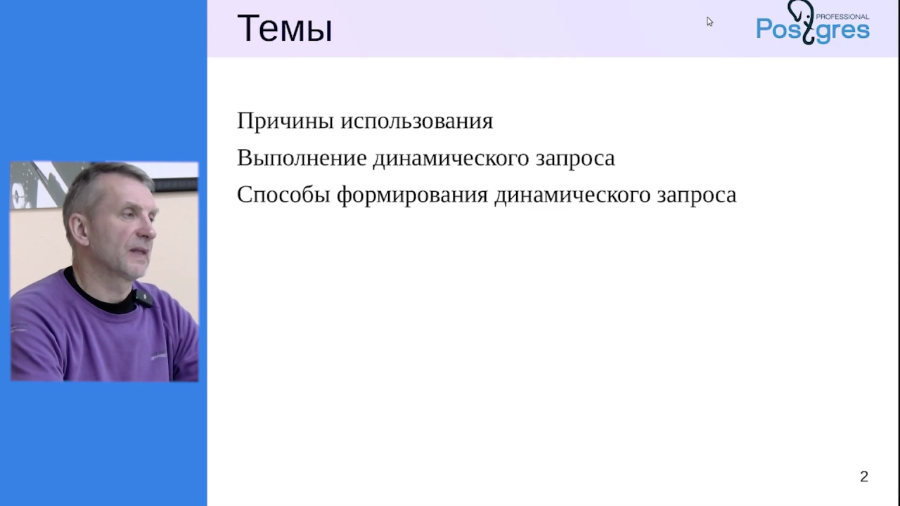
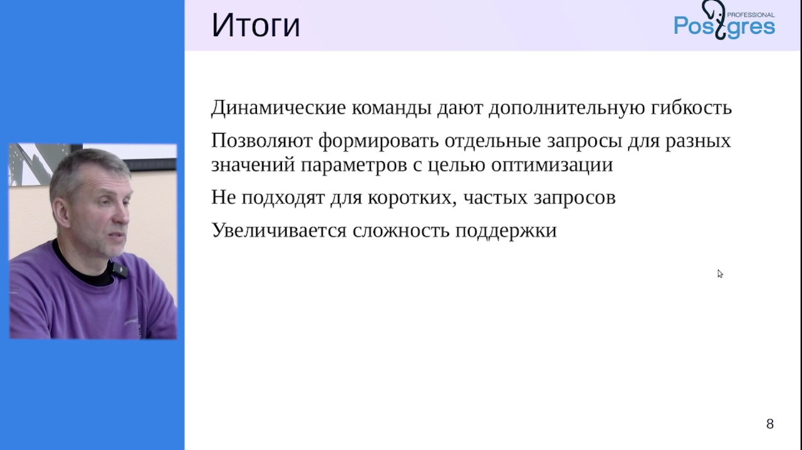
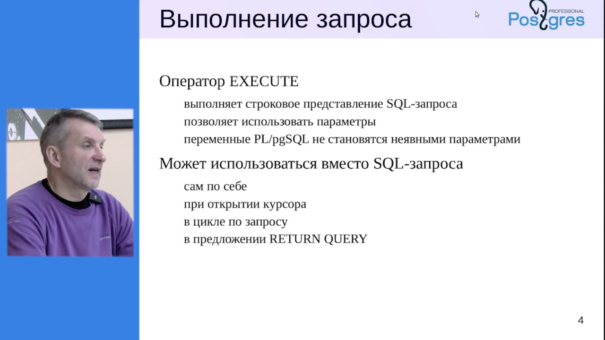
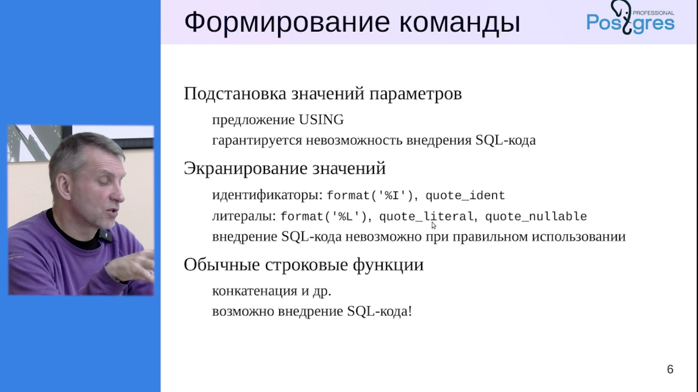
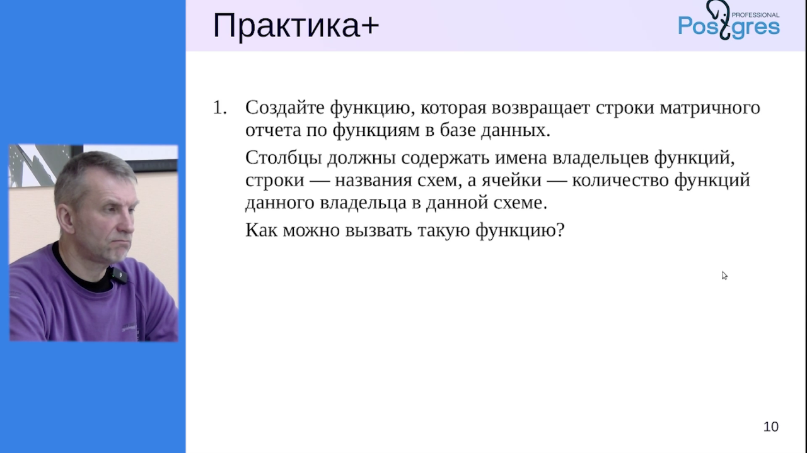
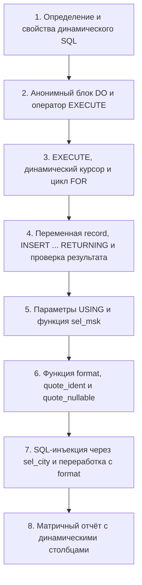

# Динамический SQL в PL/pgSQL

> [!abstract] Обзор
> Материал о динамическом SQL в PL/pgSQL: SQL-команды формируются на лету в момент выполнения. Разбираются анонимный блок DO, оператор EXECUTE, работа с переменной record, динамический INSERT ... RETURNING, проверка через GET DIAGNOSTICS и STRICT, а также обработка результата в цикле FOR и через курсор. Отдельно рассматриваются параметры через USING с плейсхолдерами $1, $2, функция sel_msk и ограничение USING для изменяющихся имён объектов. Для безопасной сборки команд показаны функция format с шаблонами %I и %L, quote_ident, quote_literal и quote_nullable, двойные кавычки против инъекции и усечение длинных идентификаторов. Также описан матричный отчёт с заранее неизвестным числом столбцов и отмечены гибкость, сложность поддержки и риск внедрения SQL-кода.

> [!info] Курс
> [[index|Оглавление курса]]

## Оглавление
1. [[#1. Определение и свойства динамического SQL]]
2. [[#2. Анонимный блок DO и оператор EXECUTE]]
3. [[#3. EXECUTE, динамический курсор и цикл FOR]]
4. [[#4. Переменная record, INSERT ... RETURNING и проверка результата]]
5. [[#5. Параметры USING и функция sel_msk]]
6. [[#6. Функция format, quote_ident и quote_nullable]]
7. [[#7. SQL-инъекция через sel_city и переработка с format]]
8. [[#8. Матричный отчёт с динамическими столбцами]]

**Схема** — [[#Схема]]
**Итог** — [[#Итог]]

## 1. Определение и свойства динамического SQL

Динамический SQL — это возможность формировать SQL-команды на лету в момент выполнения процедурного кода. Он даёт дополнительную гибкость и применяется для формирования нескольких конкретных запросов вместо одного универсального для оптимизации. Динамические команды позволяют в необходимых случаях получить дополнительную гибкость, но увеличивают сложность поддержки и не подходят для коротких, частых запросов. Запрос собирается из кусочков, поэтому его сложно найти текстовым поиском в коде; операторы не подготавливаются, возрастает риск внедрения SQL-кода и сложность сопровождения. Значения должны либо экранироваться и форматироваться, либо проверяться на ранних этапах другими способами.

*Источник: [00:00:16], [00:24:17], [00:25:37]*

> [!quote]- Кадр [00:00:16]
> 

> [!quote]- Кадр [00:25:37]
> 

## 2. Анонимный блок DO и оператор EXECUTE

Анонимный блок кода в PostgreSQL позволяет выполнять код без создания функции или процедуры и оформляется с помощью DO $$ ... $$. EXECUTE в PL/pgSQL выполняет динамический SQL, заданный в виде текстовой строки, например в переменной cmd. В примерах строка содержит команду CREATE TABLE city_msk. В анонимном блоке DO переменная cmd может быть объявлена как CONSTANT text с командой CREATE TABLE и выполнена через EXECUTE cmd. Лектор замечает, что приведённый код без параметров не содержит ничего, что заставило бы делать его динамическим в жизни.

```go
DO $$
DECLARE
    cmd CONSTANT text := 'CREATE TABLE city_msk(
        name text, architect text, founded integer
    )';
BEGIN
    EXECUTE cmd; -- таблица для исторических зданий Москвы
END
$$;

RAISE NOTICE '%', rec;
GET DIAGNOSTICS cnt := ROW_COUNT;
RAISE NOTICE 'Добавлено строк: %', cnt;
```

*Источник: [00:04:29], [00:05:23], [00:05:40], [00:06:32], [00:07:00]*

## 3. EXECUTE, динамический курсор и цикл FOR

Оператор EXECUTE выполняет строковое представление SQL-запроса, переданное в качестве параметра, и позволяет использовать параметры через предложение USING. EXECUTE можно применять сам по себе, при открытии курсора, в цикле по запросу или в предложении RETURN QUERY; переменные PL/pgSQL при этом не становятся неявными параметрами. Для обработки динамического запроса в цикле можно использовать курсор: объявить refcursor, открыть его командой OPEN cur FOR EXECUTE '...', получать строки через FETCH cur INTO rec и завершать цикл при EXIT WHEN NOT FOUND. Результат динамического запроса также можно обработать в цикле FOR: конструкция FOR rec IN EXECUTE 'SELECT ...' LOOP по очереди выводит каждую строку в переменную rec, а цикл завершается END LOOP. В примере с architect = 'Роман Клейн' вывелись две записи, которые выводятся через RAISE NOTICE.

```go
DO $$
DECLARE
    cur refcursor;
    rec record;
BEGIN
    OPEN cur FOR EXECUTE 'SELECT * FROM city_msk WHERE architect = ''Роман Клейн'' ORDER BY founded';
    LOOP
        FETCH cur INTO rec;
        EXIT WHEN NOT FOUND;
        RAISE NOTICE '%', rec;
    END LOOP;
END
$$;

OPEN cur FOR EXECUTE 'SELECT * FROM city_msk WHERE architect = ''Роман Клейн'' ORDER BY founded';
LOOP
    FETCH cur INTO rec;
    EXIT WHEN NOT FOUND;
    RAISE NOTICE '%', rec;
END LOOP;

DO $$
DECLARE
	rec record;
BEGIN
	FOR rec IN EXECUTE 'SELECT * FROM city_msk WHERE architect = ''Роман Клейн'' ORDER BY founded'
	LOOP
		RAISE NOTICE '%', rec;
	END LOOP;
END
$$;

>= CREATE FUNCTION sel_msk(architect text, founded integer DEFAULT NULL)
RETURNS SETOF text
AS $$
DECLARE
    -- параметры пронумерованы: $1, $2...
    cmd text := '
        SELECT name FROM city_msk
        WHERE architect = $1 AND ($2 IS NULL OR founded \u003c $2)';
BEGIN
    RETURN QUERY
        EXECUTE cmd
        USING architect, founded; -- указываем значения по порядку
END
$$ LANGUAGE plpgsql;

>= CREATE FUNCTION sel_msk(architect text, founded integer DEFAULT NULL)
RETURNS SETOF text
AS $$
DECLARE
    -- параметры пронумерованы: $1, $2...
    cmd text := '
        SELECT name FROM city_msk
        WHERE architect = $1 AND ($2 IS NULL OR founded \u003c $2)';
BEGIN
    RETURN QUERY
        EXECUTE cmd
        USING architect, founded; -- указываем значения по порядку
END
$$ LANGUAGE plpgsql;

>= CREATE FUNCTION sel_msk(architect text, founded integer DEFAULT NULL)
RETURNS SETOF text
AS $$
DECLARE
    -- параметры пронумерованы: $1, $2...
    cmd text := '
        SELECT name FROM city_msk
        WHERE architect = $1 AND ($2 IS NULL OR founded \u003c $2)';
BEGIN
    RETURN QUERY
        EXECUTE cmd
        USING architect, founded; -- указываем значения по порядку
END
$$ LANGUAGE plpgsql;

>= CREATE FUNCTION sel_msk(architect text, founded integer DEFAULT NULL)
RETURNS SETOF text
AS $$
DECLARE
    -- параметры пронумерованы: $1, $2...
    cmd text := '
        SELECT name FROM city_msk
        WHERE architect = $1 AND ($2 IS NULL OR founded < $2)';
BEGIN
    RETURN QUERY
        EXECUTE cmd
        USING architect, founded; -- указываем значения по порядку
END
$$ LANGUAGE plpgsql;

DO $$
DECLARE
    rec record;
BEGIN
    FOR rec IN EXECUTE 'SELECT * FROM city_msk WHERE architect = ''Роман Клейн'' ORDER BY founded'
    LOOP
        RAISE NOTICE '%', rec;
    END LOOP;
END
$$;
```

*Источник: [00:02:57], [00:08:10], [00:09:00], [00:09:20], [00:09:40]*

> [!quote]- Кадр [00:02:57]
> 

## 4. Переменная record, INSERT ... RETURNING и проверка результата

Для динамического запроса, возвращающего строки, объявляется нетипизированная переменная rec типа record. В команде EXECUTE можно дополнительно указать фразу INTO и переменную, определённую ранее: после EXECUTE 'INSERT ... RETURNING ...' INTO rec возвращённые данные сохраняются в rec. Для проверки результата выполнения динамической команды используется GET DIAGNOSTICS: после EXECUTE 'INSERT ... RETURNING ...' INTO rec команда GET DIAGNOSTICS cnt := ROW_COUNT сохраняет количество добавленных строк. Для вывода количества используется RAISE NOTICE, в примере выводится «Добавлено строк: 5». Чтобы команда обработала ровно одну строку, добавляется фраза STRICT.

```go
EXECUTE 'INSERT INTO city_msk (name, architect, founded) VALUES
        (''Пашков дом'', ''Василий Баженов'', 1784),
        (''Ансамбль Царицыно'', ''Василий Баженов'', 1776),
        (''Усадьба Туголмина'', ''Василий Баженов'', 1788),
        (''Музей Пушкина'', ''Роман Клейн'', 1898),
        (''ЦУМ'', ''Роман Клейн'', 1908)
        RETURNING name, architect, founded'
    INTO rec;

DO $$
DECLARE
    rec record;
    cnt bigint;
BEGIN
    EXECUTE 'INSERT INTO city_msk (name, architect, founded) VALUES
        (''Пашков дом'', ''Василий Баженов'', 1784),
        (''Ансамбль Царицыно'', ''Василий Баженов'', 1776),
        (''Усадьба Туполимова'', ''Василий Баженов'', 1788),
        (''Музей Пушкина'', ''Роман Клейн'', 1898),
        (''ЦУМ'', ''Роман Клейн'', 1908)
        RETURNING name, architect, founded'
    INTO rec;
    RAISE NOTICE '%', rec;
    GET DIAGNOSTICS cnt := ROW_COUNT;
    RAISE NOTICE 'Добавлено строк: %', cnt;
END
$$;
```

*Источник: [00:06:00], [00:06:32], [00:07:00], [00:07:20], [00:07:50], [00:08:10]*

## 5. Параметры USING и функция sel_msk

В динамических запросах PL/pgSQL параметры обозначаются плейсхолдерами $1, $2; значения передаются через предложение USING в порядке следования, и один и тот же параметр может использоваться в запросе несколько раз. Переменные PL/pgSQL при использовании EXECUTE не становятся неявными параметрами. Функция sel_msk читает таблицу City MSK и делает выборку зданий по архитекторам с ограничениями; она принимает имя архитектора и необязательный год. В plpgsql команда может быть помещена в строковую переменную cmd, а при выполнении через EXECUTE значения параметров передаются с помощью USING по порядку; параметр со значением по умолчанию (DEFAULT NULL) позволяет не передавать его при вызове. Условие ($2 IS NULL OR founded < $2) фильтрует строки только при указании значения, а RETURN QUERY в PL/pgSQL может использовать динамические запросы через RETURN QUERY EXECUTE cmd USING architect, founded.

```go
CREATE FUNCTION sel_msk(architect text, founded integer DEFAULT NULL)
RETURNS SETOF text
AS $$
DECLARE
    -- параметры пронумерованы: $1, $2...
    cmd text := '
        SELECT name FROM city_msk
        WHERE architect = $1 AND ($2 IS NULL OR founded < $2)';
BEGIN
    RETURN QUERY
        EXECUTE cmd
        USING architect, founded; -- указываем значения по порядку
END
$$ LANGUAGE plpgsql;

=> SELECT * FROM sel_msk('Роман Клейн');
    sel_msk
-----------
Музей Пушкина
ЦУМ
(2 rows)

=> SELECT * FROM sel_msk('Роман Клейн', 1905);  -- до событий на Красной Пресне
    sel_msk
-----------
Музей Пушкина
(1 row)
```

*Источник: [00:02:57], [00:09:40], [00:10:05], [00:11:16], [00:11:36], [00:14:21]*


## 6. Функция format, quote_ident и quote_nullable

Функция format подставляет аргументы в шаблон, содержащий маркеры %I и %L. Шаблон %I форматирует строку как идентификатор и забирает её в правильные двойные кавычки, а %L экранирует литерал; для безопасного формирования SQL-запросов format применяется, когда USING не подходит для изменяющихся имён объектов. USING предназначено для подстановки значений параметров и не подходит для изменяющихся имён объектов, в том числе имён таблиц; в DO-блоке шаблон CREATE TABLE с плейсхолдером %I позволяет через format(cmd, 'city_spb') и format(cmd, 'city_nov') создавать таблицы для Санкт-Петербурга и Новгорода. Функция quote_ident выполняет такое же экранирование идентификаторов, как format('%I'), включая идентификаторы с пробелами и кавычками. Для литералов можно использовать format('%L', ...) или quote_nullable; format('%L', NULL) возвращает NULL, quote_nullable превращает NULL в литерал, а quote_literal, поданная на вход NULL, возвращает NULL.

```go
DO $$
DECLARE
    cmd CONSTANT text := 'CREATE TABLE %I(
        name text, architect text, founded integer
    )';
BEGIN
    EXECUTE format(cmd, 'city_spb'); -- таблица для Санкт-Петербурга
    EXECUTE format(cmd, 'city_nov'); -- таблица для Новгорода
END
$$;

SELECT format('%I', 'foo'),
       format('%I', 'foo bar'),
       format('%I', 'foo"bar');

SELECT format('%L', 'foo bar'),
       format('%L', 'foo''bar'),
       format('%L', NULL);

SELECT quote_ident('foo'),
       quote_ident('foo bar'),
       quote_ident('foo"bar');

SELECT quote_nullable('foo bar'),
           quote_nullable('foo''bar'),
           quote_nullable(NULL);

SELECT quote_literal(NULL);

SELECT format('%I', 'foo'),
       format('%I', 'foo bar'),
       format('%I', 'foo"bar');

SELECT format('%L', 'foo bar'),
       format('%L', 'foo''bar'),
       format('%L', NULL);

DECLARE
    cmd text := '
SELECT name FROM %I
WHERE architect = %L AND (%L IS NULL OR founded < %L::integer)';
BEGIN
    RETURN QUERY EXECUTE format(
        cmd, 'city_'||city_code, architect, founded, founded
    );
END

=> SELECT format('%I', 'foo'),
           format('%I', 'foo bar'),
           format('%I', 'foo"bar');

>= CREATE FUNCTION sel_city(
    city_code text,
    architect text,
    founded integer DEFAULT NULL
  )
  RETURNS SETOF text AS $$
  DECLARE
    cmd text := '
      SELECT name FROM city_' || city_code || '
      WHERE architect = $1 AND ($2 IS NULL OR founded < $2)';
  BEGIN
    RAISE NOTICE '%', cmd;
    RETURN QUERY
      EXECUTE cmd
      USING architect, founded;
  END
  $$ LANGUAGE plpgsql;

CREATE OR REPLACE FUNCTION sel_city(
    city_code text,
    architect text,
    founded integer DEFAULT NULL
)
RETURNS SETOF text
AS $$
DECLARE
    cmd text := '
        SELECT name FROM %I
        WHERE architect = %L AND (%L IS NULL OR founded < %L::integer)';
BEGIN
    RETURN QUERY EXECUTE format(
        cmd, 'city' || city_code, architect, founded, founded
    );
END
$$ LANGUAGE plpgsql;

>= CREATE FUNCTION sel_city(
    city_code text,
    architect text,
    founded integer DEFAULT NULL
  )
  RETURNS SETOF text AS $$
  DECLARE
    cmd text := '
      SELECT name FROM city_' || city_code || '
      WHERE architect = $1 AND ($2 IS NULL OR founded \u003c $2)';
  BEGIN
    RAISE NOTICE '%', cmd;
    RETURN QUERY
      EXECUTE cmd
      USING architect, founded;
  END
  $$ LANGUAGE plpgsql;

CREATE FUNCTION sel_city(
    city_code text,
    architect text,
    founded integer DEFAULT NULL
  )
  RETURNS SETOF text AS $$
  DECLARE
    cmd text := '
      SELECT name FROM city_' || city_code || '
      WHERE architect = $1 AND ($2 IS NULL OR founded < $2)';
  BEGIN
    RAISE NOTICE '%', cmd;
    RETURN QUERY
      EXECUTE cmd
      USING architect, founded;
  END
  $$ LANGUAGE plpgsql;

DECLARE
    cmd text := '
                SELECT name FROM city_' || city_code || '
                WHERE architect = $1 AND ($2 IS NULL OR founded < $2)';
BEGIN
    RAISE NOTICE '%', cmd;
    RETURN QUERY
        EXECUTE cmd
        USING architect, founded;
END
$$ LANGUAGE plpgsql;

SELECT quote_ident('foo'),
       quote_ident('foo bar'),
       quote_ident('foo"bar');

=> SELECT quote_ident('foo'),
           quote_ident('foo bar'),
           quote_ident('foo"bar');

>= DO $$
DECLARE
    cmd CONSTANT text := 'CREATE TABLE %I(
       name text, architect text, founded integer
    )';
BEGIN
    EXECUTE format(cmd, 'city_spb'); -- таблица для Санкт-Петербурга
    EXECUTE format(cmd, 'city_nov'); -- таблица для Новгорода
END
$$;

SELECT format('%L', 'foo bar'),
         format('%L', 'foo''bar'),
         format('%L', NULL);

SELECT quote_nullable('foo bar'),
           quote_nullable('foo''bar'),
           quote_nullable(NULL);

SELECT quote_literal(NULL);

=> SELECT format('%L', 'foo bar'),
         format('%L', 'foo''bar'),
         format('%L', NULL);

=> SELECT quote_nullable('foo bar'),
           quote_nullable('foo''bar'),
           quote_nullable(NULL);

=> SELECT quote_literal(NULL);

>= SELECT * FROM sel_city('msk WHERE false
        UNION ALL
       SELECT username FROM pg_user
       UNION ALL
       SELECT name FROM city_msk', '');

NOTICE:
        SELECT name FROM city_msk WHERE false
       UNION ALL
       SELECT username FROM pg_user
       UNION ALL
       SELECT name FROM city_msk
       WHERE architect = $1 AND ($2 IS NULL OR founded < $2)
sel_city
----------------
student
postgres
(2 rows)

>= SELECT * FROM sel_city('msk WHERE false
        UNION ALL
       SELECT username FROM pg_user
       UNION ALL
       SELECT name FROM city_msk', '');

NOTICE:
        SELECT name FROM city_msk WHERE false
       UNION ALL
       SELECT username FROM pg_user
       UNION ALL
       SELECT name FROM city_msk
       WHERE architect = $1 AND ($2 IS NULL OR founded < $2)
sel_city
----------------
student
postgres
(2 rows)

SELECT * FROM sel_city('msk WHERE false
        UNION ALL
        SELECT username FROM pg_user
        UNION ALL
        SELECT name FROM city_msk', '');

>= SELECT * FROM sel_city('msk WHERE false
        UNION ALL
       SELECT username FROM pg_user
       UNION ALL
       SELECT name FROM city_msk', '');

NOTICE:
        SELECT name FROM city_msk WHERE false
       UNION ALL
       SELECT username FROM pg_user
       UNION ALL
       SELECT name FROM city_msk
       WHERE architect = $1 AND ($2 IS NULL OR founded \u003c $2)
sel_city
----------------
student
postgres
(2 rows)

>= SELECT * FROM sel_city('msk WHERE false
        UNION ALL
       SELECT username FROM pg_user
       UNION ALL
       SELECT name FROM city_msk', '');

NOTICE:
        SELECT name FROM city_msk WHERE false
       UNION ALL
       SELECT username FROM pg_user
       UNION ALL
       SELECT name FROM city_msk
       WHERE architect = $1 AND ($2 IS NULL OR founded < $2)
sel_city
----------------
student
postgres
(2 rows)

cmd text := '
    SELECT name FROM %I
    WHERE architect = %L AND (%L IS NULL OR founded < %L::integer)';
BEGIN
  RETURN QUERY EXECUTE format(
    cmd, 'city_'||city_code, architect, founded, founded
  );
END

CREATE OR REPLACE FUNCTION sel_city(
    city_code text,
    architect text,
    founded integer DEFAULT NULL
)
RETURNS SETOF text
AS $$
DECLARE
    cmd text := '
        SELECT name FROM %I
        WHERE architect = %L AND (%L IS NULL OR founded < %L::integer)';
BEGIN
    RETURN QUERY EXECUTE format(
        cmd, 'city' || city_code, architect, founded, founded
    );
END
$$ LANGUAGE plpgsql;

cmd text := '
    SELECT name FROM %I
    WHERE architect = %L AND (%L IS NULL OR founded < %L::integer)';
BEGIN
  RETURN QUERY EXECUTE format(
    cmd, 'city_'||city_code, architect, founded, founded
  );
END

cmd text := '
    SELECT name FROM %I
    WHERE architect = %L AND (%L IS NULL OR founded \u003c %L::integer)';
BEGIN
  RETURN QUERY EXECUTE format(
    cmd, 'city_'||city_code, architect, founded, founded
  );
END

CREATE OR REPLACE FUNCTION sel_city(
    city_code text,
    architect text,
    founded integer DEFAULT NULL
)
RETURNS SETOF text
AS $$
DECLARE
    cmd text := '
        SELECT name FROM %I
        WHERE architect = %L AND (%L IS NULL OR founded \u003c %L::integer)';
BEGIN
    RETURN QUERY EXECUTE format(
        cmd, 'city' || city_code, architect, founded, founded
    );
END
$$ LANGUAGE plpgsql;

cmd text := '
    SELECT name FROM %I
    WHERE architect = %L AND (%L IS NULL OR founded < %L::integer)';
BEGIN
  RETURN QUERY EXECUTE format(
    cmd, 'city_'||city_code, architect, founded, founded
  );
END
```

| шаблон | назначение |
|---|---|
| %I | форматирует строку как идентификатор, забирает в двойные кавычки |
| %L | экранирует литерал |

> [!info] Зачем это нужно
> Для безопасного формирования SQL-запросов.

*Источник: [00:11:56], [00:15:03], [00:15:23], [00:15:43], [00:16:33], [00:18:31] и др.*

> [!quote]- Кадр [00:11:56]
> 

## 7. SQL-инъекция через sel_city и переработка с format

При передаче в параметр (например, в функцию sel_city) вместо кода города произвольной строки она попадает в текст SQL-команды, что позволяет внедрить чужой SQL. В PL/pgSQL запрос собирается конкатенацией: 'SELECT name FROM city_' || city_code. Пример внедрения — строка 'msk WHERE false UNION ALL SELECT username FROM pg_user UNION ALL SELECT name FROM city_msk' вклеивается в формируемый запрос; в результате через UNION ALL SELECT username FROM pg_user выводятся имена пользователей student и postgres. Двойные кавычки в динамическом SQL заставляют Postgres воспринимать вставленный код как единый идентификатор; двойные кавычки защищают от инъекции. В переработанной версии sel_city текст команды формируется с использованием %I для имени таблицы и %L для литералов, а подстановка значений выполняется через RETURN QUERY EXECUTE format; функция объявлена как RETURNS SETOF text.

```go
>= SELECT * FROM sel_city('msk WHERE false
        UNION ALL
       SELECT username FROM pg_user
       UNION ALL
       SELECT name FROM city_msk', '');

NOTICE:
        SELECT name FROM city_msk WHERE false
       UNION ALL
       SELECT username FROM pg_user
       UNION ALL
       SELECT name FROM city_msk
       WHERE architect = $1 AND ($2 IS NULL OR founded < $2)
sel_city
----------------
student
postgres
(2 rows)

CREATE OR REPLACE FUNCTION sel_city(
    city_code text,
    architect text,
    founded integer DEFAULT NULL
)
RETURNS SETOF text
AS $$
DECLARE
    cmd text := '
        SELECT name FROM %I
        WHERE architect = %L AND (%L IS NULL OR founded < %L::integer)';
BEGIN
    RETURN QUERY EXECUTE format(
        cmd, 'city' || city_code, architect, founded, founded
    );
END
$$ LANGUAGE plpgsql;
```

*Источник: [00:15:43], [00:16:33], [00:17:31], [00:17:51], [00:18:31], [00:23:37] и др.*

## 8. Матричный отчёт с динамическими столбцами

Отчёт показывает наличие функций в базе данных: по столбцам располагаются имена владельцев функций, по строкам — названия схем, в ячейках — количество функций данного владельца в данной схеме. Количество столбцов отчёта зависит от числа имеющихся пользователей: сколько пользователей в наличии, столько получится и столбцов. Запрос может иметь заранее неизвестное количество столбцов, и эту неизвестность можно преодолеть, формируя запрос на ходу.

*Источник: [00:26:47]*

> [!quote]- Кадр [00:26:47]
> 

## Схема



## Итог

> [!success] Что в итоге
> Динамический SQL формирует команды на лету в момент выполнения, что даёт гибкость, но повышает риск внедрения SQL-кода и сложность сопровождения. В анонимном блоке DO команды выполняет EXECUTE; результат помещается в переменную record и проверяется через GET DIAGNOSTICS, а для ровно одной строки добавляется STRICT. Динамический запрос обрабатывается в цикле FOR или через курсор. Для безопасной сборки команд служат параметры через USING, шаблоны %I и %L функции format и двойные кавычки; динамические команды также применяются в матричном отчёте с заранее неизвестным числом столбцов.

