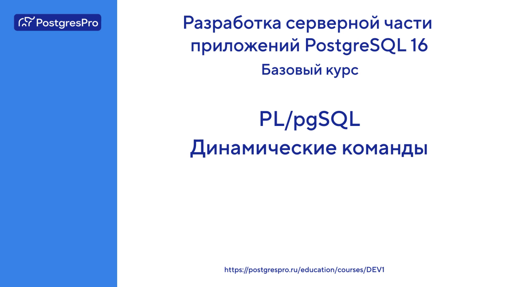
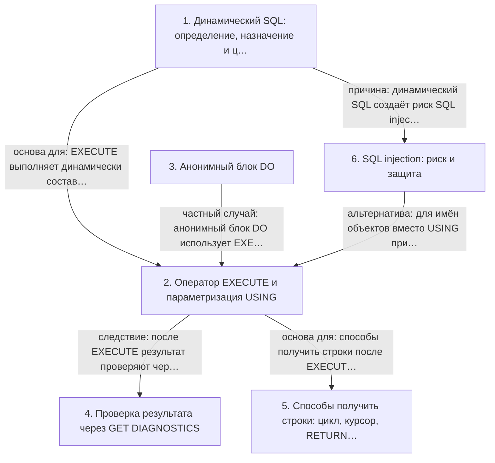

# Динамический SQL в PL/pgSQL: гибкость и безопасность

> [!abstract] Обзор
> Материал посвящён динамическому SQL в PL/pgSQL: определению, назначению и цене динамических команд, а также выполнению через EXECUTE с параметрами USING и получению результатов. Разбираются анонимные блоки DO, проверка результата через GET DIAGNOSTICS, способы получить строки (цикл, курсор, RETURN QUERY). Отдельное внимание уделено риску SQL injection и защите: использованию format с %I и %L, quote_ident, quote_nullable, экранированию апострофов и безопасной переработке функции выборки с защитой двойной кавычкой. Показывается, что USING не подходит для имён объектов, поэтому применяют конкатенацию, а правильное форматирование защищает от внедрения кода.

> [!info] Курс
> [[index|Оглавление курса]]

## Оглавление
1. [[#1. Динамический SQL: определение, назначение и цена]]
2. [[#2. Оператор EXECUTE и параметризация USING]]
3. [[#3. Анонимный блок DO]]
4. [[#4. Проверка результата через GET DIAGNOSTICS]]
5. [[#5. Способы получить строки: цикл, курсор, RETURN QUERY]]
6. [[#6. SQL injection: риск и защита]]

**Схема** — [[#Схема]]
**Итог** — [[#Итог]]

## 1. Динамический SQL: определение, назначение и цена

Динамический SQL — это возможность формировать SQL-команды на лету в момент выполнения процедурного кода, что даёт гибкость и позволяет обойтись без него в некоторых ситуациях. Он позволяет конструировать запрос под конкретную ситуацию вместо одного громадного сложного запроса с фильтрацией результатов на клиенте, а также избавляет от множества типовых сходных запросов и разветвлений в процедурном коде, используя, например, настройки приложения. Значения, из которых собирается динамический код, должны проверяться на ранних этапах, экранироваться и форматироваться. Цена: динамически выполняемые операторы не подготавливаются и не оптимизируются, а сложность сопровождения продукта возрастает.

*Источник: [00:00:04], [00:00:10]*

> [!quote]- Кадр [00:00:10]
> 

> [!quote]- Кадр [00:00:04]
> 

## 2. Оператор EXECUTE и параметризация USING

Оператор EXECUTE принимает заранее составленную строку с SQL-запросом и выполняет её. Параметры можно передавать через конструкцию USING со списком параметров; локальные переменные PL/pgSQL не становятся неявными параметрами, а один параметр может использоваться в команде несколько раз. EXECUTE можно использовать самостоятельно, встраивать в цикл по запросу, применять в курсорах и в предложении RETURN QUERY. Не всё в запросе можно параметризовать: USING нельзя применять для имён объектов, в частности для изменяющихся имён таблиц, привязанных к дате. Чтобы вставить такое имя таблицы или собрать текст запроса с такими именами, используют конкатенацию строк.

> [!info] Зачем это нужно
> Чтобы вставить изменяющееся имя таблицы или собрать текст запроса с такими именами.

*Источник: [00:00:04]*


## 3. Анонимный блок DO

В PL/pgSQL не обязательно писать функции или процедуры — можно использовать анонимный блок кода. Текст запроса задаётся в текстовой строке, например cmd, без параметров. Здесь анонимный блок DO $$ объявляет переменную cmd со SQL-строкой CREATE TABLE city_msk и выполняет её через EXECUTE cmd.

```go
DO $$
DECLARE
    cmd CONSTANT text := 'CREATE TABLE city_msk(
        name text, architect text, founded integer
    )';
BEGIN
    EXECUTE cmd; -- таблица для исторических зданий Москвы
END
$$;
```

*Источник: [00:00:04], [00:06:40]*


## 4. Проверка результата через GET DIAGNOSTICS

Для проверки результата выполнения динамической команды можно использовать GET DIAGNOSTICS, чтобы вытащить, например, число строк, которое эта команда затронула.

```go
DO $$
DECLARE
    rec record;
    cnt bigint;
BEGIN
    EXECUTE 'INSERT INTO city_msk (name, architect, founded) VALUES
        (''Пашков дом'', ''Василий Баженов'', 1784),
        (''Ансамбль Царицыно'', ''Василий Баженов'', 1776),
        (''Усадьба Тутолмина'', ''Василий Баженов'', 1788),
        (''Музей Пушкина'', ''Роман Клейн'', 1898),
        (''ЦУМ'', ''Роман Клейн'', 1908)
        RETURNING name, architect, founded'
    INTO rec;
    RAISE NOTICE '%', rec;
    GET DIAGNOSTICS cnt := ROW_COUNT;
    RAISE NOTICE 'Добавлено строк: %', cnt;
END
$$;
```

*Источник: [00:00:04], [00:06:40]*


## 5. Способы получить строки: цикл, курсор, RETURN QUERY

В анонимном блоке объявляется нетипизированная переменная-запись (record), затем в цикле выполняется динамический запрос через execute, и каждая полученная строка по очереди выводится в эту переменную. Для получения нескольких строк также описывают курсорную переменную, открывают курсор (в нём фигурирует динамический запрос) и в цикле вычитывают из курсора записи. Динамический запрос может возвращать одну или несколько строк с помощью RETURN QUERY; это аналогично табличным функциям на PL/pgSQL. В команде EXECUTE можно указать фразу INTO и переменную, в которую выведутся результаты динамического запроса.

*Источник: [00:00:04]*


## 6. SQL injection: риск и защита

Использование динамических команд создаёт риск внедрения SQL-кода (SQL injection): при конкатенации пользовательский ввод может изменить структуру запроса, добавив UNION или обратившись к системному каталогу pg_user. Для защиты динамическую команду формируют правильными приёмами: функция format с плейсхолдером %I забирает идентификатор в двойные кавычки, а %L экранирует литералы в одинарные апострофы; также применяют quote_ident (экранирует двойные кавычки) и quote_nullable. Безопасная переработка функции выборки использует format с шаблоном, который конкатенируется с внешним значением, и двойная кавычка не даёт постороннему фрагменту кода пройти.

> [!info] Зачем это нужно
> Чтобы не дать злоумышленнику пробиться к данным и чтобы посторонний фрагмент кода не прошёл.

*Источник: [00:00:04], [00:00:10]*


## Схема



## Итог

> [!success] Что в итоге
> Динамические команды в PL/pgSQL дают гибкость, но не подготавливаются, не оптимизируются и повышают сложность сопровождения. Выполняются они через EXECUTE; параметры можно передавать через USING, но не для имён объектов, поэтому имена подставляют через конкатенацию с экранированием. Результат можно получить в переменную, через цикл, курсор, RETURN QUERY и проверить через GET DIAGNOSTICS. Для защиты от SQL injection применяют format с %I и %L, quote_ident, quote_nullable и экранирование апострофов.

