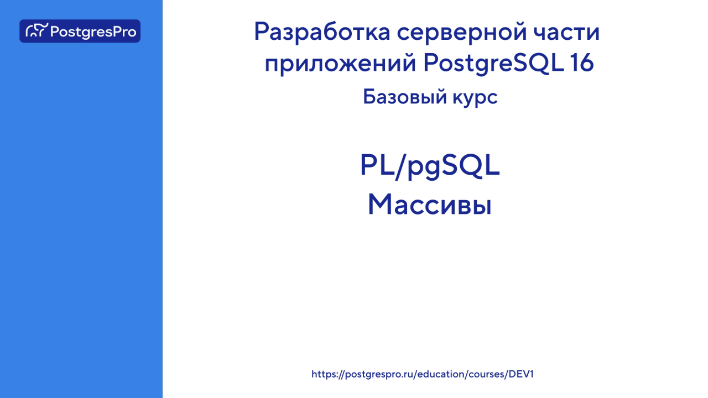
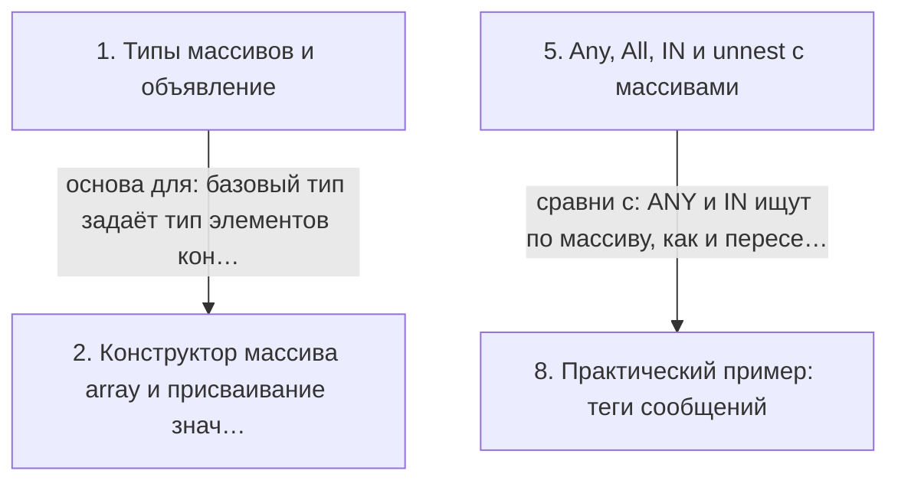

# Массивы в PostgreSQL и PL/pgSQL

> [!abstract] Обзор
> Материал о массивах в PostgreSQL 16 и PL/pgSQL — от объявления типа до практического применения. Разбирается, как задаётся тип массива, как Postgres автоматически строит типы массивов, как инициализировать элементы через array, присваивать их и обходить циклами по индексам и через FOR EACH. Отдельно показаны многомерные массивы, срезы и хранение массивов, в том числе уход в TOAST-таблицу. Связь массивов с подзапросами раскрывается через Any, All, IN и unnest, а также через VARIADIC и полиморфные типы. Практический пример — хранение тегов сообщений массивом против традиционного подхода с тремя таблицами, поиск тега через пересечение и вхождение, ограничения массивов, а также функции addBook, map и reduce.

> [!info] Курс
> [[index|Оглавление курса]]

## Оглавление
1. [[#1. Типы массивов и объявление]]
2. [[#2. Конструктор массива array и присваивание значений]]
3. [[#3. Хранение массивов и срезы]]
4. [[#4. Обход массивов циклами]]
5. [[#5. Any, All, IN и unnest с массивами]]
6. [[#6. VARIADIC и функции с переменным числом параметров]]
7. [[#7. Полиморфные типы и OUT-параметр]]
8. [[#8. Практический пример: теги сообщений]]
9. [[#9. Функция addBook с массивом]]
10. [[#10. Функции map и reduce на PL/pgSQL]]

**Схема** — [[#Схема]]
**Итог** — [[#Итог]]

## 1. Типы массивов и объявление

Массив — это набор элементов с одним и тем же типом данных, доступ к которым осуществляется по целочисленному индексу, а не по именам. В PL/pgSQL и SQL поддерживаются одномерные и многомерные массивы; срез двумерного массива — это строка, то есть одномерный массив, а двумерные массивы в PL/pgSQL — некая экзотика. Можно объявить переменную, которая является массивом, где каждый элемент — составной тип, например currency. Для использования типа массива не нужно явно его определять: достаточно взять базовый тип и добавить к нему квадратные скобки; при объявлении переменной-массива целых чисел размерность в квадратных скобках игнорируется. При создании любого типа данных, таблицы или представления автоматически создаётся одноимённый тип данных, и Postgres сразу создаёт для него тип массива с именем из подчёркивания и имени базового типа, например _int4 — массив целых чисел.

*Источник: [00:00:04]*

> [!quote]- Кадр [00:00:04]
> 

## 2. Конструктор массива array и присваивание значений

Конструкция array в квадратных скобках с перечислением элементов — это конструктор массива, который подставляет заданные значения. Массив можно инициализировать через array с квадратными скобками или через строковый литерал с фигурными скобками, и оба способа работают одинаково; массив можно сформировать из подзапроса конструкцией ARRAY(...) с круглыми скобками, при этом подзапрос внутри должен возвращать только один столбец. Можно присваивать значения отдельным элементам массива, в том числе расширять массив; если элементы пропущены, они заполняются NULL, и в массиве тоже могут быть NULL. Нельзя присвоить значение элементу, который выходит за рамки массива: это приводит к ошибке при выходе за границы массива.

*Источник: [00:00:04]*

## 3. Хранение массивов и срезы

Массив хранится внутри обычной строки, пока туда помещается, а если перестаёт помещаться — уходит в TOAST-таблицу, как обычно; с точки зрения хранения массив — это просто последовательность байтов. Можно брать срезы массивов — слайсы; срез массива — это кусочек массива, например, со второго по третий элемент. Срезом можно присваивать значения.

*Источник: [00:00:04]*

## 4. Обход массивов циклами

Функции array_lower и array_upper возвращают младший и старший индексы массива; с их помощью можно организовать обычный целочисленный цикл и обращаться к элементам по индексу. При переборе строк в цикле переменная цикла должна быть определена как массив. Двумерный или многомерный массив после инициализации нельзя расширять; он представляется как массив массивов, для него внешний цикл идёт по строкам (индекс 1), а вложенный — по столбцам (индекс 2). В PL/pgSQL для перебора всех элементов массива без использования индекса есть специальный цикл FOR EACH: нужно объявить переменную цикла и написать FOR EACH x IN array LOOP, тогда в x по очереди будут все элементы. При использовании FOR EACH вложенный цикл не нужен: FOR EACH перебирает элементы двумерного массива так же, как одномерного, а при переборе двумерного массива FOR EACH x с slice1 можно перебирать по строчкам, и значение x равно строке массива.

*Источник: [00:00:04]*

## 5. Any, All, IN и unnest с массивами

Массивы в некотором смысле взаимозаменяемы с подзапросами: конструкции Any и All, которые работают с подзапросами, могут работать и с массивами. Условие ID = ANY(массив) позволяет передать один параметр-массив вместо множества отдельных параметров: вместо подготовленного оператора с сотней параметров достаточно одного параметра. Конструкция IN со списком значений внутри Postgres превращается в поиск по массиву — это можно увидеть в плане запроса через explain. Функция unnest принимает массив и возвращает таблицу с элементами этого массива, то есть разворачивает массивы; после разворачивания можно выбрать уникальные значения, а при большом числе строк это становится тяжёлой конструкцией.

*Источник: [00:00:04]*

## 6. VARIADIC и функции с переменным числом параметров

Последний параметр подпрограммы объявляется с типом массива базового типа, и всё, что допишут в конце, сворачивается в массив и передаётся в подпрограмму как массив значений. Массив позволяет создавать функции с переменным числом параметров: функция максимум создаётся с одним параметром типа массив целых чисел и ключевым словом VARIADIC, для поиска максимума устраивается цикл по массиву, а текущий максимум обновляется, если найдено значение больше текущего. Стандартная функция greatest принимает любое число значений, а написанная конструкция является практически полным аналогом greatest и работает с целыми и вещественными числами.

*Источник: [00:00:04]*

## 7. Полиморфные типы и OUT-параметр

Для полиморфных подпрограмм в PL/pgSQL создаются псевдотипы: any array соответствует любому массиву, any non array — любому значению, не являющемуся массивом; также есть пара AnyCompatibleArray и AnyCompatibleNonArray. Полиморфные типы anyArray и anyElement взаимосвязаны: если anyElement принимает тип integer, то anyArray будет массивом целых чисел, аналогично взаимосвязаны anyCompatibleArray и anyCompatible. Полиморфные типы (anyarray, anyelement) можно использовать только в заголовке функции: при вызове они заменяются на реальные типы, и внутри тела функции работают уже с реальными типами. Чтобы объявить переменную того же типа, что и входной массив, её объявляют как OUT-параметр; тогда в заголовке можно использовать any compatible, и переменная автоматически примет тип переданного массива.

*Источник: [00:00:04]*

## 8. Практический пример: теги сообщений

Теги сообщения можно хранить в виде массива в основной таблице — столбец tags типа массив текстовых строк, и тогда отдельная таблица тегов и промежуточная таблица удаляются; хранение тегов массивом компактно и не требует соединений таблиц. Альтернативный традиционный подход создаёт отдельную таблицу сообщений (идентификатор и текст), отдельную таблицу тегов (идентификатор и имя тега) и промежуточную таблицу для связи многие ко многим. Чтобы вывести сообщение и все его теги, нужно соединить все три таблицы по равенству ID с группировкой по сообщениям и агрегатной функцией REGG, собирающей имена тегов в массив. В Postgres оператор && находит пересечение массивов: чтобы найти тег, берут массив тегов и массив из одного искомого элемента, проверяют пересечение — такую операцию можно проиндексировать специальным индексом; также для поиска можно использовать операцию вхождения элемента в массив. При усложнении сценария массивы становятся скованными рамками: для даты добавления тега приходится создавать составной тип и массив из них, а для списка идентификаторов нельзя воспользоваться внешним ключом, поэтому при сомнениях используйте обычный способ с несколькими таблицами.

*Источник: [00:00:04]*

## 9. Функция addBook с массивом

Функция addBook предназначена для добавления новой книжки и принимает два параметра: название книги и массив идентификаторов авторов. Она возвращает идентификатор новой книжки. Массив используется, потому что у книги может быть несколько авторов.

*Источник: [00:00:04]*

## 10. Функции map и reduce на PL/pgSQL

Функция map принимает массив и другую функцию, применяет эту функцию к каждому элементу массива и получает новый массив, то есть отображает один массив в другой. Функция reduce или fold сворачивает массив к одному значению: она принимает массив и функцию, которая принимает два аргумента, а возвращает один. Если в SQL нет нужной операции, можно воспользоваться возможностями языка и написать удобную функцию. PL/pgSQL не функциональный язык, и функцию внутри функции передать нельзя; можно использовать динамические команды и передать название функции как строку, а такие функции можно сделать полиморфными.

*Источник: [00:00:04]*

## Схема

## Итог

> [!success] Что в итоге
> Массивы в PostgreSQL — полнофункциональный тип данных: их тип задаётся базовым типом с квадратными скобками, а Postgres автоматически создаёт типы массивов вроде _int4. Элементы инициализируются через array, обходятся циклами по индексам или FOR EACH, срезы позволяют брать и присваивать куски массива. Массивы связывают работу с подзапросами (Any, All, IN) и позволяют делать функции с переменным числом параметров через VARIADIC и псевдотипы. На практике хранение тегов массивом компактно, но при усложнении сценария массивы становятся скованными рамками, поэтому при сомнениях рекомендуют обычный способ с несколькими таблицами.

