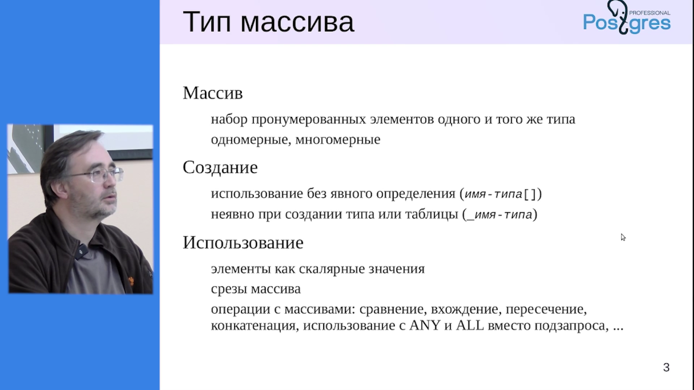
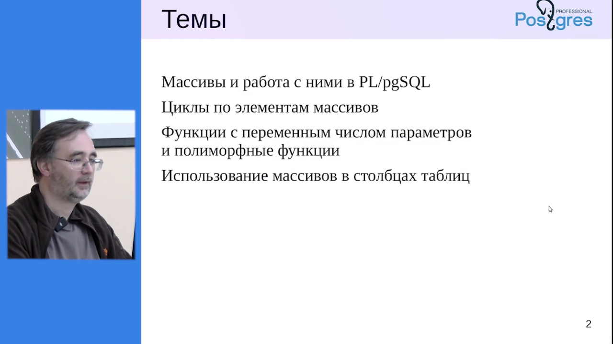
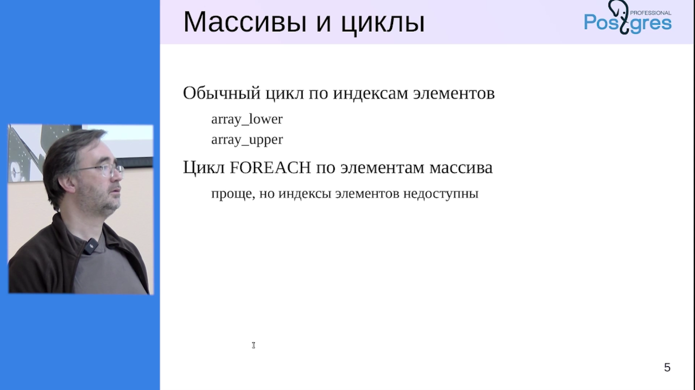
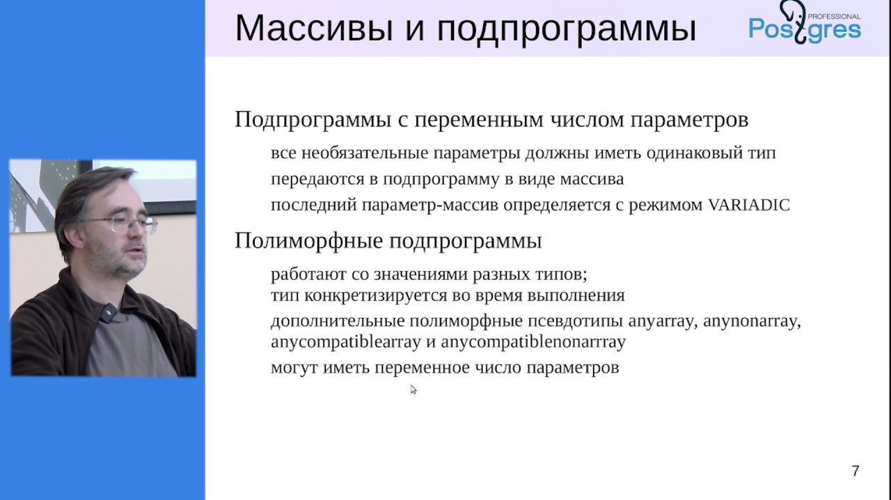
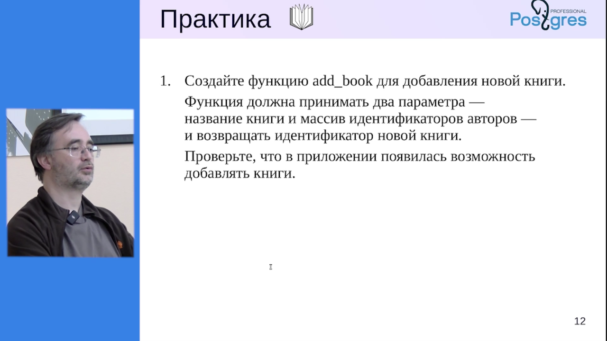
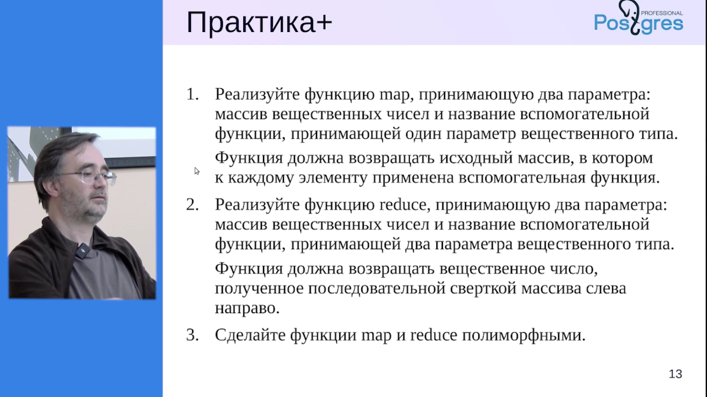
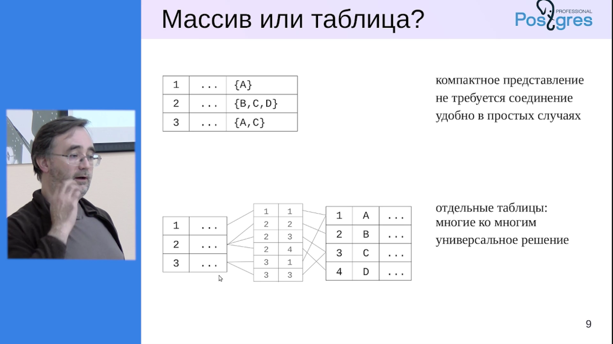
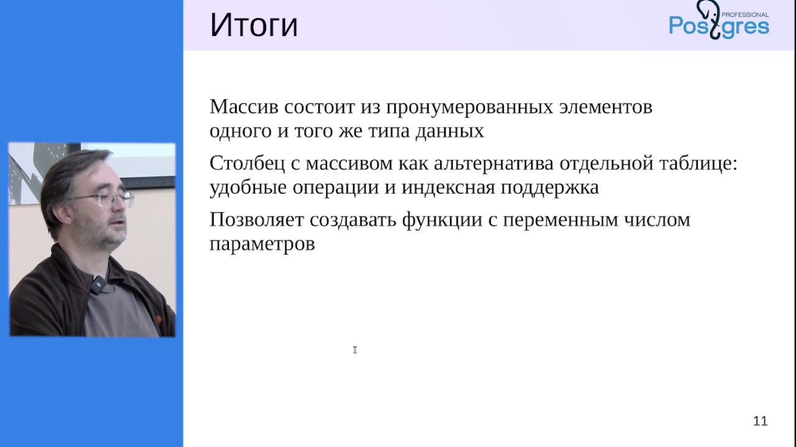
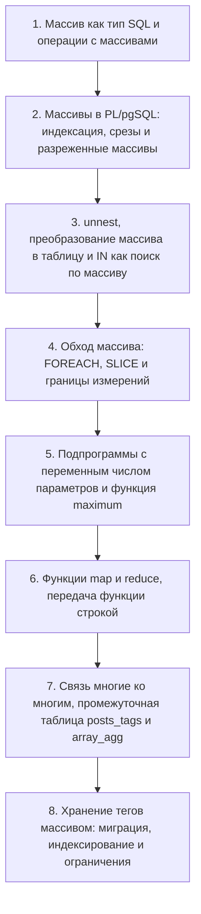

# Массивы в PostgreSQL и связи многие ко многим

> [!abstract] Обзор
> Материал охватывает тип массива в PostgreSQL и работу с ним в PL/pgSQL, а также организацию связей многие ко многим. Разобраны создание типа массива, конструктор ARRAY, сбор из подзапроса, срезы и невозможность расширения массива, разреженные массивы и массивы составного типа, обход через FOREACH и по границам измерений. Отдельно рассмотрены unnest, представление IN как = ANY и передача массива одним параметром. На примере функции maximum показаны подпрограммы с переменным числом параметров (VARIADIC), полиморфные псевдотипы и %TYPE, что делает её аналогом greatest. В части про связи показано, как промежуточная таблица реализует многие ко многим, а столбец-массив служит компактной альтернативой; теги собираются через array_agg, уникальные значения извлекаются через unnest, а map и reduce преобразуют элементы и сворачивают массив к одному значению.

> [!info] Курс
> [[index|Оглавление курса]]

## Оглавление
1. [[#1. Массив как тип SQL и операции с массивами]]
2. [[#2. Массивы в PL/pgSQL: индексация, срезы и разреженные массивы]]
3. [[#3. unnest, преобразование массива в таблицу и IN как поиск по массиву]]
4. [[#4. Обход массива: FOREACH, SLICE и границы измерений]]
5. [[#5. Подпрограммы с переменным числом параметров и функция maximum]]
6. [[#6. Функции map и reduce, передача функции строкой]]
7. [[#7. Связь многие ко многим, промежуточная таблица posts_tags и array_agg]]
8. [[#8. Хранение тегов массивом: миграция, индексирование и ограничения]]

**Схема** — [[#Схема]]
**Итог** — [[#Итог]]

## 1. Массив как тип SQL и операции с массивами

Массив — это набор пронумерованных элементов одного типа с доступом по целочисленному индексу; поддерживаются одномерные и многомерные массивы. В PostgreSQL массив — полноценный тип SQL: столбцы могут иметь тип массива, а тип массива создаётся добавлением [] к базовому типу; при создании типа, таблицы или представления автоматически создаётся тип массива с именем _имя-типа. Массивы поддерживают сравнение, вхождение, пересечение, конкатенацию и срезы; конструктор ARRAY с квадратными скобками подставляет значения, а ARRAY( ... ) с круглыми скобками создаёт массив из подзапроса, возвращающего один столбец. Массив может состоять из элементов составного типа (например, currency[]), и отдельным полям элемента можно присваивать значения по индексу; вместо нескольких параметров можно передать один массив, сформированный клиентом. Для фильтрации по тегу массив тегов проверяют на пересечение с массивом из одного элемента; оператор && находит пересечение.

```go
a integer[2]; -- размер игнорируется
a := ARRAY[10,20,30];

CREATE TYPE currency AS (amount numeric, code text);
=> DO $$
DECLARE
    c currency[];  -- массив из элементов составного типа
BEGIN
    c[1].amount := 10;  c[1].code := 'RUB';
    c[2].amount := 50;  c[2].code := 'KZT';
    RAISE NOTICE '%', c;
END
$$ LANGUAGE plpgsql;

DO $$
DECLARE
    a integer[];
BEGIN
    a := ARRAY( SELECT n FROM generate_series(1,3) n );
    RAISE NOTICE '%', a;
END
$$ LANGUAGE plpgsql;

NOTICE:  {1,2,3}

DO $$
DECLARE
    a integer[];
BEGIN
    a := ARRAY( SELECT n FROM generate_series(1,3) n );
    RAISE NOTICE '%', a;
END
$$ LANGUAGE plpgsql;

NOTICE:  {1,2,3}

SELECT unnest( ARRAY[1,2,3] );

unnest
-------
     1
     2
     3
(3 rows)

=> SELECT DISTINCT unnest(p.tags) AS name
FROM posts p;

name
----------
технологии
былое и думы
семья
(3 rows)
```

*Источник: [00:01:04], [00:03:19], [00:06:09], [00:06:56], [00:07:16], [00:08:06] и др.*

> [!quote]- Кадр [00:01:04]
> 

## 2. Массивы в PL/pgSQL: индексация, срезы и разреженные массивы

В PL/pgSQL при объявлении переменной-массива указанная размерность игнорируется, а элементы по умолчанию нумеруются с единицы. Массив можно расширять, присваивая значения элементам с индексами за пределами текущего размера; пропущенные индексы заполняются NULL, и массив получает новые границы (например, [2:6]). Срез массива записывается как a[2:3] — это «кусочек» массива, его можно использовать для вывода и для присваивания, которое изменяет исходный массив. Неограниченному срезу (например, a[2:]) можно присвоить новый массив, что изменяет соответствующие элементы; в двумерных массивах срез a[2:] означает строки со второй и до конца. После инициализации многомерного массива его нельзя расширить ни по какому измерению: присваивание a[4][4] := 1 приводит к ошибке array subscript out of range.

```go
DO $$
DECLARE
    a integer[2]; -- размер игнорируется
BEGIN
    a := ARRAY[10,20,30];
    RAISE NOTICE '%', a;
    -- по умолчанию элементы нумеруются с единицы
    RAISE NOTICE 'a[1] = %, a[2] = %, a[3] = %', a[1], a[2], a[3];
    RAISE NOTICE 'Срез [2:3] = %', a[2:3];
END;
$$ LANGUAGE plpgsql;

DO $$
DECLARE
    a integer[];
BEGIN
    a[2] := 10;
    a[3] := 20;
    a[6] := 30;
    RAISE NOTICE '%', a;
END;
$$ LANGUAGE plpgsql;

NOTICE:  [2:6]={10,20,NULL,NULL,30}

DO $$
DECLARE
    a integer[][] := '{
        { 10, 20, 30},
        {100,200,300}
    }';
BEGIN
    RAISE NOTICE 'Двумерный массив : %', a;
    RAISE NOTICE 'Неограниченный срез массива [2:] = %', a[2:];
    -- присваиваем значения этому срезу
    a[2:] := ARRAY[ARRAY[111, 222, 333]];
    -- снова выводим весь массив
    RAISE NOTICE '%', a;
END
$$ LANGUAGE plpgsql;

RAISE NOTICE 'Срез [2:3] = %', a[2:3];
a[2:3] := ARRAY[222,333];
RAISE NOTICE 'Неограниченный срез массива [2:] = %', a[2:];
a[2:] := ARRAY[ARRAY[111, 222, 333]];

a[2:3] := ARRAY[222,333];
-- выводим весь массив
RAISE NOTICE '%', a;

NOTICE:  {10,222,333}

DO $$
DECLARE
    a integer[][] := '{
        { 10, 20, 30},
        {100,200,300}
    }';
BEGIN
    RAISE NOTICE 'Неограниченный срез массива [2:] = %', a[2:];
    -- присваиваем значения этому срезу
    a[2:] := ARRAY[ARRAY[111, 222, 333]];
    -- расширить нельзя ни по какому измерению
    a[4][4] := 1;
END
$$ LANGUAGE plpgsql;

DO $$
DECLARE
  a integer[] := ARRAY[
    ARRAY[ 10, 20, 30],
    ARRAY[100,200,300]
  ];
BEGIN
  FOR i IN array_lower(a,1)..array_upper(a,1) LOOP -- по строкам
    FOR j IN array_lower(a,2)..array_upper(a,2) LOOP -- по столбцам
      RAISE NOTICE 'a[%][%] = %', i, j, a[i][j];
    END LOOP;
  END LOOP;
END
$$ LANGUAGE plpgsql;
```

*Источник: [00:00:14], [00:01:04], [00:03:19], [00:04:39], [00:05:25], [00:05:49] и др.*

> [!quote]- Кадр [00:00:14]
> 

## 3. unnest, преобразование массива в таблицу и IN как поиск по массиву

Функция unnest принимает массив и разворачивает его в таблицу, возвращая элементы массива в виде строк; таблицы и массивы могут в некотором смысле заменять друг друга. Уникальные теги извлекаются через SELECT DISTINCT unnest(p.tags), но при большом числе строк это тяжёлая конструкция: сначала получится огромная таблица из всех тегов, потом нужно выбрать уникальные. В Postgres конструкция IN со списком значений внутри превращается в поиск по массиву: условие id IN (1,2,3) представляется как id = ANY ('{1,2,3}'::integer[]), что видно в плане запроса.

```sql
SELECT unnest( ARRAY[1,2,3] );

 unnest
--------
      1
      2
      3
(3 rows)

EXPLAIN (costs off)
SELECT * FROM generate_series(1,10) g(id) WHERE id IN (1,2,3);

            QUERY PLAN
-------------------------------------
 Function Scan on generate_series g
   Filter: (id = ANY ('{1,2,3}'::integer[]))

=> SELECT DISTINCT unnest(p.tags) AS name
FROM posts p;

name
----------
технологии
былое и думы
семья
(3 rows)
```

*Источник: [00:07:16], [00:08:06], [00:08:26], [00:08:55], [00:09:47], [00:33:33] и др.*

## 4. Обход массива: FOREACH, SLICE и границы измерений

Цикл FOREACH перебирает все элементы массива по очереди; он проще вложенных циклов, но индексы элементов недоступны. Для перебора двумерного массива по одномерным срезам (строкам) используется FOREACH x SLICE 1 IN ARRAY a: значение x равно срезу размерности 1 исходного массива, и переменная x должна быть объявлена как массив. Для обхода по индексам используется обычный цикл с array_lower и array_upper, второй параметр — номер размерности; внешний цикл идёт по строкам (array_lower(a,1)..array_upper(a,1)), вложенный — по столбцам, доступ к элементу выполняется как a[i][j].

```go
DO $$
DECLARE
    a integer[] := ARRAY[
        ARRAY[ 10, 20, 30],
        ARRAY[100,200,300]
    ];
    x integer;
BEGIN
    FOREACH x IN ARRAY a LOOP
        RAISE NOTICE '%', x;
    END LOOP;
END
$$ LANGUAGE plpgsql;

FOR i IN array_lower(a,1)..array_upper(a,1) LOOP -- по строкам
    FOR j IN array_lower(a,2)..array_upper(a,2) LOOP -- по столбцам
        RAISE NOTICE 'a[%][%] = %', i, j, a[i][j];
    END LOOP;
END LOOP;

DO $$
DECLARE
    a integer[] := ARRAY[
        ARRAY[ 10, 20, 30],
        ARRAY[100,200,300]
    ];
    x integer[];
BEGIN
    FOREACH x SLICE 1 IN ARRAY a LOOP
        RAISE NOTICE '%', x;
    END LOOP;
END
$$ LANGUAGE plpgsql;

NOTICE:  {10,20,30}
NOTICE:  {100,200,300}
```

> [!info] Зачем это нужно
> Если индексы не нужны, то проще итерировать сами элементы с помощью FOREACH.

*Источник: [00:12:40], [00:13:52], [00:14:21], [00:15:01], [00:15:51], [00:16:11] и др.*

> [!quote]- Кадр [00:12:40]
> 

## 5. Подпрограммы с переменным числом параметров и функция maximum

В PostgreSQL подпрограммы с переменным числом параметров принимают необязательные параметры одного типа, которые передаются как массив с режимом VARIADIC. Полиморфные подпрограммы работают со значениями разных типов, конкретный тип определяется во время выполнения; полиморфные псевдотипы включают anyarray, anynonarray, anycompatiblearray и anycompatiblenonarray. Простая функция maximum(VARIADIC a integer[]) перебирает массив через FOREACH, хранит максимум в maxsofar, пропускает NULL и возвращает результат. Полиморфная версия с VARIADIC anycompatiblearray и OUT-параметром anycompatible даёт практически полный аналог greatest: maximum(12, 65, 47) возвращает 65, maximum(12.1, 65.3, 47.6) — 65.3, maximum(12, 65.3, 15e2, 3.14) — 1500, а при всех NULL возвращается NULL.

```go
CREATE FUNCTION maximum(VARIADIC a integer[]) RETURNS integer
AS $$
DECLARE
  x integer;
  maxsofar integer;
BEGIN
  FOREACH x IN ARRAY a LOOP
    IF x IS NOT NULL AND (maxsofar IS NULL OR x > maxsofar) THEN
      maxsofar := x;
    END IF;
  END LOOP;
  RETURN maxsofar;
END
$$ IMMUTABLE LANGUAGE plpgsql;

CREATE FUNCTION maximum(VARIADIC a anycompatiblearray, maxsofar OUT anycompatible)
   AS $$
   DECLARE
     x maxsofar%TYPE;
   BEGIN
     FOREACH x IN ARRAY a LOOP
       IF x IS NOT NULL AND (maxsofar IS NULL OR x > maxsofar) THEN
         maxsofar := x;
       END IF;
     END LOOP;
   END
   $$ IMMUTABLE LANGUAGE plpgsql;

CREATE FUNCTION maximum(VARIADIC a integer[]) RETURNS integer
AS $$
DECLARE
    x integer;
    maxsofar integer;
BEGIN
    FOREACH x IN ARRAY a LOOP
        IF x IS NOT NULL AND (maxsofar IS NULL OR x > maxsofar) THEN
            maxsofar := x;
        END IF;
    END LOOP;
    RETURN maxsofar;
END
$$ IMMUTABLE LANGUAGE plpgsql;

CREATE FUNCTION maximum(VARIADIC a anycompatiblearray, maxsofar OUT anycompatible)
AS $$
DECLARE
    x maxsofar%TYPE;
BEGIN
    FOREACH x IN ARRAY a LOOP
        IF x IS NOT NULL AND (maxsofar IS NULL OR x > maxsofar) THEN
            maxsofar := x;
        END IF;
    END LOOP;
END
$$ IMMUTABLE LANGUAGE plpgsql;

> SELECT maximum(12, 65, 47);
 maximum
---------
      65

> SELECT maximum(12.1, 65.3, 47.6);
 maximum
---------
    65.3

> SELECT maximum(12, 65.3, 15e2, 3.14);
 maximum
---------
    1500

>= SELECT maximum(12, 65, 47);
   65
=> SELECT maximum(12.1, 65.3, 47.6);
   65.3
=> SELECT maximum(12, 65.3, 15e2, 3.14);
   1500
```

> [!info] Зачем это нужно
> Вариант с массивом проще, чем объявление default-параметров, которые требуют анализа того, какое значение null, а какое нет.

*Источник: [00:17:31], [00:20:37], [00:21:00], [00:22:10], [00:22:51], [00:23:11] и др.*

> [!quote]- Кадр [00:17:31]
> 

## 6. Функции map и reduce, передача функции строкой

Map принимает массив и вспомогательную функцию и применяет её к каждому элементу, возвращая массив с результатами; в примерах map принимает массив вещественных чисел и вспомогательную функцию с одним вещественным параметром. Reduce (fold) принимает массив и вспомогательную функцию с двумя параметрами, последовательно слева направо сворачивает массив к одному значению. В PL/pgSQL нельзя передать функцию как параметр, но можно передать её название как строку и использовать динамические команды. Функция add_book принимает название книги и массив идентификаторов авторов, потому что у книги может быть несколько авторов, и возвращает идентификатор новой книги.

*Источник: [00:40:25], [00:41:15]*

> [!quote]- Кадр [00:40:25]
> 

> [!quote]- Кадр [00:41:15]
> 

## 7. Связь многие ко многим, промежуточная таблица posts_tags и array_agg

В традиционном реляционном варианте создаётся одна таблица для сообщений и отдельная таблица для тегов, а для связи между ними создаётся промежуточная таблица, реализующая соответствие: у одного сообщения может быть много тегов, и один тег может принадлежать разным сообщениям. Таблица posts_tags связывает посты и теги: post_id ссылается на posts(post_id), tag_id — на tags(tag_id), то есть содержит внешние ключи на posts и tags; чтобы получить сообщения и имена тегов, нужно соединить posts, posts_tags и tags по равенству ID. Чтобы найти все сообщения с определённым тегом, выполняют JOIN с фильтром WHERE t.name = 'былое и думы' и сортировкой ORDER BY p.post_id. При соединении одно сообщение попадает в результат несколько раз — по одному разу на каждый тег, поэтому теги собираются массивом через array_agg(t.name ORDER BY t.name) с GROUP BY p.post_id. Чтобы найти все уникальные теги, достаточно показать все строки из таблицы tags.

```sql
CREATE TABLE posts_tags(
    post_id integer REFERENCES posts(post_id),
    tag_id integer REFERENCES tags(tag_id)
  );

SELECT t.name
FROM tags t
ORDER BY t.name;

CREATE TABLE posts(
    post_id integer PRIMARY KEY,
    message text
);

CREATE TABLE tags(
    tag_id integer PRIMARY KEY,
    name text
);

SELECT p.message, array_agg(t.name ORDER BY t.name) tags
FROM posts p
    JOIN posts_tags pt ON pt.post_id = p.post_id
    JOIN tags t ON t.tag_id = pt.tag_id
GROUP BY p.post_id
ORDER BY p.post_id;
```

*Источник: [00:26:14], [00:28:49], [00:29:09], [00:30:13], [00:31:03], [00:31:23]*

> [!quote]- Кадр [00:26:14]
> 

## 8. Хранение тегов массивом: миграция, индексирование и ограничения

Массив тегов хранится для каждой записи и обеспечивает компактное представление без соединения; с точки зрения хранения массив ничем не отличается от типа text — это последовательность байтов. В основную таблицу добавляют столбец tags типа text[] через ALTER TABLE ADD COLUMN, что позволяет обойтись одной таблицей и упростить запросы: для поиска по тегам используется операция &&, которая может быть проиндексирована (не обычным B-tree). Однако у такого подхода есть ограничения: теги дублируются в разных сообщениях, нельзя воспользоваться ограничением внешнего ключа, и поддержка согласованности отсутствует. Если к тегу нужно добавить дату или другой атрибут, массив простых тегов не позволяет это сделать без создания составного типа. Поскольку живая система усложняется, при сомнениях рекомендуется использовать способ с несколькими таблицами.

```sql
Перечитывал пейджер, много думал. | {"былое и думы",технологии}
Это было уже весной и я отнес елку обратно. | {"былое и думы",семья}

DROP TABLE posts_tags;
DROP TABLE tags;
ALTER TABLE posts ADD COLUMN tags text[];

SELECT p.message
FROM posts p
WHERE p.tags && '{"былое и думы"}'
ORDER BY p.post_id;
```

| Критерий | Массив | Отдельные таблицы |
|---|---|---|
| Соединение | не требуется | требуется |
| Хранение | компактное представление | — |
| Применение | удобно в простых случаях | универсальное решение |

| Массив | Отдельная таблица |
|---|---|
| компактное представление | универсальное решение для многие ко многим |
| не требует соединения | связь через промежуточную таблицу |
| удобен в простых случаях | |

*Источник: [00:26:14], [00:31:43], [00:32:03], [00:32:23], [00:32:43], [00:33:33] и др.*


> [!quote]- Кадр [00:37:12]
> 

## Схема



## Итог

> [!success] Что в итоге
> Массив в PostgreSQL — полноценный тип SQL: тип массива создаётся добавлением [] к базовому типу, поддерживаются операции, срезы, ANY и ALL, а IN внутри представляется как = ANY с массивом; unnest разворачивает массив в таблицу. В PL/pgSQL массивы нумеруются с единицы, расширяются присваиванием, допускают срезы, но после инициализации многомерный массив нельзя расширить ни по какому измерению; обход выполняется через FOREACH (в том числе SLICE) или по границам измерений. Подпрограммы с переменным числом параметров принимают необязательные параметры одного типа как массив с режимом VARIADIC, а полиморфизм через anycompatiblearray и anycompatible превращает maximum в аналог greatest. Для связи многие ко многим служит промежуточная таблица, тогда как массив тегов даёт компактное представление без соединения, но приводит к дублированию тегов и потере ограничения внешнего ключа; при сомнениях советуют способ с несколькими таблицами.

