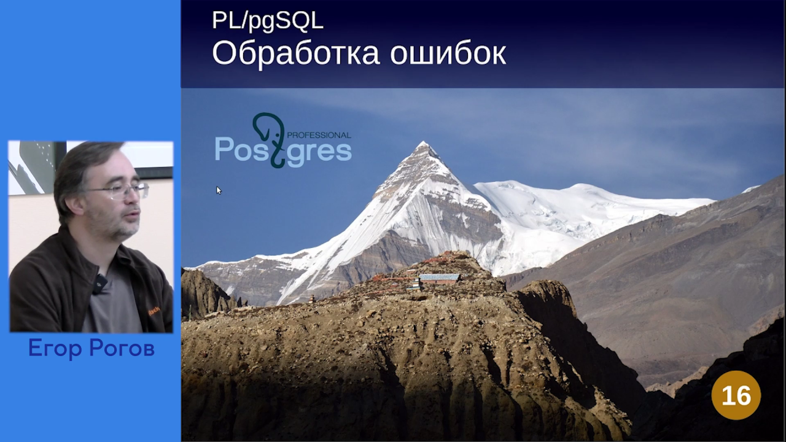
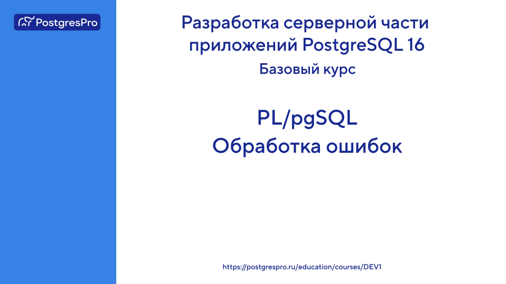
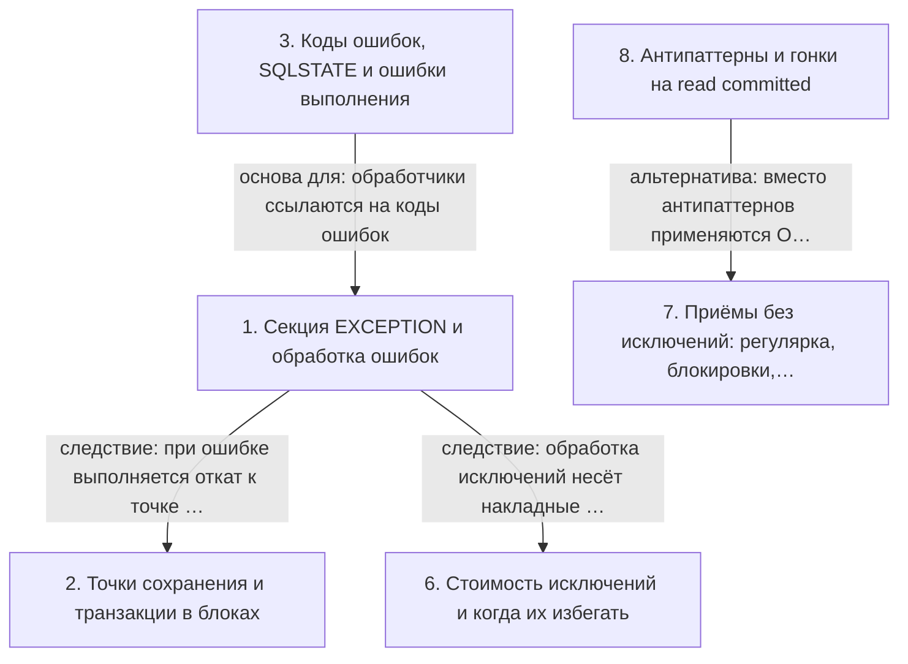

# Обработка ошибок в PL/pgSQL

> [!abstract] Обзор
> Материал посвящён обработке ошибок в PL/pgSQL: как устроена секция EXCEPTION, как ищется обработчик и как работают транзакции внутри блоков с исключениями. Разбираются коды ошибок с двухуровневой иерархией, доступ к коду и описанию через SQLState и SQLRM, INTO STRICT, Too many rows и no_data_found, а также ошибки в секции DECLARE. Отдельно рассматривается диагностика: стек вызовов, RAISE, WHEN OTHERS и GetStackedDiagnostics. Показано, что исключения несут накладные расходы, и разобраны приёмы без исключений — проверка регулярным выражением, рекомендательные блокировки, SELECT FOR UPDATE NOWAIT и INSERT ... ON CONFLICT, а также антипаттерны select count — if и update — insert, ломающиеся из-за гонок на read committed.

> [!info] Курс
> [[index|Оглавление курса]]

## Оглавление
1. [[#1. Секция EXCEPTION и обработка ошибок]]
2. [[#2. Точки сохранения и транзакции в блоках]]
3. [[#3. Коды ошибок, SQLSTATE и ошибки выполнения]]
4. [[#4. Диагностика ошибок: стек, RAISE, WHEN OTHERS]]
5. [[#5. E-строковые литералы]]
6. [[#6. Стоимость исключений и когда их избегать]]
7. [[#7. Приёмы без исключений: регулярка, блокировки, ON CONFLICT]]
8. [[#8. Антипаттерны и гонки на read committed]]
9. [[#9. Перечислимый тип и WHERE CURRENT OF]]

**Схема** — [[#Схема]]
**Итог** — [[#Итог]]

## 1. Секция EXCEPTION и обработка ошибок

В PL/pgSQL ошибки идентифицируются и имеют атрибуты; для ошибки по стеку вызовов ищется обработчик, статически его определить нельзя. Можно создавать свои ошибки со своими кодами и сообщениями, а в обработчике получать выводимые PSQL сообщение, детальное сообщение, подсказку и контекст. Блок PL/pgSQL содержит секцию объявлений, блок кода с BEGIN и в конце может быть секция EXCEPTION; блок exception напоминает try-catch, но в нём нет секции finally. В начале блока устанавливается точка сохранения; при ошибке происходит откат к ней, после чего ищется подходящий обработчик в секции EXCEPTION. Поиск идёт изнутри наружу: сначала во вложенных блоках, затем в объемлющих и выше по стеку вызовов; если во вложенном блоке нет подходящего обработчика, ошибка распространяется в объемлющий блок. Если обработчик найден, выполняются его команды и блок считается успешным; иначе блок завершается с ошибкой, а необработанная ошибка выходит наружу, доходит до клиента, транзакция считается оборванной, и клиенту нужно явно отменить её командой rollback. Обработчики в секции exception выглядят как условия CASE: WHEN название ошибки THEN команды, и выполняется первый подходящий пункт. В секции DECLARE можно выполнять присваивания, и внутри них может произойти ошибка, например деление на 0 при инициализации переменной; ошибка, возникшая в секции DECLARE, не может быть поймана обработчиком исключений этого блока, и весь блок считается сбойным. Переменные объявляют, а значения присваивают внутри блока, чтобы ошибка возникла внутри блока; сложные конструкции стараются не вносить в DECLARE.

> [!info] Зачем это нужно
> Если вы ничего не можете сделать с ошибкой, её не перехватывают и дают распространиться дальше.

*Источник: [00:00:04], [00:00:10]*

> [!quote]- Кадр [00:00:10]
> 

> [!quote]- Кадр [00:00:04]
> 

## 2. Точки сохранения и транзакции в блоках

Откат к точке сохранения влияет только на данные в таблицах и не влияет на локальные переменные: выполненный UPDATE откатывается, а номер версии остаётся без изменений. При ошибке в транзакции с точкой сохранения происходит неявный откат к этой точке, а при входе в блок exception устанавливается неявная точка сохранения, поэтому блок начинает выполняться медленнее. В блоке exception и во всех блоках выше по стеку вызовов нельзя использовать commit и rollback — иначе ошибка invalid transaction termination; управлять транзакциями можно только выше уровнем. Внутри функции нельзя написать COMMIT, поэтому цикл с фиксацией изменений по каждому документу реализуется в процедуре: каждый документ обрабатывается в отдельной транзакции, сбойный документ откатывает только свои изменения, а изменения по другим документам остаются, так как зафиксированы внутри цикла. Сбойные документы можно посмотреть по статусу, а сообщение об ошибке помогает решить, что с ними делать; этот способ удобен и применяется на практике.

*Источник: [00:00:04]*

## 3. Коды ошибок, SQLSTATE и ошибки выполнения

Код ошибки состоит из пяти символов и организован в двухуровневую иерархию; если последние три символа нули, код принадлежит верхнему уровню. Код P0.000 объединяет все ошибки PL/pgSQL, внутри есть разные ошибки, например RiseException и NoDataFound. В обработчике код доступен через переменную SQLState, а короткое описание — через SQLRM; чтобы использовать коды, пишут WHEN SQLSTATE 'P003', где P003 соответствует too many rows. INTO STRICT требует ровно одну строку: при одной строке переменная получает значение, а при большем числе срабатывает Too many rows (код P003, при поиске по коду исключение too many rows невозможно); если строк нет, возникает no data found, и функция возвращает null. Обработчик для ошибки верхнего уровня включает подклассы, поэтому при ошибке-подкласса может сработать обработчик суперкласса; код описан как unique, поэтому ограничение не даст добавить две строки с одинаковыми кодами.

*Источник: [00:00:04]*

## 4. Диагностика ошибок: стек, RAISE, WHEN OTHERS

У каждой ошибки есть дополнительные сведения: сообщение, детальное сообщение, подсказка, имена связанных объектов и контекст. В PL/pgSQL можно вызывать ошибки командой RAISE, указав название или код ошибки; внутри обработчика доступ к стеку вызовов даёт getStackDiagnostics с ключом pgExceptionContext (результат — одна строка типа text). Конструкция WHEN OTHERS THEN перехватывает любую ошибку и позволяет вывести её код и сообщение, но при повторном возбуждении часть стека теряется, что затрудняет отладку. Для работы с ошибками можно использовать GetStackedDiagnostics, чтобы получить сообщения, детали и подсказку; PostgreSQL (PSQL) показывает стек вызовов изнутри наружу, включая строку в базе и вызовы процедур и функций. В PL/pgSQL при вычислении perform передаётся SQL-движку команда select, поэтому в стеке фигурирует select; в сообщении об ошибке процедура может называться function — это историческое наследие.

*Источник: [00:00:04]*

## 5. E-строковые литералы

Строковые литералы с буквой E впереди позволяют записывать escape-последовательности. \n и \t заменяются на соответствующие символы, например \n — на перевод строки.

*Источник: [00:00:04]*

## 6. Стоимость исключений и когда их избегать

Если какую-то задачу можно решить без обработки исключений, имеет смысл решить её без них — это будет быстрее и проще, потому что код будет лучше читаться. Любая обработка исключений — это неявные переходы из одного места в другое, такой код всегда сложнее читать и отлаживать; пример — обработка пачки документов по одному, когда в процессе может произойти ошибка. При этом без исключений невозможно обойтись в серверном коде, и иногда исключения используются по делу. Накладные расходы исключений оценивают по времени выполнения: в примере время стало 13 секунд вместо 11, а если ошибка возникает при каждом вызове, это соответствует стопроцентному попаданию в ошибку. Функция с обработкой исключений выполняется дольше, и часто задачу можно решить без исключений.

> [!info] Зачем это нужно
> Оценка нужна, чтобы понять, насколько всё становится медленнее.

*Источник: [00:00:04]*

## 7. Приёмы без исключений: регулярка, блокировки, ON CONFLICT

Если в текстовый столбец попадают числа, их стоит выделить в отдельное числовое поле. Функция saveToInteger пытается преобразовать строку к целому числу и при ошибке invalidTextRepresentation возвращает null; альтернатива без исключений проверяет число регулярным выражением и тоже возвращает null, если строка не похожа на число, — такой вариант работает быстрее (в примере время сократилось вдвое, до 5 секунд). SELECT FOR UPDATE NOWAIT блокирует строку для изменений, но не ждёт освобождения и сразу завершается ошибкой, если строка уже заблокирована; при ошибке «Lock not available» можно сообщить, что кто-то другой уже работает. В Postgres можно обойтись без исключений с помощью рекомендательных блокировок: текстовая категория превращается в число через хэш-код, и это число блокируется; функция захвата возвращает true при успехе и false иначе, достаточно обычного if. Также есть команда INSERT ... ON CONFLICT: при конфликте по ключевому полю можно выполнить другое действие, например обновить, что решает задачу без исключений.

| Вариант | Проверка | При ошибке |
| --- | --- | --- |
| saveToInteger через исключение | преобразование к целому числу | возвращает null при invalidTextRepresentation |
| Без исключения | регулярное выражение | возвращает null |

*Источник: [00:00:04]*

## 8. Антипаттерны и гонки на read committed

Сначала считается count категорий по коду: если count равен 0, категорию вставляют, иначе обновляют описание — но такой вариант не работает. Делать select count, а потом if — антипаттерн: между операторами может что-то случиться, и код сломается. Другой неправильный вариант — обновить категорию, а если ничего не обновилось (проверка по found), делать insert; это тоже может сломаться. Уровень изоляции по умолчанию — read committed: каждый оператор видит свою картину данных, и она может меняться; между проверкой count и insert другая транзакция может вставить такую же категорию, и insert сломается с ошибкой (при параллельных вызовах первый отработает, второй сломается, событие маловероятно, но рано или поздно происходит, а искать такую ошибку долго). При нарушении ограничения уникальности можно переписать код на обработку исключений: в цикле сначала обновление, при неудаче — вставка, при исключении unique violation цикл повторяется.

*Источник: [00:00:04]*

## 9. Перечислимый тип и WHERE CURRENT OF

Перечислимый тип задаёт набор значений, которые может принимать столбец, например ready, error или processed; в примере создаётся таблица с идентификатором документа, версией, статусом этого типа и сообщением об ошибке. WHERE CURRENT OF возможно в цикле по курсору, а в цикле по запросу, без явного курсора, использовать WHERE CURRENT OF нельзя.

*Источник: [00:00:04]*

## Схема

## Итог

> [!success] Что в итоге
> Обработка ошибок в PL/pgSQL строится вокруг секции EXCEPTION, обработчики в которой проверяются по порядку как в CASE, а ошибка ищет обработчик изнутри наружу по стеку вызовов. При входе в блок exception создаётся неявная точка сохранения, а commit и rollback внутри блока и выше недопустимы. Там, где задачу можно решить без исключений — регулярным выражением, рекомендательными блокировками, SELECT FOR UPDATE NOWAIT или INSERT ... ON CONFLICT, — это быстрее и проще, а проверки вида select count — if и update — insert ломаются из-за гонок на уровне read committed.

