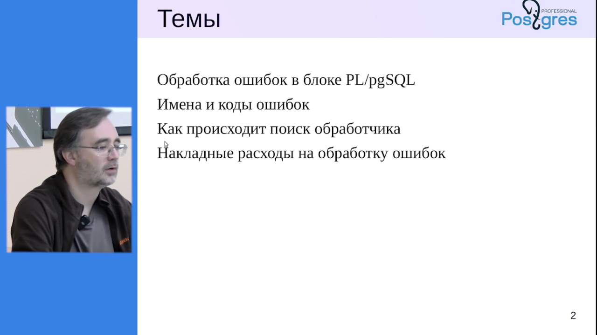
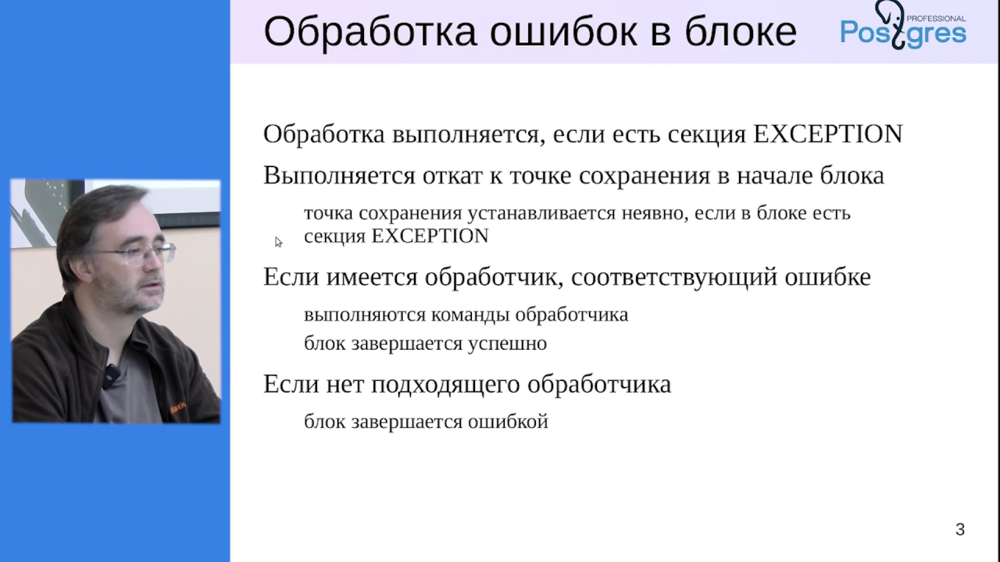
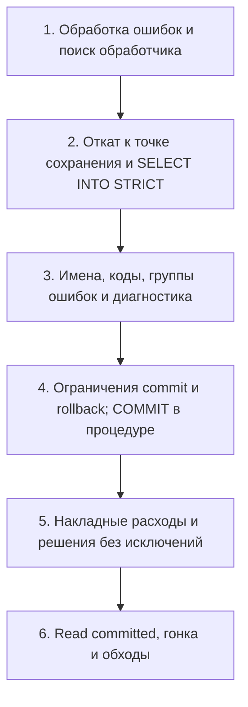

# b5056845d7521eee6b35940b3e9d0b64

> [!abstract] Обзор
> Материал посвящён обработке ошибок и исключений в PL/pgSQL в PostgreSQL и связанным с ней вопросам транзакций. Разбирается, как ошибка обрывает транзакцию, как секция EXCEPTION создаёт неявную точку сохранения и как обработчик ищется по стеку вызовов. Описаны имена, коды и группы ошибок, псевдо-ошибка others, свои ошибки и диагностика через GetStackedDiagnostics. Отдельно показаны ограничения commit и rollback, накладные расходы исключений и предпочтительность решений без исключений. Второй пласт — уровень изоляции read committed, гонка при проверке перед вставкой и обходы: цикл «сначала UPDATE», обработка unique_violation, UPSERT через ON CONFLICT, FOR UPDATE NOWAIT и рекомендательные блокировки. На примере обработки документов показаны enum-статусы, таблица статуса, цикл без курсора и COMMIT только в процедуре.

> [!info] Курс
> [[index|Оглавление курса]]

## Оглавление
1. [[#1. Обработка ошибок и поиск обработчика]]
2. [[#2. Откат к точке сохранения и SELECT INTO STRICT]]
3. [[#3. Имена, коды, группы ошибок и диагностика]]
4. [[#4. Ограничения commit и rollback; COMMIT в процедуре]]
5. [[#5. Накладные расходы и решения без исключений]]
6. [[#6. Read committed, гонка и обходы]]

**Схема** — [[#Схема]]
**Итог** — [[#Итог]]

## 1. Обработка ошибок и поиск обработчика

При ошибке psql сообщает о ней, показывая ошибку, детали, подсказку, контекст и стек вызовов изнутри наружу; если ошибку не перехватили, транзакция обрывается и клиенту нужно явно выполнить rollback. Обработка выполняется, если есть секция EXCEPTION: подходящий обработчик локализует ошибку в блоке и блок завершается успешно, иначе ошибка поднимается на уровень выше. Обработчик ищется по стеку вызовов, и статически определить его нельзя; в виде одной строки возвращается и стек вызовов. Обработчики похожи на case: проверяются по порядку, выбирается первый подходящий, а when others then перехватывает любую ошибку и позволяет вывести её код и сообщение. Ошибка инициализации переменной в секции declare (например, деление на 0) не ловится обработчиком этого блока, поэтому переменные объявляют, а значения присваивают внутри блока.

> [!info] Зачем это нужно
> Пачка документов обрабатывается по одному, и ошибка в процессе обработки не должна приводить к общему сбою.

*Источник: [00:00:39], [00:00:59], [00:03:39], [00:06:49], [00:12:32], [00:13:22] и др.*

> [!quote]- Кадр [00:00:39]
> 

> [!quote]- Кадр [00:00:59]
> 

## 2. Откат к точке сохранения и SELECT INTO STRICT

При откате к точке сохранения (savepoint) всё выполненное внутри блока отменяется: откат влияет на данные в таблицах, но не затрагивает локальные переменные, поэтому выполненный апдейт откатывается, а номер версии остаётся без изменений. Если операция ломается, переменная остаётся с прежним значением: n как была равна трём, так и осталась; insert был третьей строкой, но его откатывают, поэтому count в этот момент показывает две и откат insert не увеличивает count. SELECT INTO STRICT вызывает исключения no_data_found и too_many_rows; в примере при двух строках в таблице срабатывает too_many_rows, и переменная n остаётся равной 3. Если нашлось одно значение, блок выполняется удачно (n = 1), а при лишней строке и отсутствии секции обработки ошибок возникает ошибка. Создаётся таблица t с целочисленным столбцом id, что показано в примере.

```go
CREATE TABLE t(id integer);

=> DO $$
DECLARE
    n integer;
BEGIN
    n := 3;
    INSERT INTO t(id) VALUES (n);
    SELECT id INTO STRICT n FROM t;
    RAISE NOTICE 'Оператор SELECT INTO выполнен, n = %', n;
EXCEPTION
    WHEN no_data_found THEN
        RAISE NOTICE 'Нет данных';
    WHEN too_many_rows THEN
        RAISE NOTICE 'Слишком много данных';
        RAISE NOTICE 'Строк в таблице: %, n = %', (SELECT count(*) FROM t), n;
END
$$;
```

*Источник: [00:02:39], [00:02:59], [00:03:39], [00:06:29], [00:20:33], [00:37:54] и др.*

## 3. Имена, коды, группы ошибок и диагностика

У ошибок есть имена, на которые можно ссылаться, и пятисимвольный код; коды образуют двухуровневую иерархию, где код с последними тремя нулями принадлежит верхнему уровню. Помимо имени и кода есть сообщение об ошибке, детальное сообщение, подсказка и иногда имена связанных объектов — контекст, помогающий справиться с ошибкой. Ошибка too_many_rows имеет код P0003 и текст query returned more than one row; чтобы использовать коды ошибок, нужно написать SQLState и затем текстовым литералом код ошибки, а в одном обработчике можно объединять несколько кодов и узнать, какая именно произошла. Группа P0.000 содержит все ошибки PL/pgSQL, а не SQL; существует псевдо-ошибка others, перехватывающая любое исключение, и пара фатальных ошибок, которые не перехватываются. Можно создавать свои ошибки с кодами и сообщениями, а всё связанное с ошибками извлекать через GetStackedDiagnostics; например, при добавлении книги с одним и тем же автором функцию AdBook предлагается изменить так, чтобы перехватить ошибку и вместо неё вызвать другую с понятным текстовым описанием.

> [!info] Зачем это нужно
> Ошибку имеет смысл перехватить там, где с ней можно сделать что-то вразумительное; если в своём коде сделать уже ничего нельзя, пусть ошибка распространяется дальше. Своя ошибка с понятным описанием нужна, чтобы показать его в правой панели приложения.

*Источник: [00:07:47], [00:08:07], [00:10:42], [00:11:02], [00:11:52], [00:14:12] и др.*

## 4. Ограничения commit и rollback; COMMIT в процедуре

В блоке секции exception устанавливается неявная точка сохранения; в этом блоке и во всех блоках выше по стеку вызовов нельзя использовать команды управления транзакциями commit и rollback — попытка приводит к ошибке invalid transaction termination. Управлять транзакциями можно только выше блоков с обработкой исключений, а COMMIT нельзя написать внутри функции, поэтому для обработки документов используется процедура: в процедуре process_docs COMMIT выполняется в цикле после каждого документа, и каждый документ обрабатывается в отдельной транзакции. При обработке документов используется перечисление (enum) — простой тип данных, значение которого может принимать только заданные значения: статус документа может быть ready, error или processed («Готов для обработки», «обработан», «произошла ошибка»). Создаётся таблица с идентификатором документа, версией документа, статусом типа и сообщением об ошибке, а процедура в цикле вызывает процедуру обработки одного документа. Цикл идёт по запросу, который выбирает все документы, готовые к обработке в нужном статусе, и для перебора используется цикл FOR doc IN (SELECT ...) LOOP без объявления явного курсора; обработка увеличивает версию на единичку и симулирует возможность ошибки с вероятностью 5%.

```sql
CREATE PROCEDURE process_docs()
AS $$
DECLARE
    doc record;
BEGIN
    FOR doc IN (SELECT id FROM documents WHERE status = 'READY')
    LOOP
        BEGIN
            CALL process_one_doc(doc.id);

            UPDATE documents d
            SET status = 'PROCESSED'
            WHERE d.id = doc.id;
        EXCEPTION
            WHEN others THEN
                UPDATE documents d
                SET status = 'ERROR', message = sqlerrm
                WHERE d.id = doc.id;
        END;
        COMMIT; -- каждый документ в своей транзакции
    END LOOP;
END
$$ LANGUAGE plpgsql;
```

> [!info] Зачем это нужно
> Каждый документ обрабатывается в своей транзакции.

*Источник: [00:28:23], [00:28:48], [00:29:08], [00:51:53], [00:54:03], [00:54:27] и др.*

## 5. Накладные расходы и решения без исключений

Обработка исключений в PL/pgSQL несёт накладные расходы: вызывается неявная точка сохранения, и как только написано слово exception, блок начинает выполняться медленнее, а при ошибке и откате время ещё увеличивается. Не нужно в каждый блок писать exception и ловить всё, что можно, хотя накладных расходов не надо бояться, так как PL/pgSQL и так не очень быстрый; секции finally в PL/pgSQL нет, а любая обработка исключений — это неявные переходы, код сложнее читать и отлаживать. Проблемы с производительностью обычно кроются в неверных планах выполнения запросов, а не в процедурном коде; пример saveToInteger пытается преобразовать текст к целому числу через исключения, а вариант с регулярным выражением делает то же самое без исключений. Для теста вставляют миллион строк: 99% — случайные числа, приведённые к текстовому типу, примерно 1% — произвольный текст, и ошибка реально возникала только в одном проценте случаев; по результатам вариант с регулярным выражением оказывается быстрее. Функция get_cat_desc(code text) возвращает text, выбирая c.description из таблицы categories, где c.code совпадает с аргументом code, объявлена как STABLE LANGUAGE plpgsql; при отсутствии категории она возвращает null, а при поиске по уникальному коду too many rows быть не может, поэтому достаточно count 0 или 1, и если срабатывает no date found, функция возвращает null.

```
CREATE OR REPLACE FUNCTION get_cat_desc(code text) RETURNS text
AS $$
BEGIN
    RETURN (SELECT c.description
            FROM categories c
            WHERE c.code = get_cat_desc.code);
END
$$ STABLE LANGUAGE plpgsql;
```

| Вариант | Механизм |
|---|---|
| saveToInteger | преобразование текста к числу через исключения |
| проверка регулярным выражением | проверка, что значение — целое число, без исключений |

> [!info] Зачем это нужно
> Решение без исключений быстрее, проще и лучше читается.

*Источник: [00:22:03], [00:24:33], [00:29:48], [00:31:38], [00:33:18], [00:34:48] и др.*

## 6. Read committed, гонка и обходы

Уровень изоляции по умолчанию — read committed: другие транзакции могут влиять, и между двумя операторами может случиться всё, что угодно — каждый оператор видит свою картину данных. Между проверкой отсутствия записи и insert другая транзакция может вставить такую же категорию, из-за чего insert завершится ошибкой duplicate key value violates unique constraint "categories_code_key"; антипаттерн — SELECT count и IF, либо UPDATE с NOT FOUND и INSERT после pg_sleep(1), что создаёт окно для гонки. Обойтись можно циклом: сначала UPDATE, и если обновилось — выйти; при исключении unique_violation цикл повторяется и снова выполняется UPDATE, что позволяет избежать сбоя при одновременной вставке одной и той же записи. В Postgres есть INSERT ... ON CONFLICT, позволяющий при конфликте по code выполнить DO UPDATE SET description = change.description без исключений; поскольку это одна команда, между её частями ничего не может поменяться. Также применяются блокировки: FOR UPDATE NOWAIT не ждёт освобождения строки и сразу падает с ошибкой «Lock not available», а рекомендательные блокировки превращают категорию в число по хэш-коду и возвращают true или false, так что для захвата достаточно обычного if.

```sql
UPDATE categories c
    SET description = change.description
    WHERE c.code = change.code;

    IF NOT FOUND THEN
        PERFORM pg_sleep(1); -- тут может произойти все, что угодно
        INSERT INTO categories VALUES (code, description);
    END IF;

ERROR: duplicate key value violates unique constraint "categories_code_key"
DETAIL: Key (code)=(games) already exists.
CONTEXT: SQL statement "INSERT INTO categories VALUES (code, description)"
PL/pgSQL function change(text,text) line 9 at SQL statement

LOOP
        UPDATE categories c
        SET description = change.description
        WHERE c.code = change.code;

        EXIT WHEN FOUND;
        PERFORM pg_sleep(1); -- для демонстрации

        BEGIN
            INSERT INTO categories VALUES (code, description);
            EXIT;
        EXCEPTION
            WHEN unique_violation THEN NULL;
        END;
    END LOOP;

CREATE OR REPLACE FUNCTION change(code text, description text)
RETURNS void
VOLATILE LANGUAGE sql
BEGIN ATOMIC
    INSERT INTO categories VALUES (code, description)
    ON CONFLICT(code)
        DO UPDATE SET description = change.description;
END;
```

> [!info] Зачем это нужно
> Можно потребовать, чтобы одновременно только один поток пытался обновлять категорию — это актуально, когда обработка сложная и не хочется думать про изоляцию.

*Источник: [00:40:16], [00:42:56], [00:44:16], [00:45:06], [00:45:26], [00:45:46] и др.*

## Схема



## Итог

> [!success] Что в итоге
> Обработчик ошибки в PL/pgSQL ищется по стеку вызовов, и статически определить его нельзя. Секция EXCEPTION создаёт неявную точку сохранения, накладывает ограничения на commit и rollback и несёт накладные расходы, поэтому часто задачи проще решать без исключений. Стандартный уровень read committed допускает влияние других транзакций, из-за чего проверка перед вставкой даёт гонку и дубликаты, а обходами служат цикл «сначала UPDATE», ON CONFLICT, FOR UPDATE NOWAIT и рекомендательные блокировки.

