# Триггеры PostgreSQL: механизм, уровни, переходные таблицы, изменяемые представления и историзация

> [!abstract] Обзор
> Материал объединяет два конспекта о триггерах и изменяемых представлениях в PostgreSQL. Разобрано, что такое триггер и триггерная функция, какие бывают события (INSERT, UPDATE, DELETE, TRUNCATE и DDL), уровни срабатывания (statement и row) и моменты срабатывания (BEFORE, AFTER, INSTEAD OF), а также их порядок, переменные контекста OLD/NEW и TG-переменные. Отдельно показаны переходные таблицы OLD TABLE и NEW TABLE, событийные триггеры, условие WHEN и сложности триггеров. На примерах таблиц airports, flights и представления flights_v разобрано, как INSTEAD OF UPDATE-триггер делает представление изменяемым. Завершают материал условное изменение строк (ON CONFLICT и MERGE), историзация изменений таблицы coins в coins_history и задание по согласованности склада книг.

> [!info] Курс
> [[index|Оглавление курса]]

## Оглавление
1. [[#1. Триггер и триггерная функция]]
2. [[#2. События, уровни, порядок и условие WHEN]]
3. [[#3. Контекст: TG-переменные и OLD/NEW]]
4. [[#4. Моменты срабатывания: BEFORE и AFTER]]
5. [[#5. Переходные таблицы]]
6. [[#6. Событийные триггеры и DDL]]
7. [[#7. Таблицы airports и flights, представление flights_v и триггер INSTEAD OF]]
8. [[#8. Условное изменение строк: ON CONFLICT и MERGE]]
9. [[#9. Историзация изменений: coins и coins_history]]
10. [[#10. Сложности триггеров]]
11. [[#11. Задание: согласованность склада]]

**Схема** — [[#Схема]]
**Итог** — [[#Итог]]

## 1. Триггер и триггерная функция

Триггер — объект базы данных со списком обрабатываемых событий; это механизм, позволяющий отреагировать на возникновение события, выполнить дополнительные действия, изменить результат операции или отменить операцию. При событии вызывается триггерная функция, которой передаётся контекст; реакция распространяется на выполнение операций над таблицами и представлениями. Триггерная функция — объект базы данных с кодом обработки события, выполняемым в той же транзакции, что и основная операция; по соглашению она не принимает параметры и возвращает значение псевдотипа trigger (фактически record). Одна и та же триггерная функция может обслуживать несколько триггеров; если внутри неё возникает ошибка, откатывается вся транзакция. describe() — отладочная триггерная функция на PL/pgSQL: для ROW-триггеров при TG_LEVEL = 'ROW' она выбирает запись в зависимости от TG_OP через CASE (DELETE — OLD, UPDATE — NEW, INSERT — NEW) и выводит диагностику через RAISE NOTICE.

```go
=> CREATE OR REPLACE FUNCTION describe() RETURNS trigger
AS $$
DECLARE
    rec record;
    str text := '';
BEGIN
    IF TG_LEVEL = 'ROW' THEN
        CASE TG_OP
            WHEN 'DELETE' THEN rec := OLD; str := OLD::text;
            WHEN 'UPDATE' THEN rec := NEW; str := OLD || ' -> ' || NEW;
            WHEN 'INSERT' THEN rec := NEW; str := NEW::text;
        END CASE;
    END IF;
    RAISE NOTICE '% % %: %',
        TG_TABLE_NAME, TG_WHEN, TG_OP, TG_LEVEL, str;
    RETURN rec;
END
$$ LANGUAGE plpgsql;

=> CREATE OR REPLACE FUNCTION describe() RETURNS trigger
AS $$
DECLARE
    rec record;
    str text := '';
BEGIN
    IF TG_LEVEL = 'ROW' THEN
        CASE TG_OP
            WHEN 'DELETE' THEN rec := OLD; str := OLD::text;
            WHEN 'UPDATE' THEN rec := NEW; str := OLD || ' -> ' || NEW;
            WHEN 'INSERT' THEN rec := NEW; str := NEW::text;
        END CASE;
    END IF;
    RAISE NOTICE '% % % %',
        TG_TABLE_NAME, TG_WHEN, TG_OP, TG_LEVEL, str;
    RETURN rec;
END
$$ LANGUAGE plpgsql;
```

*Источник: [00:00:25], [00:00:45], [00:15:21], [00:17:41], [00:58:57]*

> [!quote]- Кадр [00:00:45]
> 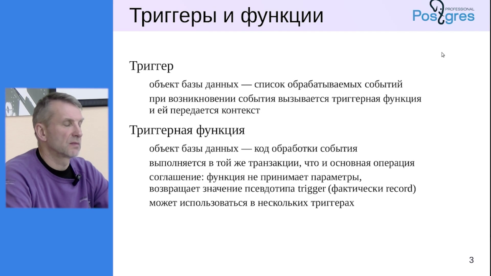

> [!quote]- Кадр [00:58:57]
> 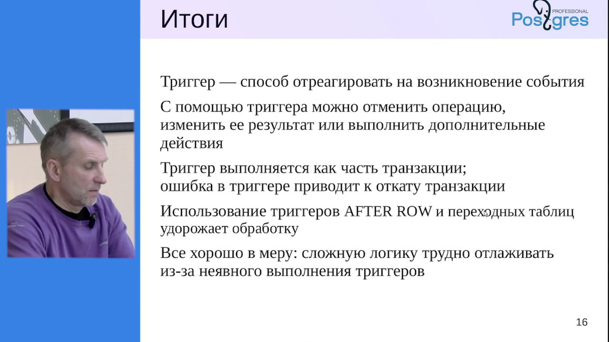

## 2. События, уровни, порядок и условие WHEN

Триггеры срабатывают на события INSERT, UPDATE, DELETE для таблиц и представлений, а также на TRUNCATE для таблиц. По уровню они делятся на операторные (statement, создаются с FOR EACH STATEMENT) и строковые (row, с FOR EACH ROW); по моменту — на BEFORE, AFTER и INSTEAD OF. Порядок срабатывания: BEFORE STATEMENT, BEFORE ROW, INSTEAD OF ROW, выполнение операции, AFTER ROW, AFTER STATEMENT; для одного события триггеры вызываются в алфавитном порядке. При создании триггера можно добавить условие WHEN, которое фильтрует неинтересующие события, помогая минимизировать очередь и снизить накладные расходы.

```javascript
CREATE TRIGGER t_before_stmt
BEFORE INSERT OR UPDATE OR DELETE ON t
FOR EACH STATEMENT EXECUTE FUNCTION describe();

CREATE TRIGGER t before_row
  BEFORE INSERT OR UPDATE OR DELETE ON t
  FOR EACH ROW EXECUTE FUNCTION describe();

CREATE TRIGGER t after_row
  AFTER INSERT OR UPDATE OR DELETE ON t
  FOR EACH ROW EXECUTE FUNCTION describe();

=> INSERT INTO t VALUES (1, 'aaa'), (2, 'bbb');

  NOTICE:  t BEFORE INSERT STATEMENT:
  NOTICE:  t BEFORE INSERT ROW: (1,aaa)
  NOTICE:  t BEFORE INSERT ROW: (2,bbb)
  NOTICE:  t AFTER INSERT ROW: (1,aaa)
  NOTICE:  t AFTER INSERT ROW: (2,bbb)
  NOTICE:  t AFTER INSERT STATEMENT:

=> CREATE TRIGGER t before_stmt
BEFORE INSERT OR UPDATE OR DELETE -- события
ON t -- таблица
FOR EACH STATEMENT -- уровень
EXECUTE FUNCTION describe(); -- триггерная функция

CREATE TRIGGER t_before_stmt
BEFORE INSERT OR UPDATE OR DELETE -- события
ON t -- таблица
FOR EACH STATEMENT -- уровень
EXECUTE FUNCTION describe();

CREATE TRIGGER t before_row
  BEFORE INSERT OR UPDATE OR DELETE ON t
  FOR EACH ROW EXECUTE FUNCTION describe();

CREATE TRIGGER t after_row
  AFTER INSERT OR UPDATE OR DELETE ON t
  FOR EACH ROW EXECUTE FUNCTION describe();

=> INSERT INTO t VALUES (1, 'aaa'), (2, 'bbb');

  NOTICE:  t BEFORE INSERT STATEMENT:
  NOTICE:  t BEFORE INSERT ROW: (1,aaa)
  NOTICE:  t BEFORE INSERT ROW: (2,bbb)
  NOTICE:  t AFTER INSERT ROW: (1,aaa)
  NOTICE:  t AFTER INSERT ROW: (2,bbb)
  NOTICE:  t AFTER INSERT STATEMENT:

NOTICE:  t BEFORE INSERT STATEMENT:
NOTICE:  t BEFORE INSERT ROW: (1,aaa)
NOTICE:  t BEFORE INSERT ROW: (2,bbb)
NOTICE:  t AFTER INSERT ROW: (1,aaa)
NOTICE:  t AFTER INSERT ROW: (2,bbb)
NOTICE:  t AFTER INSERT STATEMENT:
```

| Уровень | Задание |
|---|---|
| Оператора | FOR EACH STATEMENT |
| Строки | FOR EACH ROW |

*Источник: [00:03:05], [00:09:58], [00:11:48], [00:14:16], [00:18:51], [00:19:11] и др.*

> [!quote]- Кадр [00:03:05]
> 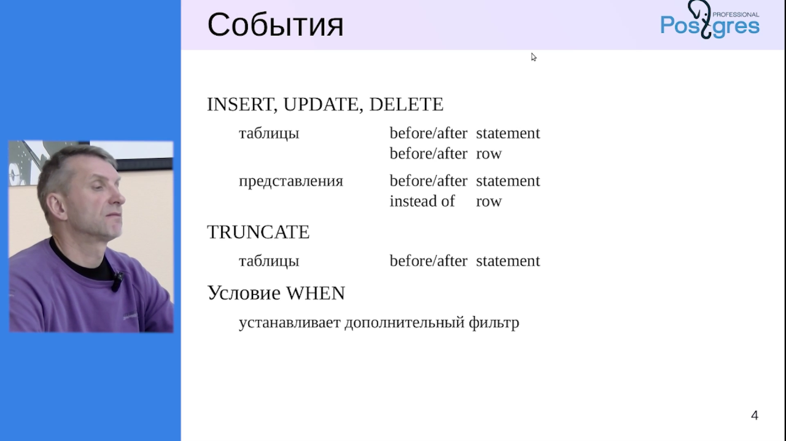

> [!quote]- Кадр [00:09:58]
> 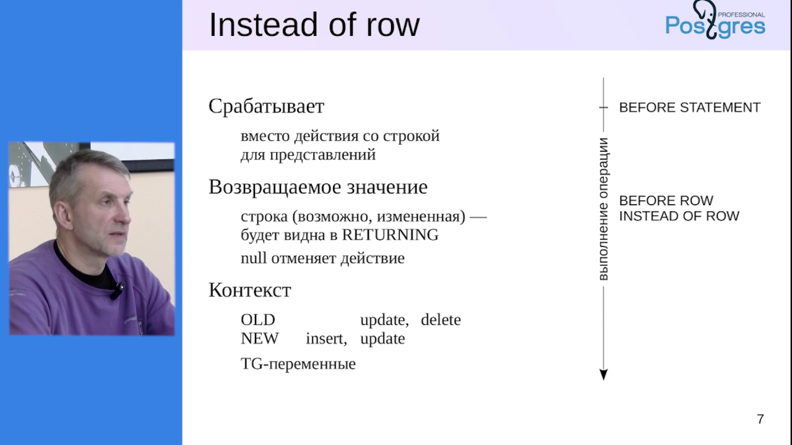

> [!quote]- Кадр [00:35:20]
> 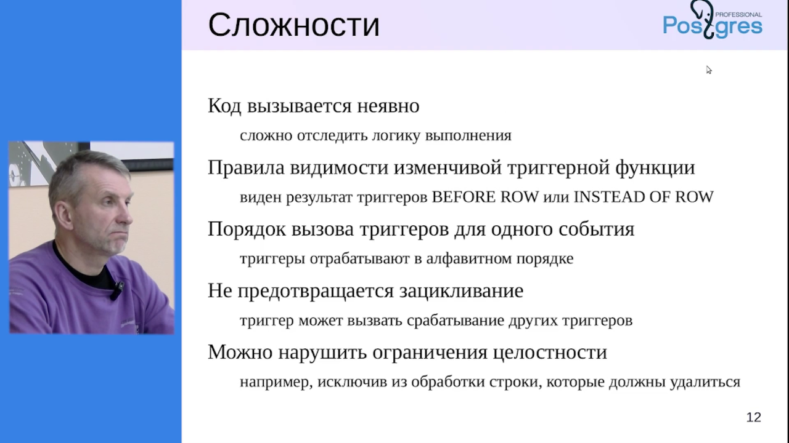

> [!quote]- Кадр [00:11:48]
> 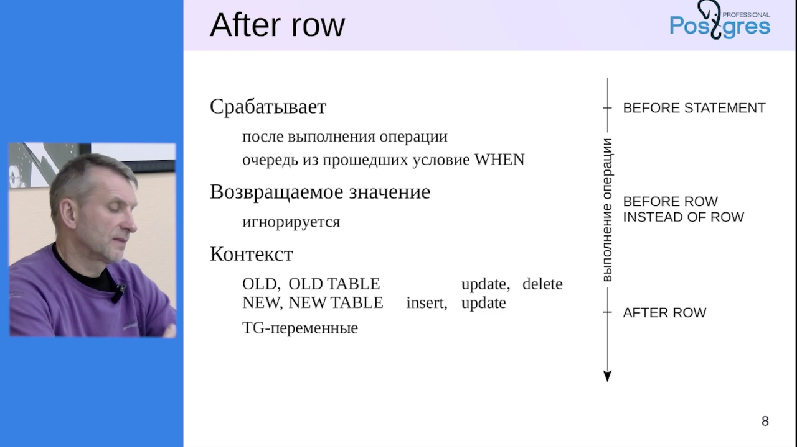

## 3. Контекст: TG-переменные и OLD/NEW

Триггерная функция не принимает параметров, но имеет доступ к контексту — набору специальных переменных. TG-переменные начинаются с tg_ и дают триггерной функции понять, из какого конкретно триггера она была вызвана и по какому условию; дополнительные сведения передаются в функцию не через параметры, а с помощью переменных контекста. OLD и NEW — переменные контекста, дающие доступ к информации строки до и после изменений: OLD — строка до изменения, доступна для UPDATE и DELETE; NEW — новое состояние строки, доступна для INSERT и UPDATE. При INSERT OLD не определена, при DELETE нельзя прочитать NEW; с переменными можно работать, обращаясь к атрибутам, изменяя их или делая проверки.

```go
CASE TG_OP
    WHEN 'DELETE' THEN rec := OLD; str := OLD::text;
    WHEN 'UPDATE' THEN rec := NEW; str := OLD || ' -> ' || NEW;
    WHEN 'INSERT' THEN rec := NEW; str := NEW::text;
END CASE;
```

*Источник: [00:05:32], [00:07:30], [00:09:58], [00:11:48], [00:20:21], [00:20:41] и др.*

> [!quote]- Кадр [00:05:32]
> 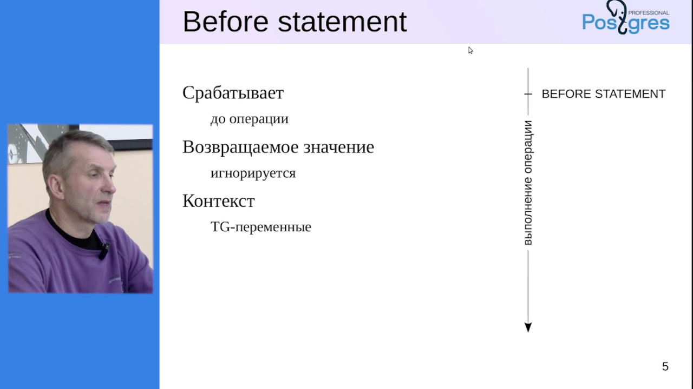

> [!quote]- Кадр [00:07:30]
> 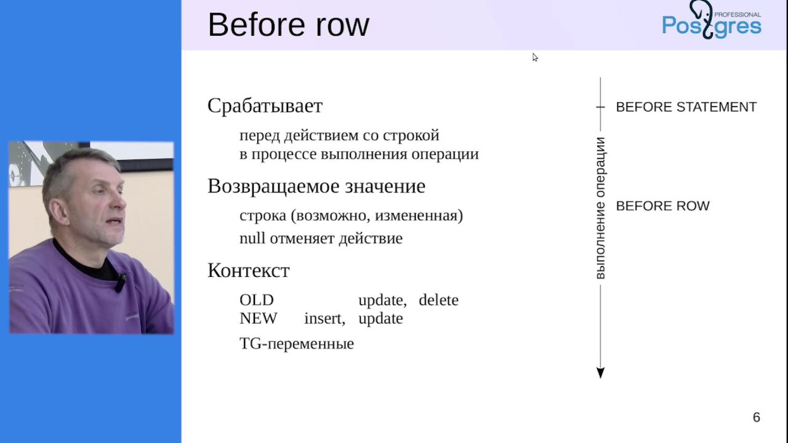

## 4. Моменты срабатывания: BEFORE и AFTER

BEFORE ROW срабатывает перед действием с каждой строкой, может изменять строку и должен возвращать её; возврат null отменяет действие над строкой. BEFORE STATEMENT срабатывает до операции, его возвращаемое значение игнорируется, но можно прервать операцию, например, запретить апдейт в нерабочее время. AFTER ROW срабатывает после обработки всех строк (события ставятся в очередь) и используется для проверки согласованности, аудита и каскадных изменений; его возвращаемое значение игнорируется. AFTER STATEMENT срабатывает после завершения операции, даже если не затронуто ни одной строки; аудит в AFTER ROW откатывается вместе с транзакцией, поэтому ненадёжен.

| BEFORE ROW | AFTER ROW |
|---|---|
| возвращает строку, возможно изменённую | возвращаемое значение игнорируется |
| при возврате null действие отменяется | срабатывает после отработки всех строк |

*Источник: [00:05:32], [00:07:30], [00:09:58], [00:11:48], [00:14:16], [00:17:41] и др.*


> [!quote]- Кадр [00:31:56]
> 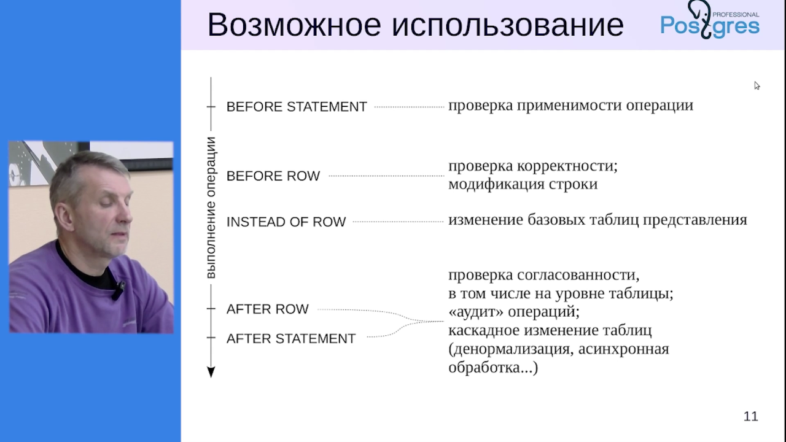


## 5. Переходные таблицы

Переходные таблицы — это таблицы, которые формируются и хранятся в оперативной памяти сервера. OLD TABLE и NEW TABLE используются в триггерах для доступа к старому и новому состоянию изменённых строк: они содержат только строки, затронутые операцией, и показывают состояние набора строк, а не отдельных строк. OLD TABLE доступна в контексте update и delete, NEW TABLE — в контексте insert и update; чтобы таблицы создавались, необходимо указать их имена при создании триггера через REFERENCING OLD TABLE AS old_table и NEW TABLE AS new_table (можно указать одну или обе). Их можно использовать в триггерах AFTER ROW, но обычно это не имеет смысла; наиболее оправдано и удобно применение переходных таблиц в триггере After statement, который срабатывает после операции, даже если не затронута ни одна строка, а его возвращаемое значение игнорируется. Использование триггеров AFTER ROW и переходных таблиц удорожает обработку, так как изменения накапливаются в специальной очереди.

```
CREATE TRIGGER t_after_upd_trans
AFTER UPDATE ON trans -- только одно событие на один триггер
REFERENCING
    OLD TABLE AS old_table
    NEW TABLE AS new_table -- можно и одну, не обязательно обе
FOR EACH STATEMENT
EXECUTE FUNCTION transition();

CREATE OR REPLACE FUNCTION transition() RETURNS trigger
AS $$
DECLARE
    rec record;
BEGIN
    IF TG_OP = 'DELETE' OR TG_OP = 'UPDATE' THEN
        RAISE NOTICE 'Старое состояние:';
        FOR rec IN SELECT * FROM old_table LOOP
            RAISE NOTICE '%', rec;
        END LOOP;
    END IF;
    IF TG_OP = 'UPDATE' OR TG_OP = 'INSERT' THEN
        RAISE NOTICE 'Новое состояние:';
        FOR rec IN SELECT * FROM new_table LOOP
            RAISE NOTICE '%', rec;
        END LOOP;
    END IF;
    RETURN NULL;
END
$$ LANGUAGE plpgsql;
```

| Таблица | Доступна при |
|---|---|
| OLD TABLE | UPDATE, DELETE |
| NEW TABLE | INSERT, UPDATE |

*Источник: [00:11:48], [00:14:16], [00:27:10], [00:27:30], [00:27:50], [00:28:30] и др.*


> [!quote]- Кадр [00:28:30]
> 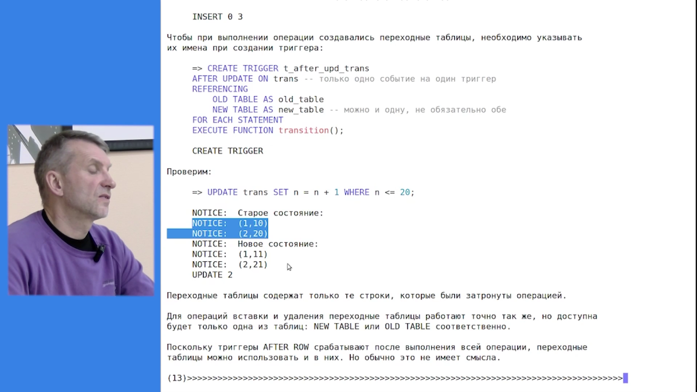

> [!quote]- Кадр [00:14:16]
> 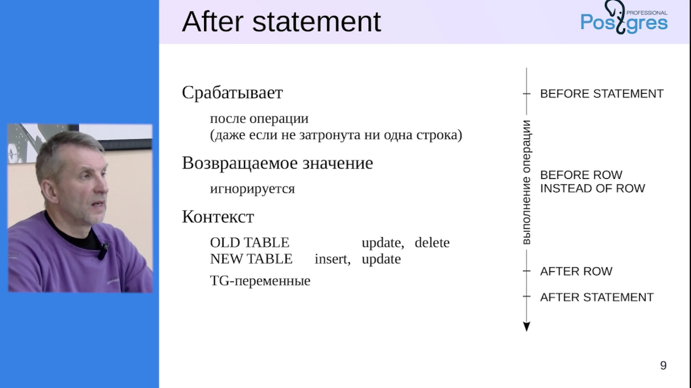

## 6. Событийные триггеры и DDL

Событийные триггеры реагируют на DDL-команды (в отличие от обычных табличных триггеров, реагирующих на DML). Они могут срабатывать на DDL_COMMAND_START, DDL_COMMAND_END, TABLE_REWRITE и SQL_DROP. Триггерная функция не принимает параметров, возвращает event_trigger и получает контекст через специальные функции, например pg_event_trigger_ddl_commands(); пример describe_ddl() выводит информацию о выполненных DDL-командах. Для table_rewrite (физическая перезапись таблицы) можно получить OID таблицы и код причины через pg_event_trigger_table_rewrite_oid() и pg_event_trigger_table_rewrite_reason().

```javascript
CREATE OR REPLACE FUNCTION describe_ddl() RETURNS event_trigger
AS $$
DECLARE
    r record;
BEGIN
    FOR r IN SELECT * FROM pg_event_trigger_ddl_commands()
    LOOP
        RAISE NOTICE '%, тип: %, OID: %, имя: % ',
            r.command_tag, r.object_type, r.objid, r.object_identity;
    END LOOP;
END
$$ LANGUAGE plpgsql;

CREATE EVENT TRIGGER after_ddl
ON ddl_command_end EXECUTE FUNCTION describe_ddl();

=> CREATE TABLE t1(id integer PRIMARY KEY GENERATED ALWAYS AS IDENTITY);

NOTICE:  CREATE SEQUENCE. тип: sequence, OID: 16459, имя: public.t1_id_seq
NOTICE:  CREATE TABLE. тип: table, OID: 16460, имя: public.t1
NOTICE:  CREATE INDEX. тип: index, OID: 16463, имя: public.t1_pkey
NOTICE:  ALTER SEQUENCE. тип: sequence, OID: 16459, имя: public.t1_id_seq

CREATE FUNCTION describe_rewrite() RETURNS event_trigger
AS $$
BEGIN
    -- Для события table_rewrite специальные функции возвращают данные:
    RAISE NOTICE 'Будет перезаписана таблица %, код %',
        pg_event_trigger_table_rewrite_oid()::regclass,  -- перезаписываемая таблица
        pg_event_trigger_table_rewrite_reason();  -- код причины перезаписи
END
$$ LANGUAGE plpgsql;

CREATE EVENT TRIGGER before_rewrite
ON table_rewrite EXECUTE FUNCTION describe_rewrite();

CREATE OR REPLACE FUNCTION describe_ddl() RETURNS event_trigger
AS $$
DECLARE
    r record;
BEGIN
    FOR r IN SELECT * FROM pg_event_trigger_ddl_commands()
    LOOP
        RAISE NOTICE '%, тип: %, OID: %, имя: % ',
            r.command_tag, r.object_type, r.objid, r.object_identity;
    END LOOP;
END
$$ LANGUAGE plpgsql;

CREATE EVENT TRIGGER after_ddl
ON ddl_command_end EXECUTE FUNCTION describe_ddl();

ON ddl_command_end EXECUTE FUNCTION describe_ddl();
CREATE EVENT TRIGGER

=> CREATE TABLE t1(id integer PRIMARY KEY GENERATED ALWAYS AS IDENTITY);

NOTICE:  CREATE SEQUENCE. тип: sequence, OID: 16459, имя: public.t1_id_seq
NOTICE:  CREATE TABLE. тип: table, OID: 16460, имя: public.t1
NOTICE:  CREATE INDEX. тип: index, OID: 16463, имя: public.t1_pkey
NOTICE:  ALTER SEQUENCE. тип: sequence, OID: 16459, имя: public.t1_id_seq
```

*Источник: [00:00:25], [00:00:45], [00:52:17], [00:54:42], [00:55:24], [00:56:10] и др.*

> [!quote]- Кадр [00:00:25]
> 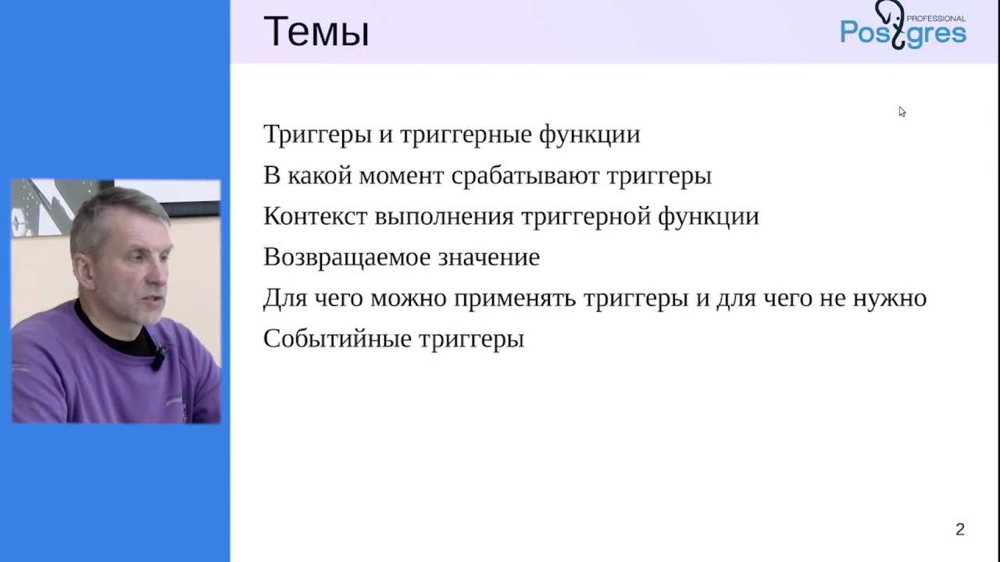

> [!quote]- Кадр [00:52:17]
> 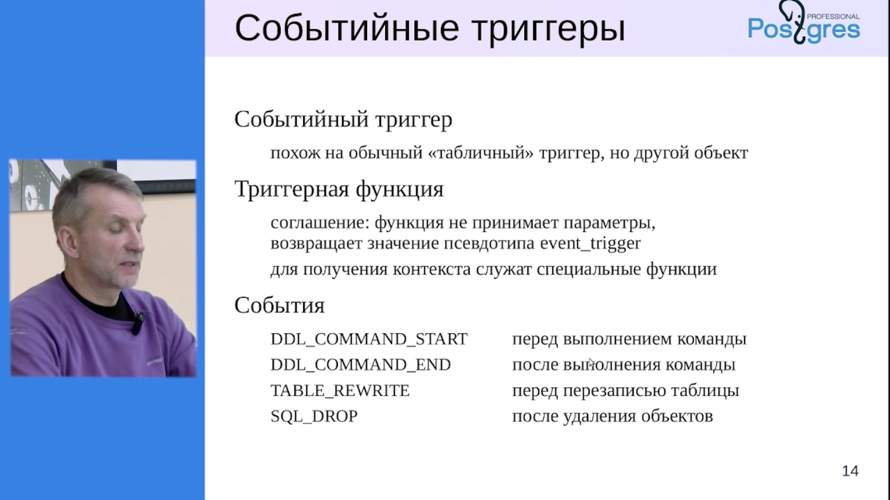

## 7. Таблицы airports и flights, представление flights_v и триггер INSTEAD OF

Таблица airports создаётся с полем code char(3) PRIMARY KEY и полем name text NOT NULL; таблица flights задаёт airport_from и airport_to как char(3) NOT NULL с REFERENCES airports(code), а пара (airport_from, airport_to) объявлена UNIQUE. Представление flights_v показывает перелёты в удобном виде: оно выбирает id и преобразует коды аэропортов в названия с помощью подзапросов к таблице airports, но UPDATE flights_v не изменяет данные в нижележащих базовых таблицах. Триггер типа INSTEAD OF можно создать только для операций, затрагивающих представления; INSTEAD OF означает «взамен»: для строк он срабатывает вместо действия со строкой, делая представление изменяемым. Для обновления flights_v создаётся триггер INSTEAD OF UPDATE flights_v_upd_trigger, который для каждой строки вызывает функцию flights_v_update(); функция обновляет таблицу flights, обращается к airports, чтобы получить код аэропорта по его названию, проверяет наличие аэропорта по имени и при отсутствии перехватывает no_data_found и заменяет его на RAISE EXCEPTION с текстом «Аэропорт ... отсутствует», при этом обновление представления не выполняется.

```sql
CREATE OR REPLACE FUNCTION flights_v_update() RETURNS trigger
AS $$
DECLARE
    code_to char(3);
BEGIN
    BEGIN
        SELECT code INTO STRICT code_to
        FROM airports
        WHERE name = NEW.airport_to;
    EXCEPTION
        WHEN no_data_found THEN
            RAISE EXCEPTION 'Аэропорт "%" отсутствует', NEW.airport_to;
    END;
    UPDATE flights
    SET airport_to = code_to
    WHERE id = OLD.id; -- изменение id игнорируем
    RETURN NEW;
END
$$ LANGUAGE plpgsql;

CREATE TRIGGER flights_v_upd_trigger
INSTEAD OF UPDATE ON flights_v
FOR EACH ROW EXECUTE FUNCTION flights_v_update();

CREATE TABLE airports(
    code char(3) PRIMARY KEY,
    name text NOT NULL
);

INSERT INTO airports VALUES
    ('SVO', 'Москва. Шереметьево'),
    ('LED', 'Санкт-Петербург. Пулково'),
    ('TOF', 'Томск. Богашево');

CREATE VIEW flights_v AS
SELECT id,
       (SELECT name
        FROM airports
        WHERE code = airport_from) airport_from,
       (SELECT name
        FROM airports
        WHERE code = airport_to) airport_to
FROM flights;

CREATE OR REPLACE FUNCTION flights_v_update() RETURNS trigger
AS $$
DECLARE
    code_to char(3);
BEGIN
    BEGIN
        SELECT code INTO STRICT code_to
        FROM airports
        WHERE name = NEW.airport_to;
    EXCEPTION
        WHEN no_data_found THEN
            RAISE EXCEPTION 'Аэропорт "%" отсутствует', NEW.airport_to;
    END;
    UPDATE flights
    SET airport_to = code_to
    WHERE id = OLD.id; -- изменение id игнорируем
    RETURN NEW;
END
$$ LANGUAGE plpgsql;

CREATE TRIGGER flights_v_upd_trigger
INSTEAD OF UPDATE ON flights_v
FOR EACH ROW EXECUTE FUNCTION flights_v_update();

CREATE TABLE airports(
    code char(3) PRIMARY KEY,
    name text NOT NULL
);

INSERT INTO airports VALUES
    ('SVO', 'Москва. Шереметьево'),
    ('LED', 'Санкт-Петербург. Пулково'),
    ('TOF', 'Томск. Богашево');

CREATE TABLE coins(
    face_value numeric PRIMARY KEY,
    name text
);
=> CREATE TABLE coins_history(LIKE coins);
=> ALTER TABLE coins_history
    ADD start_date timestamp,
    ADD end_date timestamp;

CREATE VIEW flights_v AS
SELECT id,
       (SELECT name
        FROM airports
        WHERE code = airport_from) airport_from,
       (SELECT name
        FROM airports
        WHERE code = airport_to) airport_to
FROM flights;
```

*Источник: [00:03:05], [00:09:58], [00:31:56], [00:47:46], [00:48:06], [00:48:26] и др.*


## 8. Условное изменение строк: ON CONFLICT и MERGE

В Postgres оператор INSERT с предложением ON CONFLICT является одним атомарным оператором; при конфликте по дублированию id соответствующая строка обновляется, и значение столбца s изменяется на EXCLUDED.s, при этом срабатывают триггеры как для INSERT, так и для UPDATE (уровня строки и уровня оператора, BEFORE и AFTER). Для конфликтующей строки срабатывают триггеры UPDATE, для вставляемой без конфликта — триггеры INSERT. При UPDATE, не затронувшем ни одной строки (UPDATE 0), срабатывают только BEFORE UPDATE STATEMENT и AFTER UPDATE STATEMENT, а BEFORE UPDATE ROW и AFTER UPDATE ROW не вызываются. Оператор MERGE сопоставляет строки целевой таблицы с набором значений по условию ON и выполняет ветки WHEN MATCHED и WHEN NOT MATCHED; для MERGE нет специальных или отдельных триггеров, используются уже существующие триггеры на обновление, удаление и вставку.

```sql
=> MERGE INTO t
   USING (VALUES (1, 'fff'), (3, 'ggg'), (4, 'hhh')) AS vals(id, s)
   ON t.id = vals.id
   WHEN MATCHED AND t.id = 1 THEN
      UPDATE SET s = vals.s
   WHEN MATCHED THEN
      DELETE
   WHEN NOT MATCHED THEN
      INSERT (id, s)
      VALUES (vals.id, vals.s);
   NOTICE: t BEFORE INSERT STATEMENT:
   NOTICE: t BEFORE UPDATE STATEMENT:
   NOTICE: t BEFORE DELETE STATEMENT:
   NOTICE: t BEFORE UPDATE ROW: (1,ddd) -> (1,fff)
   NOTICE: t BEFORE DELETE ROW: (3,eee)
   NOTICE: t BEFORE INSERT ROW: (4,hhh)
   NOTICE: t AFTER UPDATE ROW: (1,ddd) -> (1,fff)
   NOTICE: t AFTER DELETE ROW: (3,eee)
   NOTICE: t AFTER INSERT ROW: (4,hhh)
   NOTICE: t AFTER DELETE STATEMENT:
   NOTICE: t AFTER UPDATE STATEMENT:
   NOTICE: t AFTER INSERT STATEMENT:
   MERGE 3

=> INSERT INTO t VALUES (1,'ddd'), (3,'eee')
ON CONFLICT(id) DO UPDATE SET s = EXCLUDED.s;

NOTICE:  t BEFORE INSERT STATEMENT:
NOTICE:  t BEFORE UPDATE STATEMENT:
NOTICE:  t BEFORE INSERT ROW: (1,ddd)
NOTICE:  t BEFORE UPDATE ROW: (1,ccc) -> (1,ddd)
NOTICE:  t BEFORE INSERT ROW: (3,eee)
NOTICE:  t AFTER UPDATE ROW: (1,ccc) -> (1,ddd)
NOTICE:  t AFTER INSERT ROW: (3,eee)
NOTICE:  t AFTER UPDATE STATEMENT:
NOTICE:  t AFTER INSERT STATEMENT:
INSERT 0 2

=> UPDATE t SET s = 'ddd' WHERE id = 0;

NOTICE:  t BEFORE UPDATE STATEMENT:
NOTICE:  t AFTER UPDATE STATEMENT:
UPDATE 0

=> MERGE INTO t
   USING (VALUES (1, 'fff'), (3, 'ggg'), (4, 'hhh')) AS vals(id, s)
   ON t.id = vals.id
   WHEN MATCHED AND t.id = 1 THEN
      UPDATE SET s = vals.s
   WHEN MATCHED THEN
      DELETE
   WHEN NOT MATCHED THEN
      INSERT (id, s)
      VALUES (vals.id, vals.s);
   NOTICE: t BEFORE INSERT STATEMENT:
   NOTICE: t BEFORE UPDATE STATEMENT:
   NOTICE: t BEFORE DELETE STATEMENT:
   NOTICE: t BEFORE UPDATE ROW: (1,ddd) -> (1,fff)
   NOTICE: t BEFORE DELETE ROW: (3,eee)
   NOTICE: t BEFORE INSERT ROW: (4,hhh)
   NOTICE: t AFTER UPDATE ROW: (1,ddd) -> (1,fff)
   NOTICE: t AFTER DELETE ROW: (3,eee)
   NOTICE: t AFTER INSERT ROW: (4,hhh)
   NOTICE: t AFTER DELETE STATEMENT:
   NOTICE: t AFTER UPDATE STATEMENT:
   NOTICE: t AFTER INSERT STATEMENT:
   MERGE 3

INSERT INTO t VALUES (1,'ddd'), (3,'eee')
ON CONFLICT(id) DO UPDATE SET s = EXCLUDED.s;

MERGE INTO t
USING (VALUES (1, 'fff'), (3, 'ggg'), (4, 'hhh')) AS vals(id, s)
ON t.id = vals.id
WHEN MATCHED AND t.id = 1 THEN
    UPDATE SET s = vals.s
WHEN MATCHED THEN
    DELETE
WHEN NOT MATCHED THEN
    INSERT (id, s)
    VALUES (vals.id, vals.s);

=> INSERT INTO t VALUES (1,'ddd'), (3,'eee')
ON CONFLICT(id) DO UPDATE SET s = EXCLUDED.s;

NOTICE:  t BEFORE INSERT STATEMENT:
NOTICE:  t BEFORE UPDATE STATEMENT:
NOTICE:  t BEFORE INSERT ROW: (1,ddd)
NOTICE:  t BEFORE UPDATE ROW: (1,ccc) -> (1,ddd)
NOTICE:  t BEFORE INSERT ROW: (3,eee)
NOTICE:  t AFTER UPDATE ROW: (1,ccc) -> (1,ddd)
NOTICE:  t AFTER INSERT ROW: (3,eee)
NOTICE:  t AFTER UPDATE STATEMENT:
NOTICE:  t AFTER INSERT STATEMENT:
INSERT 0 2

=> UPDATE t SET s = 'ddd' WHERE id = 0;

NOTICE:  t BEFORE UPDATE STATEMENT:
NOTICE:  t AFTER UPDATE STATEMENT:
UPDATE 0

=> MERGE INTO t
USING (VALUES (1, 'fff'), (3, 'ggg'), (4, 'hhh')) AS vals(id, s)
ON t.id = vals.id
WHEN MATCHED AND t.id = 1 THEN
    UPDATE SET s = vals.s
WHEN MATCHED THEN
    DELETE
WHEN NOT MATCHED THEN
    INSERT (id, s)
    VALUES (vals.id, vals.s);
```

*Источник: [00:21:22], [00:21:43], [00:22:04], [00:24:45], [00:25:05], [00:25:32] и др.*

## 9. Историзация изменений: coins и coins_history

LIKE позволяет создать таблицу той же структуры, что и указанная; coins_history создаётся через CREATE TABLE coins_history(LIKE coins), а затем расширяется столбцами start_date и end_date типа timestamp, чтобы можно было увидеть содержимое изначальной таблицы на определённый момент времени. Историю ведут триггерные функции на plpgsql: history_insert() вставляет новую строку с start_date = current_timestamp и end_date = NULL, history_delete() проставляет end_date = current_timestamp для записи с end_date IS NULL; на таблице coins создаются триггеры coins_history_insert (AFTER INSERT OR UPDATE) и coins_history_delete (AFTER UPDATE OR DELETE). Обновление строки в основной таблице coins трактуется как удаление и последующая вставка строки, поэтому получаются сцепленные строки, а в coins_history вместо полей xmin и xmax используются start_date и end_date. Команда \set d '...' задаёт переменную psql, которая подставляется в запрос через :'d'; запрос выбирает строки, у которых start_date <= заданный момент и end_date IS NULL или заданный момент < end_date, так строится снимок данных на заданный момент времени.

```sql
CREATE TABLE coins(
    face_value numeric PRIMARY KEY,
    name text
);

CREATE TABLE coins_history(LIKE coins);

ALTER TABLE coins_history
    ADD start_date timestamp,
    ADD end_date timestamp;

CREATE OR REPLACE FUNCTION history_insert() RETURNS trigger
AS $$
BEGIN
    EXECUTE format(
      'INSERT INTO %I SELECT ($1).*, current_timestamp, NULL',
      TG_TABLE_NAME||'_history'
    ) USING NEW;
    RETURN NEW;
END
$$ LANGUAGE plpgsql;

CREATE OR REPLACE FUNCTION history_delete() RETURNS trigger
AS $$
BEGIN
    EXECUTE format(
        'UPDATE %I SET end_date = current_timestamp WHERE face_value = $1 AND end_date IS NULL',
        TG_TABLE_NAME||'_history'
    ) USING OLD.face_value;
    RETURN OLD;
END
$$ LANGUAGE plpgsql;

CREATE TRIGGER coins_history_insert
AFTER INSERT OR UPDATE ON coins
FOR EACH ROW EXECUTE FUNCTION history_insert();

CREATE TRIGGER coins_history_delete
AFTER UPDATE OR DELETE ON coins
FOR EACH ROW EXECUTE FUNCTION history_delete();

SELECT * FROM coins_history ORDER BY face_value, start_date;

 face_value |   name    |        start_date        |        end_date
-----------+-----------+--------------------------+-------------------------
       0.25 | Полушка   | 2024-10-24 14:41:38.234952 | 2024-10-24 14:42:00.799057
          3 | Алтын     | 2024-10-24 14:41:38.234952 | 2024-10-24 14:41:48.379453
          3 | 3 копейки | 2024-10-24 14:41:48.379453 |
          5 | 5 копеек  | 2024-10-24 14:41:56.021829 |
(4 rows)

\set d '2024-10-24 14:41:38.343814+03'

SELECT face_value, name
   FROM coins_history
   WHERE start_date <= :'d' AND (end_date IS NULL OR :'d' < end_date)
   ORDER BY face_value;

CREATE TABLE coins(
    face_value numeric PRIMARY KEY,
    name text
);

CREATE TABLE coins_history(LIKE coins);

ALTER TABLE coins_history
    ADD start_date timestamp,
    ADD end_date timestamp;

CREATE OR REPLACE FUNCTION history_insert() RETURNS trigger
AS $$
BEGIN
    EXECUTE format(
      'INSERT INTO %I SELECT ($1).*, current_timestamp, NULL',
      TG_TABLE_NAME||'_history'
    ) USING NEW;
    RETURN NEW;
END
$$ LANGUAGE plpgsql;

CREATE OR REPLACE FUNCTION history_delete() RETURNS trigger
AS $$
BEGIN
    EXECUTE format(
        'UPDATE %I SET end_date = current_timestamp WHERE face_value = $1 AND end_date IS NULL',
        TG_TABLE_NAME||'_history'
    ) USING OLD.face_value;
    RETURN OLD;
END
$$ LANGUAGE plpgsql;

CREATE TRIGGER coins_history_insert
AFTER INSERT OR UPDATE ON coins
FOR EACH ROW EXECUTE FUNCTION history_insert();

CREATE TRIGGER coins_history_delete
AFTER UPDATE OR DELETE ON coins
FOR EACH ROW EXECUTE FUNCTION history_delete();

CREATE OR REPLACE FUNCTION history_delete() RETURNS trigger
AS $$
BEGIN
    EXECUTE format(
        'UPDATE %I SET end_date = current_timestamp WHERE face_value = $1 AND end_date IS NULL',
        TG_TABLE_NAME||'_history'
    ) USING OLD.face_value;

    RETURN OLD;
END
$$ LANGUAGE plpgsql;

SELECT * FROM coins_history ORDER BY face_value, start_date;

 face_value |   name   |        start_date        |        end_date
-----------+----------+--------------------------+-------------------------
       0.25 | Полупика | 2024-10-24 14:41:38.234952 | 2024-10-24 14:42:00.799057
          3 | Алтын    | 2024-10-24 14:41:38.234952 | 2024-10-24 14:41:48.379453
          3 | 3 копейки | 2024-10-24 14:41:48.379453 |
          5 | 5 копеек | 2024-10-24 14:41:56.021829 |
(4 rows)

\set d '2024-10-24 14:41:38.343814+03'

SELECT face_value, name
   FROM coins_history
   WHERE start_date <= :'d' AND (end_date IS NULL OR :'d' < end_date)
   ORDER BY face_value;

CREATE TABLE coins(
    face_value numeric PRIMARY KEY,
    name text
);

CREATE TABLE coins_history(LIKE coins);

ALTER TABLE coins_history
    ADD start_date timestamp,
    ADD end_date timestamp;

CREATE OR REPLACE FUNCTION history_insert() RETURNS trigger
AS $$
BEGIN
    EXECUTE format(
      'INSERT INTO %I SELECT ($1).*, current_timestamp, NULL',
      TG_TABLE_NAME||'_history'
    ) USING NEW;
    RETURN NEW;
END
$$ LANGUAGE plpgsql;

CREATE OR REPLACE FUNCTION history_delete() RETURNS trigger
AS $$
BEGIN
    EXECUTE format(
        'UPDATE %I SET end_date = current_timestamp WHERE face_value = $1 AND end_date IS NULL',
        TG_TABLE_NAME||'_history'
    ) USING OLD.face_value;
    RETURN OLD;
END
$$ LANGUAGE plpgsql;

CREATE TRIGGER coins_history_insert
AFTER INSERT OR UPDATE ON coins
FOR EACH ROW EXECUTE FUNCTION history_insert();

CREATE TRIGGER coins_history_delete
AFTER UPDATE OR DELETE ON coins
FOR EACH ROW EXECUTE FUNCTION history_delete();

=> CREATE TABLE coins(
    face_value numeric PRIMARY KEY,
    name text
);

=> CREATE TABLE coins_history(LIKE coins);

=> ALTER TABLE coins_history
    ADD start_date timestamp,
    ADD end_date timestamp;

SELECT * FROM coins_history ORDER BY face_value, start_date;
 face_value |   name    |        start_date        |        end_date
-----------+-----------+--------------------------+-------------------------
       0.25 | Полушка   | 2024-10-24 14:41:38.234952 | 2024-10-24 14:42:00.799057
          3 | Алтын     | 2024-10-24 14:41:38.234952 | 2024-10-24 14:41:48.379453
          3 | 3 копейки | 2024-10-24 14:41:48.379453 |
          5 | 5 копеек  | 2024-10-24 14:41:56.021829 |
(4 rows)
```

*Источник: [00:38:36], [00:38:56], [00:39:46], [00:40:11], [00:40:31], [00:41:21] и др.*

> [!quote]- Кадр [01:00:26]
> 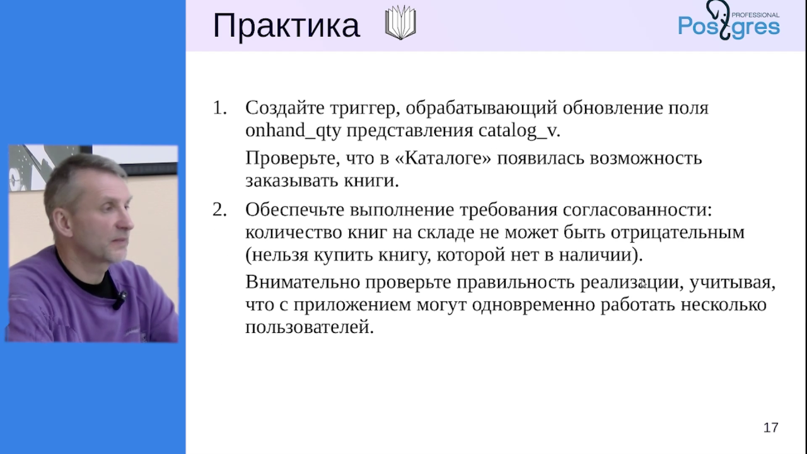

## 10. Сложности триггеров

Триггеры могут нарушать ограничения целостности: ошибка в триггерной функции при каскадном удалении приводит к тому, что строка, которая должна быть удалена, не удаляется; изменчивая (volatile) триггерная функция может видеть результат триггеров BEFORE ROW или INSTEAD OF ROW. Зацикливание не предотвращается: триггер может вызвать срабатывание других триггеров, и PostgreSQL такое зацикливание поймать не может. Код триггеров вызывается неявно, поэтому сложно отследить логику выполнения и отладка практически невозможна; все хорошо в меру, поэтому при использовании триггеров следует соблюдать умеренность. Триггер выполняется как часть транзакции: если в триггере возникает ошибка, вся транзакция откатывается.

*Источник: [00:35:20], [00:58:57]*


## 11. Задание: согласованность склада

Количество книг на складе не может быть отрицательным: нельзя купить книгу, которой нет в наличии. При реализации нужно учитывать, что с приложением могут одновременно работать несколько пользователей. Это нужно, чтобы данные не сломались.

*Источник: [01:00:26]*


## Схема

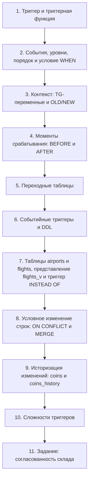

## Итог

> [!success] Что в итоге
> Триггер даёт отреагировать на событие, изменяя, дополняя или отменяя операцию; типы различаются по уровню (statement и row) и моменту срабатывания (BEFORE, AFTER, INSTEAD OF) с фиксированным порядком выполнения, а для одного события триггеры срабатывают в алфавитном порядке. BEFORE ROW может изменить или отменить действие над строкой, тогда как AFTER ROW срабатывает после обработки всех строк и его возвращаемое значение игнорируется, а аудит в AFTER ROW откатывается вместе с транзакцией. INSTEAD OF-триггер делает представление изменяемым, событийные триггеры срабатывают на DDL-события, а на основе триггеров строится историзация: изменения coins пишутся в coins_history с интервалами start_date и end_date, что позволяет восстановить состояние на любой момент времени. Работу с триггерами осложняют возможное зацикливание и неявный вызов, из-за которого отладка практически невозможна, поэтому следует соблюдать умеренность.

