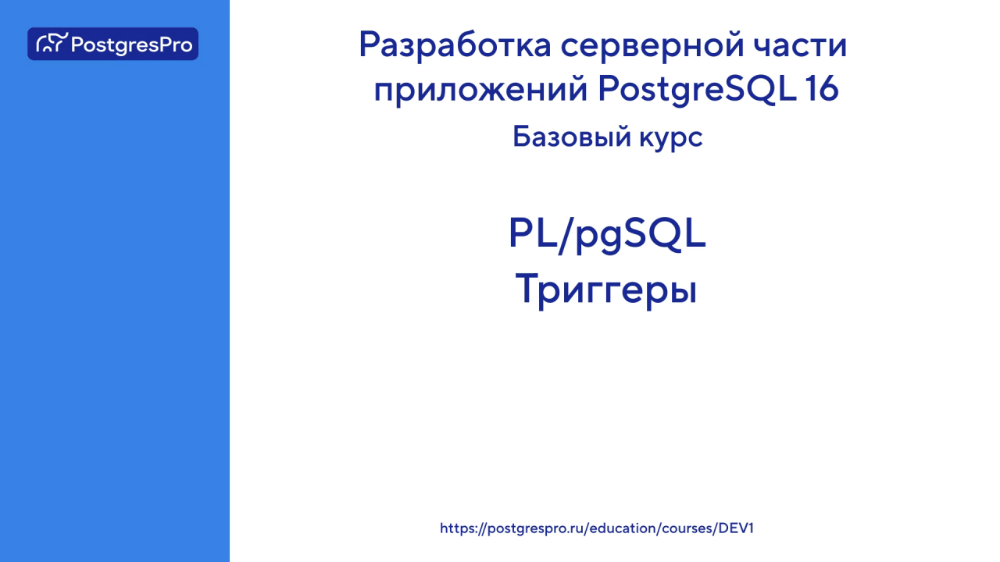
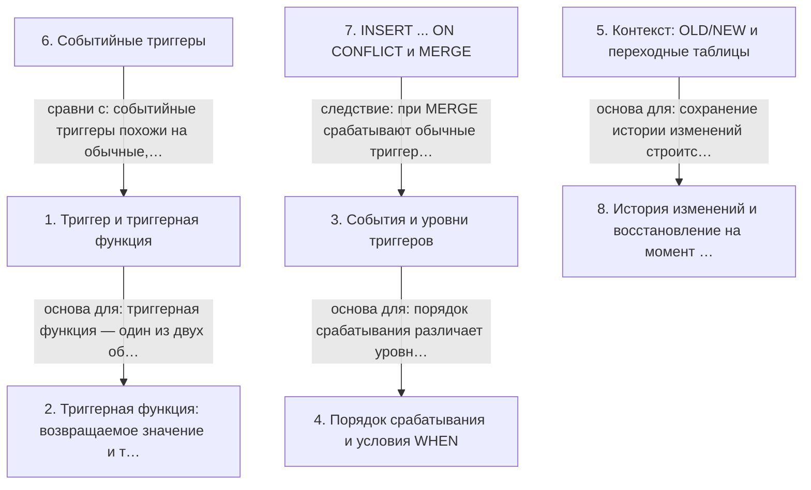

# Триггеры, триггерные функции, INSERT ... ON CONFLICT и MERGE в PostgreSQL

> [!abstract] Обзор
> Материал посвящён триггерам, триггерным функциям и связанным операторам в PostgreSQL. Разбирается, из каких объектов состоит триггер, на какие события он реагирует, какие бывают уровни — оператора и строк, как устроены BEFORE и INSTEAD OF, переменные контекста и OLD/NEW, переходные таблицы. Отдельно рассматриваются событийные триггеры, операторы INSERT ... ON CONFLICT и MERGE, а также условия WHEN и сложности использования триггеров. Показано применение триггеров для аудита и сохранения истории изменений с восстановлением состояния на момент времени. Между собой темы связаны через механику срабатывания: триггерная функция строит триггер, OLD/NEW и переходные таблицы питают проверки и историю, а обычные триггеры обслуживают MERGE.

> [!info] Курс
> [[index|Оглавление курса]]

## Оглавление
1. [[#1. Триггер и триггерная функция]]
2. [[#2. Триггерная функция: возвращаемое значение и транзакция]]
3. [[#3. События и уровни триггеров]]
4. [[#4. Порядок срабатывания и условия WHEN]]
5. [[#5. Контекст: OLD/NEW и переходные таблицы]]
6. [[#6. Событийные триггеры]]
7. [[#7. INSERT ... ON CONFLICT и MERGE]]
8. [[#8. История изменений и восстановление на момент времени]]
9. [[#9. Сложности использования триггеров и volatile-функции]]
10. [[#10. Последовательность как генератор]]

**Схема** — [[#Схема]]
**Итог** — [[#Итог]]

## 1. Триггер и триггерная функция

Триггер — объект базы данных, позволяющий выполнить код в ответ на определённые действия (события). В Postgres при создании триггера нужно создать как минимум два объекта: сам триггер и триггерную функцию — код, выполняемый в ответ на событие. Для представлений можно создать триггер типа INSTEAD OF: он срабатывает вместо действия со строкой, работает только при операциях над представлением и делает представление изменяемым, изменяя базовые таблицы. Например, для представления, объединяющего таблицы аэропортов и авиаперелётов, INSTEAD OF-триггер и функция корректно вносят изменения в нижележащую таблицу Flights. Функция проверки кода аэропорта ищет название по коду в таблице аэропортов; если запрос ничего не вернул, возбуждается исключение, иначе обновляется код аэропорта прибытия в Flights.

> [!info] Зачем это нужно
> Позволяет выполнить код в ответ на определённые действия.

*Источник: [00:00:04]*

> [!quote]- Кадр [00:00:04]
> 

## 2. Триггерная функция: возвращаемое значение и транзакция

Триггерная функция пишется на любом языке программирования, кроме чистого SQL, не принимает параметры и возвращает псевдотип trigger — запись той таблицы или представления, с которым работает. Одна триггерная функция может обслуживать несколько триггеров, имя таблицы она берёт из переменной контекста через динамический SQL, дополняя суффиксом history. Функция должна возвращать строку (возможно, изменённую), которую можно увидеть в RETURNING; если функция возвращает неопределённое значение, действие со строкой отменено; в AFTER-триггере возвращаемое значение игнорируется, так как изменения уже состоялись. Триггерная функция всегда выполняется в той же транзакции, что и основная операция; если внутри неё возникла ошибка, откатится вся транзакция. Триггеры можно использовать для аудита операций, записывая информацию в отдельную таблицу, но при откате транзакции изменения аудита также откатятся.

*Источник: [00:00:04]*

## 3. События и уровни триггеров

Триггеры реагируют на INSERT, UPDATE, DELETE и TRUNCATE (опустошение таблицы) — как для таблиц, так и для представлений. По уровню они делятся на триггеры уровня оператора (statement) и уровня строк (row-level): первые срабатывают на сам факт выполнения операции, даже если ни одна строка не обрабатывается, вторые — для каждой затронутой строки. Для TRUNCATE можно создать только триггер уровня оператора. Триггер before statement срабатывает до выполнения операции, и его возвращаемое значение игнорируется; в его функции можно выполнить проверки применимости операции, например запретить обновление в нерабочее время. Триггер before row срабатывает перед действием с отдельной строкой, может проверять и изменять столбцы, должен вернуть строку (возможно, изменённую) или null.

| Уровень | Когда срабатывает |
| --- | --- |
| Оператора (Statement) | На сам факт выполнения операции |
| Строк (row-level) | Для каждой затронутой строки |

*Источник: [00:00:04]*

## 4. Порядок срабатывания и условия WHEN

Сначала срабатывает триггер уровня оператора, затем BEFORE-триггеры для каждой строки, потом AFTER-триггеры для каждой строки и напоследок AFTER-триггер уровня оператора. Например, при UPDATE сначала срабатывает триггер уровня оператора, затем BEFORE и AFTER уровня строки. События ставятся в очередь, и после обработки всего набора строк отрабатывают накопленные AFTER-триггеры, что вносит дополнительные накладные расходы. Триггеры срабатывают в алфавитном порядке названий, но не стоит полагаться на этот порядок в долговременной перспективе. При создании триггера можно добавить условие WHEN, которое сужает его действие и отфильтровывает события, точно не интересующие.

*Источник: [00:00:04]*

## 5. Контекст: OLD/NEW и переходные таблицы

Триггерная функция не принимает параметров, но имеет доступ к контексту — переменным с префиксом tg_ (например, TG_LEVEL и TG_OP), которые показывают уровень, операцию и имя таблицы или представления. В триггерах доступны OLD и NEW: OLD — строка до изменения, NEW — новое состояние строки; при вставке OLD не определена, при удалении NEW не определена, при UPDATE формируются обе. Переходные таблицы — это таблицы в оперативной памяти сервера, показывающие набор строк, затронутых операцией, до и после её выполнения. Через REFERENCING задаются имена новой и старой переходных таблиц, которые определяются при создании триггера; их хорошо использовать на уровне всего отработавшего оператора. Триггерная функция может анализировать операцию (DELETE или UPDATE) и в цикле построчно вытаскивать информацию из переходной таблицы, тогда как для отдельных строк доступны OLD и NEW.

*Источник: [00:00:04]*

## 6. Событийные триггеры

В Postgres есть событийные триггеры (event triggers) — объекты другого типа, похожие на обычные табличные триггеры; для них отдельно создаются триггер и триггерная функция. Триггерная функция для event triggers не принимает параметры и возвращает псевдотип event-триггер. Обычные триггеры реагируют на DML-операции, а событийные — на события, например на выполнение DDL-команд; одно из событий — DDL Command End (завершение DDL-операции). Событийные триггеры скорее помогают администраторам баз данных, а не разработчикам приложений. CREATE EVENT TRIGGER определяет событие и функцию, а контекст в event trigger берётся не из переменных, а из специальных функций.

*Источник: [00:00:04]*

## 7. INSERT ... ON CONFLICT и MERGE

INSERT ... ON CONFLICT — это один атомарный оператор вставки-обновления (upsert): он пытается вставить строки, а при конфликте по дублированию столбца обновляет соответствующую строку, изменяя значение столбца, всё как одна команда. MERGE сравнивает набор строк и для совпадающих выполняет ветку WHEN MATCHED (изменение или удаление строки), а для строк без соответствия — WHEN NOT MATCHED (вставка новой строки). В PostgreSQL для MERGE нет специальных триггеров: срабатывают обычные триггеры на обновление, удаление и вставку в необходимых случаях. MERGE появился в 15-й версии. При конфликте вставки строки срабатывает триггер на попытку вставки; поскольку возник конфликт, выполняется апдейт, и срабатывает BEFORE-триггер на её изменение.

*Источник: [00:00:04]*

## 8. История изменений и восстановление на момент времени

Популярный пример использования триггеров — сохранение истории изменения строк таблицы: при каждой операции (вставке, изменении, удалении) триггеры автоматически отслеживают изменения и записывают данные в отдельную историческую таблицу. Историческую таблицу той же структуры можно создать через like coins, а затем дополнить столбцами start_date и end_date, в которых учитывается время действия строки. В таблицу истории вставляются те же данные, что и в целевую: начало действия помечается текущим моментом времени (current timestamp), а окончание пока null. Триггерная функция вставляет новую строку с открытым интервалом действия, а отдельная функция закрывает интервал, вписывая текущую дату. Время окончания действия строки совпадает с временем начала новой версии, поэтому получаются сцепленные строки, и по исторической таблице можно восстановить содержимое основной таблицы на любой момент времени.

*Источник: [00:00:04]*

## 9. Сложности использования триггеров и volatile-функции

При построении логики приложения на триггерах тяжело отслеживать выполнение многочисленных триггеров, а отлаживать практически невозможно, потому что код вызывается неявно. Postgres не может поймать зацикливание триггеров, и нужно учитывать порядок вызовов триггеров для одного события. Переходные таблицы удорожают обработку, а использование триггеров может добавить накладных расходов. Функция с категорией изменчивости volatile может увидеть результат действий триггеров before row или instead of row, что может нарушить согласованность данных и ограничения целостности. Например, при каскадном удалении ошибка в триггерной функции приводит к тому, что строка, которая должна быть удалена, не удаляется.

*Источник: [00:00:04]*

## 10. Последовательность как генератор

Последовательность — это генератор, который обслуживает автоинкрементное целочисленное поле.

*Источник: [00:00:04]*

## Схема

## Итог

> [!success] Что в итоге
> Триггеры в Postgres строятся из самого триггера и триггерной функции и реагируют на INSERT, UPDATE, DELETE и TRUNCATE; они бывают уровня оператора и уровня строк, различаются порядком срабатывания и доступом к контексту и переходным таблицам. Триггерная функция выполняется в той же транзакции и возвращает строку или псевдотип trigger, а событийные триггеры являются объектами другого типа. Для операторов INSERT ... ON CONFLICT и MERGE специальных триггеров нет — срабатывают обычные триггеры, при этом MERGE появился в 15-й версии. Триггеры сложно отслеживать и отлаживать из-за неявного вызова, но на них строятся аудит (с откатом вместе с транзакцией) и история изменений со сцепленными интервалами версий и восстановлением состояния на момент времени.

