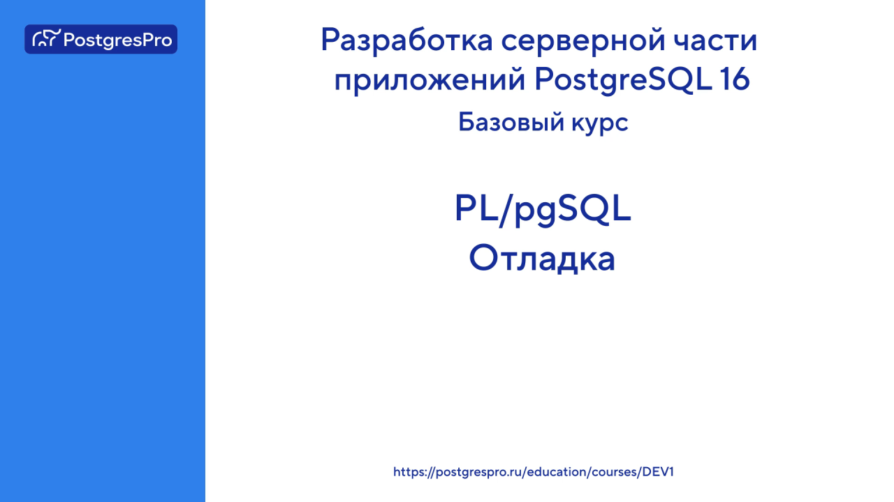
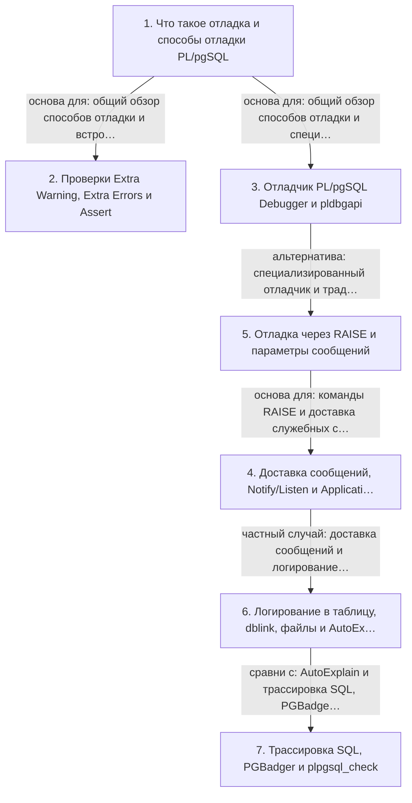

# Отладка PL/pgSQL в Postgres

> [!abstract] Обзор
> Материал об отладке кода PL/pgSQL в Postgres: что понимают под отладкой, какие проверки и параметры помогают выявлять проблемы, как устроен специализированный отладчик PL/pgSQL Debugger и расширение pldbgapi, а также как отлаживать через служебные сообщения. Разбираются команда RAISE и параметры client_min_messages и log_min_messages, процедура DebugMessage с pg_sleep и кастомные параметры уровня вывода. Отдельно рассматривается, куда можно доставлять служебные сообщения: на консоль, в журнал сервера, в таблицу, во внешний файл и другим процессам, включая tail, Notify и Listen, сессионный параметр Application Name, автономные транзакции, dblink и запись через файловую систему. Завершают тему трассировка SQL, её накладные расходы, анализ журналов через PGBadger и расширения AutoExplain и plpgsql_check, а также необходимость выключать трассировку после отладки.

> [!info] Курс
> [[index|Оглавление курса]]

## Оглавление
1. [[#1. Что такое отладка и способы отладки PL/pgSQL]]
2. [[#2. Проверки Extra Warning, Extra Errors и Assert]]
3. [[#3. Отладчик PL/pgSQL Debugger и pldbgapi]]
4. [[#4. Доставка сообщений, Notify/Listen и Application Name]]
5. [[#5. Отладка через RAISE и параметры сообщений]]
6. [[#6. Логирование в таблицу, dblink, файлы и AutoExplain]]
7. [[#7. Трассировка SQL, PGBadger и plpgsql_check]]

**Схема** — [[#Схема]]
**Итог** — [[#Итог]]

## 1. Что такое отладка и способы отладки PL/pgSQL

Отладка — это изучение кода программы на предмет поиска всевозможных ошибок, проблем и неувязок. Основные способы отладки PL/pgSQL — применение специализированного дебаггера либо включение в код приложения инструментария по формированию служебных сообщений. PL/pgSQL Check позволяет выполнять трассировку, результаты которой записываются в журнал. При отладке код выполняется на сервере, а разработчик сидит на клиенте и отлаживает удалённо работающий процесс; отлаживаемый код выполняется в отдельном серверном процессе, а через интерфейсные функции поднимается второй обслуживающий процесс. Расширение PL Debug API представляет собой набор интерфейсных функций, которые неудобно использовать вручную, — API предназначен для того, чтобы функции цеплялись из графических сред, например pgAdmin. Для отладки не требуется изменение кода: он выполняется на сервере, а отладчик подключается извне; вывод сообщений можно отключить изменением значения параметра, причём изменение параметра не требует изменений в коде приложения.

*Источник: [00:00:04]*

> [!quote]- Кадр [00:00:04]
> 

## 2. Проверки Extra Warning, Extra Errors и Assert

Параметры Extra Warning и Extra Errors, будучи включёнными, помогают выявить ряд проблем на этапе компиляции кода и во время выполнения. Команда Assert предоставляет проверки корректности в коде, которые не должны влиять на выполнение программы: они позволяют выявить некорректные параметры, переданные в подпрограммы, — при передаче неправильных значений функция возвращает неверный результат (например, 0). Есть параметры, позволяющие после отладки выключить все ассерты, не изменяя код. Assert проверяет выражение, которое должно вычисляться в логическое значение: если выражение верно, assert ничего не делает, иначе поднимается исключение с соответствующим сообщением.

*Источник: [00:00:04]*


## 3. Отладчик PL/pgSQL Debugger и pldbgapi

Родной отладчик PostgreSQL называется PL/pgSQL Debugger и представляет собой набор функций, для работы с ним следует искать графическое средство. Для использования отладчика нужно установить расширение и загрузить библиотеку Plugin Debugger; загрузка библиотеки требует рестарта экземпляра. Команда CREATE EXTENSION pldbgapi SCHEMA public; создаёт расширение pldbgapi в схеме public, а ответ CREATE EXTENSION подтверждает выполнение. Существует два варианта отладки: установить точку останова (Breakpoint), и отладчик будет ждать, пока код дойдёт до этого места, либо вызвать функцию явно, ввести параметры и пройти её по шагам. Типовые действия при отладке — установка точек прерывания (break point) и пошаговое выполнение, включающее Step Into и Step Over; можно просматривать и устанавливать значения параметров и локальных переменных, а также запускать без остановок и ставить дополнительные точки останова.

```javascript
=> CREATE EXTENSION pldbgapi SCHEMA public;
CREATE EXTENSION
student$ /usr/pgadmin4/bin/pgadmin4 2>/dev/null
```

| Вариант | Как работает |
| Точка останова (Breakpoint) | отладчик ждёт, пока код дойдёт до этого места |
| Явный вызов функции | ввести параметры и пройти функцию по шагам |

*Источник: [00:00:04], [00:09:18], [00:11:02]*


## 4. Доставка сообщений, Notify/Listen и Application Name

При отладке служебные сообщения можно доставлять в различные источники: на консоль, в журнал сообщений, в таблицу, во внешний файл, а также передавать другим процессам. Процессы в Postgres могут обмениваться информацией с помощью команд Notify и Listen, но для отладки этот механизм не очень удобен, потому что он транзакционный: сообщения Notify отправляются слушающему процессу только после завершения и фиксации транзакции, а если транзакция откатится, сообщения вообще не будут отправлены. Для отметки этапов выполнения долгоиграющей функции или процедуры можно изменять сессионный параметр Application Name. Записанное значение видно снаружи из системы мониторинга через представление pg_stat_activity, содержащее столбец application_name и возвращающее по строке на каждый процесс сервера; периодически обращаясь к представлению, можно видеть, как динамически изменяется application_name. Для отслеживания прогресса можно передавать сообщения о текущем шаге (например, «Шаг 1») в параметр названия приложения.

*Источник: [00:00:04]*


## 5. Отладка через RAISE и параметры сообщений

Традиционный приём отладки — помещать в код служебные сообщения. Команда RAISE с уровнями (RAISE NOTICE, RAISE LOG, RAISE INFO) позволяет передавать сообщения клиенту или записывать их в журнал; вызов RAISE NOTICE формирует нужное сообщение независимо от того, что происходит с транзакцией, — команда работает нетранзакционно. Параметры client_min_messages и log_min_messages определяют, при каком уровне сообщение отправляется клиенту или записывается в журнал сервера; сообщение уровня, соответствующего параметру или более высокого, отправляется клиенту, записывается в журнал либо туда и туда, если изменить значения этих параметров. Создаётся процедура DebugMessage, которая содержит один оператор RAISE NOTICE и предназначена для отладки; она вызывается между этапами длительной процедуры для вывода сообщений о текущем этапе, а длительность этапов имитируется с помощью вызовов функции pg_sleep. Пользовательский параметр, имя которого содержит точку, Postgres распознаёт как кастомный параметр и работает с ним как со своим родным параметром уровня сеанса; вызов команды RAISE управляется изменением пользовательского параметра up.racelevel, а при значении NON по умолчанию вывода сообщений не будет. Сообщения, направленные в журнал сервера, можно посмотреть с помощью команды tail из операционной системы.

*Источник: [00:00:04]*


## 6. Логирование в таблицу, dblink, файлы и AutoExplain

Запись служебных сообщений в отдельную таблицу в той же транзакции, что и основной код, считается плохим путём. В ванильном PostgreSQL автономные транзакции отсутствуют, но они реализованы в Postgres Pro Enterprise; для ванильного PostgreSQL предлагается использовать расширение DB-Link, которое входит в состав поставки, — это набор функций для подключения к внешним серверам и выполнения на них запросов, он создаёт новое клиентское соединение, и откат вашей транзакции ему не помешает. При записи служебных сообщений в таблицу log из другого сеанса данные сохраняются даже при откате транзакции. Ещё один способ формировать и записывать служебные сообщения — использование файловой системы сервера: для отладки можно привлечь расширение adminpack, функционал которого в основном касается работы с текстовыми файлами на диске; заводится константа с абсолютным путём к текстовому файлу, в который записываются журнал и сообщения, запись в текстовые файлы выполняется от лица пользователя Postgres операционной системы, писать удастся только в те файлы, до которых Postgres дотянется по своим правам доступа. Серверный код можно писать не только на SQL и PL/pgSQL, но и на недоверенных языках, таких как процедурный Perl и Python, которые позволяют написать код, записывающий необходимую информацию в файлы; вызов функции pg_file.write принимает имя файла, сообщение и логический параметр, указывающий, перезаписывать файл или дописывать, а код выполняется под пользователем postgres. Параметры, позволяющие получить информацию о выполняющихся запросах, записывают в журнал только вызовы верхнего уровня: вложенные вызовы функций и процедур в журнале не видны. Расширение AutoExplain записывает в журнал планы выполнения запросов, в которых можно разглядеть вложенные вызовы и стек вызовов; расширение является штатным, auto_explain входит в поставку Postgres, как и DB-Link, настраивается параметрами и позволяет включать в журнал планы выполнения долгих команд, включая вложенные запросы, а параметр logStatement в значении all включает запись в журнал сервера всех команд: DDL, модификаций данных и всех запросов.

*Источник: [00:00:04]*


## 7. Трассировка SQL, PGBadger и plpgsql_check

В PostgreSQL можно выполнять трассировку SQL, под которой понимается отображение информации о шагах выполнения кода. Существуют параметры, позволяющие включать в журнал информацию о выполнении SQL-запросов; при их включении появляются накладные расходы, и если система производственная и достаточно нагружена, не стоит включать соответствующие параметры глобально, иначе получится огромный лог, который потом будет сложно разобрать. PGBadger — приложение для Postgres, позволяющее анализировать журналы сервера и строить на их основе HTML-отчёты. Расширение plpgsql_check позволяет увидеть трассировку подпрограмм, которые вызывают одна другую; трассировка отображается с вложенностью. В журнале сервера фиксируется факт вызова команды SelectGetCount, туда попадает и последнее действие — команда Reset, выключающая трассировку; трассировку выключают, чтобы лишнего журнала не прилетало, прежде чем заглянуть в журнал сервера, и после отладки с трассировкой нужно выключить трассировку, чтобы журнал не разрастался.

*Источник: [00:00:04]*


## Схема



## Итог

> [!success] Что в итоге
> Отладка PL/pgSQL опирается на проверки корректности и параметры, помогающие выявлять проблемы, а также на специализированный дебаггер PL/pgSQL Debugger с расширением pldbgapi или на служебные сообщения. Сообщения о шагах доставляются на консоль, в журнал, таблицу, внешний файл или другим процессам; логирование в ту же транзакцию считается плохим путём, поэтому применяют автономные транзакции, dblink, отдельный сеанс или файловую систему. Для трассировки используются параметры журналирования и расширения AutoExplain и plpgsql_check, анализ журналов выполняет PGBadger, а после отладки трассировку нужно выключать, чтобы журнал не разрастался.

