# Отладка и трассировка PL/pgSQL в PostgreSQL

> [!abstract] Обзор
> Материал об отладке кода на PL/pgSQL двумя путями: через отладчик plugin_debugger с расширением pldbgapi и pgAdmin 4 и через служебные сообщения. Разбираются проверки корректности через plpgsql_check и ASSERT, архитектура отладчика из двух процессов, установка отладчика и пошаговая отладка. Служебные сообщения выводятся через RAISE разных уровней, уровень выбирает процедура debug_message по параметру app.raise_level, а application_name позволяет отслеживать этапы. Отдельно рассматриваются транзакционность NOTIFY/LISTEN, автономные транзакции в Postgres Pro Enterprise, dblink для сохранения данных при откате, запись в файл через AdminPack и pg_file_write, а также средства трассировки SQL (log_statement, log_min_duration_statement, PGBadger) и auto_explain.

> [!info] Курс
> [[index|Оглавление курса]]

## Оглавление
1. [[#1. Проверки корректности: plpgsql_check и ASSERT]]
2. [[#2. Служебные сообщения: RAISE и уровни]]
3. [[#3. application_name и отслеживание этапов]]
4. [[#4. Отладчик PL/pgSQL: архитектура, установка и pgAdmin 4]]
5. [[#5. Динамическое формирование запроса через format]]
6. [[#6. Трассировка SQL: log_statement, PGBadger, auto_explain]]
7. [[#7. Сохранение отладочных сообщений вне транзакции]]

**Схема** — [[#Схема]]
**Итог** — [[#Итог]]

## 1. Проверки корректности: plpgsql_check и ASSERT

Дополнительные проверки доступны через расширение plpgsql_check; проверки корректности включают проверки времени компиляции и времени выполнения, а параметры plpgsql.extra_warnings и plpgsql.extra_errors помогают выявить ряд проблем на этапе компиляции и во время выполнения. plpgsql_check можно установить и использовать для проверки процедурного кода; оно также позволяет выполнять трассировку PL/pgSQL с записью в журнал (настройки plpgsql_check.enable_tracer, plpgsql_check.tracer, plpgsql_check.tracer_errlevel; надо опасаться большого объёма выдачи). ASSERT предоставляет проверки корректности, не влияющие на выполнение программы, и позволяет проверить корректность входных параметров; он принимает логическое выражение и при ложном значении выбрасывает исключение. Функция entrance принимает floors, flats_per_floor и flat_no, создаётся с атрибутом IMMUTABLE и через ASSERT проверяет, что все параметры больше нуля; вызов entrance(9, 4, 0) приводит к ошибке 'Некорректные входные параметры'. После отладки кода можно выключить все ASSERT специальными параметрами, не изменяя код.

```javascript
>= CREATE OR REPLACE FUNCTION entrance(
    floors integer,
    flats_per_floor integer,
    flat_no integer
)
RETURNS integer
AS $$
BEGIN
    ASSERT floors > 0 AND flats_per_floor > 0 AND flat_no > 0,
        'Некорректные входные параметры';
    RETURN floor((flat_no - 1)::real / (floors * flats_per_floor)) + 1;
END
$$ LANGUAGE plpgsql IMMUTABLE;
CREATE FUNCTION
=> SELECT entrance(9, 4, 0);
ERROR:  Некорректные входные параметры
CONTEXT:  PL/pgSQL function entrance(integer,integer,integer) line 3 at ASSERT

>= CREATE FUNCTION entrance(
    floors integer,
    flats_per_floor integer,
    flat_no integer
  )
  RETURNS integer
  AS $$
  BEGIN
    RETURN floor((flat_no - 1)::real / (floors * flats_per_floor)) + 1;
  END
  $$ LANGUAGE plpgsql IMMUTABLE;

=> CREATE FUNCTION entrance(
    floors integer,
    flats_per_floor integer,
    flat_no integer
  )
  RETURNS integer
  AS $$
  BEGIN
    RETURN floor((flat_no - 1)::real / (floors * flats_per_floor)) + 1;
  END
  $$ LANGUAGE plpgsql IMMUTABLE;

=> CREATE OR REPLACE FUNCTION entrance(
    floors integer,
    flats_per_floor integer,
    flat_no integer
)
RETURNS integer
AS $$
BEGIN
    ASSERT floors > 0 AND flats_per_floor > 0 AND flat_no > 0,
        'Некорректные входные параметры';
    RETURN floor((flat_no - 1)::real / (floors * flats_per_floor)) + 1;
END
$$ LANGUAGE plpgsql IMMUTABLE;
CREATE FUNCTION
=> SELECT entrance(9, 4, 0);
ERROR:  Некорректные входные параметры
CONTEXT:  PL/pgSQL function entrance(integer,integer,integer) line 3 at ASSERT

BEGIN
        ASSERT floors > 0 AND flats_per_floor > 0 AND flat_no > 0,
                'Некорректные входные параметры';
        RETURN floor((flat_no - 1)::real / (floors * flats_per_floor)) + 1;
END

>= CREATE DATABASE plpgsql_debug;

=> ALTER SYSTEM SET shared_preload_libraries = 'plugin_debugger';
ALTER SYSTEM

student$ sudo pg_ctlcluster 16 main restart

student$ psql bookstore
| => CREATE EXTENSION pldbgapi SCHEMA public;
| CREATE EXTENSION

=> CREATE DATABASE plpgsql_debug;

=> ALTER SYSTEM SET shared_preload_libraries = 'plugin_debugger';
ALTER SYSTEM

student$ sudo pg_ctlcluster 16 main restart

student$ psql bookstore
| => CREATE EXTENSION pldbgapi SCHEMA public;
| CREATE EXTENSION
```

*Источник: [00:00:46], [00:02:50], [00:03:10], [00:03:50], [00:04:10], [00:04:50] и др.*

> [!quote]- Кадр [00:00:46]
> 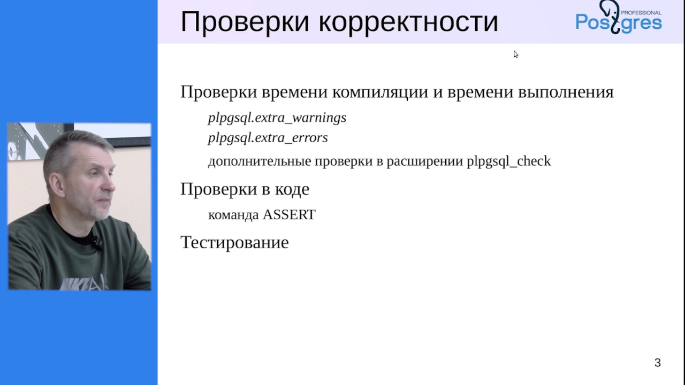

> [!quote]- Кадр [00:37:54]
> 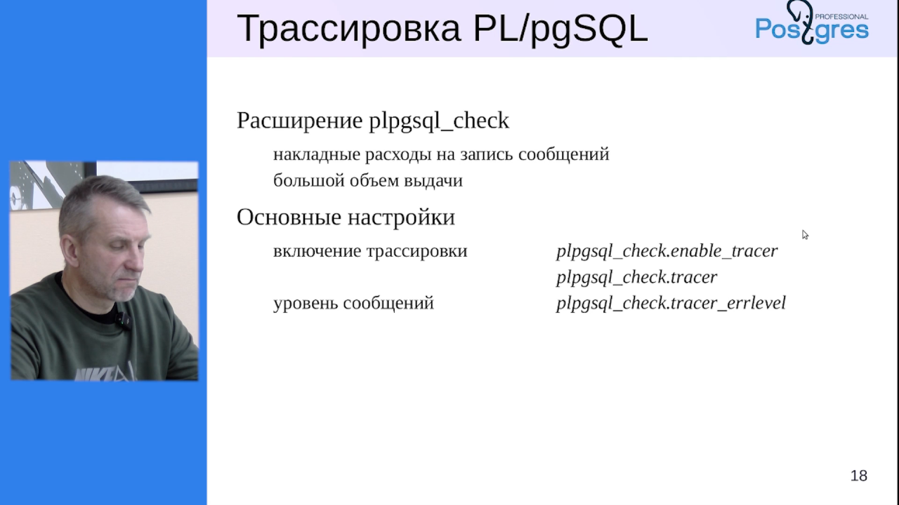

## 2. Служебные сообщения: RAISE и уровни

Отладка может выполняться через специализированный дебаггер, но альтернативный путь — добавление в код инструментария для формирования служебных сообщений: их помещают в код, чтобы получать информацию при отладке, мониторинге долго выполняющихся процессов и ведении журнала приложения. Команда RAISE поддерживает уровни DEBUG, LOG, NOTICE, INFO и WARNING; меняя client_min_messages и log_min_messages, можно организовать вывод сообщений RAISE клиенту, в журнал сервера или в оба места, не меняя код приложения. RAISE NOTICE работает нетранзакционно: сообщения выдаются и записываются независимо от того, когда транзакция фиксируется или откатывается. Процедура debug_message принимает текст msg и выводит его через RAISE с подстановкой '%', а также выводит user и clock_timestamp(); уровень вывода выбирается по значению current_setting('app.raise_level', true) — для NOTICE, DEBUG, LOG, INFO и WARNING выполняется соответствующий RAISE, а ветка ELSE NULL отключает вывод сообщений. Процедура long_running вызывает debug_message на трёх этапах (1/3, 2/3, 3/3) и между вызовами делает задержку через pg_sleep для имитации длительной работы; при значении NONE отладочные сообщения не выдаются, при NOTICE — выдаются в сеансе, а при LOG записываются в журнал сервера.

```go
CREATE FUNCTION get_count(tabname text) RETURNS bigint
AS $$
DECLARE
    cmd text;
    retval bigint;
BEGIN
    cmd := 'SELECT COUNT(*) FROM ' || quote_ident(tabname);
    RAISE NOTICE 'cmd: %', cmd;
    EXECUTE cmd INTO retval;
    RETURN retval;
END
$$ LANGUAGE plpgsql STABLE;

CREATE PROCEDURE long_running()
AS $$
BEGIN
    CALL debug_message('long_running. Stage 1/3...');
    PERFORM pg_sleep(2);
    CALL debug_message('long_running. Stage 2/3...');
    PERFORM pg_sleep(3);
    CALL debug_message('long_running. Stage 3/3...');
    PERFORM pg_sleep(1);
    CALL debug_message('long_running. Done');
END
$$ LANGUAGE plpgsql;

CREATE OR REPLACE PROCEDURE debug_message(msg text)
AS $$
BEGIN
  CASE current_setting('app.raise_level', true)
    WHEN 'NOTICE' THEN RAISE NOTICE   '%, %, %', user, clock_timestamp(), msg;
    WHEN 'DEBUG'  THEN RAISE DEBUG    '%, %, %', user, clock_timestamp(), msg;
    WHEN 'LOG'    THEN RAISE LOG      '%, %, %', user, clock_timestamp(), msg;
    WHEN 'INFO'   THEN RAISE INFO     '%, %, %', user, clock_timestamp(), msg;
    WHEN 'WARNING' THEN RAISE WARNING '%, %, %', user, clock_timestamp(), msg;
    ELSE NULL; -- все прочие значения отключают вывод сообщений
  END CASE;
END
$$ LANGUAGE plpgsql;

=> SET app.raise_level TO 'LOG';
=> CALL long_running();
student$ tail -n 30 /var/log/postgresql/postgresql-16-main.log | grep 'long_running\.'
2024-10-25 10:40:51.388 MSK [9791] student@plpgsql_debug LOG: student, 2024-10-25 10:40:51.388051+03, long_running. Stage 1/3...
	SQL statement "CALL debug_message('long_running. Stage 1/3...')"

SET app.raise_level TO 'NONE';
SET
=> CALL long_running();
CALL
=> SET app.raise_level TO 'NOTICE';
SET
=> CALL long_running();

NOTICE: student, 2024-10-25 10:40:32.888329+03, long_running. Stage 1/3...
NOTICE: student, 2024-10-25 10:40:34.89102+03, long_running. Stage 2/3...

CREATE FUNCTION get_count(tabname text) RETURNS bigint
AS $$
DECLARE
    cmd text;
    retval bigint;
BEGIN
    cmd := 'SELECT COUNT(*) FROM ' || quote_ident(tabname);
    RAISE NOTICE 'cmd: %', cmd;
    EXECUTE cmd INTO retval;
    RETURN retval;
END
$$ LANGUAGE plpgsql STABLE;

CREATE PROCEDURE long_running()
AS $$
BEGIN
    CALL debug_message('long_running. Stage 1/3...');
    PERFORM pg_sleep(2);
    CALL debug_message('long_running. Stage 2/3...');
    PERFORM pg_sleep(3);
    CALL debug_message('long_running. Stage 3/3...');
    PERFORM pg_sleep(1);
    CALL debug_message('long_running. Done');
END
$$ LANGUAGE plpgsql;

CREATE OR REPLACE PROCEDURE debug_message(msg text)
AS $$
BEGIN
  CASE current_setting('app.raise_level', true)
    WHEN 'NOTICE' THEN RAISE NOTICE   '%, %, %', user, clock_timestamp(), msg;
    WHEN 'DEBUG'  THEN RAISE DEBUG    '%, %, %', user, clock_timestamp(), msg;
    WHEN 'LOG'    THEN RAISE LOG      '%, %, %', user, clock_timestamp(), msg;
    WHEN 'INFO'   THEN RAISE INFO     '%, %, %', user, clock_timestamp(), msg;
    WHEN 'WARNING' THEN RAISE WARNING '%, %, %', user, clock_timestamp(), msg;
    ELSE NULL; -- все прочие значения отключают вывод сообщений
  END CASE;
END
$$ LANGUAGE plpgsql;

WHEN 'NOTICE' THEN RAISE NOTICE '%, %, %', user, clock_timestamp(), msg;
WHEN 'DEBUG' THEN RAISE DEBUG '%, %, %', user, clock_timestamp(), msg;
WHEN 'LOG' THEN RAISE LOG '%, %, %', user, clock_timestamp(), msg;
WHEN 'INFO' THEN RAISE INFO '%, %, %', user, clock_timestamp(), msg;
WHEN 'WARNING' THEN RAISE WARNING '%, %, %', user, clock_timestamp(), msg;
ELSE NULL; -- все прочие значения отключают вывод сообщений
END CASE;

=> SET app.raise_level TO 'LOG';
=> CALL long_running();
student$ tail -n 30 /var/log/postgresql/postgresql-16-main.log | grep 'long_running\.'
2024-10-25 10:40:51.388 MSK [9791] student@plpgsql_debug LOG: student, 2024-10-25 10:40:51.388051+03, long_running. Stage 1/3...
	SQL statement "CALL debug_message('long_running. Stage 1/3...')"

=> SET log_statement = 'all';

>= SET log_statement = 'all';
    SET
  => SELECT get_count('pg_views');
  NOTICE:  cmd: SELECT COUNT(*) FROM pg_views
   get_count
   ------------
        141
  (1 row)
  => RESET log_statement;
    RESET
  student$ tail -n 2 /var/log/postgresql/postgresql-16-main.log
  2024-10-25 10:59:00.852 MSK [9791] student@plpgsql_debug LOG:  statement: SELECT get_count('pg_views');
  2024-10-25 10:59:18.096 MSK [9791] student@plpgsql_debug LOG:  statement: RESET log_statement;

=> SET log_statement = 'all';
    SET
  => SELECT get_count('pg_views');
  NOTICE:  cmd: SELECT COUNT(*) FROM pg_views
   get_count
   ------------
        141
  (1 row)
  => RESET log_statement;
    RESET
  student$ tail -n 2 /var/log/postgresql/postgresql-16-main.log
  2024-10-25 10:59:00.852 MSK [9791] student@plpgsql_debug LOG:  statement: SELECT get_count('pg_views');
  2024-10-25 10:59:18.096 MSK [9791] student@plpgsql_debug LOG:  statement: RESET log_statement;

CREATE PROCEDURE long_running()
AS $$
BEGIN
    CALL debug_message('long_running. Stage 1/3...');
    PERFORM pg_sleep(2);
    CALL debug_message('long_running. Stage 2/3...');
    PERFORM pg_sleep(3);
    CALL debug_message('long_running. Stage 3/3...');
    PERFORM pg_sleep(1);
    CALL debug_message('long_running. Done');
END
$$ LANGUAGE plpgsql;

CREATE OR REPLACE PROCEDURE debug_message(msg text)
AS $$
BEGIN
  CASE current_setting('app.raise_level', true)
    WHEN 'NOTICE' THEN RAISE NOTICE   '%, %, %', user, clock_timestamp(), msg;
    WHEN 'DEBUG'  THEN RAISE DEBUG    '%, %, %', user, clock_timestamp(), msg;
    WHEN 'LOG'    THEN RAISE LOG      '%, %, %', user, clock_timestamp(), msg;
    WHEN 'INFO'   THEN RAISE INFO     '%, %, %', user, clock_timestamp(), msg;
    WHEN 'WARNING' THEN RAISE WARNING '%, %, %', user, clock_timestamp(), msg;
    ELSE NULL; -- все прочие значения отключают вывод сообщений
  END CASE;
END
$$ LANGUAGE plpgsql;

CREATE OR REPLACE PROCEDURE debug_message(msg text)
AS $$
BEGIN
    CASE current_setting('app.raise_level', true)
        WHEN 'NOTICE'  THEN RAISE NOTICE  '%, %, %', user, clock_timestamp(), msg;
        WHEN 'DEBUG'   THEN RAISE DEBUG   '%, %, %', user, clock_timestamp(), msg;
        WHEN 'LOG'     THEN RAISE LOG     '%, %, %', user, clock_timestamp(), msg;
        WHEN 'INFO'    THEN RAISE INFO    '%, %, %', user, clock_timestamp(), msg;
        WHEN 'WARNING' THEN RAISE WARNING '%, %, %', user, clock_timestamp(), msg;
        ELSE NULL; -- все прочие значения отключают вывод сообщений
    END CASE;
END
$$ LANGUAGE plpgsql;

SET app.raise_level TO 'NONE';
SET
=> CALL long_running();
CALL
=> SET app.raise_level TO 'NOTICE';
SET
=> CALL long_running();

NOTICE: student, 2024-10-25 10:40:32.888329+03, long_running. Stage 1/3...
NOTICE: student, 2024-10-25 10:40:34.89102+03, long_running. Stage 2/3...
```

*Источник: [00:05:10], [00:14:30], [00:14:50], [00:15:13], [00:17:17], [00:17:37] и др.*

> [!quote]- Кадр [00:05:10]
> 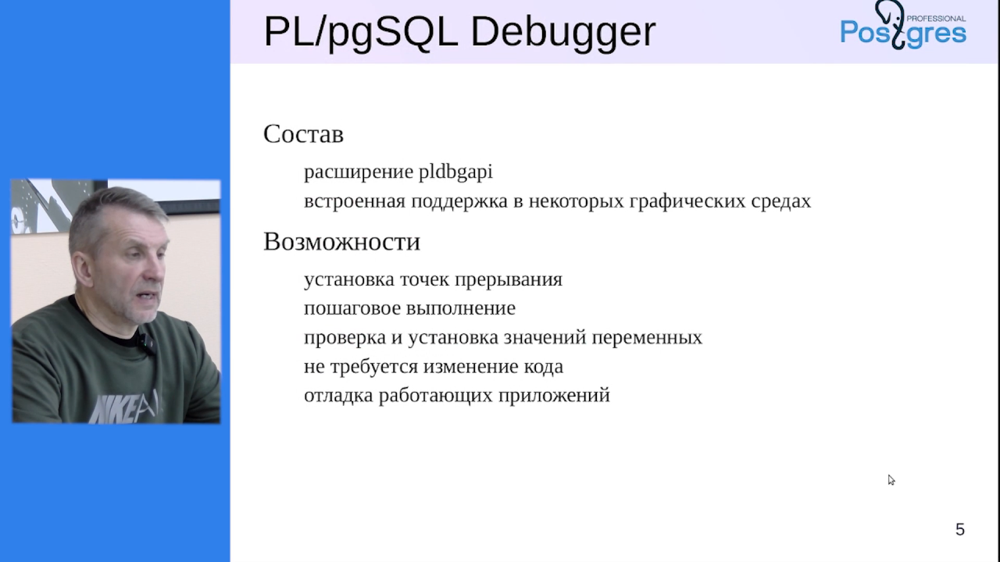

> [!quote]- Кадр [00:14:50]
> 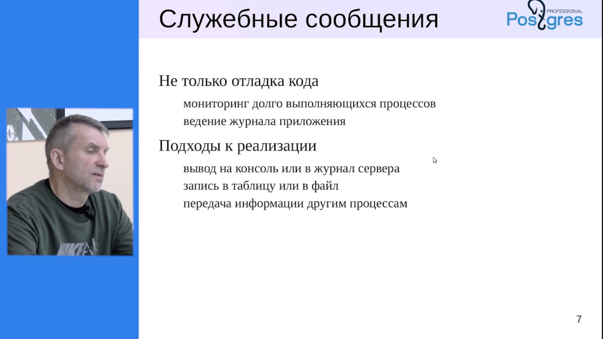

> [!quote]- Кадр [00:41:27]
> 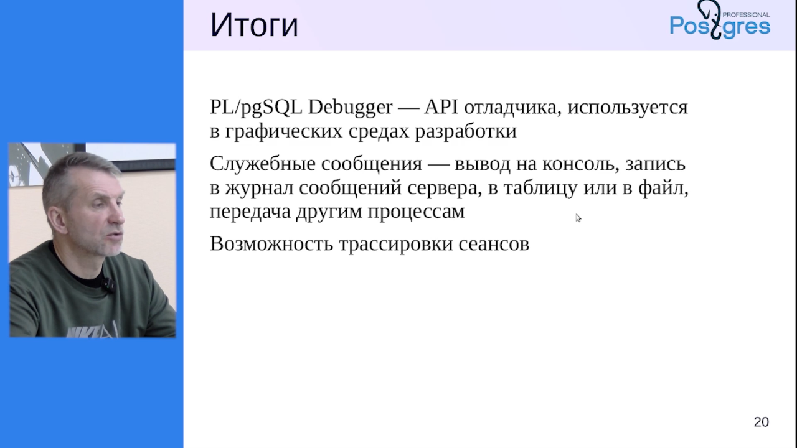

> [!quote]- Кадр [00:15:13]
> 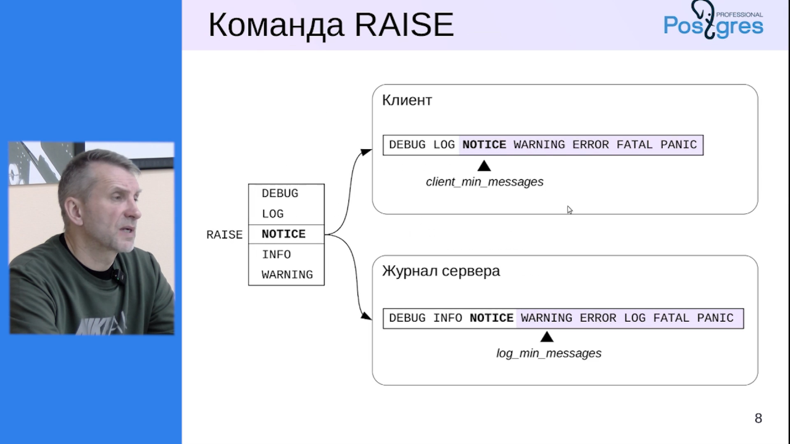

## 3. application_name и отслеживание этапов

application_name — сессионный параметр, относящийся к статусу сеанса; его значение можно менять по ходу выполнения. Он виден в представлении pg_stat_activity и в выводе команды ps, а также может использоваться в журнальных сообщениях. Изменение application_name позволяет отслеживать ход выполнения программы и отмечать этапы выполнения долгоиграющей функции или процедуры; запрос к pg_stat_activity позволяет увидеть application_name активных процессов, исключая собственный процесс. Передаваемое сообщение поступает как параметр msg процедуры: debug_message устанавливает application_name в значение переданного сообщения с помощью set_config с is_local=true. Периодически запрашивая pg_stat_activity, можно видеть изменение названия приложения.

```sql
SELECT pid, username, application_name
FROM pg_stat_activity
WHERE datname = 'plpgsql_debug' AND pid <> pg_backend_pid();

CREATE OR REPLACE PROCEDURE debug_message(msg text)
AS $$
BEGIN
    PERFORM set_config('application_name', format('%s', msg), /* is_local */ true);
END
$$ LANGUAGE plpgsql;
```

> [!info] Зачем это нужно
> Для отслеживания хода выполнения программы.

*Источник: [00:23:04], [00:23:26], [00:25:49], [00:26:09]*

> [!quote]- Кадр [00:23:04]
> 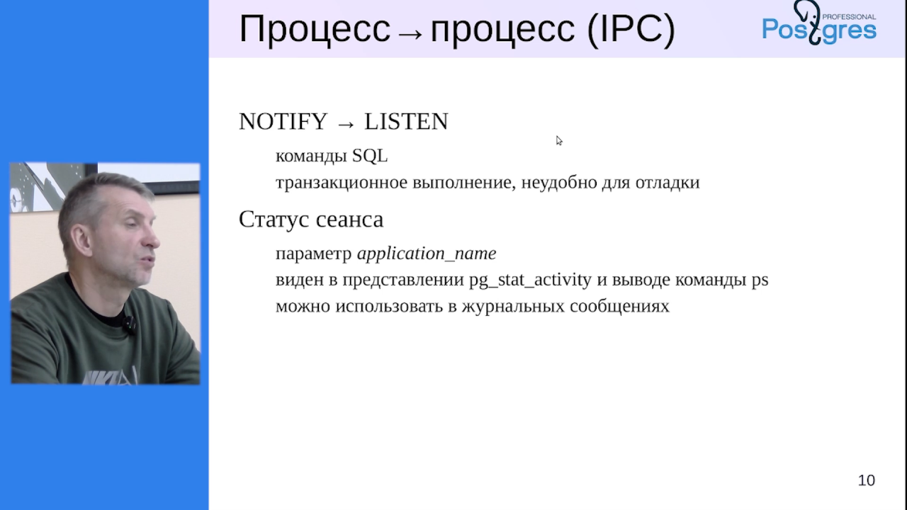

> [!quote]- Кадр [00:23:26]
> 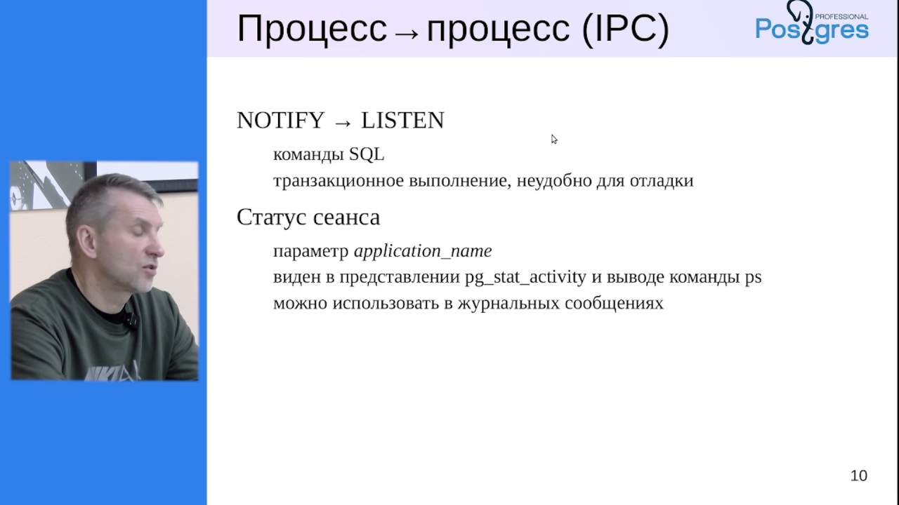

## 4. Отладчик PL/pgSQL: архитектура, установка и pgAdmin 4

Отладчик поднимает второй обслуживающий процесс, который подключается к уже выполняемому серверному процессу, получает из него информацию и управляет его выполнением; в результате есть два процесса: отлаживаемый (с нашим кодом) и вспомогательный, из которого вызываются функции отладки. Отладчик не требует изменения кода и поддерживает отладку работающих приложений; он позволяет устанавливать точки прерывания, выполнять код пошагово, проверять и устанавливать значения переменных. PL/pgSQL Debugger состоит из расширения pldbgapi и встроенной поддержки в некоторых графических средах; pldbgapi — это API отладчика, набор интерфейсных функций для вызова из графических сред разработки, вручную использовать его неудобно. Для использования отладчика нужно установить расширение и загрузить библиотеку plugin_debugger через shared_preload_libraries; загрузка выполняется командой ALTER SYSTEM SET shared_preload_libraries = 'plugin_debugger' и требует перезапуска экземпляра (кластера). После перезапуска создаётся расширение pldbgapi в схеме public; также создаётся новая база данных plpgsql_debug командой CREATE DATABASE, а отладка проводится с помощью графической утилиты pgAdmin 4: в контекстном меню функции есть пункт дебаггинг, можно установить точку останова Breakpoint, при нажатии «Поиск» выполнение перехватывается, доступны кнопки Step into и Step over для пошагового выполнения, запуск без остановок и установка дополнительных точек останова.

```javascript
>= CREATE DATABASE plpgsql_debug;

=> ALTER SYSTEM SET shared_preload_libraries = 'plugin_debugger';
ALTER SYSTEM

student$ sudo pg_ctlcluster 16 main restart

student$ psql bookstore
| => CREATE EXTENSION pldbgapi SCHEMA public;
| CREATE EXTENSION
```

*Источник: [00:02:30], [00:05:10], [00:08:38], [00:09:18], [00:09:59], [00:11:39] и др.*


> [!quote]- Кадр [00:09:18]
> 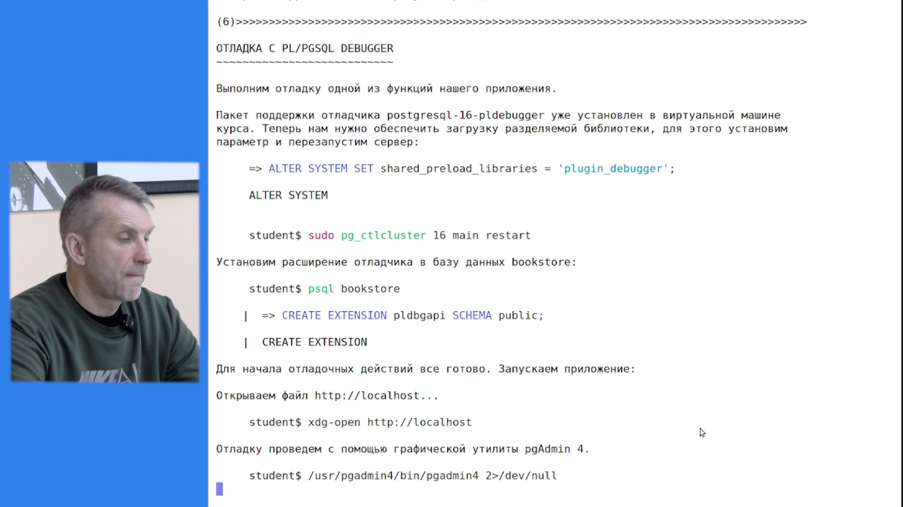

> [!quote]- Кадр [00:14:30]
> 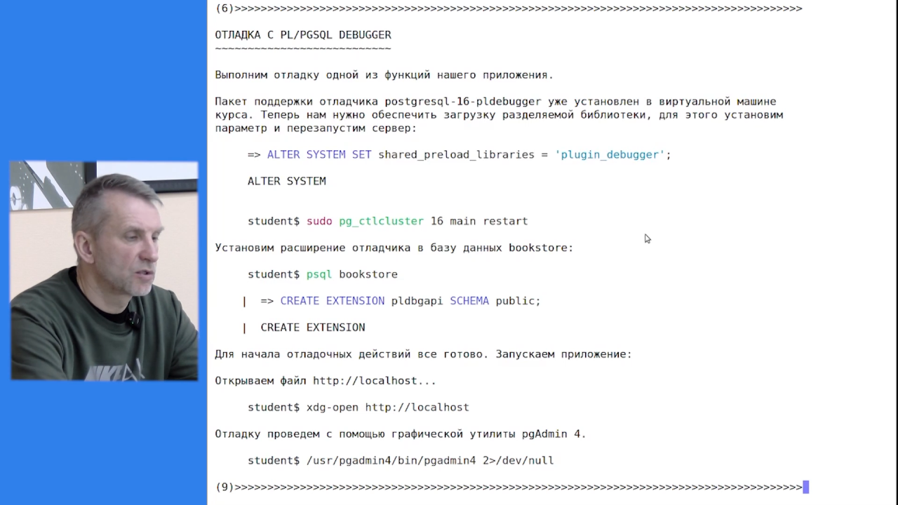

## 5. Динамическое формирование запроса через format

В функции Get Catalog условия фильтрации добавляются динамически; в условиях используется подстановка %L. В блоке DECLARE переменные title_cond, author_cond и qty_cond инициализируются пустыми строками, а cmd объявляется без значения. Если входные параметры book_title или author_name не пусты, соответствующая переменная получает значение через format с шаблоном ' AND cv.title ILIKE %L' / ' AND cv.authors ILIKE %L' и подстановкой '%'||book_title||'%'. Условия title_cond, author_cond, qty_cond конкатенируются в строку cmd, после чего запрос выполняется оператором RETURN QUERY EXECUTE. Локальные переменные описаны в блоке DECLARE, их состояние можно посмотреть внизу; пустые строковые значения отображаются как пустые окошки.

```go
DECLARE
    title_cond text := '';
    author_cond text := '';
    qty_cond text := '';
    cmd text;
BEGIN
    IF book_title != '' THEN
        title_cond := format(
            ' AND cv.title ILIKE %L', '%'||book_title||'%');
    END IF;
    IF author_name != '' THEN
        author_cond := format(
            ' AND cv.authors ILIKE %L', '%'||author_name||'%');
    END IF;

cmd := 'SELECT cv.book_id,
            cv.display_name,
            cv.onhand_qty
        FROM
            catalog_v cv
        WHERE true'
        || title_cond || author_cond || qty_cond || '
        ORDER BY display_name';
RAISE NOTICE '%', cmd;
RETURN QUERY EXECUTE cmd;

DECLARE
    title_cond text := '';
    author_cond text := '';
    qty_cond text := '';
    cmd text;
BEGIN
    IF book_title != '' THEN
        title_cond := format(
            ' AND cv.title ILIKE %L', '%'||book_title||'%'
        );
    END IF;
    IF author_name != '' THEN
        author_cond := format(
            ' AND cv.authors ILIKE %L', '%'||author_name||'%'
        );
    END IF;
```

*Источник: [00:12:03], [00:12:55], [00:13:35]*

## 6. Трассировка SQL: log_statement, PGBadger, auto_explain

Под трассировкой понимается отображение информации о шагах выполнения кода; включение трассировки команд SQL на уровне сервера позволяет проверить, какие команды попадают в журнал сообщений, но после проверки трассировку нужно выключить, и не стоит включать её глобально из-за огромного журнала и накладных расходов. Настройка log_min_duration_statement связана с долго выполняющимися командами, log_statement указывает, какие команды записывать, а log_line_prefix задаёт контекст сообщения. PGBadger — приложение для Postgres, которое позволяет анализировать журналы сервера и строить на их основе HTML-отчёты; стандартные параметры трассировки дают информацию только о вызовах верхнего уровня. Команда SET log_statement = 'all' включает запись всех SQL-запросов (включая DDL, модификации данных и запросы) в лог; динамически формируемый текст запроса можно записать в журнал сообщений сервера, изменив функцию get_catalog. Расширение auto_explain входит в поставку Postgres и не требует внешней установки; загрузка выполняется командой LOAD 'auto_explain', а для трассировки всех команд вне зависимости от длительности и вложенных запросов устанавливают auto_explain.log_min_duration = 0 и auto_explain.log_nested_statements = on; при включении auto_explain.log_nested_statements в лог попадают планы выполнения вложенных запросов, а SET auto_explain.log_level = 'NOTICE' задаёт уровень сообщений NOTICE.

```sql
>= SET log_statement = 'all';
    SET
  => SELECT get_count('pg_views');
  NOTICE:  cmd: SELECT COUNT(*) FROM pg_views
   get_count
   ------------
        141
  (1 row)
  => RESET log_statement;
    RESET
  student$ tail -n 2 /var/log/postgresql/postgresql-16-main.log
  2024-10-25 10:59:00.852 MSK [9791] student@plpgsql_debug LOG:  statement: SELECT get_count('pg_views');
  2024-10-25 10:59:18.096 MSK [9791] student@plpgsql_debug LOG:  statement: RESET log_statement;

=> LOAD 'auto_explain';
LOAD
=> SET auto_explain.log_min_duration = 0;
SET
=> SET auto_explain.log_nested_statements = on;
SET
=> SET auto_explain.log_level = 'NOTICE';
SET
=> SELECT get_count('pg_views');

SELECT get_count('pg_views');
NOTICE:  cmd: SELECT COUNT(*) FROM pg_views
NOTICE:  duration: 0.199 ms  plan:
Query Text: SELECT COUNT(*) FROM pg_views
Aggregate  (cost=19.52..19.53 rows=1 width=8)
  ->  Seq Scan on pg_class c  (cost=0.00..19.16 rows=141 width=0)
        Filter: (relkind = 'v'::"char")

>= LOAD 'auto_explain';

=> LOAD 'auto_explain';
LOAD
=> SET auto_explain.log_min_duration = 0;
SET
=> SET auto_explain.log_nested_statements = on;
SET
=> SET auto_explain.log_level = 'NOTICE';
SET
=> SELECT get_count('pg_views');

SELECT get_count('pg_views');
NOTICE:  cmd: SELECT COUNT(*) FROM pg_views
NOTICE:  duration: 0.199 ms  plan:
Query Text: SELECT COUNT(*) FROM pg_views
Aggregate  (cost=19.52..19.53 rows=1 width=8)
  ->  Seq Scan on pg_class c  (cost=0.00..19.16 rows=141 width=0)
        Filter: (relkind = 'v'::"char")

>= LOAD 'auto_explain';

=> LOAD 'auto_explain';
```

*Источник: [00:16:37], [00:34:44], [00:36:34], [00:38:44], [00:39:24], [00:39:44] и др.*

> [!quote]- Кадр [00:34:44]
> 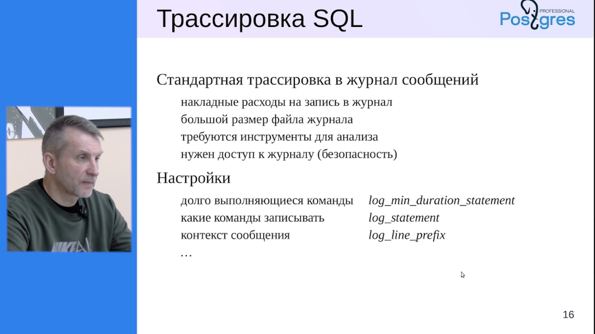

> [!quote]- Кадр [00:36:34]
> 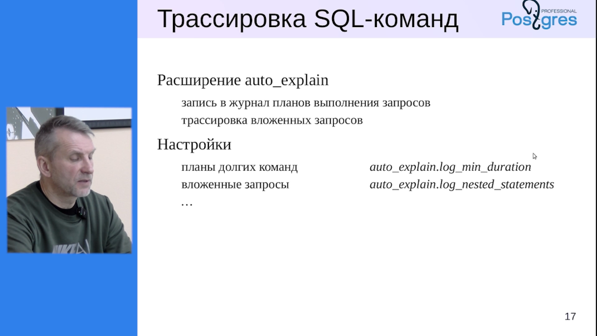

## 7. Сохранение отладочных сообщений вне транзакции

В PostgreSQL команды SQL NOTIFY и LISTEN реализуют межпроцессное взаимодействие (IPC), позволяя процессам обмениваться информацией; их выполнение транзакционное: сообщения отправляются слушающему процессу только после фиксации транзакции, а если транзакция откатится, сообщения не будут отправлены, поэтому механизм не очень удобен для отладки. В ванильном PostgreSQL автономных транзакций нет; они реализованы в форке Postgres Pro Enterprise, где доступны и удобны. dblink — это набор функций, позволяющий подключаться к внешним серверам и выполнять на них запросы; использование dblink создаёт новый бэкенд с отдельной сессией и транзакцией, а откат основной транзакции не влияет на записи через dblink. Расширение dblink входит в состав сервера и имеет накладные расходы на создание соединения; с его помощью можно подключиться и к своему же серверу, создав новое клиентское соединение; процедура debug_message формирует SQL-команду INSERT в таблицу log и выполняет её через dblink, подключаясь к текущей базе, поэтому данные не теряются даже после ROLLBACK основной транзакции. В PostgreSQL можно выполнять трассировку SQL; серверный код можно писать не только на SQL и PL/pgSQL, но и на недоверенных языках, например PL/Perl; расширение AdminPack входит в состав сервера и позволяет записывать текстовые файлы от имени пользователя Postgres операционной системы, а с помощью pg_file_write можно записывать сообщения в файл, и такие записи сохраняются даже после отката транзакции.

```go
CREATE OR REPLACE PROCEDURE debug_message(msg text)
AS $$
DECLARE
    cmd  text;
BEGIN
    cmd  := format(
               'INSERT INTO log (username, ts, message)
                VALUES (%L, %L::timestamptz, %L)',
               user, clock_timestamp()::text, debug_message.msg
           );
    PERFORM dblink('dbname=' || current_database(), cmd);
END
$$ LANGUAGE plpgsql;

=> CREATE EXTENSION adminpack;
   CREATE EXTENSION

=> CREATE OR REPLACE PROCEDURE debug_message(msg text)
   AS $$
   DECLARE
       filename CONSTANT text := '/var/lib/postgresql/log.txt';
       message text;
   BEGIN
       message := format(E'%s, %s, %s\n',
                          session_user, clock_timestamp()::text, debug_message.msg
                     );
       PERFORM pg_file_write(filename, message, /* append */ true);
   END
   $$ LANGUAGE plpgsql;

=> CREATE EXTENSION adminpack;
   CREATE EXTENSION

=> CREATE OR REPLACE PROCEDURE debug_message(msg text)
   AS $$
   DECLARE
       filename CONSTANT text := '/var/lib/postgresql/log.txt';
       message text;
   BEGIN
       message := format(E'%s, %s, %s\n',
                          session_user, clock_timestamp()::text, debug_message.msg
                     );
       PERFORM pg_file_write(filename, message, /* append */ true);
   END
   $$ LANGUAGE plpgsql;

CREATE OR REPLACE PROCEDURE debug_message(msg text)
AS $$
DECLARE
    filename CONSTANT text := '/var/lib/postgresql/log.txt';
    message text;
BEGIN
    message := format(E'%s, %s, %s\\n',
                       session_user, clock_timestamp()::text, debug_message.msg
                  );
    PERFORM pg_file_write(filename, message, /* append */ true);
END
$$ LANGUAGE plpgsql;

CREATE OR REPLACE PROCEDURE debug_message(msg text)
AS $$
DECLARE
    filename CONSTANT text := '/var/lib/postgresql/log.txt';
    message text;
BEGIN
    message := format(E'%s, %s, %s\n',
                       session_user, clock_timestamp()::text, debug_message.msg
                  );
    PERFORM pg_file_write(filename, message, /* append */ true);
END
$$ LANGUAGE plpgsql;
```

| СУБД | Автономные транзакции |
|---|---|
| ванильный PostgreSQL | нет |
| Postgres Pro Enterprise | доступны, удобно |

*Источник: [00:22:44], [00:23:04], [00:23:26], [00:25:29], [00:26:29], [00:28:51] и др.*


> [!quote]- Кадр [00:26:29]
> 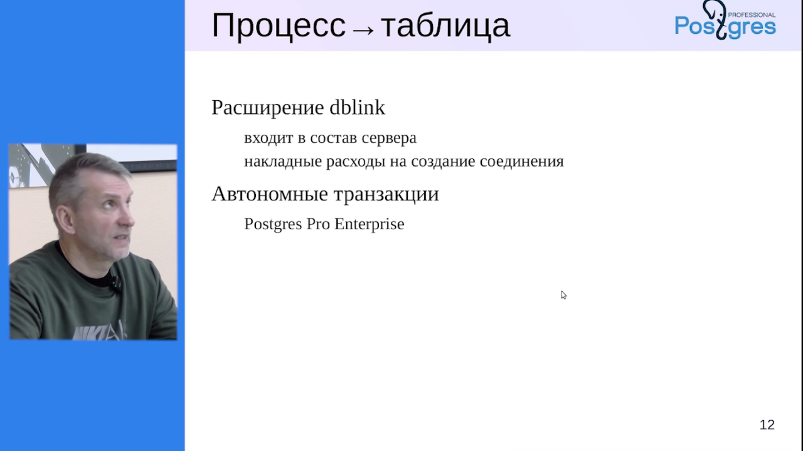

> [!quote]- Кадр [00:31:12]
> 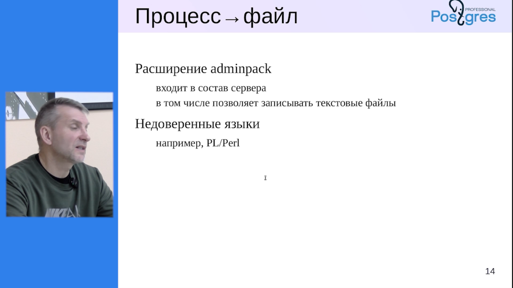

## Схема

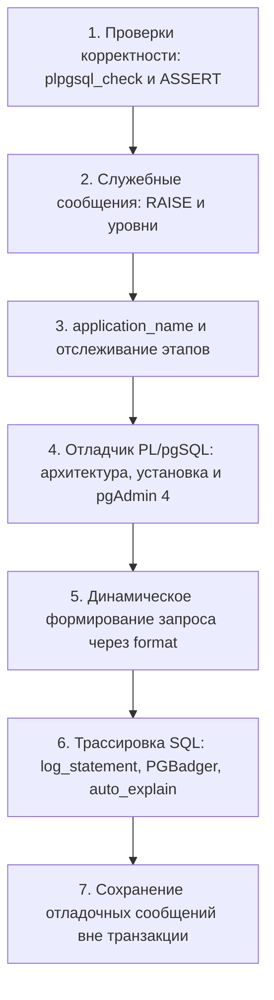

## Итог

> [!success] Что в итоге
> Отладка PL/pgSQL опирается на проверки корректности (plpgsql_check и ASSERT), архитектуру отладчика из двух процессов и отладочный инструментарий pgAdmin 4 с точками останова и пошаговым выполнением. Для вывода отладочных сообщений служат RAISE с параметрами client_min_messages и log_min_messages, уровень через app.raise_level и кастомные параметры с точкой в имени, а application_name позволяет отслеживать этапы. Транзакционность NOTIFY и запись в ту же транзакцию неудобны для отладки, поэтому применяют dblink, сохраняющий данные при откате, и запись в файл через AdminPack/pg_file_write; автономные транзакции есть только в Postgres Pro Enterprise. Для диагностики служат параметры трассировки SQL (log_statement, log_min_duration_statement, log_line_prefix), plpgsql_check, auto_explain и PL/pgSQL Debugger на базе pldbgapi.

