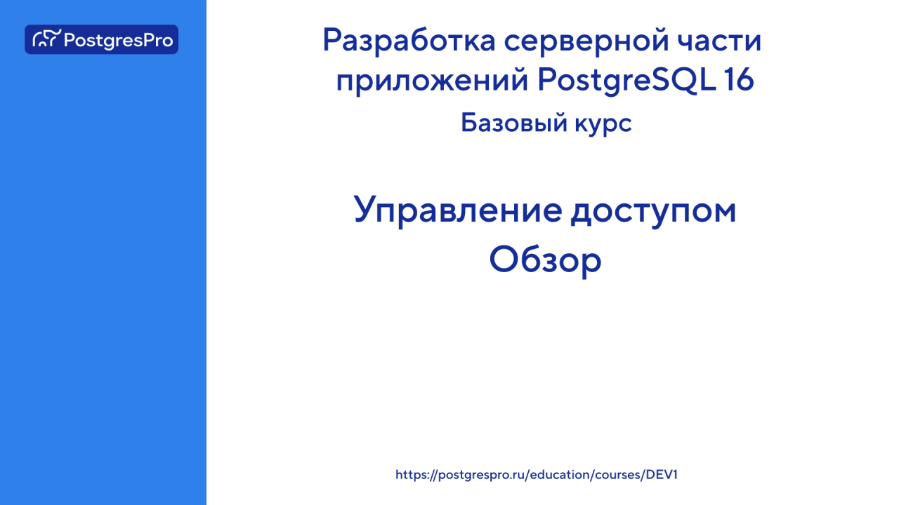
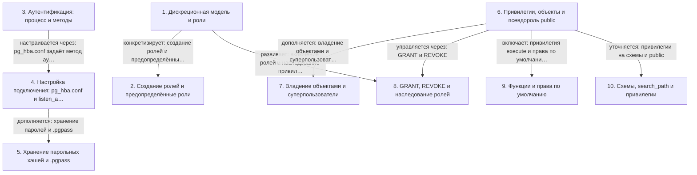

# Управление доступом в PostgreSQL: роли, аутентификация и привилегии

> [!abstract] Обзор
> Материал объединяет две части по управлению доступом в PostgreSQL 16. Сначала разбирается дискреционная модель доступа, роли и их атрибуты, создание ролей, предопределённый пользователь Postgres и предопределённые роли, а также идентификация, аутентификация и авторизация при подключении, файл pg_hba.conf, параметр listen_addresses, методы аутентификации и хранение паролей. Затем тема продолжается привилегиями и объектами, псевдоролью public, привилегиями на уровне столбцов, баз данных и последовательностей, владением объектами, суперпользователями, командами GRANT и REVOKE, включением ролей и наследованием, привилегией execute и функциями security definer, правами по умолчанию и схемами со search_path. Темы связаны последовательно: от модели доступа и ролей — к настройке подключения и аутентификации, а затем к привилегиям и правам на объекты.

> [!info] Курс
> [[index|Оглавление курса]]

## Оглавление
1. [[#1. Дискреционная модель и роли]]
2. [[#2. Создание ролей и предопределённые роли]]
3. [[#3. Аутентификация: процесс и методы]]
4. [[#4. Настройка подключения: pg_hba.conf и listen_addresses]]
5. [[#5. Хранение парольных хэшей и .pgpass]]
6. [[#6. Привилегии, объекты и псевдороль public]]
7. [[#7. Владение объектами и суперпользователи]]
8. [[#8. GRANT, REVOKE и наследование ролей]]
9. [[#9. Функции и права по умолчанию]]
10. [[#10. Схемы, search_path и привилегии]]

**Схема** — [[#Схема]]
**Итог** — [[#Итог]]

## 1. Дискреционная модель и роли

В дискреционной модели доступа есть субъекты и объекты; субъекты могут выполнять действия над объектами, например пользователь может читать данные из таблицы. В PostgreSQL субъектами управления доступом являются роли: отдельных пользователей и групп нет, всё называется словом роль, и отдельного признака «группа» не существует. Роли могут быть индивидуальными пользователями или групповыми субъектами, и роли можно включать друг в друга. Свойства роли определяются набором атрибутов, которые характеризуют роль безотносительно конкретных ресурсов: например, логин, SuperUser, CreateDB, CreateRoll. Атрибуты могут быть включены или выключены; выключенный логин не даёт подключиться под ролью, но такая роль может быть групповой для назначения привилегий.

*Источник: [00:00:04]*

> [!quote]- Кадр [00:00:04]
> 

## 2. Создание ролей и предопределённые роли

Роль создаётся командой CREATE ROLE; при создании можно сразу задать атрибут LOGIN и пароль, а список всех ролей в экземпляре даёт короткая команда du (буква u намекает на users). Если запустить psql без параметров под пользователем student, утилита пытается подключиться к экземпляру с тем же именем; при выводе привилегий psql использует однобуквенные обозначения типов привилегий. При инициализации кластера появляется единственный пользователь, который назначается супер-юзером и наделяется всеми атрибутами; чаще всего его называют Postgres. Существуют предопределённые роли (predefined roles), заранее наделённые особыми полномочиями: они позволяют включённым в них ролям выполнять административные действия, не являясь суперпользователем, то есть это делегирование полномочий. Среди них есть роли для чтения параметров, чтения и записи файлов на сервере, а также чтения и изменения данных во всех таблицах; роль pg_read_all_data используется для разрешения на чтение таблиц, а список предопределённых ролей расширяется с новыми версиями Postgres.

> [!info] Зачем это нужно
> Позволяет делегировать задачи администрирования, не раздавая суперпользовательские полномочия.

*Источник: [00:00:04]*

## 3. Аутентификация: процесс и методы

При подключении к серверу нужно выполнять идентификацию, аутентификацию и авторизацию пользователя: клиент сообщает, к какой базе хочет подключиться, а сервер запрашивает дополнительные данные, например пароль, храня хэш и сравнивая контрольные значения. Пароль можно установить при создании роли и изменить позже командой ALTER ROLE; если настроена явная парольная аутентификация, а у пользователя нет пароля, доступ будет отказан. Метод trust означает разрешить безусловно, reject — безусловно отклонить соединение. MD5 и SCRAM-SHA-256 — парольные методы аутентификации и алгоритмы формирования парольного хэша: MD5 устаревает, SCRAM-SHA-256 современнее, при этом пароли в открытом виде на сервер не прилетают. При внешней аутентификации сервер полагается на то, что пользователя уже аутентифицировала операционная система, и ему нужно сопоставить имя пользователя ОС с именем роли; прямой связи между пользователями ОС и ролями сервера нет.

| Метод | Особенность |
|---|---|
| MD5 | устаревающий способ подсчёта хэша |
| SCRAM-SHA-256 | более современный |

*Источник: [00:00:04]*

## 4. Настройка подключения: pg_hba.conf и listen_addresses

В postgresql.conf параметр listen_addresses задаёт список интерфейсов, которые сервер прослушивает для входящих соединений; по умолчанию там указан localhost или строка закомментирована, а чтобы разрешить подключения, обычно вписывают звёздочку для всех интерфейсов. Настройка аутентификации требует установки правил в файле pg_hba.conf, который располагается там же, где основной файл postgresql.conf; это набор строк, каждая из которых является правилом доступа, а не строками «ключ — значение», и изменения воспринимаются сервером при перечитывании параметров. Первые четыре столбца включают тип запрашиваемого подключения и базу данных: роли можно явно указать через запятую или задать список баз данных, ключевое слово all означает любую роль или любую базу, в столбце адрес может быть all, конкретный адресат или адреса подсетей. Первый столбец — тип подключения: local означает локальное подключение через сокеты операционной системы, host — через сетевой стек, также возможны варианты host с явным указанием использования или неиспользования SSL/TLS. Сервер просматривает файл сверху вниз и берёт метод аутентификации из пятого столбца первой подходящей строки, правила располагаются от конкретных к общим, а если ни одно правило не соответствует, подключение не состоится; HBA — это Host-Based Authentication (аутентификация на основе хоста), а функция pg-hba-file-rules показывает содержимое файла в табличном виде.

*Источник: [00:00:04]*

## 5. Хранение парольных хэшей и .pgpass

Парольные хэши хранятся в системном каталоге в таблице pg_authid, заглянуть в которую может только суперпользователь. Пароль можно вводить на клиенте вручную или подцеплять из переменной окружения PGPASSWORD. Использование PGPASSWORD неудобно, если подключаться к разным экземплярам, разным базам и разными ролями, так как переменную нужно постоянно изменять. Существует файл .pgpass, предназначенный для паролей: его нужно положить в домашний каталог пользователя, он содержит строки с информацией об экземпляре, куда вы подключаетесь, и пароль в открытом виде. Для безопасности на файл должны быть установлены права 600, и это удобный способ не вводить пароли вручную.

*Источник: [00:00:04]*

## 6. Привилегии, объекты и псевдороль public

Привилегии связывают субъекты с объектами и определяют права доступа ролей к объектам; объекты — это всё, что есть в СУБД: в первую очередь таблицы, а также представления и хранимый код. В строке вывода привилегий часть до знака равно указывает роль, получившую привилегии, далее перечислены сами привилегии и субъект, их выдавший; псевдороль public неявно включает все остальные роли, и если слева от знака равно пусто, привилегия относится к public. Роль public имеет право подключаться к любой базе данных, доступ к системному каталогу и право выполнять любые подпрограммы; эти привилегии выдаются заново любой создаваемой роли, поэтому свежесозданная роль получает небезопасный набор привилегий, а в PostgreSQL есть механизм привилегий по умолчанию. Некоторые привилегии можно определять на уровне отдельных столбцов: например, не разрешать читать всю таблицу, а только определённые столбцы; если в SELECT использовать *, запрос завершится отказом, так как право на чтение есть только на конкретный столбец. Для баз данных определена привилегия Connect — разрешение на подключение к конкретной базе; привилегия Create означает возможность создавать в этой базе схемы; привилегия Temporary предназначена для создания временных объектов и вынесена на уровень базы данных, потому что Postgres сам управляет названиями временных схем; привилегия select для последовательности позволяет получить её текущее значение, а привилегия usage — получить текущее значение и переключить последовательность на следующее.

| Привилегия | Возможности |
|---|---|
| select | получить текущее значение |
| usage | получить текущее значение и переключить на следующее |

*Источник: [00:00:04]*

## 7. Владение объектами и суперпользователи

У каждого объекта в СУБД Postgres есть владелец — изначально это роль, создавшая объект. Владением можно управлять: роль может передавать объекты во владение другим ролям. Владелец изначально может делать со своим объектом всё, что хочет: все предусмотренные привилегии, а также действия, не регламентированные привилегиями, например удаление таблицы целиком (drop), и может выдавать и отзывать привилегии. Суперпользователи — это роли, в которых атрибут суперпользователя включён; для них никакие проверки доступа не выполняются, доступ ко всем объектам полный.

*Источник: [00:00:04]*

## 8. GRANT, REVOKE и наследование ролей

Привилегиями можно управлять с помощью команды grant или revoke: grant даёт привилегию, revoke отзывает. Привилегии можно выдавать по отдельности или все сразу; пользователь может выдать привилегию другому пользователю на конкретный объект. Командами GRANT и REVOKE также выполняется включение и исключение ролей, и их не следует путать с GRANT и REVOKE для привилегий; роль становится групповой, если в неё включены другие роли, а специального признака групповой роли нет. При включении пользователя в групповую роль он получает привилегии, назначенные этой роли, например SELECT на все таблицы и USAGE на все схемы, и может обращаться к данным в любой схеме; при этом проверяется, что разграничение доступа не нарушается: роли Reader выдают только usage, а роли Writer — create и usage на схему public. Опция SET позволяет явно переключиться в групповую роль и выполнять действия от её лица, а INHERIT означает использование привилегий группы без явного переключения роли.

| Опция | Поведение |
|---|---|
| SET | явное переключение в групповую роль |
| INHERIT | использование привилегий группы без явного переключения роли |

*Источник: [00:00:04]*

## 9. Функции и права по умолчанию

Для функций и процедур существует единственная привилегия — execute, которая разрешает или запрещает выполнять этот хранимый код; всем пользователям по умолчанию сразу разрешается запускать любой хранимый код, и по умолчанию подпрограмма выполняется с правами вызывающего. Хранимый код можно определить как security definer, тогда он выполняется с правами владельца, того, кто его создал; если Алиса создаёт функцию, а Боб вызывает её, возникает ошибка, когда в теле функции есть обращение к таблице T2, на которую у Боба нет прав. Если в теле функции не указано квалифицированное имя таблицы, то при вызове от имени разных пользователей каждый обращается к своей таблице. Можно заранее указать, что при появлении новых таблиц в схеме сразу разрешается право читать и записывать в них такой-то роли; это похоже на работу Linux с default ACL на каталоги, когда права задаются заранее до появления объектов. Команда ALTER DEFAULT PRIVILEGES для определённой роли отзывает привилегию выполнения на весь хранимый код из схемы public, как только этот код будет создан пользователем Alice, а другая команда позволяет точечно разрешать использование вновь создаваемых процедур и функций пользователю BOP; механизм привилегий по умолчанию позволяет заранее сообщить Postgres, какие привилегии должны быть назначены объекту, которого ещё не существует.

> [!info] Зачем это нужно
> Позволяет не давать прямого доступа к объектам — пользователь получает данные через функцию от лица владельца.

*Источник: [00:00:04]*

## 10. Схемы, search_path и привилегии

Таблицы пользователя попадают в схему, совпадающую по имени с этим пользователем. По умолчанию search_path первым элементом содержит $user, поэтому при наличии схемы с именем пользователя она подставляется впереди public; это удобно, так как пользователь может создавать таблицы, не указывая квалифицированное имя схемы. Привилегия USAGE на схему позволяет обратиться к схеме, но не даёт доступа к таблице: после выдачи USAGE пользователь всё ещё получает ошибку, пока ему не выданы привилегии на таблицу; если нет доступа к содержимому схемы, SELECT к таблице завершается ошибкой «Permission denied for schema», и до проверки привилегий на саму таблицу дело не доходит. Если у пользователя нет привилегий для создания схем в базе данных, попытка создать одноимённую схему завершается ошибкой «Запрещено»; команда dn+ выводит список схем и позволяет просматривать информацию о привилегиях на конкретные схемы, в её выводе есть колонка Access Privileges. Разрешение на создание объектов в схеме public нужно выдавать абсолютно явно, а раньше в схеме public разрешалось создавать всем любые объекты.

*Источник: [00:00:04]*

## Схема

## Итог

> [!success] Что в итоге
> Управление доступом в PostgreSQL строится на ролях с их атрибутами и на дискреционной модели, где субъекты действуют над объектами; роли можно включать друг в друга и наследовать привилегии. Подключение проходит идентификацию, аутентификацию и авторизацию, настраивается через правила в pg_hba.conf и параметр listen_addresses, а методы аутентификации включают trust, reject, MD5, SCRAM-SHA-256 и внешнюю аутентификацию при хранении хэшей в pg_authid. Привилегии связывают роли с объектами, задаются для столбцов, баз данных и последовательностей, управляются командами GRANT и REVOKE, а объекты имеют владельца с полными правами; суперпользователи обходят проверки доступа. Отдельно рассматриваются псевдороль public с широким набором привилегий по умолчанию, функции security definer и права по умолчанию для ещё не созданных объектов.

