# Роли, аутентификация и привилегии в PostgreSQL

> [!abstract] Обзор
> Материал объясняет разграничение доступа в PostgreSQL: роли как субъекты доступа, их атрибуты, вложение друг в друга, членство и предопределённые роли. Отдельно разбирается подключение к серверу и аутентификация через файл pg_hba.conf: порядок правил, типы подключения local и host, параметр listen_addresses, методы trust, reject, scram-sha-256, md5 и peer, а также способы ввода пароля и хранение парольных хэшей. Вторая часть посвящена привилегиям: их уровням (столбцы, таблицы, базы данных, схемы, табличные пространства, последовательности), владельцам объектов, привилегиям по умолчанию и управлению командами grant и revoke. Показано, что доступ к схеме не подразумевает доступ к таблице, разобраны ошибки permission denied и псевдороль public. Для хранимого кода объясняются единственная привилегия EXECUTE, характеристики SECURITY INVOKER и SECURITY DEFINER и поведение функции foo в зависимости от контекста пользователя. Связующая идея — кто является субъектом доступа, как он подтверждает личность при подключении и какие права получает на объекты.

> [!info] Курс
> [[index|Оглавление курса]]

## Оглавление
1. [[#1. Роли: субъекты, владельцы и атрибуты]]
2. [[#2. Членство в ролях и предопределённые роли]]
3. [[#3. Файл pg_hba.conf, типы подключения и listen_addresses]]
4. [[#4. Методы аутентификации и парольная аутентификация]]
5. [[#5. Привилегии на объекты и команды grant/revoke]]
6. [[#6. Доступ к базам, схемам и search_path]]
7. [[#7. Привилегия EXECUTE и характеристики безопасности функций]]
8. [[#8. Псевдороль public и просмотр привилегий]]

**Схема** — [[#Схема]]
**Итог** — [[#Итог]]

## 1. Роли: субъекты, владельцы и атрибуты

В PostgreSQL субъектами доступа являются роли; они делятся на суперпользователей, владельцев объектов и остальные роли. Суперпользователи имеют полный доступ ко всем объектам, и для них проверки доступа не выполняются. У каждого объекта есть владелец — изначально роль, создавшая объект; владелец изначально получает все привилегии на объект (их можно отозвать), а остальные роли получают доступ только в рамках выданных привилегий. Действие DROP не регламентируется привилегиями, поэтому владелец может удалить свой объект. Свойства роли задаются атрибутами — LOGIN, SUPERUSER, CREATEDB, CREATEROLE и другими, которые можно включать и выключать; при выключенном LOGIN подключиться под ролью нельзя. Команда CREATE ROLE создаёт роль с нужными атрибутами, список ролей показывает \du, а CREATE DATABASE создаёт базу данных; в примере роль writer получает create и usage на схему public, роль reader — только usage, а у псевдороли public отзываются все привилегии на схему public.

```javascript
student=# CREATE ROLE alice LOGIN PASSWORD 'alice';
CREATE ROLE
student=# \du
student=# CREATE DATABASE access_overview;

alice=> CREATE TABLE t2(n numeric, who text DEFAULT current_user);

alice=> SELECT current_schemas(false);
current_schemas
-----------------
{alice,public}
(1 row)
```

*Источник: [00:01:05], [00:03:20], [00:03:47], [00:04:07], [00:04:37], [00:21:05] и др.*

> [!quote]- Кадр [00:01:05]
> 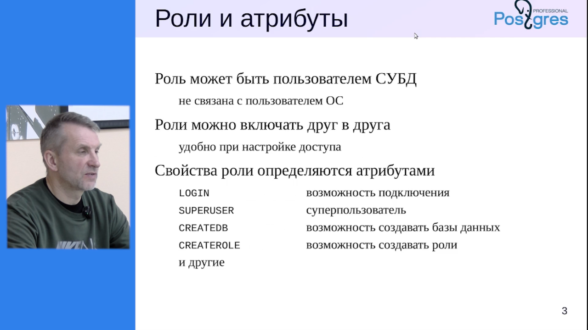

> [!quote]- Кадр [00:22:33]
> 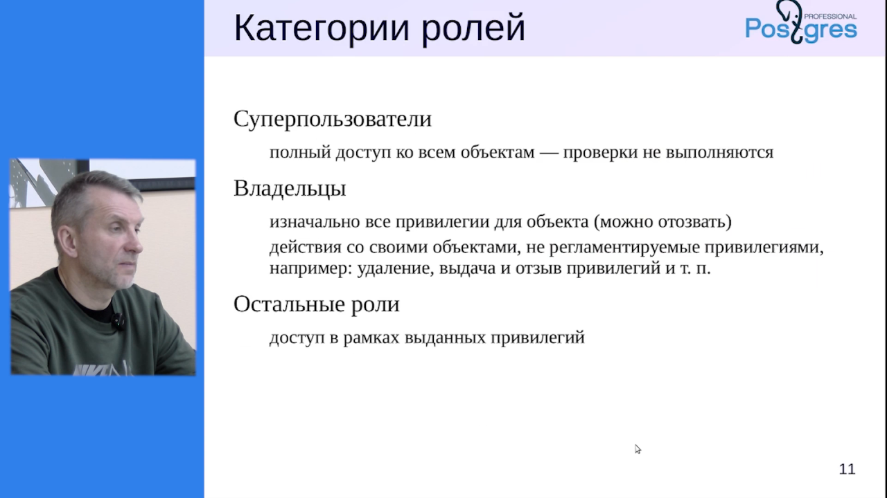

> [!quote]- Кадр [00:21:05]
> 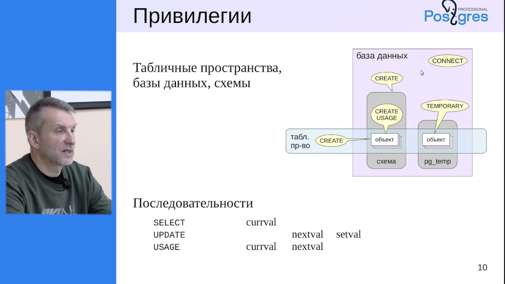

> [!quote]- Кадр [00:48:24]
> 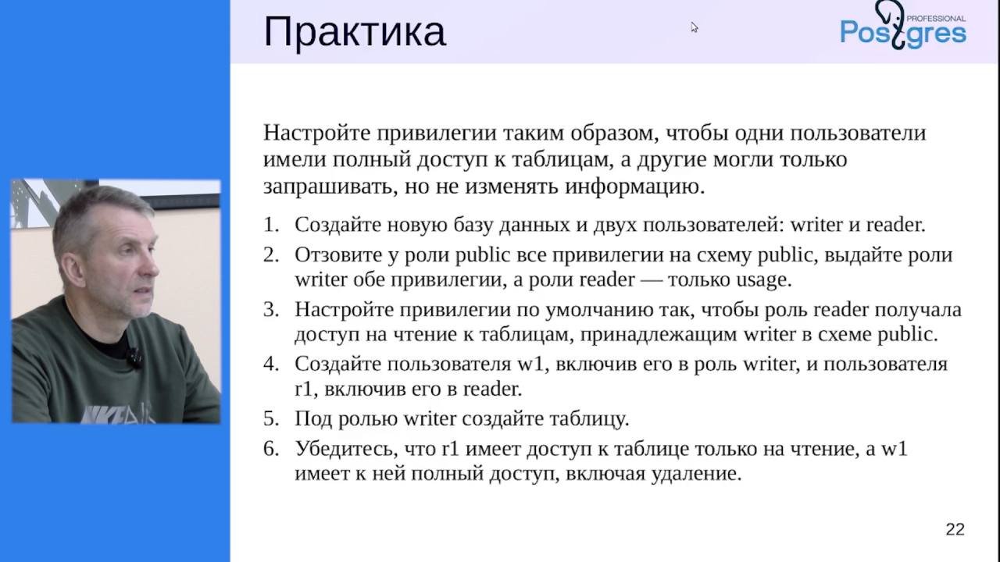

## 2. Членство в ролях и предопределённые роли

Роли можно включать друг в друга, что позволяет использовать роль как групповую для назначения привилегий; сам факт включения делает роль групповой, и Боб может явно переключиться на неё специальной командой, а информацию о членстве показывает короткая команда — видно, что bob состоит в групповой роли и кто его включил. Атрибут inherit означает использование привилегий группы без явного переключения, и по умолчанию Боб получает все возможности и привилегии групповой роли. В столбце Options команды psql настройки включения в группу обозначаются так: SET — возможность переключения на групповую роль, INHERIT — использование привилегий группы без переключения. В Postgres есть предопределённые роли с особыми полномочиями, созданные, чтобы делегировать администрирование без выдачи суперпользователя; например, pg_read_all_data работает так, будто пользователю выдали SELECT на все таблицы и usage на все схемы. Список предопределённых ролей расширяется с версиями, а разрешение создавать объекты в схеме public в новых версиях нужно давать явно.

*Источник: [00:01:05], [00:33:53], [00:34:43], [00:35:08], [00:35:47], [00:36:07] и др.*


> [!quote]- Кадр [00:41:02]
> 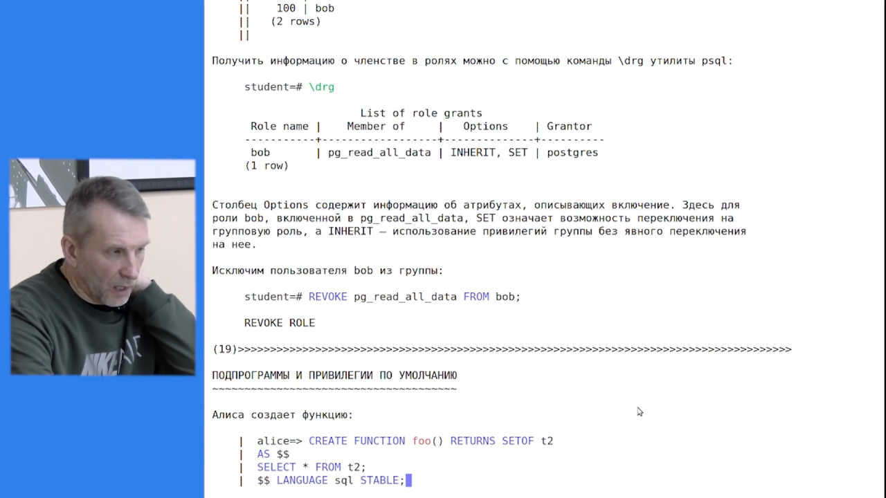

## 3. Файл pg_hba.conf, типы подключения и listen_addresses

Клиент, подключаясь к серверу, сообщает, что это такой-то пользователь и он хочет подключиться к такой-то базе; сервер при необходимости запрашивает дополнительные данные, например пароль, то есть выполняет аутентификацию. Файл pg_hba.conf (Host-Based Authentication, HBA) — текстовый набор строк-правил доступа, который правится вручную; строки просматриваются сверху вниз, и выбирается первая запись, соответствующая параметрам подключения (тип, база, пользователь, адрес), поэтому конкретные правила размещают выше общих. Файл лежит там же, где все настроечные файлы; вместо просмотра из операционной системы используется функция pg_hba_file_rules, показывающая содержимое в табличном виде, а изменения воспринимаются сервером при перечитывании параметров. В pg_hba.conf ключевое слово all в столбцах USER, DATABASE и ADDRESS означает любую роль, любую базу и любой IP соответственно; команда SHOW hba_file; возвращает путь к файлу. Тип подключения может быть local — через сокет операционной системы — или host — через сетевой стек; чтобы подключение заработало, в postgresql.conf нужен параметр listen_addresses, задающий список прослушиваемых интерфейсов (по умолчанию localhost или закомментировано, часто вписывают звёздочку для всех интерфейсов). Для пользователя student по умолчанию срабатывает первое правило local {all} {all} trust, дающее безусловный вход.

```
student=# SHOW hba_file;

        hba_file
-----------------------------------
 /etc/postgresql/16/main/pg_hba.conf
(1 row)

student=# SELECT type, database, user_name, address, auth_method
FROM pg_hba_file_rules();

 type  | database | user_name | address | auth_method
-------+----------+-----------+---------+------------
 local | {all}    | {all}     |         | trust
 host  | {all}    | {all}     | 127.0.0.1 | scram-sha-256
 host  | {all}    | {all}     | ::1       | scram-sha-256
```

local — подключение через сокет операционной системы
host — подключение через сетевой стек

*Источник: [00:05:37], [00:16:40], [00:17:20], [00:17:43], [00:18:04], [00:18:45] и др.*

> [!quote]- Кадр [00:05:37]
> 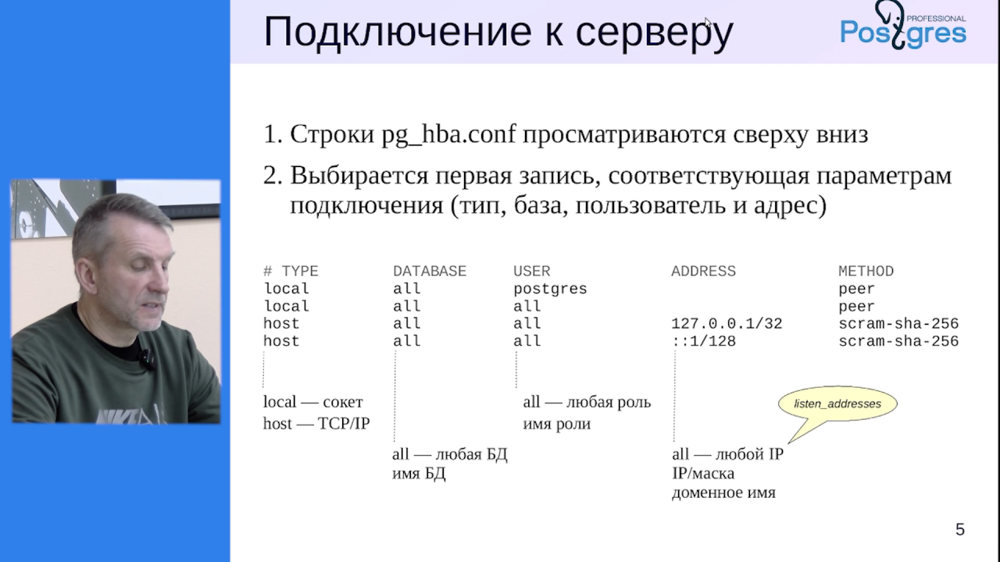

## 4. Методы аутентификации и парольная аутентификация

При совпадении первых четырёх столбцов правила pg_hba.conf сервер смотрит в пятый столбец и выполняет аутентификацию указанным методом: trust разрешает подключение безусловно, reject безусловно отказывает, scram-sha-256 и md5 — парольные методы (алгоритмы формирования парольного хэша), при которых пароль в открытом виде на сервер не прилетает, а сервер хранит хэш и сравнивает контрольные значения. Метод peer спрашивает операционную систему, сопоставляет имя пользователя ОС с именем роли и является внешней аутентификацией: сервер полагается на то, что пользователя уже аутентифицировала ОС, и при наличии одноимённого пользователя можно подключиться под ним. Если не подошла ни одна запись, доступ запрещается; прямой связи между пользователями операционной системы и ролями сервера нет, и совпадение имён не означает соответствия. При парольной аутентификации пользователю без пароля будет отказано; пароль устанавливается при создании роли или меняется командой ALTER ROLE, хранится в системном каталоге pg_authid в виде хэшей, и заглянуть туда может только суперпользователь. Пароль на клиенте можно вводить вручную, брать из переменной окружения PGPASSWORD или из файла ~/.pgpass (формат узел:порт:база:роль:пароль, права 600); имя текущей роли вынесено в приглашение psql, а команда psql со строкой подключения host=localhost user=alice dbname=access_overview password=alicepass подключается к базе access_overview от имени alice.

```javascript
student=# ALTER ROLE alice PASSWORD 'alicepass';
    student$ psql 'host=localhost user=alice dbname=access_overview password=alicepass'
    | alice=> \conninfo

student=# ALTER ROLE alice PASSWORD 'alicepass';
student$ psql 'host=localhost user=alice dbname=access_overview password=alicepass'
```

| Метод | Поведение |
|---|---|
| trust | доступ без проверки |
| reject | безусловный отказ |
| scram-sha-256, md5 | запрос пароля |
| peer | спрашивает ОС |

*Источник: [00:05:17], [00:05:37], [00:11:27], [00:14:25], [00:19:05], [00:19:25] и др.*


> [!quote]- Кадр [00:11:27]
> 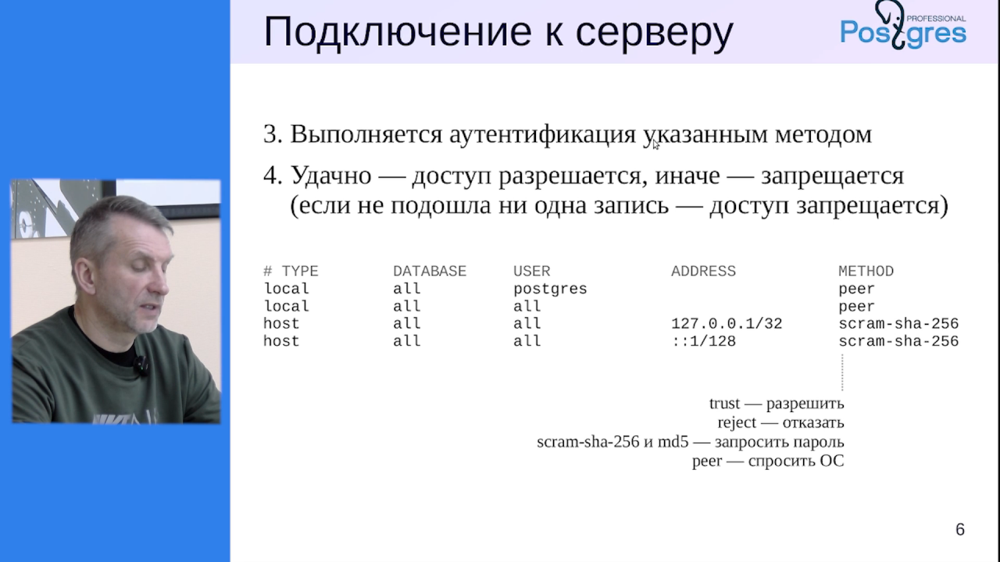

> [!quote]- Кадр [00:14:25]
> 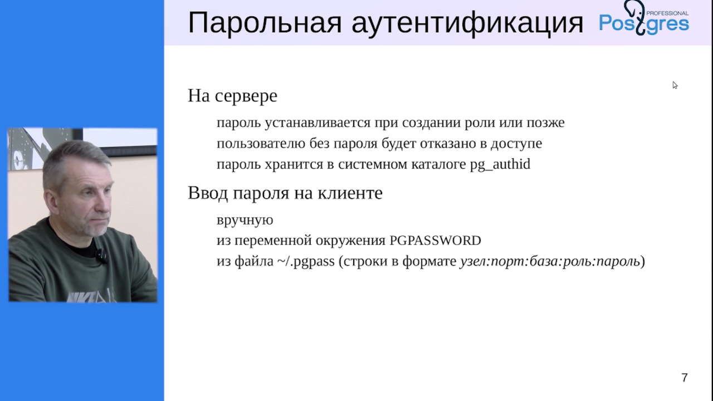

> [!quote]- Кадр [00:05:17]
> 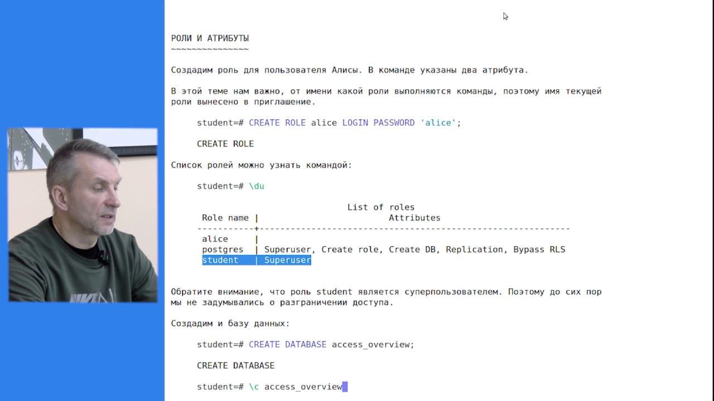

## 5. Привилегии на объекты и команды grant/revoke

Привилегии связывают субъекты с объектами; больше всего их для таблиц и представлений: SELECT — чтение, INSERT — вставка строк, UPDATE — изменение, DELETE — удаление, TRUNCATE — опустошение, REFERENCES — внешний ключ (можно на уровне столбцов), TRIGGER — создание триггеров. Некоторые привилегии, включая REFERENCES, задаются на уровне отдельных столбцов, поэтому можно разрешить чтение только определённых столбцов; например, GRANT SELECT(n), INSERT ON alice.t2 TO bob даёт Бобу чтение столбца n и вставку в таблицу t2, а \dp показывает привилегии на столбцы отдельно от таблицы. Для баз данных определена привилегия Connect (подключение к базе), CREATE на базе означает возможность создавать в ней схемы; для схем CREATE разрешает создавать объекты, USAGE — обращаться к схеме; для табличных пространств Create — создавать объекты в этом пространстве; для последовательностей используются Select, Update и Usage (SELECT — currval, UPDATE — nextval и setval). Привилегии по умолчанию задаются командой ALTER DEFAULT PRIVILEGES: она указывает, какие права будут автоматически выданы или отозваны при создании новых объектов, имя конкретного объекта не указывается, потому что привилегии применяются, когда функция или процедура создадутся (это похоже на default ACL в Linux); после GRANT EXECUTE ON ROUTINES TO bob новая функция bar() становится доступной для bob. Управляют привилегиями команды grant (выдать) и revoke (отозвать), можно выдавать отдельные привилегии или все сразу; их не следует путать с grant и revoke для включения в роль и исключения из роли.

```sql
bob=> UPDATE t1 SET n = n + 1;
UPDATE 1
bob=> SELECT * FROM t1;

 n
---
 2
(1 row)

bob=> DELETE FROM t1;
ERROR: permission denied for table t1
bob=> INSERT INTO t2(n) VALUES (100);
INSERT 0 1
alice=> GRANT SELECT(n), INSERT ON alice.t2 TO bob;

alice=> ALTER DEFAULT PRIVILEGES
FOR ROLE alice
REVOKE EXECUTE ON ROUTINES FROM public;

alice=> ALTER DEFAULT PRIVILEGES
FOR ROLE alice
GRANT EXECUTE ON ROUTINES TO bob;

alice=> \ddp
          Default access privileges
 Owner | Schema |   Type   | Access privileges
-------+--------+----------+-------------------
 alice |        | function | alice=X/alice    +
       |        |          | bob=X/alice
```

| Привилегия | Что разрешает |
|---|---|
| CREATE | создавать внутри схемы объекты |
| USAGE | обращаться к схеме |

*Источник: [00:19:25], [00:19:45], [00:21:05], [00:22:33], [00:31:21], [00:32:08] и др.*

> [!quote]- Кадр [00:19:45]
> 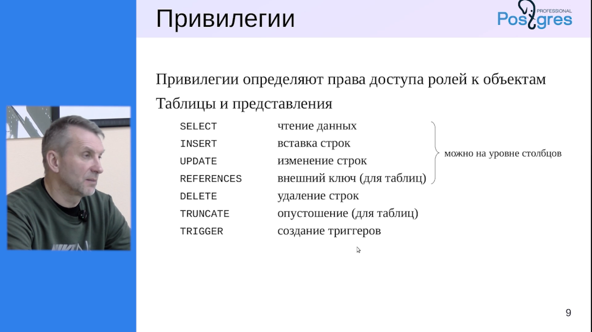


> [!quote]- Кадр [00:38:56]
> 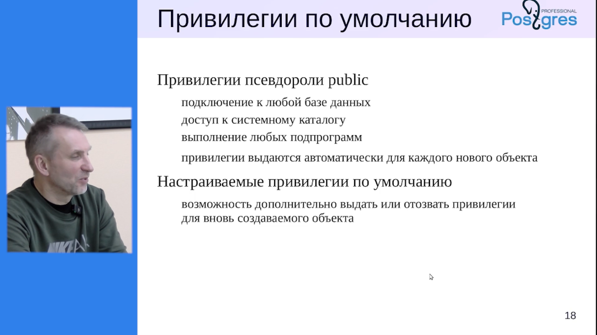

## 6. Доступ к базам, схемам и search_path

Чтобы создать схему в базе, роли нужна привилегия CREATE на саму базу: без неё CREATE SCHEMA завершается ошибкой permission denied for database access_overview, а после GRANT CREATE ON DATABASE access_overview TO alice схема создаётся, и её владелец по умолчанию работает в ней. Привилегии на схему и на таблицу различаются: GRANT CREATE, USAGE ON SCHEMA alice TO bob не даёт доступа к таблице alice.t1, и SELECT * FROM alice.t1 возвращает ошибку permission denied for table t1, тогда как permission denied for schema означает ограничение на уровне схемы. Доступ к схеме не подразумевает доступ к таблице; владелец таблицы может отдельно выдать права на чтение и изменение данных. Специальное значение $user в search_path соответствует схеме с именем текущего пользователя и при её наличии помещается перед public, поэтому если пользователь создаёт таблицы без квалификатора схемы, они попадают в схему с его именем. Боб может установить search path, включив туда схему с таблицами Алисы, чтобы не писать квалификатор каждый раз; при создании таблицы можно указать DEFAULT current_user для столбца.

```sql
alice=> CREATE SCHEMA alice;
ERROR:  permission denied for database access_overview
student=# GRANT CREATE ON DATABASE access_overview TO alice;
GRANT
alice=> CREATE SCHEMA alice;
CREATE SCHEMA
alice=> SELECT current_schemas(false);
 current_schemas
-----------------
 {alice,public}
(1 row)

alice=> REVOKE EXECUTE ON ALL ROUTINES IN SCHEMA alice FROM public;
REVOKE
bob=> SELECT foo();
ERROR:  permission denied for function foo

bob=> SELECT foo();
ERROR: permission denied for table t2
CONTEXT:  SQL function "foo" statement 1

student=# GRANT CREATE ON SCHEMA public TO bob;
GRANT

bob=> CREATE TABLE t2(n numeric, who text DEFAULT current_user);
CREATE TABLE

bob=> INSERT INTO t2(n) VALUES (42);
INSERT 0 1
alice=> GRANT CREATE, USAGE ON SCHEMA alice TO bob;
GRANT
bob=> SELECT * FROM alice.t1;
ERROR: permission denied for table t1

bob=> SELECT * FROM alice.t1;
ERROR: permission denied for schema alice
```

*Источник: [00:11:27], [00:25:59], [00:26:19], [00:26:39], [00:27:01], [00:27:21] и др.*


## 7. Привилегия EXECUTE и характеристики безопасности функций

Для функций и процедур существует единственная привилегия — EXECUTE: она разрешает или запрещает выполнение хранимого кода. По умолчанию всем пользователям разрешено запускать любой хранимый код, поэтому его нужно явно отзывать: REVOKE EXECUTE ON ALL ROUTINES IN SCHEMA alice FROM public приводит к тому, что вызов foo() из-под пользователя bob возвращает ошибку permission denied for function foo. Вызов функции происходит, даже если у пользователя нет прав на объект, к которому обращается тело функции; ошибка возникает только при обращении к этому объекту. По умолчанию функция выполняется с характеристикой SECURITY INVOKER — с правами вызывающего. Если объявить функцию с SECURITY DEFINER, она выполняется с правами владельца, что позволяет пользователю получать данные через функцию, не имея прямого доступа к таблице.

```javascript
alice=> ALTER FUNCTION foo() SECURITY DEFINER;
ALTER FUNCTION
bob=> DROP TABLE t2;
DROP TABLE
bob=> SELECT foo();
   foo
---------
 (1,alice)
 (100,bob)
```

*Источник: [00:37:37], [00:37:57], [00:43:19]*

> [!quote]- Кадр [00:37:57]
> 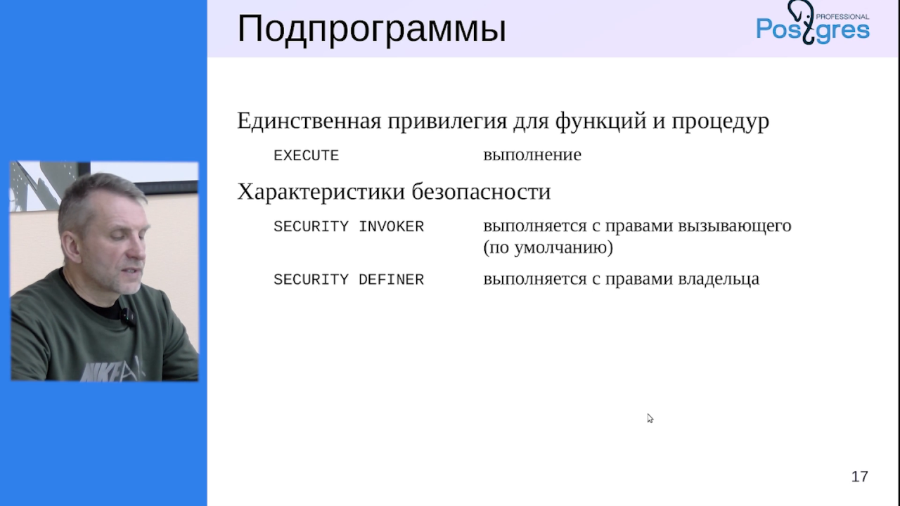

## 8. Псевдороль public и просмотр привилегий

Информацию о привилегиях на схемы можно посмотреть командой \dn+: в колонке Access Privileges строка содержит роль, список привилегий и субъекта, который их выдал, а UC для схем означает usage-create. В псевдороль public неявно включены все остальные роли, поэтому любая новая роль автоматически получает этот небезопасный набор: public изначально может подключаться к любой базе данных, обращаться к системному каталогу и выполнять любые подпрограммы. Привилегии, выданные псевдороли public, можно отозвать как для конкретной роли, так и для самой public; у роли public отзываются все привилегии на схему public. В выводе прав PUBLIC отображается пустым местом слева от знака равно, что означает, что привилегия usage дана для всех.

*Источник: [00:28:21], [00:28:41], [00:29:31]*

## Схема

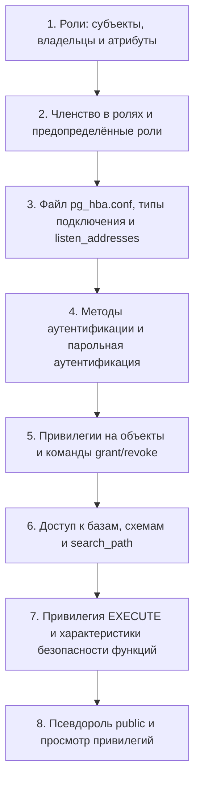

## Итог

> [!success] Что в итоге
> Роли в PostgreSQL — субъекты доступа с включаемыми атрибутами, которые можно объединять в группы и наделять предопределёнными полномочиями. Подключение сопровождается аутентификацией по правилам pg_hba.conf, где важен порядок строк, тип подключения и метод аутентификации, включая безусловный trust и парольные методы с проверкой по хэшу. Привилегии задаются на разных уровнях — от столбцов и баз данных до схем, табличных пространств и последовательностей — и управляются командами grant и revoke; доступ к схеме не подразумевает доступ к таблице, а псевдороль public изначально обладает широким набором полномочий, которые можно отозвать. Для функций и процедур единственная привилегия — EXECUTE, при этом SECURITY INVOKER выполняется с правами вызывающего, а SECURITY DEFINER — с правами владельца.

