# Логическое резервное копирование и COPY в PostgreSQL

> [!abstract] Обзор
> Материал разбирает логическое резервное копирование в PostgreSQL и его отличие от физического, а также архив журнала предзаписи. Показаны команды COPY и \copy: выгрузка и загрузка данных, произвольные запросы, форматы CSV и NULL, завершение ввода, HEADER MATCH и влияние на последовательности IDENTITY. Описаны утилиты pg_dump и pg_dumpall, структура дампа, владельцы объектов, выборочная выгрузка и требования к восстановлению базы через template0. Отдельно разобраны форматы копий plain, custom, directory и TAR, параллельное восстановление через pg_restore с ключами --create, --clean и --use-list, согласованность через общий снимок и ANALYZE после загрузки.

> [!info] Курс
> [[index|Оглавление курса]]

## Оглавление
1. [[#1. Логическая и физическая копия]]
2. [[#2. Архив журнала предзаписи]]
3. [[#3. Команда COPY и \copy]]
4. [[#4. IDENTITY-столбец и последовательность]]
5. [[#5. Утилиты pg_dump и pg_dumpall]]
6. [[#6. Восстановление базы: --create и --clean]]
7. [[#7. Форматы дампа]]

**Схема** — [[#Схема]]
**Итог** — [[#Итог]]

## 1. Логическая и физическая копия

Логическая копия отличается от физической и позволяет выгрузить весь кластер, базу данных или отдельные объекты, например таблицу; её можно восстановить на другой версии Postgres. Физическая копия — это копия файловой системы кластера: она быстрее, восстанавливает статистику, но копирует все файлы целиком и требует совместимой основной версии PostgreSQL, так как основные версии несовместимы на двоичном уровне. Логическое резервирование плохо подходит для восстановления после сбоя с минимальной потерей данных, поскольку восстанавливаются только выгруженные данные и только на момент копии. Зато оно хорошо для небольших объёмов, длительного хранения, смены версии сервера и миграции на другую платформу. Логическая копия работает медленно, особенно при большом объёме, а индексы после загрузки создаются особенно медленно.

> [!info] Зачем это нужно
> По словам лектора, физическое копирование — основной инструмент системных администраторов.

*Источник: [00:00:21], [00:00:43], [00:01:07], [00:03:57], [00:46:28], [00:46:48]*

> [!quote]- Кадр [00:00:21]
> 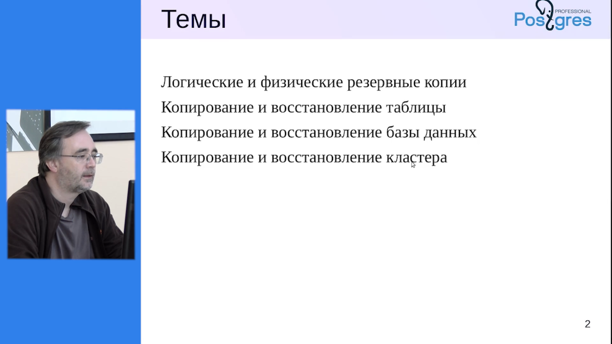

> [!quote]- Кадр [00:46:48]
> 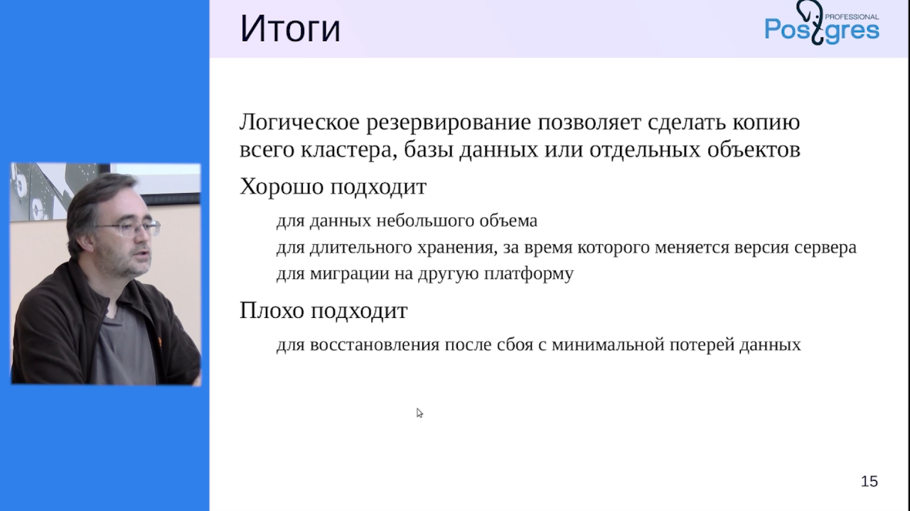

> [!quote]- Кадр [00:03:57]
> 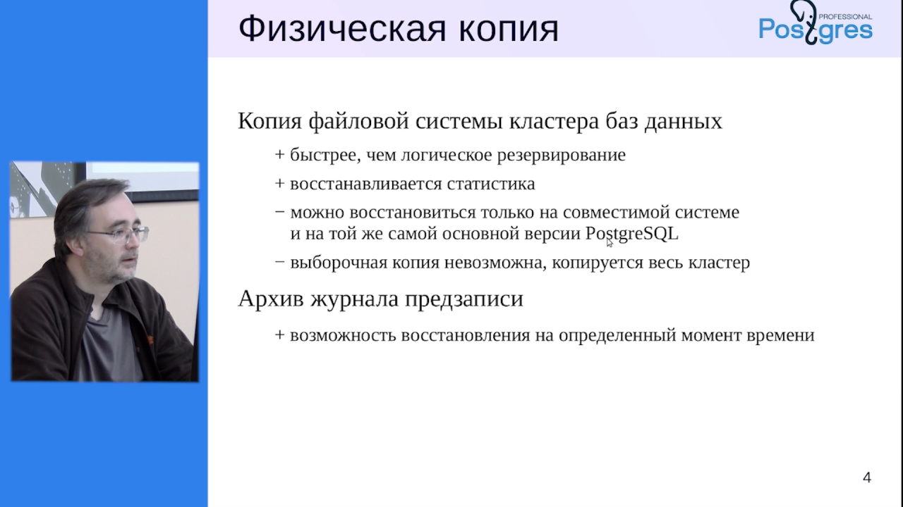

> [!quote]- Кадр [00:00:43]
> 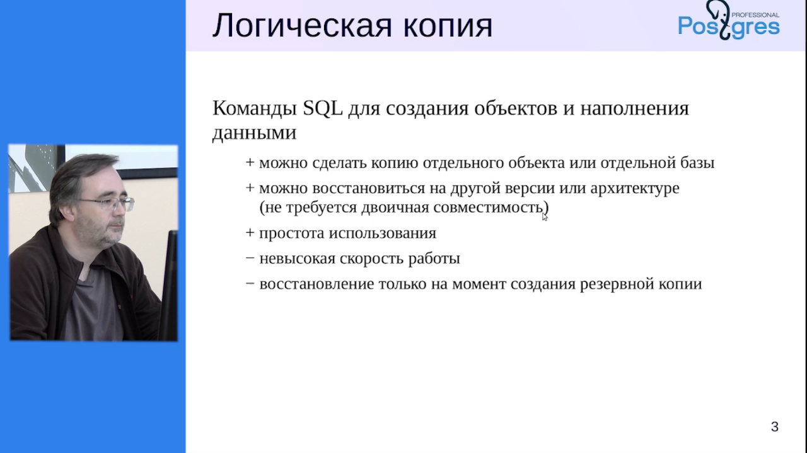

## 2. Архив журнала предзаписи

Архив журнала предзаписи даёт возможность восстановления системы на определённый момент времени. Если настроен архив, можно восстановить систему из копии, а затем проиграть журнальные файлы из архива. Это позволяет восстановить состояние практически на любой момент времени до текущего.

*Источник: [00:03:57]*


## 3. Команда COPY и \copy

COPY таблица TO 'файл' записывает содержимое таблицы в файл, а COPY таблица FROM 'файл' читает файл и загружает данные; команда выполняется на сервере, поэтому файл создаётся в файловой системе сервера, а \copy в psql создаёт файл локально на клиенте. Вместо таблицы можно указать произвольный SELECT в скобках, ограничить столбцы или выгрузить результат запроса или представления; опция HEADER MATCH проверяет соответствие строки заголовка именам столбцов принимающей таблицы и выдаёт ошибку column name mismatch при несовпадении. COPY загружает данные одной командой и эффективнее отдельных INSERT, а если COPY нет, можно использовать INSERT; pg_dump с опцией --column-inserts выгружает отдельные INSERT вместо COPY, но загрузка идёт существенно дольше. Формат вывода настраивается: NULL по умолчанию обозначается \N, опции WITH (NULL '<NULL>', DELIMITER ',', HEADER) задают литерал NULL, разделитель и заголовок, а FORMAT csv разделяет значения запятыми и берёт строки в кавычки. При вводе с консоли нужен маркер конца файла \., а команда \pset null '\N' в psql задаёт отображение NULL-значений.

```sql
COPY (SELECT * FROM t WHERE s IS NOT NULL) TO stdout;

=> INSERT INTO t (s) VALUES ('Строка пять');
ERROR: duplicate key value violates unique constraint "t_pkey"
DETAIL:  Key (id)=(4) already exists.
=> SELECT pg_catalog.setval('t_id_seq', 4, true);

=> COPY t FROM stdin (HEADER MATCH);
id  s
4  Строка четыре
\.
COPY 1
=> COPY t FROM stdin (HEADER MATCH);
Col_1   Col_2
5  Строка пять
\.
ERROR:  column name mismatch in header line field 1: got "Col_1", expected "id"

COPY public.t (id, s) FROM stdin;
1	Привет, мир!
2
3	\N
4	Строка четыре
5	Строка пять
\.

=> CREATE TABLE t(
    id integer PRIMARY KEY GENERATED ALWAYS AS IDENTITY,
    s text
);
CREATE TABLE
=> INSERT INTO t(s) VALUES ('Привет, мир!'), (''), (NULL);
INSERT 0 3
=> COPY t TO stdout;
1 Привет, мир!
2
3 \N
=> COPY t TO stdout WITH (NULL '<NULL>', DELIMITER ',', HEADER);
id,s
1,Привет\, мир!
2,
3,<NULL>

COPY t TO stdout WITH (FORMAT csv);

INSERT INTO t(s) VALUES ('Привет, мир!'), (''), (NULL);

COPY t FROM stdin;
1	Привет, мир!
2
3	\N
\

student$ pg_dump --format=custom -d backup_logical_dev_1 -f /home/student/backup_logical_dev_1.custom

student$ pg_dump --format=directory --jobs=2 -d backup_logical_dev_1 -f /home/student/backup_logical_dev_1.directory
student$ ls -l /home/student/backup_logical_dev_1.directory
total 8
-rw-rw-r-- 1 student student    95 окт 25 13:44 3365.dat.gz
-rw-rw-r-- 1 student student  2282 окт 25 13:44 toc.dat

=> \pset null '\N'
Null display is "\N".
=> SELECT * FROM t;
 id |     s
----+---------
  1 | Привет, мир!
  2 |
  3 | \N
  4 | Строка четыре
  5 | Строка пять
(5 rows)

COPY (SELECT * FROM t WHERE s IS NOT NULL) TO stdout;

=> INSERT INTO t (s) VALUES ('Строка пять');
ERROR:  duplicate key value violates unique constraint "t_pkey"
DETAIL:  Key (id)=(4) already exists.
=> SELECT pg_catalog.setval('t_id_seq', 4, true);

=> COPY t FROM stdin (HEADER MATCH);
id  s
4  Строка четыре
\.
COPY 1
=> COPY t FROM stdin (HEADER MATCH);
Col_1   Col_2
5  Строка пять
\.
ERROR:  column name mismatch in header line field 1: got "Col_1", expected "id"

COPY public.t (id, s) FROM stdin;
1	Привет, мир!
2
3	\N
4	Строка четыре
5	Строка пять
\.
```

*Источник: [00:07:17], [00:09:32], [00:10:30], [00:10:50], [00:11:10], [00:11:30] и др.*

> [!quote]- Кадр [00:07:17]
> 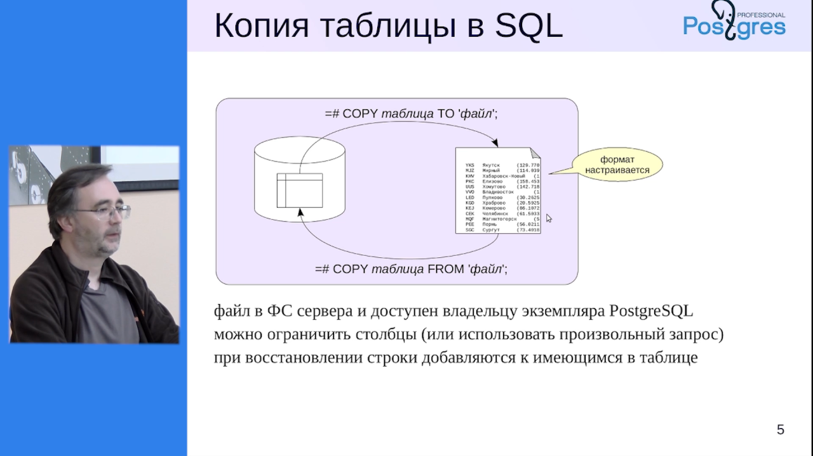

> [!quote]- Кадр [00:09:32]
> 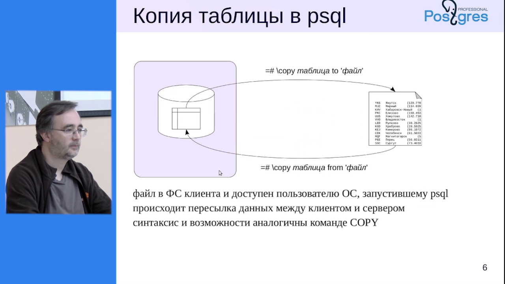

> [!quote]- Кадр [00:48:08]
> 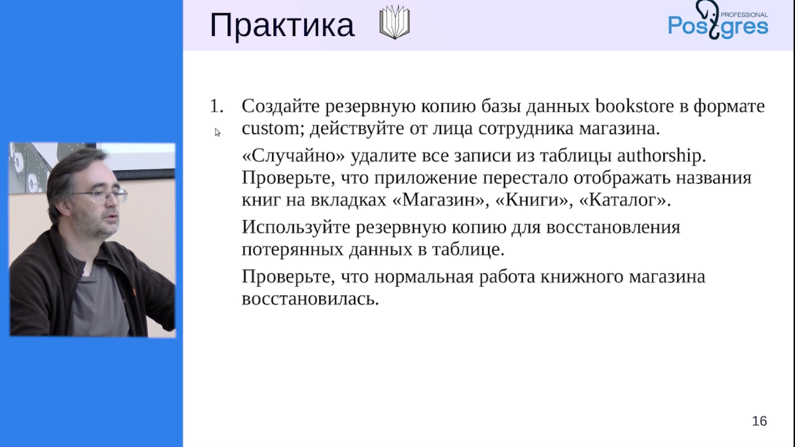

> [!quote]- Кадр [00:31:46]
> 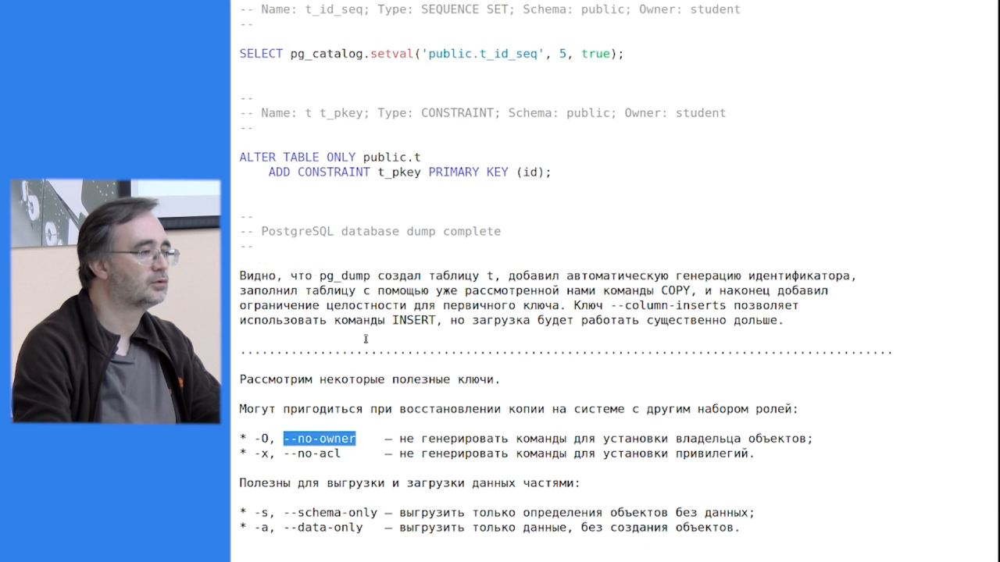

> [!quote]- Кадр [00:13:47]
> 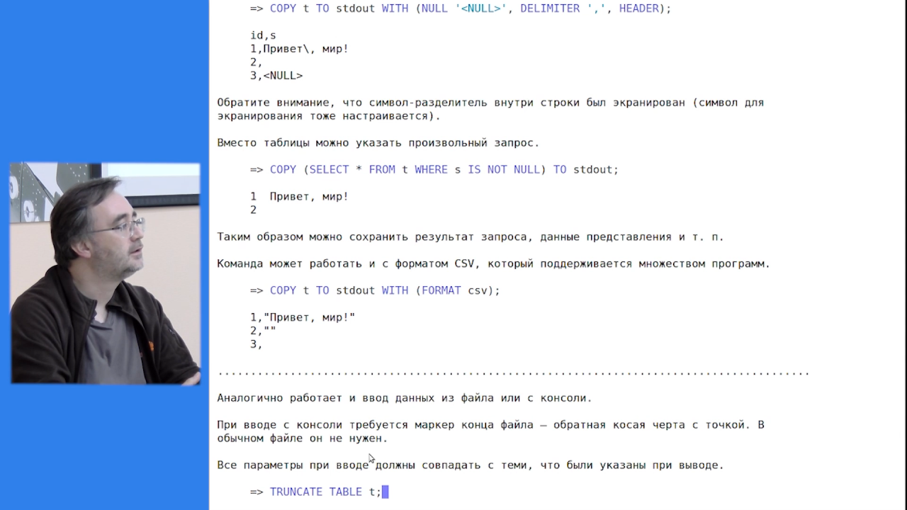

## 4. IDENTITY-столбец и последовательность

Столбец id объявлен как GENERATED ALWAYS AS IDENTITY, за ним лежит последовательность; после вставки трёх строк последовательность прокрутилась до 4. Успешно выполненная команда COPY не передвинула значение последовательности, из-за чего следующий INSERT вызвал ошибку duplicate key value violates unique constraint, исправить которую можно командой SELECT pg_catalog.setval('t_id_seq', 4, true). В дампе PostgreSQL после CREATE TABLE и ограничения первичного ключа идёт команда setval, которая продвигает последовательность к нужному идентификатору. Если фразы GENERATED ALWAYS AS IDENTITY нет, она добавляется отдельной командой ALTER TABLE public.t ALTER COLUMN id ADD GENERATED ALWAYS AS IDENTITY с указанием SEQUENCE NAME, START WITH и INCREMENT BY.

```sql
CREATE TABLE public.t (
    id integer NOT NULL,
    s text
);
ALTER TABLE public.t ALTER COLUMN id ADD GENERATED ALWAYS AS IDENTITY (
  SEQUENCE NAME public.t_id_seq
  START WITH 1
  INCREMENT BY 1
  NO MINVALUE
  NO MAXVALUE
  CACHE 1
);

-- Dumped from database version 16.3 (Ubuntu 16.3-1.pgdg22.04+1)
SET default_table_access_method = heap;

CREATE TABLE public.t (
    id integer NOT NULL,
    s text
);

ALTER TABLE ONLY public.t
    ADD CONSTRAINT t_pkey PRIMARY KEY (id);

SELECT pg_catalog.setval('public.t_id_seq', 5, true);
```

*Источник: [00:15:15], [00:15:56], [00:16:16], [00:28:58], [00:29:18], [00:29:38] и др.*

## 5. Утилиты pg_dump и pg_dumpall

pg_dump вызывается из командной оболочки и по умолчанию выдаёт текст с командами SQL для воспроизведения базы; ключом -f можно указать файл для вывода, а для загрузки файл передаётся на вход psql. pg_dump выгружает только объекты базы данных, а глобальные объекты кластера (роли и табличные пространства) не включаются — для полной копии кластера нужна утилита pg_dumpall, которая не поддерживает параллельную выгрузку. При выгрузке с помощью pg_dump можно выбрать отдельные объекты базы, например только схему или таблицу; при большом кластере pg_dumpall используют только для глобальных объектов, а отдельные базы копируют pg_dump в несколько потоков. Согласованность обеспечивается общим снимком данных: pg_dump создаёт снимок на момент запуска, и все потоки используют один и тот же снимок. Команда ALTER TABLE public.t OWNER TO student делает студента владельцем таблицы, а флаги -O/--no-owner и -X/--no-acl не генерируют команды для установки владельца объектов и привилегий, что может пригодиться при восстановлении на системе с другим набором ролей.

```
ALTER TABLE public.t OWNER TO student;
```

> [!info] Зачем это нужно
> Флаги могут пригодиться при восстановлении копии на системе с другим набором ролей.

*Источник: [00:18:16], [00:25:26], [00:29:18], [00:31:26], [00:31:46], [00:33:46]*


> [!quote]- Кадр [00:18:16]
> 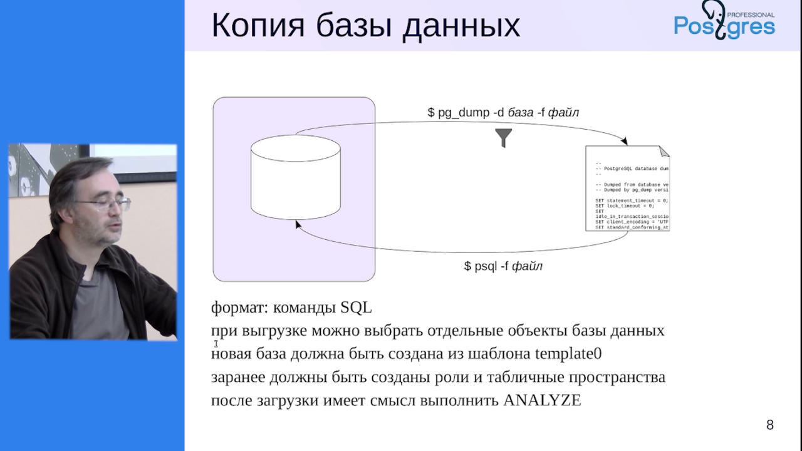

> [!quote]- Кадр [00:25:26]
> 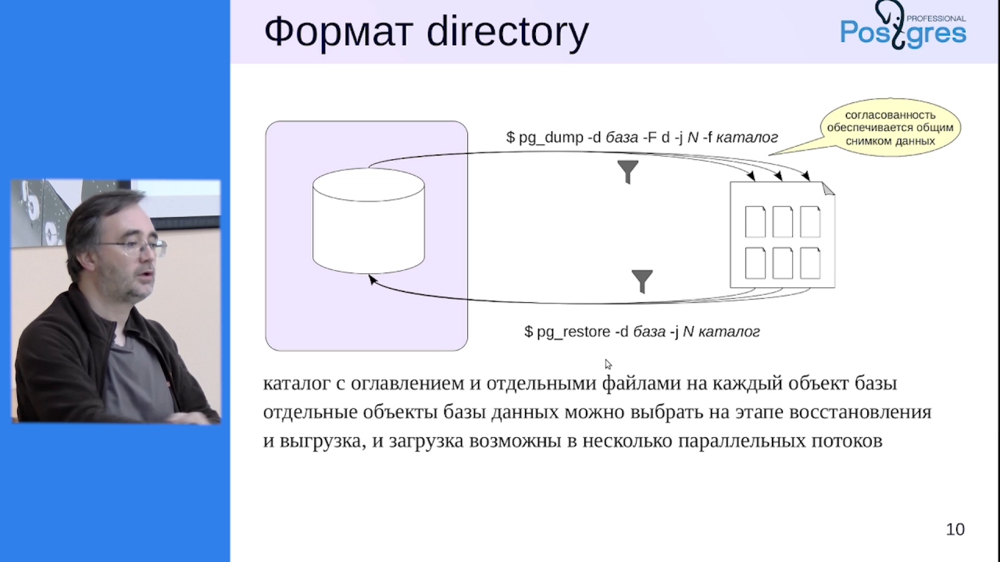

## 6. Восстановление базы: --create и --clean

Новая база должна быть создана из шаблона template0 — чистого шаблона без дополнительных объектов, поэтому загрузка проходит без ошибок; заранее должны быть созданы роли и табличные пространства. При выполнении CREATE DATABASE по умолчанию создаётся клон базы template1, и если в него добавить расширения или другие объекты, они будут включены во все новые базы; если создать пустую базу командой CREATE DATABASE, при загрузке могут возникнуть конфликты. Ключ --create добавляет в выгрузку команду CREATE DATABASE и заставляет pg_dump генерировать команду создания базы данных и команду подключения к ней, при этом база создаётся из template0; в выводе CREATE DATABASE содержит параметры шаблона, кодировки и локали. При использовании ключа --clean в резервную копию попадут команды drop перед созданием объекта, поэтому при восстановлении существующие таблицы сначала удаляются, а затем создаются заново; можно также выгрузить только определения объектов без данных, получив пустой каркас. Для восстановления объектов из копии предназначена утилита pg_restore; для формата custom возможна загрузка в несколько параллельных потоков командой pg_restore -j N, что важно для большой базы. pg_restore --list выводит оглавление резервной копии (список объектов, TOC), которое можно записать в файл, отредактировать и передать в pg_restore через ключ --use-list; утилита распознаёт формат сама и понимает ключи фильтрации -I, -P, -T. Формат custom является двоичным, поэтому для восстановления таблицы нужно использовать pg_restore, а перед восстановлением таблица удаляется командой drop table. Ключ -d указывает любую существующую базу данных; с ключом --create утилита сама создаст базу, указанную в архиве, и переключится на неё, а ключ --clean удаляет существующую базу данных, после чего создаёт её заново и загружает данные. После загрузки имеет смысл выполнить ANALYZE, чтобы собрать статистику, — тогда запросы будут работать как нужно; статистика автоматически не собирается.

```javascript
student$ pg_dump --create -d backup_logical_dev_1 | grep 'CREATE DATABASE'
CREATE DATABASE backup_logical_dev_1 WITH TEMPLATE = template0 ENCODING = 'UTF8' LOCALE_PROVIDER = libc LOCALE = 'en_US.UTF-8';

=> DROP TABLE t;
DROP TABLE
student$ pg_restore --table=t -d backup_logical_dev_2 /home/student/backup_logical_dev_1.custom

student$ pg_restore --create -d student /home/student/backup_logical_dev_1.custom

5; 2615 2200 SCHEMA - public student
216; 1259 16392 TABLE public t_student
215; 1259 16391 SEQUENCE public t_id_seq student
3366; 0 16392 TABLE DATA public t_student
3373; 0 0 SEQUENCE SET public t_id_seq student
3221; 2606 16398 CONSTRAINT public t_pkey student
```

*Источник: [00:18:16], [00:23:06], [00:32:06], [00:33:26], [00:33:46], [00:34:56] и др.*

> [!quote]- Кадр [00:33:26]
> 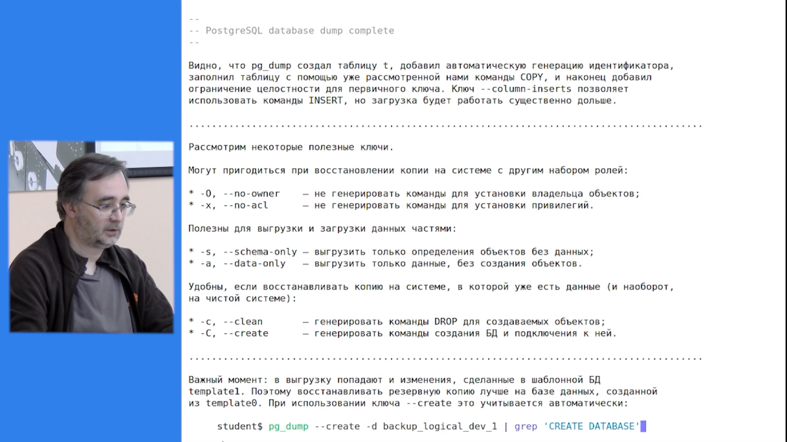

> [!quote]- Кадр [00:23:06]
> 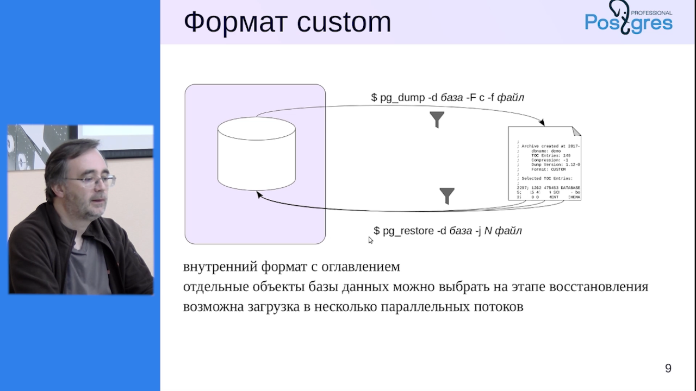

> [!quote]- Кадр [00:38:56]
> 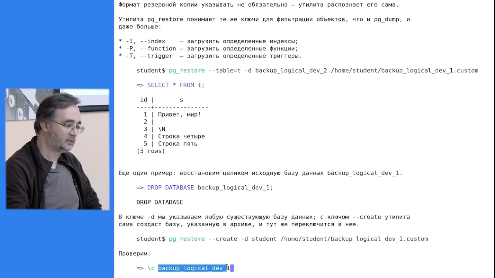


## 7. Форматы дампа

По умолчанию используется формат plain: на выходе получается просто команда SQL, и восстановление идёт по SQL; в нём объекты нужно выбирать в момент выгрузки. Формат custom — внутренний формат для бэкапа: данные хранятся в сжатом виде и сопровождаются оглавлением; сначала делается копия всей базы, а на этапе восстановления можно выбирать отдельные объекты и загружать их в несколько параллельных потоков. Формат directory (ключ -F d или --format=directory, каталог задаётся через -f) создаёт каталог с файлом оглавления toc.dat и отдельными, в том числе сжатыми, файлами на каждый объект базы; в нём и выгрузка, и загрузка возможны в несколько параллельных потоков (число задаётся через --jobs), а отдельные объекты выбираются на этапе восстановления. Файлы выгрузки — просто zip, поэтому для просмотра можно использовать zcat: она раззиповывает файл и выводит результат наружу. TAR — это то же самое, что directory, пропущенная через утилиту TAR и свёрнутая в отдельный файл; он ничего нового не привносит и не добавляет возможностей.

| Формат | Параллельность | Что создаётся |
|---|---|---|
| custom | загрузка в несколько потоков | один файл с оглавлением |
| directory | выгрузка и загрузка в несколько потоков | каталог с toc.dat и файлами объектов |

*Источник: [00:23:06], [00:25:26], [00:27:00], [00:36:26], [00:36:46], [00:37:26] и др.*

> [!quote]- Кадр [00:27:00]
> 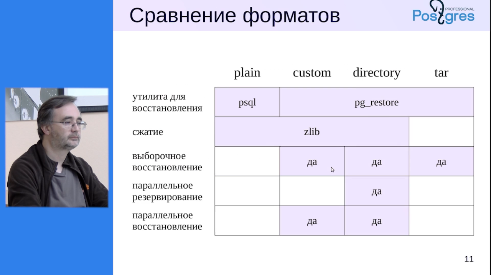


## Схема

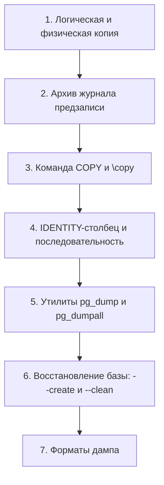

## Итог

> [!success] Что в итоге
> Логическая копия — текстовый файл с SQL-командами, пригодный для отдельного объекта, длительного хранения и миграции, но восстанавливаемый только на момент копии; физическая копия быстрее, но требует совместимой основной версии PostgreSQL и копирует весь кластер, а архив журнала предзаписи добавляет восстановление на момент времени. COPY выгружает и загружает данные на сервере, \copy работает с файлом на клиенте, а последовательность после COPY не двигается и правится через setval. pg_dump и pg_dumpall с форматами plain, custom, directory и TAR задают, что и как восстанавливать; восстановление идёт через psql или pg_restore с ключами --create, --clean и --use-list, а после загрузки выполняется ANALYZE для сбора статистики.

