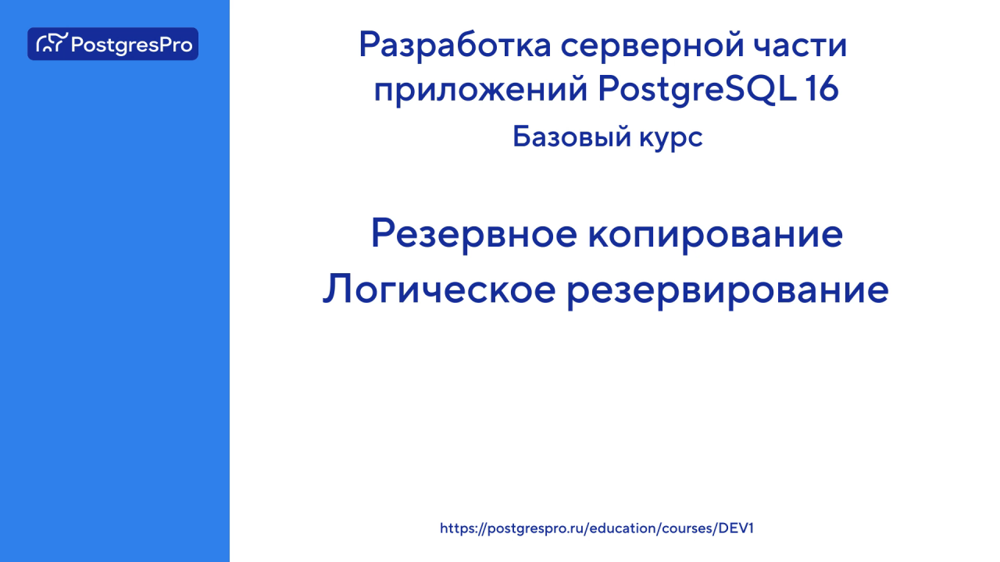
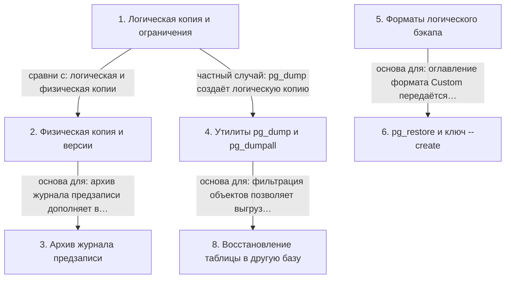

# Логическое и физическое резервное копирование в PostgreSQL

> [!abstract] Обзор
> Материал охватывает логическое и физическое резервное копирование в PostgreSQL. Логическая копия — это команды SQL, которые воссоздают объекты и данные и допускают выборочную выгрузку, но работают медленно и восстанавливают состояние только на момент копии. Физическая копия — это копия файлов кластера, она быстрее, но требует сходной архитектуры и той же основной версии Postgres; архив журнала предзаписи поверх копии позволяет получить состояние практически на любой момент времени. Логическое резервирование строится на утилитах pg_dump и pg_dumpall, форматах Plain, Custom, Directory и TAR, восстановлении через pg_restore и настройке шаблонов, ролей и табличных пространств. Отдельно разбираются команда COPY и её локальный вариант \copy, форматы вывода — stdout, NULL, CSV и выгрузка по SELECT, а также многопоточное резервирование.

> [!info] Курс
> [[index|Оглавление курса]]

## Оглавление
1. [[#1. Логическая копия и ограничения]]
2. [[#2. Физическая копия и версии]]
3. [[#3. Архив журнала предзаписи]]
4. [[#4. Утилиты pg_dump и pg_dumpall]]
5. [[#5. Форматы логического бэкапа]]
6. [[#6. pg_restore и ключ --create]]
7. [[#7. Подготовка восстановления и шаблоны]]
8. [[#8. Восстановление таблицы в другую базу]]
9. [[#9. COPY, \copy и настройка вывода]]

**Схема** — [[#Схема]]
**Итог** — [[#Итог]]

## 1. Логическая копия и ограничения

Логическая копия — это команды SQL (create table, insert и т.п.), которые воссоздают объекты и данные базы или кластера; для восстановления достаточно подать её на вход SQL. Она позволяет выгружать как весь кластер, так и отдельные объекты — таблицу или отдельную базу — и, поскольку это текстовый файл с командами, его можно проиграть на другой версии Postgres или подправить под другую СУБД. На большом объёме данных логическое резервирование работает медленно, особенно медленно создаются индексы после загрузки; восстановиться можно только на момент создания копии, а последующие действия пропадут, если их не выгрузить отдельно. Минимальную потерю данных и задачи администрирования так не решить. Можно сделать копию всей базы, а затем восстановить из неё только определённую таблицу, при этом существующие таблицы сначала удаляются и создаются заново.

*Источник: [00:00:04]*

> [!quote]- Кадр [00:00:04]
> 

## 2. Физическая копия и версии

Физическая копия — это копия файлов, относящихся к кластеру базы данных. Она быстрее логической, и после восстановления не нужно повторно создавать индексы и собирать статистику. Развернуть её можно только на компьютере со сходной архитектурой и на той же основной версии Postgres; копируются все файлы, поэтому нельзя скопировать только одну таблицу — файлы таблицы вне кластера не восстановить. PostgreSQL разных мажорных версий несовместимы на двоичном уровне, поэтому физическую копию на новой версии восстановить не удастся, а логическую — можно. При подключении к удалённому серверу файл логического резервирования создаётся на машине, где работает сервер, и его нужно забрать оттуда.

| | Логическая копия | Физическая копия |
|---|---|---|
| Содержимое | команды SQL | файлы кластера |
| Скорость | медленно на большом объёме | быстрее |
| Совместимость | другая версия Postgres | та же основная версия и сходная архитектура |

*Источник: [00:00:04]*

## 3. Архив журнала предзаписи

Если настроен архив журнала предзаписи, можно восстановить систему из копии и проиграть журнальные файлы. В результате можно получить состояние практически на любой момент времени до текущего.

*Источник: [00:00:04]*

## 4. Утилиты pg_dump и pg_dumpall

pg_dump вызывается из shell и по умолчанию выдаёт текст с SQL-командами для воспроизведения базы данных; если не указывать файл, вывод идёт на консоль. pg_dumpall выгружает весь кластер, включая глобальные объекты — роли и табличные пространства — и также выдаёт команды SQL, поэтому кластер восстанавливается обычной SQL-командой с резервной копией на входе. Для запуска нужен доступ ко всем объектам кластера, обычно это администратор или роль, входящая в PG Read All Data. pg_dumpall проще pg_dump: выгружает только команды SQL и не поддерживает многопоточность.

*Источник: [00:00:04]*

## 5. Форматы логического бэкапа

Используются форматы Plain, Custom, Directory и TAR; формат TAR совпадает с директорией. По умолчанию используется формат plain, который выдаёт SQL-команды, и восстановление выполняется по SQL. Формат Custom — специальный двоичный формат, в котором данные хранятся в сжатом виде; у него есть оглавление, то есть он внутри себя знает, какие объекты попали в копию, что позволяет ограничивать объекты не только при создании резервной копии, но и в момент восстановления. При указании формата директории в -f задаётся каталог, внутри которого на каждый объект создаётся отдельный файл, и выгрузку можно запускать в несколько потоков; оглавление дампа можно отредактировать и передать утилите pg_restore с помощью ключа --use-list.

*Источник: [00:00:04]*

## 6. pg_restore и ключ --create

Для восстановления из формата custom используется утилита pg_restore, так как получаемый файл двоичный и его нельзя подать на вход по SQL. Из формата custom можно восстанавливаться в несколько параллельных потоков; ключ -g или --jobs в pg_restore задаёт количество потоков восстановления. При восстановлении формат файла резервной копии указывать не нужно — pg_restore сам разберётся; ключ clean удаляет уже существующие объекты, а ключи фильтрации объектов такие же, как у pg_dump, и даже больше, поэтому можно восстановить только таблицу T в указанную базу. Чтобы целиком восстановить базу из копии, pg_restore запускают с ключом --create: подключившись к какой-нибудь существующей базе, он создаёт ту базу, которая есть в резервной копии.

*Источник: [00:00:04]*

## 7. Подготовка восстановления и шаблоны

При восстановлении логической копии роли и табличные пространства должны быть созданы заранее. Иначе логическую копию нужно подкорректировать, чтобы она к ним не обращалась, если это не нужно. Логическая копия включает команду create-index, поэтому индексы создаются автоматически, а статистика не собирается; после загрузки можно выполнить Analyze или дождаться автоматического сбора статистики. Базу данных принято создавать из шаблона template0, в котором нет дополнительных объектов, чтобы избежать ошибок из-за уже существующих объектов. По умолчанию CREATE DATABASE создаёт копию базы template1, поэтому объекты, добавленные в template1, появляются во всех новых базах; pg_dump выгружает объекты, установленные в template1, и загрузка такой копии в пустую базу может вызвать конфликты.

*Источник: [00:00:04]*

## 8. Восстановление таблицы в другую базу

Создаётся новая база данных, запускается pg_dump с указанием только таблицы T, и результат через пайп передаётся в psql, подключённый к другой базе. После подключения к ней там обнаруживается таблица T со всеми её строчками: таблица перетекает в базу данных с другим именем.

*Источник: [00:00:04]*

## 9. COPY, \copy и настройка вывода

Команда COPY в SQL выгружает содержимое таблицы; она работает на сервере, поэтому файл создаётся на сервере. В утилите psql есть команда \copy, которая почти совпадает с серверной командой COPY; отличие в том, что файл создаётся локально, а не на сервере, и доступен пользователю, запустившему psql, а данные при этом пересылаются по сети. Вместо файла можно указать stdout, тогда копия выводится на консоль. Формат вывода настраивается: можно задать разделители и представление пустых значений и NULL (по умолчанию \N), а также формат CSV; пустая строка отличается от NULL. Вместо таблицы можно указать подзапрос с любым SELECT, и то, что он вернёт, можно записать в файл; можно подобрать такие комбинации настроек вывода, что результат выведется, но восстановить его не получится. При восстановлении из файла командой COPY FROM содержимое дописывается к уже имеющемуся в таблице, а не очищает её. В логическом дампе отсутствует фраза GENERATED ALWAYS AS IDENTITY: её добавляют отдельной командой с явным указанием последовательности, а после загрузки данных командой COPY последовательность продвигают к нужному идентификатору функцией setval, иначе строки дальше не будут вставляться нормально. При COPY ... FROM stdin ввод завершается обратной косой чертой и точкой, потому что при чтении из файла конец файла определяется автоматически, а в консоли — нет. Можно проверять соответствие заголовка: нужно указать строку заголовка вначале, и если столбцы совпадут, строка загрузится, иначе PostgreSQL сообщит об ошибке. Команда alterTableOwnerTo делает студента владельцем таблицы.

*Источник: [00:00:04]*

## Схема

## Итог

> [!success] Что в итоге
> Логическая копия — это команды SQL, которые воссоздают объекты и данные и допускают выборочную выгрузку, но работают медленно и восстанавливают состояние только на момент копии. Физическая копия — это копия файлов кластера, она быстрее, но требует сходной архитектуры и той же основной версии Postgres, поэтому версии несовместимы на двоичном уровне. Логическое резервирование выполняется утилитами pg_dump и pg_dumpall; двоичный формат Custom с оглавлением восстанавливается через pg_restore, в том числе ключом --create. Команда COPY и её локальный вариант \copy задают формат вывода — stdout, NULL, CSV и выгрузку по SELECT.

