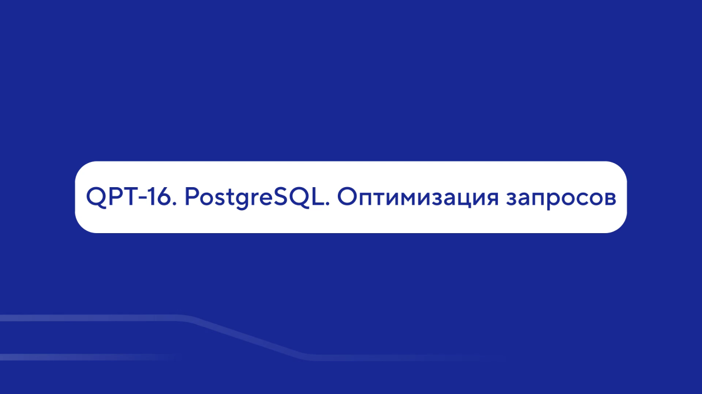
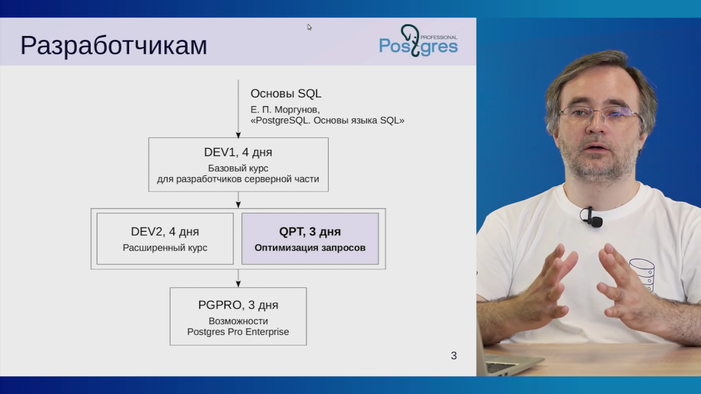
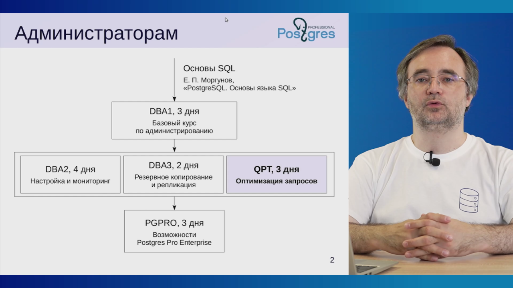
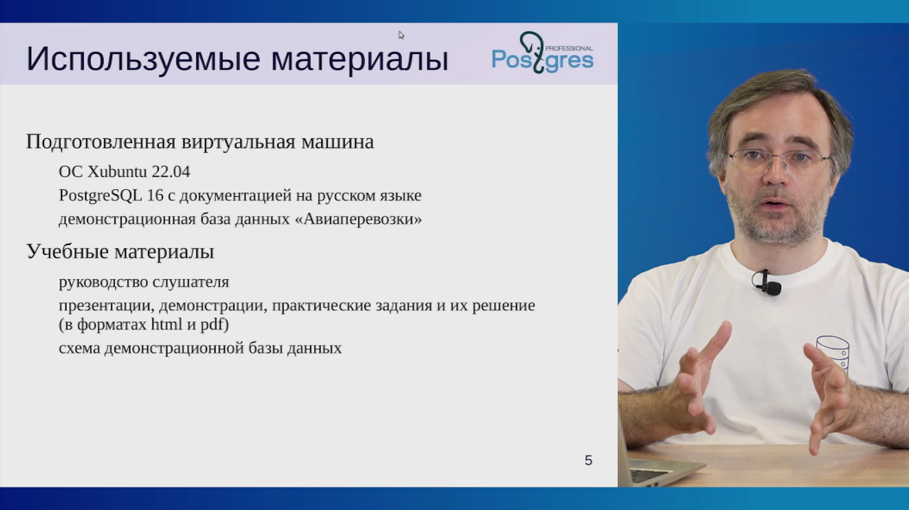
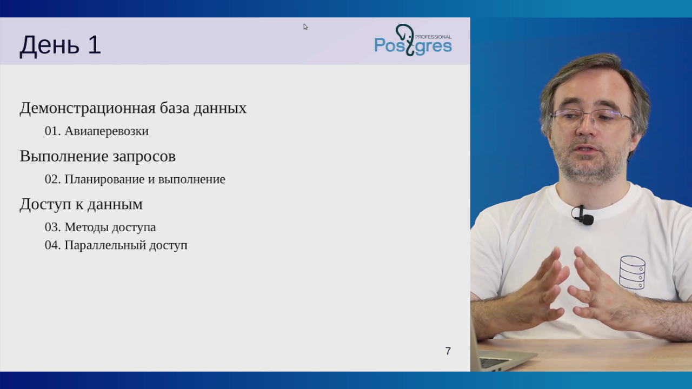
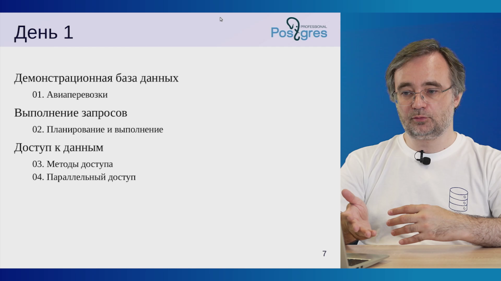
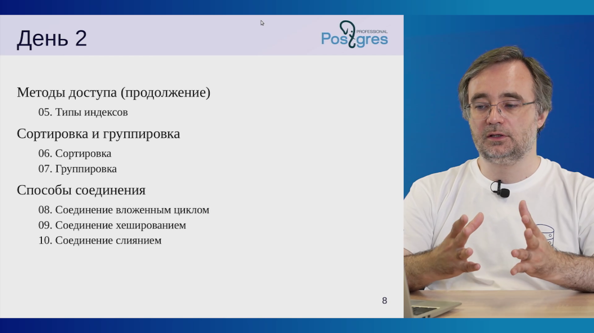
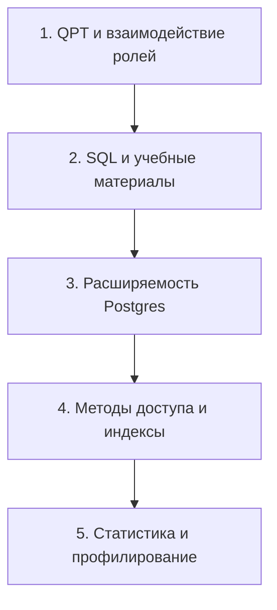

# Оптимизация запросов в PostgreSQL (QPT)

> [!abstract] Обзор
> Материал вводит QPT — оптимизацию, или настройку производительности запросов, и показывает, что ей занимаются и администраторы, и разработчики, глядя на задачу с разных сторон. Отдельно разбирается необходимость общего языка взаимодействия между ними. Также речь идёт о знании SQL при переходе на Postgres, рекомендуемых учебниках и удобстве HTML-материалов. Далее перечисляются темы, связанные с доступом к данным: методы доступа, типы индексов, статистика для планировщика и профилирование запросов.

> [!info] Курс
> [[index|Оглавление курса]]

## Оглавление
1. [[#1. QPT и взаимодействие ролей]]
2. [[#2. SQL и учебные материалы]]
3. [[#3. Расширяемость Postgres]]
4. [[#4. Методы доступа и индексы]]
5. [[#5. Статистика и профилирование]]

**Схема** — [[#Схема]]
**Итог** — [[#Итог]]

## 1. QPT и взаимодействие ролей

QPT расшифровывается как настройка производительности запросов (query performance tuning), проще — оптимизация. К ней имеют отношение и администраторы, и разработчики, но смотрят на проблему с разных сторон: разработчик оптимизирует те запросы, которые он пишет, а администратор — весь экземпляр в целом, определяя самые долгие, ресурсоёмкие и проблемные запросы. Чтобы понимать друг друга и взаимодействовать, им нужен как минимум общий язык.

*Источник: [00:00:00], [00:05:59]*

> [!quote]- Кадр [00:00:00]
> 

> [!quote]- Кадр [00:05:59]
> 

## 2. SQL и учебные материалы

При переходе с другой базы данных на Postgres SQL обычно уже известен; возможны отличия в диалектах, но это не является серьёзной проблемой. С этим знанием можно настраивать Postgres, получать обратную связь и улучшать начальные настройки под конкретную рабочую нагрузку и данные. Для изучения SQL применительно к PostgreSQL рекомендуется учебник Евгения Моргунова «PostgreSQL. Основы языка SQL», где есть теория и задачи; продолжение — «PostgreSQL – профессиональный SQL» — охватывает более сложные темы: оконные функции, латерал и общие табличные выражения. Слайд-схема показывает образовательную траекторию для администраторов PostgreSQL: от основ SQL к курсам DBA1, DBA2, DBA3, QPT и PGPRO. Учебные материалы в формате HTML удобнее, потому что из них можно копировать запросы и вставлять в терминал, а из PDF некоторые запросы копируются некорректно.

*Источник: [00:01:00], [00:12:42]*

> [!quote]- Кадр [00:01:00]
> 

> [!quote]- Кадр [00:12:42]
> 

## 3. Расширяемость Postgres

Написав код на стороне сервера, можно приспособить Postgres к решению самых разнообразных задач. Основная часть курса DEV2 посвящена расширяемости Postgres.

*Источник: [00:05:59]*

## 4. Методы доступа и индексы

Узлы плана выполнения, связанные с доступом к данным, включают различные методы доступа: последовательные и индексные; у Postgres есть возможности параллельного доступа к данным. В Postgres есть много разных типов индексов; обычный тип индекса — B-tree.

*Источник: [00:14:53], [00:15:22]*

> [!quote]- Кадр [00:14:53]
> 

> [!quote]- Кадр [00:15:22]
> 

## 5. Статистика и профилирование

Статистика нужна планировщику для того, чтобы хорошо строить план выполнения запроса. Профилирование — это способ поиска узких мест в системе.

*Источник: [00:14:53], [00:16:02]*

> [!quote]- Кадр [00:16:02]
> 

## Схема

## Итог

> [!success] Что в итоге
> QPT — это оптимизация запросов, которой занимаются и администраторы, и разработчики, смотря на задачу с разных сторон и нуждаясь в общем языке. Знание SQL обычно уже есть при переходе на Postgres, а учебники и HTML-материалы помогают его углубить. С доступом к данным связаны методы доступа, типы индексов, статистика для планировщика и профилирование.

