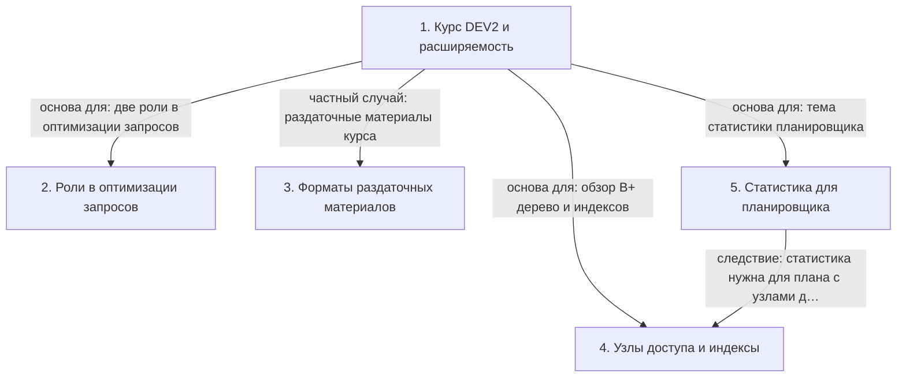

# Postgres: курс DEV2 и оптимизация запросов

> [!abstract] Обзор
> Материал описывает четырёхдневный курс DEV2, в котором подробно разбирается устройство Postgres и только темы, интересные разработчикам. В нём затрагиваются расширяемость Postgres через серверный код и две роли в оптимизации запросов — администраторов и разработчиков, которым нужен общий язык. Отдельно отмечены форматы раздаточных материалов, узлы доступа к данным и обычный тип индекса B+ дерево (B+ дерево). Завершает набор тема статистики, нужной планировщику для построения плана выполнения.

> [!info] Курс
> [[index|Оглавление курса]]

## Оглавление
1. [[#1. Курс DEV2 и расширяемость]]
2. [[#2. Роли в оптимизации запросов]]
3. [[#3. Форматы раздаточных материалов]]
4. [[#4. Узлы доступа и индексы]]
5. [[#5. Статистика для планировщика]]

**Схема** — [[#Схема]]
**Итог** — [[#Итог]]

## 1. Курс DEV2 и расширяемость

DEV2 — четырёхдневный курс, в котором подробно разбирается, как устроен Postgres. Он похож на DBA2, но рассматривает только темы, интересные разработчикам. Написав код на стороне сервера, можно приспособить Postgres к решению задач, для которых он изначально не был рассчитан.

*Источник: [00:01:00]*

> [!quote]- Кадр [00:01:00]
> 

## 2. Роли в оптимизации запросов

К оптимизации запросов и производительности сервера имеют отношение как администраторы, так и разработчики, но смотрят на проблему с разных сторон. Разработчик оптимизирует те запросы, которые он пишет. Администратор смотрит на весь экземпляр в целом, определяет наиболее долгие и ресурсоёмкие запросы и пытается их оптимизировать. Разработчики и администраторы должны как минимум говорить на одном языке, чтобы понимать друг друга и взаимодействовать.

> [!info] Зачем это нужно
> Общий язык нужен разработчикам и администраторам, чтобы понимать друг друга и взаимодействовать.

*Источник: [00:01:00]*

## 3. Форматы раздаточных материалов

Раздаточные материалы доступны в форматах HTML и PDF. В HTML удобнее копировать запросы для вставки в терминал, а из PDF некоторые запросы копируются некорректно.

| Формат | Особенность |
|---|---|
| HTML | Удобнее копировать запросы для вставки в терминал |
| PDF | Некоторые запросы копируются некорректно |

*Источник: [00:01:00]*

## 4. Узлы доступа и индексы

Узлы плана выполнения, связанные с доступом к данным, — это различные методы доступа; среди них есть последовательные и индексные. Обычный тип индекса — B+ дерево, но в Postgres есть ещё много разных индексов.

*Источник: [00:01:00]*

## 5. Статистика для планировщика

Статистика нужна планировщику для того, чтобы хорошо строить план выполнения запроса.

> [!info] Зачем это нужно
> Статистика нужна планировщику, чтобы хорошо строить план выполнения запроса.

*Источник: [00:01:00]*

## Схема

## Итог

> [!success] Что в итоге
> Курс DEV2 подробно разбирает устройство Postgres и ориентирован на темы, интересные разработчикам. Оптимизация запросов делится между двумя ролями: разработчик оптимизирует свои запросы, администратор — весь экземпляр, и для взаимодействия им нужен общий язык. Узлы доступа к данным, обычный тип индекса B+ дерево и статистика для планировщика относятся к тому, как планировщик строит план выполнения.

