# Демонстрационная база «Авиаперевозки»: схема, SQL-запросы и локализация

> [!abstract] Обзор
> Материал описывает демонстрационную базу данных «Авиаперевозки» под лицензией PostgreSQL: её назначение, три редакции и реалистичные данные. Показана схема из восьми основных таблиц с главной таблицей бронирования, а также связи bookings, tickets и ticket_flights через book_ref и ticket_no. Разобраны рейсы с суррогатным ключом flight_id и структурой flights, статусы рейса, аэропорты с многоязычным представлением над airports_data и параметр bookings.lang. Отдельно рассмотрены представления flights_v и routes, конфигурация салона в Seats, JOIN flights, aircrafts и seats, а также посадочные талоны и регистрация. Отмечены непостоянство данных пассажира, различие расписания и факта и то, что демобаза — это слепок системы.

> [!info] Курс
> [[index|Оглавление курса]]

## Оглавление
1. [[#1. Демонстрационная база «Авиаперевозки»]]
2. [[#2. Схема базы и бронирование]]
3. [[#3. Билеты и данные пассажира]]
4. [[#4. Рейсы и статусы]]
5. [[#5. Выборка рейсов и представления маршрутов]]
6. [[#6. Аэропорты и многоязычность]]
7. [[#7. Самолёты и салон]]
8. [[#8. Посадочные талоны и регистрация]]

**Схема** — [[#Схема]]
**Итог** — [[#Итог]]

## 1. Демонстрационная база «Авиаперевозки»

Разработали демонстрационную базу данных «Авиаперевозки» на тему авиаперевозок. База распространяется под лицензией PostgreSQL и используется для изучения SQL, PostgreSQL и оптимизации, написания статей и книг, демонстрации возможностей PostgreSQL. У неё три редакции — маленькая, средняя и большая; данные делались реалистичными (имена, адреса, телефоны), хотя они не существуют в реальности. Демобаза — это слепок системы, поэтому даты могут отличаться от текущей now(); текущий момент можно посмотреть через SELECT now(), для демобазы это 15 августа 2017 года, а бронирование в примере состоялось 20 дней назад. Схема проста, но содержит много данных и позволяет писать сложные и долгие запросы для оптимизации. Информация о рейсах делится на связанную со временем (например, даты) и не привязанную ко времени.

```sql
=> SELECT * FROM bookings b WHERE b.book_ref = '0824C5';
 book_ref |     book_date      | total_amount
----------+--------------------+------------
 0824C5   | 2017-07-25 23:36:00+03 |    112400.00
(1 row)

=> SELECT now();
SELECT bookings.now();

=> SELECT * FROM bookings b WHERE b.book_ref = '0824C5';
 book_ref |     book_date      | total_amount
----------+--------------------+--------------
 0824C5   | 2017-07-25 23:36:00+03 |    112400.00
(1 row)

=> SELECT now();
```

*Источник: [00:00:40], [00:01:01], [00:06:15], [00:06:35], [00:07:01], [00:31:27]*

> [!quote]- Кадр [00:00:40]
> 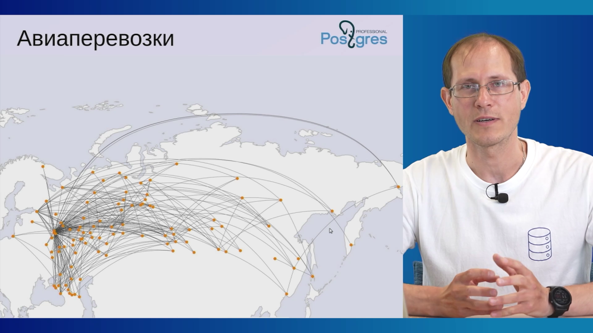

> [!quote]- Кадр [00:01:01]
> 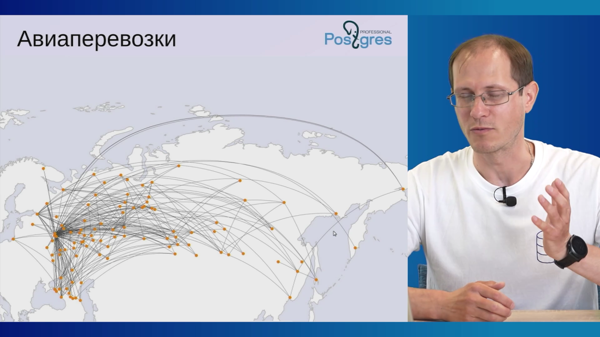

> [!quote]- Кадр [00:31:27]
> 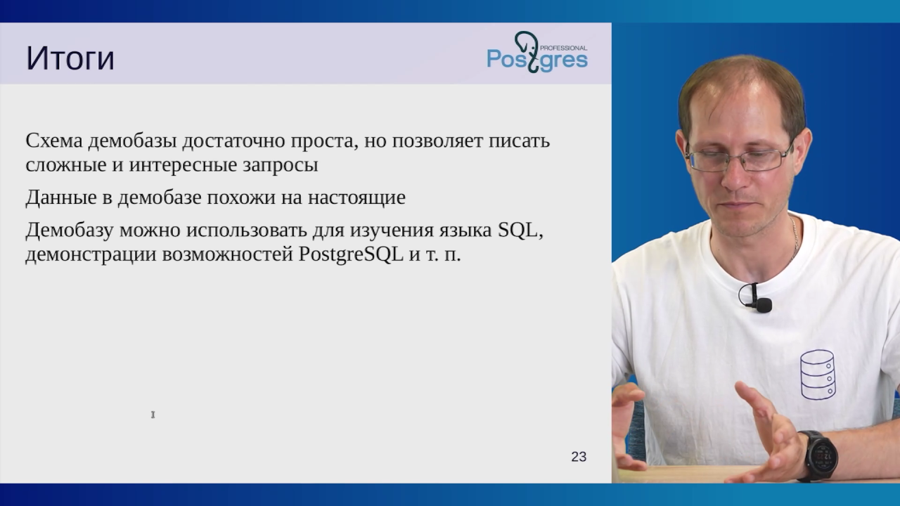

## 2. Схема базы и бронирование

База авиаперевозок состоит из 8 основных таблиц: Bookings, Tickets, Ticket_flights, Boarding_passes, Airports, Flights, Aircrafts, Seats; на схеме представлены только первичные и внешние ключи. Главная таблица — Bookings (бронирование): сначала создаётся бронирование, в него входят билеты, а в билетах — информация о перелётах. Bookings имеет дату (book_date), номер (book_ref) и общую стоимость (total_amount); в неё включён элемент денормализации для упрощения некоторых запросов. book_ref — шестибуквенный буквоцифровой код, номер бронирования. Соединение bookings с tickets по book_ref даёт перелёты пассажиров по брони, а tickets соединяется с ticket_flights по ticket_no.

```javascript
=> SELECT * FROM bookings b WHERE b.book_ref = 'RB24C5';

=> SELECT t.*
   FROM bookings b
   JOIN tickets t ON t.book_ref = b.book_ref
   WHERE b.book_ref = '0824C5';
=> SELECT tf.*
   FROM tickets t
   JOIN ticket_flights tf ON tf.ticket_no = t.ticket_no
   WHERE t.ticket_no = '0005435126781';
```

*Источник: [00:02:05], [00:02:25], [00:02:55], [00:05:05], [00:05:55], [00:11:10]*

> [!quote]- Кадр [00:02:05]
> 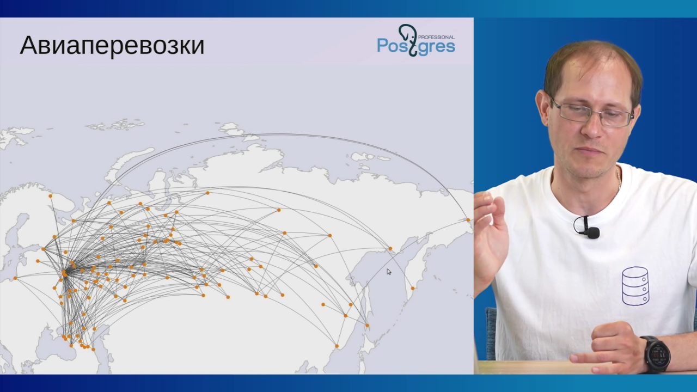

> [!quote]- Кадр [00:02:25]
> 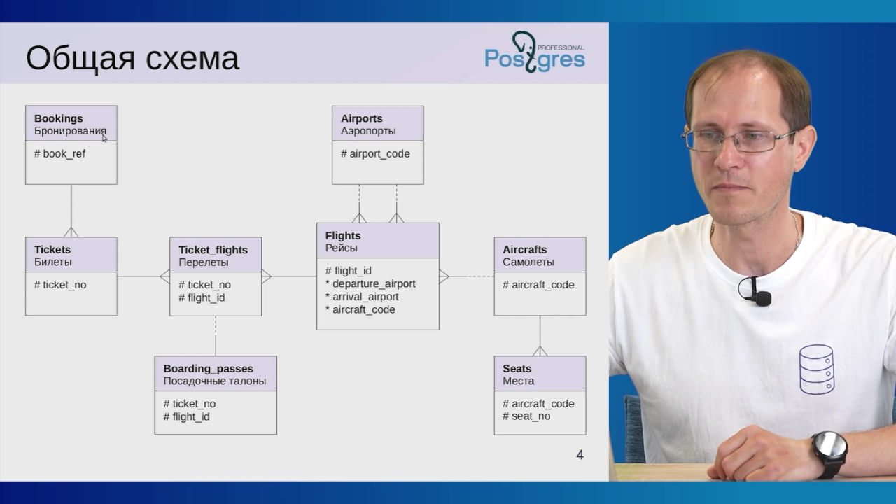

> [!quote]- Кадр [00:05:05]
> 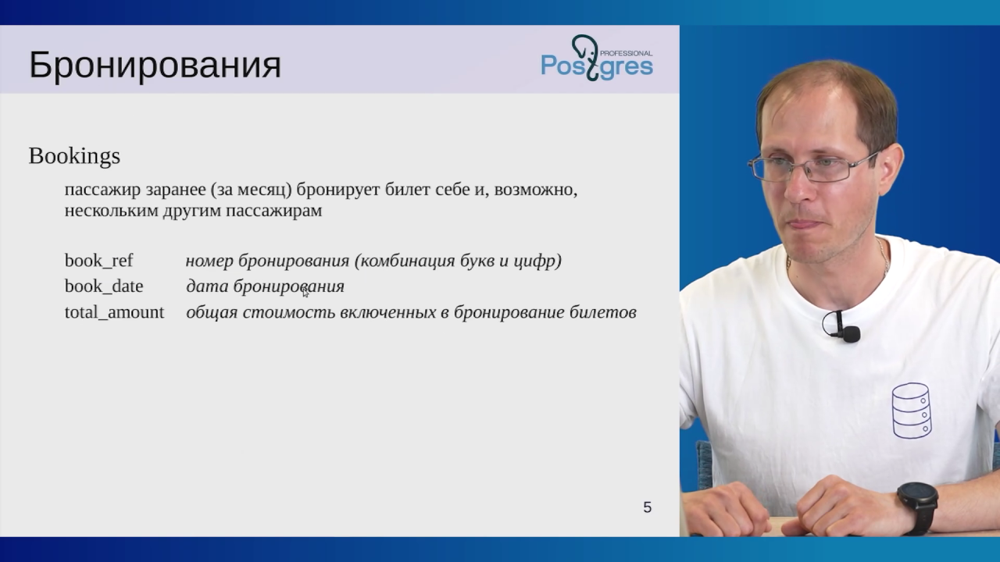

## 3. Билеты и данные пассажира

Билет выдаётся на одного пассажира и может включать несколько перелётов. Таблица Ticket_flights соединяет билеты и рейсы; её поля: ticket_no, flight_id, fare_conditions (класс обслуживания: бизнес, эконом или комфорт) и amount (стоимость перелёта). Ни passenger_id (номер документа), ни passenger_name не являются постоянными: паспорт и имя можно менять, поэтому нельзя однозначно найти все билеты одного и того же пассажира.

*Источник: [00:07:25], [00:07:45], [00:10:00]*

> [!quote]- Кадр [00:07:45]
> 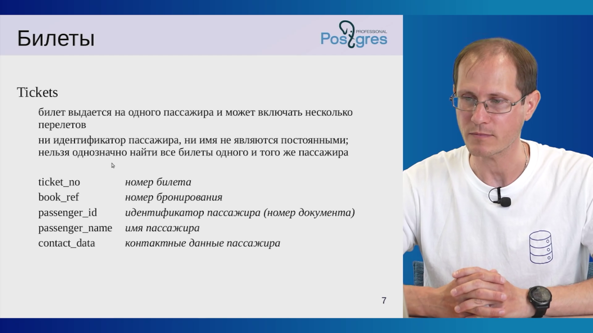

> [!quote]- Кадр [00:10:00]
> 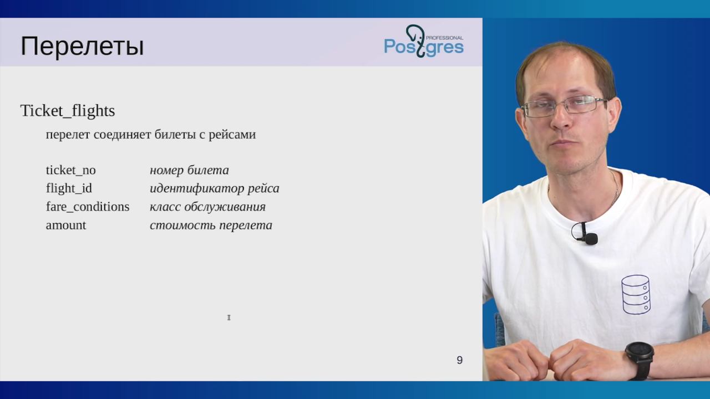

## 4. Рейсы и статусы

Рейс — это направление от одного аэропорта до другого. Естественный ключ рейса — номер рейса и дата отправления; для упрощения запросов в таблице Flights используется суррогатный ключ flight_id. Таблица flights содержит поля flight_id, flight_no, scheduled_departure/arrival (по расписанию), actual_departure/arrival (фактические, могут отличаться на несколько минут), departure/arrival_airport, status и aircraft_code. Статус рейса (status) может принимать значения scheduled, on time, delayed, canceled, arrival (рейс уже прилетел), а также Departed (в полёте); on time означает открытую регистрацию, scheduled — регистрация ещё не открыта.

*Источник: [00:02:25], [00:02:55], [00:10:00], [00:11:31], [00:14:03]*

> [!quote]- Кадр [00:11:31]
> 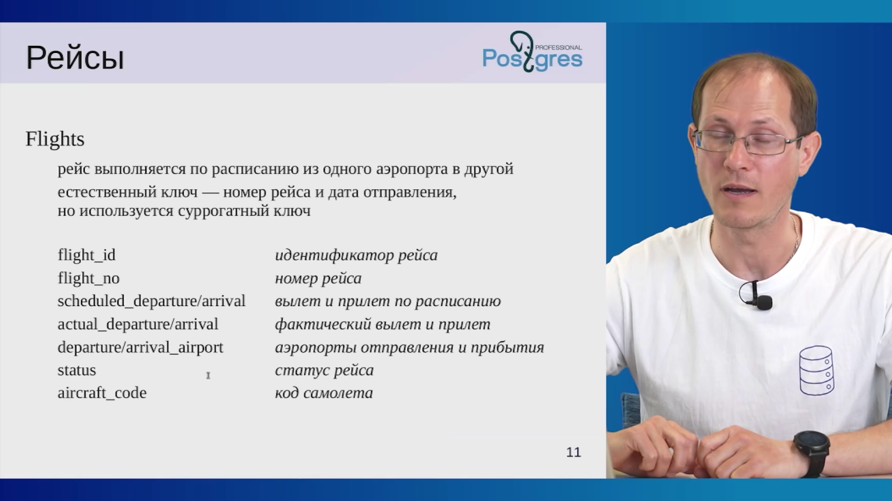


## 5. Выборка рейсов и представления маршрутов

SQL-запрос соединяет ticket_flights, tickets и flights по ticket_no и flight_id и выбирает аэропорты отправления и прибытия, статус и код самолёта для заданного номера билета, сортируя по scheduled_departure. В примере actual_departure 2017-08-12 11:01:00+03 отличается от scheduled_departure на минуту. Номер flight_no одинаков для всех рейсов, следующих по одному маршруту по расписанию; маршрут можно найти по номеру рейса запросом к представлению routes. В демобазе есть представление flights_v, которое содержит информацию о перелётах и упрощает сложные JOIN; через него можно получить данные о конкретном перелёте, например из Москвы в Пермь, и узнать воздушное судно. Дни выполнения маршрута задаются массивом days_of_week; для вывода в расширенном формате используется \gx.

```sql
SELECT f.flight_id, f.scheduled_departure,
       f.departure_airport dep, f.arrival_airport arr,
       f.status, f.aircraft_code aircraft
FROM ticket_flights tf
JOIN tickets t ON tf.ticket_no = t.ticket_no
JOIN flights f ON f.flight_id = tf.flight_id
WHERE t.ticket_no = '0005435126781'
ORDER BY f.scheduled_departure;

SELECT f.flight_id, f.flight_no, f.scheduled_departure
FROM flights f
WHERE f.flight_no = 'PG0412'
ORDER BY f.scheduled_departure
LIMIT 10;

f.departure_airport dep, f.arrival_airport arr,
f.status, f.aircraft_code aircraft
FROM tickets t
  JOIN ticket_flights tf ON tf.ticket_no = t.ticket_no
  JOIN flights f ON f.flight_id = tf.flight_id
WHERE t.ticket_no = '0005435126781'
ORDER BY f.scheduled_departure;

SELECT f.flight_id, f.flight_no, f.scheduled_departure
FROM flights f
WHERE f.flight_no = 'PG0412'
ORDER BY f.scheduled_departure
LIMIT 10;

=> SELECT * FROM routes r WHERE r.flight_no = 'PG0412' \gx

SELECT * FROM flights_v f WHERE f.flight_id = 22566 \gx

SELECT * FROM flights_v f WHERE f.flight_id = 22566 \gx

SELECT * FROM routes r WHERE r.flight_no = 'PG0412' \gx

SELECT s.*
FROM flights f
  JOIN aircrafts a ON a.aircraft_code = f.aircraft_code
  JOIN seats s ON s.aircraft_code = a.aircraft_code
WHERE f.flight_id = 22566
AND s.seat_no = '1A';
```

*Источник: [00:14:03], [00:15:45], [00:16:05], [00:16:29], [00:18:32], [00:19:52] и др.*

## 6. Аэропорты и многоязычность

Аэропорты обозначаются трёхбуквенными кодами, например VKO — Внуково в Москве; эти обозначения международные. Таблица Airports содержит поля airport_code, airport_name, city, coordinates (долгота и широта) и timezone; город не выделен в отдельную таблицу. Таблица реализована как многоязычное представление над airports_data; AirportsData — базовая таблица с переводами названий в формате JSON: поля airport_name и city хранят значения с ключами en и ru. В поставке по умолчанию есть русский и английский; для многоязычности используется конфигурационный параметр bookings.lang, значение меняется командой SET. При lang = 'en' названия выводятся на английском (Vnukovo International Airport, Moscow), при русском — на русском (Внуково, Москва).

```sql
> SET bookings.lang = 'en';
SET
=> SELECT * FROM airports a WHERE a.airport_code = 'VKO' \gx
-[ RECORD 1 ]+---------------------------
airport_code | VKO
airport_name | Vnukovo International Airport
city         | Moscow

SELECT * FROM airports WHERE airport_code = 'VKO' \gx

SELECT f.scheduled_departure,
  dep.airport_code || ' (' || dep.city || ')' departure,
  arr.airport_code || ' (' || arr.city || ')' arrival
FROM ticket_flights tf
JOIN tickets t ON tf.ticket_no = t.ticket_no
JOIN flights f ON f.flight_id = tf.flight_id
JOIN airports dep ON dep.airport_code = f.departure_airport
JOIN airports arr ON arr.airport_code = f.arrival_airport
WHERE t.ticket_no = '0005435126781'
ORDER BY f.scheduled_departure;

=> SELECT * FROM airports_data ml WHERE ml.airport_code = 'VKO' \gx

=> SET bookings.lang = 'en';
SET
=> SELECT * FROM airports a WHERE a.airport_code = 'VKO' \gx
-[ RECORD 1 ]+---------------------------
airport_code | VKO
airport_name | Vnukovo International Airport
city         | Moscow
```

*Источник: [00:16:49], [00:17:12], [00:18:52], [00:19:32], [00:22:50], [00:28:37] и др.*

> [!quote]- Кадр [00:16:49]
> 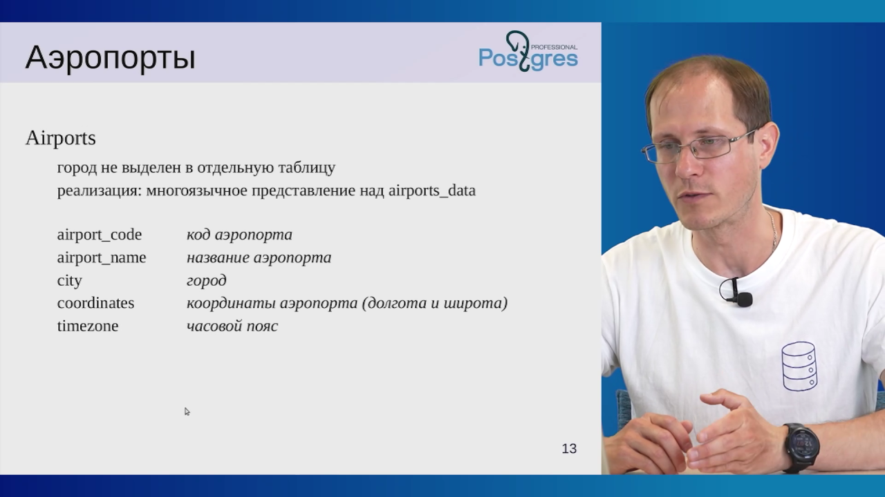

> [!quote]- Кадр [00:17:12]
> 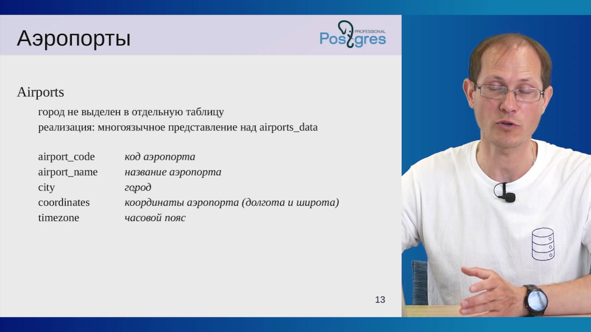

> [!quote]- Кадр [00:28:57]
> 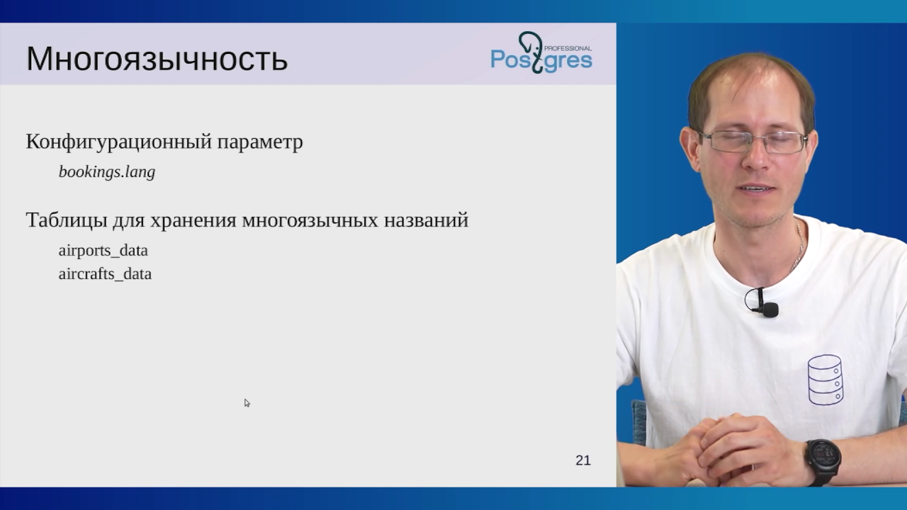

## 7. Самолёты и салон

Чтобы получить информацию о модели самолёта и дальности полёта для конкретного рейса, выполняется JOIN таблиц flights и aircrafts по aircraft_code. Таблица Seats определяет схему салона: все самолёты одной модели имеют одинаковую компоновку; столбцы aircraft_code, seat_no и fare_conditions. В бизнес-классе места прореженные: вместо трёх мест в ряду два, в первом ряду бизнес-класса шесть мест (1A, 1C, 1D, 1G, 1H, 1K). Посмотреть первый ряд можно через соединение flights, aircrafts и seats; запрос с группировкой позволяет посмотреть общее число мест различных классов обслуживания.

```sql
SELECT a.*
FROM flights f
  JOIN aircrafts a ON a.aircraft_code = f.aircraft_code
WHERE f.flight_id = 22566;

SELECT s.*
FROM flights f
  JOIN aircrafts a ON a.aircraft_code = f.aircraft_code
  JOIN seats s ON s.aircraft_code = a.aircraft_code
WHERE f.flight_id = 22566
AND s.seat_no ~ '^1.$';

SELECT s.fare_conditions, count(*)
FROM seats s
WHERE s.aircraft_code = '733'
GROUP BY s.fare_conditions;

SELECT s.*
FROM flights f
  JOIN aircrafts a ON a.aircraft_code = f.aircraft_code
  JOIN seats s ON s.aircraft_code = a.aircraft_code
WHERE f.flight_id = 22566
AND s.seat_no = '1A';
```

> [!info] Зачем это нужно
> Чтобы получить модель самолёта и дальность полёта для конкретного рейса.

*Источник: [00:24:34], [00:24:54], [00:25:44], [00:26:04], [00:26:24], [00:26:44]*

> [!quote]- Кадр [00:24:54]
> 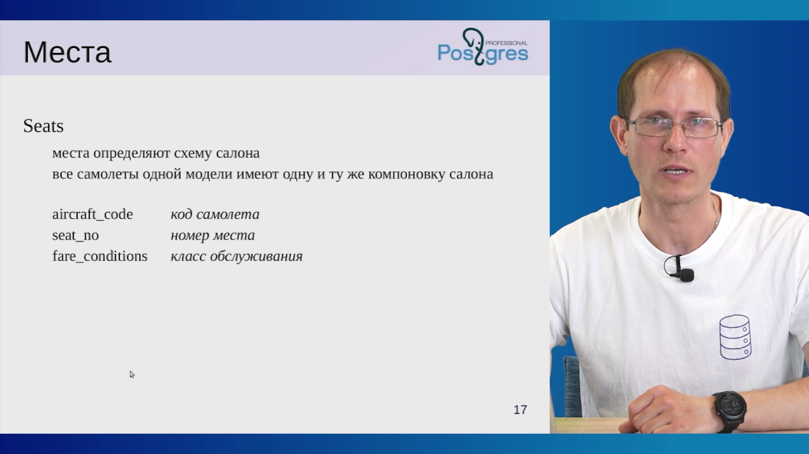

## 8. Посадочные талоны и регистрация

При регистрации человеку выдаётся посадочный талон с информацией о месте в самолёте. Сущность boarding_passes включает поля boarding_no, flight_id, seat_no и ticket_no; boarding_no — номер посадочного талона, присваивается в порядке регистрации (по возрастанию), по нему можно определить очерёдность регистрации на рейс, а seat_no — номер места, который выдаётся пассажиру при регистрации. Регистрация на рейс открывается за сутки до отправления; после открытия пассажиры могут выбрать более удобные места. Для некоторых перелётов регистрация ещё не открылась, поэтому посадочные талоны ещё не выданы; в таком случае используется LEFT JOIN.

```sql
SELECT f.status, bp.*
FROM tickets t
JOIN ticket_flights tf ON tf.ticket_no = t.ticket_no
JOIN flights f ON f.flight_id = tf.flight_id
LEFT JOIN boarding_passes bp
  ON bp.ticket_no = tf.ticket_no AND bp.flight_id = tf.flight_id
WHERE t.ticket_no = '0005435126781'
ORDER BY f.scheduled_departure;
```

*Источник: [00:02:55], [00:26:44], [00:27:04], [00:27:54]*

> [!quote]- Кадр [00:02:55]
> 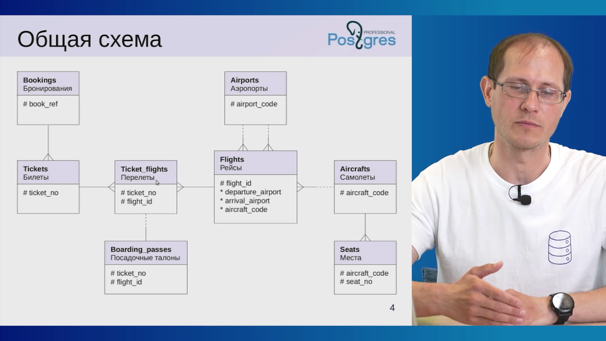

> [!quote]- Кадр [00:27:04]
> 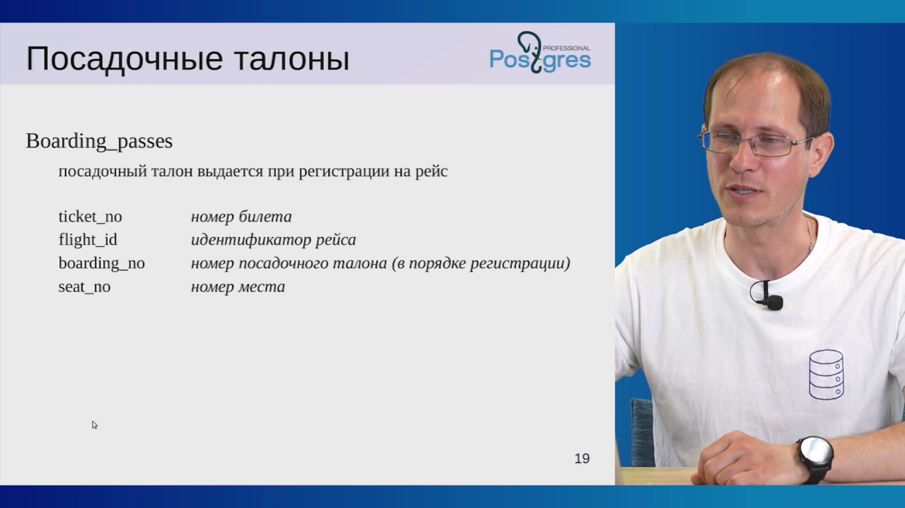

## Схема

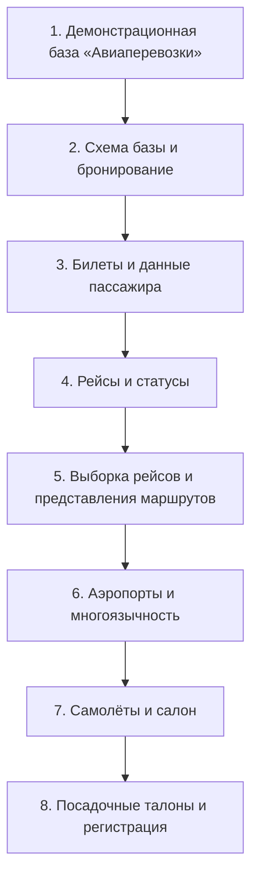

## Итог

> [!success] Что в итоге
> Демонстрационная база «Авиаперевозки» под лицензией PostgreSQL построена вокруг бронирования и связанных таблиц билетов и перелётов; схема проста, но содержит много данных и позволяет писать сложные долгие запросы для оптимизации. SQL-запросы через book_ref и ticket_no дают данные брони и маршрут конкретного билета, а соединения с airports, seats и boarding_passes добавляют детали. Рейсы используют суррогатный ключ flight_id, аэропорты реализованы как многоязычное представление с переводами в airports_data, язык переключается значением bookings.lang. Отдельно отмечены непостоянство данных пассажира, различие расписания и факта и появление посадочных талонов после открытия регистрации.

