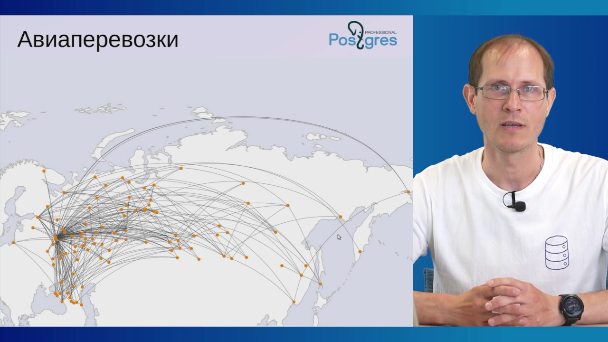
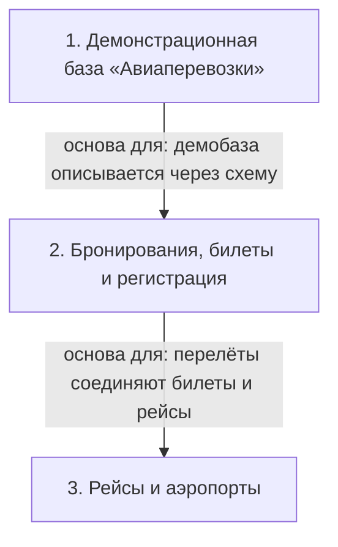

# Демонстрационная база данных «Авиаперевозки»

> [!abstract] Обзор
> Материал посвящён демонстрационной базе данных «Авиаперевозки», созданной для курса по оптимизации запросов. Описываются её назначение, лицензия, три редакции и простая схема, относящаяся к аэропортам, бронированиям, билетам, перелётам и самолётам. Отдельно разбираются элементы схемы: бронирования, билеты, рейсы, аэропорты, сущность Aircraft, таблица SIDS, массив дней недели, денормализация Total Amount, текущий момент времени, уникальность пассажиров, ключи и статусы рейса, плановое и фактическое время. Завершают материал регистрация на рейс через LEFT JOIN и представления: многоязычность с параметром bookings.lang, flight, flightsv, Roads и поле local.

> [!info] Курс
> [[index|Оглавление курса]]

## Оглавление
1. [[#1. Демонстрационная база «Авиаперевозки»]]
2. [[#2. Бронирования, билеты и регистрация]]
3. [[#3. Рейсы и аэропорты]]
4. [[#4. Дни, ключи, статусы, время]]
5. [[#5. Самолёты, места и SIDS]]
6. [[#6. Многоязычность и представления]]

**Схема** — [[#Схема]]
**Итог** — [[#Итог]]

## 1. Демонстрационная база «Авиаперевозки»

Для курса по оптимизации запросов разработана демонстрационная база данных «Авиаперевозки»; она избавляет от необходимости создавать и наполнять свои таблицы в каждой теме. База существует в трёх редакциях — маленькая, средняя и большая; в курсе используется большая база с перелётами за год. Она распространяется под лицензией PostgreSQL, поэтому её можно свободно использовать для изучения SQL, написания статей и книг. В демо-базе есть фиктивные данные, которые выглядят реалистично; e-mail в ней не существуют. Демобаза — это слепок системы на определённый момент времени: текущий момент в базе данных можно узнать через Bookings.now, для демобазы это 15 августа 2017 года.

> [!info] Зачем это нужно
> Чтобы не создавать и наполнять свои таблицы в каждой теме, так как делать это каждый раз сложно и трудоёмко.

*Источник: [00:00:00], [00:01:00]*

> [!quote]- Кадр [00:01:00]
> 

## 2. Бронирования, билеты и регистрация

Главная таблица — бронирование; в него входят билеты, которые содержат информацию о перелётах, а перелёты создаются, когда нет прямого сообщения между точкой отбытия и точкой прибытия. Таблица bookings хранит бронирования с шестибуквенным буквоцифровым кодом и датой бронирования, пассажир может забронировать билет для себя или для других; билет выдается на одного пассажира и может включать несколько перелётов, например если нет прямых перелётов или перелёт туда-обратно. В билетах есть номер билета; в перелётах есть номер билета и идентификатор рейса, класс обслуживания и стоимость конкретного перелёта, и перелёты соединяют билеты и рейсы. Total Amount — это общая стоимость включённых в бронирование билетов; это элемент денормализации, добавляемый для упрощения некоторых запросов, а однозначно идентифицировать пассажира нельзя, потому что паспорт и имя можно поменять, поэтому все пассажиры считаются уникальными. При регистрации человеку выдаётся посадочный талон; в таблице посадочных талонов хранятся номер билета и идентификатор рейса, а номер посадочного талона отражает порядок регистрации на рейс; регистрация открывается за сутки до отправления, и для некоторых перелётов она ещё не открылась, поэтому в запросе используется LEFT JOIN.

> [!info] Зачем это нужно
> Добавляется для упрощения некоторых запросов.

*Источник: [00:01:00]*

## 3. Рейсы и аэропорты

Рейс — это перелёт человека из одного аэропорта в другой; информация о рейсах хранится в таблице рейс. Номер рейса (flight number) одинаков для всех рейсов, летящих по одному маршруту. Таблица «Аэропорт» содержит название города, стандартный трёхбуквенный код аэропорта, название аэропорта, координаты и часовой пояс; в запрос можно добавить соединение с таблицей аэропортов, чтобы видеть эти обозначения. В демонстрационной базе данных город не выделен в отдельную сущность (таблицу), хотя это можно сделать.

*Источник: [00:01:00]*

## 4. Дни, ключи, статусы, время

Дни недели, в которые выполняется перелёт, хранятся в поле типа массив; значения массива заключены в фигурные скобки. Естественный ключ рейса — это номер рейса и дата отправления; для упрощения запросов в таблице рейсов используется суррогатный ключ. В авиаперевозках статус рейса может принимать 6 значений: запланирован (scheduled) — рейс будет отправлен за сутки, вовремя (on time) — рейс полетит вовремя, отложен (delayed), отменён (canceled), прибытие (arrival) — рейс уже прилетел и закончен. В данных о рейсе есть запланированное и фактическое время отправления и прибытия; они могут отличаться, например, на минуту.

> [!info] Зачем это нужно
> Для упрощения запросов.

*Источник: [00:01:00]*

## 5. Самолёты, места и SIDS

Для хранения информации о самолётах используется отдельная сущность Aircraft; она включает трёхбуквенный код самолёта, модель и максимальную дальность полёта, и самолёты используют трёхбуквенное обозначение. К перелёту добавляется информация о самолёте: идентификатор (код самолёта) и подробные данные о модели; например, для boeing дальность полёта составляет 11100 метров. В таблице SIDS хранятся код самолёта, список номеров мест и классы обслуживания для этих мест; номера мест в самолёте могут идти не по порядку. В бизнес-классе места прореженные: вместо трёх мест находится два, одно место убрали для удобства.

*Источник: [00:01:00]*

## 6. Многоязычность и представления

Многоязычность для аэропортов реализована за счёт представления над базовой таблицей Airports Data; над базовой таблицей AirportsData существует специальное представление, содержащее переводы названий в формате JSON, где в самой базовой таблице в JSON хранится информация, например для EN — Vnukovo International Airport. Многоязычность для самолётов реализована так же, как для аэропортов, над базовой таблицей Aircrafts Data. Переключение между русским и английским языками выполняется с помощью параметра Bookings.lang; конфигурационный параметр bookings.lang управляет языком отображаемой информации, в том числе об аэропортах или самолётах, по умолчанию информация представлена на русском языке, а значение параметра меняется командой set, например на en. Чтобы не писать один и тот же запрос каждый раз, в демонстрационной базе данных создали представление flight, в котором уже есть эта информация; при обращении к представлению flightsv видна та же самая информация. Через представление можно смотреть локальное время прилёта или отлёта конкретных рейсов; поле local имеет префикс local и содержит локальную информацию, локальное время прилёта может отличаться от московского (для Перми отличие времени составляет 2 часа), а информация о перелетах, не завязанная на время, выделена в отдельное представление Roads.

> [!info] Зачем это нужно
> Чтобы не писать один и тот же запрос каждый раз.

*Источник: [00:01:00]*

## Схема

## Итог

> [!success] Что в итоге
> Демонстрационная база «Авиаперевозки» создана для курса по оптимизации запросов, доступна под лицензией PostgreSQL и существует в трёх редакциях. Её схема строится вокруг бронирований, билетов, рейсов, аэропортов и самолётов; отдельные темы посвящены ключам, статусам, времени и представлениям. Базу можно свободно использовать для изучения SQL, Postgres и написания статей, а на её простой схеме с реалистичными данными можно писать сложные запросы для последующей оптимизации. Язык отображаемой информации задаётся параметром bookings.lang.

