# Обработка, оптимизация и планирование SQL-запросов в PostgreSQL

> [!abstract] Обзор
> Материал объединяет две темы: обработку SQL-запросов в PostgreSQL и оптимизацию запросов с планированием. Показан путь запроса от текста через разбор, переписывание и планирование к выполнению, с проверкой объектов и прав через системный каталог и построением деревьев разбора с узлами From Expression и RTE. Разбирается дерево плана (PLANNEDSTMT, SORT, NESTLOOP, SEQSCAN), конвейерная работа экзекьютора и диагностика через EXPLAIN с buffers, analyze и actual time, а также деление буферов на shared и local. Отдельно рассматриваются JIT-компиляция и tuple deforming, подготовленные операторы PREPARE/EXECUTE и \bind, курсоры и протоколы выполнения запросов. В части оптимизации описываются два подхода (настройка параметров и оптимизация запросов), оценка селективности и кардинальности, стоимость узлов и выбор плана с сокращением пространства поиска.

> [!info] Курс
> [[index|Оглавление курса]]

## Оглавление
1. [[#1. Этапы обработки и оптимизация запроса]]
2. [[#2. Разбор запроса и системный каталог]]
3. [[#3. Дерево разбора, план и выполнение]]
4. [[#4. Переписывание запроса и представления]]
5. [[#5. EXPLAIN, буферы и анализ выполнения]]
6. [[#6. JIT-компиляция и tuple deforming]]
7. [[#7. Подготовленные операторы и курсоры]]
8. [[#8. Селективность, кардинальность и стоимость плана]]

**Схема** — [[#Схема]]
**Итог** — [[#Итог]]

## 1. Этапы обработки и оптимизация запроса

Оптимизация — широкое слово: мы ищем оптимальные пути, а если что-то неоптимально, пытаемся сделать это оптимальным. Обработка запроса включает этапы разбора (parse), переписывания (rewrite), планирования (оптимизации) и выполнения. В PostgreSQL рассматривают два подхода: настройку параметров и оптимизацию запросов. Настройка параметров подстраивает систему под имеющуюся нагрузку, действует глобально и требует мониторинга. Оптимизация запросов уменьшает нагрузку локально — на запрос или несколько запросов — и для неё используется профилирование.

> [!info] Зачем это нужно
> Снижает общую нагрузку на систему и освобождает ресурсы.

*Источник: [00:00:40], [00:01:00], [00:01:26], [00:05:59]*

> [!quote]- Кадр [00:00:40]
> 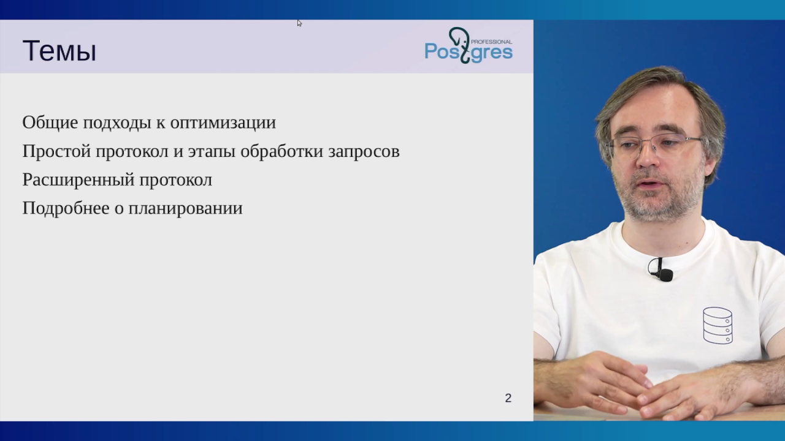

> [!quote]- Кадр [00:05:59]
> 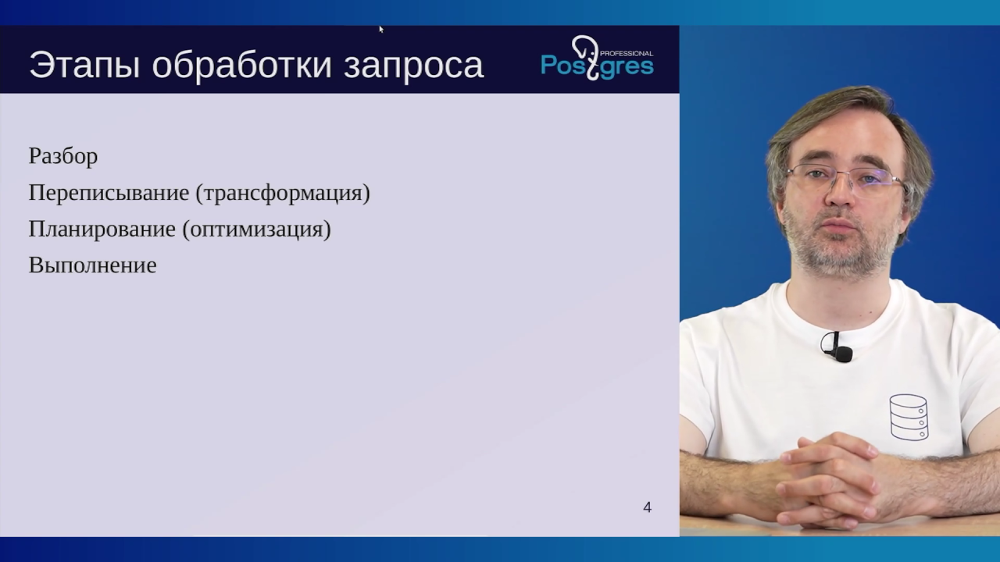

> [!quote]- Кадр [00:01:00]
> 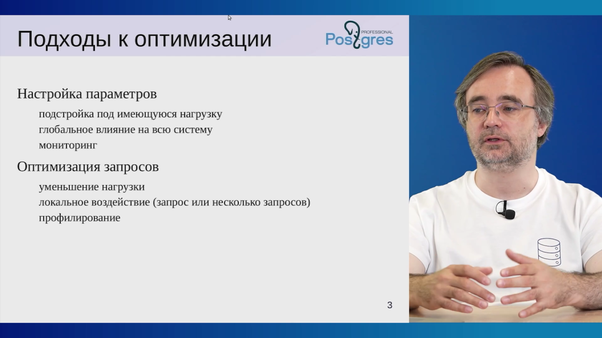

## 2. Разбор запроса и системный каталог

Текст запроса разбирается (parse) в дерево запроса с использованием системного каталога. Разбор включает лексический анализ, который выделяет ключевые слова, числа и строки, и синтаксический анализ, который проверяет последовательность лексем; синтаксически корректный пример: select * from t;, некорректный: from t select *. Системный каталог — это специальные таблицы базы данных с мета-информацией об объектах: таблицах, индексах. Семантический разбор проверяет смысл запроса: существует ли объект (например, таблица t) и есть ли права доступа к нему; синтаксически верный запрос может быть семантически неверным. При разборе запроса к pg_tables выясняется, что это представление в системном каталоге; у представления есть идентификатор, и при разборе проверяются права доступа.

*Источник: [00:06:19], [00:06:40], [00:10:28]*

> [!quote]- Кадр [00:06:19]
> 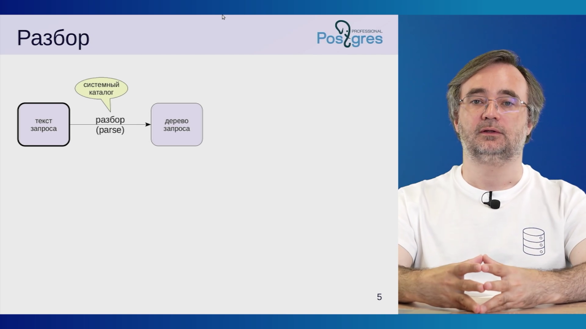

> [!quote]- Кадр [00:06:40]
> 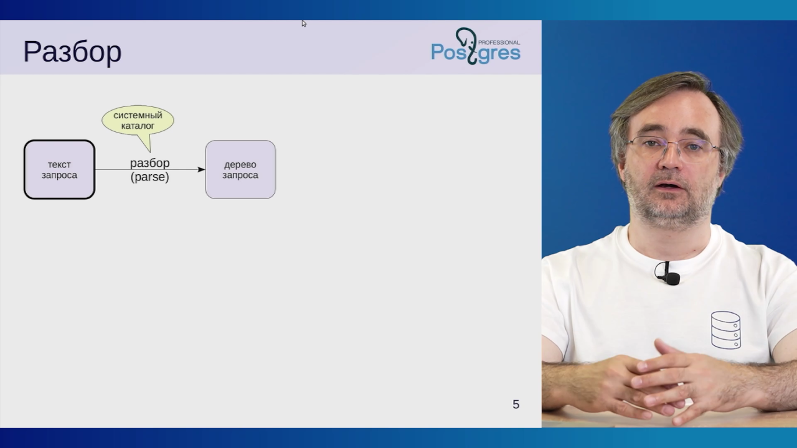

## 3. Дерево разбора, план и выполнение

При синтаксическом разборе SQL-запроса строится дерево, верхний узел которого — query; столбцы SELECT, условия фильтрации, сортировки и группировки попадают в отдельные узлы, а From Expression описывает, к каким данным мы обращаемся, и RTE (Range Table Entry) в Postgres называется всё, из чего можно получить набор строк. Включение параметра debug.print.parse позволяет увидеть в журнале сообщений сервера настоящее дерево разбора, а план запроса отображается как дерево узлов: сверху PLANNEDSTMT, также видны SORT, NESTLOOP и SEQSCAN, и команда EXPLAIN показывает план выполнения в виде дерева. В плане разбора есть просто соединения и обращения к таблицам (узлы RTE), но не уточняется, каким образом узлы будут соединяться; Seq Scan — узел плана выполнения, означающий последовательное чтение всей таблицы без индекса. Выполнение работает как конвейер: дерево плана обходится от корня вниз, данные передаются наверх по мере поступления или все сразу, дерево выполнения передаётся исполнителю (executor), и когда клиенту нужна очередная строка, он обращается к корневому узлу, тот запрашивает строку у нижнего узла, и так до листовых узлов, которые читают данные. Узел SORT не может сортировать данные, пока не получит всю выборку, поэтому сначала запрашивает все данные и затем сортирует; Nested loop — конкретный способ соединения с узлом NESTLOOP, который получает по одной строке от узлов, соединения выполняются всегда попарно, а порядок соединения в плане важен.

```sql
SELECT schemaname, tablename
FROM pg_tables
WHERE tableowner = 'postgres'
ORDER BY tablename;

Планирование
PLANNEDSTMT
SORT
TARGETENTRY
NESTLOOP
TARGETENTRY
SEQSCAN
pg_class
SEQSCAN
pg_namespace
OPEXPR
n.oid = c.relnamespace
OPEXPR
c.relkind = 'r'::"char"
pg_get_userbyid(relowner) = 'postgres'::name
```

*Источник: [00:08:26], [00:08:55], [00:11:28], [00:14:24], [00:18:20], [00:19:27] и др.*

> [!quote]- Кадр [00:14:24]
> 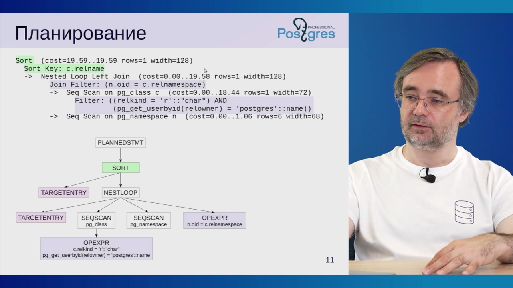

> [!quote]- Кадр [00:11:28]
> 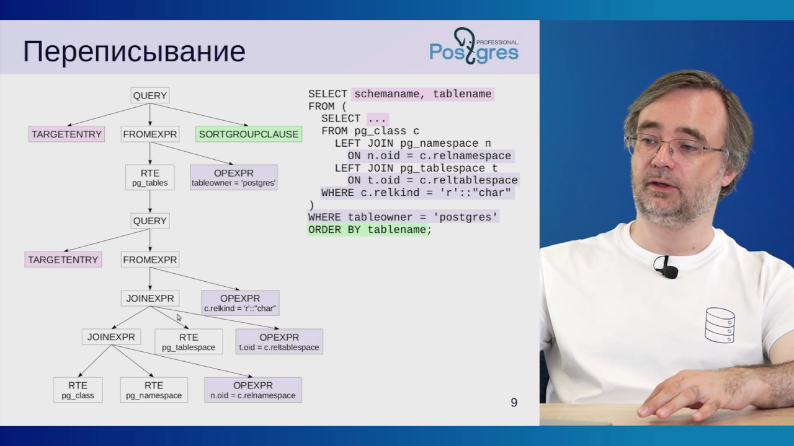

> [!quote]- Кадр [00:24:59]
> 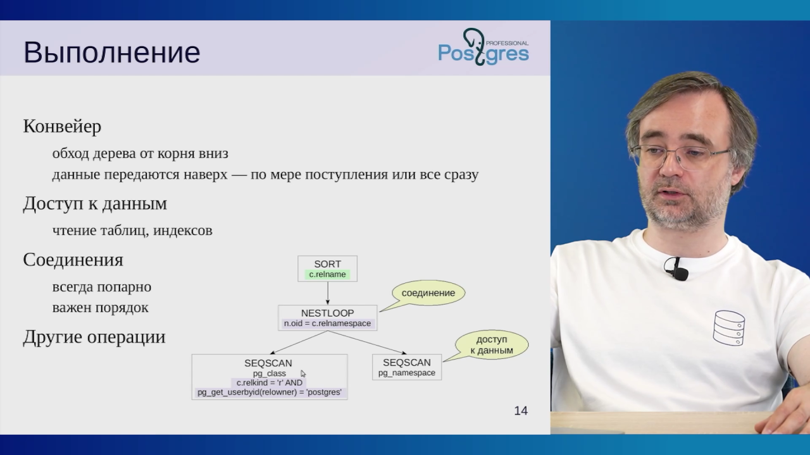

## 4. Переписывание запроса и представления

После разбора (parse) дерево запроса может быть переписано на этапе rewrite. В Postgres есть механизм правил, определяющих, как дерево будет переписываться; можно создавать свои правила, но большого смысла в этом нет. Postgres разбирает текст запроса в дерево, затем переписывает его по правилам в новое дерево, после чего выполняется планирование. Частный случай правил переписывания — подстановка текста представления на место его имени: текст представления из системного каталога разбирается в дерево, и представление вставляется в общее дерево запроса соединением с узлом RTE, а не текстуально.

*Источник: [00:10:48], [00:11:08], [00:11:28]*

> [!quote]- Кадр [00:10:48]
> 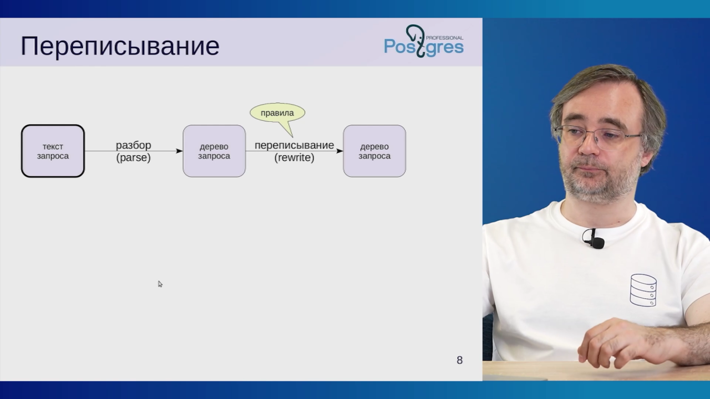


## 5. EXPLAIN, буферы и анализ выполнения

При просмотре плана запроса можно отключить вывод стоимости; параметр buffers в EXPLAIN показывает страницы, которые запрос читал, а изменённая страница становится грязной в буферном кэше и позже будет записана на диск. Если добавить analyze, сервер выполнит запрос и отобразит план с детальной информацией о выполнении, поэтому с изменяющими данными запросами надо быть аккуратными. При EXPLAIN (analyze, buffers, costs off) в плане появляются скобки с actual time — реальное время выполнения в миллисекундах, а в поле Planning Buffers показывается число страниц буферного кэша, прочитанных при построении плана; вывод времени требует ресурсов, и EXPLAIN ANALYZE может существенно замедлять выполнение. В выводе EXPLAIN буферы делятся на shared и local: shared — разделяемые буферы, глобальный буферный кэш, а local относятся к временным таблицам. Временные таблицы обрабатываются не в общем буферном кэше, а локально в обслуживающем процессе, и для анализа плана вставки используется EXPLAIN (analyze, buffers, costs off) на INSERT INTO ... SELECT; в примере создаётся temp_airports через CREATE TEMP TABLE (LIKE airports), затем выполняется INSERT INTO temp_airports SELECT * FROM airports, и план показывает использование локального буферного кэша: попадания, изменения и записи на диск.

```sql
=> EXPLAIN (analyze, buffers, costs off)
SELECT * FROM airports;
 Seq Scan on airports_data ml  (actual time=0.109..0.421 rows=104 loops=1)
   Buffers: shared read=3

=> EXPLAIN (buffers, costs off)
SELECT * FROM airports;

=> EXPLAIN (buffers, costs off)
SELECT * FROM airports;

                        QUERY PLAN
----------------------------------------------------------
 Seq Scan on airports_data ml
 Planning:
   Buffers: shared hit=54 read=6 dirtied=1
(3 rows)

=> CREATE TEMP TABLE temp_airports (LIKE airports);
CREATE TABLE

=> EXPLAIN (analyze, buffers, costs off) INSERT INTO temp_airports SELECT * FROM airports;

QUERY PLAN
-----------------------------------------------------------------------------------------------------------------------------------
Insert on temp_airports (actual time=0.811..0.812 rows=0 loops=1)
  Buffers: shared hit=3, local hit=104 dirtied=3 written=5
  -> Seq Scan on airports data ml (actual time=0.084..0.426 rows=104 loops=1)
        Buffers: shared hit=3
Planning Time: 0.104 ms
Execution Time: 0.840 ms
(6 rows)

CREATE TEMP TABLE temp_airports (LIKE airports);

EXPLAIN (analyze, buffers, costs off) INSERT INTO temp_airports SELECT * FROM airports;

Insert on temp_airports
  Buffers: shared hit=3, local hit=104 dirtied=3 written=5
```

| Буферы | Относятся к |
| shared | глобальному буферному кэшу |
| local | временным таблицам |

> [!info] Зачем это нужно
> Если время не важно, тайминги отключают, чтобы не замедлять выполнение запроса.

*Источник: [00:18:20], [00:18:47], [00:19:07], [00:19:27], [00:20:32], [00:20:52] и др.*

> [!quote]- Кадр [00:20:52]
> 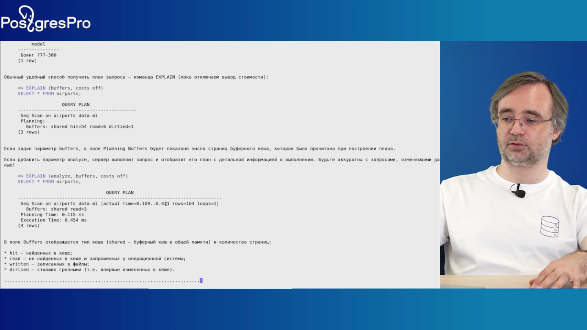

## 6. JIT-компиляция и tuple deforming

JIT-компиляция компилирует часть запросов в исходный код, чтобы вместо медленной интерпретации выполнять готовый компилированный код: вычисление выражений в WHERE, целевого списка (SELECT), агрегатов и проекций, а также преобразование версий строк. Как правило, JIT-компиляция на запросах ничего не даёт, но можно подобрать пример с выигрышем; она не поможет, если запрос очень быстрый в духе OLTP. tuple deforming — это когда мы читаем с диска строчку и преобразуем её в вид, в котором она должна находиться в оперативной памяти. Параметр jit по умолчанию ON, в примере для базы demo он установлен OFF; JIT можно отключить командой SET jit = off, а настройку посмотреть в pg_db_role_setting. JIT помогает в системах со сложными массивными запросами, и то, помогает ли он, зависит от нагрузки.

```sql
EXPLAIN (analyze, timing off)
WITH pi AS (
    SELECT random() x, random() y
    FROM generate_series(1,10_000_000)
)
SELECT 4*sum(1-floor(x*x+y*y))/count(*) val FROM pi;
                                            QUERY PLAN
-----------------------------------------------------------------------------------------------------
 Aggregate  (cost=52500.00..52500.02 rows=1 width=8) (actual rows=1 loops=1)
   CTE pi
     ->  Function Scan on generate_series  (cost=0.00..15000.00 rows=10000000 width=16) (actual rows=10000000 loops=1)
     ->  CTE Scan on pi  (cost=0.00..200000.00 rows=10000000 width=16) (actual rows=10000000 loops=1)
 Planning Time: 1.660 ms
 JIT:
   Functions: 6
   Options: Inlining true, Optimization true, Expressions true, Deforming true
 Execution Time: 2837.141 ms

SELECT setconfig
FROM pg_db_role_setting
WHERE setdatabase = (SELECT oid FROM pg_database WHERE datname='demo');

=> SET jit = off;
SET
=> EXPLAIN (analyze, timing off)
WITH pi AS (
  SELECT random() x, random() y
  FROM generate_series(1,10_000_000)
)
SELECT 4*sum(1-floor(x*x+y*y))/count(*) val FROM pi;
                                        QUERY PLAN
------------------------------------------------------------------------------------------------
 Aggregate  (cost=525000.00..525000.02 rows=1 width=8) (actual rows=1 loops=1)
   CTE pi
     ->  Function Scan on generate_series  (cost=0.00..150000.00 rows=10000000 width=16) (actual rows=10000000 loops=1)
     ->  CTE Scan on pi  (cost=0.00..200000.00 rows=10000000 width=16) (actual rows=10000000 loops=1)
 Planning Time: 1.155 ms
 Execution Time: 2828.161 ms
(6 rows)

=> SET jit = off;
SET
=> EXPLAIN (analyze, timing off)
WITH pi AS (
  SELECT random() x, random() y
  FROM generate_series(1,10_000_000)
)
SELECT 4*sum(1-floor(x*x+y*y))/count(*) val FROM pi;
                                        QUERY PLAN
----------------------------------------------------------------------------------------------------
 Aggregate  (cost=525000.00..525000.02 rows=1 width=8) (actual rows=1 loops=1)
   CTE pi
     ->  Function Scan on generate_series  (cost=0.00..150000.00 rows=10000000 width=16) (actual rows=10000000 loops=1)
   ->  CTE Scan on pi  (cost=0.00..200000.00 rows=10000000 width=16) (actual rows=10000000 loops=1)
 Planning Time: 1.155 ms
 Execution Time: 2828.161 ms
(6 rows)

=> SET jit = on;

SET

=> WITH pi AS (
    SELECT random() x, random() y
    FROM generate_series(1,10_000_000)
)
SELECT 4*sum(1-floor(x*x+y*y))/count(*) val FROM pi;
    val
-----------
 3.1407588
(1 row)
```

*Источник: [00:27:44], [00:28:04], [00:30:24], [00:30:47], [00:31:07], [00:31:47] и др.*

> [!quote]- Кадр [00:27:44]
> 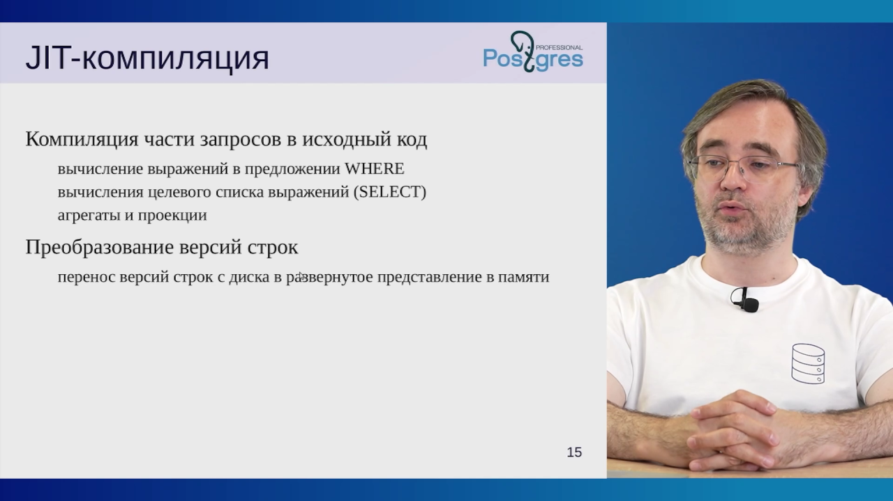

> [!quote]- Кадр [00:28:04]
> 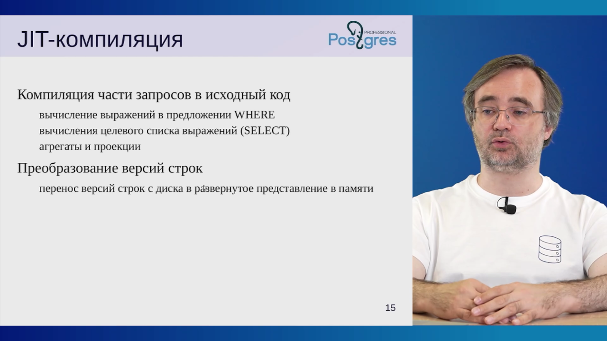

## 7. Подготовленные операторы и курсоры

Простой протокол запросов в PostgreSQL включает четыре этапа: разбор (parse), переписывание (rewrite), планирование (plan) и выполнение; при выполнении select в PSQL используется именно простой протокол. Расширенный протокол состоит из PREPARE (разбор, переписывание) и EXECUTE (планирование, привязка параметров, выполнение); PREPARE сохраняет готовый общий план запроса, а EXECUTE подставляет нужные параметры и выполняет запрос. Посмотреть подготовленные операторы сеанса можно через представление pg_prepared_statements; они находятся в памяти обслуживающего процесса и пропадают при завершении сеанса, а с учётом переданных параметров выполняется планирование и получается частный план запроса (custom plan); psql позволяет использовать расширенный протокол, и команда \bind связывает параметр со значением. Курсор позволяет получать результат не сразу целиком, а построчно; SQL работает с множествами строк, а процедурные языки обрабатывают строки по одной в цикле, для чего используется курсор, который объявляется внутри транзакции и автоматически открывается. Курсор объявляется командой DECLARE c CURSOR FOR SELECT внутри транзакции (BEGIN), строки выбираются по одной через FETCH, курсор закрывается через CLOSE, транзакция завершается COMMIT; все курсоры и подготовленные операторы автоматически пропадают по окончании транзакции, а для курсора оптимизируется время получения части первых строк (по умолчанию первых 10%, cursor_tuple_fraction), а не всего запроса.

```sql
=> PREPARE model(varchar) AS
   SELECT model FROM aircrafts WHERE aircraft_code = $1;

PREPARE

=> EXECUTE model('773');

    model
-------------
 Боинг 777-300
(1 row)

=> EXECUTE model('763');

=> SELECT * FROM pg_prepared_statements \gx
-[ RECORD 1 ]----+-------------------------------------------------
name             | model
statement        | PREPARE model(varchar) AS
                 | SELECT model FROM aircrafts WHERE aircraft_code = $1;
prepare_time     | 2025-06-10 11:56:57.17741+03
parameter_types  | {"character varying"}
result_types     | {text}
from_sql         | t
generic_plans    | 0
custom_plans     | 2
=> \c
You are now connected to database "demo" as user "postgres".
=> SELECT * FROM pg_prepared_statements \gx
(0 rows)
=> \bind '773'

=> \bind '763'

=> EXPLAIN SELECT model FROM aircrafts WHERE aircraft_code = $1;
                      QUERY PLAN
------------------------------------------------------
 Seq Scan on aircrafts  (cost=0.00..1.36 rows=1 width=32)
   Filter: (aircraft_code = '763'::bpchar)
(2 rows)

=> BEGIN;
BEGIN
=> DECLARE c CURSOR FOR SELECT * FROM aircrafts;
DECLARE CURSOR
=> FETCH c;

> => PREPARE model(varchar) AS
   SELECT model FROM aircrafts WHERE aircraft_code = $1;

PREPARE

=> EXECUTE model('773');

    model
-------------
 Боинг 777-300
(1 row)

=> EXECUTE model('763');

=> SELECT * FROM pg_prepared_statements \gx
-[ RECORD 1 ]----+-------------------------------------------------
name             | model
statement        | PREPARE model(varchar) AS
                 | SELECT model FROM aircrafts WHERE aircraft_code = $1;
prepare_time     | 2025-06-10 11:56:57.17741+03
parameter_types  | {"character varying"}
result_types     | {text}
from_sql         | t
generic_plans    | 0
custom_plans     | 2
=> \c
You are now connected to database "demo" as user "postgres".
=> SELECT * FROM pg_prepared_statements \gx
(0 rows)
=> \bind '773'

=> \bind '763'

=> EXPLAIN SELECT model FROM aircrafts WHERE aircraft_code = $1;
                      QUERY PLAN
------------------------------------------------------
 Seq Scan on aircrafts  (cost=0.00..1.36 rows=1 width=32)
   Filter: (aircraft_code = '763'::bpchar)
(2 rows)
```

*Источник: [00:06:19], [00:33:24], [00:34:14], [00:34:34], [00:36:24], [00:36:44] и др.*

> [!quote]- Кадр [00:34:34]
> 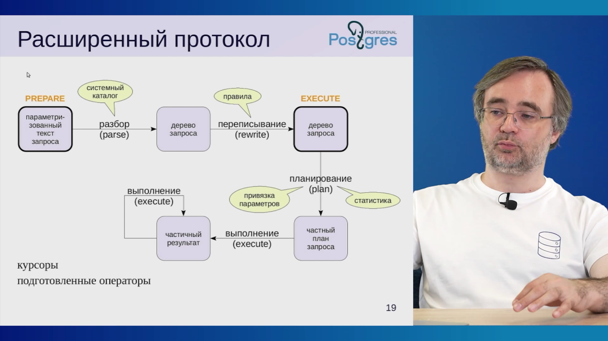

> [!quote]- Кадр [00:36:24]
> 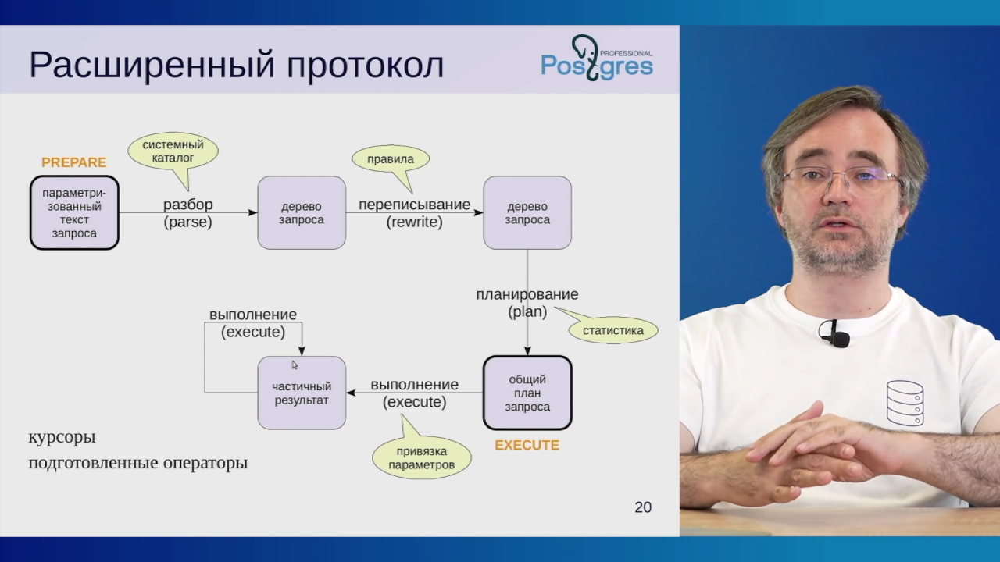

> [!quote]- Кадр [00:36:44]
> 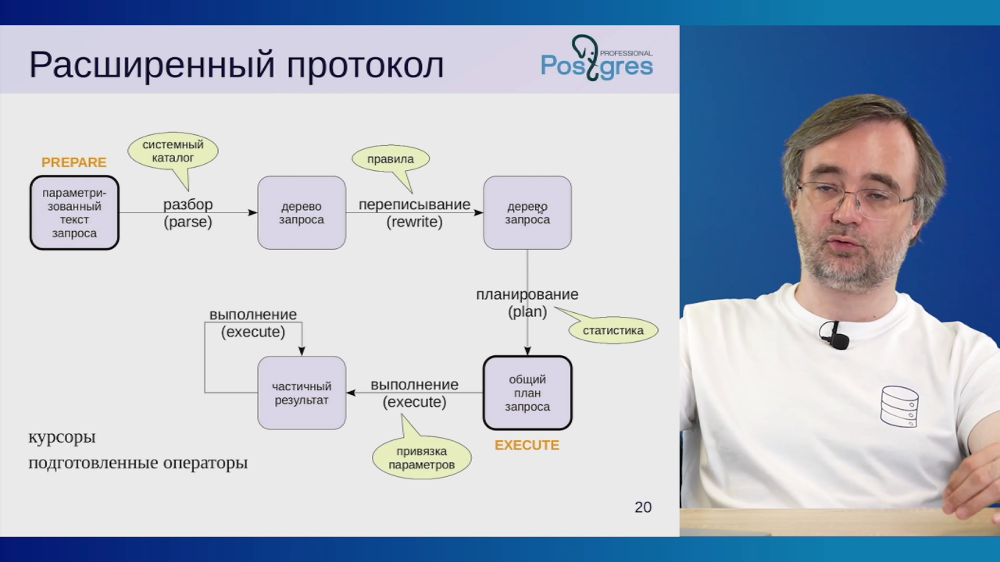

> [!quote]- Кадр [00:43:48]
> 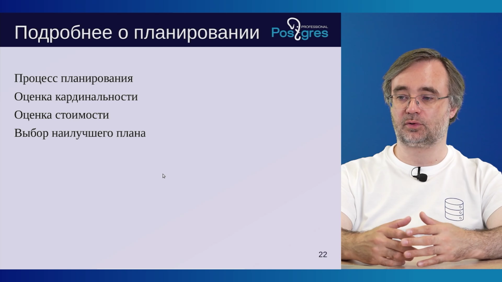

> [!quote]- Кадр [00:34:14]
> 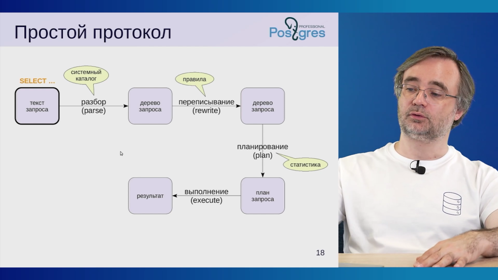

> [!quote]- Кадр [00:33:24]
> 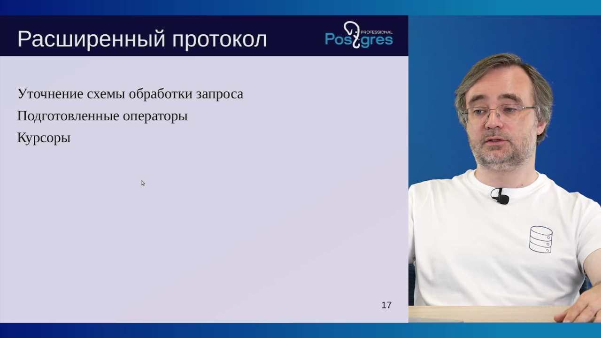

> [!quote]- Кадр [00:54:46]
> 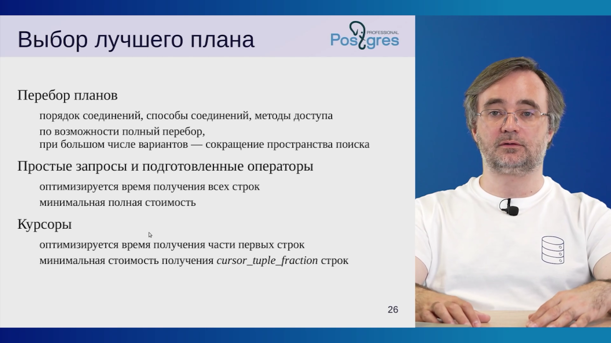

## 8. Селективность, кардинальность и стоимость плана

Селективность условий — доля выбираемых строк из общего количества после применения условия фильтрации: при селективности, близкой к единице, возвращаются практически все исходные строки, при близкой к нулю — малая доля. Термины «высокая селективность» и «низкая селективность» вызывают путаницу: здесь высокая селективность означает маленькое значение, низкая — большое, близкое к единице; в некоторых книгах можно увидеть обратное определение. Кардинальность узла — это итоговое число строк, которое узел возвращает наверх; оценка кардинальности каждого узла рекурсивна, требует статистики о размере таблиц и распределении данных и предполагает, что условия не зависят друг от друга, поэтому для коррелированных условий такая оценка выдаёт ошибку. Стоимость узла плана в первую очередь зависит от типа узла и числа обрабатываемых строк: чем больше строк, тем больше работы; стоимость вычисляется как сумма стоимостей дочерних узлов и стоимости самого узла. В стоимость входят подготовительная работа (действия, которые надо проделать независимо от того, сколько строк мы собираемся получить) и полная стоимость, то есть получение всех строк; планировщик перебирает разные планы и выбирает план с наименьшей стоимостью, но количество планов экспоненциально растёт с числом соединяемых таблиц, для сокращения перебора применяется динамическое программирование, а при большом числе вариантов пространство поиска сокращается, например генетическим алгоритмом, и лучший план может не быть найден.

| Термин | Значение | Возвращаемые строки |
| --- | --- | --- |
| Высокая селективность | близка к нулю | малая доля строк |
| Низкая селективность | близка к единице | практически все исходные строки |

*Источник: [00:39:18], [00:43:48], [00:44:08], [00:48:17], [00:50:16], [00:51:56] и др.*

> [!quote]- Кадр [00:44:08]
> 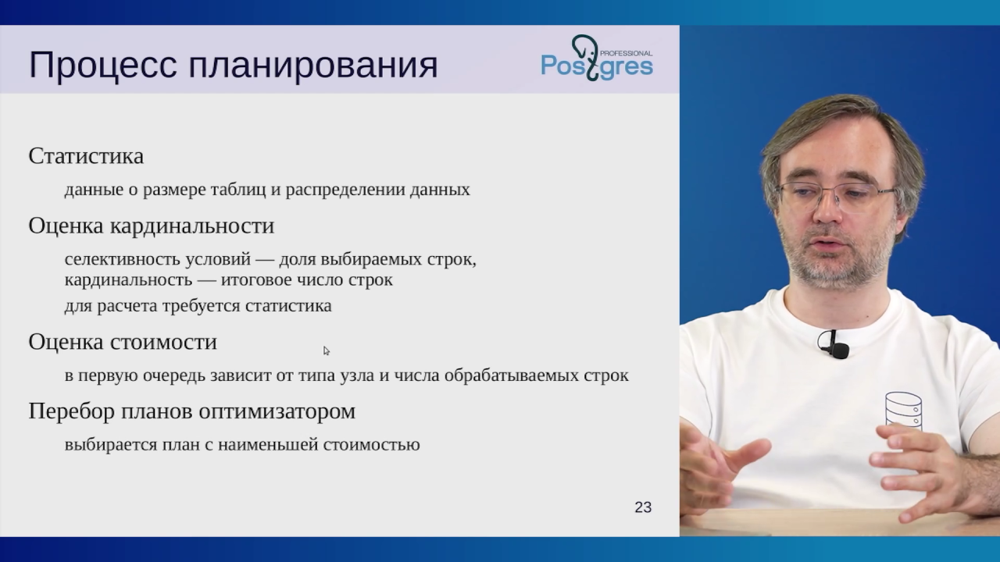

> [!quote]- Кадр [00:48:17]
> 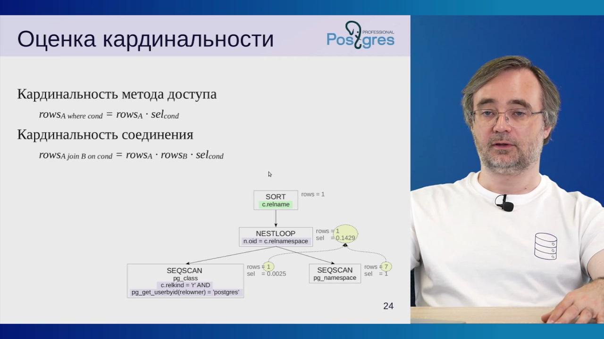

> [!quote]- Кадр [00:50:16]
> 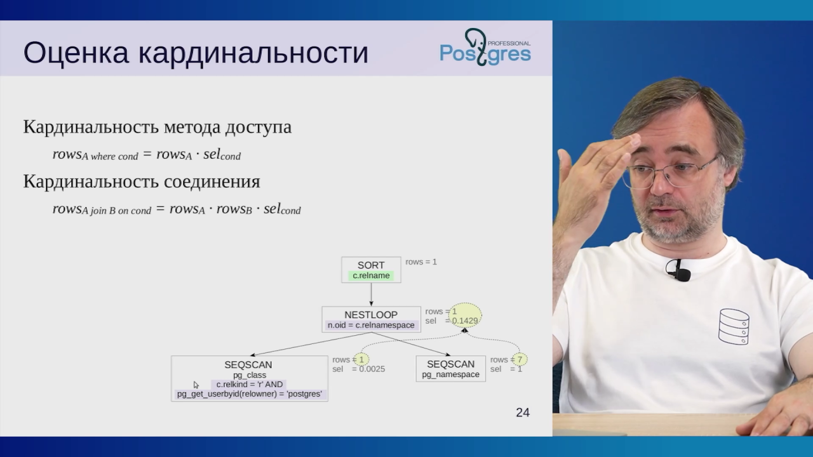

> [!quote]- Кадр [00:51:56]
> 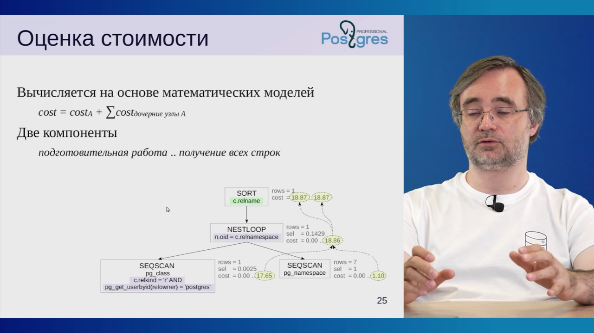


> [!quote]- Кадр [00:57:11]
> 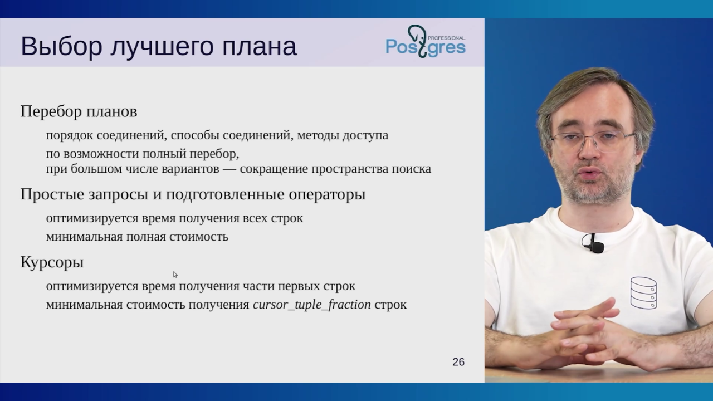

## Схема

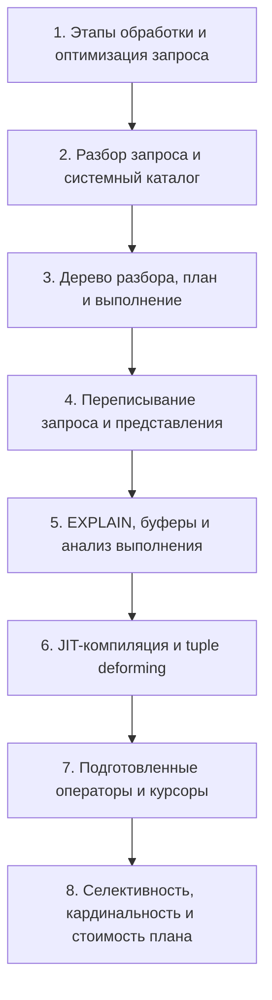

## Итог

> [!success] Что в итоге
> Путь SQL-запроса в PostgreSQL идёт от текста через разбор, переписывание и планирование к выполнению; разбор опирается на системный каталог и строит дерево разбора с узлами From Expression и RTE, а планировщик выбирает план с наименьшей стоимостью по оценке кардинальности и селективности. План выполнения отображается как дерево узлов и передаётся экзекьютору, который конвейерно отдаёт строки наверх; EXPLAIN с параметрами buffers, analyze и actual time помогает диагностировать выполнение, а буферы делятся на shared и local. JIT-компиляция и tuple deforming компилируют часть вычислений, подготовленные операторы через PREPARE/EXECUTE обеспечивают частный или общий план, а курсоры — построчную выдачу результата.

