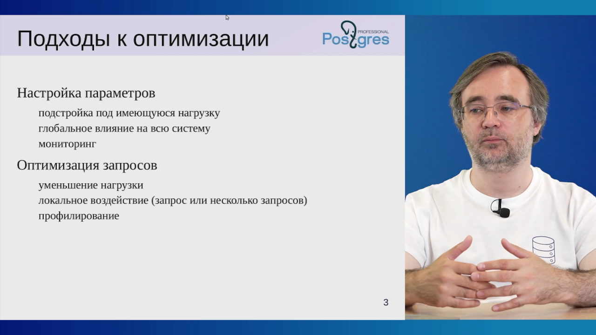
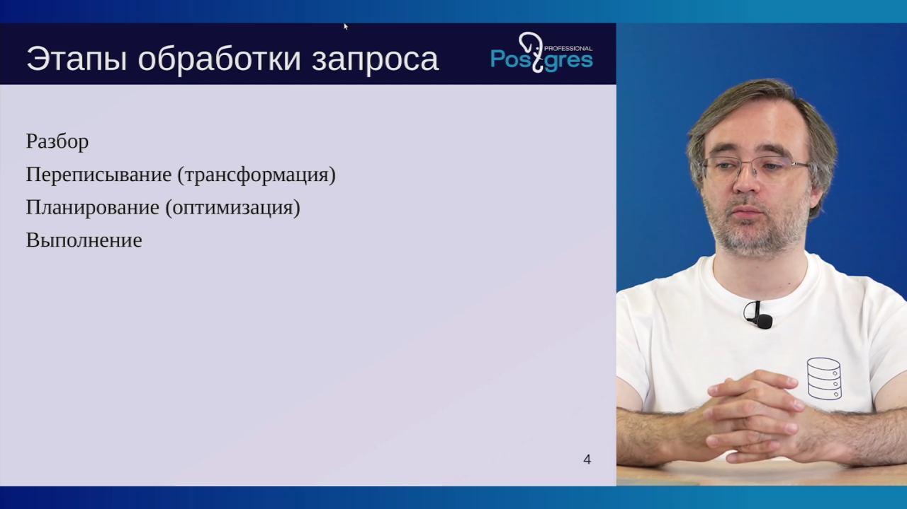
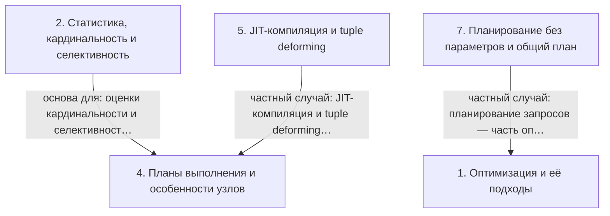

# Оптимизация запросов в PostgreSQL

> [!abstract] Обзор
> Материал об оптимизации в PostgreSQL: что такое оптимизация, два подхода к ней — настройка параметров и оптимизация запросов. Разбираются этапы обработки запроса (разбор, переписывание, планирование, выполнение) и инструменты разбора (RTE, debug.print_parse). Рассматриваются планы выполнения (Seq Scan, EXPLAIN ANALYZE, кардинальность, селективность), особенности выполнения (локальный кэш временных таблиц, вывод времени, парное соединение), а также JIT-компиляция, tuple deforming, курсор и планирование запросов без параметров с переходом на общий план. Отдельно описывается статистика для планировщика: она рассказывает о данных и распределении, на ней строится планирование; селективность рассчитывается для простых выражений и через логические операции, а кардинальность получается умножением количества строк на селективность. Для курсоров важен быстрый доступ к первым строкам и параметр cursor_tuple_fraction.

> [!info] Курс
> [[index|Оглавление курса]]

## Оглавление
1. [[#1. Оптимизация и её подходы]]
2. [[#2. Статистика, кардинальность и селективность]]
3. [[#3. Обработка запроса и разбор]]
4. [[#4. Планы выполнения и особенности узлов]]
5. [[#5. JIT-компиляция и tuple deforming]]
6. [[#6. Курсоры]]
7. [[#7. Планирование без параметров и общий план]]

**Схема** — [[#Схема]]
**Итог** — [[#Итог]]

## 1. Оптимизация и её подходы

Оптимизация — широкое понятие: это поиск оптимальных путей, когда неоптимальное превращают в оптимальное. Настройка параметров — подход, при котором выполняется подстройка под имеющуюся нагрузку; для неё используется мониторинг. Она глобально влияет на всю систему, но настройками можно повлиять не так сильно, как хотелось бы. Оптимизация запросов уменьшает нагрузку, действует локально (на запрос или несколько запросов) и использует профилирование. Планировщик рассматривает набор планов, оценивает каждый и выбирает план с минимальной полной стоимостью, чтобы оптимизировать время получения всех строк; пространство поиска сокращается динамическим программированием или генетическим алгоритмом.

*Источник: [00:00:00], [00:01:00]*

> [!quote]- Кадр [00:00:00]
> 

> [!quote]- Кадр [00:01:00]
> 

## 2. Статистика, кардинальность и селективность

Статистика — это информация о том, какие данные хранятся в таблицах и какое распределение они имеют; без хорошей статистики планировщик работать не может, а план строится оптимизатором на основе стоимости, рассчитанной на основе статистики. Кардинальность узла — итоговое число строк, которое узел возвращает наверх; в плане это значение обозначено как rows. Селективность — доля строк, которые отбираются из общего количества после применения условия фильтрации; её нужно уметь рассчитывать только для простых выражений, а для выражений с логическими операциями AND, OR и так далее можно посчитать селективности простых выражений и затем по несложной формуле — селективность общего выражения. Количество строк умножается на рассчитанную селективность, и получается нужная кардинальность. Если селективность близка к единице, возвращается практически все исходные строки; для условия AND селективность первого условия умножается на селективность второго (предполагается независимость условий, для коррелированных условий оценка даёт ошибку). Высокоселективный запрос выбирает малую долю строк со значением селективности близким к нулю (в этом курсе; в некоторых книгах высокая селективность может называться близкой к единице), а низкоселективное условие возвращает практически все строки со значением селективности близким к единице.

| Понятие | Значение селективности | Доля строк |
|---|---|---|
| Высокоселективный запрос | близко к нулю | малая доля строк |
| Низкоселективное условие | близко к единице | практически все строки |

*Источник: [00:01:00]*

## 3. Обработка запроса и разбор

Запрос проходит этапы обработки: разбор, переписывание (трансформация), планирование (оптимизация) и выполнение. Разбор включает лексический анализ — выделение ключевых слов, чисел, строк — и синтаксический анализ, проверяющий корректность последовательности лексем. RTE (Range Table Entry) — это узел, обозначающий всё, из чего можно получить набор строк: таблицы, представления, подзапросы. Параметр debug.print_parse позволяет увидеть в журнале сообщений сервера, как выглядит настоящее дерево разбора запроса.

*Источник: [00:01:00], [00:06:00]*

> [!quote]- Кадр [00:06:00]
> 

## 4. Планы выполнения и особенности узлов

Seq Scan означает последовательное чтение всей таблицы без индекса. Планировщик может безболезненно убрать одну таблицу из запроса, если данные можно получить из меньшего числа таблиц. С параметром analyze команда explain не просто показывает план, а ещё и выполняет запрос; после этого выводится план плюс детальная информация о выполнении: реальное время выполнения в миллисекундах, число полученных строк и сколько раз выполнялся узел. Временные таблицы обрабатываются не в общем буферном кэше, а локально в обслуживающем процессе. Не всегда нужно выводить время выполнения узлов запроса: на вычисление времени тратятся ресурсы, а на некоторых платформах функция получения времени выполняется медленно; соединение всегда выполняется попарно.

*Источник: [00:01:00]*

## 5. JIT-компиляция и tuple deforming

План запроса интерпретируется, но часть действий можно откомпилировать и запомнить откомпилированный код; при последующем выполнении выполняется уже готовый компилированный код вместо медленной интерпретации. JIT-компиляция применяется не ко всем запросам, а только к отдельным частям — как правило к вычислению выражений и функций. Она помогает, когда запрос выполняет интенсивные вычисления и сам запрос достаточно тяжёлый, а для быстрых OLTP-запросов не помогает, потому что требует дополнительных действий, которые не окупаются на коротком запросе. JIT можно настроить параметрами: не выполнять определённые JIT-действия, пока стоимость запроса не превышает заданного уровня, или полностью отключить JIT. tuple deforming — это преобразование прочитанной с диска строки в вид, в котором она должна находиться в оперативной памяти; это действие требует ресурсов и тоже может компилироваться.

> [!info] Зачем это нужно
> Помогает на тяжёлых запросах с интенсивными вычислениями.

*Источник: [00:01:00]*

## 6. Курсоры

SQL работает с множествами строк. Для процедурных языков используется курсор; процедурные языки обрабатывают строки по одной в цикле. Для курсоров важно быстро получить первые строки запроса. Параметр cursor_tuple_fraction минимизирует получение первых 10% строк. Параметр cursor_tuple_fraction по умолчанию равен 1.1.

> [!info] Зачем это нужно
> Для курсоров важно быстро получить первые строки запроса.

*Источник: [00:01:00]*

## 7. Планирование без параметров и общий план

Если запрос не имеет параметров, его план не нужно перепланировать при каждом выполнении: на этапе подготовки запрос разбирается, переписывается и планируется, а готовый план запоминается. При выполнении берётся готовый план и подставляются параметры, если они есть. Время выполнения запроса крайне сильно зависит от качества планирования: разница может быть не в разах, а во многих порядках — хорошо спланированный запрос может выполняться за доли секунды, а плохо спланированный — часами и днями. Postgres может переключиться с частных планов на общий план запроса и подставлять параметры на этапе выполнения, если общий план получается не хуже частных. Это экономит ресурсы, особенно на коротких запросах.

> [!info] Зачем это нужно
> Время выполнения запроса крайне сильно зависит от качества планирования.

*Источник: [00:01:00]*

## Схема

## Итог

> [!success] Что в итоге
> Оптимизация в PostgreSQL делится на настройку параметров с глобальным влиянием и оптимизацию запросов с локальным. Запрос проходит разбор, переписывание, планирование и выполнение, а качество планирования крайне сильно влияет на время выполнения. Статистика — база планирования, на которой рассчитываются селективность и кардинальность. Особенности выполнения и настройки (JIT, tuple deforming, общий план, cursor_tuple_fraction) связаны с подготовкой и выполнением запросов.

