# PostgreSQL: методы доступа, индексы, буферный кэш и стоимость запросов

> [!abstract] Обзор
> Материал о том, как PostgreSQL добирается до табличных данных: методы доступа, последовательное сканирование (Seq Scan), индексное сканирование (Index Scan), Index Only Scan и сканирование по битовой карте. Показано, как EXPLAIN и EXPLAIN ANALYZE выводят план, буферы и время, а планировщик оценивает стоимость через relpages, seq_page_cost, cpu_tuple_cost и random_page_cost из pg_class. Разобрано устройство индексов на B-дереве, сортируемые типы, размещение NULL, Include-индексы и обязательные индексы для ограничений целостности. Отдельно рассмотрены буферный кэш, массовое вытеснение, буферное кольцо из 32 страниц и статистика в pg_stat_io, а также работа с мёртвыми версиями строк: DELETE, VACUUM и ANALYZE. Bitmap Index Scan и Bitmap Heap Scan, объединение карт через BitmapAnd и BitmapOr, параметр work_mem и lossy-фрагменты показаны вместе с диапазонными условиями. Команда CLUSTER упорядочивает данные по индексу, после чего планировщик может предпочесть обычное индексное сканирование.

> [!info] Курс
> [[index|Оглавление курса]]

## Оглавление
1. [[#1. Методы доступа: Seq Scan и Index Scan]]
2. [[#2. Диапазонный поиск, IN и Index Scan Backward]]
3. [[#3. EXPLAIN и оценка стоимости планировщиком]]
4. [[#4. Сканирование по битовой карте и work_mem]]
5. [[#5. Устройство B-дерева]]
6. [[#6. Индексы для ограничений целостности]]
7. [[#7. Include-индексы и Index Only Scan]]
8. [[#8. Мёртвые версии строк и VACUUM]]
9. [[#9. Буферный кэш и pg_stat_io]]
10. [[#10. Команда CLUSTER]]

**Схема** — [[#Схема]]
**Итог** — [[#Итог]]

## 1. Методы доступа: Seq Scan и Index Scan

Методы доступа — это способы, которыми Postgres может достучаться до данных; наиболее важен доступ к табличным данным, но данные можно получать также из функций или из обёрток сторонних данных. Seq Scan — последовательное чтение всех страниц таблицы, представленное в плане узлом Seq Scan: время зависит от физического размера файла, данные возвращаются в произвольном порядке, проверяется видимость версий строк, а страницы читаются в буферный кэш. Index Scan ищет одно значение и избегает полного чтения таблицы: поиск начинается с корневой страницы, максимально эффективен при высокой селективности, страницы таблицы читаются хаотично, а стоимость зависит от высоты дерева и оценивается параметром random_page_cost. Index-Only Scan применяется, когда все столбцы запроса входят в индекс, в который можно добавить неключевой столбец любого типа через INCLUDE; на таблице ticket_flights составной индекс по ticket_no и flight_id используется при запросе по ticket_no или по обоим столбцам, а запрос только по flight_id этот индекс не использует и до версии 18 выполнялся Parallel Seq Scan с фильтром. Index Cond содержит условия, по которым в индексе искали данные, а Filter накладывается на найденные результаты индексного доступа; в PostgreSQL 18 появилась возможность использовать многоколоночный индекс, даже когда указано значение только второго столбца.

```sql
=> SELECT current_setting('random_page_cost');

=> EXPLAIN SELECT * FROM bookings WHERE book_ref = 'CDE888';

=> EXPLAIN SELECT * FROM bookings WHERE book_ref = 'CDE088';

                         QUERY PLAN
------------------------------------------------------------------
 Index Scan using bookings_pkey on bookings  (cost=0.43..8.45 rows=1 width=21)
   Index Cond: (book_ref = 'CDE088'::bpchar)
(2 rows)

=> EXPLAIN SELECT *
FROM ticket_flights
WHERE ticket_no = '0005432000284' AND flight_id = 187662;

QUERY PLAN
-------------------------------------------------
Index Scan using ticket_flights_pkey on ticket_flights
  Index Cond: ((ticket_no = '0005432000284'::bpchar) AND (flight_id = 187662))

=> EXPLAIN SELECT *
FROM ticket_flights
WHERE flight_id = 187662;

Gather  (cost=1000.00..114678.36 rows=107 width=32)
  Workers Planned: 2
  ->  Parallel Seq Scan on ticket_flights  (cost=0.00..113667.66 rows=45 width=32)
        Filter: (flight_id = 187662)

=> EXPLAIN (costs off)
SELECT total_amount FROM bookings
WHERE total_amount > 200000;

Index Only Scan using bookings_total_amount_idx on bookings
  Index Cond: (total_amount > '200000'::numeric)

=> EXPLAIN
SELECT * FROM bookings
WHERE book_ref = 'CDE08B' AND total_amount > 1000;

QUERY PLAN
-------------------------------------------
 Index Scan using bookings_pkey on bookings  (cost=0.43..8.45 rows=1 width=21)
   Index Cond: (book_ref = 'CDE08B'::bpchar)
   Filter: (total_amount > '1000'::numeric)
(3 rows)

=> EXPLAIN (analyze, costs off, timing off)
SELECT count(*) FROM bookings
WHERE total_amount < '5000' AND book_date > $1;

   -> Bitmap Heap Scan on bookings (actual rows=129 loops=1)
      Rows Removed by Index Recheck: 89895
      Heap Blocks: exact=811 lossy=568
      -> BitmapAnd (actual rows=0 loops=1)
         -> Bitmap Index Scan on bookings_total_amount_idx (actual rows=1471 loops=1)
         -> Bitmap Index Scan on bookings_book_date_idx (actual rows=178142 loops=1)

Bitmap Heap Scan on bookings  (cost=94.57..9854.66 rows=4921 width=21)
  Recheck Cond: (total_amount < '5000'::numeric)
  ->  Bitmap Index Scan on bookings_total_amount_idx  (cost=0.00..93.34 rows=4921 width=0)
        Index Cond: (total_amount < '5000'::numeric)

=> SELECT current_setting('random_page_cost');

=> EXPLAIN SELECT * FROM bookings WHERE book_ref = 'CDE888';

=> EXPLAIN SELECT * FROM bookings WHERE book_ref = 'CDE088';

                         QUERY PLAN
------------------------------------------------------------------
 Index Scan using bookings_pkey on bookings  (cost=0.43..8.45 rows=1 width=21)
   Index Cond: (book_ref = 'CDE088'::bpchar)
(2 rows)

=> EXPLAIN SELECT *
FROM ticket_flights
WHERE ticket_no = '0005432000284' AND flight_id = 187662;

QUERY PLAN
-------------------------------------------------
Index Scan using ticket_flights_pkey on ticket_flights
  Index Cond: ((ticket_no = '0005432000284'::bpchar) AND (flight_id = 187662))

=> EXPLAIN SELECT *
FROM ticket_flights
WHERE flight_id = 187662;

Gather  (cost=1000.00..114678.36 rows=107 width=32)
  Workers Planned: 2
  ->  Parallel Seq Scan on ticket_flights  (cost=0.00..113667.66 rows=45 width=32)
        Filter: (flight_id = 187662)

=> EXPLAIN (costs off)
SELECT total_amount FROM bookings
WHERE total_amount > 200000;

Index Only Scan using bookings_total_amount_idx on bookings
  Index Cond: (total_amount > '200000'::numeric)

=> EXPLAIN SELECT *
FROM ticket_flights
WHERE ticket_no = '0005432000284' AND flight_id = 187662;

QUERY PLAN
-------------------------------------------------
Index Scan using ticket_flights_pkey on ticket_flights
  Index Cond: ((ticket_no = '0005432000284'::bpchar) AND (flight_id = 187662))

=> EXPLAIN SELECT *
FROM ticket_flights
WHERE flight_id = 187662;

Gather  (cost=1000.00..114678.36 rows=107 width=32)
  Workers Planned: 2
  ->  Parallel Seq Scan on ticket_flights  (cost=0.00..113667.66 rows=45 width=32)
        Filter: (flight_id = 187662)

=> EXPLAIN (costs off)
SELECT total_amount FROM bookings
WHERE total_amount > 200000;

Index Only Scan using bookings_total_amount_idx on bookings
  Index Cond: (total_amount > '200000'::numeric)

>= EXPLAIN SELECT *
FROM ticket_flights
WHERE ticket_no = '0005432000284' AND flight_id = 187662;

QUERY PLAN
-------------------------------------------------
Index Scan using ticket_flights_pkey on ticket_flights
  Index Cond: ((ticket_no = '0005432000284'::bpchar) AND (flight_id = 187662))

=> EXPLAIN SELECT *
FROM ticket_flights
WHERE flight_id = 187662;

Gather  (cost=1000.00..114678.36 rows=107 width=32)
  Workers Planned: 2
  ->  Parallel Seq Scan on ticket_flights  (cost=0.00..113667.66 rows=45 width=32)
        Filter: (flight_id = 187662)

=> EXPLAIN
SELECT * FROM bookings
WHERE book_ref = 'CDE08B' AND total_amount > 1000;

QUERY PLAN
-------------------------------------------
 Index Scan using bookings_pkey on bookings  (cost=0.43..8.45 rows=1 width=21)
   Index Cond: (book_ref = 'CDE08B'::bpchar)
   Filter: (total_amount > '1000'::numeric)
(3 rows)

=> EXPLAIN
SELECT * FROM bookings
WHERE book_ref = 'CDE08B' AND total_amount > 1000;

 Index Scan using bookings_pkey on bookings  (cost=0.43..8.45 rows=1 width=21)
   Index Cond: (book_ref = 'CDE08B'::bpchar)
   Filter: (total_amount > '1000'::numeric)
```

| Метод | Когда применяется |
|---|---|
| Index Scan | поиск значений с переходами в табличные страницы |
| Index-Only Scan | все столбцы запроса входят в индекс |

| Запрос | План |
|---|---|
| по ticket_no | Index Scan using ticket_flights_pkey |
| по flight_id | Parallel Seq Scan с Filter: (flight_id = 187662) |

> [!info] Зачем это нужно
> Цель индекса — избежать полного чтения таблицы при поиске одного значения.

*Источник: [00:00:00], [00:00:20], [00:24:47], [00:28:29], [00:30:19], [00:31:09] и др.*

> [!quote]- Кадр [00:00:00]
> 

> [!quote]- Кадр [01:12:53]
> 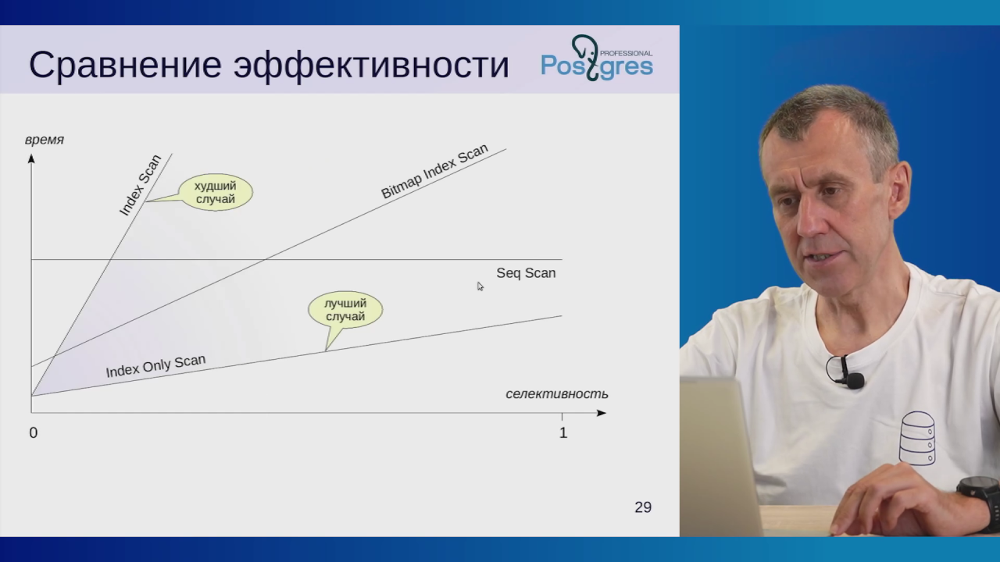

> [!quote]- Кадр [01:10:54]
> 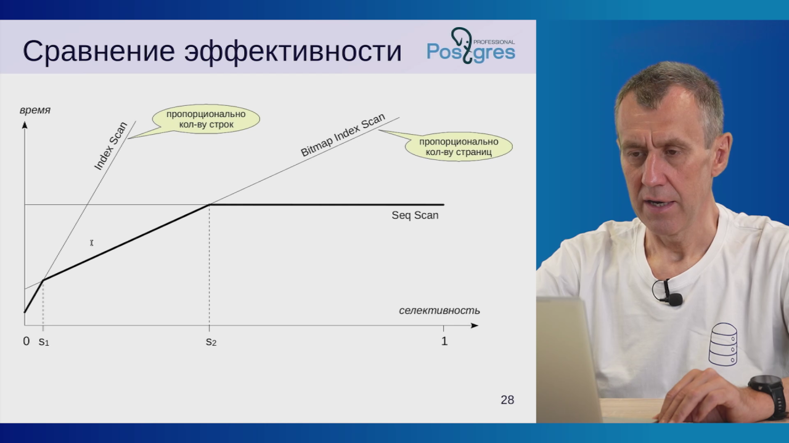

> [!quote]- Кадр [00:00:20]
> 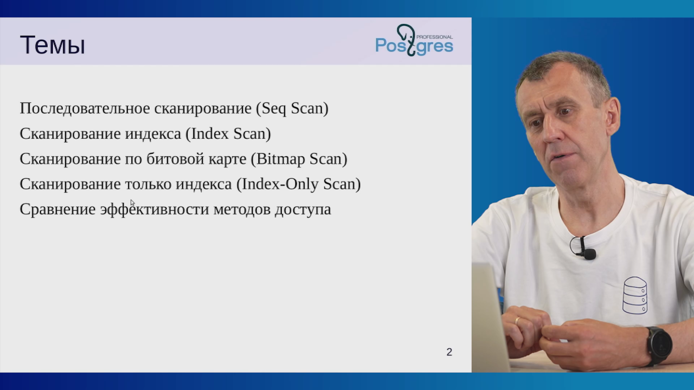

> [!quote]- Кадр [00:28:29]
> 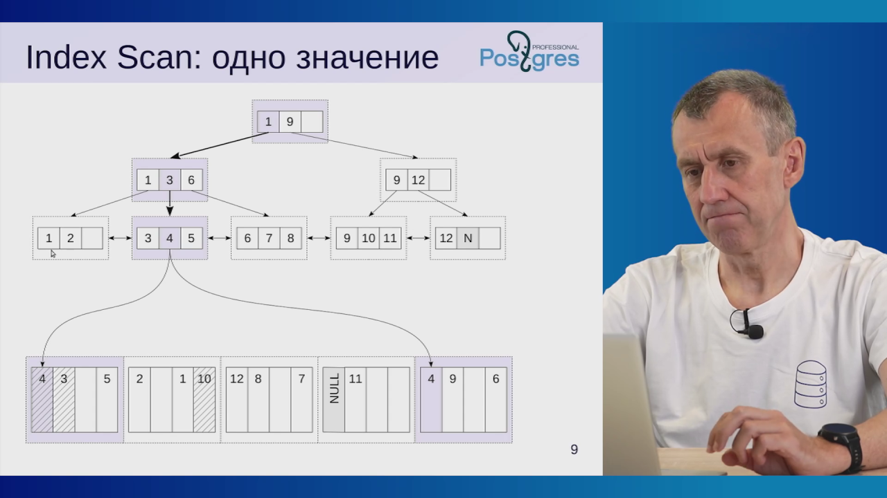

> [!quote]- Кадр [00:24:47]
> 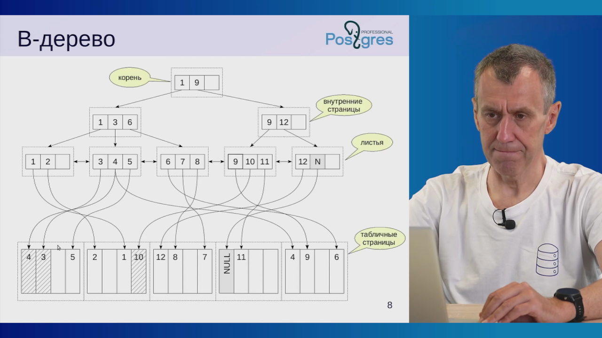

> [!quote]- Кадр [00:34:29]
> 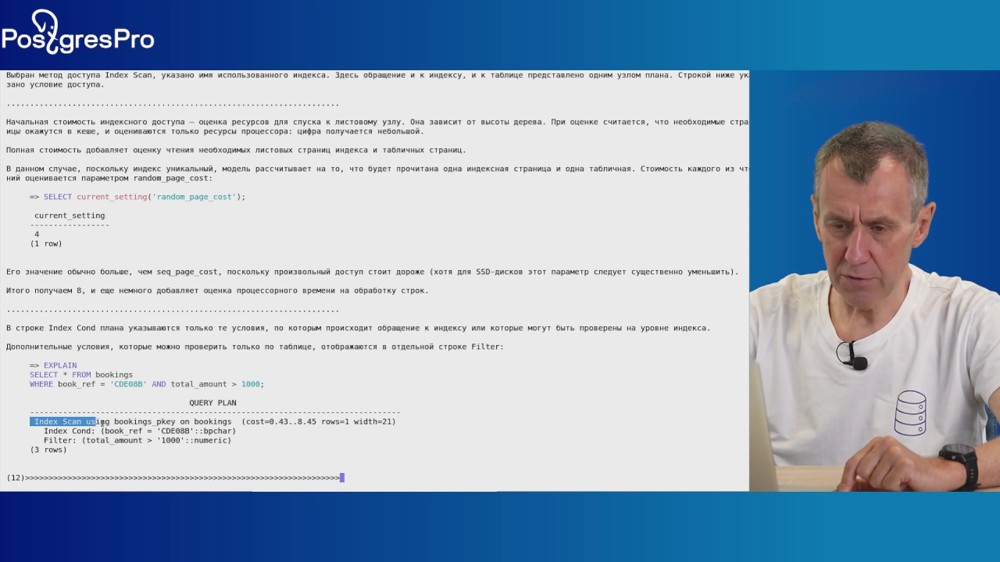

> [!quote]- Кадр [01:03:42]
> 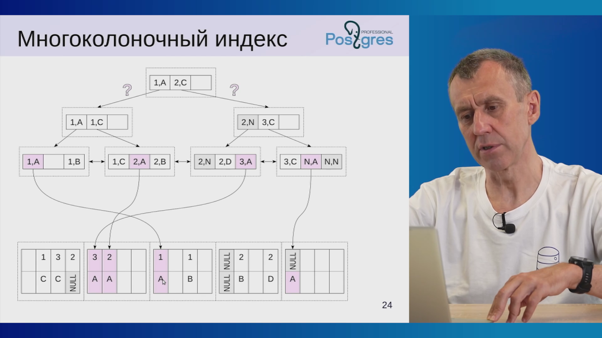

> [!quote]- Кадр [00:34:09]
> 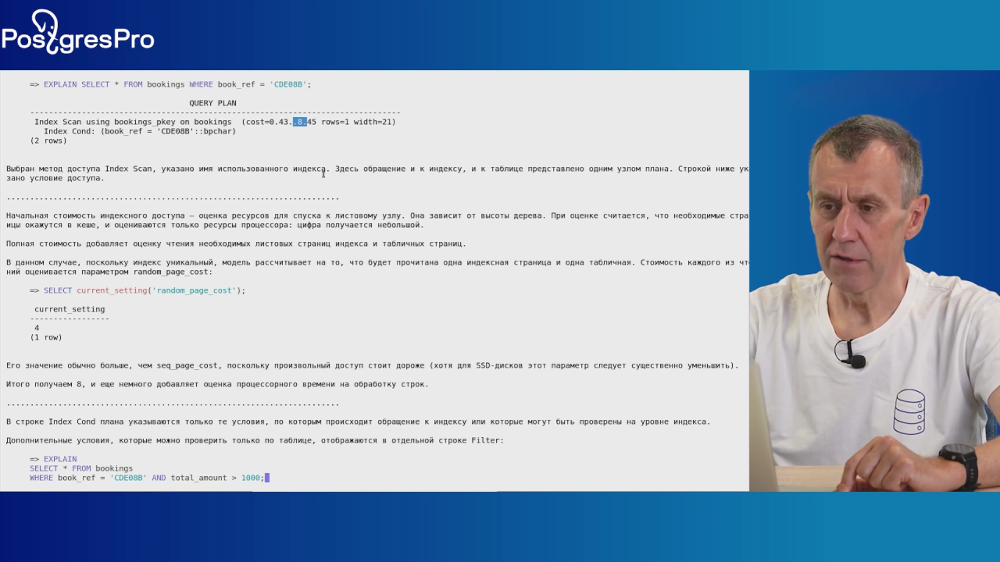

## 2. Диапазонный поиск, IN и Index Scan Backward

Индексный доступ можно использовать не только для поиска одного значения, но и для поиска по диапазону; для этого применяются операторы >, < и BETWEEN. При Index Scan по диапазону Postgres последовательно считывает значения индекса и может несколько раз прочитать одну и ту же табличную страницу; страницы читаются хаотично — в примере последняя страница читается три раза. Операция ORDER BY по индексированному полю не добавляет накладных расходов, а для ORDER BY book_ref DESC планировщик может использовать тот же индекс, но сканировать листовые страницы от большего значения к меньшему (Index Scan Backward). Перечисление значений через IN возвращает тот же результат, но требует в два раза больше ресурсов: в 16 версии поиск по IN выполняется от корня для каждого значения, а в 17-й версии добавлена оптимизация без многократного отхода от корня.

```sql
=> EXPLAIN (costs off)
SELECT * FROM bookings
WHERE book_ref > '000900' AND book_ref < '000939'
ORDER BY book_ref;

                    QUERY PLAN
----------------------------------------------------------
 Index Scan using bookings_pkey on bookings
   Index Cond: ((book_ref > '000900'::bpchar) AND (book_ref < '000939'::bpchar))
(2 rows)

=> EXPLAIN (analyze, buffers, costs off, timing off, summary off)
SELECT * FROM bookings
WHERE book_ref > '000900' AND book_ref < '000939'
ORDER BY book_ref DESC;

                    QUERY PLAN
----------------------------------------------------------
 Index Scan Backward using bookings_pkey on bookings (actual rows=5 loops=1)
   Index Cond: ((book_ref > '000900'::bpchar) AND (book_ref < '000939'::bpchar))
   Buffers: shared hit=4 read=1
Planning:
   Buffers: shared hit=12
(5 rows)

=> EXPLAIN (analyze, buffers, costs off)
SELECT * FROM bookings
WHERE book_ref IN ('000906','000909','000917','000930','000938')
ORDER By book_ref DESC;

QUERY PLAN

Index Scan Backward using bookings_pkey on bookings (actual time=0.042..0.062 rows=5 loops=1)
  Index Cond: (book_ref = ANY ('{000906,000909,000917,000930,000938}'::bpchar[]))
  Buffers: shared hit=24
Planning Time: 0.129 ms
Execution Time: 0.078 ms
(5 rows)

>= SELECT reads, hits, reuses
FROM pg_stat_io
WHERE context = 'bulkread' -- Сканирование больших таблиц
AND object = 'relation'
AND backend_type = 'client backend';

EXPLAIN
SELECT * FROM bookings WHERE total_amount < 5000;

 Bitmap Heap Scan on bookings  (cost=94.57..9854.66 rows=4921 width=21)
   Recheck Cond: (total_amount < '5000'::numeric)
   ->  Bitmap Index Scan on bookings_total_amount_idx  (cost=0.00..93.34 rows=4921 width=0)
         Index Cond: (total_amount < '5000'::numeric)

EXPLAIN (costs off)
SELECT * FROM bookings
WHERE total_amount < 5000 OR total_amount > 500000;

 Bitmap Heap Scan on bookings
   Recheck Cond: ((total_amount < '5000'::numeric) OR (total_amount > '500000'::numeric))
   ->  BitmapOr
         ->  Bitmap Index Scan on bookings_total_amount_idx
               Index Cond: (total_amount < '5000'::numeric)
         ->  Bitmap Index Scan on bookings_total_amount_idx
               Index Cond: (total_amount > '500000'::numeric)

=> EXPLAIN (analyze, costs off, timing off)
SELECT count(*) FROM bookings
WHERE total_amount < '5000' AND book_date > $1;

   -> Bitmap Heap Scan on bookings (actual rows=129 loops=1)
      Rows Removed by Index Recheck: 89895
      Heap Blocks: exact=811 lossy=568
      -> BitmapAnd (actual rows=0 loops=1)
         -> Bitmap Index Scan on bookings_total_amount_idx (actual rows=1471 loops=1)
         -> Bitmap Index Scan on bookings_book_date_idx (actual rows=178142 loops=1)

=> EXPLAIN (costs off)
SELECT * FROM bookings
WHERE total_amount < 5000 OR total_amount > 500000;

Bitmap Heap Scan on bookings
  Recheck Cond: ((total_amount < '5000'::numeric) OR (total_amount > '500000'::numeric))
  ->  BitmapOr
        ->  Bitmap Index Scan on bookings_total_amount_idx
              Index Cond: (total_amount < '5000'::numeric)
        ->  Bitmap Index Scan on bookings_total_amount_idx
              Index Cond: (total_amount > '500000'::numeric)
```

*Источник: [00:34:51], [00:35:19], [00:38:06], [00:38:26], [00:39:37], [00:39:57] и др.*

> [!quote]- Кадр [00:34:51]
> 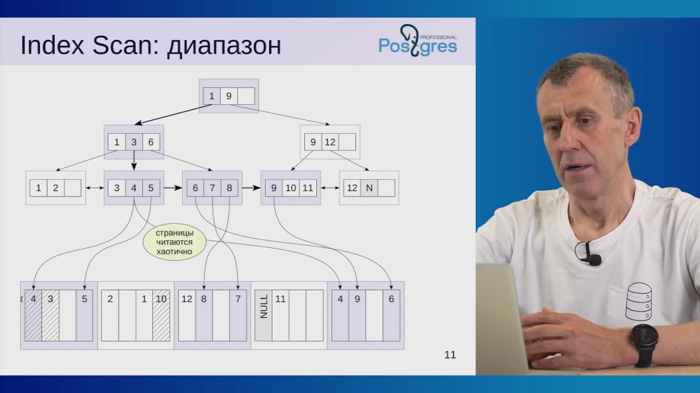

> [!quote]- Кадр [00:35:19]
> 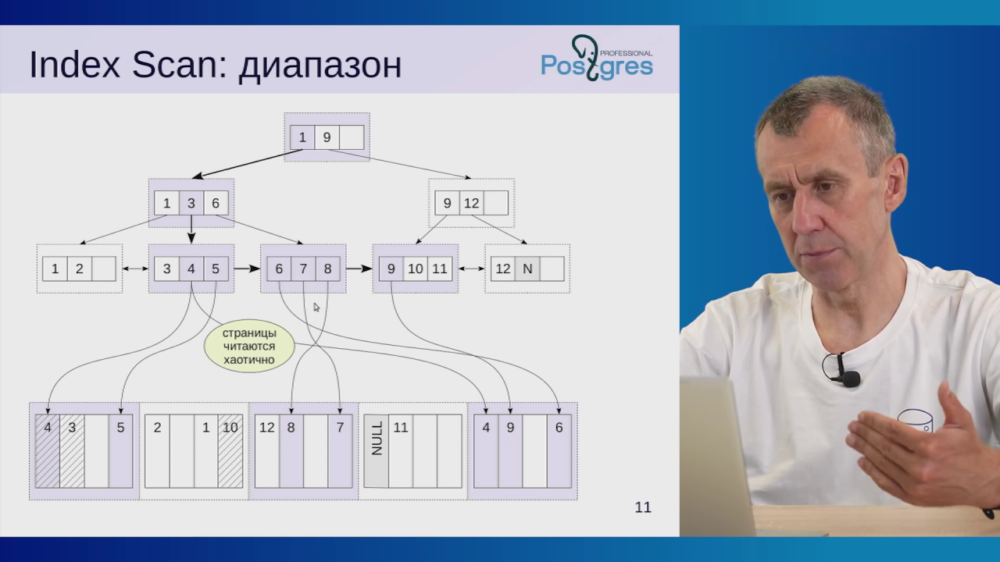

## 3. EXPLAIN и оценка стоимости планировщиком

EXPLAIN без Analyze показывает только планируемый метод доступа, а EXPLAIN ANALYZE реально выполняет запрос и выводит фактические результаты; с опцией BUFFERS — сколько буферов прочитал запрос, включая shared hit, а вывод содержит actual rows, Buffers, Planning Time и Execution Time. Самый простой способ получить последовательное сканирование таблицы — запрос SELECT * FROM имя_таблицы; для пустой таблицы стоимость плана минимальна — не прочитано ни одной версии строки. Оценку количества страниц таблицы планировщик берёт из pg_class, а составляющая ввода-вывода рассчитывается как relpages * seq_page_cost. Стоимость указывается в условных единицах и состоит из начальной стоимости узла (плата, чтобы начать обрабатывать первую строку; для Seq Scan равна нулю) и полной стоимости получения всех данных; стоимость обработки строк оценивается как reltuples * cpu_tuple_cost (по умолчанию 0.01). Стоимость чтения одной индексной страницы определяется параметром random_page_cost: по умолчанию он равен 4, что больше seq_page_cost, а для современных SSD-дисков значение стоит существенно уменьшить — это увеличивает вероятность выбора индексного доступа в пограничных случаях.

```sql
=> EXPLAIN (analyze, buffers, timing off)
SELECT count(*) FROM flights_copy;

 Aggregate  (cost=0.00..0.01 rows=1 width=8) (actual rows=1 loops=1)
   ->  Seq Scan on flights_copy  (cost=0.00..0.00 rows=1 width=0) (actual rows=0 loops=1)
 Planning:
 Buffers: shared hit 2
 Planning Time: 0.114 ms
 Execution Time: 0.034 ms

EXPLAIN (buffers) SELECT * FROM flights;

=> SELECT relpages, current_setting('seq_page_cost'),
    relpages * current_setting('seq_page_cost')::real AS total
FROM pg_class WHERE relname = 'flights';
=> SELECT reltuples, current_setting('cpu_tuple_cost'),
    reltuples * current_setting('cpu_tuple_cost')::real AS total
FROM pg_class WHERE relname = 'flights';

retuples | current setting | total
----------+-----------------+-------
  214867 | 0.01            | 2148.67
(1 row)

=> SELECT current_setting('random_page_cost');
 current_setting
-----------------
             4
(1 row)

=> EXPLAIN (analyze, buffers, timing off)
SELECT count(*) FROM flights_copy;

 Aggregate  (cost=0.00..0.01 rows=1 width=8) (actual rows=1 loops=1)
   ->  Seq Scan on flights_copy  (cost=0.00..0.00 rows=1 width=0) (actual rows=0 loops=1)
 Planning:
 Buffers: shared hit 2
 Planning Time: 0.114 ms
 Execution Time: 0.034 ms

EXPLAIN (buffers) SELECT * FROM flights;

>= EXPLAIN (analyze, buffers, timing off)
SELECT count(*) FROM flights_copy;
QUERY PLAN
--------------------------------------------------------------------------
 Aggregate  (cost=0.00..0.01 rows=1 width=8) (actual rows=1 loops=1)
   ->  Seq Scan on flights_copy  (cost=0.00..0.00 rows=1 width=0) (actual rows=0 loops=1)
 Planning:
   Buffers: shared hit=2
 Planning Time: 0.114 ms
 Execution Time: 0.034 ms
(6 rows)

=> EXPLAIN (analyze, costs off, timing off, summary off)
SELECT total_amount FROM bookings
WHERE total_amount > 200000;

----------------------------------------
QUERY PLAN
Index Only Scan using bookings_total_amount_idx on bookings (actual rows=141535 loops=1)
  Index Cond: (total_amount > '200000'::numeric)
  Heap Fetches: 0
(3 rows)

=> EXPLAIN (analyze, buffers, timing off)
SELECT count(*) FROM flights_copy;

 Aggregate  (cost=0.00..0.01 rows=1 width=8) (actual rows=1 loops=1)
   ->  Seq Scan on flights_copy  (cost=0.00..0.00 rows=1 width=0) (actual rows=0 loops=1)
 Planning:
 Buffers: shared hit 2
 Planning Time: 0.114 ms
 Execution Time: 0.034 ms

EXPLAIN (buffers) SELECT * FROM flights;

=> EXPLAIN (analyze, buffers, timing off)
SELECT count(*) FROM flights_copy;

 Aggregate  (cost=0.00..0.01 rows=1 width=8) (actual rows=1 loops=1)
   ->  Seq Scan on flights_copy  (cost=0.00..0.00 rows=1 width=0) (actual rows=0 loops=1)
 Planning:
 Buffers: shared hit 2
 Planning Time: 0.114 ms
 Execution Time: 0.034 ms

=> EXPLAIN (analyze, buffers, timing off)
SELECT count(*) FROM flights_copy;

QUERY PLAN
Aggregate  (cost=0.00..0.01 rows=1 width=8) (actual rows=1 loops=1)
  ->  Seq Scan on flights_copy  (cost=0.00..0.00 rows=1 width=0) (actual rows=0 loops=1)
Planning:
Buffers: shared hit=2
Planning Time: 0.114 ms
Execution Time: 0.034 ms

=> SELECT relpages, current_setting('seq_page_cost'),
    relpages * current_setting('seq_page_cost')::real AS total
FROM pg_class WHERE relname = 'flights';
=> SELECT reltuples, current_setting('cpu_tuple_cost'),
    reltuples * current_setting('cpu_tuple_cost')::real AS total
FROM pg_class WHERE relname = 'flights';

retuples | current setting | total
----------+-----------------+-------
  214867 | 0.01            | 2148.67
(1 row)

=> SELECT current_setting('random_page_cost');
 current_setting
-----------------
             4
(1 row)

SELECT relpages, current_setting('seq_page_cost'),
    relpages * current_setting('seq_page_cost')::real AS total
FROM pg_class WHERE relname = 'flights';

=> SELECT reltuples, current_setting('cpu_tuple_cost'),
    reltuples * current_setting('cpu_tuple_cost')::real AS total
FROM pg_class WHERE relname = 'flights';

retuples | current setting | total
----------+-----------------+-------
  214867 | 0.01            | 2148.67
(1 row)

=> SELECT current_setting('random_page_cost');
 current_setting
-----------------
             4
(1 row)
```

*Источник: [00:02:05], [00:04:33], [00:04:53], [00:07:21], [00:09:11], [00:10:31] и др.*

> [!quote]- Кадр [00:07:21]
> 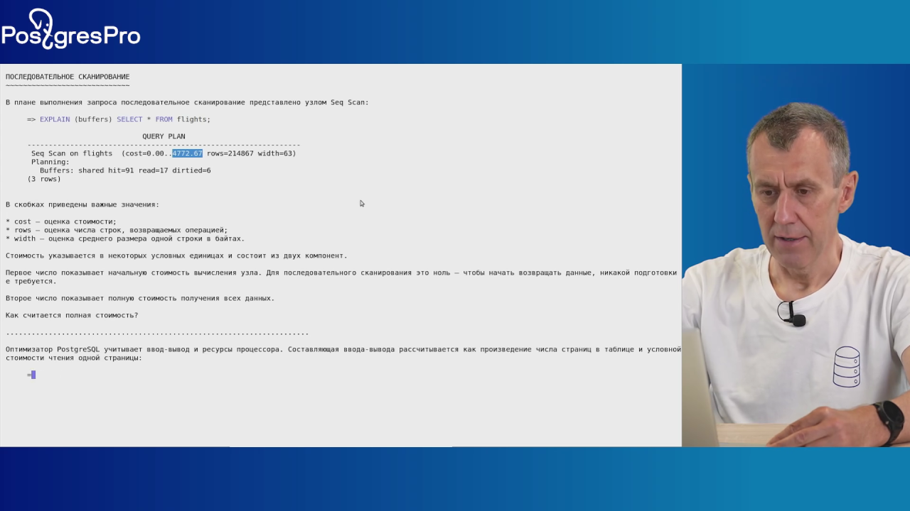

> [!quote]- Кадр [00:04:53]
> 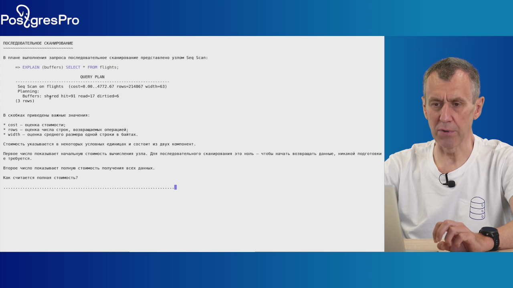

## 4. Сканирование по битовой карте и work_mem

Bitmap Index Scan — метод доступа, связанный с индексами: он спускается до листа и идёт по листу, но не идёт сразу в таблицы, а строит битовую карту ссылок на требуемые табличные строки в оперативной памяти (указывается только индекс, без имени таблицы). Время Index Scan пропорционально количеству строк, а Bitmap Index Scan — количеству страниц; Bitmap Heap Scan — второй этап, он не обращается к индексу, а использует битовую карту и по ней читает нужные версии строк в таблице, поэтому строки читаются только один раз. Сканирование по битовой карте удобно, когда данные в таблице неупорядочены или разрознены и одни и те же страницы читаются несколько раз; битовые карты можно объединять через BitmapAnd или BitmapOr, причём условия BitmapOr не обязательно должны быть по одному и тому же столбцу — можно использовать разные индексы. Пока размер карты не превышает work_mem, информация хранится с точностью до версии строки; work_mem — мягкий, а не жёсткий лимит, и при нехватке памяти часть карты огрубляется до отдельных страниц — это lossy-фрагменты, требующие перепроверки всех версий строк на странице (Rows Removed by Index Recheck). Строка Recheck Condition показывается всегда, даже если карта строилась без потери точности, а «Heap Blocks: exact» означает, что все фрагменты построены с точностью до строк и перепроверка не выполняется.

```sql
>= SELECT reads, hits, reuses
FROM pg_stat_io
WHERE context = 'bulkread' -- Сканирование больших таблиц
AND object = 'relation'
AND backend_type = 'client backend';

EXPLAIN
SELECT * FROM bookings WHERE total_amount < 5000;

 Bitmap Heap Scan on bookings  (cost=94.57..9854.66 rows=4921 width=21)
   Recheck Cond: (total_amount < '5000'::numeric)
   ->  Bitmap Index Scan on bookings_total_amount_idx  (cost=0.00..93.34 rows=4921 width=0)
         Index Cond: (total_amount < '5000'::numeric)

EXPLAIN (costs off)
SELECT * FROM bookings
WHERE total_amount < 5000 OR total_amount > 500000;

 Bitmap Heap Scan on bookings
   Recheck Cond: ((total_amount < '5000'::numeric) OR (total_amount > '500000'::numeric))
   ->  BitmapOr
         ->  Bitmap Index Scan on bookings_total_amount_idx
               Index Cond: (total_amount < '5000'::numeric)
         ->  Bitmap Index Scan on bookings_total_amount_idx
               Index Cond: (total_amount > '500000'::numeric)

=> EXPLAIN (analyze, costs off, timing off)
SELECT count(*) FROM bookings
WHERE total_amount < '5000' AND book_date > $1;

   -> Bitmap Heap Scan on bookings (actual rows=129 loops=1)
      Rows Removed by Index Recheck: 89895
      Heap Blocks: exact=811 lossy=568
      -> BitmapAnd (actual rows=0 loops=1)
         -> Bitmap Index Scan on bookings_total_amount_idx (actual rows=1471 loops=1)
         -> Bitmap Index Scan on bookings_book_date_idx (actual rows=178142 loops=1)

=> SET work_mem = '64kB';

=> EXPLAIN (analyze, costs off, timing off)
SELECT count(*) FROM bookings
WHERE total_amount < 5000 AND book_date > $1;

  ->  Bitmap Heap Scan on bookings (actual rows=129 loops=1)
     Recheck Cond: ((total_amount < '5000'::numeric) AND (book_date > '2017-07-15 18:00:00+03'::timestamp with time zone))
     Rows Removed by Index Recheck: 89895
     Heap Blocks: exact=31 lossy=568
     ->  BitmapAnd (actual rows=0 loops=1)
           ->  Bitmap Index Scan on bookings_total_amount_idx
           ->  Bitmap Index Scan on bookings_book_date_idx

EXPLAIN (costs off)
SELECT * FROM bookings
WHERE total_amount < 5000
  OR book_date = bookings.now() - INTERVAL '1 day';

SET work_mem = '64kB';

EXPLAIN (analyze, costs off, timing off)
SELECT count(*) FROM bookings
WHERE total_amount < 5000 AND book_date > $1;

 Bitmap Heap Scan on bookings (actual rows=129 loops=1)
   Recheck Cond: ((total_amount < '5000'::numeric) AND (book_date > '2017-07-15 18:00:00+03'::timestamp with time zone))
   Rows Removed by Index Recheck: 89895
   Heap Blocks: exact=31 lossy=568
   ->  BitmapAnd (actual rows=0 loops=1)
         ->  Bitmap Index Scan on bookings_total_amount_idx
         ->  Bitmap Index Scan on bookings_book_date_idx

EXPLAIN (costs off)
SELECT * FROM bookings
WHERE total_amount < 5000 OR total_amount > 500000;

EXPLAIN (costs off)
SELECT * FROM bookings
WHERE total_amount < 5000
  OR book_date = bookings.now() - INTERVAL '1 day';

=> SET work_mem = '64kB';

=> EXPLAIN (analyze, costs off, timing off)
SELECT count(*) FROM bookings
WHERE total_amount < 5000 AND book_date > $1;

  ->  Bitmap Heap Scan on bookings (actual rows=129 loops=1)
     Recheck Cond: ((total_amount < '5000'::numeric) AND (book_date > '2017-07-15 18:00:00+03'::timestamp with time zone))
     Rows Removed by Index Recheck: 89895
     Heap Blocks: exact=31 lossy=568
```

| Метод | Пропорционален |
|---|---|
| Index Scan | количеству строк |
| Bitmap Index Scan | количеству страниц |

| Фрагмент | Точность | Перепроверка |
|---|---|---|
| exact | до строк | не выполняется |
| lossy | до страниц | нужна |

> [!info] Зачем это нужно
> Чтобы не читать одну и ту же табличную страницу по нескольку раз.

*Источник: [00:00:00], [00:30:19], [00:34:51], [00:40:17], [00:42:06], [00:44:36] и др.*


> [!quote]- Кадр [01:14:13]
> 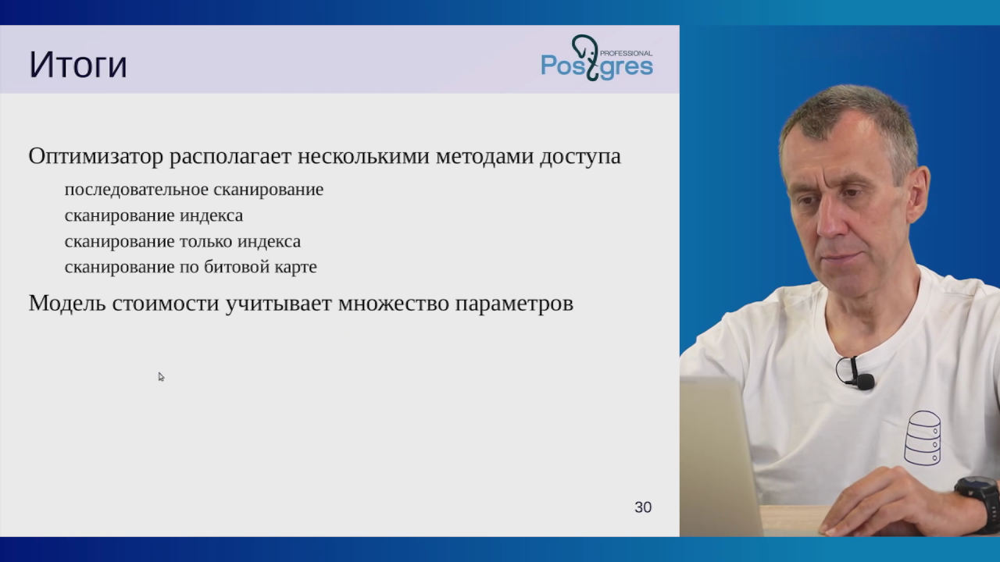

> [!quote]- Кадр [00:52:23]
> 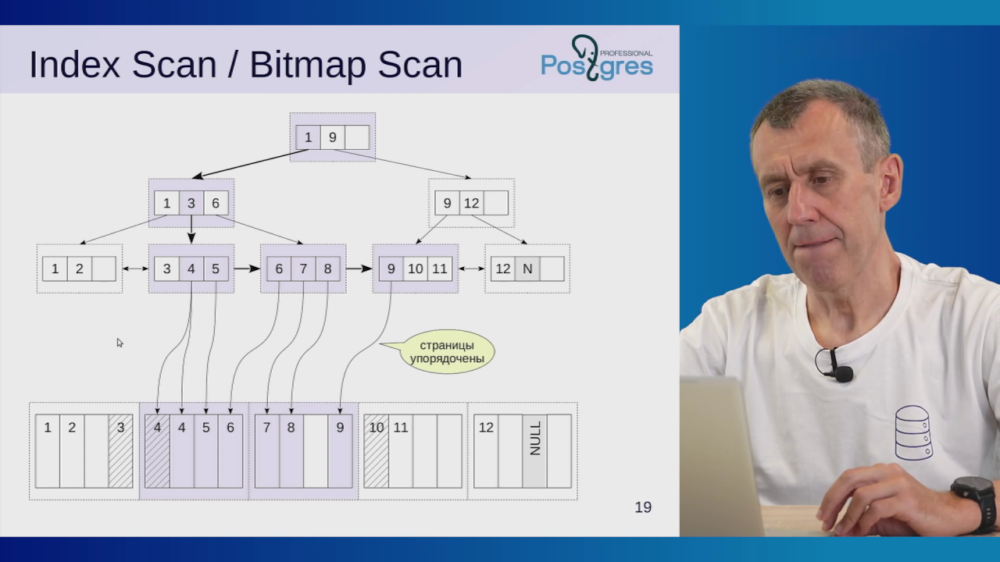

> [!quote]- Кадр [00:52:45]
> 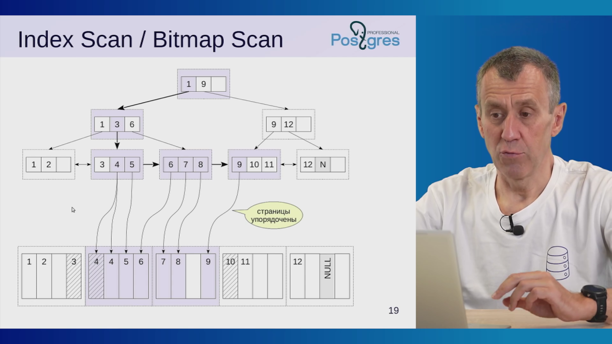

> [!quote]- Кадр [00:49:32]
> 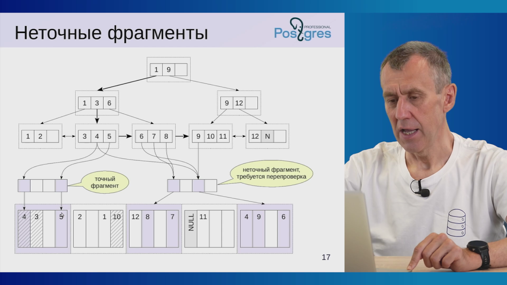

> [!quote]- Кадр [00:46:56]
> 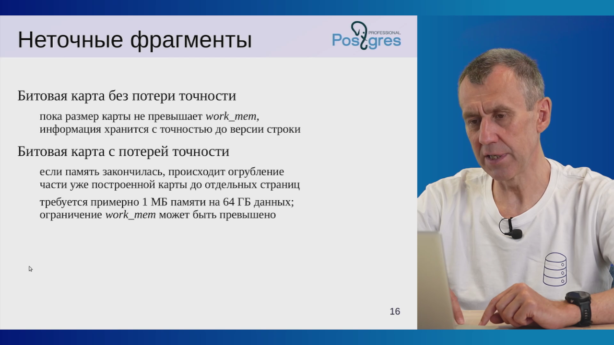

## 5. Устройство B-дерева

B-дерево — сбалансированное сильно ветвистое дерево поиска, работающее только с сортируемыми типами данных; как индекс это вспомогательная структура во внешней памяти, сопоставляющая ключи и идентификаторы строк таблицы. Оно состоит из корня, внутренних страниц, листьев и табличных страниц; поиск идёт от корня по веткам к листовым страницам, где хранятся ссылки на табличные строки, а листовые страницы связаны между собой двунаправленным списком, поэтому результаты поиска автоматически выдаются отсортированными, и поиск можно вести как в прямом, так и в обратном порядке. Сбалансированность означает одинаковое количество уровней от корня до листовой страницы. Индекс на B-дереве поддерживает только сортируемые типы данных, а столбцы или выражения можно указывать только для сортируемых типов. По умолчанию null-значения записываются в конец индекса; при создании индекса можно указать NULLS LAST или NULLS FIRST.

```
Indexes:
  "bookings_pkey" PRIMARY KEY, btree (book_ref)
```

*Источник: [00:00:20], [00:21:18], [00:24:47], [00:38:06]*

> [!quote]- Кадр [00:21:18]
> 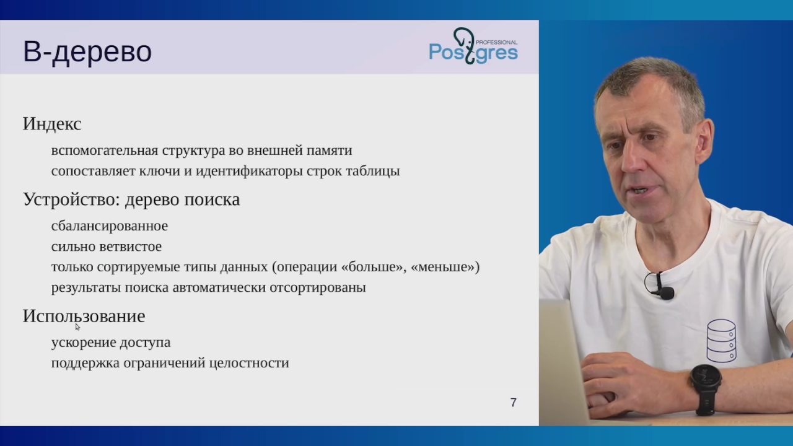


## 6. Индексы для ограничений целостности

Для первичного и уникального ключа Postgres поддерживает уникальность только с помощью уникальных индексов, поэтому для таких ограничений целостности индексы типа B-дерева создаются обязательно. В таблице бронирования Bookings для столбца BookRef создан первичный ключ; ограничение PRIMARY KEY обеспечивается индексом bookings_pkey (btree) по полю book_ref.

```javascript
=> \d bookings

         Table "bookings.bookings"
 Column     |            Type             | Collation | Nullable | Default
------------+-----------------------------+-----------+----------+---------
 book_ref   | character(6)                |           | not null |
 book_date  | timestamp with time zone    |           | not null |
 total_amount | numeric(10,2)             |           | not null |
Indexes:
    "bookings_pkey" PRIMARY KEY, btree (book_ref)
```

> [!info] Зачем это нужно
> Postgres поддерживает уникальность только с помощью уникальных индексов.

*Источник: [00:21:18], [00:28:29], [00:30:19]*


## 7. Include-индексы и Index Only Scan

Include-индекс — это индекс, в который при создании можно добавить неключевые столбцы с помощью фразы INCLUDE; сначала указываются основные ключи индексирования. Неключевые столбцы не используются при поиске по индексу и не учитываются ограничением уникальности; в INCLUDE можно помещать столбцы, которые нельзя включить в обычный B-tree, например несортируемые типы данных: geometry, JSON, XML. Если вся необходимая информация содержится в самом индексе, то нет необходимости обращаться к таблице — за исключением проверки видимости; значения неключевых столбцов хранятся в индексной записи и возвращаются без обращения к таблице, и это называется Index Only Scan. Heap Fetches показывает, сколько версий строк было проверено с помощью таблицы: при актуальной карте видимости обращаться к таблице не требуется, поэтому Heap Fetches = 0, а после обновления строки значение становится 20.

```sql
=> CREATE UNIQUE INDEX ON tickets (ticket_no) INCLUDE (book_ref);
CREATE INDEX

EXPLAIN (analyze, costs off, timing off, summary off)
SELECT total_amount FROM bookings
WHERE total_amount > 200000;

QUERY PLAN
-------------------------------------------------------------
Index Only Scan using bookings_total_amount_idx on bookings (actual rows=141535 loops=1)
  Index Cond: (total_amount > '200000'::numeric)
  Heap Fetches: 0
(3 rows)

EXPLAIN SELECT *
   FROM ticket_flights
   WHERE flight_id = 187662;
                        QUERY PLAN
---------------------------------------------------------------------------
  Gather  (cost=1000.00..114678.36 rows=107 width=32)
    Workers Planned: 2
    ->  Parallel Seq Scan on ticket_flights  (cost=0.00..113667.66 rows=45 width=32)
          Filter: (flight_id = 187662)
(4 rows)

EXPLAIN (analyze, costs off, timing off, summary off)
SELECT total_amount FROM bookings
WHERE total_amount > 200000;

QUERY PLAN
-------------------------------------------------------------
Index Only Scan using bookings_total_amount_idx on bookings (actual rows=141535 loops=1)
  Index Cond: (total_amount > '200000'::numeric)
  Heap Fetches: 0
(3 rows)

EXPLAIN SELECT *
   FROM ticket_flights
   WHERE flight_id = 187662;
                        QUERY PLAN
---------------------------------------------------------------------------
  Gather  (cost=1000.00..114678.36 rows=107 width=32)
    Workers Planned: 2
    ->  Parallel Seq Scan on ticket_flights  (cost=0.00..113667.66 rows=45 width=32)
          Filter: (flight_id = 187662)
(4 rows)

EXPLAIN (analyze, costs off, timing off, summary off)
SELECT total_amount FROM bookings
WHERE total_amount > 200000;

QUERY PLAN
-------------------------------------------------------------
Index Only Scan using bookings_total_amount_idx on bookings (actual rows=141535 loops=1)
  Index Cond: (total_amount > '200000'::numeric)
Heap Fetches: 0
(3 rows)
```

> [!info] Зачем это нужно
> Если вся необходимая информация содержится в самом индексе, обращаться к таблице не нужно — кроме проверки видимости.

*Источник: [00:59:54], [01:01:24], [01:06:24], [01:07:04], [01:09:21], [01:09:41] и др.*

> [!quote]- Кадр [01:07:04]
> 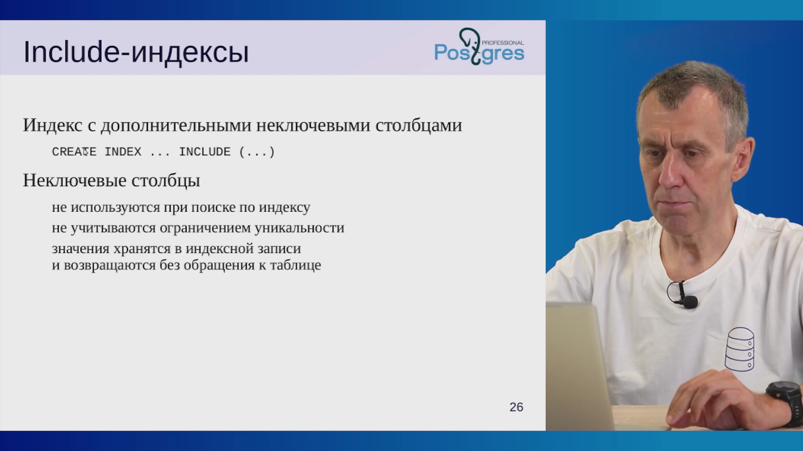

## 8. Мёртвые версии строк и VACUUM

Создаётся копия таблицы flights с отключённым автовакуумом, чтобы он автоматически не обрабатывал таблицу; таблица заполняется всеми строками из flights. EXPLAIN ANALYZE для count(*) показывает последовательное сканирование, которому нужно прочитать все 2624 страницы таблицы. Команда VACUUM помечает место, занятое мёртвыми версиями строк, как свободное для повторного использования, а если в конце файла есть страницы только с мёртвыми строками, возвращает это место операционной системе; карта видимости хранит информацию о страницах, на которых все версии строк видны пользователям, и обновляется операцией VACUUM. После удаления всех строк командой DELETE размер таблицы остаётся прежним, потому что мёртвые версии строк остаются в файле до очистки; после VACUUM размер уменьшается — в примере таблица стала занимать 16 kB вместо 21 MB и в ней остаётся две страницы. Команда ANALYZE собирает статистику.

```sql
CREATE TABLE flights_copy
   WITH (autovacuum_enabled = false)
AS SELECT * FROM flights;

VACUUM flights_copy;

=> CREATE TABLE flights_copy
   WITH (autovacuum_enabled = false)
   AS SELECT * FROM flights;

SELECT 214867

=> SELECT pg_size_pretty(pg_total_relation_size('flights_copy'));

 pg_size_pretty
----------------
 21 MB
(1 row)

=> DELETE FROM flights_copy;

DELETE 214867

=> SELECT pg_size_pretty(pg_total_relation_size('flights_copy'));

 pg_size_pretty
----------------
 21 MB
(1 row)

=> VACUUM flights_copy;
VACUUM
=> SELECT pg_size_pretty(pg_total_relation_size('flights_copy'));
 pg_size_pretty
----------------
 16 kB
(1 row)

>= VACUUM ANALYZE bookings;
```

*Источник: [00:02:05], [00:10:31], [00:11:22], [00:11:42], [00:12:02], [00:12:22] и др.*

> [!quote]- Кадр [00:02:05]
> 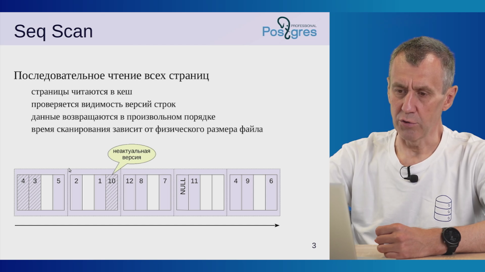

## 9. Буферный кэш и pg_stat_io

Postgres при чтении данных записывает их в буферный кэш и работает с ними там, и при последовательном сканировании в плане EXPLAIN (analyze, buffers) отображается Buffers: shared hit=2; при первом выполнении запроса кеш заполняется, а при повторном данные читаются из кеша — небольшие таблицы, такие как flights, помещаются в кеш. При чтении таблицы, размер которой больше четверти shared_buffers, PostgreSQL выполняет Seq Scan, страницы загружаются в буферный кэш с вытеснением, а в pg_stat_io столбец reuses показывает, сколько страниц было вытеснено. Для сканирования больших таблиц PostgreSQL использует буферное кольцо размером 32 страницы: как только 32 страницы заполнены, чтение идёт по кругу — предыдущие страницы вылетают из кэша, а на их место зачитываются новые, пока не прочитается вся таблица. Страницы в буферном кольце могут изменяться другими процессами: они помечаются как грязные и выпадают из кольца, затем идёт запись на диск и последующее чтение на общих основаниях. Статистику ввода-вывода показывает представление pg_stat_io с накопленной статистикой для всех клиентских процессов; перед началом сбора её сбрасывают функцией pg_stat_reset_shared('io').

```sql
Planning:
   Buffers: shared hit=2

=> SELECT reads, hits, reuses
FROM pg_stat_io
WHERE context = 'bulkread'
AND object = 'relation'
AND backend_type = 'client backend';

reads | hits | reuses
-------+------+--------
 49415 |    0 | 49383

>> EXECUTE EXPLAIN (buffers, analyze, costs off)
SELECT * FROM tickets;

               QUERY PLAN
---------------------------------------------------------------------------
Seq Scan on tickets (actual time=0.692..642.226 rows=2949857 loops=1)
  Buffers: shared read=49415

> SELECT pg_stat_reset_shared('io');
pg_stat_reset_shared
---------------------
(1 row)
```

reads | hits | reuses
-------+------+--------
 49415 |    0 | 49383

*Источник: [00:13:45], [00:14:05], [00:15:03], [00:17:12], [00:17:32], [00:17:52] и др.*

> [!quote]- Кадр [00:14:05]
> 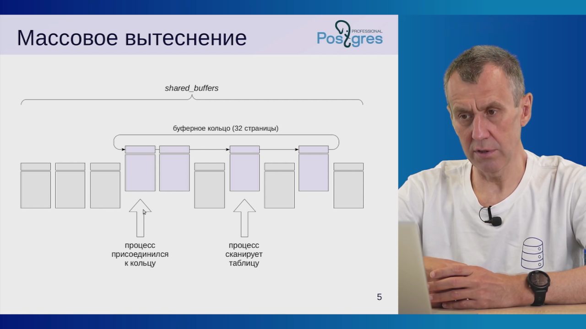

> [!quote]- Кадр [01:15:03]
> 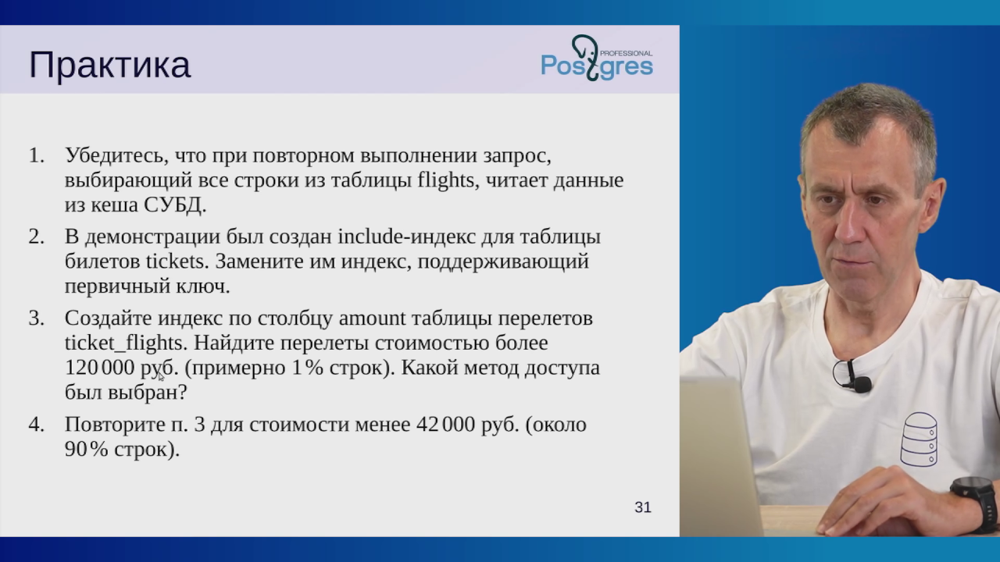

## 10. Команда CLUSTER

Команда CLUSTER позволяет переупорядочить данные в таблице, перестраивая таблицу так, чтобы данные были физически упорядочены по указанному индексу. CLUSTER переписывает все строки таблицы в новые файлы, физически сортируя их по указанному индексу, и накладывает те же ограничения, что и VACUUM FULL: может занять время и накладывает эксклюзивную блокировку на всю таблицу. После кластеризации данные упорядочены по индексу, и планировщик заменяет сканирование по битовой карте на обычное индексное сканирование, считая его выгоднее. Со временем при слишком частых изменениях таблицы упорядоченность по total_amount деградирует.

```sql
>= CLUSTER bookings USING bookings_total_amount_idx;

=> EXPLAIN (costs off)
SELECT * FROM bookings
WHERE total_amount < 5000;

Index Scan using bookings_total_amount_idx on bookings
  Index Cond: (total_amount < '5000'::numeric)
```

| Ситуация | План |
|---|---|
| Данные неупорядочены, страницы читаются несколько раз | сканирование по битовой карте |
| Таблица кластеризована | обычное индексное сканирование |

> [!info] Зачем это нужно
> После кластеризации проще и выгодней сделать обычное индексное сканирование.

*Источник: [00:52:45], [00:53:50], [00:55:41], [00:59:04], [00:59:54]*


## Схема

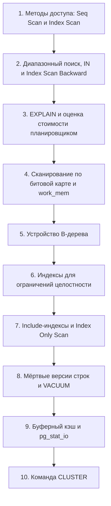

## Итог

> [!success] Что в итоге
> Метод доступа в PostgreSQL выбирается между последовательным сканированием, сканированием индекса, сканированием только индекса и сканированием по битовой карте, и выбор зависит от модели стоимости, в том числе random_page_cost. Индексы на B-дереве работают только с сортируемыми типами и обязательны для первичного и уникального ключей; Include-индексы позволяют выполнять Index Only Scan с Heap Fetches = 0. DELETE не уменьшает размер таблицы — мёртвые версии строк удаляются только командой VACUUM, а при чтении больших таблиц shared_buffers использует буферное кольцо из 32 страниц. Команда CLUSTER делает данные физически упорядоченными по индексу, после чего планировщик может предпочесть обычное индексное сканирование вместо сканирования по битовой карте.

