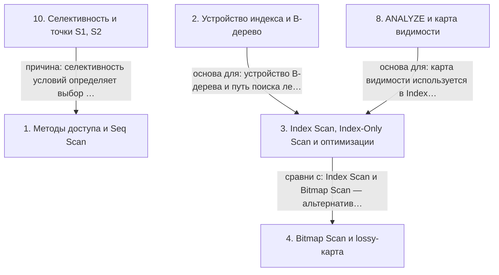

# Методы доступа к данным в PostgreSQL: Seq Scan, Index Scan и Bitmap Scan

> [!abstract] Обзор
> Материал о том, как Postgres достучится до табличных данных: разбираются методы доступа (Seq Scan, Index Scan, Index-Only Scan, Bitmap Scan), устройство индекса и B-дерева, стоимость плана и влияние параметров вроде random_page_cost. Объясняется, как строится битовая карта, что такое lossy-карта и Recheck Condition, как работают буферный кэш и буферные кольца. Отдельно рассматриваются мёртвые строки, Vacuum и VACUUM FULL, CLUSTER, карта видимости и роль ANALYZE, ограничения многоколоночных индексов и покрывающие (include) индексы. Влияние селективности условий на выбор метода описывается через точки S1 и S2. Проверять поведение запросов и ввод-вывод помогают EXPLAIN ANALYZE и статистика в pg_stat_io, в PG 18 — по отдельным процессам.

> [!info] Курс
> [[index|Оглавление курса]]

## Оглавление
1. [[#1. Методы доступа и Seq Scan]]
2. [[#2. Устройство индекса и B-дерево]]
3. [[#3. Index Scan, Index-Only Scan и оптимизации]]
4. [[#4. Bitmap Scan и lossy-карта]]
5. [[#5. Буферный кэш и буферные кольца]]
6. [[#6. Стоимость плана и параметры]]
7. [[#7. Vacuum, VACUUM FULL и CLUSTER]]
8. [[#8. ANALYZE и карта видимости]]
9. [[#9. Многоколоночные и покрывающие индексы]]
10. [[#10. Селективность и точки S1, S2]]
11. [[#11. Диагностика: EXPLAIN ANALYZE и pg_stat_io]]

**Схема** — [[#Схема]]
**Итог** — [[#Итог]]

## 1. Методы доступа и Seq Scan

Метод доступа — это то, каким образом Postgres может достучаться до данных; наиболее важна работа с табличными данными. Планировщик располагает методами: последовательное сканирование (Seq Scan), сканирование индекса (Index Scan), сканирование только индекса (Index-Only Scan) и сканирование по битовой карте (Bitmap Scan). Seq Scan последовательно читает все страницы таблицы в буферный кэш, проверяет видимость версий строк и возвращает данные в произвольном порядке; время зависит от физического размера файлов таблицы. Выбор метода сильно зависит от конкретных таблиц, индексов и множества других параметров. Пример простого Seq Scan — SELECT * FROM имя_таблицы.

*Источник: [00:00:00], [00:01:00]*

> [!quote]- Кадр [00:00:00]
> 

> [!quote]- Кадр [00:01:00]
> 

## 2. Устройство индекса и B-дерево

При индексном сканировании доступ к таблице идёт не напрямую, а через индекс — дополнительную структуру во внешней памяти, сохраняемую на диске, чтобы находить данные быстрее: сначала находится нужное в индексе, затем точечно происходит обращение к данным таблицы. При создании индекса указываются ключи — значения столбцов или выражения, и составляется список ключей и ссылок на строки таблицы; листовые страницы содержат ссылки на табличные строки и связаны двунаправленным списком, внутренние — ссылки на следующие страницы. B-дерево — сбалансированное дерево поиска: от корня до листовой страницы всегда одинаковое количество уровней; поддерживает только сортируемые типы данных; ускоряет доступ, когда нужна малая часть значений; поддерживает первичный и уникальный ключи; побочный эффект — результаты выдаются автоматически отсортированными. Для поиска диапазона сначала находят нижнюю границу спуском от корня к листовой, затем используют двунаправленный список. Составной индекс хранит значения, отсортированные сначала по первому столбцу, затем по второму, и эффективен при условиях по обоим столбцам; по умолчанию NULL записываются в конец индекса, можно указать NULLS FIRST или NULLS LAST; благодаря двунаправленному списку возможно обратное сканирование (Index Scan Backward).

> [!info] Зачем это нужно
> Индекс нужен, чтобы находить данные в таблице быстрее и избежать полного чтения.

*Источник: [00:01:00]*

## 3. Index Scan, Index-Only Scan и оптимизации

Index Scan ищет по индексу, но данные читает из таблицы; возвращает данные в порядке индекса даже без ORDER BY, может несколько раз считывать одну и ту же табличную страницу и применим для поиска по диапазону. Index-Only Scan используется, когда в запросе задействованы все столбцы, включённые в индекс, и применяет карту видимости, где хранится информация о страницах, где все версии строк видны пользователям; но информации о видимости строк в индексе нет, поэтому даже если все нужные значения есть в индексе, всё равно нужно сходить в таблицу и перепроверить видимость. При поиске конкретного значения по первичному ключу BookRef используется Index Scan; может вернуться не более одной строки, что оптимально для уникального индекса, а Index Cond показывает условия поиска в индексе. При дополнительном условии данные из таблицы дополнительно фильтруются, а страницы могут читаться несколько раз. Запрос с перечислением значений из диапазона через IN возвращает тот же результат, что и запрос с диапазоном, но тратит в два раза больше; в 16-й версии поиск от корня выполняется для каждого из пяти значений, а в 17-й версии добавлена оптимизация, позволяющая не отходить от корня несколько раз, поэтому количество прочитанных страниц больше.

*Источник: [00:01:00]*

## 4. Bitmap Scan и lossy-карта

Bitmap Index Scan — первая операция сканирования по битовой карте: она спускается по индексу и в оперативной памяти (work_mem) строит битовую карту со ссылками на требуемые табличные строки, не обращаясь к таблице; затем Bitmap Heap Scan использует эту карту для чтения строк, выполняя точный поиск: сначала определяется страница, затем внутри страницы — место, где лежит нужная строка. При сканировании по битовой карте индекс не просматривается: в оперативной памяти есть битовая карта, по которой читаются нужные версии строк таблицы, и каждая из них читается только один раз; операция сканирования не может начаться, пока битовая карта не построена полностью, а её построение требует небольших дополнительных затрат. Bitmap Scan удобен, когда данные в таблице хранятся в неупорядоченном виде по нужному индексному условию: данные разрознены и одни и те же страницы читаются несколько раз; если данные физически отсортированы по ключу индекса, планировщик может предпочесть Index Scan. Условия не обязательно должны быть по одному и тому же столбцу — при наличии индексов по разным столбцам можно использовать разные индексы для построения объединённой битовой карты; например, планировщик строит одну карту для условия «меньше 5000» и вторую — для условия «больше 500 тысяч»; эффективность зависит от таблиц, индексов, частоты обновления карты и очистки таблицы вместе с обновлением карты видимости. При построении Bitmap Scan ограничение work_mem по умолчанию составляет 4 мегабайта, и этот лимит мягкий: даже при превышении битовая карта всё равно будет построена в оперативной памяти; если указатели на строки не помещаются, карта строится с потерей точности — запоминаются не конкретные версии строк, а ссылки на страницы, при чтении такой страницы все версии строк перепроверяются, и такая карта может использовать много оперативной памяти; при уменьшении work_mem с 4 МБ до 64 КБ появляются lossy-фрагменты — неточные ссылки с точностью до страниц, а строка Recheck Condition показывает перепроверку условий и отображается в плане всегда.

| Index Scan | Bitmap Scan |
|---|---|
| Читает таблицу по ссылкам из листовой страницы, может читать одну страницу несколько раз | Строит битовую карту по индексу, затем читает таблицу по ней |
| Предпочтителен, если данные физически отсортированы по ключу индекса | Удобен, когда данные разрознены и одни и те же страницы читаются несколько раз |

*Источник: [00:01:00]*

## 5. Буферный кэш и буферные кольца

Любая работа в Postgres с данными ведётся именно через буферный кэш: страницы всегда считываются в буферный кэш, и только там Postgres начинает с ними работать. При чтении большой таблицы из буферного кэша могут вытесниться все полезные данные. Если нужно прочитать больше 1/4 размера буферного кэша, для операции последовательного чтения создаётся специальное буферное кольцо; при последовательном сканировании чтение идёт через буферное кольцо размером 32 страницы, которое используется при сканировании больших таблиц. Если другой процесс выполняет последовательное чтение той же таблицы, он присоединяется к тому же буферному кольцу и читает те данные, которые первый процесс уже успел прочитать. Если странички в кольце изменяются, они помечаются как грязные: грязные странички выпадают из буферного кольца, после чего записываются на диск и читаются на общих основаниях.

*Источник: [00:01:00]*

## 6. Стоимость плана и параметры

Стоимость запроса для Seq Scan представлена тремя группами значений: cost из двух значений, rows — оценка планировщиком количества возвращаемых строк и оценка средней ширины строки в байтах. Стоимость складывается из компонента ввода-вывода и компонента затрат процессора; компонент ввода-вывода — это seq_page_cost, умноженный на количество страниц таблицы, а количество страниц можно получить из pg_class; параметр cpu_tuple_cost по умолчанию равен 0,01 и складывается с другими составляющими в общую стоимость. Планировщик вычисляет общую оценку стоимости плана с помощью алгоритмов, учитывающих настройки сервера и статистику; учитываются операции ввода-вывода — необходимость прочитать определённое количество страниц, стоимость чтения одной страницы равна единице, а общая оценка ввода-вывода берётся из числа страниц в таблице. Вторая компонента — оценка процессорных ресурсов на обработку каждой строки, она записывается в параметре cpu_tuple_cost. Начальная стоимость — это стоимость, которую нужно заплатить, чтобы начать обрабатывать первую строку этим узлом; для последовательного сканирования она нулевая, а стоимость чтения одной индексной страницы определяется параметром random_page_cost: по умолчанию он равен 4, то есть случайный доступ считается в 4 раза медленнее последовательного, и это значение больше seq_page_cost; для современных дисков это значение стоит существенно уменьшить.

*Источник: [00:01:00]*

## 7. Vacuum, VACUUM FULL и CLUSTER

В Postgres данные после удаления или изменения остаются в таблице: команда Delete помечает строки как мёртвые, но физический размер файлов не уменьшается. Специальный процесс «Вакуум» помечает освободившиеся места как свободные, а если в конце файла есть страницы только с мёртвыми строками, это место возвращается операционной системе; пока vacuum не сработал, мёртвые строки остаются в таблице, и такие неактуальные версии строк не нужно показывать пользователю. Своевременная очистка таблицы важна: если её не делать, запросы, сканирующие таблицу, будут читать лишнюю информацию, расходуя ресурсы на ввод-вывод и на процесс; чем больше мёртвых строк занимают место, тем больше лишнего чтения выполняет последовательное сканирование. В листовой странице индекса может оказаться несколько ссылок на табличные страницы — как на мёртвую строку, так и на нормальную; значение из мёртвой строки возвращать нельзя, возвращается только нормальная строка. VACUUM FULL создаёт новые файлы и переписывает в них только живые строки таблицы, а команда CLUSTER переупорядочивает данные таблицы, перестраивая её: строки записываются в новые файлы, физически отсортированными по указанному индексу; CLUSTER накладывает эксклюзивную блокировку на таблицу и может занять время; после выполнения CLUSTER упорядоченность автоматически не поддерживается, дальнейшие изменения приводят к появлению мёртвых строк, вставке данных в произвольные места, и со временем упорядоченность деградирует.

| Аспект | CLUSTER | VACUUM FULL |
|---|---|---|
| Что делает | перестраивает таблицу, записывая строки в новые файлы | создаёт новые файлы и переписывает только живые строки |
| Порядок строк | физически отсортированы по указанному индексу | — |

*Источник: [00:01:00]*

## 8. ANALYZE и карта видимости

После команды ANALYZE планировщик Postgres понимает, что данные упорядочены по столбцу. Для запроса по этому столбцу с условиями в плане запроса уже не видно сканирования по битовой карте (Bitmap Scan). Для каждой таблицы есть специальный файл — карта видимости, который обновляется операцией вакуум очистки; по карте видимости отсеиваются страницы, где все строки видимы, и в такие страницы не нужно заходить, это выгоднее, чем ходить во все странички.

*Источник: [00:01:00]*

## 9. Многоколоночные и покрывающие индексы

Если в условии запроса указан только второй столбец многоколоночного индекса, Postgres не может использовать этот индекс для поиска; в 16-й версии это невозможно, и до версии 18 такой индекс для таких запросов не применяется. Для индекса по двум столбцам (Ticket, FlightID) Index Scan используется, если в условии указаны оба столбца или только первый, а если указан только второй (FlightID) — используется Seq Scan. В 18-й версии появится оптимизация: при условии не по ведущему столбцу многоколоночного индекса индекс можно просканировать несколько раз, если количество значений первого столбца невелико (например, от 1 до 3). Покрывающие или include-индексы — это индексы, в которые при создании можно добавлять дополнительные столбцы: фраза INCLUDE позволяет добавить в индекс неключевые столбцы, которые не используются при поиске по индексу и для ограничений уникальности, чтобы избежать обращения к таблице при выборке таких столбцов по ключу, например для получения наименования по идентификатору. В include можно поместить столбцы с любым типом, в том числе несортируемые (геометрия, JSON, XML), которые в обычный B+ дерево (B+ дерево) индекс включить нельзя; тогда index-only scan сможет использовать и возвращать эти данные любых типов, работая изначально с индексом B+ дерево.

*Источник: [00:01:00]*

## 10. Селективность и точки S1, S2

Селективность 1 означает отсутствие селективности: нужно все строки таблицы; малые значения (близкие к 0) означают высокую селективность, то есть нужно выбрать мало записей. Index Scan максимально эффективен при высокой селективности до условной точки S1, дальше он перестаёт быть эффективным, так как приходится сканировать одни и те же табличные строки по нескольку раз. После точки S1 побеждает метод сканирования по битовой карте, а после точки S2 выгоднее Seq Scan; точки S1 и S2 зависят от таблицы и конкретных индексов.

*Источник: [00:01:00]*

## 11. Диагностика: EXPLAIN ANALYZE и pg_stat_io

EXPLAIN ANALYZE выполняет запрос, тогда как команда EXPLAIN без ANALYZE не подтверждает факт выполнения запроса и показывает, какой метод доступа планировщик собирается использовать; опция analyze говорит о том, что запрос реально выполняется, а не просто строится его план. Чтобы получить точную статистику, нужно указать ANALYZE. Посмотреть статистику ввода-вывода можно в представлении pg_stat_io, для чистоты эксперимента её сбрасывают специальной функцией; чтобы статистика правильно показывала данные, нужно убедиться, что в системе больше никто не работает. pg_stat_io показывает статистику для всех клиентских процессов, а не только для того, который выполнял команду Explain; балк-рит — это операции сканирования больших таблиц, а столбец Reuses показывает, сколько страниц было вытеснено: вычитание 49 383 из 49 415 даёт 32 и указывает на то, что таблица читалась с вытеснением; после чтения таблицы страницы остаются в буферном кэше, что видно по счётчику hit. В 18-й версии Postgres будет возможность получать статистику ввода-вывода не на уровне всей системы, а для отдельных клиентских процессов: функция pg.getbackend.io принимает идентификатор процесса и показывает статистику ввода-вывода именно для этого клиентского процесса.

*Источник: [00:01:00]*

## Схема

## Итог

> [!success] Что в итоге
> Postgres достучится до табличных данных либо через индекс, либо последовательным сканированием страниц, а планировщик выбирает между Seq Scan, Index Scan, Index-Only Scan и Bitmap Scan по оценке стоимости, на которую влияют ввод-вывод, затраты процессора и параметры вроде random_page_cost. Bitmap Scan строит битовую карту в оперативной памяти с мягким лимитом work_mem, и при нехватке памяти карта становится lossy, из-за чего условия перепроверяются (Recheck Condition). На лишнее чтение влияют мёртвые строки, поэтому важны Vacuum и VACUUM FULL, а упорядоченность данных связана с CLUSTER и ANALYZE; в выборе метода также важны селективность с точками S1 и S2, ограничения многоколоночных индексов и покрывающие (include) индексы. Проверять поведение запросов и ввод-вывод помогают EXPLAIN ANALYZE и статистика в pg_stat_io, в PG 18 — по отдельным процессам.

