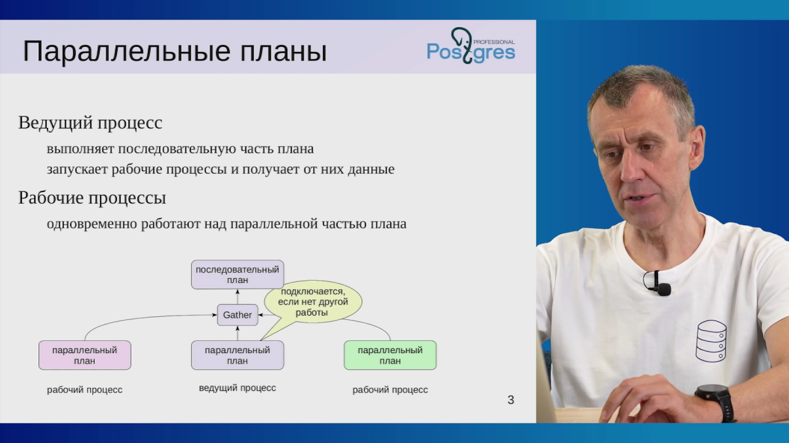
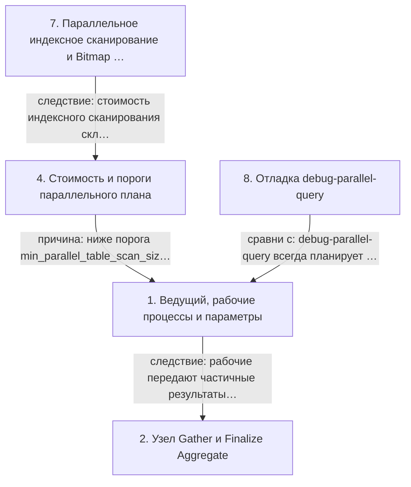

# Параллельные планы в PostgreSQL

> [!abstract] Обзор
> Материал описывает параллельные планы в PostgreSQL: роль ведущего и рабочих процессов, узел Gather и разделение параллельной и последовательной частей плана. Разобраны параметры, влияющие на число рабочих процессов: MaxWorkerProcesses, MaxParallelWorkers, Parallel Workers и Parallel Leader Participation. Показаны пороги построения плана (min_parallel_table_scan_size, min_parallel_index_scan_size) и стоимость параллельного выполнения, включая Parallel Setup Cost и стоимость частичной агрегации. Отдельно рассмотрены параллельный скан, параллельное индексное сканирование и Bitmap Heap Scan, а также объекты и запросы, которые не распараллеливаются, включая временные таблицы. Показано, что последовательный план в выводе планировщика означает лишь меньшую стоимость, а не невозможность параллелизма.

> [!info] Курс
> [[index|Оглавление курса]]

## Оглавление
1. [[#1. Ведущий, рабочие процессы и параметры]]
2. [[#2. Узел Gather и Finalize Aggregate]]
3. [[#3. Параллельный скан]]
4. [[#4. Стоимость и пороги параллельного плана]]
5. [[#5. Последовательный план и отключение параллелизма]]
6. [[#6. Что не распараллеливается]]
7. [[#7. Параллельное индексное сканирование и Bitmap Heap Scan]]
8. [[#8. Отладка debug-parallel-query]]

**Схема** — [[#Схема]]
**Итог** — [[#Итог]]

## 1. Ведущий, рабочие процессы и параметры

Запрос начинает ведущий процесс: он выполняет последовательную часть плана, запускает рабочие процессы, которые одновременно работают над параллельной частью плана, и получает от них данные; каждый процесс сканирует свою часть таблицы и получает частичный агрегат по просканированным им данным, а планировщик может счесть, что для большой таблицы Bookings лучше использовать параллельный план. Количество рабочих процессов для одного узла не может превышать MaxParallelWorkers, по умолчанию — 2, поэтому при двух рабочих над параллельной частью работают три процесса; фактически запускается не больше MaxParallelWorkersPerGather, и рабочих может быть меньше расчётного. MaxWorkerProcesses настраивает общее количество рабочих процессов, по умолчанию — 8; общее число таких процессов в системе не должно превышать это значение, и они нужны не только для параллельных запросов, но и, например, для логической репликации. MaxParallelWorkers можно настраивать, в том числе так, чтобы он был на несколько меньше MaxWorkerProcesses, если есть дополнительные задачи для рабочих процессов. Параметр хранения Parallel Workers позволяет явно зафиксировать количество рабочих процессов для параллельной части плана запросов к конкретной таблице, например для Bookings можно задать 4 рабочих процесса; по умолчанию ведущий участвует в выполнении параллельного плана, за это отвечает параметр участия ведущего (Parallel Leader Participation), который включён по умолчанию.

*Источник: [00:00:00], [00:01:00]*

> [!quote]- Кадр [00:01:00]
> 

## 2. Узел Gather и Finalize Aggregate

В параллельном плане узел Gather показывает границу: всё, что ниже него, — параллельная часть плана. Количество частичных агрегатов равно количеству процессов, работавших над параллельной частью; результаты частичных агрегатов пересылаются ведущему процессу в узел Gather, где собирается финальный агрегат. В параллельном плане частичный агрегат вычисляется внутри каждого рабочего процесса; Gather получает данные обратно от рабочих, а Finalize Aggregate берёт результаты предыдущего узла (например, три строки) и складывает их. После Gather ведущий процесс продолжает выполнение последовательного плана; последовательный план подключается, если нет другой работы, а стоимость Gather и Finalize Aggregate практически не отличается.

*Источник: [00:01:00]*

## 3. Параллельный скан

Параллельный скан — это последовательное сканирование таблицы, выполняемое параллельно: таблица делится на части, каждый рабочий процесс сканирует свою часть, после чего результаты агрегируются. В узле Parallel Seq Scan строка rows показывает оценку количества строк, которые обработает один рабочий процесс, а не общее количество строк в таблице. Ведущий процесс тоже участвует в параллельной seq scan-операции: при двух рабочих процессах он берёт на себя 0,4 — 40% от доли рабочих процессов, и эта доля уменьшается с увеличением количества рабочих процессов. Ресурсы процессора делятся на 2,4, поскольку рабочие процессы работают одновременно; стоимость ввода-вывода учитывается полностью и не делится на число рабочих процессов, потому что каждую страницу всё равно нужно прочитать.

*Источник: [00:01:00]*

## 4. Стоимость и пороги параллельного плана

Для агрегации нужно обработать определённое количество строк: количество строк, обработанных рабочим процессом, умножается на значение параметра CPU оператора COST. Затраты на запуск рабочих процессов оценивает стоимость настройки параллельного выполнения (Parallel Setup Cost) — стоимость запуска любого количества параллельных процессов. Общая стоимость складывается из стоимости доступа к индексу и стоимости доступа к таблице; стоимость индексного доступа между процессами не делится, потому что все процессы должны прочитать индексные страницы, а количество страниц и строк делят на 4, если запрос выбирает четвёртую часть; последовательное сканирование и индексный доступ могут выполняться параллельно, и ресурсы процессора используются сразу в нескольких рабочих процессах одновременно, что может сэкономить время. Параллельный план не строится для таблиц, размер которых не превышает min_parallel_table_scan_size, по умолчанию порог равен 8 мегабайтам: на 8 МБ запускается один процесс, на 24 МБ появляется второй. Параллельный индексный доступ не используется, если размер выборки, которую нужно получить в результате запроса, не превышает min_parallel_index_scan_size, по умолчанию — 512 кБ.

*Источник: [00:01:00]*

## 5. Последовательный план и отключение параллелизма

Последовательный план используется как запасной вариант (fallback): он подключается, если нет другой работы. Если планировщик показывает последовательный план, это не означает, что запрос не может исполняться параллельно: это говорит о том, что последовательный план дешевле по стоимости, чем параллельный. Чтобы посмотреть на план без параллельного выполнения, можно установить параметр MaxParallelWorkersPerGather в 0, тогда план точно будет последовательным.

*Источник: [00:01:00]*

## 6. Что не распараллеливается

Не распараллеливаются запросы на запись, запросы с блокировкой строк, операции с курсорами (включая курсоры в цикле for) и запросы, вызывающие функции, помеченные как небезопасные для параллельного выполнения (parallel unsafe). Некоторые узлы плана могут выполняться параллельно, но некоторые части плана никогда не распараллеливаются и выполняются только последовательно, например чтение результатов общих табличных выражений и нераскрываемые подзапросы; это не мешает параллельному выполнению других частей. Обращения к временным таблицам не распараллеливаются. Если объединить результаты с временной таблицей, доступ к основной таблице выполняется параллельно, а доступ к временной таблице — последовательно.

*Источник: [00:01:00]*

## 7. Параллельное индексное сканирование и Bitmap Heap Scan

Индекс может сканироваться параллельно, включая index scan и сканирование по битовой карте. Для параллельного индексного сканирования сначала выполняется последовательная часть — спуск от корня к листовой странице; листовые страницы индекса делятся между несколькими рабочими процессами, каждый рабочий процесс читает свои листовые страницы, а запускает их ведущий процесс. Рабочий процесс смотрит в карту видимости, затем ходит в таблицу и читает соответствующие табличные строки, получая результат. Битовая карта всегда строится одним процессом, последовательно; в плане это ведущий процесс. После построения битовой карты операция Bitmap Heap Scan может выполняться параллельно и отображается в узле Parallel Bitmap Heap Scan; для таблицы Bookings операция выполняется с перепроверкой условий и дополнительным фильтром, причём построение битовой карты происходит до её выполнения.

*Источник: [00:01:00]*

## 8. Отладка debug-parallel-query

Параметр debug-parallel-query (Debug Parallel Query) используется только для отладки. При его включении планировщик использует параллельные планы, даже если считает их невыгодными по стоимости. Он позволяет узнать, как мог бы выглядеть параллельный план. Параметр всегда планирует только один рабочий процесс, что можно использовать при поиске оптимального плана.

*Источник: [00:01:00]*

## Схема

## Итог

> [!success] Что в итоге
> Параллельный план строится вокруг ведущего процесса и рабочих, которые делят таблицу или листовые страницы индекса и передают частичные результаты в узел Gather, где Finalize Aggregate складывает их. Число рабочих процессов ограничено параметрами (MaxWorkerProcesses, MaxParallelWorkers) и может фиксироваться для конкретной таблицы через Parallel Workers, а само построение плана зависит от порогов min_parallel_table_scan_size и min_parallel_index_scan_size и стоимости запуска процессов. Часть запросов и объектов, включая временные таблицы и запросы на запись, не распараллеливается. Последовательный план в выводе планировщика означает лишь меньшую стоимость, а для отладки применяется debug-parallel-query.

