# Параллельные запросы в PostgreSQL: процессы, стоимость и методы доступа

> [!abstract] Обзор
> Материал о параллельном выполнении запросов в PostgreSQL: как устроены параллельные планы и как они отражаются в EXPLAIN. Разбираются роли ведущего и рабочих процессов, общий пул рабочих процессов и параметры max_worker_processes, max_parallel_workers, max_parallel_workers_per_gather и parallel_workers, а также формула расчёта числа процессов. Показаны узлы Parallel Seq Scan, Partial Aggregate, Gather и Finalize Aggregate, Parallel Index Scan, Parallel Index Only Scan и Parallel Bitmap Heap Scan. Отдельно рассматривается оценка стоимости через cpu_operator_cost, cpu_tuple_cost, parallel_setup_cost с делением процессорной части на 2.4 и индексного доступа делением на 4. Описаны случаи, когда план остаётся последовательным, и операции, которые не распараллеливаются, а также вспомогательная настройка debug_parallel_query.

> [!info] Курс
> [[index|Оглавление курса]]

## Оглавление
1. [[#1. Структура параллельного плана и агрегации]]
2. [[#2. Пул рабочих процессов, лимиты и формула]]
3. [[#3. Параллельные методы доступа и их стоимость]]
4. [[#4. Последовательный план и нераспараллеливаемые операции]]

**Схема** — [[#Схема]]
**Итог** — [[#Итог]]

## 1. Структура параллельного плана и агрегации

Ведущий процесс выполняет последовательную часть параллельного плана, запускает рабочие процессы и получает от них данные; при наличии свободного времени он может выполнять часть работы рабочих процессов. Рабочие процессы одновременно работают над параллельной частью плана, обрабатывают свою часть и передают результаты ведущему; они предназначены не только для параллельного выполнения запросов, но и для других задач. Узел Gather собирает результаты от рабочих процессов, после чего ведущий продолжает последовательный план: всё, что находится ниже узла Gather, — параллельная часть, а Gather и узлы выше выполняются только в ведущем процессе. При параллельном выполнении агрегации план включает Finalize Aggregate, Gather, Partial Aggregate и Parallel Seq Scan: каждый рабочий процесс получает частичный агрегат, результаты пересылаются в Gather, а Finalize Aggregate объединяет их в итоговый результат. Поля Workers Planned и Workers Launched показывают запланированное и реально запущенное число рабочих процессов; EXPLAIN без ANALYZE показывает только план и не выполняет запрос, а с ANALYZE запрос выполняется и видно реальное число воркеров.

```sql
>= EXPLAIN
SELECT count(*) FROM bookings;

QUERY PLAN
Finalize Aggregate  (cost=25442.58..25442.59 rows=1 width=8)
  ->  Gather  (cost=25442.36..25442.57 rows=2 width=8)
        Workers Planned: 2
        ->  Partial Aggregate  (cost=24442.36..24442.37 rows=1 width=8)
              ->  Parallel Seq Scan on bookings  (cost=0.00..22243.29 rows=879629 width=0)
(5 rows)

=> SELECT round(
    (
        reltuples * current_setting('cpu_operator_cost')::real / 2.4
    )::numeric,
    2
  ) AS "cost"
FROM pg_class WHERE relname = 'bookings';
cost
-------
2199.07
(1 row)

EXPLAIN (analyze, costs off)
SELECT count(*) FROM bookings;

Finalize Aggregate
  -> Gather
        Workers Planned: 2
        Workers Launched: 2
        -> Partial Aggregate
              -> Parallel Seq Scan on bookings

=> EXPLAIN (analyze, costs off)
SELECT count(*) FROM flights;
 QUERY PLAN
----------------------------------------------------------------
 Finalize Aggregate (actual time=63.755..63.792 rows=1 loops=1)
   ->  Gather (actual time=63.748..63.787 rows=2 loops=1)
         Workers Planned: 1
         Workers Launched: 1
         ->  Partial Aggregate (actual time=47.530..47.530 rows=1 loops=2)
               ->  Parallel Seq Scan on flights (actual time=0.398..43.553 rows=107434 loops=2)

>= EXPLAIN
SELECT count(*) FROM bookings;

QUERY PLAN
Finalize Aggregate  (cost=25442.58..25442.59 rows=1 width=8)
  ->  Gather  (cost=25442.36..25442.57 rows=2 width=8)
        Workers Planned: 2
        ->  Partial Aggregate  (cost=24442.36..24442.37 rows=1 width=8)
              ->  Parallel Seq Scan on bookings  (cost=0.00..22243.29 rows=879629 width=0)
(5 rows)

=> SELECT round(
    (
        reltuples * current_setting('cpu_operator_cost')::real / 2.4
    )::numeric,
    2
  ) AS "cost"
FROM pg_class WHERE relname = 'bookings';
cost
-------
2199.07
(1 row)

=> SELECT current_setting('parallel_setup_cost') parallel_setup_cost,
current_setting('parallel_tuple_cost') parallel_tuple_cost;

=> EXPLAIN
SELECT count(*) FROM bookings;

QUERY PLAN
Finalize Aggregate  (cost=25442.58..25442.59 rows=1 width=8)
  ->  Gather  (cost=25442.36..25442.57 rows=2 width=8)
        Workers Planned: 2
        ->  Partial Aggregate  (cost=24442.36..24442.37 rows=1 width=8)
              ->  Parallel Seq Scan on bookings  (cost=0.00..22243.29 rows=879629 width=0)
(5 rows)

=> SELECT round(
    (
        reltuples * current_setting('cpu_operator_cost')::real / 2.4
    )::numeric,
    2
  ) AS "cost"
FROM pg_class WHERE relname = 'bookings';
cost
-------
2199.07
(1 row)

=> SELECT current_setting('parallel_setup_cost') parallel_setup_cost,
current_setting('parallel_tuple_cost') parallel_tuple_cost;

EXPLAIN (analyze, costs off)
SELECT count(*) FROM bookings;

Finalize Aggregate
  -> Gather
        Workers Planned: 2
        Workers Launched: 2
        -> Partial Aggregate
              -> Parallel Seq Scan on bookings

=> EXPLAIN (analyze, costs off)
SELECT count(*) FROM flights;
 QUERY PLAN
----------------------------------------------------------------
 Finalize Aggregate (actual time=63.755..63.792 rows=1 loops=1)
   ->  Gather (actual time=63.748..63.787 rows=2 loops=1)
         Workers Planned: 1
         Workers Launched: 1
         ->  Partial Aggregate (actual time=47.530..47.530 rows=1 loops=2)
               ->  Parallel Seq Scan on flights (actual time=0.398..43.553 rows=107434 loops=2)

=> EXPLAIN
   SELECT count(*) FROM bookings;

                          QUERY PLAN
------------------------------------------------------------
 Finalize Aggregate  (cost=25442.58..25442.59 rows=1 width=8)
   ->  Gather  (cost=25442.36..25442.57 rows=2 width=8)
         Workers Planned: 2
         ->  Partial Aggregate  (cost=24442.36..24442.37 rows=1 width=8)
               ->  Parallel Seq Scan on bookings  (cost=0.00..22243.29 rows=879629 width=0)
(5 rows)

SELECT count(*) FROM bookings;

QUERY PLAN
-----------------------------------------------------------
 Finalize Aggregate  (cost=25442.58..25442.59 rows=1 width=8)
   ->  Gather  (cost=25442.36..25442.57 rows=2 width=8)
         Workers Planned: 2
         ->  Partial Aggregate  (cost=24442.36..24442.37 rows=1 width=8)
               ->  Parallel Seq Scan on bookings  (cost=0.00..22243.29 rows=879629 width=0)
(5 rows)

=> SELECT reltuples, current_setting('cpu_operator_cost'),
       reltuples * current_setting('cpu_operator_cost')::real AS total
FROM pg_class WHERE relname = 'seats';

 reltuples | current_setting | total
-----------+-----------------+--------
      1339 | 0.0025          | 3.3474998

=> SELECT round(
       ( relpages * current_setting('seq_page_cost')::real +
         reltuples * current_setting('cpu_tuple_cost')::real / 2.4
       )::numeric,
       2
  ) AS "cost"
FROM pg_class WHERE relname = 'bookings';
 cost
------
22243.29
(1 row)

=> SELECT round(
    (
        relpages * current_setting('seq_page_cost')::real +
        reltuples * current_setting('cpu_tuple_cost')::real / 2.4
    )::numeric,
    2
  ) AS "cost"
  FROM pg_class WHERE relname = 'bookings';

=> SELECT current_setting('parallel_setup_cost') parallel_setup_cost,
  current_setting('parallel_tuple_cost') parallel_tuple_cost;
 parallel_setup_cost | parallel_tuple_cost
---------------------+--------------------
          1000       | 0.1
(1 row)

=> SHOW parallel_leader_participation;
parallel_leader_participation
------------------------------
on
(1 row)
=> SET parallel_leader_participation = off;
SET

=> ALTER TABLE bookings SET (parallel_workers = 4);

ALTER TABLE
=> EXPLAIN (analyze, costs off)
SELECT count(*) FROM bookings;

                    QUERY PLAN
------------------------------------------------------------
  Finalize Aggregate (actual time=251.354..251.482 rows=1 loops=1)
    ->  Gather (actual time=230.057..251.392 rows=5 loops=1)
          Workers Planned: 4
          Workers Launched: 4
          ->  Partial Aggregate (actual time=216.437..216.439 rows=1 loops=5)
                ->  Parallel Seq Scan on bookings (actual time=0.027..169.144 rows=422222 loops=5)

=> SELECT round(reltuples / 2.4) "rows"
  FROM pg_class WHERE relname = 'bookings';
```

| Поле | Что показывает |
| Workers Planned | запланированное число рабочих процессов |
| Workers Launched | реально запущенное число рабочих процессов |

*Источник: [00:00:47], [00:02:44], [00:05:50], [00:09:32], [00:12:28], [00:15:14] и др.*

> [!quote]- Кадр [00:00:47]
> 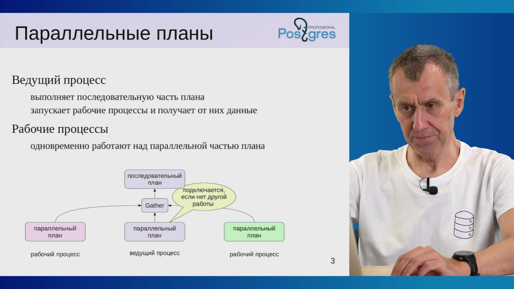

> [!quote]- Кадр [00:12:28]
> 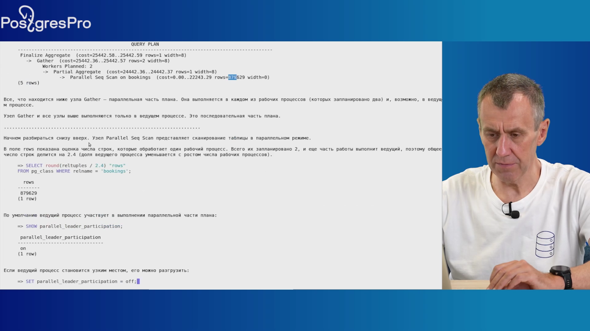

> [!quote]- Кадр [00:05:50]
> 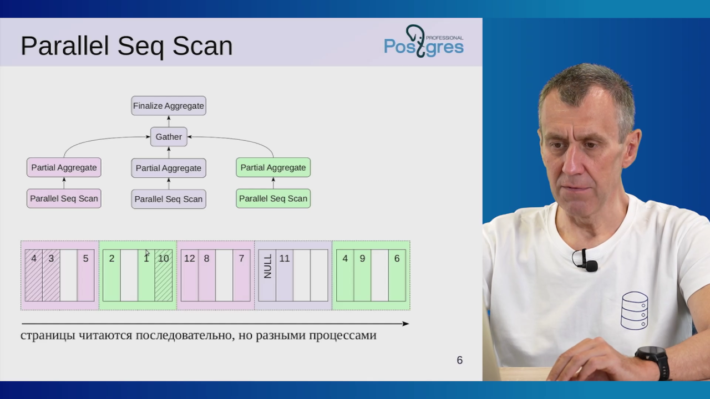

## 2. Пул рабочих процессов, лимиты и формула

max_worker_processes по умолчанию равен 8 и задаёт максимальное количество рабочих процессов, которые одновременно могут работать в системе; они используются для параллельного выполнения запросов, логической репликации и расширениями, и их общее количество не должно превышать этот параметр. max_parallel_workers по умолчанию равен 8 и ограничивает число процессов для параллельных запросов; его можно настроить меньше max_worker_processes, чтобы оставить процессы для других задач. Число рабочих процессов для одного узла ограничено max_parallel_workers_per_gather (по умолчанию 2); параметр хранения parallel_workers на таблице задаёт количество параллельных процессов для параллельной части плана, а если установить его в 0, планировщик всегда выберет последовательное сканирование. Если таблица больше min_parallel_table_scan_size (по умолчанию 8 МБ) и parallel_workers не задан, число процессов вычисляется по формуле 1 + ⌊log₃(размер таблицы / min_parallel_table_scan_size)⌋; для выборки — 1 + ⌊log₃(размер выборки / min_parallel_index_scan_size)⌋, но не больше max_parallel_workers_per_gather, а если размер меньше min_parallel_index_scan_size (512 kB), процессов ноль. Параметр parallel_leader_participation (по умолчанию on) определяет, участвует ли ведущий процесс в параллельной части; при двух рабочих процессах ведущий берёт на себя 0,4 (40% от доли рабочих), а при отключении работа делится только между рабочими процессами. Параметр debug_parallel_query служит только для отладки: он заставляет планировщик использовать параллельные планы, даже если они невыгодны, и всегда планирует только один процесс (один воркер).

```sql
ALTER TABLE bookings SET (parallel_workers = 4);

=> EXPLAIN (analyze, costs off)
SELECT count(*) FROM bookings;

                    QUERY PLAN
------------------------------------------------------------
  Finalize Aggregate (actual time=251.354..251.482 rows=1 loops=1)
    ->  Gather (actual time=230.057..251.392 rows=5 loops=1)
          Workers Planned: 4
          Workers Launched: 4
          ->  Partial Aggregate (actual time=216.437..216.439 rows=1 loops=5)
                ->  Parallel Seq Scan on bookings (actual time=0.027..169.144 rows=422222 loops=5)

SET debug_parallel_query = on;

=> EXPLAIN (costs off)
SELECT * FROM bookings;

         QUERY PLAN
-----------------------------
 Gather
   Workers Planned: 1
   Single Copy: true
   ->  Seq Scan on bookings
(4 rows)

=> RESET debug_parallel_query;

=> SHOW min_parallel_table_scan_size;
 min_parallel_table_scan_size
----------------------------
 8MB

=> SHOW parallel_leader_participation;
parallel_leader_participation
------------------------------
on
(1 row)
=> SET parallel_leader_participation = off;
SET

SELECT round(reltuples / 2.4) "rows"
  FROM pg_class WHERE relname = 'bookings';

ALTER TABLE bookings SET (parallel_workers = 4);

>= ALTER TABLE bookings SET (parallel_workers = 4);

ALTER TABLE
=> EXPLAIN (analyze, costs off)
SELECT count(*) FROM bookings;

                    QUERY PLAN
------------------------------------------------------------
  Finalize Aggregate (actual time=251.354..251.482 rows=1 loops=1)
    ->  Gather (actual time=230.057..251.392 rows=5 loops=1)
          Workers Planned: 4
          Workers Launched: 4
          ->  Partial Aggregate (actual time=216.437..216.439 rows=1 loops=5)
                ->  Parallel Seq Scan on bookings (actual time=0.027..169.144 rows=422222 loops=5)

SET debug_parallel_query = on;
EXPLAIN (costs off) SELECT * FROM bookings;
 Gather
   Workers Planned: 1
   Single Copy: true
   ->  Seq Scan on bookings

>= SET debug_parallel_query = on;
SET

=> EXPLAIN (costs off)
SELECT * FROM bookings;

         QUERY PLAN
-----------------------------
 Gather
   Workers Planned: 1
   Single Copy: true
   ->  Seq Scan on bookings
(4 rows)

=> RESET debug_parallel_query;

>= EXPLAIN
SELECT sum(total_amount)
FROM bookings WHERE book_ref < '400000';

        QUERY PLAN
----------------
        Finalize Aggregate  (cost=16864.79..16864.80 rows=1 width=32)
          ->  Gather  (cost=16864.57..16864.78 rows=2 width=32)
                Workers Planned: 2
                ->  Partial Aggregate  (cost=15864.57..15864.58 rows=1 width=32)
                      ->  Parallel Index Scan using bookings_pkey on bookings  (cost=0.43..15314.81 rows=219906 width=6)
                            Index Cond: (book_ref < 400000::bpchar)

SELECT round(
  (relpages / 4.0) * current_setting('random_page_cost')::real +
  (reltuples / 4.0) * current_setting('cpu_index_tuple_cost')::real +
  (reltuples / 4.0) * current_setting('cpu_operator_cost')::real
 ) AS index_cost
FROM pg_class WHERE relname = 'bookings_pkey';

index_cost
----------
    9750
(1 row)

SELECT round(
   (relpages / 4.0) * current_setting('seq_page_cost')::real +
   (reltuples / 4.0) / 2.4 * current_setting('cpu_tuple_cost')::real
  ) AS table_cost
  FROM pg_class WHERE relname = 'bookings';

>= RESET debug_parallel_query;
RESET

=> EXPLAIN
SELECT sum(total_amount)
FROM bookings WHERE book_ref < '400000';

QUERY PLAN
Finalize Aggregate  (cost=16864.79..16864.80 rows=1 width=32)
  ->  Gather  (cost=16864.57..16864.78 rows=2 width=32)
        Workers Planned: 2
        ->  Partial Aggregate  (cost=15864.57..15864.58 rows=1 width=32)
              ->  Parallel Index Scan using bookings_pkey on bookings  (cost=0.43..15314.81 rows=219906 width=6)
                    Index Cond: (book_ref < '400000'::bpchar)
(6 rows)

SELECT round(
    (relpages / 4.0) * current_setting('random_page_cost')::real +
    (reltuples / 4.0) * current_setting('cpu_index_tuple_cost')::real +
    (reltuples / 4.0) * current_setting('cpu_operator_cost')::real
  ) AS index_cost
FROM pg_class WHERE relname = 'bookings_pkey';

SELECT round(
  (relpages / 4.0) * current_setting('random_page_cost')::real +
  (reltuples / 4.0) * current_setting('cpu_index_tuple_cost')::real +
  (reltuples / 4.0) * current_setting('cpu_operator_cost')::real
 ) AS index_cost
FROM pg_class WHERE relname = 'bookings_pkey';

index_cost
----------
    9750
(1 row)

SELECT round(
   (relpages / 4.0) * current_setting('random_page_cost')::real +
   (reltuples / 4.0) * current_setting('cpu_index_tuple_cost')::real +
   (reltuples / 4.0) * current_setting('cpu_operator_cost')::real
  ) AS index_cost
  FROM pg_class WHERE relname = 'bookings_pkey';

index_cost
-----------
 937.56
(1 row)

=> SELECT round(
   (relpages / 4.0) * current_setting('seq_page_cost')::real +
   (reltuples / 4.0) / 2.4 * current_setting('cpu_tuple_cost')::real
  ) AS table_cost
  FROM pg_class WHERE relname = 'bookings';

>= CREATE INDEX ON bookings(total_amount);
CREATE INDEX

=> \bind '2017-07-15 18:00:00+03'

=> EXPLAIN (costs off)
   SELECT count(*) FROM bookings
   WHERE total_amount < 20000 AND book_date > $1;
```

*Источник: [00:02:44], [00:10:48], [00:12:08], [00:12:28], [00:12:48], [00:16:44] и др.*

> [!quote]- Кадр [00:02:44]
> 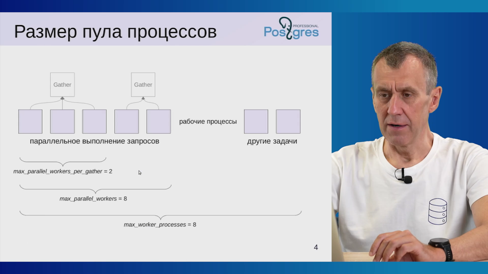

> [!quote]- Кадр [00:35:26]
> 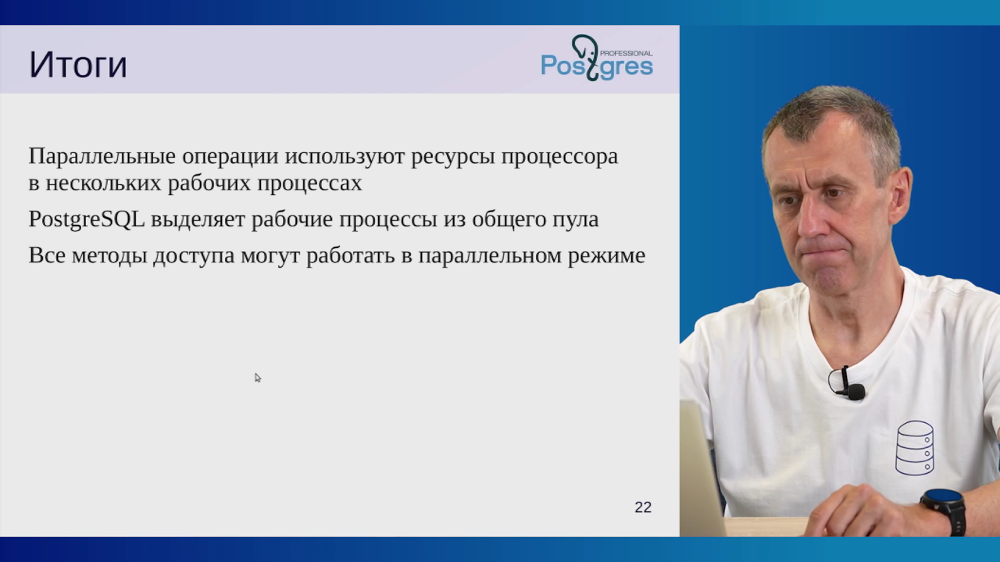

> [!quote]- Кадр [00:34:06]
> 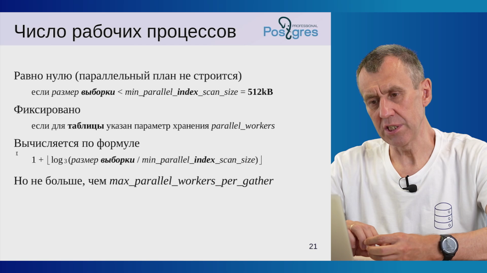

> [!quote]- Кадр [00:17:04]
> 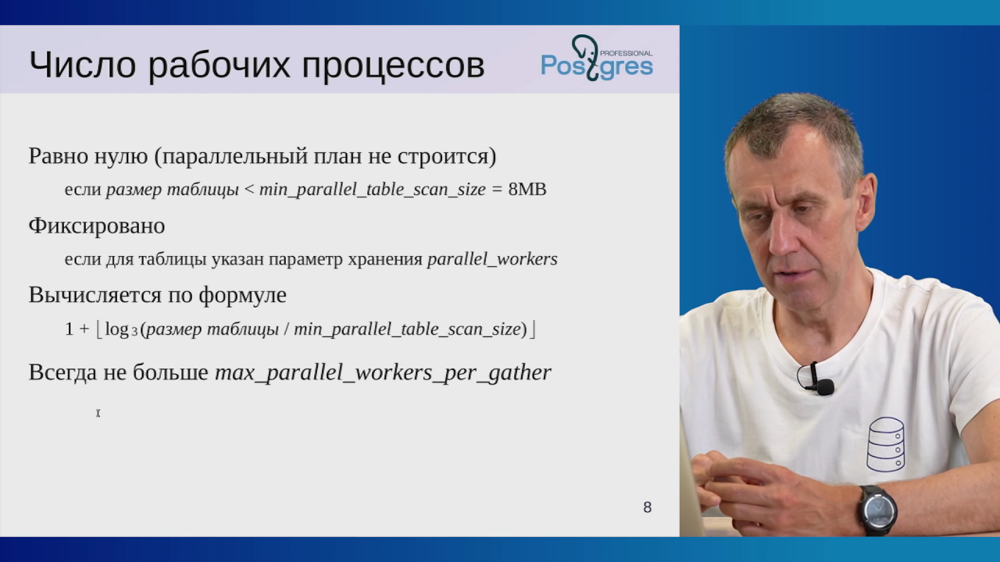


## 3. Параллельные методы доступа и их стоимость

Parallel Seq Scan — это последовательное сканирование таблицы, выполняемое параллельно: таблица делится на части, и каждый рабочий процесс сканирует свою часть; он хорошо подходит для агрегаций. Все методы доступа могут работать в параллельном режиме: Parallel Index Scan читает и индекс, и таблицу, Parallel Index Only Scan — только индекс; спуск к листовой странице индекса выполняет ведущий процесс, а листовые страницы делятся между рабочими. При Parallel Index Only Scan каждый рабочий процесс проверяет карту видимости. Битовая карта строится только ведущим процессом; после этого Bitmap Heap Scan может выполняться параллельно как Parallel Bitmap Heap Scan, и каждый процесс идёт по битовой карте и перепроверяет условия. Стоимость Parallel Seq Scan вычисляется как relpages * seq_page_cost + reltuples * cpu_tuple_cost / 2.4; стоимость индексного доступа оценивается делением страниц и строк на 4: (relpages/4)*random_page_cost + (reltuples/4)*cpu_index_tuple_cost + (reltuples/4)*cpu_operator_cost. Стоимость запуска параллельных процессов определяется параметром parallel_setup_cost, а parallel_tuple_cost минимален и им можно пренебречь; компонента ввода-вывода учитывается полностью, а ресурсы процессора делятся на 2.4, так как они работают одновременно.

```sql
>= EXPLAIN
SELECT sum(total_amount)
FROM bookings WHERE book_ref < '400000';

        QUERY PLAN
----------------
        Finalize Aggregate  (cost=16864.79..16864.80 rows=1 width=32)
          ->  Gather  (cost=16864.57..16864.78 rows=2 width=32)
                Workers Planned: 2
                ->  Partial Aggregate  (cost=15864.57..15864.58 rows=1 width=32)
                      ->  Parallel Index Scan using bookings_pkey on bookings  (cost=0.43..15314.81 rows=219906 width=6)
                            Index Cond: (book_ref < 400000::bpchar)

SELECT round(
  (relpages / 4.0) * current_setting('random_page_cost')::real +
  (reltuples / 4.0) * current_setting('cpu_index_tuple_cost')::real +
  (reltuples / 4.0) * current_setting('cpu_operator_cost')::real
 ) AS index_cost
FROM pg_class WHERE relname = 'bookings_pkey';

index_cost
----------
    9750
(1 row)

SELECT round(
   (relpages / 4.0) * current_setting('seq_page_cost')::real +
   (reltuples / 4.0) / 2.4 * current_setting('cpu_tuple_cost')::real
  ) AS table_cost
  FROM pg_class WHERE relname = 'bookings';

SELECT round(
   (relpages / 4.0) * current_setting('random_page_cost')::real +
   (reltuples / 4.0) * current_setting('cpu_index_tuple_cost')::real +
   (reltuples / 4.0) * current_setting('cpu_operator_cost')::real
  ) AS index_cost
  FROM pg_class WHERE relname = 'bookings_pkey';

index_cost
-----------
 937.56
(1 row)

>= CREATE INDEX ON bookings(total_amount);
CREATE INDEX

=> \bind '2017-07-15 18:00:00+03'

=> EXPLAIN (costs off)
   SELECT count(*) FROM bookings
   WHERE total_amount < 20000 AND book_date > $1;

>= SELECT reltuples, current_setting('cpu_operator_cost'),
       reltuples * current_setting('cpu_operator_cost')::real AS total
FROM pg_class WHERE relname = 'seats';

 reltuples | current_setting | total
-----------+-----------------+--------
      1339 | 0.0025          | 3.3474998

=> SELECT round(
       ( relpages * current_setting('seq_page_cost')::real +
         reltuples * current_setting('cpu_tuple_cost')::real / 2.4
       )::numeric,
       2
  ) AS "cost"
FROM pg_class WHERE relname = 'bookings';
 cost
------
22243.29
(1 row)

=> SELECT current_setting('parallel_setup_cost') parallel_setup_cost,
  current_setting('parallel_tuple_cost') parallel_tuple_cost;
 parallel_setup_cost | parallel_tuple_cost
---------------------+--------------------
          1000       | 0.1
(1 row)
```

| Термин | Что читает |
| Parallel Index Scan | индекс и таблицу |
| Parallel Index Only Scan | только индекс |

| Признак | Parallel Seq Scan | Parallel Index Scan |
|---|---|---|
| Что используется | последовательное сканирование таблицы | индекс по определённому условию |
| Кто выполняет | несколько процессов | несколько процессов |

*Источник: [00:05:09], [00:08:42], [00:10:48], [00:13:08], [00:13:34], [00:13:54] и др.*

> [!quote]- Кадр [00:05:09]
> 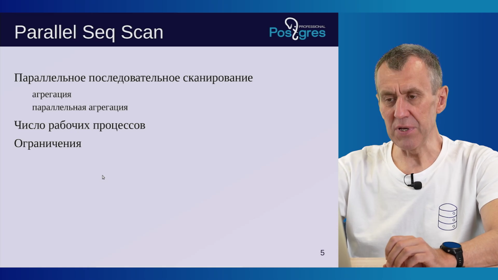


> [!quote]- Кадр [00:27:06]
> 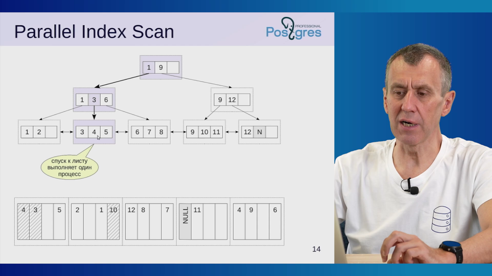


> [!quote]- Кадр [00:26:46]
> 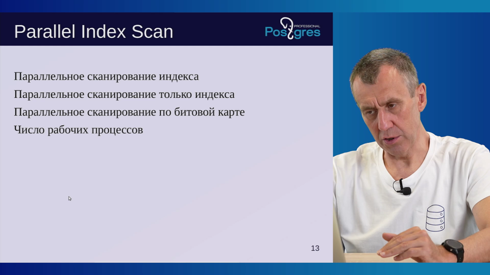

> [!quote]- Кадр [00:32:35]
> 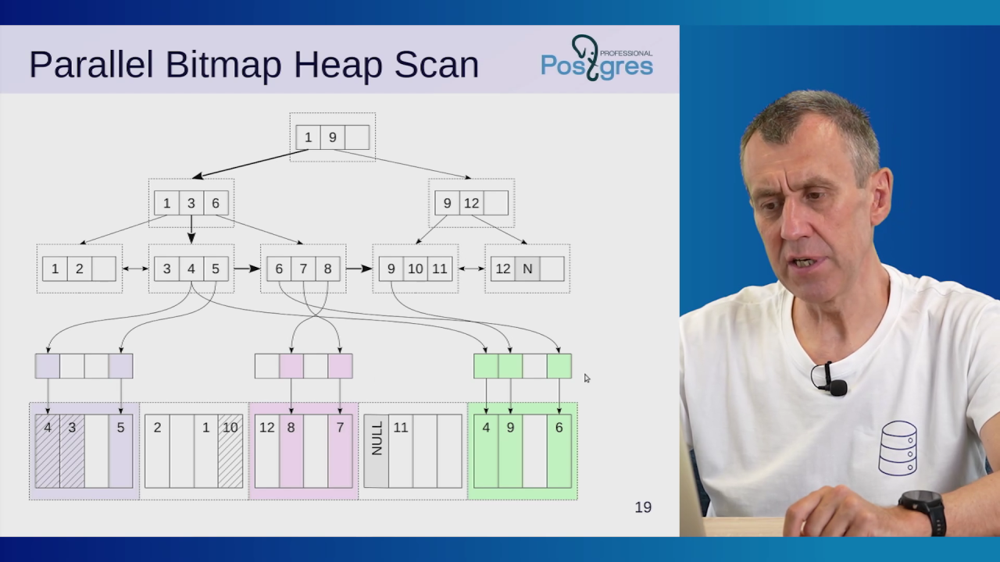

## 4. Последовательный план и нераспараллеливаемые операции

Если стоимость последовательного сканирования ниже, чем параллельного, планировщик выбирает последовательный план; для маленьких таблиц параллельный план считается невыгодным. Агрегатный узел плана не начнёт возвращать строки, пока предыдущий узел Seq Scan не выполнится полностью. Запросы на запись никогда не распараллеливаются, как и запросы на чтение с блокировкой строк; курсоры, в том числе в цикле FOR в PL/pgSQL, не распараллеливаются. Запросы с функциями PARALLEL UNSAFE не распараллеливаются; вложенные запросы внутри функций выполняются последовательно, параллельно может выполняться только запрос верхнего уровня. Обращения к временным таблицам всегда последовательны; при объединении с временной таблицей доступ к основной таблице может быть параллельным, а к временной — последовательным. Также не распараллеливаются чтение CTE, нераскрываемых подзапросов, вызовы функций PARALLEL RESTRICTED и функции с вложенными транзакциями.

```sql
>= EXPLAIN
SELECT count(*) FROM seats;

QUERY PLAN
Aggregate  (cost=24.74..24.75 rows=1 width=8)
  ->  Seq Scan on seats  (cost=0.00..21.39 rows=1339 width=0)
(2 rows)

CREATE TEMP TABLE tmp_bookings AS
   SELECT * FROM bookings;

=> EXPLAIN
SELECT count(*) FROM seats;

QUERY PLAN
Aggregate  (cost=24.74..24.75 rows=1 width=8)
  ->  Seq Scan on seats  (cost=0.00..21.39 rows=1339 width=0)
(2 rows)
```

> [!info] Зачем это нужно
> Чтобы избежать каскадного распараллеливания.

*Источник: [00:00:47], [00:07:32], [00:07:52], [00:21:17], [00:21:37], [00:22:33] и др.*


> [!quote]- Кадр [00:21:37]
> 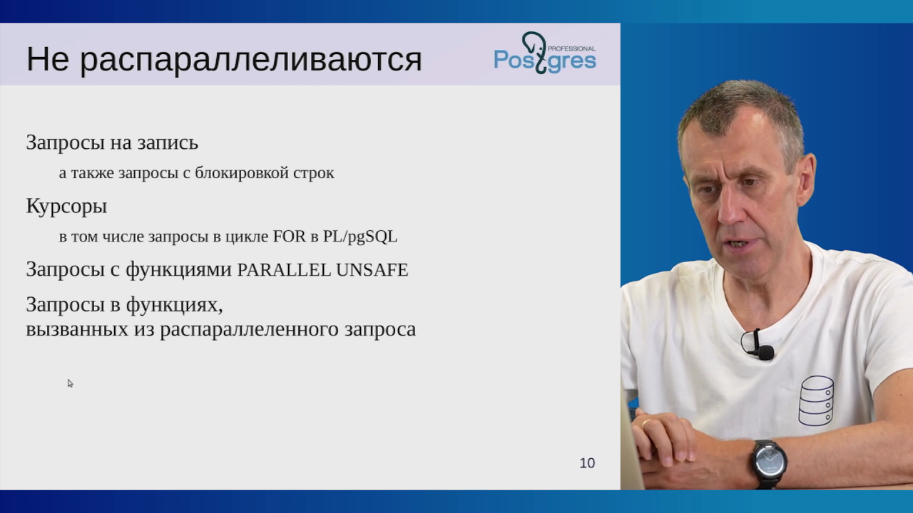

> [!quote]- Кадр [00:22:33]
> 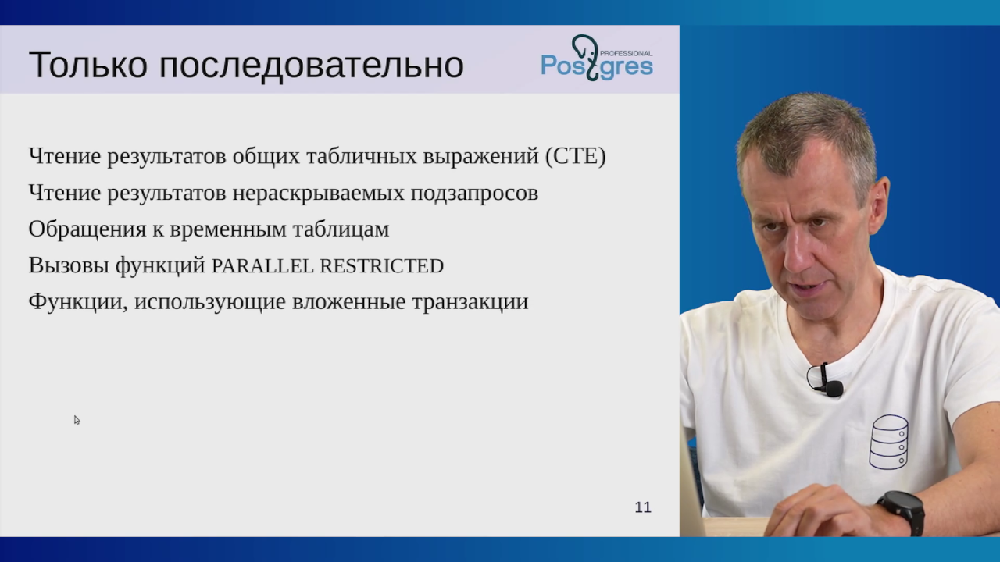

## Схема

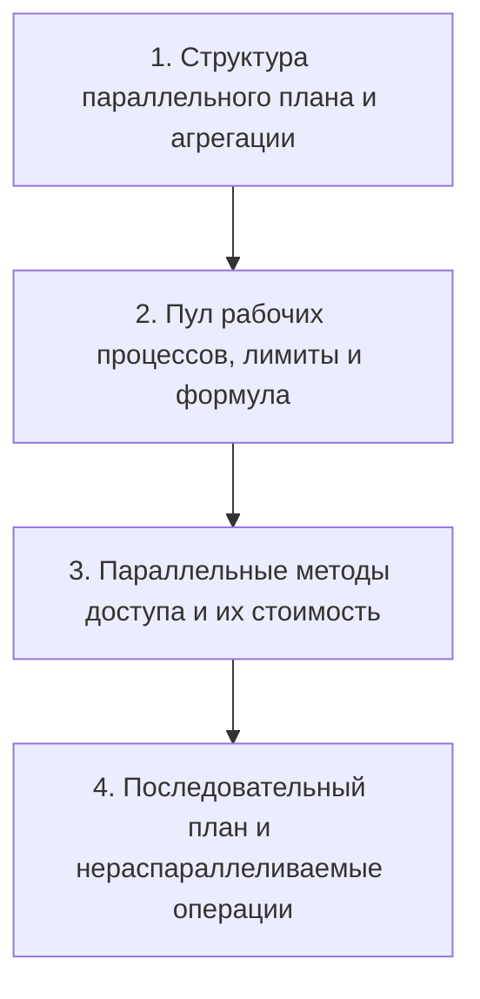

## Итог

> [!success] Что в итоге
> Параллельный план состоит из последовательной части, выполняемой ведущим процессом, и параллельной части ниже узла Gather, выполняемой рабочими процессами, число которых ограничено max_worker_processes и определяется формулой от размера таблицы. Стоимость Parallel Seq Scan вычисляется по relpages и reltuples с делением процессорной части на 2.4, отдельно учитывается стоимость запуска процессов (parallel_setup_cost); стоимость индексного доступа оценивается делением страниц и строк на 4. Когда параллельный план невыгоден — например, на маленькой таблице — планировщик выбирает последовательный план. Часть запросов и операций не распараллеливается: запись, чтение с блокировкой строк, курсоры, функции PARALLEL UNSAFE, вложенные запросы, CTE, временные таблицы и функции PARALLEL RESTRICTED.

