# Индексы в PostgreSQL: B-дерево, хэш, GiST, SP-GiST, GIN и BRIN

> [!abstract] Обзор
> Материал об индексах PostgreSQL и их применении для разных типов данных и запросов. Разбираются B-дерево как основной упорядоченный индекс, идея хэширования и хэш-индекс для поиска по равенству, а также GiST и SP-GiST для типов данных, которые нельзя отсортировать. GIN описан как инвертированный индекс для составных значений, а BRIN хранит сводную информацию по зонам блоков и потому очень мал. Отдельно рассматриваются классы операторов, методы доступа и план запроса, поиск на представлениях, расширение pg_trgm с триграммами и временное отключение последовательного сканирования.

> [!info] Курс
> [[index|Оглавление курса]]

## Оглавление
1. [[#1. B-дерево]]
2. [[#2. Хэширование и хэш-индекс]]
3. [[#3. Методы доступа, план запроса и классы операторов]]
4. [[#4. GiST]]
5. [[#5. SP-GiST]]
6. [[#6. GIN и pg_trgm]]
7. [[#7. Поиск в радиусе и индекс на представлении]]
8. [[#8. BRIN]]
9. [[#9. Отключение последовательного сканирования]]

**Схема** — [[#Схема]]
**Итог** — [[#Итог]]

## 1. B-дерево

B-дерево — тип индекса, который используется в большинстве случаев в базах данных. Он рассчитан на то, что данные могут быть отсортированы, упорядочены.

*Источник: [00:00:00]*

> [!quote]- Кадр [00:00:00]
> 

## 2. Хэширование и хэш-индекс

Идея хэширования применима к типам данных с огромным числом значений: хеш-функция сопоставляет значению целое число и распределяет строки по диапазону, а от значения берётся несколько бит, чтобы хеш-таблица была небольшого размера; элементы массива хеш-таблицы называются корзинами. В Postgres хэш-индекс — это хранимая на диске хеш-таблица для быстрого доступа; он хранит только значения хеш-функций, поэтому размер индекса не зависит от длины индексируемых значений. Хеш-функция не сохраняет отношение больше-меньше, поэтому хэш-индекс поддерживает поиск только по равенству, а при диапазонном условии планировщик возвращается к последовательному сканированию. Невозможно сканирование только индекса — приходится обращаться к таблице; хэш-индексы нельзя создавать по нескольким столбцам, они не поддерживают первичный ключ, уникальность и include-индексы. При вставке новых данных используется дополнительный бит хеш-функции, поэтому размер увеличивается скачками; хэш-индекс строит битовую карту, по которой выполняется доступ к таблице, и если используется только поиск по равенству, хэш-индекс может оказаться удачнее B-дерева, но это надо проверять.

```sql
CREATE INDEX ON t USING hash(title);
SELECT * FROM t
WHERE title = 'Abbey Road';
hash('Abbey Road') = 100010 01

>= CREATE INDEX ON seats USING hash(seat_no);

=> EXPLAIN (costs off)
SELECT * FROM seats WHERE seat_no = '31D';

------------------ QUERY PLAN ------------------
Bitmap Heap Scan on seats
  Recheck Cond: ((seat_no)::text = '31D'::text)
  ->  Bitmap Index Scan on seats_seat_no_idx
        Index Cond: ((seat_no)::text = '31D'::text)

=> EXPLAIN (costs off)
SELECT * FROM seats WHERE seat_no > '31D';

------------------ QUERY PLAN ------------------
Seq Scan on seats
  Filter: ((seat_no)::text > '31D'::text)

>= CREATE INDEX ON seats USING hash(seat_no);

=> EXPLAIN (costs off)
SELECT * FROM seats WHERE seat_no = '31D';

------------------ QUERY PLAN ------------------
Bitmap Heap Scan on seats
  Recheck Cond: ((seat_no)::text = '31D'::text)
  ->  Bitmap Index Scan on seats_seat_no_idx
        Index Cond: ((seat_no)::text = '31D'::text)

=> EXPLAIN (costs off)
SELECT * FROM seats WHERE seat_no > '31D';

------------------ QUERY PLAN ------------------
Seq Scan on seats
  Filter: ((seat_no)::text > '31D'::text)

>= CREATE INDEX ON seats USING hash(seat_no);

=> EXPLAIN (costs off)
SELECT * FROM seats WHERE seat_no = '31D';

------------------ QUERY PLAN ------------------
Bitmap Heap Scan on seats
  Recheck Cond: ((seat_no)::text = '31D'::text)
  ->  Bitmap Index Scan on seats_seat_no_idx
        Index Cond: ((seat_no)::text = '31D'::text)

=> EXPLAIN (costs off)
SELECT * FROM seats WHERE seat_no > '31D';

------------------ QUERY PLAN ------------------
Seq Scan on seats
  Filter: ((seat_no)::text > '31D'::text)

>=> CREATE INDEX ON seats USING hash(seat_no);

=> EXPLAIN (costs off)
SELECT * FROM seats WHERE seat_no = '31D';

------------------ QUERY PLAN ------------------
Bitmap Heap Scan on seats
  Recheck Cond: ((seat_no)::text = '31D'::text)
  ->  Bitmap Index Scan on seats_seat_no_idx
        Index Cond: ((seat_no)::text = '31D'::text)

=> EXPLAIN (costs off)
SELECT * FROM seats WHERE seat_no > '31D';

------------------ QUERY PLAN ------------------
Seq Scan on seats
  Filter: ((seat_no)::text > '31D'::text)

>= CREATE INDEX ON seats USING hash(seat_no);

=> EXPLAIN (costs off)
SELECT * FROM seats WHERE seat_no = '31D';

------------------ QUERY PLAN ------------------
Bitmap Heap Scan on seats
  Recheck Cond: ((seat_no)::text = '31D'::text)
  ->  Bitmap Index Scan on seats_seat_no_idx
        Index Cond: ((seat_no)::text = '31D'::text)

=> EXPLAIN (costs off)
SELECT * FROM seats WHERE seat_no > '31D';

------------------ QUERY PLAN ------------------
Seq Scan on seats
  Filter: ((seat_no)::text > '31D'::text)

CREATE INDEX ON seats USING hash(seat_no);

EXPLAIN (costs off)
SELECT * FROM seats WHERE seat_no = '31D';

 Bitmap Heap Scan on seats
   Recheck Cond: ((seat_no)::text = '31D'::text)
   ->  Bitmap Index Scan on seats_seat_no_idx
         Index Cond: ((seat_no)::text = '31D'::text)
```

> [!info] Зачем это нужно
> Если используется только поиск по равенству, хеш-индекс может оказаться удачнее B-дерева, но это надо проверять.

*Источник: [00:00:20], [00:01:20], [00:04:13], [00:04:54], [00:07:41], [00:08:23] и др.*

> [!quote]- Кадр [00:00:20]
> 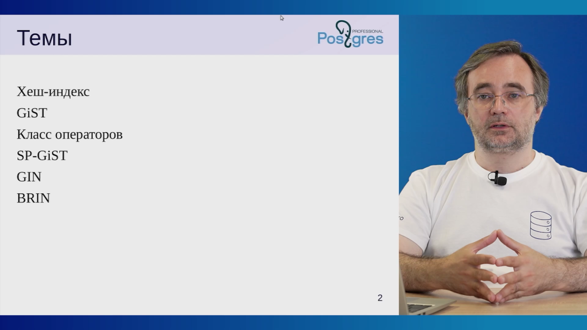

> [!quote]- Кадр [00:04:13]
> 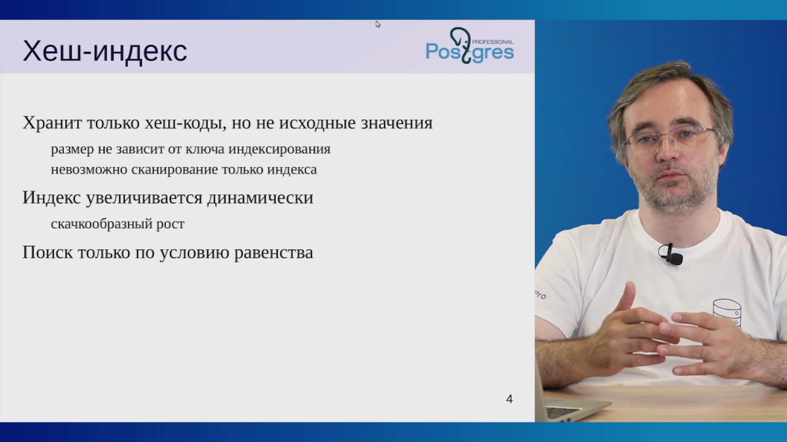

> [!quote]- Кадр [00:04:54]
> 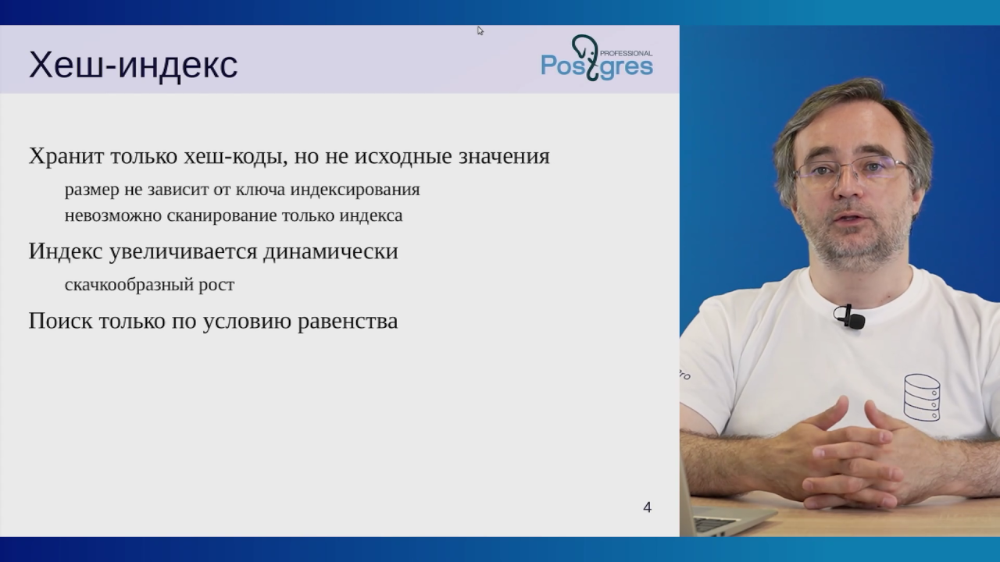

## 3. Методы доступа, план запроса и классы операторов

Из плана запроса нельзя узнать, какой тип индекса используется. Методы доступа IndexScan, Bitmap, IndexOnlyScan одинаковы для любого типа индекса: если индекс может использоваться для этого метода доступа, то сам метод доступа будет точно такой же. Класс операторов — это посредник между индексным методом и типом данных, представляющий собой набор всех операторов и, возможно, некоторых дополнительных. Классы операторов определяют, какие функции нужно вызывать, чтобы понять, что одно значение меньше другого, больше другого или равно другому; они позволяют настраивать большинство типов индексов на разные типы данных. Для одних и тех же типов данных и одного и того же индексного метода могут существовать разные классы операторов, которые реализуют разное разбиение пространства: например, на квадранты или делением плоскости пополам; в GiST значительная часть логики индексирования вынесена внутрь класса операторов: point_ops для point, box_ops для box, range_ops для anyrange, inet_ops для inet, а тип индекса берёт на себя низкоуровневые детали, такие как блокировки и журналирование.

*Источник: [00:08:03], [00:08:23], [00:18:29], [00:18:51], [00:26:22], [00:42:25]*

> [!quote]- Кадр [00:18:29]
> 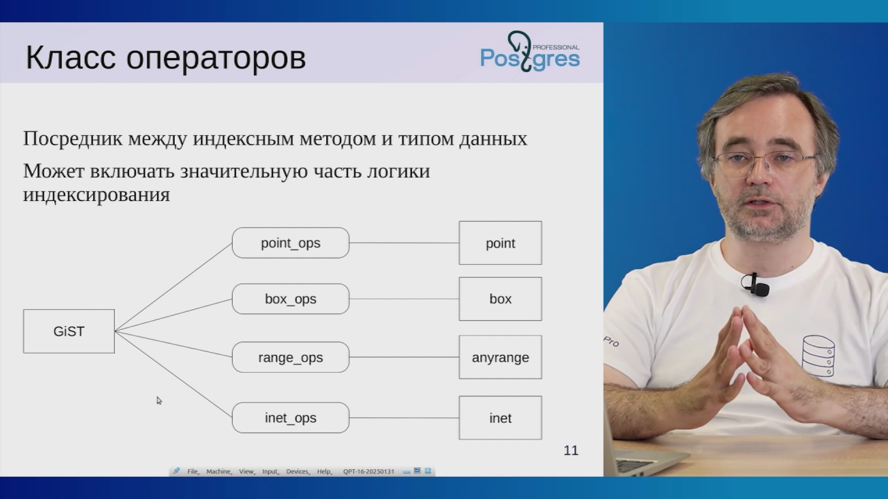

> [!quote]- Кадр [00:18:51]
> 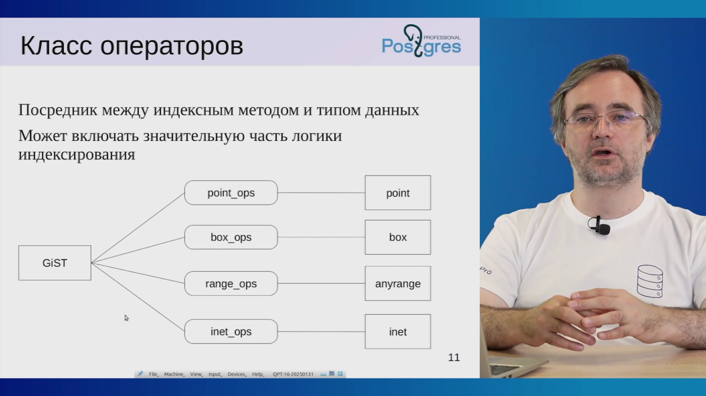

## 4. GiST

GiST — сбалансированное дерево поиска, у которого расстояние от корня до листьев одинаково во всём дереве, такое же, как и B-дерево, но оно хранит не числа или строки, а другие типы данных, рассчитано на произвольные типы данных и не требует упорядоченности. Прямоугольник в родительской вершине охватывает все прямоугольники в дочерних узлах, и при поиске нужно спускаться только в те подузлы, чьи прямоугольники пересекаются с искомой областью; прямоугольники могут пересекаться, это не страшно, но эффективность поиска может немного снижаться. Типичные поддерживаемые операции: вхождение в область, нахождение слева, справа, сверху, снизу от области, поиск ближайших соседей. В PostgreSQL по полю coordinates типа point можно создать GiST-индекс, указав USING GIST и столбец coordinates; без индекса запрос по coordinates выполняется как последовательное сканирование всей таблицы с фильтрацией.

```sql
CREATE INDEX airports_gist_idx ON airports_data
USING gist(coordinates);
```

*Источник: [00:10:18], [00:14:41], [00:16:26], [00:17:43], [00:18:09], [00:26:02] и др.*

> [!quote]- Кадр [00:10:18]
> 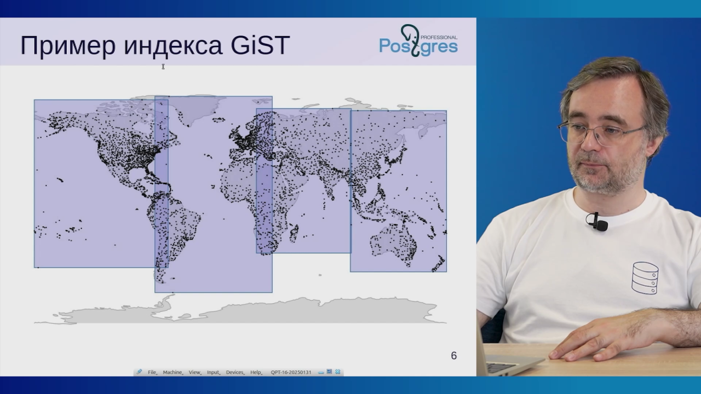

> [!quote]- Кадр [00:14:41]
> 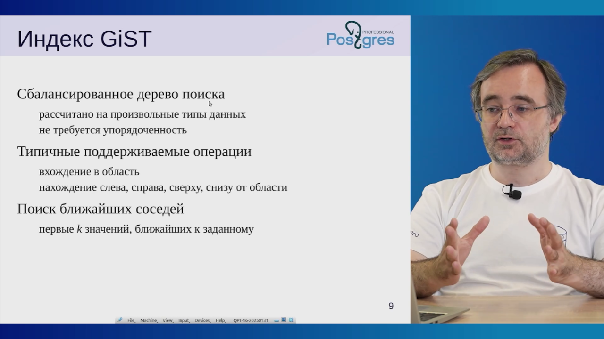

## 5. SP-GiST

SP-GiST делит пространство поиска на непересекающиеся области, тогда как в GiST прямоугольники могли пересекаться. Это несбалансированное дерево поиска, слабо ветвящееся дерево с большой глубиной, рассчитанное на произвольные типы данных: области с высокой плотностью точек дробятся сильнее. В дереве квадрантов выбирается точка, называемая центроидом, и по этой точке плоскость делится прямыми на 4 части. При создании SP-GiST-индекса после поля указывается название класса операторов; для координат можно задать класс операторов kd_point_ops, представляющий k-d дерево (k-мерное дерево), а по умолчанию используется quad_point_ops (дерево квадрантов).

```sql
CREATE INDEX airports_spgist_idx ON airports_data
USING spgist(coordinates kd_point_ops);

EXPLAIN (costs off)
SELECT airport_code
FROM airports_data
WHERE coordinates >=^ '(72.6989831542969,65.48090362548828)'::point;
QUERY PLAN
-----------------------------------------
Bitmap Heap Scan on airports_data
  Recheck Cond: (coordinates >=^ '(72.6989831542969,65.48090362548828)'::point)
  ->  Bitmap Index Scan on airports_spgist_idx
        Index Cond: (coordinates >=^ '(72.6989831542969,65.48090362548828)'::point)
```

| Свойство | GiST | SP-GiST |
|:--|:--|:--|
| Области | прямоугольники могут пересекаться | области не пересекаются |
| Балансировка | сбалансированное дерево | несбалансированное дерево |

| Класс операторов | Разбиение пространства |
|---|---|
| quad_point_ops | дерево квадрантов (по умолчанию) |
| kd_point_ops | k-d дерево |

*Источник: [00:23:39], [00:26:02], [00:26:22], [00:27:54], [00:32:43], [00:33:03]*

> [!quote]- Кадр [00:23:39]
> 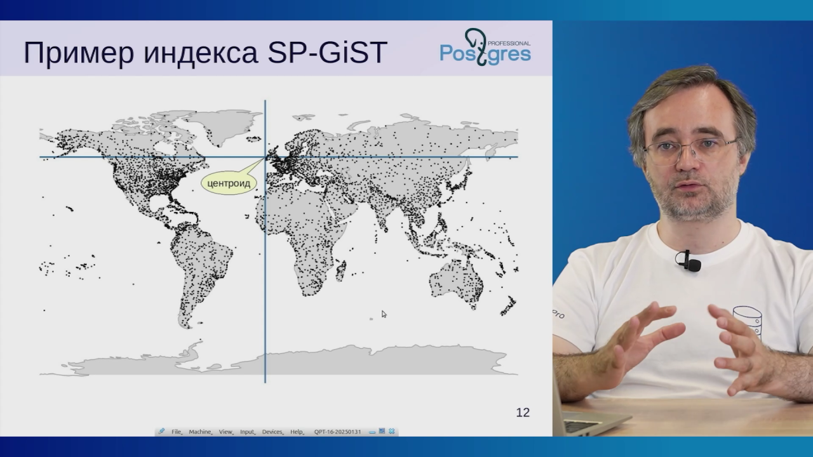

## 6. GIN и pg_trgm

GIN расшифровывается как Generalized Inverted Index (обобщённый инвертированный индекс) — это инвертированный индекс, позволяющий сопоставлять документы поисковому запросу; его идею лучше всего понять на примере предметного указателя в книге. GIN предназначен для случаев, когда индексируемые значения являются составными: индексируются элементы, а не документы. GIN поддерживает проверку соответствия документа поисковому запросу, проверку вхождения элемента в массив и поиск документов JSON по ключам или значениям; он оптимизирован для быстрой вставки множества значений. pg_trgm — это расширение, которое работает с триграммами: строка раскладывается на последовательности из трёх символов — первый, второй, третий, затем второй, третий, четвёртый и так далее. Триграммы можно уложить в GIN-индекс, который позволяет организовать неточный поиск, например поиск по словам с учётом опечатки в поисковом запросе, и ускоряет операции поиска вхождений в строку и поиск записей, в которых поле содержит последовательность цифр 1234.

```sql
CREATE INDEX routestbl_gin_idx ON routes_tbl USING gin(days_of_week);

EXPLAIN (costs off)
SELECT flight_no, departure_airport_name AS departure,
       arrival_airport_name AS arrival, days_of_week
FROM routes_tbl
WHERE days_of_week = ARRAY[3,6];

QUERY PLAN
-------------------------------------------
Bitmap Heap Scan on routes_tbl
  Recheck Cond: (days_of_week = '{3,6}'::integer[])
  ->  Bitmap Index Scan on routestbl_gin_idx
        Index Cond: (days_of_week = '{3,6}'::integer[])
(4 rows)

CREATE TABLE routes_tbl
AS SELECT * FROM routes;

CREATE INDEX routestbl_gin_idx ON routes_tbl USING gin(days_of_week);
```

*Источник: [00:27:54], [00:31:12], [00:32:23], [00:32:43], [00:33:03], [00:33:23] и др.*

> [!quote]- Кадр [00:31:12]
> 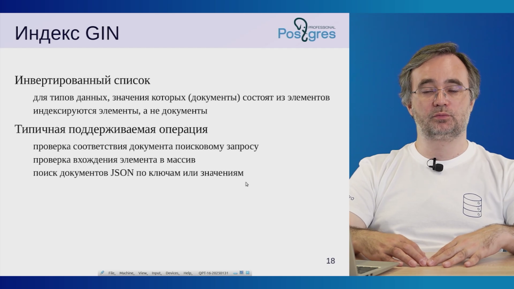

> [!quote]- Кадр [00:44:36]
> 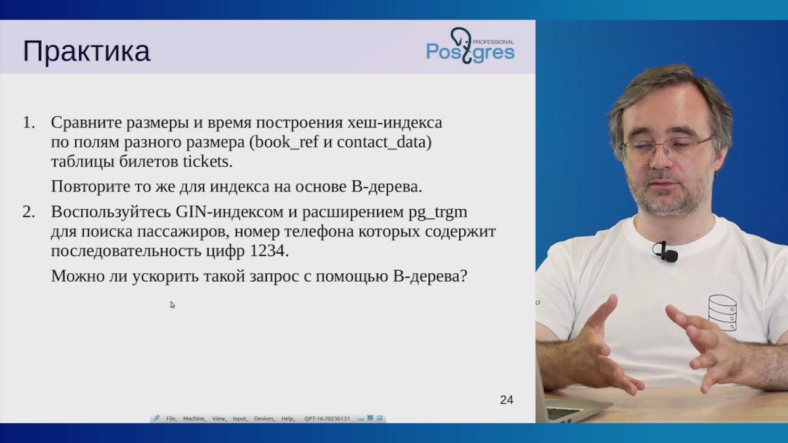

## 7. Поиск в радиусе и индекс на представлении

В таблице AirPortsData есть поле coordinates типа point, в котором хранятся координаты аэропорта. Поиск в радиусе осуществляется через <@: условие coordinates <@ '<(37.622513,55.753220),1.0>::circle' находит записи, координаты которых попадают в круг радиуса 1 вокруг заданной точки. На представлении AirPorts индекс создать нельзя, поэтому индекс нужно создать на базовой таблице AirPortsData; для этого его сохраняют в отдельной таблице: таблица создаётся как выборка из представления, после чего на ней можно создать GIN-индекс. Для таблиц размером в терабайты создание обычного индекса, например дерева, очень сложно, и индекс будет огромным.

```sql
SELECT airport_code
FROM airports_data
WHERE coordinates <@ '<(37.622513,55.753220),1.0>::circle';
```

*Источник: [00:16:26], [00:33:03]*

## 8. BRIN

BRIN — это block range index, то есть индекс зон блоков; он разбивает таблицу на зоны — непрерывные последовательности блоков, размер зоны настраивается, значение по умолчанию — 128 страниц. BRIN-индекс полагается на то, что данные записываются последовательно, поэтому значения лежат слоями; для BRIN требуется корреляция значений с физическим расположением строк. Чем больше размер зоны, тем меньше размер индекса, но падает точность; для каждой зоны вычисляется сводная информация, например минимальное и максимальное значение нужного столбца. BRIN-индекс может использоваться для диапазонных запросов, но сканирование по битовой карте всегда будет неточным (lossy).

```sql
CREATE INDEX tflights_brin_idx ON ticket_flights USING brin(flight_id);

EXPLAIN (analyze, costs off, timing off)
SELECT *
FROM ticket_flights
WHERE flight_id BETWEEN 3000 AND 4000;

QUERY PLAN
---------------------------------------------------
Gather (actual rows=46357 loops=1)
  Workers Planned: 2
  Workers Launched: 2
  ->  Parallel Bitmap Heap Scan on ticket_flights (actual rows=15452 loops=3)
        Recheck Cond: ((flight_id >= 3000) AND (flight_id <= 4000))
        Rows Removed by Index Recheck: 2377352
        ->  Bitmap Index Scan on tflights_brin_idx (actual rows=598480 loops=1)
              Index Cond: ((flight_id >= 3000) AND (flight_id <= 4000))

SELECT * FROM t WHERE temperature BETWEEN 20 AND 30;

CREATE INDEX tflights_brin_idx ON ticket_flights USING brin(flight_id);

EXPLAIN (analyze, costs off, timing off)
SELECT *
FROM ticket_flights
WHERE flight_id BETWEEN 3000 AND 4000;

QUERY PLAN
---------------------------------------------------
Gather (actual rows=46357 loops=1)
  Workers Planned: 2
  Workers Launched: 2
  ->  Parallel Bitmap Heap Scan on ticket_flights (actual rows=15452 loops=3)
        Recheck Cond: ((flight_id >= 3000) AND (flight_id <= 4000))
        Rows Removed by Index Recheck: 2377352
        ->  Bitmap Index Scan on tflights_brin_idx (actual rows=598480 loops=1)
              Index Cond: ((flight_id >= 3000) AND (flight_id <= 4000))

CREATE INDEX tflights_brin_idx ON ticket_flights USING brin(flight_id);

EXPLAIN (analyze, costs off, timing off)
SELECT *
FROM ticket_flights
WHERE flight_id BETWEEN 3000 AND 4000;
  ->  Parallel Bitmap Heap Scan on ticket_flights
        Rows Removed by Index Recheck: 2377352
        Heap Blocks: lossy=19462
        ->  Bitmap Index Scan on tflights_brin_idx

SELECT * FROM t WHERE temperature BETWEEN 20 AND 30;
```

> [!info] Зачем это нужно
> За счёт того, что индекс хранит только сводную информацию, но не хранит ссылки на версии строк, он получается очень маленький.

*Источник: [00:34:03], [00:35:13], [00:40:52], [00:41:12]*

## 9. Отключение последовательного сканирования

Для отключения последовательного сканирования используется команда SET enable_seqscan = off, и такое отключение является временным. Планировщик может выбрать Seq Scan даже при наличии индекса. Последовательное сканирование отключают, чтобы проверить работу индекса; это происходит на небольшой таблице.

```
SET enable_seqscan = off;
```

> [!info] Зачем это нужно
> Отключают, чтобы проверить работу индекса на небольшой таблице.

*Источник: [00:17:43], [00:18:09], [00:26:22]*

## Схема

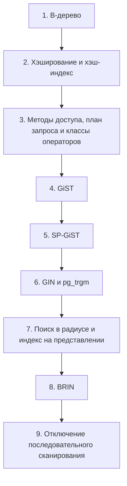

## Итог

> [!success] Что в итоге
> Материал показывает разные типы индексов PostgreSQL и их назначение: B-дерево как основной упорядоченный индекс, хэш-индекс для поиска по равенству, GiST и SP-GiST для типов данных, которые нельзя сортировать, GIN для составных значений и BRIN как очень маленький индекс по зонам блоков. Ограничения хэш-индекса вытекают из свойств хеш-функции, а GiST и SP-GiST различаются тем, что в первом прямоугольники могут пересекаться, а во втором пространство делится на непересекающиеся области. Связывает индексный метод и тип данных класс операторов, а чтобы проверить работу индекса на небольшой таблице, последовательное сканирование временно отключают через SET enable_seqscan = off. Индекс на представлении построить нельзя, поэтому данные сохраняют в отдельной таблице, а сканирование по битовой карте для BRIN неточно, что отражает EXPLAIN.

