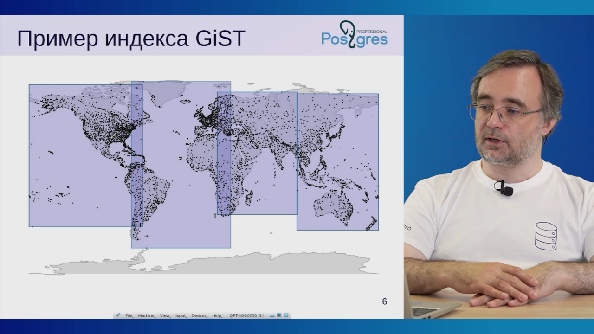
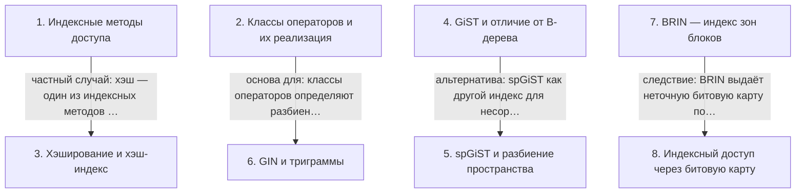

# Индексные методы доступа в PostgreSQL: GiST, GIN, BRIN и другие

> [!abstract] Обзор
> Материал об индексных методах доступа в PostgreSQL, кроме B-дерева: хэш, GiST, spGiST, GIN и BRIN. Разбираются их устройство, ограничения и применение: хэш-индекс для равенства, GiST для произвольных типов и координат, spGiST с непересекающимися областями, GIN для полнотекста, массивов и JSON, BRIN для очень больших таблиц. Отдельно рассматриваются классы операторов и их реализация, а также методы разбиения пространства — дерево квадрантов и KD Point Ops. Показано, как план запроса и планировщик взаимодействуют с индексами, и как индексный доступ идёт через битовую карту. Обсуждается невозможность индекса на представлении.

> [!info] Курс
> [[index|Оглавление курса]]

## Оглавление
1. [[#1. Индексные методы доступа]]
2. [[#2. Классы операторов и их реализация]]
3. [[#3. Хэширование и хэш-индекс]]
4. [[#4. GiST и отличие от B-дерева]]
5. [[#5. spGiST и разбиение пространства]]
6. [[#6. GIN и триграммы]]
7. [[#7. BRIN — индекс зон блоков]]
8. [[#8. Индексный доступ через битовую карту]]
9. [[#9. План запроса и планировщик]]
10. [[#10. Индекс на представлении]]

**Схема** — [[#Схема]]
**Итог** — [[#Итог]]

## 1. Индексные методы доступа

Кроме B-дерева в PostgreSQL есть другие типы индексов — индексные методы доступа: хэш, GiST, spGiST, GIN и BRIN. PostgreSQL позволяет добавить новый тип данных на лету, без перезагрузки сервера.

*Источник: [00:00:00]*

> [!quote]- Кадр [00:00:00]
> 

## 2. Классы операторов и их реализация

Класс операторов — это набор всех операторов и, возможно, вспомогательных функций, которые нужны индексному методу для работы с конкретным типом данных. Для одних и тех же типов данных и одного индексного метода могут быть разные классы операторов, реализующие разную логику разбиения пространства поиска; класс операторов определяет, как обрабатывается поисковый запрос. Для разных типов индексов есть разные классы операторов: для точек — PointOps, для прямоугольников — box ops, для диапазонов — range ops; типичная операция — проверка документа поисковому запросу: для полнотекста это набор слов, для массивов — элемент массива. Реализовать класс операторов для индексного метода гораздо проще, чем написать индексный метод с нуля: нужно программировать на языке C, но достаточно реализовать уже продуманный API и несколько функций с понятной логикой. При этом не нужно понимать всю магию системного программирования: обход дерева и расщепление узла уже реализованы, а вам нужно реализовать только набор понятных логических действий.

*Источник: [00:10:00]*

> [!quote]- Кадр [00:10:00]
> 

## 3. Хэширование и хэш-индекс

Типы данных теоретически могут состоять из огромного количества значений, но в конкретной таблице в конкретном столбце значений обычно ограниченное количество. Функция хэширования берёт значение, например строку, и сопоставляет ей целое число, распределяя все возможные строки более или менее равномерно по диапазону целых чисел. Хэш-индекс — это хэш-таблица, которая хранится на диске; она хранит только значения хэш-функций, но не сами исходные значения. Поиск возможен только по условию равенства, индекс нельзя создавать по нескольким столбцам, он не поддерживает первичный ключ и уникальность, и с ним нельзя делать include-индексы. Размер хэш-индекса небольшой и не зависит от длины индексируемых значений, но так как исходные значения в индексе не хранятся, использовать только индексное сканирование нельзя; для создания хэш-индекса нужно указать USING hash.

*Источник: [00:01:00]*

> [!quote]- Кадр [00:01:00]
> 

## 4. GiST и отличие от B-дерева

B-дерево рассчитано на то, что данные можно отсортировать и упорядочить, а точки упорядочить нельзя, так как непонятно, что значит одна точка меньше другой. GiST — обобщённое дерево поиска, рассчитанное на произвольные типы данных и не требующее упорядоченности; за счёт этого он поддерживает операции, имеющие смысл для этих типов (например, вхождение в область для точек), и является сбалансированным деревом, где расстояние от корня до листьев одинаковое, а положение значения определяется правилом: прямоугольник в родительской вершине охватывает все прямоугольники в дочерних узлах. GiST-индекс позволяет ускорять поиск вхождений в строку, например с помощью LIKE с шаблоном '%...%', чего B-дерево не может, и предоставляет возможность поиска ближайших соседей. Задачу поиска ближайших соседей можно свести к поиску внутри области, но неясно, какого размера область брать. Для условия вхождения координаты в область (например, в круг вокруг центра Москвы) индекс создаётся с помощью USING GiST на поле coordinates; в примере он строится по полю coordinates типа point в таблице AirPortsData.

*Источник: [00:01:00], [00:10:00]*

## 5. spGiST и разбиение пространства

spGiST делит пространство поиска на непересекающиеся области, тогда как в GiST прямоугольники могли пересекаться; SP-GiST — слабоветвящееся дерево: в каждом узле не больше 4 дочерних узлов, из-за чего дерево получается глубоким и несбалансированным. По функционалу индексы SP-GiST и GiST похожи, но по внутреннему устройству отличаются; SP-GiST поддерживает вхождение в область, нахождение слева-справа и поиск ближайших соседей, а для создания индекса указывается USING spgist, после чего подписывается название класса операторов. Один из способов разбиения — дерево квадрантов: плоскость делится прямыми на 4 части, выбирается центроид, затем каждый прямоугольник делится на 4 части соответствующими центроидами, а густо засеянные точками области дробятся больше. Такое дерево получается несбалансированным: расстояние от корня до листьев разное. Класс операторов KD Point Ops реализует разбиение плоскости пополам: сначала по горизонтали, затем по вертикали, далее чередует горизонталь и вертикаль.

| Свойство | GiST | SP-GiST |
|---|---|---|
| Области | могут пересекаться | непересекающиеся |
| Дочерние узлы | — | не больше 4 |
| Сбалансированность | сбалансированное | глубокое и несбалансированное |

*Источник: [00:10:00]*

## 6. GIN и триграммы

GIN — это Generalized Inverted Index, то есть инвертированный индекс; его идею лучше всего понять на примере предметного указателя в книге. GIN-индекс индексирует не сами документы, а слова, которые в них входят, что типично для полнотекстового поиска; он представляет собой B-дерево, к которому могут подвешиваться дополнительные B-деревья для часто встречающихся слов, а ссылки на редко встречающиеся слова хранятся внутри индексной страницы. GIN оптимизирован для быстрой вставки множества значений, например при добавлении документа с множеством слов, что вызывает массированное обновление индекса. GIN может использоваться не только для полнотекстового поиска, но и для составных значений: с его помощью можно быстро находить массивы, содержащие нужный элемент, и JSON-документы с нужными ключами или значениями; классы операторов GIN определяют, каким образом документ разбивается на отдельные слова. Строка разбивается на триграммы — последовательности из трёх символов (первый, второй, третий; второй, третий, четвёртый и так далее), которые можно уложить в GIN-индекс, что позволяет организовать неточный поиск, например с учётом опечаток в поисковом запросе.

*Источник: [00:10:00]*

## 7. BRIN — индекс зон блоков

BRIN (block range index) — это индекс зон блоков. Он разбивает таблицу на зоны — непрерывные последовательности блоков, размер зоны настраивается (по умолчанию 128 страниц), — и для каждой зоны вычисляется сводная информация, например минимальное и максимальное значение нужного столбца. Чем больше размер зоны, тем меньше размер индекса, но точность падает; можно найти баланс между размером и точностью. BRIN выдаёт неточную битовую карту по всем страницам, которые входят в нужные зоны, далее страницы просматриваются подряд и данные фильтруются; он требует корреляции значений с физическим расположением строк и рассчитан на хранилище, куда данные только добавляются. BRIN имеет смысл применять для очень больших таблиц, когда создание обычного индекса накладно.

*Источник: [00:10:00]*

## 8. Индексный доступ через битовую карту

Индексный доступ выполняется через битовую карту: строится битовая карта по индексу, после чего идёт обращение к таблице. Пример условия — отбор рейсов, отправляющихся по средам и субботам. При использовании GiST сканирование всегда выполняется по неточной битовой карте (lossy) и требует проверки большого количества строк.

*Источник: [00:10:00]*

## 9. План запроса и планировщик

Из плана запроса нельзя узнать, какой тип индекса используется; в плане просто указан индекс. IndexScan, Bitmap IndexScan и IndexOnlyScan работают одинаково с любым типом индекса, и знания о них применимы к любому индексу. На таблице около 100 аэропортов планировщик не будет использовать созданный индекс, потому что последовательное сканирование всей таблицы быстрее. Чтобы проверить работу индекса, можно отключить последовательное сканирование.

*Источник: [00:01:00], [00:10:00]*

## 10. Индекс на представлении

На представлении индекс создать нельзя.

*Источник: [00:10:00]*

## Схема

## Итог

> [!success] Что в итоге
> Кроме B-дерева в PostgreSQL есть другие индексные методы доступа, включая хэш, GiST, spGiST, GIN и BRIN. Хэш-индекс хранит только хэши и работает по равенству; GiST не требует упорядоченности и подходит для произвольных типов; spGiST делит пространство на непересекающиеся области. GIN обслуживает полнотекстовый поиск и составные значения, триграммы в GIN дают неточный поиск с опечатками, а BRIN применяют для очень больших таблиц. Классы операторов настраивают индексный метод на тип данных, а индексный доступ выполняется через битовую карту.

