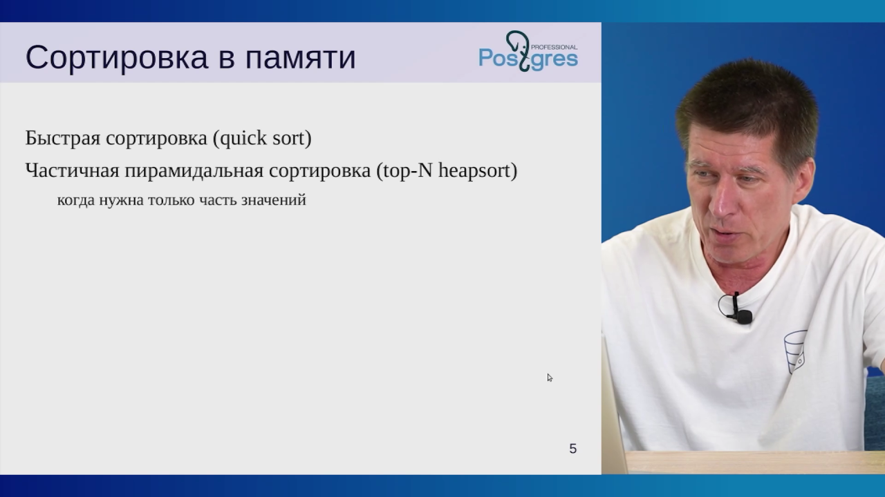
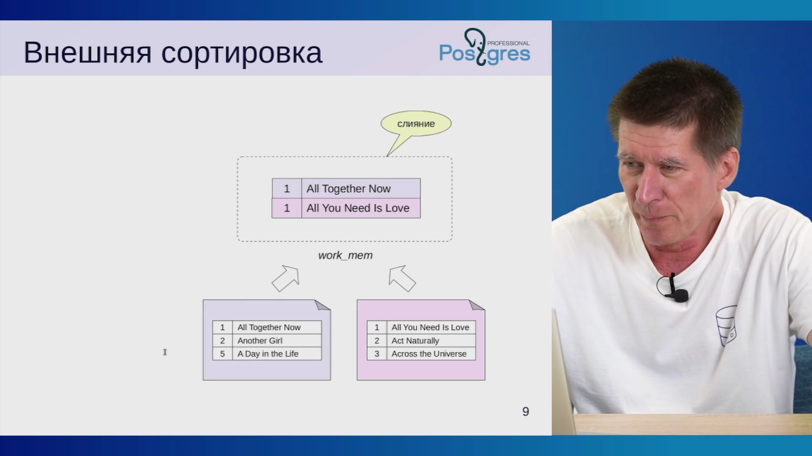
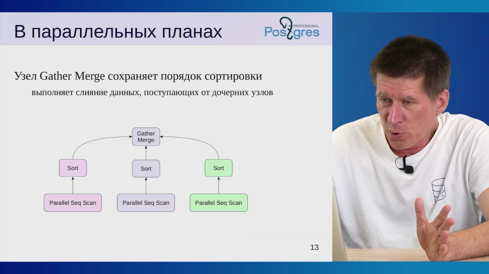
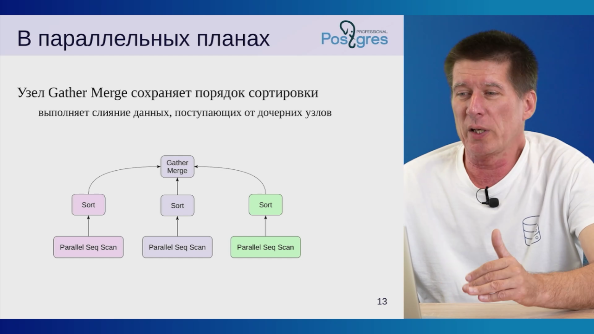
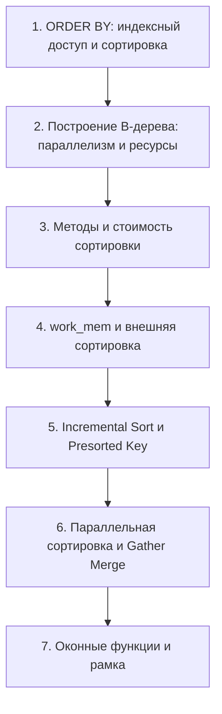

# Сортировка, оконные функции и параллельные планы в PostgreSQL

> [!abstract] Обзор
> Материал о том, как PostgreSQL выполняет сортировку при ORDER BY и как это отражается в планах запросов. Разбираются индексный доступ через B-дерево, который сразу отдаёт отсортированный набор, сортировка в памяти (quicksort и частичная top-N heapsort) и внешняя сортировка с временными файлами и слиянием, включая работу параллельных воркеров и узел Gather Merge. Показано, что даёт EXPLAIN analyze для узла Sort, как работают параметры work_mem и temp_file_limit. Отдельно рассматриваются инкрементальная сортировка (Incremental Sort) с разбиением на группы, а также оконные функции: описание окна через OVER, рамка ROWS BETWEEN и вычисление в узле WindowAgg над узлом Sort.

> [!info] Курс
> [[index|Оглавление курса]]

## Оглавление
1. [[#1. ORDER BY: индексный доступ и сортировка]]
2. [[#2. Построение B-дерева: параллелизм и ресурсы]]
3. [[#3. Методы и стоимость сортировки]]
4. [[#4. work_mem и внешняя сортировка]]
5. [[#5. Incremental Sort и Presorted Key]]
6. [[#6. Параллельная сортировка и Gather Merge]]
7. [[#7. Оконные функции и рамка]]

**Схема** — [[#Схема]]
**Итог** — [[#Итог]]

## 1. ORDER BY: индексный доступ и сортировка

Индексный доступ через B-дерево возвращает строки уже отсортированными, поэтому для ORDER BY по индексированному столбцу (например, flight_id — первичный ключ) PostgreSQL использует Index Scan и отдельная сортировка не нужна. Если ORDER BY идёт по неиндексированному столбцу (например, status), план выполняет Seq Scan, а затем узел Sort с ключом в строке Sort Key. Индекс B-дерева строится так: строки сортируются, собираются в листовые страницы, ссылки на них — в страницы следующего уровня и так до корня. Для первой сортировки по book_ref используется B-дерево.

```sql
>= EXPLAIN (costs off)
SELECT * FROM flights
ORDER BY flight_id;
-----------------------------
         QUERY PLAN
-----------------------------
 Index Scan using flights_pkey on flights
(1 row)

Sort
  Sort Key: status
  ->  Seq Scan on flights

EXPLAIN SELECT *,
    sum(total_amount) OVER (ORDER BY book_date),
    count(*) OVER (ORDER BY book_ref)
  FROM bookings;
```

*Источник: [00:00:48], [00:01:38], [00:02:28], [00:16:45], [00:22:52], [00:23:12] и др.*

> [!quote]- Кадр [00:00:48]
> 

## 2. Построение B-дерева: параллелизм и ресурсы

Сортировка применяется не только в запросах, но и при построении B-деревьев. Построение B-дерева может выполняться параллельно: количество процессов ограничено параметром max_parallel_maintenance_workers, а память — maintenance_work_mem. Проверить, использовался ли при построении индекса временный файл, можно по журналу сообщений. Операция нечастая и служебная.

```sql
=> EXPLAIN (analyze, buffers, timing off, summary off)
SELECT *, count(*) OVER (ORDER BY seat_no)
FROM seats;

             QUERY PLAN
--------------------------------------------
 WindowAgg
   ->  Sort
         Sort Key: seat_no
         Sort Method: quicksort  Memory: 101kB
         ->  Seq Scan on seats
```

*Источник: [00:17:35], [00:25:32], [00:26:22]*

> [!quote]- Кадр [00:25:32]
> 

> [!quote]- Кадр [00:17:35]
> 

## 3. Методы и стоимость сортировки

EXPLAIN analyze для узла Sort показывает метод и объём оперативной памяти. Для полной сортировки небольших наборов используется quicksort; его сложность O(m log m), где m — число строк, а начальная стоимость узла Sort высокая, потому что нужно отсортировать весь набор перед выдачей. При LIMIT планировщик может выбрать частичную пирамидальную сортировку top-N heapsort: в плане появляются Limit и Sort Method: top-N heapsort, стоимость и память ниже, чем при полной сортировке. Сложность top-N heapsort — O(M log N), где M — число строк в исходном наборе, N — количество первых строк.

```sql
Sort  (cost=90.93..94.28 rows=1339 width=15) (actual rows=1339 loops=1)
  Sort Key: seat_no
  Sort Method: quicksort  Memory: 101kB
  ->  Seq Scan on seats  (cost=0.00..21.39 rows=1339 width=15) (actual rows=1339 loops=1)

>= EXPLAIN (analyze, timing off, summary off)
SELECT *
FROM seats
ORDER BY seat_no;

QUERY PLAN

Limit  (cost=72.57..72.82 rows=100 width=15) (actual rows=100 loops=1)
  ->  Sort  (cost=72.57..75.91 rows=1339 width=15) (actual rows=100 loops=1)
        Sort Key: seat_no
        Sort Method: top-N heapsort  Memory: 32kB
        ->  Seq Scan on seats  (cost=0.00..21.39 rows=1339 width=15) (actual rows=1339 loops=1)

>= EXPLAIN (analyze, buffers, timing off, summary off)
SELECT *
FROM flights
ORDER BY scheduled_departure;
```

> [!info] Зачем это нужно
> Причина высокой стоимости в том, что для выдачи данных нужно отсортировать набор строк полностью.

*Источник: [00:02:48], [00:03:08], [00:03:28], [00:04:48], [00:07:52], [00:16:45]*

> [!quote]- Кадр [00:02:48]
> 

## 4. work_mem и внешняя сортировка

Для узла Sort память выделяется в объёме work_mem; параметр work_mem можно задать через SET work_mem и сбросить через RESET work_mem. Если набор не помещается в память, включается внешняя сортировка: сначала в памяти сортируется столько строк, сколько позволяет work_mem (quicksort), затем отсортированные наборы сбрасываются во временные файлы; файлы попарно сливаются, и при необходимости результат снова сбрасывается во временный файл, пока не получится итоговый порядок. Увеличение work_mem до '40MB' позволяет поместить все строки в память, планировщик выбирает quicksort вместо external merge, стоимость снижается, исчезают чтение и запись временных данных (temp read and written). Общий объём временных файлов в пределах сеанса ограничивается параметром temp_file_limit. С опцией Buffers в разделе Temp видно, сколько страниц временных файлов прочитано и записано, а также сколько места на диске потребовалось (например, 17112 килобайт).

```sql
>= SET work_mem = '40MB';

SET

=> EXPLAIN (analyze, buffers, timing off, summary off)
SELECT *
FROM flights
ORDER BY scheduled_departure;

               QUERY PLAN
-------------------------------------------------
 Sort  (cost=23802.46..24339.62 rows=214867 width=63) (actual rows=214867 loops=1)
   Sort Key: scheduled_departure
   Sort Method: quicksort  Memory: 26161kB
   Buffers: shared hit=2624
   ->  Seq Scan on flights  (cost=0.00..4772.67 rows=214867 width=63) (actual rows=214867 loops=1)
     Buffers: shared read=2624
(6 rows)

=> EXPLAIN (analyze, buffers, timing off, summary off)
SELECT *, sum(total_amount) OVER (ORDER BY book_date)
FROM bookings;

             QUERY PLAN
--------------------------------------------
 WindowAgg
   ->  Sort
         Sort Key: book_date
         Sort Method: external merge  Disk: 65984kB
         ->  Seq Scan on bookings

=> SET work_mem = '40MB';

SET

=> EXPLAIN (analyze, buffers, timing off, summary off)
SELECT *
FROM flights
ORDER BY scheduled_departure;

               QUERY PLAN
-------------------------------------------------
 Sort  (cost=23802.46..24339.62 rows=214867 width=63) (actual rows=214867 loops=1)
   Sort Key: scheduled_departure
   Sort Method: quicksort  Memory: 26161kB
   Buffers: shared hit=2624
   ->  Seq Scan on flights  (cost=0.00..4772.67 rows=214867 width=63) (actual rows=214867 loops=1)
     Buffers: shared read=2624
(6 rows)

SET work_mem = '40MB';

EXPLAIN (analyze, buffers, timing off, summary off)
SELECT *
FROM flights
ORDER BY scheduled_departure;

   Sort Method: quicksort  Memory: 26161kB

RESET work_mem;

=> SET work_mem = '40MB';

SET

=> EXPLAIN (analyze, buffers, timing off, summary off)
SELECT *
FROM flights
ORDER BY scheduled_departure;

               QUERY PLAN
-------------------------------------------------
 Sort  (cost=23802.46..24339.62 rows=214867 width=63) (actual rows=214867 loops=1)
   Sort Key: scheduled_departure
   Sort Method: quicksort  Memory: 26161kB
   Buffers: shared hit=2624
   ->  Seq Scan on flights  (cost=0.00..4772.67 rows=214867 width=63) (actual rows=214867 loops=1)
     Buffers: shared read=2624
(6 rows)

=> SET work_mem = '40MB';

SET

=> EXPLAIN (analyze, buffers, timing off, summary off)
SELECT *
FROM flights
ORDER BY scheduled_departure;

               QUERY PLAN
-------------------------------------------------
 Sort  (cost=23802.46..24339.62 rows=214867 width=63) (actual rows=214867 loops=1)
   Sort Key: scheduled_departure
   Sort Method: quicksort  Memory: 26161kB

=> SET work_mem = '40MB';
SET
=> EXPLAIN (analyze, buffers, timing off, summary off)
SELECT *
FROM flights
ORDER BY scheduled_departure;
QUERY PLAN
-------------------------------------------------------------
Sort  (cost=23802.46..24339.62 rows=214867 width=63) (actual rows=214867 loops=1)
  Sort Key: scheduled_departure
  Sort Method: quicksort  Memory: 26161kB
  Buffers: shared hit=2624
  ->  Seq Scan on flights  (cost=0.00..4772.67 rows=214867 width=63) (actual rows=214867 loops=1)
    Buffers: shared read=2624
(6 rows)

=> SET work_mem = '40MB';

SET

=> EXPLAIN (analyze, buffers, timing off, summary off)
SELECT *
FROM flights
ORDER BY scheduled_departure;

QUERY PLAN
--------------------------------------------------
Sort  (cost=23802.46..24339.62 rows=214867 width=63) (actual rows=214867 loops=1)
  Sort Key: scheduled_departure
  Sort Method: quicksort  Memory: 26161kB
  Buffers: shared hit=2624

=> EXPLAIN (analyze, buffers, timing off, summary off)
SELECT *, sum(total_amount) OVER (ORDER BY book_date)
FROM bookings;

             QUERY PLAN
--------------------------------------------
 WindowAgg
   ->  Sort
         Sort Key: book_date
         Sort Method: external merge  Disk: 65984kB
         ->  Seq Scan on bookings
```

*Источник: [00:04:48], [00:05:38], [00:06:28], [00:06:51], [00:07:52], [00:08:12] и др.*

> [!quote]- Кадр [00:05:38]
> 

> [!quote]- Кадр [00:14:32]
> 

> [!quote]- Кадр [00:06:51]
> 

> [!quote]- Кадр [00:06:28]
> 

## 5. Incremental Sort и Presorted Key

Инкрементальная сортировка может использовать как сортировку в памяти, так и внешнюю сортировку. Если набор данных уже отсортирован по столбцу (Presorted Key: total_amount), а запрос требует сортировки по двум столбцам, алгоритм инкрементальной сортировки может рассчитывать на то, что набор частично отсортирован: Postgres использует уже отсортированные группы и внутри каждой группы досортировывает строки по оставшимся столбцам. Строки разбиваются на группы по значениям столбца, по которому сортировка уже выполнена; в зависимости от размеров групп выбирается одна из двух стратегий: Pre-sorted Groups или Full-sort Groups, что видно в плане запроса вместе со средней и пиковой памятью. Если группы очень мелкие, досортировка внутри групп оказывается невыгодной — тогда группы выгоднее объединить и выполнить обычную сортировку по всем столбцам. Для иллюстрации создаётся индекс на bookings(total_amount), благодаря которому через индексный доступ можно получить набор, уже отсортированный по total_amount; в одном случае Full-sort Groups оказалось 2823, и во всех случаях эти наборы поместились в память.

```sql
>= CREATE INDEX ON bookings(total_amount);
  CREATE INDEX
=> EXPLAIN (analyze, costs off, timing off, summary off)
SELECT *
FROM bookings
ORDER BY total_amount, book_date;
                        QUERY PLAN
---------------------------------------------------------------------
 Incremental Sort (actual rows=2111110 loops=1)
   Sort Key: total_amount, book_date
   Presorted Key: total_amount
   Full-sort Groups: 2823  Sort Method: quicksort  Average Memory: 28kB  Peak Memory: 28kB
   Pre-sorted Groups: 2624  Sort Method: quicksort  Average Memory: 2193kB  Peak Memory: 2263kB
   ->  Index Scan using bookings_total_amount_idx on bookings (actual rows=2111110 loops=1)
(6 rows)

=> CREATE INDEX ON bookings(total_amount);
  CREATE INDEX
=> EXPLAIN (analyze, costs off, timing off, summary off)
SELECT *
FROM bookings
ORDER BY total_amount, book_date;
                        QUERY PLAN
---------------------------------------------------------------------
 Incremental Sort (actual rows=2111110 loops=1)
   Sort Key: total_amount, book_date
   Presorted Key: total_amount
   Full-sort Groups: 2823  Sort Method: quicksort  Average Memory: 28kB  Peak Memory: 28kB
   Pre-sorted Groups: 2624  Sort Method: quicksort  Average Memory: 2193kB  Peak Memory: 2263kB
   ->  Index Scan using bookings_total_amount_idx on bookings (actual rows=2111110 loops=1)
(6 rows)

CREATE INDEX ON bookings(total_amount);
EXPLAIN (analyze, costs off, timing off, summary off)
SELECT *
FROM bookings
ORDER BY total_amount, book_date;
                        QUERY PLAN
---------------------------------------------------------------------
 Incremental Sort (actual rows=2111110 loops=1)
   Sort Key: total_amount, book_date
   Presorted Key: total_amount
   Full-sort Groups: 2823  Sort Method: quicksort  Average Memory: 28kB  Peak Memory: 28kB
   Pre-sorted Groups: 2624  Sort Method: quicksort  Average Memory: 2193kB  Peak Memory: 2263kB
   ->  Index Scan using bookings_total_amount_idx on bookings (actual rows=2111110 loops=1)

CREATE INDEX ON bookings(total_amount);

EXPLAIN (analyze, costs off, timing off, summary off)
SELECT *
FROM bookings
ORDER BY total_amount, book_date;

 Incremental Sort (actual rows=2111110 loops=1)
   Sort Key: total_amount, book_date
   Presorted Key: total_amount
   ->  Index Scan using bookings_total_amount_idx on bookings
```

*Источник: [00:09:36], [00:11:21], [00:11:42], [00:12:02], [00:14:32]*

> [!quote]- Кадр [00:09:36]
> 


## 6. Параллельная сортировка и Gather Merge

Если ключ сортировки не входит ни в один индекс, запрос сортировки большой таблицы может выполняться параллельно: каждый процесс сортирует свой набор данных. Узел Gather Merge выполняет слияние данных от дочерних узлов и сохраняет порядок сортировки; в параллельных планах он используется вместо узла Gather. Узел запрашивает у процессов очередную строку, выбирая тот процесс, у которого по предположению строка должна быть следующей. Воркеры использовали внешнюю сортировку, записывая временные файлы на диск: Worker 0 — около 23 МБ, Worker 1 — немного меньше; в плане это отражается как Sort Method: external merge Disk. EXPLAIN ANALYZE показывает запланированные и фактически запущенные рабочие процессы.

```sql
>= RESET work_mem;
    => EXPLAIN (analyze, costs off, timing off, summary off)
    SELECT *
    FROM bookings
    ORDER BY book date;

                    QUERY PLAN
----------------------------------------------------------
Gather Merge (actual rows=2111110 loops=1)
  Workers Planned: 2
  Workers Launched: 2
  -> Sort (actual rows=703703 loops=3)
        Sort Key: book_date
        Sort Method: external merge  Disk: 21840kB
        Worker 0:  Sort Method: external merge  Disk: 23488kB
        Worker 1:  Sort Method: external merge  Disk: 22904kB
        ->  Parallel Seq Scan on bookings (actual rows=703703 loops=3)
(9 rows)

=> RESET work_mem;
    => EXPLAIN (analyze, costs off, timing off, summary off)
    SELECT *
    FROM bookings
    ORDER BY book date;

                    QUERY PLAN
----------------------------------------------------------
Gather Merge (actual rows=2111110 loops=1)
  Workers Planned: 2
  Workers Launched: 2
  -> Sort (actual rows=703703 loops=3)
        Sort Key: book_date
        Sort Method: external merge  Disk: 21840kB
        Worker 0:  Sort Method: external merge  Disk: 23488kB
        Worker 1:  Sort Method: external merge  Disk: 22904kB
        ->  Parallel Seq Scan on bookings (actual rows=703703 loops=3)
(9 rows)

    => EXPLAIN SELECT *, sum(total_amount) OVER (ORDER BY book date)
    FROM bookings;

=> RESET work_mem;
    => EXPLAIN (analyze, costs off, timing off, summary off)
    SELECT *
    FROM bookings
    ORDER BY book date;

                    QUERY PLAN
----------------------------------------------------------
Gather Merge (actual rows=2111110 loops=1)
  Workers Planned: 2
  Workers Launched: 2
  -> Sort (actual rows=703703 loops=3)
        Sort Key: book_date
        Sort Method: external merge  Disk: 21840kB
        Worker 0:  Sort Method: external merge  Disk: 23488kB
        Worker 1:  Sort Method: external merge  Disk: 22904kB
        -> Parallel Seq Scan on bookings (actual rows=703703 loops=3)
(9 rows)

    => EXPLAIN SELECT *, sum(total_amount) OVER (ORDER BY book date)
    FROM bookings;
```

> [!info] Зачем это нужно
> Параллельное выполнение запроса сортировки служит для ускорения обработки.

*Источник: [00:15:23], [00:15:44], [00:16:25], [00:16:45], [00:20:35]*

> [!quote]- Кадр [00:15:23]
> 

> [!quote]- Кадр [00:15:44]
> 

## 7. Оконные функции и рамка

Оконная функция описывается ключевым словом OVER со скобками, в которых задаётся описание окна; окно определяет агрегируемую выборку для каждой строки. В простейшем случае с пустыми скобками рамка включает весь набор; если в описании окна есть ORDER BY, левая граница остаётся на месте, правая совпадает с текущей строкой, и рамка расширяется. Выражение sum(total_amount) OVER (ORDER BY book_date) считает сумму от первой строки до текущей. Оконная функция вычисляется в узле WindowAgg, который получает отсортированные данные от дочернего узла Sort; начальная стоимость WindowAgg совпадает с начальной стоимостью Sort, а итоговая выше, потому что нужно считать оконную функцию по рамкам. При нескольких оконных функциях в плане появляется несколько узлов WindowAgg; рамка задаётся, например, как ROWS BETWEEN 3 PRECEDING AND 3 FOLLOWING — текущая строка, три предыдущих и три последующих.

```
WindowAgg  (cost=342915.67..379860.10 rows=2111110 width=53)
  ->  Sort  (cost=342915.67..348193.45 rows=2111110 width=21)
        Sort Key: book_date
        ->  Seq Scan on bookings  (cost=0.00..34558.10 rows=2111110 width=21)

EXPLAIN SELECT *, sum(total_amount) OVER (ORDER BY book_date)
FROM bookings;

WindowAgg (cost=342915.67...379860.10 rows=2111110 width=53)
 -> Sort (cost=342915.67...348193.45 rows=2111110 width=21)
  Sort Key: book_date
 -> Seq Scan on bookings (cost=0.00...34558.10 rows=2111110 width=21)

EXPLAIN SELECT *,
    sum(total_amount) OVER (ORDER BY book_date),
    avg(total_amount) OVER (ORDER BY book_date ROWS BETWEEN 3 PRECEDING AND 3 FOLLOWING)
    FROM bookings
    ORDER BY book_date;
```

*Источник: [00:16:45], [00:18:32], [00:18:57], [00:20:35], [00:21:02], [00:21:22] и др.*

> [!quote]- Кадр [00:18:32]
> 

> [!quote]- Кадр [00:18:57]
> 

## Схема



## Итог

> [!success] Что в итоге
> Для ORDER BY Postgres либо использует индексный доступ B-дерева, либо сортирует в памяти (quicksort или top-N heapsort при выборке части строк). Если набор не помещается в work_mem, включается внешняя сортировка с временными файлами и слиянием, ограниченная temp_file_limit, а без подходящего индекса большая сортировка может выполняться параллельно с сохранением порядка узлом Gather Merge. Если данные частично отсортированы, применяется Incremental Sort с разбиением на группы. Оконные функции описываются через OVER (с рамкой ROWS BETWEEN) и вычисляются в узле WindowAgg над узлом Sort.

