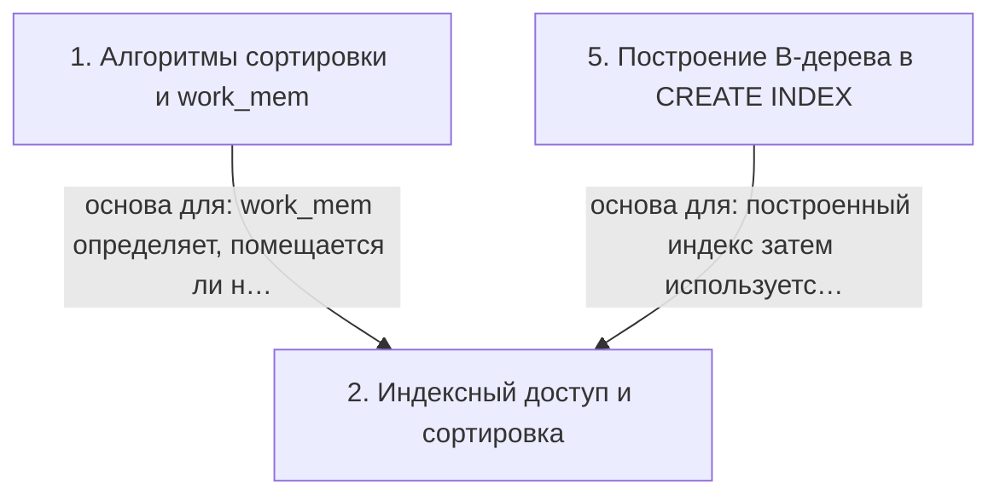

# Сортировка в PostgreSQL

> [!abstract] Обзор
> Материал о том, как Postgres выполняет сортировку: какие алгоритмы использует (quicksort, top-N heapsort, внешняя и инкрементальная сортировка), как это видно в EXPLAIN ANALYZE по узлу Sort, зачем нужен work_mem и как частичная сортировка возникает при LIMIT. Отдельно разобрано, что индексный доступ через B-дерево возвращает отсортированный набор, а Seq Scan — нет, а также как строится индекс B-дерева в CREATE INDEX и как подходящий индекс позволяет избежать сортировки.

> [!info] Курс
> [[index|Оглавление курса]]

## Оглавление
1. [[#1. Алгоритмы сортировки и work_mem]]
2. [[#2. Индексный доступ и сортировка]]
3. [[#3. EXPLAIN ANALYZE и узел Sort]]
4. [[#4. Инкрементальная сортировка]]
5. [[#5. Построение B-дерева в CREATE INDEX]]

**Схема** — [[#Схема]]
**Итог** — [[#Итог]]

## 1. Алгоритмы сортировки и work_mem

Postgres выполняет сортировку в памяти (quicksort), внешнюю сортировку и инкрементальную сортировку; также может выбирать между quicksort и top-N heapsort (частичной пирамидальной сортировкой). Top-N heapsort применяется, когда нужны только первые значения (например, при limit), не сортирует весь набор, а n раз находит максимум; его сложность O(M log N), где M — число строк, N — число первых строк. В поясняющей строке указывается потребовавшийся объём диска под временные файлы. Если увеличить work_mem до 48 МБ, весь набор помещается в оперативную память, и сортировка выполняется методом quicksort.

*Источник: [00:00:00], [00:01:00]*

> [!quote]- Кадр [00:00:00]
> 

> [!quote]- Кадр [00:01:00]
> 

## 2. Индексный доступ и сортировка

Индексный доступ с использованием B-дерева возвращает отсортированный набор строк; если индекс соответствует нужному порядку сортировки, строки возвращаются уже в этом порядке. Последовательный доступ (Seq Scan) возвращает неупорядоченный набор строк, поэтому для получения отсортированного результата необходима дополнительная операция сортировки. Если набор помещается в оперативную память, применяется quicksort, иначе — внешняя сортировка с использованием временных файлов. Можно избежать сортировки, если имеется подходящий индекс. Индексы можно рассматривать как вариант выполнения сортировки.

*Источник: [00:01:00]*

## 3. EXPLAIN ANALYZE и узел Sort

EXPLAIN с опцией ANALYZE показывает для узла Sort метод сортировки и количество потребовавшейся оперативной памяти. Начальная стоимость узла Sort высокая, потому что для выдачи данных нужно отсортировать набор строк полностью.

*Источник: [00:01:00]*

## 4. Инкрементальная сортировка

Инкрементальная сортировка возникает, когда запрос требует набор, отсортированный по нескольким столбцам, и есть возможность получить набор, уже отсортированный по некоторым из требующихся столбцов, но не по всем. Алгоритм рассчитывает на частичную отсортированность: строки разбиваются на группы по уже отсортированному столбцу, и в зависимости от размеров групп выбирается стратегия — досортировка внутри групп по оставшимся столбцам или объединение и обычная сортировка. Запрос может выполняться параллельно, рабочие процессы используют внешнюю сортировку с временными файлами. Если ключ сортировки не входит ни в один индекс, отсортированный набор нельзя получить через индекс. Группы называются presorted, если набор предварительно отсортирован; иначе это full-sort группы, для которых применяется сортировка в памяти или внешняя сортировка при нехватке памяти.

*Источник: [00:01:00]*

## 5. Построение B-дерева в CREATE INDEX

При создании индекса B-дерева сначала все строки набора сортируются, затем формируются листовые страницы индекса, далее строится следующий уровень узлов дерева до корня. Такая операция может выполняться параллельно несколькими процессами, количество которых лимитировано параметром max_parallel_maintenance_workers. Чтобы понять, был ли при построении индекса использован временный файл, можно воспользоваться журналом сообщений.

*Источник: [00:01:00]*

## Схема

## Итог

> [!success] Что в итоге
> Postgres выбирает между quicksort, top-N heapsort, внешней и инкрементальной сортировкой, а узел Sort в EXPLAIN ANALYZE показывает метод и затраченную память. Метод зависит от того, помещается ли набор в память (work_mem), и от того, требуется ли весь набор или только первые строки (LIMIT). Индексный доступ через B-дерево возвращает строки уже отсортированными, поэтому подходящий индекс позволяет избежать сортировки, а построение индекса в CREATE INDEX само выполняет сортировку набора.

