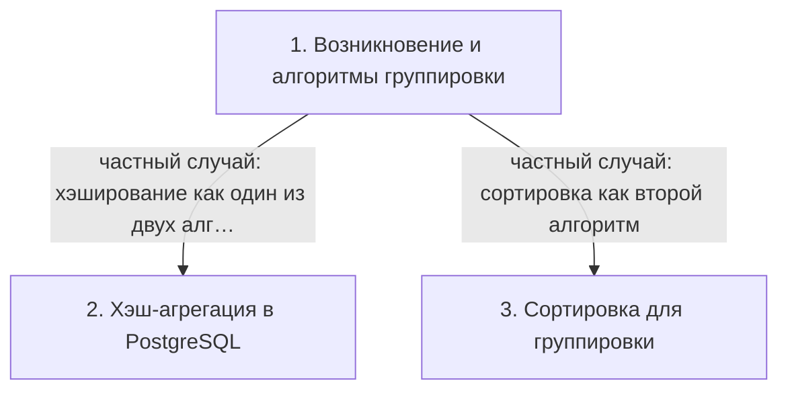

# Группировка в PostgreSQL: алгоритмы и планы выполнения

> [!abstract] Обзор
> Материал о том, когда в запросе возникает группировка и какими алгоритмами PostgreSQL её выполняет. Разбираются два основных способа — хэширование и сортировка, устройство узла HashAggregate, работа с памятью и пакетами (batches). Показано, что GROUP BY и SELECT DISTINCT по одной колонке дают идентичный план, а UNION без ALL выполняется через HashAggregate. Отдельно рассмотрены GroupAggregate и Unique, Mixed Aggregate для GROUPING SETS, параллельная агрегация и обязательная группировка через сортировку при PartitionBy в оконных функциях.

> [!info] Курс
> [[index|Оглавление курса]]

## Оглавление
1. [[#1. Возникновение и алгоритмы группировки]]
2. [[#2. Хэш-агрегация в PostgreSQL]]
3. [[#3. Сортировка для группировки]]
4. [[#4. Mixed Aggregate для GROUPING SETS]]
5. [[#5. Параллельная агрегация]]

**Схема** — [[#Схема]]
**Итог** — [[#Итог]]

## 1. Возникновение и алгоритмы группировки

Группировка возникает при явном указании group by, а также неявно: при исключении дубликатов в distinct и в запросах с union, intersect и except. Выполняется она двумя основными способами — хэшированием (сканируется набор строк и строится хэш-таблица в оперативной памяти) или сортировкой. В сложных запросах возможно совместное использование этих методов.

*Источник: [00:00:00]*

> [!quote]- Кадр [00:00:00]
> 

## 2. Хэш-агрегация в PostgreSQL

При хэшировании для каждой строки вычисляется хэш-код от значения поля группировки, по последним разрядам определяется корзина, в запись помещается точное значение и счётчик агрегатной функции, который увеличивается при совпадении. В плане появляется узел HashAggregate с ключом группировки; он строит хэш-таблицу в памяти и выдаёт результат после её полного построения. Если памяти не хватает, хэш-таблица разбивается на пакеты (batches), объём памяти рассчитывается как work_mem * HashMem Multiplier. GROUP BY и SELECT DISTINCT по одной колонке дают идентичный план с HashAggregate, а UNION без ALL также использует HashAggregate для удаления дубликатов.

```sql
=> EXPLAIN (costs off)
SELECT fare_conditions
FROM seats
GROUP BY fare_conditions;

QUERY PLAN
-------------------
HashAggregate
  Group Key: fare_conditions
  ->  Seq Scan on seats
(3 rows)

=> EXPLAIN (costs off)
SELECT DISTINCT fare_conditions
FROM seats;

QUERY PLAN
-------------------
HashAggregate
  Group Key: fare_conditions
  ->  Seq Scan on seats
(3 rows)

> EXPLAIN (costs off)
SELECT fare_conditions
FROM seats
UNION
SELECT fare_conditions
FROM seats;
```

*Источник: [00:01:00], [00:02:00]*

> [!quote]- Кадр [00:01:00]
> 

## 3. Сортировка для группировки

Второй способ группировки — сортировка, после которой читается отсортированный набор и формируются группы. Для расчёта агрегатной функции используется узел GroupAggregate, а для исключения дубликатов без агрегации — узел Unique. Если в оконных функциях указан PartitionBy, группировка всегда выполняется через сортировку.

| Ситуация | Узел в плане |
|---|---|
| Исключение дубликатов без агрегации | Unique |
| Расчёт агрегатной функции | GroupAggregate |

*Источник: [00:02:00]*

## 4. Mixed Aggregate для GROUPING SETS

GROUPING SETS требует нескольких группировок, и в плане появляется узел Mixed Aggregate.

*Источник: [00:02:00]*

## 5. Параллельная агрегация

В параллельном плане каждый процесс вычисляет агрегатную функцию по тем данным, которые он читает, а ведущий процесс собирает данные от каждого из процессов. Для финализации используется узел Finalize Group Aggregate.

*Источник: [00:02:00]*

## Схема



## Итог

> [!success] Что в итоге
> Группировка в PostgreSQL возникает как при явном group by, так и неявно — в distinct, union, intersect и except. Выполняется она двумя основными способами: хэшированием (узел HashAggregate, корзины, счётчик, пакеты при нехватке памяти) или сортировкой (узел GroupAggregate, узел Unique для дубликатов). GROUP BY и SELECT DISTINCT по одной колонке дают идентичный план, UNION без ALL выполняется через HashAggregate, а при PartitionBy в оконных функциях группировка всегда идёт через сортировку.

