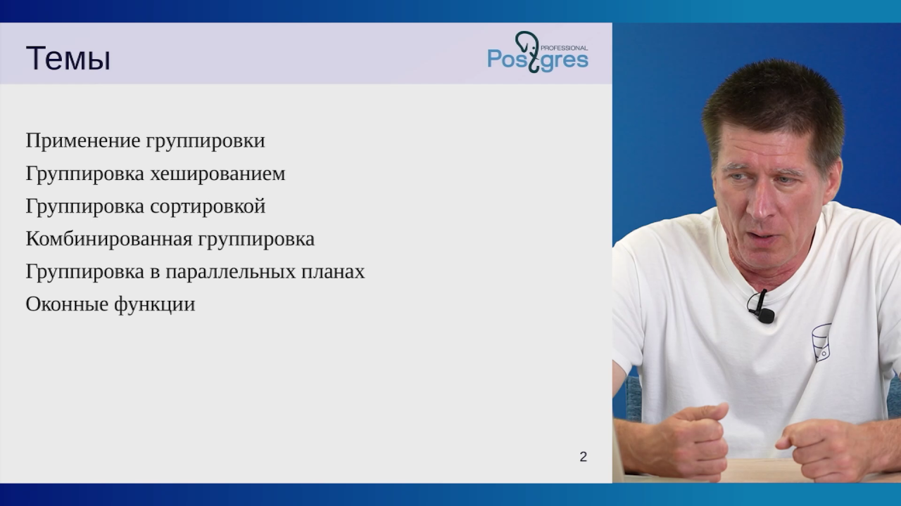
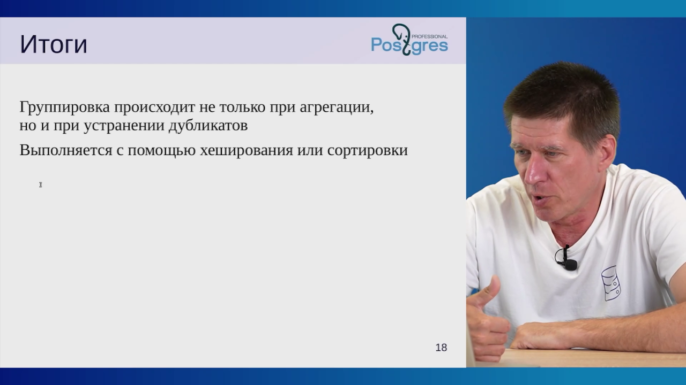
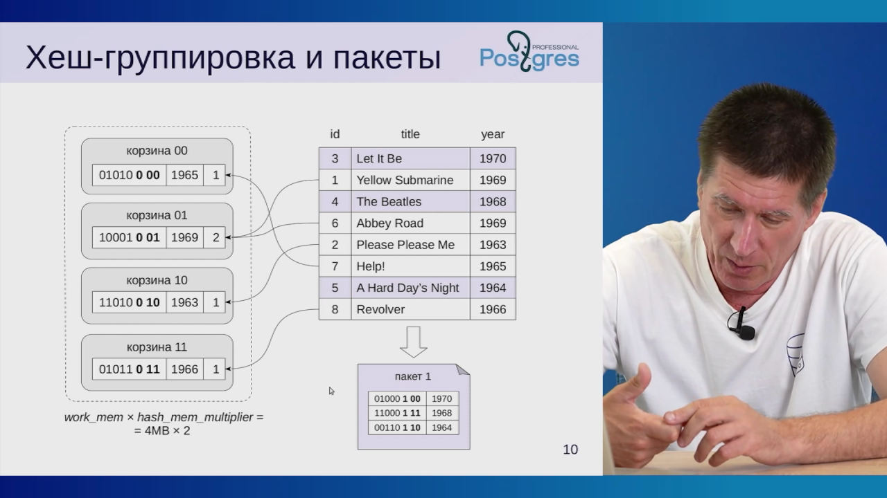
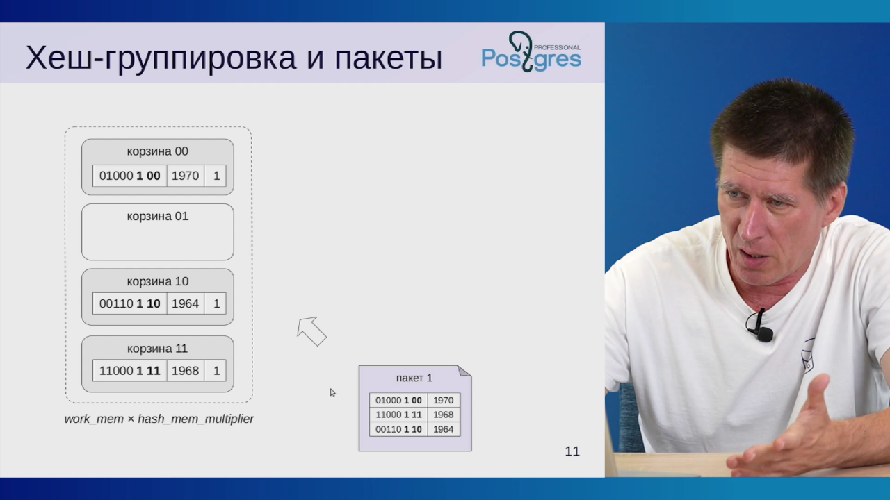
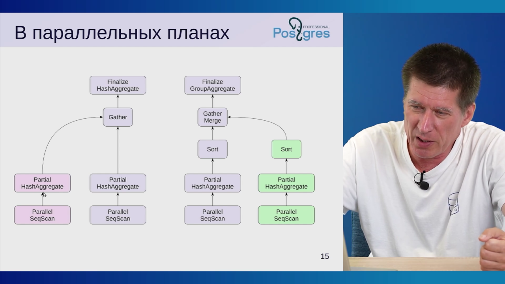
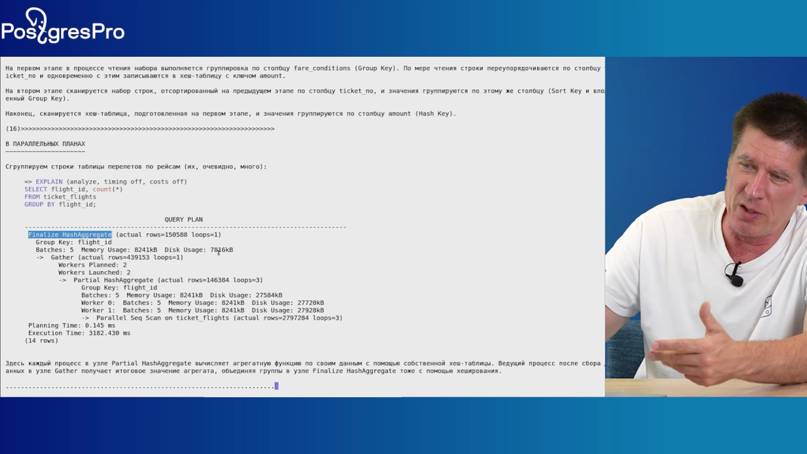
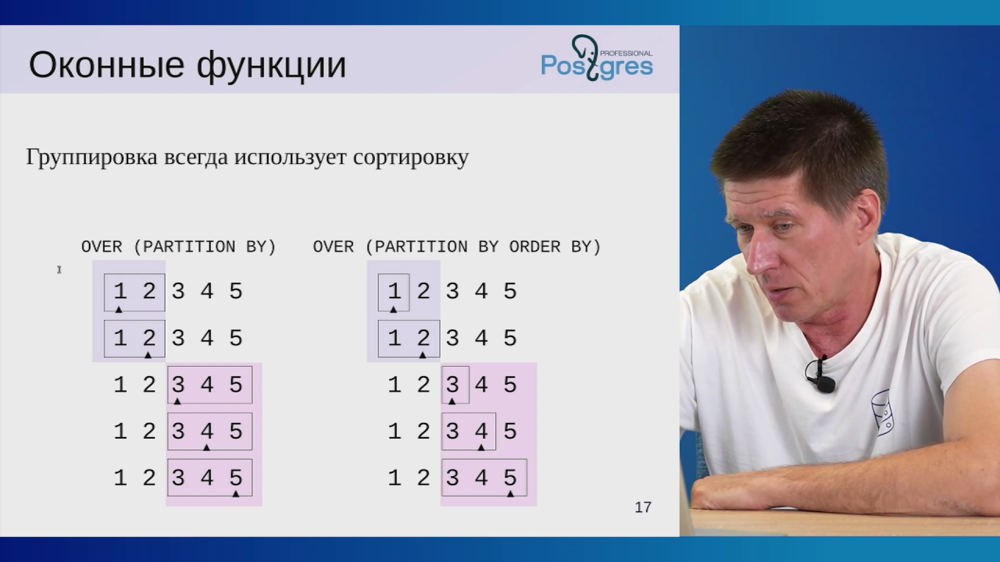
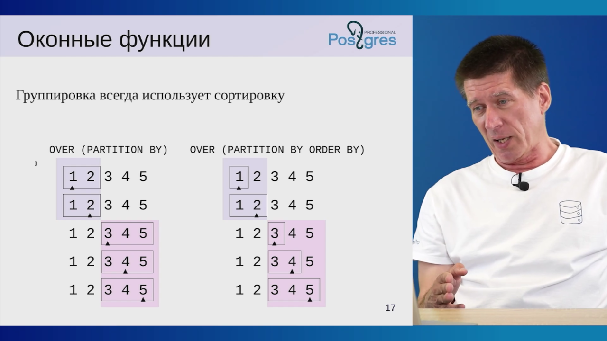
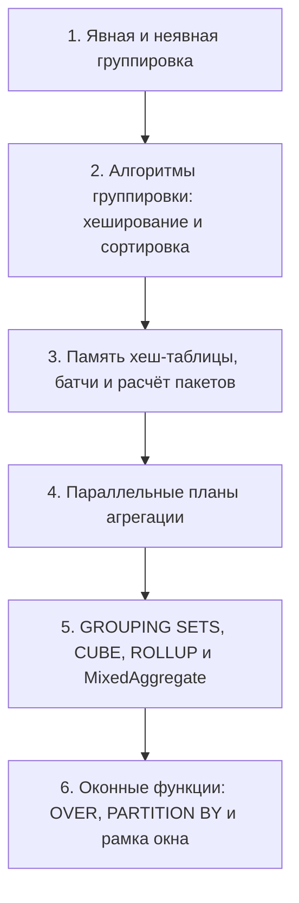

# Группировка и агрегация в PostgreSQL: планы выполнения

> [!abstract] Обзор
> Материал о том, как PostgreSQL выполняет группировку и агрегацию. Разбираются два алгоритма — хеширование и сортировка — и то, как группировка возникает явно (GROUP BY) и неявно (DISTINCT, UNION, INTERSECT, EXCEPT). Показаны узлы планов HashAggregate, GroupAggregate, Unique, MixedAggregate, а также параллельные планы с Partial HashAggregate, Gather Merge и Finalize GroupAggregate. Отдельно описаны память хеш-таблицы, разбиение на пакеты, hash_mem_multiplier и расхождение расчётного числа пакетов с фактом. Завершают материал GROUPING SETS, CUBE, ROLLUP и оконные функции с OVER и PARTITION BY.

> [!info] Курс
> [[index|Оглавление курса]]

## Оглавление
1. [[#1. Явная и неявная группировка]]
2. [[#2. Алгоритмы группировки: хеширование и сортировка]]
3. [[#3. Память хеш-таблицы, батчи и расчёт пакетов]]
4. [[#4. Параллельные планы агрегации]]
5. [[#5. GROUPING SETS, CUBE, ROLLUP и MixedAggregate]]
6. [[#6. Оконные функции: OVER, PARTITION BY и рамка окна]]

**Схема** — [[#Схема]]
**Итог** — [[#Итог]]

## 1. Явная и неявная группировка

В PostgreSQL группировка возникает явно при указании GROUP BY и неявно — при DISTINCT, а также в запросах с UNION, INTERSECT и EXCEPT. Удаление дубликатов выполняется через группировку: SELECT DISTINCT и GROUP BY по одному столбцу дают одинаковый план с узлом HashAggregate и последовательным сканированием. UNION объединяет два набора строк через узел Append, после чего HashAggregate удаляет дубликаты; без слова ALL дубликаты исключаются.

```sql
>= EXPLAIN (costs off)
SELECT fare_conditions
FROM seats
GROUP BY fare_conditions;

QUERY PLAN
---------------------
HashAggregate
  Group Key: fare_conditions
  ->  Seq Scan on seats
(3 rows)

=> EXPLAIN (costs off)
SELECT DISTINCT fare_conditions
FROM seats;

QUERY PLAN
---------------------
HashAggregate
  Group Key: fare_conditions
  ->  Seq Scan on seats
(3 rows)

=> EXPLAIN (costs off)
SELECT fare_conditions
FROM seats
UNION
SELECT fare_conditions
FROM seats;
            QUERY PLAN
------------------------
 HashAggregate
   Group Key: seats.fare_conditions
   ->  Append
         ->  Seq Scan on seats
         ->  Seq Scan on seats seats_1
(5 rows)

>= EXPLAIN (costs off)
SELECT fare_conditions
FROM seats
UNION
SELECT fare_conditions
FROM seats;
            QUERY PLAN
------------------------
 HashAggregate
   Group Key: seats.fare_conditions
   ->  Append
         ->  Seq Scan on seats
         ->  Seq Scan on seats seats_1
(5 rows)
```

*Источник: [00:00:20], [00:01:10], [00:01:30], [00:01:51], [00:02:11], [00:02:35] и др.*

> [!quote]- Кадр [00:00:20]
> 

## 2. Алгоритмы группировки: хеширование и сортировка

Группировка выполняется двумя алгоритмами: хешированием (узел HashAggregate) и сортировкой (узлы GroupAggregate и Unique). При хешировании строится хэш-таблица в оперативной памяти: для каждой строки вычисляется хэш-код ключа группировки, запись помещается в корзину, а если строка не попадает в нулевой пакет — во временный файл. Узел GroupAggregate читает отсортированный набор и создаёт новую группу при смене ключа; узел Unique устраняет дубликаты, пропуская строки с тем же ключом, что и предыдущая. В сложных запросах возможно совместное использование хеширования и сортировки.

```sql
SELECT year, count(*) cnt
FROM t
GROUP BY year;

SELECT DISTINCT year
FROM t;

QUERY PLAN
GroupAggregate
  Group Key: ticket_no
  ->  Index Only Scan using ticket_flights_pkey on ticket_flights

QUERY PLAN
Result
  ->  Unique
    ->  Index Only Scan using ticket_flights_pkey on ticket_flights
```

*Источник: [00:03:05], [00:03:28], [00:04:58], [00:05:19], [00:05:48], [00:06:08] и др.*

> [!quote]- Кадр [00:20:11]
> 

## 3. Память хеш-таблицы, батчи и расчёт пакетов

EXPLAIN (analyze) для HashAggregate показывает Batches и Memory Usage: если Batches = 1, вся хэш-таблица поместилась в оперативную память. При нехватке памяти хэш-таблица разбивается на пакеты (batches), каждый из которых должен помещаться в выделенный объём; если пакет не влезает в стандартные 8 МБ, он дробится дальше. Объём памяти под хеш-таблицу рассчитывается как work_mem × hash_mem_multiplier (например, при work_mem = 4 МБ и hash_mem_multiplier = 2 получается 8 МБ). Планировщик оценивает число пакетов заранее (Planned Partitions), но фактическое число может отличаться: в примере с группировкой по book_ref расчёт дал 32, а выполнение — 33 пакета.

```sql
>= EXPLAIN (analyze, timing off, costs off)
SELECT aircraft_code, count(*)
FROM seats
GROUP BY aircraft_code;

 HashAggregate (actual rows=9 loops=1)
   Group Key: aircraft_code
   Batches: 1  Memory Usage: 24kB
   ->  Seq Scan on seats (actual rows=1339 loops=1)

EXPLAIN (analyze, timing off, costs off)
SELECT flight_id, count(*)
FROM ticket_flights
GROUP BY flight_id;

=> EXPLAIN
SELECT book_ref, count(*)
FROM tickets
GROUP BY book_ref;

                    QUERY PLAN
----------------------------------------------------------
 HashAggregate  (cost=244820.70..282786.70 rows=1492293 width=15)
   Group Key: book_ref
   Planned Partitions: 32
   ->  Seq Scan on tickets  (cost=0.00..78910.20 rows=2949520 width=7)
(4 rows)

=> EXPLAIN (analyze, timing off, costs off)
SELECT aircraft_code, count(*)
FROM seats
GROUP BY aircraft_code;

 HashAggregate (actual rows=9 loops=1)
   Group Key: aircraft_code
   Batches: 1  Memory Usage: 24kB
   ->  Seq Scan on seats (actual rows=1339 loops=1)

EXPLAIN (analyze, timing off, costs off)
SELECT flight_id, count(*)
FROM ticket_flights
GROUP BY flight_id;
```

> [!info] Зачем это нужно
> Желательно размещать хеш-таблицу в оперативной памяти целиком.

*Источник: [00:06:49], [00:07:29], [00:07:50], [00:08:14], [00:09:26], [00:09:46] и др.*

> [!quote]- Кадр [00:07:29]
> 

> [!quote]- Кадр [00:09:26]
> 

## 4. Параллельные планы агрегации

В параллельном плане каждый процесс строит часть хеш-таблицы (Partial HashAggregate), вычисляя агрегатную функцию по своим данным с помощью собственной хеш-таблицы. Если выполняется группировка хеширования, то в каждом процессе, как правило, будет узел Parallel SeqScan и узел Partial HashAggregate. Если используется сортировка, в каждом процессе выполняется Parallel SeqScan и Partial HashAggregate, затем добавляется узел Sort, после чего Gather Merge и Finalize GroupAggregate. В параллельных планах при сборе данных появляется узел Gather Merge, который объединяет данные с сохранением порядка сортировки; для финализации используется узел Finalize GroupAggregate. По умолчанию используется два процесса. Результаты воркеров собираются в один отсортированный набор, после чего вычисляется агрегатная функция.

*Источник: [00:06:08], [00:14:57], [00:15:17]*

> [!quote]- Кадр [00:15:17]
> 

## 5. GROUPING SETS, CUBE, ROLLUP и MixedAggregate

Для группировки по нескольким наборам полей в запросе используются GROUPING SETS, CUBE или ROLLUP. GROUPING SETS по нескольким столбцам означает необходимость группировки по всем сочетаниям этих столбцов. При группировке с GROUPING SETS в плане запроса может появиться узел MixedAggregate. Таблица сканируется последовательно и сортируется по fare_conditions в узле сорт, причём так как таблица большая, здесь будет внешняя сортировка. На первом этапе выполняется группировка по столбцу fare_conditions, строки переупорядочиваются по ticket_no и записываются в хеш-таблицу с ключом amount; на втором этапе сканируется набор, отсортированный по ticket_no, и значения группируются по этому же столбцу, затем сканируется хеш-таблица и значения группируются по столбцу amount.

```sql
QUERY PLAN
MixedAggregate
  Hash Key: amount
  Group Key: fare_conditions
  Sort Key: ticket_no
  Group Key: ticket_no
  -> Sort
        Sort Key: fare_conditions
        -> Seq Scan on ticket_flights

SELECT fare_conditions, ticket_no, amount, count(*)
FROM ticket_flights
GROUP BY
  GROUPING SETS (fare_conditions, ticket_no, amount);
```

*Источник: [00:12:35], [00:13:15], [00:13:55], [00:14:15], [00:17:16]*

> [!quote]- Кадр [00:17:16]
> 

## 6. Оконные функции: OVER, PARTITION BY и рамка окна

Существует вариант OVER (PARTITION BY ORDER BY), а также вариант OVER (PARTITION BY). Для каждой строки рамка охватывает все строки той группы, к которой относится строка; в правом примере рамка начинается на первой строке группы и заканчивается текущей. В запросе SELECT status, count(*) OVER (PARTITION BY status) используется оконная функция count(*) с окном PARTITION BY status, а в описании окна PARTITION BY выполняет группировку. В целевой список можно добавить вызов row_number с тем же окном OVER (PARTITION BY status) и посмотреть, как изменится план и результат.

```sql
SELECT status, count(*) OVER (PARTITION BY status)
FROM flights
WHERE flight_no = 'PG0007'
AND departure_airport = 'VKO'
AND flight_id BETWEEN 24104 AND 24115;
```

*Источник: [00:19:31], [00:19:51], [00:20:31], [00:21:01]*

> [!quote]- Кадр [00:19:31]
> 

> [!quote]- Кадр [00:19:51]
> 

## Схема



## Итог

> [!success] Что в итоге
> Группировка в PostgreSQL выполняется двумя алгоритмами — хешированием или сортировкой, и одна и та же операция проявляется при GROUP BY, при DISTINCT, в UNION и в оконных функциях с PARTITION BY. Группировка хешированием строит хэш-таблицу, распределяя строки по корзинам и пакетам, что видно в плане как узел HashAggregate с батчами и потреблением памяти; при нехватке памяти таблица разбивается на пакеты с временными файлами. Группировка сортировкой использует узлы GroupAggregate и Unique, а GROUPING SETS приводит к MixedAggregate и этапам группировки. В параллельных планах добавляются Partial HashAggregate, Gather Merge и Finalize GroupAggregate.

