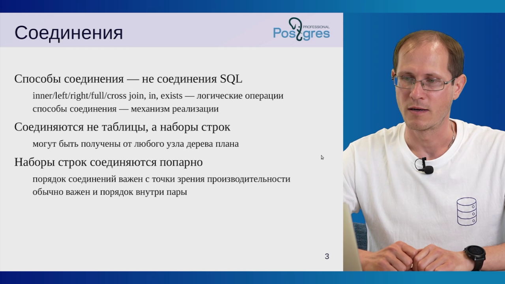

# Соединения и способы соединения в PostgreSQL

> [!abstract] Обзор
> Материал лекции QPT-16 по оптимизации запросов в PostgreSQL о соединениях. SQL-соединение — логическая операция: в запросе указывается, какие таблицы нужно соединить. Способы соединения PostgreSQL — это алгоритмы (механизмы), реализующие соединение, а не логические операции SQL. Соединяются не таблицы, а наборы строк, получаемые от любого узла дерева плана; наборы соединяются попарно, и порядок соединений важен для производительности. Отдельно разобран вложенный цикл (nested loop): для каждой строки внешнего набора перебираются подходящие строки внутреннего набора, для эффективности рекомендуется индекс на внутреннем наборе, а также рассмотрены стоимость узла, полусоединение, left join, мемоизация и влияние порядка и размеров наборов.

> [!info] Курс
> [[index|Оглавление курса]]

## Оглавление
1. [[#1. Соединение и способы соединения]]
2. [[#2. Вложенный цикл (nested loop)]]

**Итог** — [[#Итог]]

## 1. Соединение и способы соединения

inner/left/right/full/cross join, in, exists — это логические операции SQL, а не способы соединения. Способы соединения PostgreSQL — это алгоритмы (механизмы), реализующие соединение; в запросе указывается, какие таблицы нужно соединить, то есть соединение SQL — логическая операция. Соединяются не таблицы, а наборы строк: они могут быть получены от любого узла дерева плана и соединяются попарно. Порядок соединений важен с точки зрения производительности, обычно важен и порядок внутри пары.

| Понятие | Что это |
|---|---|
| inner/left/right/full/cross join, in, exists | логические операции SQL |
| Способы соединения PostgreSQL | алгоритмы (механизмы) реализации соединения |

*Источник: [00:00:00], [00:01:00]*

> [!quote]- Кадр [00:00:00]
> 

> [!quote]- Кадр [00:01:00]
> 

## 2. Вложенный цикл (nested loop)

Во вложенном цикле (nested loop) для каждой строки внешнего набора перебираются подходящие строки внутреннего набора, поэтому внутренний набор читается столько раз, сколько строк во внешнем наборе. Для эффективности рекомендуется индекс на внутреннем наборе строк; при наличии эффективного доступа ко внутреннему набору по индексу читаются не все строки внутреннего набора. Полная стоимость узла Nested Loop складывается из полной стоимости получения данных от внешнего набора и стоимости получения данных от внутреннего набора, умноженной на расчетное число строк во внешнем наборе. Мемоизация — это кэширование повторяющихся данных внутри одного набора строк: при обращении к внутреннему набору строк и получении одних и тех же данных их можно закешировать и отдавать внешнему набору строк, не обращаясь к внутреннему. В плане запроса узел nested loop left join указывает на левое соединение и вернёт строки левого набора, даже если для них не нашлась пара в правом наборе строк; полусоединение возвращает строки одного набора, для которых нашлась хотя бы одна строка во втором наборе, и его можно использовать для предиката exists, а соединение вложенным циклом сразу выдает результат без задержек и эффективно для небольших выборок, когда внешний набор небольшой, а к внутреннему есть эффективный доступ (индекс).

*Источник: [00:01:00]*

## Итог

> [!success] Что в итоге
> Соединение SQL — логическая операция, а способы соединения — алгоритмы реализации; inner/left/right/full/cross join, in, exists относятся к логическим операциям. Соединяются наборы строк, получаемые от узлов плана, попарно, и порядок соединений важен для производительности. Nested loop перебирает для каждой строки внешнего набора подходящие строки внутреннего, поэтому для эффективности важен индекс на внутреннем наборе, небольшой внешний набор и мемоизация. Полная стоимость Nested Loop зависит от внешнего набора и стоимости внутреннего доступа, умноженной на расчетное число строк внешнего набора.

