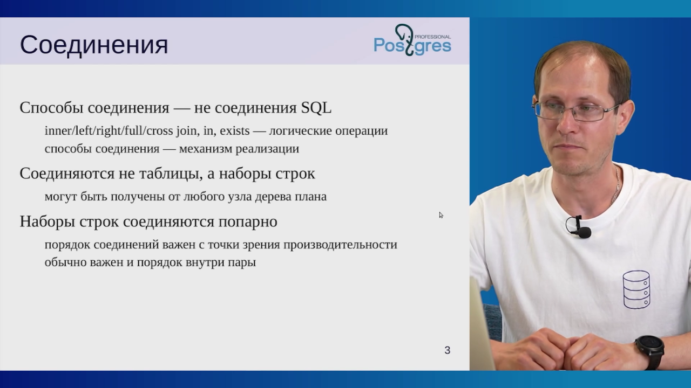
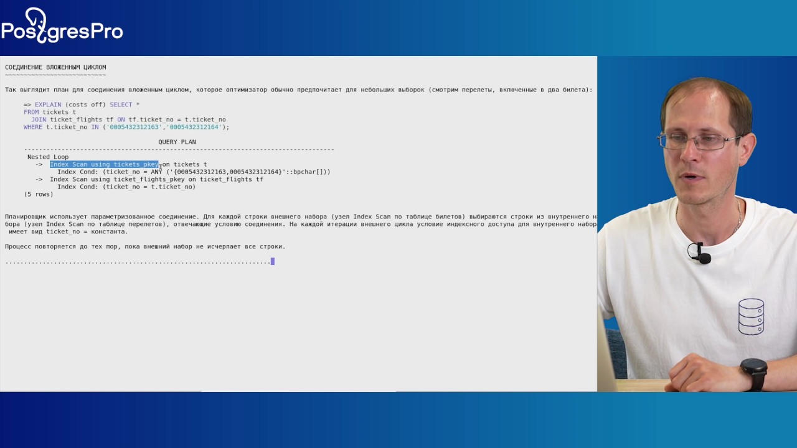
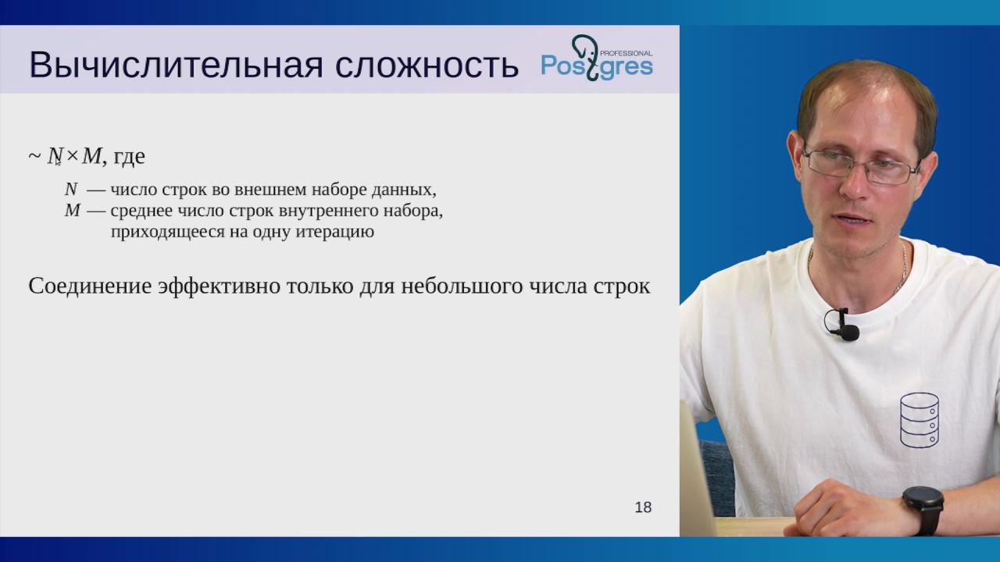
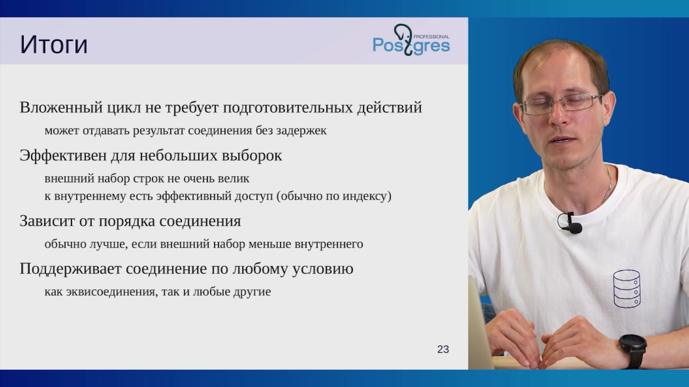
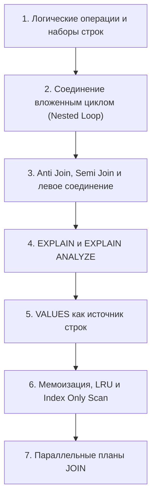

# Способы соединения в PostgreSQL

> [!abstract] Обзор
> Материал о способах соединения в PostgreSQL. Разбирается разница между логической операцией соединения в SQL (inner/left/right/full/cross join, in, exists) и алгоритмами соединения как механизмом реализации, а также то, что физически соединяются наборы строк. Подробно рассматривается соединение вложенным циклом: чтение внешнего и внутреннего наборов, роль индекса, параметризованный доступ, сложность ~ N × M, стоимость узла, зависимость от порядка и условия соединения. Отдельно показано, как NOT EXISTS превращается в Nested Loop Anti Join, а EXISTS — в Semi Join, и как анализировать план через EXPLAIN, EXPLAIN ANALYZE, costs off и summary off. В конце обсуждаются мемоизация с вытеснением по давности (LRU), показатели Index Only Scan, misses и hits, а также параллельные планы JOIN с узлом gather.

> [!info] Курс
> [[index|Оглавление курса]]

## Оглавление
1. [[#1. Логические операции и наборы строк]]
2. [[#2. Соединение вложенным циклом (Nested Loop)]]
3. [[#3. Anti Join, Semi Join и левое соединение]]
4. [[#4. EXPLAIN и EXPLAIN ANALYZE]]
5. [[#5. VALUES как источник строк]]
6. [[#6. Мемоизация, LRU и Index Only Scan]]
7. [[#7. Параллельные планы JOIN]]

**Схема** — [[#Схема]]
**Итог** — [[#Итог]]

## 1. Логические операции и наборы строк

Соединение SQL — это логическая операция: inner/left/right/full/cross join, in, exists — логические операции, а способы соединения (nested loop, hash, merge) — механизм реализации. Физически соединяются не таблицы, а наборы строк, которые могут быть получены от любого узла дерева плана; наборы соединяются попарно, и обычно важен порядок внутри пары. Порядок соединений важен для производительности, а стоимость пропорциональна количеству строк во внешнем наборе, умноженному на количество строк во внутреннем наборе. При обращении к внутреннему набору полученная строка сохраняется, а новая строка всегда добавляется в начало, а не в конец.

| Понятие | Что это |
|---|---|
| inner/left/right/full/cross join, in, exists | логические операции |
| способы соединения | механизм реализации, не соединения SQL |

*Источник: [00:00:00], [00:01:01]*

> [!quote]- Кадр [00:00:00]
> 

> [!quote]- Кадр [00:01:01]
> 

## 2. Соединение вложенным циклом (Nested Loop)

Соединение вложенным циклом (Nested Loop) — самый простой способ: есть внешний и внутренний наборы строк, и для каждой строки внешнего набора перебираются подходящие строки внутреннего по условию соединения. Внешний набор читается один раз, а внутренний — столько раз, сколько строк во внешнем наборе; если для внутреннего набора нет индекса, его приходится полностью просматривать для каждой строки внешнего, а при эффективном доступе по индексу читаются не все строки, и соединение возвращает результат почти мгновенно. Вычислительная сложность примерно N × M (без индекса — перемножение количества строк в двух наборах), поэтому вложенный цикл эффективен для небольших выборок и когда внешний набор не очень велик, а к внутреннему есть эффективный доступ обычно по индексу; обычно лучше, если внешний набор меньше внутреннего. Полная стоимость узла складывается из стоимости получения данных от внешнего набора, который надо прочитать целиком, и в примере с двумя строками внешнего набора число 16,5 умножается на расчётное число строк во внешнем наборе. Для ускорения вложенного цикла между внешним и внутренним наборами встраивается новый узел кэширования; вложенный цикл поддерживает соединение по любому условию — как эквисоединения (равенство), так и любые другие.

```sql
SELECT a.title, s.name
FROM albums a JOIN songs s ON a.id = s.album_id;

=> EXPLAIN (costs off) SELECT *
    FROM tickets t
    JOIN ticket_flights tf ON tf.ticket_no = t.ticket_no
    WHERE t.ticket_no IN ('0005432312163','0005432312164');

EXPLAIN (analyze, summary off)
SELECT *
FROM tickets t
JOIN ticket_flights tf ON tf.ticket_no = t.ticket_no
WHERE t.ticket_no IN ('0005432312163','0005432312164');

Nested Loop  (cost=0.99..46.12 rows=6 width=136) (actual time=46.663..50.694 rows=8 loops=1)
  ->  Index Scan using tickets_pkey on tickets t  (cost=0.43..12.90 rows=2 width=104) (actual time=43.735..43.771 rows=2 loops=1)
  ->  Index Scan using ticket_flights_pkey on ticket_flights tf  (cost=0.56..16.58 rows=3 width=32) (actual time=1.827..3.441 rows=4 loops=2)
```

*Источник: [00:01:01], [00:03:28], [00:04:59], [00:07:57], [00:08:38], [00:23:22] и др.*

> [!quote]- Кадр [00:08:38]
> 

> [!quote]- Кадр [00:24:42]
> 

> [!quote]- Кадр [00:32:19]
> 

## 3. Anti Join, Semi Join и левое соединение

NOT EXISTS обрабатывается как Anti Join: в плане появляется узел nested loop anti join, и запрос с LEFT JOIN можно переписать через NOT EXISTS — запросы с NOT EXISTS и с LEFT JOIN ... WHERE s.aircraft_code IS NULL дают одинаковый план. EXISTS — предикат, который возвращает строки одного набора, если во втором нашлась хотя бы одна строка; для него используется полусоединение Nested Loop Semi Join, которому из внутреннего набора нужна всего одна строка. Хотя план может показывать получение 149 строк, при выполнении фактически используется одна строка: EXPLAIN ANALYZE показывает actual rows=1, а подзапрос может выполняться через Index Only Scan. Левое соединение (LEFT JOIN) возвращает строки левого набора даже если для них не нашлась пара в правом наборе.

```sql
> SELECT *
FROM aircrafts a
WHERE a.model LIKE 'Аэробус%'
AND NOT EXISTS (
  SELECT * FROM seats s WHERE s.aircraft_code = a.aircraft_code
);

QUERY PLAN
-------------------------------------------
 Nested Loop Anti Join
   ->  Seq Scan on aircrafts_data ml
         Filter: (model ->> lang()) -> 'Аэробус%')::text)
   ->  Index Only Scan using seats_pkey on seats s
         Index Cond: (aircraft_code = ml.aircraft_code)

> EXPLAIN SELECT *
FROM aircrafts a
WHERE a.model LIKE 'Аэробус%'
AND EXISTS (
    SELECT * FROM seats s WHERE s.aircraft_code = a.aircraft_code
);

                QUERY PLAN
-----------------------------------------------------------
 Nested Loop Semi Join  (cost=0.28..4.02 rows=1 width=40)
   ->  Seq Scan on aircrafts data ml  (cost=0.00..3.39 rows=1 width=72)
         Filter: ((model ->> lang()) ~~ 'Аэробус%')::text
   ->  Index Only Scan using seats_pkey on seats s  (cost=0.28..6.88 rows=149 width=4)
         Index Cond: (aircraft_code = ml.aircraft_code)
(5 rows)

EXPLAIN SELECT *
FROM aircrafts a
WHERE a.model LIKE 'Аэробус%'
AND EXISTS (
    SELECT * FROM seats s WHERE s.aircraft_code = a.aircraft_code
);

QUERY PLAN
-------------------------------------
 Nested Loop Semi Join  (cost=0.28..4.02 rows=1 width=40)
   ->  Seq Scan on aircrafts data ml  (cost=0.00..3.39 rows=1 width=72)
         Filter: ((model ->> lang())::'Аэробус%'::text)
   ->  Index Only Scan using seats_pkey on seats s  (cost=0.28..6.88 rows=149 width=4)
         Index Cond: (aircraft_code = ml.aircraft_code)

EXPLAIN SELECT *
FROM aircrafts a
WHERE a.model LIKE 'Аэробус'
AND EXISTS (
  SELECT * FROM seats s WHERE s.aircraft_code = a.aircraft_code
);

EXPLAIN (costs off) SELECT *
FROM aircrafts a
  LEFT JOIN seats s ON (a.aircraft_code = s.aircraft_code)
  WHERE a.model LIKE 'Аэробыч%';

QUERY PLAN
Nested Loop Left Join
  ->  Seq Scan on aircrafts_data ml
        Filter: (model ~~ 'Аэробыч'::text)
  ->  Bitmap Heap Scan on seats s
        ->  Bitmap Index Scan on seats_pkey
```

*Источник: [00:13:29], [00:14:11], [00:14:31], [00:15:31], [00:15:51], [00:16:17] и др.*

## 4. EXPLAIN и EXPLAIN ANALYZE

EXPLAIN ANALYZE выполняет запрос и показывает, сколько раз выполнялся вложенный цикл: в выводе видны циклы (loops), количество выбранных строк и затраченное время. В примере планировщик оценил rows=6, но фактически было получено rows=8 — это несущественная ошибка, сам цикл выполняется эффективно. При малых значениях времени сервер тратит относительно много времени на подсчёт этого времени, поэтому при маленьких значениях рекомендуется отключить подсчёт времени. EXPLAIN (costs off) выводит план без оценок стоимости, а EXPLAIN (analyze, summary off) дополнительно показывает actual time, число строк и loops; в обоих случаях план — Nested Loop с Index Scan по tickets_pkey и ticket_flights_pkey.

```
Nested Loop  (cost=0.99..46.12 rows=6 width=136) (actual time=46.663..50.694 rows=8 loops=1)

EXPLAIN (analyze, summary off)

EXPLAIN (costs off) SELECT *
FROM tickets t
JOIN ticket_flights tf ON tf.ticket_no = t.ticket_no
WHERE t.ticket_no IN ('0005432312163','0005432312164');

QUERY PLAN
Nested Loop
  ->  Index Scan using tickets_pkey on tickets t
  ->  Index Scan using ticket_flights_pkey on ticket_flights tf
(5 rows)
```

| Команда | Что показывает |
|---|---|
| EXPLAIN (costs off) | план без оценок стоимости |
| EXPLAIN (analyze, summary off) | actual time, число строк, loops |

*Источник: [00:08:38], [00:09:58], [00:10:21]*


## 5. VALUES как источник строк

VALUES является источником строк в запросе. В запросе можно обращаться к значениям через VALUES, аналогично generate_series, просто получая значения. В запросе может происходить декартово произведение, а условие соединения накладывается как фильтр сверху.

```
EXPLAIN (costs off) SELECT *
FROM ( VALUES (1000), (10000) ) d(range)
JOIN aircrafts a ON a.range >= d.range;

Nested Loop
  Join Filter: (ml.range >= "+VALUES*".column1)
  ->  Seq Scan on aircrafts_data ml
  ->  Materialize
        ->  Values Scan on "+VALUES*"
```

*Источник: [00:11:41], [00:12:27]*

## 6. Мемоизация, LRU и Index Only Scan

Мемоизация — это кэширование повторяющихся данных внутри одного набора: когда внешнему набору строк нужна строка, она возвращается из хэша без обращения к внутреннему набору, а построенная по ключу обращения хэш-таблица отдаёт закешированные данные. Мемоизация ограничена размером workMem, умноженным на параметр hashMemMultiplier; если количество строк превышает выделенный размер кэша, значения параметров игнорируются, чтобы не хэшировать часть результата. При выполнении JOIN результат обработки внутреннего набора сохраняется, и для следующей строки внешнего набора используется уже сохранённое соответствие; при хеш-соединении строки сохраняются во внутренней памяти. Вытеснение реализуется по давности (LRU): недавно прочитанные строки располагаются наверху, давно не прочитанные опускаются ниже; в примере строка с идентификатором 2 находится, возвращается и сохраняется, а строка с идентификатором 3 выпадает из памяти и отбрасывается. В плане используется Index Only Scan и Heap Fetches: 0 — единственная строка по ключу уже закеширована; первый промах (misses) означает обращение к внутренней таблице, а последующие обращения обслуживаются кэшем (hits), в примере — 112 раз, при этом узел MIMO-ICE использует 1 килобайт памяти, вытеснение (eviction) равно 0, переполнения (Overflows) также zero.

```sql
SELECT a.title, s.name
FROM albums a JOIN songs s ON a.id = s.album_id;

QUERY PLAN
Nested Loop Semi Join (actual rows=3 loops=1)
  ->  Seq Scan on aircrafts_data ml (actual rows=3 loops=1)
        Filter: ((model ->> lang()) ~~ 'Аэробус%')
        Rows Removed by Filter: 6
  ->  Index Only Scan using seats_pkey on seats s (actual rows=1 loops=3)
        Index Cond: (aircraft_code = ml.aircraft_code)
  Heap Fetches: 0
```

*Источник: [00:04:59], [00:17:17], [00:18:01], [00:20:11], [00:22:39], [00:23:22] и др.*

## 7. Параллельные планы JOIN

Для таблицы ticket flights запланировано два процесса; каждый из процессов читает свою часть таблицы параллельно и соединяет её. Узел gather означает, что будет использоваться параллельное выполнение. В параллельных планах JOIN внешний набор строк сканируется параллельно каждым из процессов. Внутренний набор строк сканируется последовательно, но каждым процессом: каждый процесс читает свою часть данных из внутреннего набора и выдаёт результат.

*Источник: [00:23:22], [00:29:48], [00:30:39]*

## Схема



## Итог

> [!success] Что в итоге
> Способы соединения — это механизм реализации, тогда как inner/left/right/full/cross join, in и exists являются логическими операциями, и физически соединяются наборы строк. Соединение вложенным циклом читает внешний набор один раз, а внутренний — столько раз, сколько строк во внешнем, поэтому его эффективность зависит от доступа к внутреннему набору по индексу, а сложность без индекса близка к ~ N × M. В Postgres NOT EXISTS обрабатывается как Anti Join, а EXISTS — как Semi Join, для анализа плана применяются EXPLAIN, EXPLAIN ANALYZE, costs off и summary off, а мемоизация кэширует повторяющиеся данные с вытеснением по давности по алгоритму LRU.

