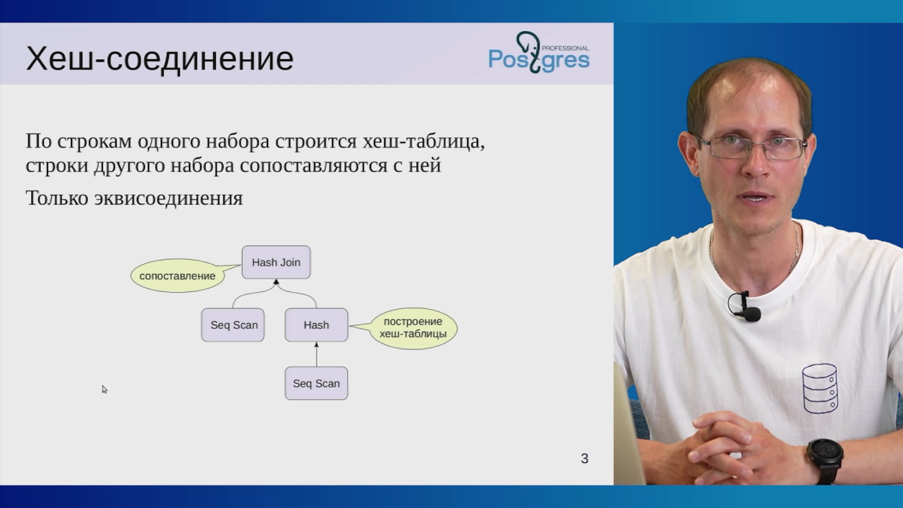
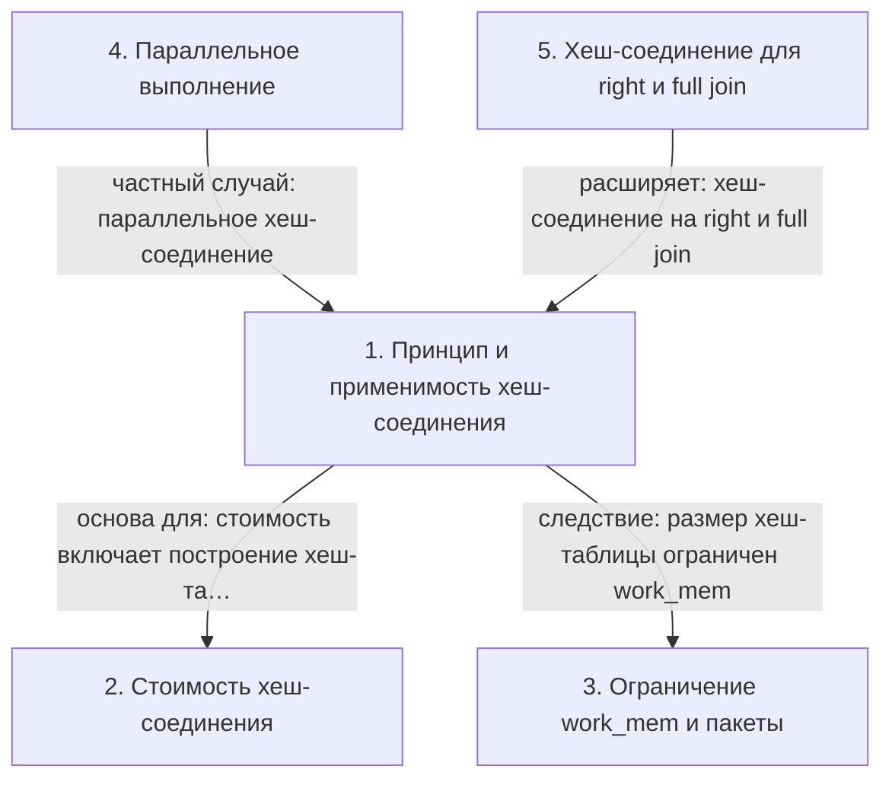

# Хеш-соединение в PostgreSQL: построение, пакеты и параллелизм

> [!abstract] Обзор
> Материал о хеш-соединении (hash join) в PostgreSQL: построении хеш-таблицы по строкам одного набора и сопоставлении с ней строк другого набора. Разбирается применимость только для эквисоединений, участвующие в плане узлы и стоимость. Отдельно рассматриваются ограничение памяти work_mem, вытеснение хеш-таблицы на диск пакетами и параллельное выполнение. Показана реализация хеш-соединения для right join и full join, а также этап разбиения на пакеты.

> [!info] Курс
> [[index|Оглавление курса]]

## Оглавление
1. [[#1. Принцип и применимость хеш-соединения]]
2. [[#2. Стоимость хеш-соединения]]
3. [[#3. Ограничение work_mem и пакеты]]
4. [[#4. Параллельное выполнение]]
5. [[#5. Хеш-соединение для right и full join]]

**Схема** — [[#Схема]]
**Итог** — [[#Итог]]

## 1. Принцип и применимость хеш-соединения

Хеш-соединение (hash join) строит хеш-таблицу по строкам одного набора (внутреннего, обычно меньшего и расположенного ниже в плане) и сопоставляет с ней строки другого (внешнего) набора. При построении хеш-таблицы сохраняются только столбцы, необходимые для соединения. При сопоставлении строка внешнего набора хешируется, код сопоставляется с хеш-таблицей, и в найденной корзине проверяется соответствие значения; если в ней несколько строк, проверяются все. Хеш-соединение применимо только для эквисоединений, так как для хеш-кодов операторы больше/меньше не имеют смысла. В плане участвует узел Hash, который строит хеш-таблицу и сначала читает данные через дочерний Seq Scan; в плане участвует также второй Seq Scan.

*Источник: [00:01:00]*

> [!quote]- Кадр [00:01:00]
> 

## 2. Стоимость хеш-соединения

Стоимость хеш-соединения равна сумме количества строк двух наборов и включает стоимость построения хеш-таблицы. Оно выгодно при больших таблицах, так как каждый набор читается только один раз. Стоимость складывается из получения второго набора строк, получения внешнего набора, сопоставления по хеш-таблице и обращения к диску при нехватке памяти.

*Источник: [00:01:00]*

## 3. Ограничение work_mem и пакеты

Хеш-таблица ограничена размером work_mem × HashMemMultiplier: если она помещается, соединение однопроходное, иначе оно становится двухпроходным; нехватка памяти может быть определена на этапе планирования или выполнения, а в примере объём work_mem увеличивают до 32 мегабайт. Если хеш-таблица не помещается в оперативную память, планировщик разбивает её на несколько пакетов (batches), и наборы строк тоже разбиваются на пакеты: внешний набор читается и разбивается на отдельные временные файлы-пакеты на диске. Строка попадает только в один пакет, поэтому соответствующих ей строк в других пакетах уже нет. Наборы разбиваются на пакеты (например, 4), и сопоставление повторяется для каждого пакета, а узел хеширования записывает данные на диск, что видно по tempwritten; после разбиения начинается этап сопоставления. По разным описаниям, первый пакет может храниться в оперативной памяти, остальные — в файлах на диске, либо все пакеты сохраняются на диск.

*Источник: [00:01:00]*

## 4. Параллельное выполнение

При параллельном выполнении все этапы производятся параллельно, а хеш-таблица строится в разделяемой памяти; в плане появляется узел Parallel Hash Join. Рабочие процессы могут помогать друг другу. Разработчик может сократить число полей, участвующих в хеш-соединении, чтобы уменьшить хеш-таблицу.

*Источник: [00:01:00]*

## 5. Хеш-соединение для right и full join

Хеш-соединение имеет реализацию для правого (right join) и полного (full join) соединения, в отличие от вложенного цикла, потому что все строки таблиц всё равно просматриваются. В плане для right join присутствует узел hash right join, а для full join — узел hash full join.

*Источник: [00:01:00]*

## Схема

## Итог

> [!success] Что в итоге
> Хеш-соединение строит хеш-таблицу и сопоставляет с ней строки внешнего набора, применимо только к эквисоединениям, а его стоимость равна сумме строк двух наборов плюс построение хеш-таблицы. Размер таблицы ограничен work_mem × HashMemMultiplier, поэтому при нехватке памяти она вытесняется на диск пакетами; строка попадает ровно в один пакет, и после разбиения начинается этап сопоставления. При параллельном выполнении хеш-таблица строится в разделяемой памяти, а для right и full join существуют отдельные узлы плана.

