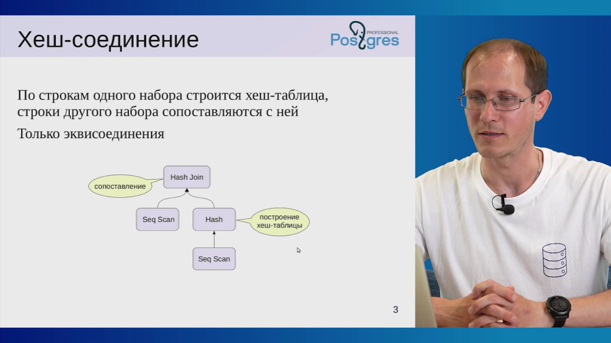
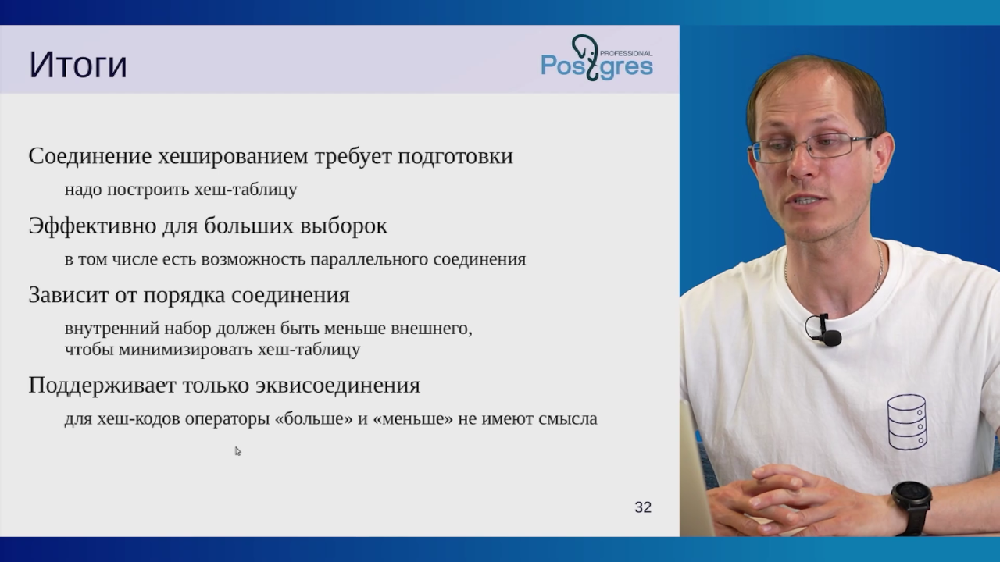
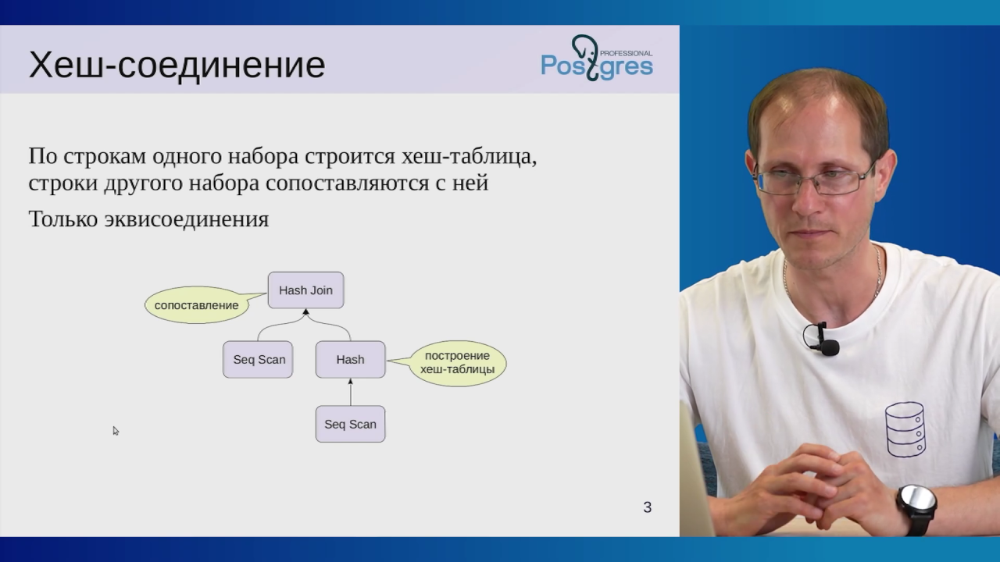
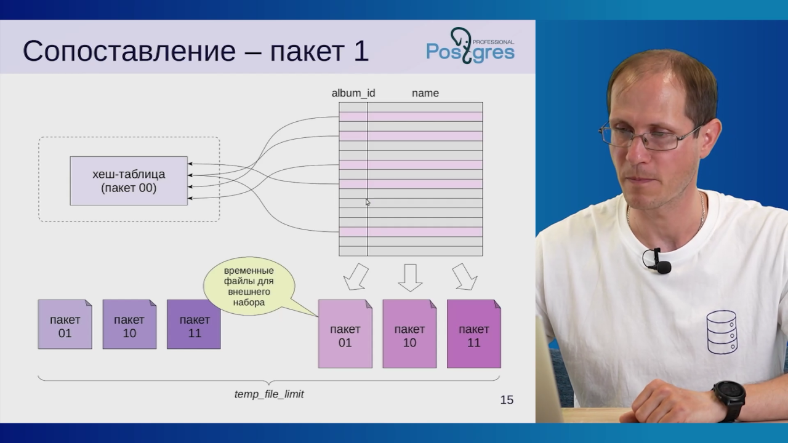
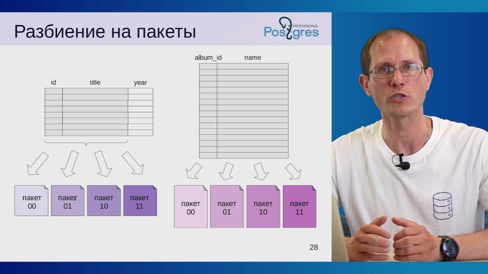
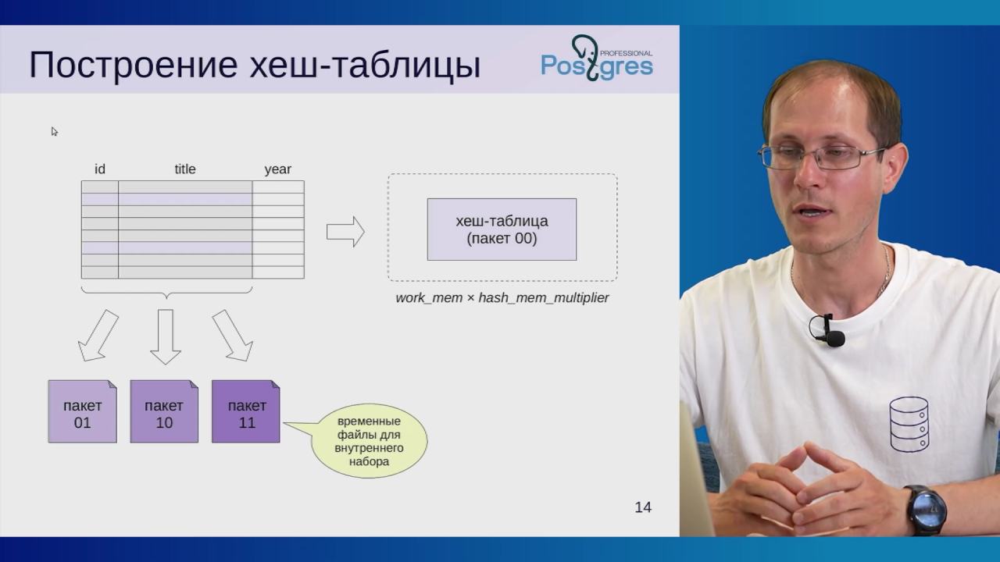
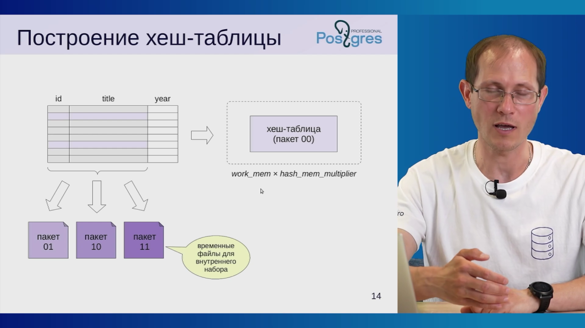
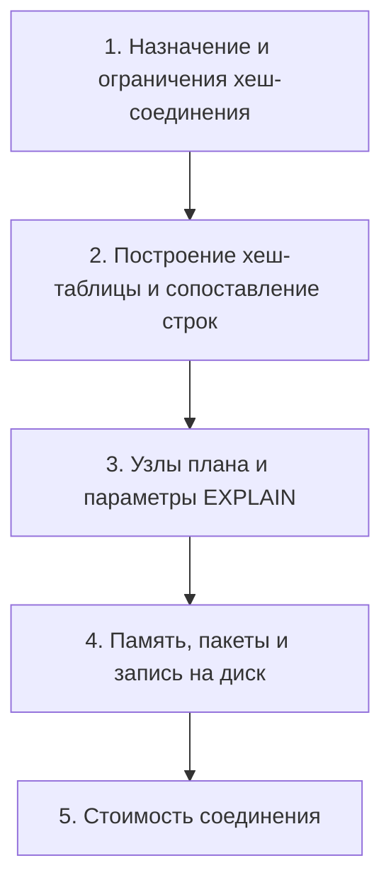

# Хеш-соединение в PostgreSQL

> [!abstract] Обзор
> Материал объясняет хеш-соединение (Hash Join) в PostgreSQL: построение хеш-таблицы по меньшему внутреннему набору, распределение строк по корзинам и сопоставление внешнего набора по хэш-коду. Показано, что поддерживаются только эквисоединения, а в плане EXPLAIN видны узлы Hash и Hash Join, параметры Buckets, Batches, Memory Usage. Разбираются ограничение памяти work_mem × hash_mem_multiplier, случай Batches: 1 и переход к пакетной обработке с записью на диск, когда хеш-таблица не помещается в оперативную память. Отдельно рассматриваются стоимость соединения, влияние явного перечисления полей на количество пакетов и применение хеш-соединения, когда важен итоговый результат.

> [!info] Курс
> [[index|Оглавление курса]]

## Оглавление
1. [[#1. Назначение и ограничения хеш-соединения]]
2. [[#2. Построение хеш-таблицы и сопоставление строк]]
3. [[#3. Узлы плана и параметры EXPLAIN]]
4. [[#4. Память, пакеты и запись на диск]]
5. [[#5. Стоимость соединения]]

**Схема** — [[#Схема]]
**Итог** — [[#Итог]]

## 1. Назначение и ограничения хеш-соединения

По строкам одного набора строится хеш-таблица, а строки другого набора сопоставляются с ней. Применимо только для эквисоединений и требует предварительной подготовки — построения хеш-таблицы. Внутренний набор должен быть меньше внешнего, чтобы минимизировать хеш-таблицу. Хеш-соединение эффективно для больших выборок, в том числе с возможностью параллельного соединения, и характерно для OLAP-систем.

> [!info] Зачем это нужно
> Применяют, когда не важно быстро получить первый результат, а важен итоговый результат.

*Источник: [00:00:40], [00:20:34], [00:34:00], [00:34:26]*

> [!quote]- Кадр [00:00:40]
> 

> [!quote]- Кадр [00:34:00]
> 

## 2. Построение хеш-таблицы и сопоставление строк

Внутренний набор — это таблица, которая в плане располагается ниже; в данном случае это albums. Для хеширования используется числовой идентификатор id: к нему применяется хеш-функция, вычисляется хеш-код, и формируется количество корзин. В хеш-таблице сохраняется идентификатор и заголовок title, а год (year) не сохраняется; количество строк в корзинах должно быть примерно одинаковым. Для каждой строки внешнего набора применяется хэш-код и проверяется соответствующая корзина: если корзина пуста, соответствия нет, а если соответствие найдено, строка возвращается узлу выше. Двухпроходное хэш-соединение загружает данные в хеш-таблицу, затем загружает данные из внешнего набора, производит сопоставление и возвращает результат; хэш-соединение чаще всего используется при низкой селективности, а при параллельном хэш-соединении процессы используют одну общую хеш-таблицу в разделяемой памяти.

```sql
SELECT a.title, s.name
FROM albums a JOIN songs s ON a.id = s.album_id;
```

*Источник: [00:02:12], [00:05:33]*

## 3. Узлы плана и параметры EXPLAIN

В плане видны два узла: Hash, который строит хеш-таблицу, и Hash Join, который сопоставляет строки. Хеш-таблица строится по меньшему набору строк, и сначала нужно прочитать весь внутренний набор. Помимо left, semi и anti join, Hash Join поддерживает right join и full join, так как все строки таблиц всё равно просматриваются; в parallel hash join все этапы параллельные, а лимит памяти определяется как work_mem × HashMemMultiplyer × количество процессов. Параметр buckets показывает количество корзин в хеш-таблице; при выполнении EXPLAIN (analyze, costs off, timing off, summary off) для Hash Join в плане отображаются Buckets, Batches и Memory Usage. Batches: 1 означает, что ограничение памяти распространяется на все процессы; выделенной для хеш-таблицы памяти хватило, чтобы она поместилась в оперативную память.

```sql
EXPLAIN (costs off)
SELECT *
FROM aircrafts a
  JOIN seats s ON a.aircraft_code = s.aircraft_code;

---------------- QUERY PLAN ----------------
Hash Join
  Hash Cond: (s.aircraft_code = m1.aircraft_code)
  ->  Seq Scan on seats s
  ->  Hash
        ->  Seq Scan on aircrafts_data m1
(5 rows)

=> EXPLAIN (analyze, costs off, timing off, summary off)
SELECT *
FROM aircrafts a
  JOIN seats s ON a.aircraft_code = s.aircraft_code;

       QUERY PLAN
--------------------------
 Hash Join (actual rows=1339 loops=1)
   Hash Cond: (s.aircraft_code = ml.aircraft_code)
   ->  Seq Scan on seats s (actual rows=1339 loops=1)
   ->  Hash (actual rows=9 loops=1)
         Buckets: 1024  Batches: 1  Memory Usage: 9kB
         ->  Seq Scan on aircrafts_data ml (actual rows=9 loops=1)

== EXPLAIN (analyze, costs off, timing off, summary off)
SELECT count(*)
FROM bookings b
  JOIN tickets t ON b.book_ref = t.book_ref;

QUERY PLAN
------------------------------------------------------------
 Finalize Aggregate (actual rows=1 loops=1)
   -> Gather (actual rows=3 loops=1)
         Workers Planned: 2
         Workers Launched: 2
         -> Partial Aggregate (actual rows=1 loops=3)
               -> Parallel Hash Join (actual rows=983286 loops=3)
                     Hash Cond: (t.book_ref = b.book_ref)
                     -> Parallel Seq Scan on tickets t (actual rows=983286 loops=3)
                     -> Parallel Hash (actual rows=703703 loops=3)
                           Buckets: 4194304  Batches: 1  Memory Usage: 115392kB
                           -> Parallel Seq Scan on bookings b (actual rows=703703 loops=3)

== EXPLAIN (analyze, costs off, timing off, summary off)
SELECT count(*)
FROM bookings b
  JOIN tickets t ON b.book_ref = t.book_ref;

QUERY PLAN
------------------------------------------------------------
 Finalize Aggregate (actual rows=1 loops=1)
   ->  Gather (actual rows=3 loops=1)
         Workers Planned: 2
         Workers Launched: 2
         ->  Partial Aggregate (actual rows=1 loops=3)
               ->  Parallel Hash Join (actual rows=983286 loops=3)
                     Hash Cond: (t.book_ref = b.book_ref)
                     ->  Parallel Seq Scan on tickets t (actual rows=983286 loops=3)
                     ->  Parallel Hash (actual rows=703703 loops=3)
                           Buckets: 4194304  Batches: 1  Memory Usage: 115392kB
                           ->  Parallel Seq Scan on bookings b (actual rows=703703 loops=3)
```

*Источник: [00:01:05], [00:09:14], [00:28:25], [00:36:37]*

> [!quote]- Кадр [00:01:05]
> 

## 4. Память, пакеты и запись на диск

Объём памяти для хеш-таблицы вычисляется как work_mem × hash_mem_multiplier; этот же лимит ограничивает размер памяти при построении хеш-таблицы, а однопроходное хэш-соединение используется, если хеш-таблица помещается в это ограничение. В Parallel Hash хеш-таблица строится в разделяемой памяти, а ограничение размера вычисляется как work_mem × hash_mem_multiplier × количество процессов; для одного процесса hash work_mem — 32 мегабайта, умноженные на hash_mem_multiplier (по умолчанию 2, то есть 64 мегабайта). Когда хэш-таблица не помещается в оперативную память, внешний набор строк обрабатывается пакетами: строки разбиваются на пакеты, сохраняются на диск и параллельно обрабатываются рабочими процессами, причём строка сохраняется в свой отдельный файл, и если она попала в какой-то пакет, то в других пакетах соответствия ей уже нет. При однопроходном последовательном хэш-соединении все пакеты сохраняются на диск (строки первого пакета — в первый файл, второго — во второй и так далее), а при сопоставлении сначала находятся соответствия в оперативной памяти для первых пакетов, затем идёт сопоставление второго пакета; в EXPLAIN помимо ANALYZE можно добавить BUFFERS, чтобы вывести статистику ввода-вывода, Batches был 1, теперь 32, после выполнения количество используемых пакетов сократилось с 32 до 16, узел хэширования записывал данные на диск, а узел hash join при сопоставлении читает и может писать temp-written. В запросах рекомендуется указывать только нужные поля вместо звёздочки (*) — это уменьшает количество пакетов и потребление памяти.

```
SET work_mem = '32MB';
```

> [!info] Зачем это нужно
> Уменьшает количество пакетов и потребление памяти.

*Источник: [00:00:00], [00:02:12], [00:07:46], [00:11:09], [00:11:49], [00:12:41] и др.*

> [!quote]- Кадр [00:00:00]
> 

> [!quote]- Кадр [00:13:29]
> 

> [!quote]- Кадр [00:29:49]
> 

> [!quote]- Кадр [00:11:49]
> 

> [!quote]- Кадр [00:12:41]
> 

## 5. Стоимость соединения

Стоимость складывается из получения второго набора строк, в данном случае ticket_flights, и получения полного набора, потому что нужно прочитать внешний набор. Далее запускается сопоставление — проверка по хэш-таблице. Для соединения ticket_flights и tickets планировщик выбрал Hash Join с условием Hash Cond: (tf.ticket_no = t.ticket_no), обе таблицы читаются через Seq Scan. Стоимость hash join составляет почти 162 тысячи условных единиц, получение первого набора — почти 79 тысяч. Стоимость соединения складывается из количества строк во внешнем наборе, просуммированного с количеством строк во внутреннем наборе; хэш-соединение прочитает только один набор строк и второй один раз.

*Источник: [00:01:05], [00:23:18], [00:27:37]*


## Схема



## Итог

> [!success] Что в итоге
> Хеш-соединение строит хеш-таблицу по меньшему внутреннему набору и сопоставляет с ней строки внешнего набора, поддерживая только эквисоединения. Если хеш-таблица помещается в лимит work_mem × hash_mem_multiplier, получается Batches: 1; иначе строки разбиваются на пакеты и сохраняются на диск. Стоимость складывается из чтения обоих наборов, а явное перечисление нужных полей уменьшает пакеты и память. Применяют его, когда важен итоговый результат, а не быстрый первый.

