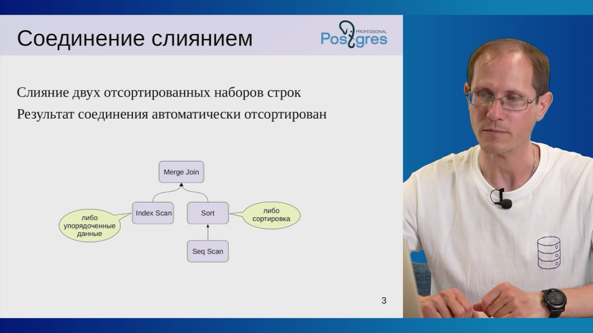
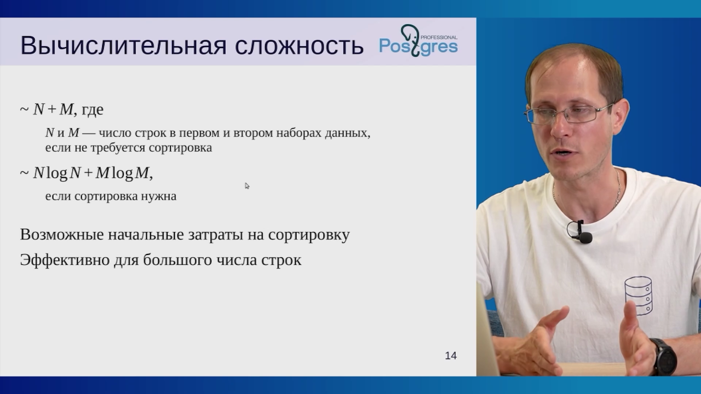
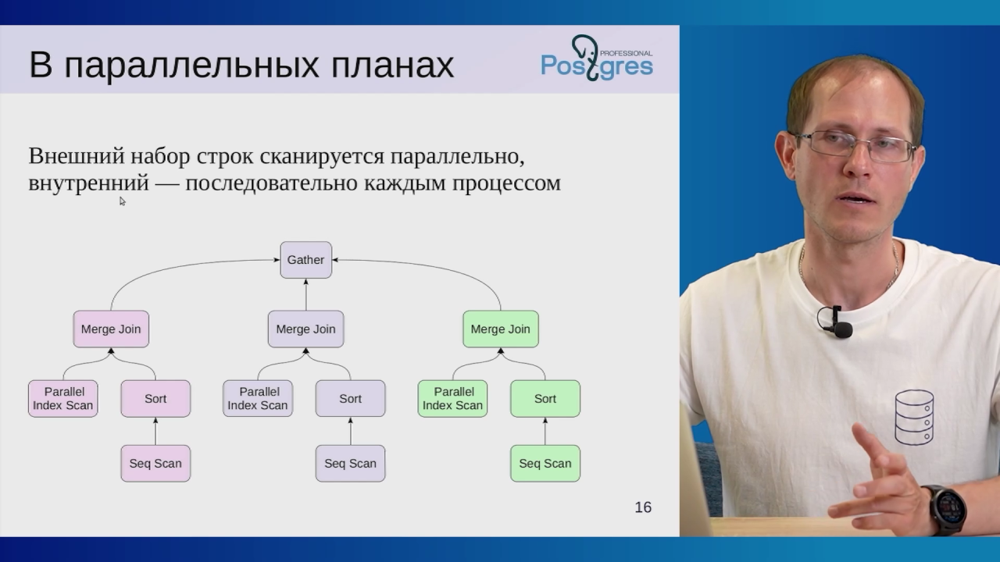
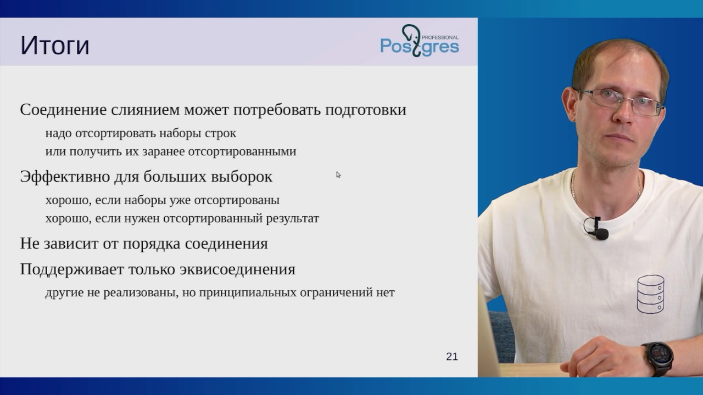
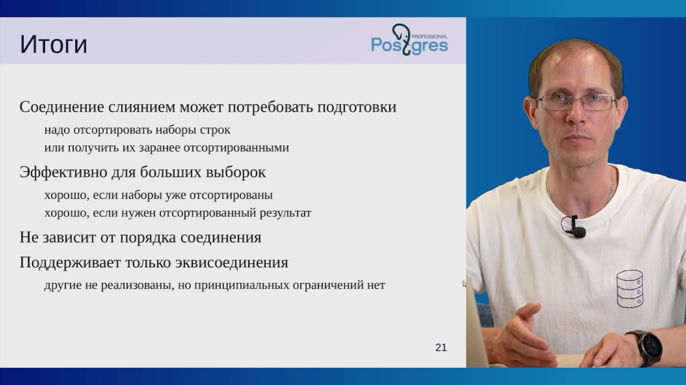
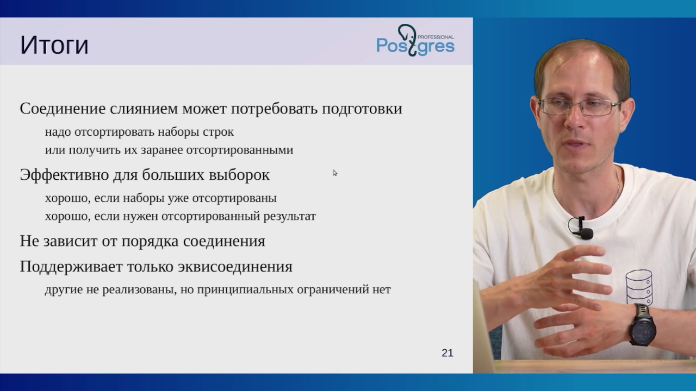
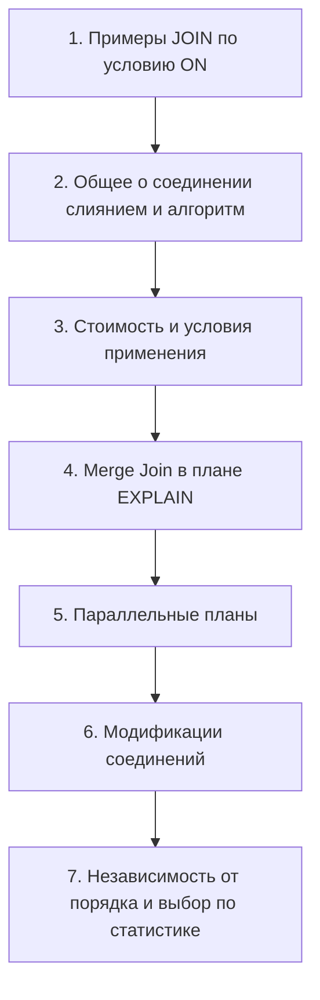

# Соединение слиянием (Merge Join) в PostgreSQL

> [!abstract] Обзор
> Материал посвящён соединению слиянием (Merge Join) в PostgreSQL: его алгоритму, требованиям к сортировке, стоимости и использованию в планах запросов. Показано, как JOIN объединяет строки двух таблиц по условию ON, и как в плане EXPLAIN узел Merge Join работает с условием Merge Cond и Index Scan. Отмечено, что данные из индексов берутся уже отсортированными, поэтому дополнительная сортировка не нужна, а результат соединения автоматически отсортирован. Разобраны планы с LIMIT, начальная стоимость, параллельные планы, модификации соединения и выбор способа соединения планировщиком по статистике.

> [!info] Курс
> [[index|Оглавление курса]]

## Оглавление
1. [[#1. Примеры JOIN по условию ON]]
2. [[#2. Общее о соединении слиянием и алгоритм]]
3. [[#3. Стоимость и условия применения]]
4. [[#4. Merge Join в плане EXPLAIN]]
5. [[#5. Параллельные планы]]
6. [[#6. Модификации соединений]]
7. [[#7. Независимость от порядка и выбор по статистике]]

**Схема** — [[#Схема]]
**Итог** — [[#Итог]]

## 1. Примеры JOIN по условию ON

JOIN объединяет строки двух таблиц по условию ON. В первом примере таблица albums (алиас a) соединяется с songs (алиас s) по условию a.id = s.album_id, выбираются поля a.title и s.name. Во втором примере выбираются все столбцы из aircrafts и seats с соединением по aircraft_code и сортировкой результата по aircraft_code через ORDER BY.

```sql
SELECT a.title, s.name
FROM albums a JOIN songs s ON a.id = s.album_id;

SELECT * FROM aircrafts a
  JOIN seats s ON a.aircraft_code = s.aircraft_code
ORDER BY a.aircraft_code;
```

*Источник: [00:02:00], [00:15:56], [00:16:47], [00:21:24], [00:21:54]*

## 2. Общее о соединении слиянием и алгоритм

Соединение слиянием объединяет два отсортированных набора строк и поддерживает только эквисоединения; другие соединения не реализованы, но принципиальных ограничений нет. Вычислительная сложность в общем случае такая же, как у хэширования: сумма количества строк в первом и во втором наборах данных. Алгоритм сравнивает идентификаторы из внешнего и внутреннего наборов; если равенства нет, указатель сдвигается в наборе с меньшим значением. При дубликатах во внешнем наборе приходится перечитывать уже прочитанные строки во внутреннем наборе; после исчерпания правого набора алгоритм продолжает читать левый. Результат соединения автоматически отсортирован.

*Источник: [00:00:00], [00:00:20], [00:00:40], [00:14:46], [00:18:37]*

> [!quote]- Кадр [00:00:00]
> 

> [!quote]- Кадр [00:00:20]
> 

> [!quote]- Кадр [00:00:40]
> 

## 3. Стоимость и условия применения

Для соединения слиянием входные данные должны быть предварительно отсортированы либо отсортированы с помощью узла Sort. Данные можно взять уже отсортированными индексным доступом, либо добавить узел Sort, потратив время на сортировку. Если данные уже отсортированы, стоимость соединения составляет ~ N + M, а если нужна сортировка — ~ N log N + M log M; полная стоимость складывается из стоимости получения первой пары строк и суммы полных стоимостей двух наборов. Метод эффективен для большого числа строк. Если запрос содержит ORDER BY, планировщик может предпочесть соединение слиянием, чтобы получить отсортированный результат. Соединение слиянием также подходит при ограничении LIMIT, тогда как хеш-соединению нужно построить хеш-таблицу, прежде чем возвращать результат клиенту.

*Источник: [00:00:20], [00:00:40], [00:02:00], [00:10:02]*


> [!quote]- Кадр [00:10:02]
> 

## 4. Merge Join в плане EXPLAIN

В плане запроса узел Merge Join соответствует соединению слиянием: EXPLAIN показывает Merge Join с условием Merge Cond (например, t.ticket_no = tf.ticket_no) и двумя Index Scan по соответствующим ключам. Соединение слиянием работает с условием равенства; начальная стоимость узла складывается из начальных стоимостей дочерних узлов (в примере 0.99 = 0.43 + 0.56). Результат Merge Join отсортирован и может использоваться как вход для следующего Merge Join; сортировку можно получить от индекса или от другого узла Merge Join. Данные из индексов берутся уже отсортированными, поэтому дополнительная сортировка не требуется — в примерах с ORDER BY t.ticket_no план использует Merge Join с двумя Index Scan без узла Sort. При LIMIT план добавляет узел Limit поверх Merge Join.

```javascript
> EXPLAIN SELECT *
   FROM tickets t
   JOIN ticket_flights tf ON tf.ticket_no = t.ticket_no
   ORDER BY t.ticket_no;

Merge Join  (cost=0.99..822448.54 rows=8391030 width=136)
  Merge Cond: (t.ticket_no = tf.ticket_no)
  ->  Index Scan using tickets_pkey on tickets t  (cost=0.43..139115.62 rows=2949963 width=104)
  ->  Index Scan using ticket_flights_pkey on ticket_flights tf  (cost=0.56..571070.20 rows=8391030 width=32)
(4 rows)

> EXPLAIN SELECT *
   FROM tickets t
   JOIN ticket_flights tf ON tf.ticket_no = t.ticket_no
   ORDER BY t.ticket_no;

Merge Join  (cost=0.99..822448.54 rows=8391030 width=136)
  Merge Cond: (t.ticket_no = tf.ticket_no)
  ->  Index Scan using tickets_pkey on tickets t
  ->  Index Scan using ticket_flights_pkey on ticket_flights tf
(4 rows)

> EXPLAIN SELECT *
   FROM tickets t
   JOIN ticket_flights tf ON tf.ticket_no = t.ticket_no
   ORDER BY t.ticket_no
   LIMIT 1000;

QUERY PLAN
Limit  (cost=0.99..99.01 rows=1000 width=136)
  ->  Merge Join  (cost=0.99..822448.54 rows=8391030 width=136)
        Merge Cond: (t.ticket_no = tf.ticket_no)
        ->  Index Scan using tickets_pkey on tickets t
        ->  Index Scan using ticket_flights_pkey on ticket_flights tf
(5 rows)

> EXPLAIN SELECT *
FROM tickets t
JOIN ticket_flights tf ON tf.ticket_no = t.ticket_no
ORDER BY t.ticket_no
LIMIT 1000;

QUERY PLAN
Limit  (cost=0.99..99.01 rows=1000 width=136)
  ->  Merge Join  (cost=0.99..822448.54 rows=8391030 width=136)
        Merge Cond: (t.ticket_no = tf.ticket_no)
        ->  Index Scan using tickets_pkey on tickets t  (cost=0.43..139115.62 rows=2949963 width=104)
        ->  Index Scan using ticket_flights_pkey on ticket_flights tf  (cost=0.56..571970.20 rows=8391030 width=32)
(5 rows)

> EXPLAIN (costs off) SELECT t.ticket_no, bp.flight_id, bp.seat_no
FROM tickets t
JOIN ticket_flights tf ON t.ticket_no = tf.ticket_no
JOIN boarding_passes bp ON bp.ticket_no = tf.ticket_no
AND bp.flight_id = tf.flight_id
ORDER BY t.ticket_no;

     Merge Join
     Merge Cond: (tf.ticket_no = t.ticket_no)
     ->  Merge Join
           Merge Cond: ((tf.ticket_no = bp.ticket_no) AND (tf.flight_id = bp.flight_id))
           ->  Index Only Scan using ticket_flights_pkey on ticket_flights tf
           ->  Index Scan using boarding_passes_pkey on boarding_passes bp
     ->  Index Only Scan using tickets_pkey on tickets t
(7 rows)

Merge Join
  Merge Cond: (tf.ticket_no = t.ticket_no)
  ->  Merge Join
        Merge Cond: ((tf.ticket_no = bp.ticket_no) AND (tf.flight_id = bp.flight_id))
        ->  Index Only Scan using ticket_flights_pkey on ticket_flights tf
        ->  Index Scan using boarding_passes_pkey on boarding_passes bp
  ->  Index Only Scan using tickets_pkey on tickets t
(7 rows)

=> EXPLAIN SELECT *
   FROM tickets t
   JOIN ticket_flights tf ON tf.ticket_no = t.ticket_no
   ORDER BY t.ticket_no;

Merge Join  (cost=0.99..822448.54 rows=8391030 width=136)
  Merge Cond: (t.ticket_no = tf.ticket_no)
  ->  Index Scan using tickets_pkey on tickets t  (cost=0.43..139115.62 rows=2949963 width=104)
  ->  Index Scan using ticket_flights_pkey on ticket_flights tf  (cost=0.56..571070.20 rows=8391030 width=32)
(4 rows)

=> EXPLAIN SELECT *
   FROM tickets t
   JOIN ticket_flights tf ON tf.ticket_no = t.ticket_no
   ORDER BY t.ticket_no;

Merge Join  (cost=0.99..822448.54 rows=8391030 width=136)
  Merge Cond: (t.ticket_no = tf.ticket_no)
  ->  Index Scan using tickets_pkey on tickets t
  ->  Index Scan using ticket_flights_pkey on ticket_flights tf
(4 rows)

=> EXPLAIN SELECT *
   FROM tickets t
   JOIN ticket_flights tf ON tf.ticket_no = t.ticket_no
   ORDER BY t.ticket_no
   LIMIT 1000;

QUERY PLAN
Limit  (cost=0.99..99.01 rows=1000 width=136)
  ->  Merge Join  (cost=0.99..822448.54 rows=8391030 width=136)
        Merge Cond: (t.ticket_no = tf.ticket_no)
        ->  Index Scan using tickets_pkey on tickets t
        ->  Index Scan using ticket_flights_pkey on ticket_flights tf
(5 rows)

=> EXPLAIN SELECT *
FROM tickets t
JOIN ticket_flights tf ON tf.ticket_no = t.ticket_no
ORDER BY t.ticket_no
LIMIT 1000;

QUERY PLAN
Limit  (cost=0.99..99.01 rows=1000 width=136)
  ->  Merge Join  (cost=0.99..822448.54 rows=8391030 width=136)
        Merge Cond: (t.ticket_no = tf.ticket_no)
        ->  Index Scan using tickets_pkey on tickets t  (cost=0.43..139115.62 rows=2949963 width=104)
        ->  Index Scan using ticket_flights_pkey on ticket_flights tf  (cost=0.56..571970.20 rows=8391030 width=32)
(5 rows)

=> EXPLAIN (costs off) SELECT t.ticket_no, bp.flight_id, bp.seat_no
FROM tickets t
JOIN ticket_flights tf ON t.ticket_no = tf.ticket_no
JOIN boarding_passes bp ON bp.ticket_no = tf.ticket_no
AND bp.flight_id = tf.flight_id
ORDER BY t.ticket_no;

     Merge Join
     Merge Cond: (tf.ticket_no = t.ticket_no)
     ->  Merge Join
           Merge Cond: ((tf.ticket_no = bp.ticket_no) AND (tf.flight_id = bp.flight_id))
           ->  Index Only Scan using ticket_flights_pkey on ticket_flights tf
           ->  Index Scan using boarding_passes_pkey on boarding_passes bp
     ->  Index Only Scan using tickets_pkey on tickets t
(7 rows)

Merge Join
  Merge Cond: (tf.ticket_no = t.ticket_no)
  ->  Merge Join
        Merge Cond: ((tf.ticket_no = bp.ticket_no) AND (tf.flight_id = bp.flight_id))
        ->  Index Only Scan using ticket_flights_pkey on ticket_flights tf
        ->  Index Scan using boarding_passes_pkey on boarding_passes bp
  ->  Index Only Scan using tickets_pkey on tickets t
(7 rows)
```

*Источник: [00:07:14], [00:07:34], [00:08:24], [00:11:33], [00:13:56], [00:17:07] и др.*

## 5. Параллельные планы

Для построения параллельного плана нужно создать дополнительный индекс на таблице tickets. В примере параллельного плана с merge join внешний набор bookings сканируется параллельно через Parallel Index Only Scan, а подзапрос tickets группируется каждым процессом. В параллельных планах внешний набор строк сканируется параллельно несколькими рабочими процессами; внутренний набор каждый процесс читает отдельно и последовательно, поэтому его приходится читать несколько раз — его читают все процессы.

```sql
> CREATE INDEX ON tickets(book_ref);

CREATE INDEX

> EXPLAIN (costs off)
SELECT count(*)
FROM bookings b
JOIN (
    SELECT book_ref FROM tickets GROUP BY book_ref
) t ON b.book_ref = t.book_ref;

QUERY PLAN
------------------------------------------------------------
Finalize Aggregate
  ->  Gather
        Workers Planned: 2
        ->  Partial Aggregate
              ->  Merge Join
                    Merge Cond: (b.book_ref = tickets.book_ref)
                    ->  Parallel Index Only Scan using bookings_pkey on bookings b
                    ->  Group
                          Group Key: tickets.book_ref
                          ->  Index Only Scan using tickets_book_ref_idx on tickets
(10 rows)

=> CREATE INDEX ON tickets(book_ref);

CREATE INDEX

=> EXPLAIN (costs off)
SELECT count(*)
FROM bookings b
JOIN (
    SELECT book_ref FROM tickets GROUP BY book_ref
) t ON b.book_ref = t.book_ref;

QUERY PLAN
------------------------------------------------------------
Finalize Aggregate
  ->  Gather
        Workers Planned: 2
        ->  Partial Aggregate
              ->  Merge Join
                    Merge Cond: (b.book_ref = tickets.book_ref)
                    ->  Parallel Index Only Scan using bookings_pkey on bookings b
                    ->  Group
                          Group Key: tickets.book_ref
                          ->  Index Only Scan using tickets_book_ref_idx on tickets
(10 rows)
```

*Источник: [00:15:36], [00:15:56], [00:16:47], [00:17:47]*

> [!quote]- Кадр [00:15:36]
> 

## 6. Модификации соединений

Соединение слиянием поддерживает модификации left, right, semi-join и anti-join. Full-join реализован только для хэш-соединения; код, который позволил бы соединению слиянием поддерживать full-join, ещё не написан.

*Источник: [00:07:34], [00:08:52]*

## 7. Независимость от порядка и выбор по статистике

Соединение слиянием не зависит от порядка соединения. Планировщик опирается на статистику, оценивает размеры таблиц и расположение внутреннего и внешнего наборов строк, после чего выбирает способ соединения. Нельзя сказать, что какой-то способ соединения всегда лучше; выбор зависит от ситуации и статистики.

*Источник: [00:18:37], [00:19:04], [00:20:44]*

> [!quote]- Кадр [00:19:04]
> 

> [!quote]- Кадр [00:18:37]
> 

> [!quote]- Кадр [00:20:44]
> 

## Схема



## Итог

> [!success] Что в итоге
> Соединение слиянием работает с двумя отсортированными наборами строк и возвращает отсортированный результат; его стоимость зависит от того, нужна ли дополнительная сортировка. Оно поддерживает эквисоединения и модификации left, right, semi-join и anti-join, но FullJoin реализован только для хэш-соединения. Отсортированные данные из индексов избавляют от дополнительной сортировки, при LIMIT план добавляет узел Limit поверх Merge Join, а в параллельном плане внешний набор сканируется параллельно, а внутренний читается каждым процессом отдельно. Планировщик выбирает способ соединения по статистике, поэтому нельзя сказать, что какой-то способ всегда лучше.

