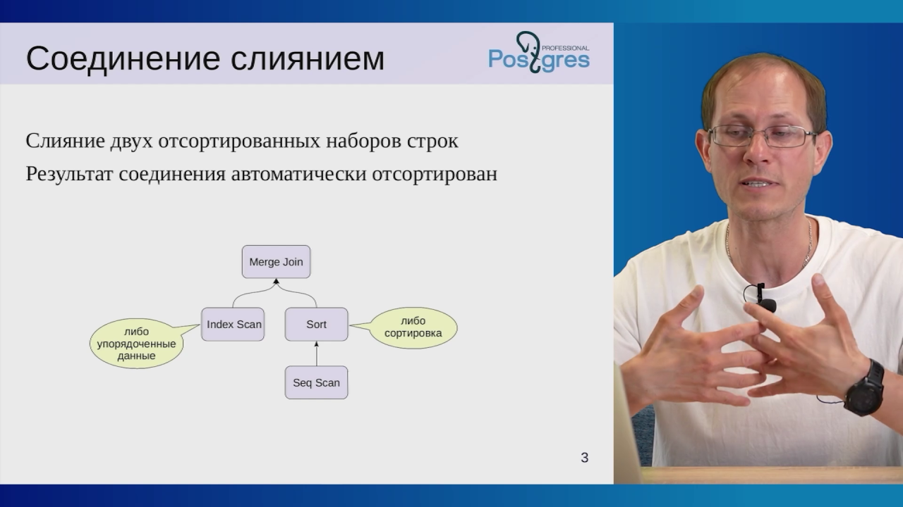
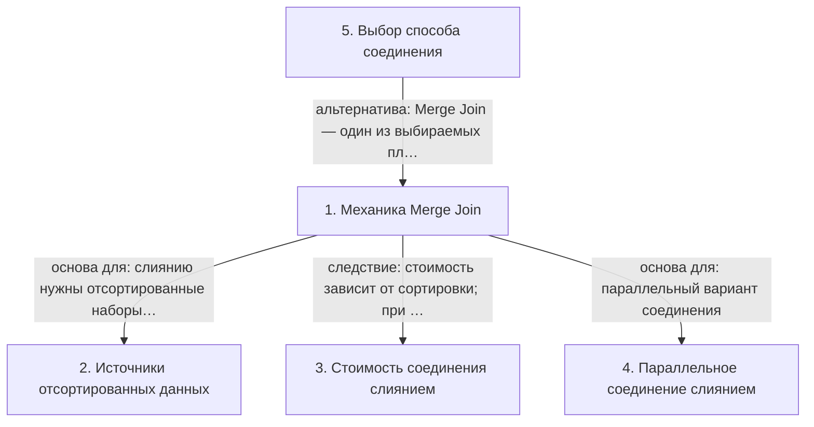

# Соединение слиянием в PostgreSQL

> [!abstract] Обзор
> Материал о соединении слиянием (Merge Join) в PostgreSQL: как устроено слияние двух отсортированных наборов строк, откуда берутся упорядоченные данные и как оценивается стоимость. Разобраны вложенный MergeJoin, поведение при LIMIT, параллельное выполнение и то, как планировщик выбирает способ соединения. Показано, что результат соединения автоматически отсортирован, а поддерживается только эквисоединение.

> [!info] Курс
> [[index|Оглавление курса]]

## Оглавление
1. [[#1. Механика Merge Join]]
2. [[#2. Источники отсортированных данных]]
3. [[#3. Стоимость соединения слиянием]]
4. [[#4. Параллельное соединение слиянием]]
5. [[#5. Выбор способа соединения]]

**Схема** — [[#Схема]]
**Итог** — [[#Итог]]

## 1. Механика Merge Join

Merge Join сливает два отсортированных набора строк, проходя по ним и соединяя соответствующие строки. При сравнении указатель смещается в том наборе, где значение меньше, а при равенстве — во внутреннем наборе; результат соединения автоматически отсортирован. В текущей реализации поддерживается только эквисоединение, а соединение по неравенству (больше-меньше) не реализовано. При нескольких повторяющихся значениях во внешнем наборе нужны механизмы перечитать уже прочитанные строки во внутреннем наборе. Узел MergeJoin может быть вложенным: отсортированный результат одного MergeJoin используется как набор строк для ещё одного узла MergeJoin.

> [!info] Зачем это нужно
> Планировщик может выбрать Merge Join, если нужен отсортированный результат, особенно когда данные приходят отсортированными от дочерних узлов.

*Источник: [00:01:00]*

> [!quote]- Кадр [00:01:00]
> 

## 2. Источники отсортированных данных

Для соединения слиянием (Merge Join) требуются упорядоченные данные. Их можно получить с помощью индекса (Index Scan) либо добавив узел Sort. При добавлении узла Sort придётся потратить время на сортировку.

*Источник: [00:01:00]*

## 3. Стоимость соединения слиянием

Полная стоимость соединения слиянием складывается из стоимости получения двух наборов строк и стоимости их сопоставления. Вычислительная сложность в общем случае такая же, как у хэширования: сумма количества строк в первом и во втором наборах данных. Стоимость зависит от количества строк в обоих наборах, если сортировка не требуется; если наборы нельзя получить отсортированными по индексу, в оценку добавляется логарифмический элемент, и стоимость возрастает. Начальная стоимость складывается из суммы начальных стоимостей узлов, которые получают данные: 0.99 получается суммированием 0.43 и 0.56. Соединение слиянием отлично подходит при наличии лимита на количество строк: при добавлении LIMIT итоговая стоимость плана снижается с более чем 800 тысяч единиц до 99 единиц.

*Источник: [00:00:00], [00:01:00]*

> [!quote]- Кадр [00:00:00]
> 

## 4. Параллельное соединение слиянием

В параллельных планах соединения слиянием внешний набор строк сканируется параллельно, а внутренний набор строк читается последовательно каждым процессом, поэтому его нужно прочитать несколько раз. Внутренний набор читает каждый рабочий процесс: первый процесс, закончивший свою работу, не избавляет остальные от чтения этого набора строк.

*Источник: [00:00:00], [00:01:00]*

## 5. Выбор способа соединения

Планировщик может использовать разные способы соединения (вложенный цикл, хэширование, слияние). Выбор зависит от статистики, размеров таблиц и наличия эквисоединения. Нельзя сказать, что какой-то способ соединения всегда лучше.

*Источник: [00:01:00]*

## Схема

## Итог

> [!success] Что в итоге
> Соединение слиянием сливает два отсортированных набора строк и даёт автоматически отсортированный результат, поддерживая только эквисоединение. Упорядоченные данные берутся из индекса или узла Sort, а стоимость зависит от количества строк и от того, требуется ли сортировка. Планировщик выбирает этот способ наравне с вложенным циклом и хэшированием по статистике, размерам таблиц и наличию эквисоединения; особенно выгодно соединение слиянием при LIMIT.

