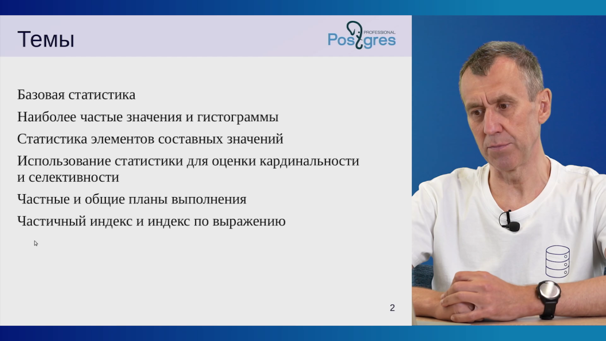
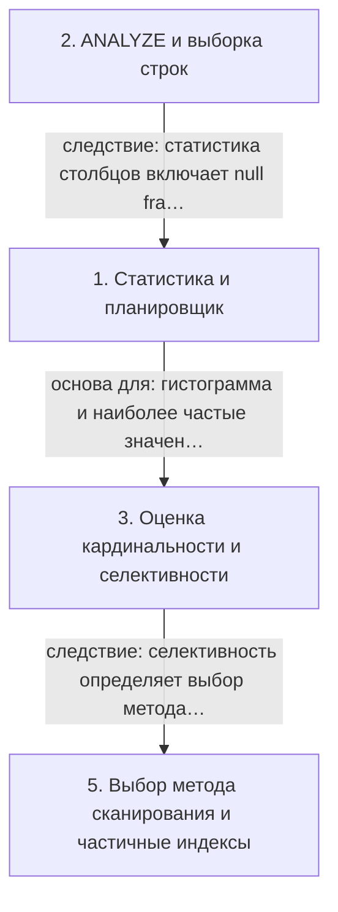

# Статистика PostgreSQL для планировщика: сбор, использование и планы запросов

> [!abstract] Обзор
> Материал о статистике в PostgreSQL, которую сервер собирает о данных, чтобы планировщик строил планы запросов. Рассмотрена базовая статистика в pg_class (reltuples, relpages) и статистика столбцов в pg_statistic и pg_stats: null fraction, n-distinct, наиболее частые значения и их частоты, гистограмма и correlation. Описан сбор статистики операцией ANALYZE по выборке строк и параметр Default Statistics Target, а также приблизительная точность оценок для больших таблиц. Отдельно разобраны оценка кардинальности и селективности, в том числе селективность соединений и ошибки при неравномерном распределении и нескольких соединениях, а также селективность функций по умолчанию и индекс по выражению. Вторая часть посвящена планам подготовленных операторов — частному и общему, их переключению, explain generic plan, plan_cache_mode и выбору метода сканирования, а также частичным индексам и протоколированию медленных запросов.

> [!info] Курс
> [[index|Оглавление курса]]

## Оглавление
1. [[#1. Статистика и планировщик]]
2. [[#2. ANALYZE и выборка строк]]
3. [[#3. Оценка кардинальности и селективности]]
4. [[#4. Планы подготовленных операторов]]
5. [[#5. Выбор метода сканирования и частичные индексы]]
6. [[#6. Протоколирование медленных запросов]]

**Схема** — [[#Схема]]
**Итог** — [[#Итог]]

## 1. Статистика и планировщик

Статистика — это информация, которую сервер Postgres собирает о данных; она помогает планировщику строить планы запросов и используется при оценке кардинальности и селективности. Базовая статистика включает общую информацию о таблице, в том числе размер: в pg_class хранятся reltuples (количество строк) и relpages (количество страниц). Для запроса, возвращающего все строки таблицы, планировщик берёт оценку из reltuples; relpages — оценка количества страниц, и если она отличается от реального размера, планировщик соотносит reltuples с учётом этой разницы; в pg_class также сохраняется информация о количестве страниц, записи в которых видны всем пользователям, что помогает понять, насколько хороша битовая карта и выгодно ли сканирование только индекса. Значения reltuples могут динамически подстраиваться под текущее состояние таблицы при выполнении запроса, а точное количество страниц можно получить, поделив размеры файлов таблицы на размер одной страницы. Для составных типов, таких как массивы, планировщик хранит наиболее частые элементы внутри массивов (Most Common Elements) и их частоты; статистика по массивам полезна для метода доступа GIN, который использует эти значения для точной оценки селективности и кардинальности. Null fraction — это значение от 0 до 1, которое определяет долю пустых значений столбца; n-distinct — количество уникальных значений столбца, а если значение отрицательное, его модуль задаёт долю уникальных значений от общего количества строк, и минус один означает, что каждое значение уникально. ANALYZE собирает наиболее частые значения (Most Common Values) и их частоты (Most Common Frequencies), число которых не превышает значение параметра Default Statistics Target; командой ALTER TABLE ... ALTER COLUMN ... SET STATISTICS задаётся, сколько наиболее частых значений сохранять, после чего нужно пересобрать статистику командой ANALYZE. Если умножить частоту встречаемости значения на количество строк в таблице, получится оценка планировщика; если значение отсутствует в списке наиболее частых, планировщик предполагает, что все остальные значения встречаются равномерно. Остальные значения распределяются по корзинам гистограммы: в каждой корзине примерно одинаковое количество значений, количество корзин определяется параметром default_statistics_target и не превышает 100, а границами корзин служат значения из таблицы. Correlation, близкие к −1, означают, что значения столбца отсортированы по убыванию, близкие к нулю — что данные хранятся хаотично; планировщик использует correlation: при упорядоченных значениях выбирается индексный доступ, при хаотичных — сканирование по битовой карте.

| Столбец | Что содержит |
|---|---|
| Most Common Values | массив наиболее частых значений столбца |
| Most Common Frequencies | массив их частот |

> [!info] Зачем это нужно
> Позволяет точно оценивать запросы и считать селективность и кардинальность.

*Источник: [00:00:00], [00:01:00]*

> [!quote]- Кадр [00:00:00]
> 

> [!quote]- Кадр [00:01:00]
> 

## 2. ANALYZE и выборка строк

По каждому столбцу операция ANALYZE собирает статистику, и она хранится в таблице pg_statistic; одна запись, как правило, соответствует одному столбцу таблицы. Над pg_statistic есть представление pg_stats, которое нагляднее показывает данные и только ту информацию, которую текущему пользователю допустимо смотреть; сама pg_statistic чувствительна с точки зрения безопасности, так как хранит информацию о данных внутри столбцов всех таблиц. Для больших таблиц ANALYZE не читает всю таблицу целиком, а читает только произвольную часть строк и на её основании делает оценки по количеству строк и страниц. Количество читаемых строк определяется настройкой Default Statistics Target, по умолчанию равной 100; значение можно менять на уровне всей системы и на уровне отдельных столбцов, и оно менялось с 10 до 100. Число просматриваемых записей равно значению параметра, умноженному на 300; при значении 100 это 30 тысяч строк — таблицы меньше 30 тысяч строк читаются полностью, а из больших читается 30 тысяч строк в произвольном порядке; увеличение параметра ведёт к увеличению времени анализа.

*Источник: [00:01:00]*

## 3. Оценка кардинальности и селективности

Селективность соединения — это доля строк от декартова произведения двух таблиц, которая должна вернуться; при равномерном распределении используется базовая формула, включающая единицу, делённую на количество уникальных значений первого набора строк, и единицу, делённую на количество уникальных значений второго набора строк. Чтобы определить кардинальность соединения, планировщику нужно оценить кардинальность декартова произведения и умножить её на селективность условий соединения вместе с дополнительными фильтрами; на практике он умножает селективность на количество строк в таблице (в примере селективность 0,47 дала оценку 65 строк, фактически получилось 66). Для значения, не входящего в 10 наиболее частых, селективность считают как единицу минус сумму частот этих значений (0,42); оценка для аэропорта Владивостока равна 1311, при этом планировщик оценил 45 866 строк при фактических 46 900. Планировщик может использовать для оценки кардинальности наиболее частые значения, гистограмму либо и то, и другое вместе, поэтому его оценка получается точнее расчёта по базовой формуле; базовая формула хорошо работает при равномерном распределении, но даёт ошибки при неравномерном, а ошибка в кардинальности возникает, когда выполняется несколько соединений и планировщик ошибается в кардинальности очередного соединения, и часто приводит к выбору не лучшего плана. В PostgreSQL по умолчанию принято, что функции имеют селективность полпроцента; если планировщик неверно оценивает селективность выражения, один из вариантов — создать индекс по выражению, вписав в Create index on flights выражение, использованное в запросе (только по детерминированному выражению); для индексов по выражению планировщик собирает собственную статистику в pg_statistic, и она видна через представление pg_stats, где в поле table_name нужно написать название индекса.

*Источник: [00:01:00]*

## 4. Планы подготовленных операторов

Частный план — это конкретный план для каждого выполнения запроса, строящийся с подстановкой значения параметра; при использовании простого протокола запросов план строится при каждом выполнении, поэтому это всегда частный план. При расширенном протоколе оператор подготавливается отдельно, и план для подготовленного оператора кэшируется и переиспользуется; выполнять его можно двумя способами — частными планами или общим планом, который строится без учёта значений параметров. Частный план полезен, если распределение данных в столбце, который задаётся параметром, неравномерное. Первые 5 выполнений всегда используют частные планы, чтобы накопить статистику; затем планировщик сравнивает оценку стоимости общего и частного планов и может переключиться на общий план, если он дешевле (в примере общий план оценён в 3,400, частный — в 5,309, и после пяти выполнений с частным планом планировщик поменял план на общий). У команды explain есть опция generic plan: можно написать explain generic plan, скопировать текст запроса вместе со значениями параметров и получить общий план; параметр plan_cache_mode по умолчанию имеет значение авто, но его можно переключить на явное использование либо частного, либо общего плана, хотя переход на общий план не всегда желателен при неравномерном распределении данных.

| Частный план | Общий план |
|---|---|
| Строится с подстановкой значения параметра | Строится без учёта значений параметров |
| Полезен при неравномерном распределении | Не всегда желателен при неравномерном распределении |

> [!info] Зачем это нужно
> Частный план позволяет учесть значение параметра при неравномерном распределении данных. Explain generic plan позволяет получить общий план для запроса.

*Источник: [00:01:00]*

## 5. Выбор метода сканирования и частичные индексы

Выбор метода сканирования зависит от селективности: планировщик выбирает индексное сканирование, когда строк мало, и последовательное сканирование, когда строк много (отменённые рейсы — пример малого числа строк, прибывшие рейсы — большого). Если значение встречается в таблице очень часто и составляет большинство строк, индексные записи для него не нужны, и запрос по такому значению лучше выполнять последовательным сканированием. Частичный индекс создаётся так, чтобы включать только редкие значения, например когда статус входит в одно из трёх значений; при запросе значений, входящих в частичный индекс, используется индексное сканирование. К индексу можно дописать дополнительное условие, можно создать индекс по выражению; общий индекс по столбцу status таблицы Flights можно удалить, так как он занимает много места.

> [!info] Зачем это нужно
> Замена полного индекса на частный позволяет сэкономить дисковое пространство и затраты на сопровождение.

*Источник: [00:01:00]*

## 6. Протоколирование медленных запросов

Медленные запросы можно протоколировать в журнале сервера с помощью LogMinDurationStatement.

*Источник: [00:01:00]*

## Схема

## Итог

> [!success] Что в итоге
> Статистика нужна в первую очередь планировщику для оценки кардинальности и селективности при построении планов запросов: базовая статистика хранится в pg_class, статистика столбцов — в pg_statistic и pg_stats, а собирается по выборке строк через ANALYZE. Помимо наиболее частых значений и null-фракции планировщик использует гистограммы и correlation, а примерной точности достаточно для адекватных планов. При неравномерном распределении или нескольких соединениях оценка может ошибаться, что приводит к выбору не лучшего плана; при неверной оценке выражений помогает индекс по выражению с собственной статистикой. Для подготовленных операторов планировщик может переключаться с частного плана на общий, а частичные индексы позволяют не хранить записи для частых значений.

