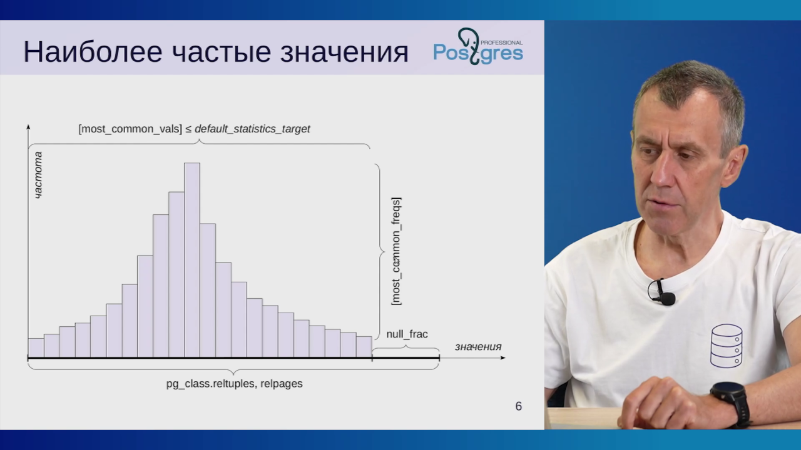
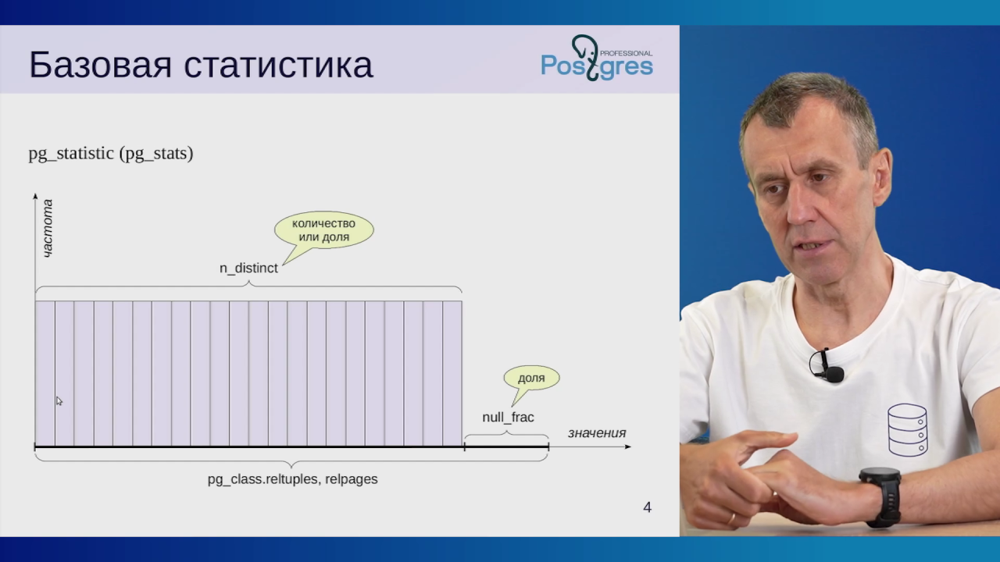
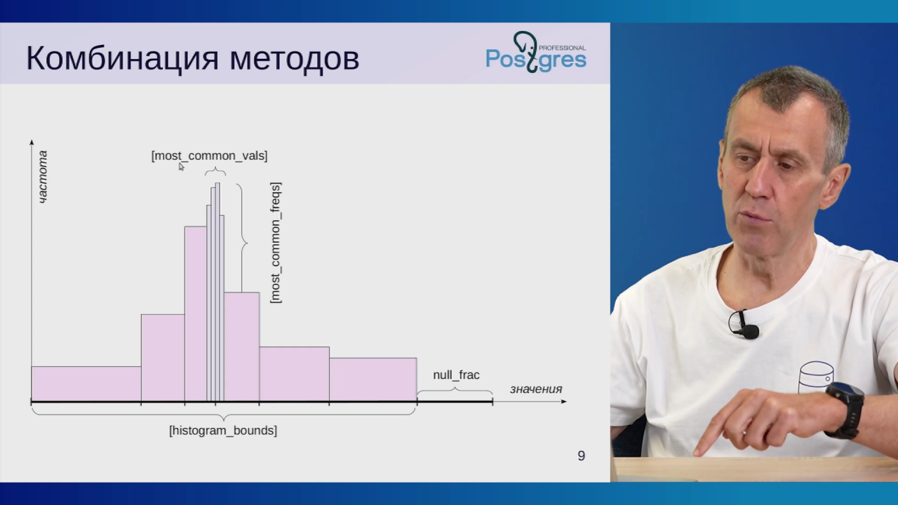
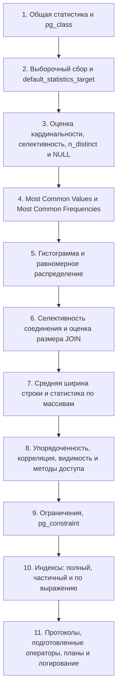

# Статистика планировщика PostgreSQL: оценка кардинальности и планы запросов

> [!abstract] Обзор
> Материал посвящён статистике планировщика PostgreSQL и её влиянию на оценку кардинальности и выбор планов запросов. Показано, какую статистику собирает Postgres: базовую в pg_class (reltuples, relpages) и постолбцовую в pg_statistic и pg_stats (null_frac, n_distinct, most_common_vals, most_common_freqs, гистограммы). Разбирается выборочный сбор и настройка default_statistics_target, а также оценка селективности через наиболее частые значения, гистограммы и формулы для соединений. Отдельно рассматриваются correlation, видимость страниц, ограничения pg_constraint, частичные и выраженческие индексы, селективность функций по умолчанию. Завершают материал протоколы запросов и подготовленные операторы с частными и общими планами, а также логирование долгих запросов.

> [!info] Курс
> [[index|Оглавление курса]]

## Оглавление
1. [[#1. Общая статистика и pg_class]]
2. [[#2. Выборочный сбор и default_statistics_target]]
3. [[#3. Оценка кардинальности, селективность, n_distinct и NULL]]
4. [[#4. Most Common Values и Most Common Frequencies]]
5. [[#5. Гистограмма и равномерное распределение]]
6. [[#6. Селективность соединения и оценка размера JOIN]]
7. [[#7. Средняя ширина строки и статистика по массивам]]
8. [[#8. Упорядоченность, корреляция, видимость и методы доступа]]
9. [[#9. Ограничения, pg_constraint]]
10. [[#10. Индексы: полный, частичный и по выражению]]
11. [[#11. Протоколы, подготовленные операторы, планы и логирование]]

**Схема** — [[#Схема]]
**Итог** — [[#Итог]]

## 1. Общая статистика и pg_class

Статистика — это то, что сервер Postgres собирает о данных; для очень больших таблиц она не абсолютно точна, так как не обязательно читать всю таблицу целиком, и собирается в том числе по отдельным элементам составных типов данных, таких как массивы. ANALYZE собирает статистику по каждому столбцу и хранит её в таблице pg_statistic, которая чувствительна с точки зрения безопасности; над pg_statistic существует представление pg_stats, показывающее только ту информацию, которую текущему пользователю допустимо смотреть. Планировщик собирает базовую статистику при выполнении операций, например ANALYZE; она включает общую информацию о таблице, в том числе о её размере: в pg_class столбец relpages хранит количество страниц, а reltuples — количество строк, и эти данные собираются командой ANALYZE, обновляются при очистке и при создании индексов. Планировщик берёт оценку кардинальности из pg_class — полей reltuples и relpages; для SELECT * FROM flights EXPLAIN выводит rows=214867, а reltuples = 214867 совпадает с count(*), поэтому оценка точна. RealPages — это оценка количества страниц: если она отличается от реального размера таблицы, планировщик может скоррелировать RealTuples относительно этой разницы, и RealTuples может динамически подстраиваться под текущее состояние таблицы при выполнении запроса; точное количество страниц таблицы можно получить, зная размеры файлов таблицы и поделив это на размер одной страницы.

```sql
SELECT reltuples, relpages FROM pg_class WHERE relname = 'flights';
 reltuples | relpages
-----------+----------
    214867 |      2624
(1 row)

== SELECT round(214867 * 9 * least(1.0/8, 1.0/9));
round
------
 214867
(1 row)
```

*Источник: [00:00:00], [00:00:20], [00:01:10], [00:08:05], [00:08:25], [00:09:05] и др.*

> [!quote]- Кадр [00:00:00]
> 

> [!quote]- Кадр [00:00:20]
> 

## 2. Выборочный сбор и default_statistics_target

Процесс сбора статистики не прочитывает всю таблицу целиком, если она очень большая: он читает произвольную часть строк и на основании этого делает оценки по количеству строк, страниц и другие статистики. Настройка default_statistics_target определяет количество строк, которые планировщик будет использовать при сборе статистики; по умолчанию она равна 100. Значение параметра умножается на 300: при значении 100 порог равен 30 тысячам строк; таблицы размером меньше 30 тысяч строк читаются полностью, а из больших таблиц читается 30 тысяч строк в произвольном порядке. Количество значений в most_common_vals не может превышать значение параметра default_statistics_target. Статистику можно менять на уровне всей системы и на уровне отдельных столбцов: для столбца arrival_airport выполняется ALTER TABLE ... ALTER COLUMN ... SET STATISTICS 10, затем ANALYZE flights; планировщик оценивает, что будет найдено 19 145 записей, и реально их почти угадали.

```sql
ALTER TABLE flights
ALTER COLUMN arrival_airport
SET STATISTICS 10;

ALTER TABLE

ANALYZE flights;

SHOW default_statistics_target;
 default_statistics_target
---------------------------
                       100

SHOW default_statistics_target;
 default_statistics_target
---------------------------
                         100
(1 row)

=> ALTER TABLE flights
   ALTER COLUMN arrival_airport
   SET STATISTICS 10;
ALTER TABLE
=> ANALYZE flights;
ANALYZE

=> EXPLAIN
SELECT * FROM flights WHERE arrival_airport = 'SVO';
```

> [!info] Зачем это нужно
> Чтобы значения проще помещались на экран.

*Источник: [00:01:10], [00:10:06], [00:14:33], [00:15:53], [00:16:13], [00:16:35] и др.*

> [!quote]- Кадр [00:14:33]
> 

## 3. Оценка кардинальности, селективность, n_distinct и NULL

В pg_statistic есть столбец null_frac, хранящий значение от 0 до 1, которое определяет долю пустых значений этого столбца; количество NULL-значений оценивается умножением общего числа строк на null_frac из pg_stats, а если неопределённых значений нет, долю null_frac учитывать не нужно. Для записей таблицы flights с неопределённым actual_departure планировщик считает, что таких строк будет 16 230: в примере 214867 * null_frac даёт оценку 16230, и она совпадает с фактическим count(*); в конспекте 2 EXPLAIN показывает rows=16348, что тоже совпадает с count(*). Команда EXPLAIN сообщает, сколько строк планировщик ожидает получить от запроса: для SELECT * FROM flights она ожидает около 214 тысяч строк, а число rows в плане оценивается на основе общего количества строк в таблице (в примере 214 867); селективность — это доля строк от декартова произведения, которая должна вернуться. Статистика нужна планировщику для оценки кардинальности, от которой напрямую зависит стоимость плана, и для её оценки планировщик может использовать наиболее частые значения, гистограмму либо и то, и другое вместе; кардинальность редких значений вычисляется как единица минус доля всех 10 наиболее частых значений (в примере 1 − 0,42), с добавлением доли наиболее частых значений, удовлетворяющих условию, и умножением на 0,2, потому что две корзины из 10 тоже содержат наши значения. Точность портится, когда в запросе больше двух таблиц: добавление третьей таблицы самолётов увеличивает оценку планировщика почти в два раза, а добавление справочной таблицы не меняет кардинальность; n_distinct — это количество уникальных значений столбца, которое оценивается для каждого столбца в pg_statistic: для flights.aircraft_code оно равно 8 и совпадает с count(DISTINCT aircraft_code), а в таблице aircrafts_data поле aircraft_code является первичным ключом, поэтому n_distinct для него равно -1.

```sql
EXPLAIN
SELECT * FROM flights WHERE actual_departure IS NULL;
Seq Scan on flights  (cost=0.00..4772.67 rows=16348 width=63)
  Filter: (actual_departure IS NULL)

SELECT 214867 * null_frac FROM pg_stats
WHERE tablename = 'flights' AND attname = 'actual_departure';
 ?column?
----------------
16229.620111763477

EXPLAIN
SELECT * FROM flights WHERE actual_departure IS NULL;

               QUERY PLAN
 ----------------------------------------
 Seq Scan on flights  (cost=0.00..4772.67 rows=16230 width=63)
   Filter: (actual_departure IS NULL)
(2 rows)

SELECT n_distinct FROM pg_stats
WHERE tablename = 'flights' AND attname = 'aircraft_code';
 n_distinct
------------
        8

SELECT count(DISTINCT aircraft_code) FROM flights;
 count
-------
     8

SELECT n_distinct FROM pg_stats
WHERE tablename = 'aircrafts_data' AND attname = 'aircraft_code';
 n_distinct
------------
         -1

SELECT n_distinct FROM pg_stats
WHERE tablename = 'flights' AND attname = 'aircraft_code';
 n_distinct
------------
        8
(1 row)

SELECT count(DISTINCT aircraft_code) FROM flights;
 count
-------
     8
(1 row)

SELECT n_distinct FROM pg_stats
WHERE tablename = 'aircrafts_data' AND attname = 'aircraft_code';
 n_distinct
------------
         -1
(1 row)

=> EXPLAIN
SELECT * FROM flights;

=> SELECT round(214867 * 9 * least(1.0/8, 1.0/9));

EXPLAIN
SELECT * FROM flights;
 Seq Scan on flights  (cost=0.00..4772.67 rows=214867 width=63)

SELECT reltuples, relpages FROM pg_class WHERE relname = 'flights';
 reltuples | relpages
-----------+----------
    214867 |     2624

EXPLAIN
SELECT * FROM flights WHERE actual_departure IS NULL;
Seq Scan on flights  (cost=0.00..4772.67 rows=16348 width=63)
  Filter: (actual_departure IS NULL)

SELECT 214867 * null_frac FROM pg_stats
WHERE tablename = 'flights' AND attname = 'actual_departure';
 ?column?
----------------
16229.620111763477

SELECT n_distinct FROM pg_stats
WHERE tablename = 'flights' AND attname = 'aircraft_code';
 n_distinct
------------
        8
(1 row)

SELECT count(DISTINCT aircraft_code) FROM flights;
 count
-------
     8
(1 row)

SELECT n_distinct FROM pg_stats
WHERE tablename = 'aircrafts_data' AND attname = 'aircraft_code';
 n_distinct
------------
         -1
(1 row)
```

| Атрибут | n_distinct | Значение |
|---|---|---|
| flights.aircraft_code | 8 | 8 уникальных значений, совпадает с count(DISTINCT aircraft_code) |
| aircrafts_data.aircraft_code | -1 | каждое значение уникально, так как поле — первичный ключ |

*Источник: [00:05:56], [00:07:45], [00:08:05], [00:08:25], [00:09:05], [00:09:26] и др.*

> [!quote]- Кадр [00:05:56]
> 

## 4. Most Common Values и Most Common Frequencies

Команда ANALYZE собирает статистику по наиболее частым значениям и хранит её в двух столбцах: Most Common Values и Most Common Frequencies. most_common_vals и most_common_freqs — массивы одинаковой длины: если значение найдено в most_common_vals на определённой позиции, частота берётся на той же позиции в most_common_freqs. Если значение попало в список наиболее частых, селективность можно узнать из статистики с помощью EXPLAIN; оценка rows получается умножением его частоты из pg_stats.most_common_freqs на количество строк в таблице. Для SVO частота 0,0891, что даёт оценку 19145 строк, тогда как точное значение — 19348. Планировщик строит не только гистограмму, но и собирает most common values и most common frequencies; также имеется null-фракция.

```sql
=> EXPLAIN
   SELECT * FROM flights WHERE arrival_airport = 'SVO';

                 QUERY PLAN
---------------------------------------------------
 Seq Scan on flights  (cost=0.00..5309.84 rows=19145 width=63)
   Filter: (arrival_airport = 'SVO'::bpchar)
(2 rows)

Точное значение:
  => SELECT count(*) FROM flights WHERE arrival_airport = 'SVO';

  count
  -----
  19348
  (1 row)

=> SELECT most_common_vals, most_common_freqs
FROM pg_stats
WHERE tablename = 'flights' AND attname = 'arrival_airport' \gx
-[ RECORD 1 ]------+
most_common_vals | {DME,SVO,LED,VKO,OVB,SVX,KJA,PEE,ROV,OVS}
most_common_freqs | {0.0967333336,0.0891,0.0559,0.0529,0.030766666,0.021233333,0.020733334,0.019433333,0.019433333,0.018133333}

ALTER TABLE flights
ALTER COLUMN arrival_airport
SET STATISTICS 10;

ANALYZE

EXPLAIN
SELECT * FROM flights WHERE arrival_airport = 'SVO';

 Seq Scan on flights  (cost=0.00..5309.84 rows=19145 width=63)
   Filter: (arrival_airport = 'SVO'::bpchar)
(2 rows)

SELECT count(*) FROM flights WHERE arrival_airport = 'SVO';
 count
-------
 19348
(1 row)

SELECT most_common_vals, most_common_freqs
FROM pg_stats
WHERE tablename = 'flights' AND attname = 'arrival_airport'
```

> [!info] Зачем это нужно
> Если значение попало в список наиболее частых, селективность можно узнать непосредственно из статистики.

*Источник: [00:14:13], [00:14:33], [00:17:15], [00:17:35], [00:17:55], [00:18:43] и др.*


## 5. Гистограмма и равномерное распределение

Помимо наиболее частых значений, планировщик собирает информацию о распределении всех значений в виде гистограммы: она представляет собой набор корзин, границами которых являются значения в таблице, и внутри каждой корзины при анализе собирается примерно одинаковое количество значений этого столбца. Гистограмма значений столбца хранится в pg_stats; в примере она распределена по 10 корзинам, границы которых обозначаются значениями, а histogram_bounds полезны в запросах, где нужно определить условия по неравенству. Запрос выбирает данные из таблицы Flights, где Arrival Airport меньше или равно 'ESL'; планировщик оценил количество строк в 45 866, точное значение соответствует 46 900 — это очень хорошая оценка. Если значение в запросе отсутствует в списке наиболее частых, планировщик предполагает, что все остальные значения встречаются равномерно в таблице; при разбивке на корзины планировщик старается сделать так, чтобы количество значений в каждой корзине получилось одинаковым. Селективность можно вычислить на примере запроса, который ищет количество строк из аэропорта Владивосток: планировщик оценил число записей как 1311, тогда как точное значение — 1188; чтобы сделать оценку, нужно посчитать частоту всех 10 наиболее частых значений (почти 3% записей в таблице попадают на наиболее частые значения), а при предположении равномерного распределения — знать количество уникальных значений для столбца Arrival Airport; если null-фракции нет, её сразу опускают, а оставшееся распределение делят на количество уникальных оставшихся значений.

```javascript
>= SELECT histogram_bounds
   FROM pg_stats s
   WHERE s.tablename = 'flights' AND s.attname = 'arrival_airport';

=> SELECT histogram_bounds
   FROM pg_stats s
   WHERE s.tablename = 'flights' AND s.attname = 'arrival_airport';
```

*Источник: [00:19:03], [00:19:23], [00:19:50], [00:20:10], [00:20:31], [00:20:51] и др.*

> [!quote]- Кадр [00:23:41]
> 

## 6. Селективность соединения и оценка размера JOIN

Чтобы определить кардинальность соединения, нужно понять селективность соединения двух таблиц. Планировщику нужно оценить кардинальность декартова произведения и умножить её на селективность условий соединения вместе с дополнительными фильтрами, если они были. Базовая формула для расчёта селективности соединения — минимальное из значений 1/nd1 и 1/nd2; nd1 — число уникальных значений ключа соединения в первом наборе строк, nd2 — во втором наборе строк. В примере формула даёт 214867: берут декартово произведение количеств строк и умножают на минимальное из отношений 1/8 и 1/9, где 1/8 — количество уникальных значений в flights, а 1/9 — в aircrafts_data. EXPLAIN для JOIN flights и aircrafts показывает Hash Join с Hash Cond по aircraft_code, обе таблицы читаются через Seq Scan, и в плане запроса это отражено как Hash Join с rows=214867. Планировщик не знает селективность функции, поэтому по умолчанию в PostgreSQL принято, что функции имеют селективность полпроцента. Планировщик вычисляет оценку количества строк, умножая число строк в таблице на 0.5%. Эта оценка может не соответствовать реальному значению.

```javascript
>= EXPLAIN SELECT *
FROM flights f
JOIN aircrafts a ON a.aircraft_code = f.aircraft_code;

QUERY PLAN
Hash Join  (cost=1.20..59857.41 rows=214867 width=183)
  Hash Cond: (f.aircraft_code = ml.aircraft_code)
  ->  Seq Scan on flights f  (cost=0.00..4772.67 rows=214867 width=63)
  ->  Hash  (cost=1.09..1.09 rows=9 width=72)
        ->  Seq Scan on aircrafts data ml  (cost=0.00..1.09 rows=9 width=72)
(5 rows)

=> SELECT n distinct FROM pg_stats
   WHERE tablename = 'aircrafts_data' AND attname = 'aircraft_code';

=> EXPLAIN SELECT *
   FROM flights f
   JOIN aircrafts a ON a.aircraft_code = f.aircraft_code;

=> EXPLAIN SELECT *
FROM flights f
JOIN aircrafts a ON a.aircraft_code = f.aircraft_code;

QUERY PLAN
Hash Join  (cost=1.20..59857.41 rows=214867 width=183)
  Hash Cond: (f.aircraft_code = ml.aircraft_code)
  ->  Seq Scan on flights f  (cost=0.00..4772.67 rows=214867 width=63)
  ->  Hash  (cost=1.09..1.09 rows=9 width=72)
        ->  Seq Scan on aircrafts data ml  (cost=0.00..1.09 rows=9 width=72)
(5 rows)

=> SELECT n distinct FROM pg_stats
   WHERE tablename = 'aircrafts_data' AND attname = 'aircraft_code';

=> EXPLAIN SELECT *
   FROM flights f
   JOIN aircrafts a ON a.aircraft_code = f.aircraft_code;
```

*Источник: [00:09:46], [00:13:05], [00:13:25], [00:13:45], [00:14:13], [00:48:58] и др.*

## 7. Средняя ширина строки и статистика по массивам

В представлении pg_stats есть столбец со средней шириной строки в байтах — это оценка памяти, которая может потребоваться планировщику для манипуляций со строками таблицы. Для составных полей, например массивов, планировщик хранит наиболее частые элементы внутри массивов. В pg_stats есть столбцы most_common_elems и most_common_elem_freqs; они позволяют смотреть не только массив как значение, но и элементы внутри массива. Планировщик берёт информацию о количестве строк с определённым значением в массиве из этих столбцов и соответствующих гистограмм, понимая, сколько строк содержат определённое значение в массиве.

*Источник: [00:30:39], [00:33:20]*

## 8. Упорядоченность, корреляция, видимость и методы доступа

Значение метрики correlation говорит об упорядоченности физического хранения данных в столбце на диске: чем ближе к 1, тем данные упорядочены по возрастанию; близкие к -1 означают сортировку по убыванию, а близкие к нулю — хаотичное хранение. Если значения упорядочены, можно использовать просто индексный доступ и не читать лишние страницы; если значения хранятся хаотично, нужно использовать сканирование по битовой карте. Статистика полезна для методов доступа, в частности GIN, который хорошо работает с массивами. В pg_class есть столбец relallvisible, он определяет видимость строк в таблице; планировщик использует информацию о количестве страниц, записи в которых видны всем пользователям, чтобы понять, насколько хороша битовая карта и можно ли использовать сканирование только индекса. Если значение не слишком велико, сканирование только индекса может быть невыгодно; в таком случае нужно использовать обычное сканирование индекса.

| correlation | Хранение |
| --- | --- |
| Близко к 1 | по возрастанию |
| Близко к -1 | по убыванию |
| Близко к 0 | хаотично |

> [!info] Зачем это нужно
> Чтобы точно считать селективность и кардинальность для методов доступа.

*Источник: [00:30:39]*

## 9. Ограничения, pg_constraint

pg_constraint — это таблица, которая хранит информацию об ограничениях целостности, определённых на таблицах. В отдельном столбце conkey хранится в виде массива список столбцов. В таблице Boarding Passes первичный ключ задан по первому и второму столбцам; те же два столбца входят и во внешний ключ. Оценочное значение в 65 строк получается умножением коэффициента 0,47 на количество строк в таблице pg_constraint; для получения оценки используется коэффициент 0,47.

*Источник: [00:29:49], [00:34:06], [00:36:38]*

## 10. Индексы: полный, частичный и по выражению

Созданный индекс по столбцу статус невыгоден для частого значения Ravit (прибывшие рейсы): запрос на это значение лучше выполнять как последовательное сканирование, без использования индекса, потому что индексные записи для ключа Ravit по большому счёту не нужны, занимают достаточно большое количество места и требуют постоянного обновления. Замена полного индекса на частный позволяет сэкономить дисковое пространство и затраты на сопровождение; к индексу по статусу дописывается условие, что статус должен быть одним из трёх достаточно редких значений, и такой частичный индекс может иметь минимальный размер — всего две странички. Когда запрашиваются данные, входящие в частичный индекс, используется индексное сканирование; при запросе частых значений, которые в индекс не попадают, по-прежнему используется последовательное сканирование. Общий индекс по столбцу статус занимает примерно полтора мегабайта; вместо него можно удалить этот индекс и создать индекс по выражению, но только если выражение детерминированное — для одинаковых входных значений всегда возвращает одни и те же выходные, иначе индекс создавать не нужно. Планировщик собирает собственную статистику для индексов по выражениям, которая хранится в таблице pg_statistic и видна через представление pg_stats с названием индекса в поле table name.

*Источник: [00:45:18], [00:45:38], [00:46:32], [00:46:57], [00:47:17], [00:48:17] и др.*

## 11. Протоколы, подготовленные операторы, планы и логирование

При использовании простого протокола запросов план для запроса строится при каждом выполнении; при использовании расширенного протокола оператор подготавливается отдельно, и подготовленный оператор может принимать один параметр, значение которого подставляется в условие WHERE при выполнении запроса. Подготовленные операторы можно выполнять двумя способами: используя частные планы или общий план. Частный план строится каждый раз при подстановке значения параметра для каждого выполнения; он полезен при неравномерном распределении данных в столбце, который задаётся параметром. Планировщик строит общий план без учёта значений конкретных параметров и сравнивает его стоимость с частным; при равномерном распределении данных общий план кэшируется и переиспользуется, а параметр plan_cache_mode по умолчанию имеет значение авто, но его можно переключить на явное использование частного или общего плана. Для накопления статистики первые 5 раз всегда используются частные планы, а начиная с 6-го планировщик может перейти на общий план; в таблице pg_prepared_statements есть статистика, показывающая, с каким планом выполнялись подготовленные операторы и сколько раз они выполнялись, а log_min_duration_statement протоколирует долго выполняющиеся запросы в журнале сервера.

*Источник: [00:36:58], [00:37:18], [00:37:42], [00:40:56], [00:41:16], [00:42:27] и др.*

## Схема



## Итог

> [!success] Что в итоге
> Postgres собирает статистику о данных, включая базовую информацию о таблице (reltuples, relpages) и постолбцовую статистику в pg_statistic и pg_stats (null_frac, n_distinct, наиболее частые значения, гистограммы). Для больших таблиц сбор идёт выборочно, а объём выборки задаётся default_statistics_target. Планировщик использует эту статистику для оценки кардинальности и селективности, в том числе для соединений, а точность оценок влияет на выбор методов доступа и планов запросов. Для подготовленных операторов различаются частные и общие планы, регулируемые plan_cache_mode, а pg_prepared_statements и логирование долгих запросов показывают, какие планы применялись.

