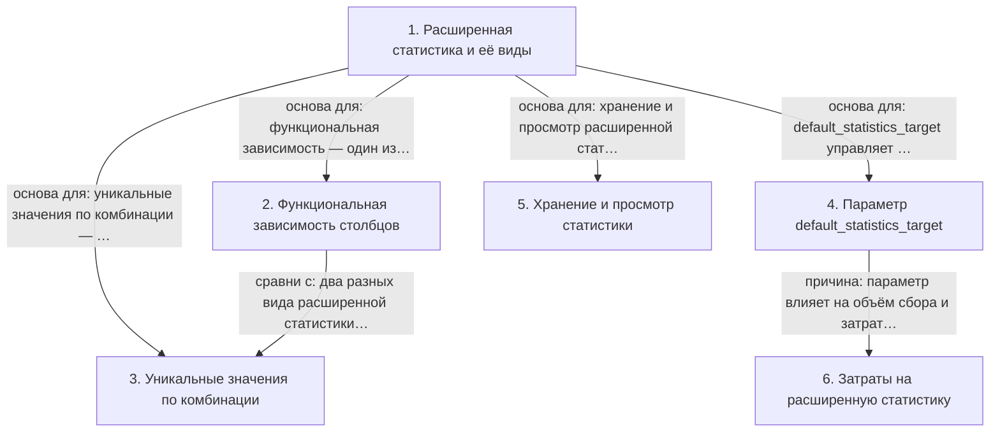

# Расширенная статистика в PostgreSQL

> [!abstract] Обзор
> Материал о расширенной статистике PostgreSQL: зачем она нужна, когда базовой статистики не хватает. Разбирается функциональная зависимость столбцов и то, что планировщик перемножает селективности отдельных условий. Показано создание статистики командой CREATE STATISTICS, её виды и ограничения оценки на примере. Отдельно рассматриваются параметр default_statistics_target, хранение и просмотр статистики, а также затраты на её сбор.

> [!info] Курс
> [[index|Оглавление курса]]

## Оглавление
1. [[#1. Расширенная статистика и её виды]]
2. [[#2. Функциональная зависимость столбцов]]
3. [[#3. Уникальные значения по комбинации]]
4. [[#4. Параметр default_statistics_target]]
5. [[#5. Хранение и просмотр статистики]]
6. [[#6. Затраты на расширенную статистику]]

**Схема** — [[#Схема]]
**Итог** — [[#Итог]]

## 1. Расширенная статистика и её виды

Расширенная статистика — отдельный объект базы данных PostgreSQL, создаваемый вручную командой CREATE STATISTICS. Она помогает, когда базовой статистики не хватает, и после создания собирается автоматически. В неё входят многовариантная статистика (по нескольким столбцам) и статистика по выражениям; статистика может собираться по произвольному выражению, как будто это виртуальный генерируемый столбец. Наиболее частые комбинации значений — вид статистики для нескольких столбцов, аналог наиболее частых значений для отдельных столбцов.

> [!info] Зачем это нужно
> Используется, когда базовой статистики не хватает.

*Источник: [00:00:00], [00:01:00]*

> [!quote]- Кадр [00:00:00]
> 

## 2. Функциональная зависимость столбцов

Зависимые столбцы — это случай, когда значение одного столбца полностью зависит от значения другого столбца; это функциональная зависимость. Планировщик по умолчанию не знает о таких зависимостях, если информация лежит в двух разных столбцах, и перемножает селективности отдельных условий; в примере с City и Index условие по городу может быть избыточным. Функциональную зависимость можно создать командой CREATE STATISTICS, указав тип собираемой статистики и столбцы таблицы; если вид статистики не указать, она будет собираться для всех возможных видов. В примере для комбинации столбцов собираются функциональные зависимости, most common values и количество уникальных значений. Для запроса по аэропорту и типу самолёта 321 фактически было выбрано 5148 строк, а оценка планировщика — 743; после сбора зависимости по двум столбцам оценка стала 1700, но всё ещё далека от фактической.

*Источник: [00:01:00]*

> [!quote]- Кадр [00:01:00]
> 

## 3. Уникальные значения по комбинации

Многовариантная статистика уникальных значений по комбинации столбцов помогает при группировке по нескольким столбцам. Статистика по отдельным столбцам не даёт точного понимания количества уникальных значений при группировке по всем столбцам.

*Источник: [00:01:00]*

## 4. Параметр default_statistics_target

default_statistics_target определяет, для какого количества наиболее частых значений или комбинаций значений собирается статистика. Значение параметра можно изменить на уровне расширенной статистики: в команде ALTER STATISTICS указывается, какое количество значений для default_statistics_target должно использоваться для этой статистики.

*Источник: [00:01:00]*

## 5. Хранение и просмотр статистики

Расширенная статистика хранится в таблицах pg_statistic_ext и pg_statistic_ext_data, а доступна через представления pg_stats_ext и pg_stats_ext_exprs. Информацию о ней можно получить из представления pg_stats_ext; в колонке N-Distinct отображается количество уникальных значений для комбинации столбцов, например для столбцов 5 и 6 это 618.

*Источник: [00:01:00]*

## 6. Затраты на расширенную статистику

Создание расширенных статистик требует дополнительных затрат на выполнение ANALYZE. Планировщик будет рассматривать эти статистики при планировании, даже если они не нужны.

*Источник: [00:01:00]*

## Схема

## Итог

> [!success] Что в итоге
> Расширенная статистика — вручную создаваемый объект PostgreSQL, включающий многовариантную статистику и статистику по выражениям, который помогает, когда базовой статистики не хватает. Она нужна из-за того, что планировщик перемножает селективности отдельных условий и не знает о зависимостях столбцов. Создание статистики требует дополнительных затрат на ANALYZE и не всегда даёт точную оценку, а её значение для количества значений настраивается через default_statistics_target.

