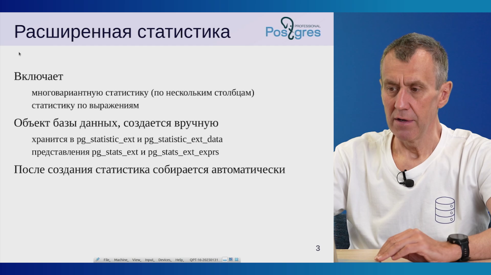
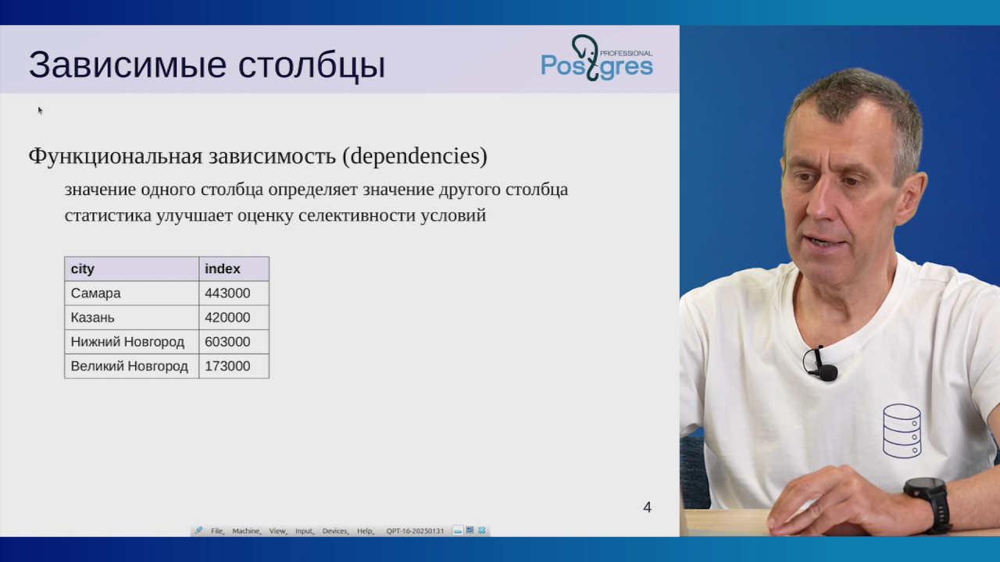
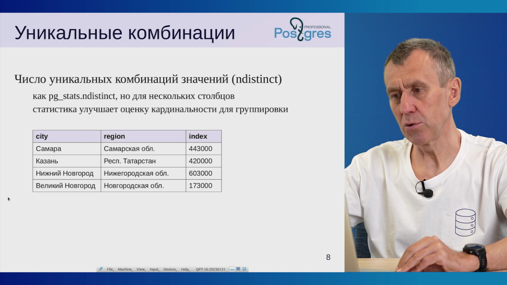
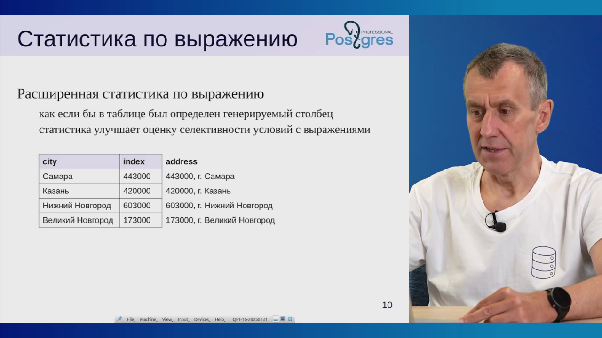
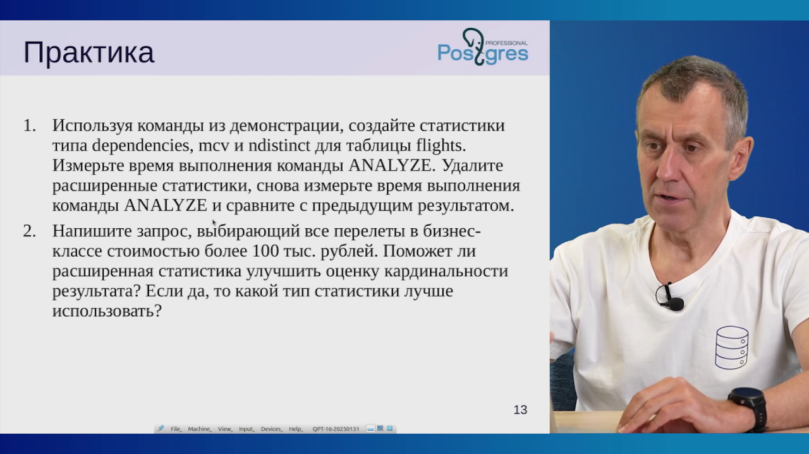
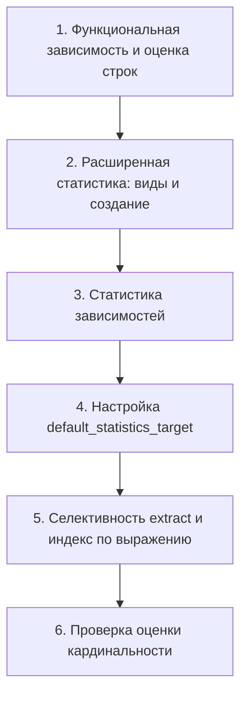

# Оценка селективности и расширенная статистика в PostgreSQL

> [!abstract] Обзор
> Материал о том, как планировщик PostgreSQL оценивает селективность условий и почему при функциональной зависимости столбцов оценка оказывается заниженной. Разбирается пример таблицы flights с условиями по flight_no и departure_airport, где оценка rows=15 расходится с фактическими 396 строками. Показано, как расширенная статистика зависимостей (dependencies) и статистика MCV улучшают оценку, как интерпретировать её в pg_stats_ext и просматривать через \d. Разбираются также расхождения оценок при группировке и в плане Bitmap Heap Scan.

> [!info] Курс
> [[index|Оглавление курса]]

## Оглавление
1. [[#1. Функциональная зависимость и оценка строк]]
2. [[#2. Расширенная статистика: виды и создание]]
3. [[#3. Статистика зависимостей]]
4. [[#4. Настройка default_statistics_target]]
5. [[#5. Селективность extract и индекс по выражению]]
6. [[#6. Проверка оценки кардинальности]]

**Схема** — [[#Схема]]
**Итог** — [[#Итог]]

## 1. Функциональная зависимость и оценка строк

Функциональная зависимость (dependencies) — это когда значение одного столбца определяет значение другого; в примере City и Index условие по городу избыточно при заданном индексе. Планировщик по умолчанию полагается на независимость предикатов и перемножает их селективности, поэтому оценка числа строк после фильтрации может сильно занижаться. Для запроса flights с flight_no = 'PG0007' и departure_airport = 'VKO' оценка rows=15, тогда как фактически таких строк 396; EXPLAIN показывает Bitmap Heap Scan rows=15 после Filter, а Bitmap Index Scan оценивает rows=276. При группировке DISTINCT departure_airport, arrival_airport планировщик оценивает 10816 строк, хотя реальных пар 618. Учёт зависимостей в расширенной статистике улучшает оценку селективности.

```sql
SELECT count(*)
FROM flights
WHERE flight_no = 'PG0007' AND departure_airport = 'VKO';

EXPLAIN
SELECT * FROM flights
WHERE flight_no = 'PG0007' AND departure_airport = 'VKO';
QUERY PLAN
Bitmap Heap Scan on flights  (cost=10.49..816.84 rows=15 width=63)
  Recheck Cond: (flight_no = 'PG0007'::bpchar)
  Filter: (departure_airport = 'VKO'::bpchar)
  ->  Bitmap Index Scan on flights_flight_no_scheduled_departure_key  (cost=0.00..10.49 rows=276 width=0)
        Index Cond: (flight_no = 'PG0007'::bpchar)
```

| Понятие | Признак |
|---|---|
| Функциональная зависимость | значение одного столбца определяет значение другого |
| Коррелированные столбцы | прямой функциональной зависимости может не быть |

*Источник: [00:00:40], [00:02:00], [00:02:50], [00:03:40], [00:04:55]*

> [!quote]- Кадр [00:00:40]
> 

> [!quote]- Кадр [00:02:00]
> 

## 2. Расширенная статистика: виды и создание

Расширенная статистика — отдельный объект, создаваемый вручную, когда базовой статистики не хватает для оценки кардинальности; она включает многовариантную статистику по нескольким столбцам и статистику по выражениям, собирается командой ANALYZE и хранится в pg_statistic_ext и pg_statistic_ext_data. CREATE STATISTICS создаёт статистику для комбинации столбцов; можно указать вид (dependencies, MCV, ndistinct), а если вид не указан, включаются все поддерживаемые виды. Для уникальных комбинаций ndistinct улучшает оценку при группировке: для DISTINCT departure_airport, arrival_airport планировщик оценивает 10816, а реально 618; после CREATE STATISTICS ON departure_airport, arrival_airport FROM flights и ANALYZE оценка становится 618. MCV-статистика хранит частые комбинации значений; её значения извлекаются через pg_mcv_list_items, pg_statistic_ext и pg_statistic_ext_data. Список объектов расширенной статистики выводится командой \dx, а для конкретной таблицы — через \d; значения смотрят в pg_statistic_ext_data, а представления pg_stats_ext и pg_stats_ext_exprs показывают доступные пользователю данные.

```sql
>= SELECT values, frequency
  FROM pg_statistic_ext
  JOIN pg_statistic_ext_data ON oid = stxoid,
       pg_mcv_list_items(stxdmcv) m
  WHERE stxname = 'flights_departure_airport_aircraft_code_stat'
  LIMIT 10;

 values  | frequency
---------+----------------------
 {SV0,SU9} | 0.029677777777777778
 {DME,SU9} | 0.029188888888888889
 {DME,CR2} | 0.025488888888888887
 {LED,3Z1} | 0.024233333333333332
 {VKO,CR2} | 0.022333333333333345
 {SV0,CR2} | 0.018711111111111112
 {BZK,SU9} | 0.018377777777777778
 {KJA,CR1} | 0.014622222222222222
 {VKO,SU9} | 0.014077777777777778
 {DME,CR1} | 0.012911111111111111
(10 rows)

SELECT DISTINCT departure_airport, arrival_airport FROM flights;

QUERY PLAN
-------------------------------------------------
HashAggregate (cost=5847.01..5955.16 rows=10816 width=8)
  Group Key: departure_airport, arrival_airport
  ->  Seq Scan on flights  (cost=0.00..4772.67 rows=214867 width=8)
(3 rows)

-------------------------------------------------
Расширенная статистика позволяет исправить эту оценку (если не указать вид статистики, в создаваемый объект будут включены все поддерживаемые виды):

=> CREATE STATISTICS
ON departure_airport, arrival_airport FROM flights;
CREATE STATISTICS
=> ANALYZE flights;
ANALYZE

=> EXPLAIN
SELECT DISTINCT departure_airport, arrival_airport FROM flights;

QUERY PLAN
-------------------------------------------------
Unique  (cost=5616.51..5621.15 rows=618 width=8)
  ->  Sort  (cost=5616.51..5618.06 rows=618 width=8)
        Sort Key: departure_airport, arrival_airport
  ->  Gather  (cost=5519.88..5587.86 rows=618 width=8)
        Workers Planned: 1
        ->  HashAggregate  (cost=5519.88..4526.06 rows=618 width=8)
              Group Key: departure_airport, arrival_airport
        ->  Parallel Seq Scan on flights  (cost=0.00..3887.92 rows=126392 width=8)
(8 rows)

-------------------------------------------------
Статистику по уникальным комбинациям можно увидеть так:
=> SELECT n_distinct
FROM pg_stats_ext
WHERE statistics_name = 'flights_departure_airport_arrival_airport_stat';
 n_distinct
-------------
 {5, 6*: 618}
(1 row)

=> \d flights
Statistics objects:
    "bookings.flights_flight_no_departure_airport_stat" (dependencies) ON flight_no, departure_airport FROM flights

Посмотреть список всех объектов расширенной статистики можно командой \dx:

=> \x \dx \x

Expanded display is on.
List of extended statistics
-[ RECORD 1 ]+--------------------------------
Schema | bookings
Name | flights_departure_airport_aircraft_code_stat
Definition | departure_airport, aircraft_code FROM flights
Ndistinct |
Dependencies |
MCV | defined
-[ RECORD 2 ]+--------------------------------
Schema | bookings
Name | flights_departure_airport_arrival_airport_stat
Definition | departure_airport, arrival_airport FROM flights
Ndistinct | defined
Dependencies | defined
MCV | defined
-[ RECORD 3 ]+--------------------------------
Schema | bookings
Name | flights_flight_no_departure_airport_stat
Definition | flight_no, departure_airport FROM flights
Ndistinct |
Dependencies | defined
MCV |

Expanded display is off.

=> \d flights
Statistics objects:
    "bookings.flights_flight_no_departure_airport_stat" (dependencies) ON flight_no, departure_airport FROM flights

>= SELECT n_distinct
FROM pg_stats_ext
WHERE statistics_name = 'flights_departure_airport_arrival_airport_stat';

n_distinct
------------
(5, 6*: 610)
(1 row)

Посмотреть список всех объектов расширенной статистики можно командой \dx:

=> \x \dx \x

Expanded display is on.
List of extended statistics
-[ RECORD 1 ]+--------------------------------
Schema | bookings
Name | flights_departure_airport_aircraft_code_stat
Definition | departure_airport, aircraft_code FROM flights
Ndistinct |
Dependencies |
MCV | defined
-[ RECORD 2 ]+--------------------------------
Schema | bookings
Name | flights_departure_airport_arrival_airport_stat
Definition | departure_airport, arrival_airport FROM flights
Ndistinct | defined
Dependencies | defined
MCV | defined
-[ RECORD 3 ]+--------------------------------
Schema | bookings
Name | flights_flight_no_departure_airport_stat
Definition | flight_no, departure_airport FROM flights
Ndistinct |
Dependencies | defined
MCV |

Expanded display is off.

Отображается наличие статистики по типам (Ndistinct, Dependencies, MCV), а значения нужно смотреть в таблице pg_statistic_ext_data.

=> \dx \dx \x

=> \x \dx \x
Expanded display is on.
List of extended statistics
-[ RECORD 1 ]+--------------------------------
Schema | bookings
Name | flights_departure_airport_aircraft_code_stat
Definition | departure_airport, aircraft_code FROM flights
Ndistinct |
Dependencies |
MCV | defined

=> SELECT values, frequency
  FROM pg_statistic_ext
  JOIN pg_statistic_ext_data ON oid = stxoid,
       pg_mcv_list_items(stxdmcv) m
  WHERE stxname = 'flights_departure_airport_aircraft_code_stat'
  LIMIT 10;

 values  | frequency
---------+-----------
 {SV0,SU9} | 0.029677777777777778
 {DME,SU9} | 0.029188888888888889
 {DME,CR2} | 0.025488888888888887
 {LED,3Z1} | 0.024233333333333332
 {VKO,CR2} | 0.022333333333333345
 {SV0,CR2} | 0.018711111111111112
 {BZK,SU9} | 0.018377777777777778
 {KJA,CR1} | 0.014622222222222222
 {VKO,SU9} | 0.014077777777777778
 {DME,CR1} | 0.012911111111111111
(10 rows)

(9)>>>>>>>>>>>>>>>>>>>>>>>>>>>>>>>>>>>>>>>>>>>>>>>>>>>>>>>>>>>>>>>>>>>>>>>>>>>>>>>
УНИКАЛЬНЫЕ КОМБИНАЦИИ
----------------------
Другая ситуация, в которой планировщик ошибается с оценкой, связана с группировкой. Количество пар аэропортов, связанных прямыми рейсами, ограничено:

=> SELECT count(*) FROM (
       SELECT DISTINCT departure_airport, arrival_airport FROM flights
     ) t;
 count
-------
    618
(1 row)

Но планировщик не знает об этом:

=> EXPLAIN
SELECT DISTINCT departure_airport, arrival_airport FROM flights;

SELECT DISTINCT departure_airport, arrival_airport FROM flights;

QUERY PLAN
-------------------------------------------------
HashAggregate (cost=5847.01..5955.16 rows=10816 width=8)
  Group Key: departure_airport, arrival_airport
  ->  Seq Scan on flights  (cost=0.00..4772.67 rows=214867 width=8)
(3 rows)

-------------------------------------------------
Расширенная статистика позволяет исправить эту оценку (если не указать вид статистики, в создаваемый объект будут включены все поддерживаемые виды):

=> CREATE STATISTICS
ON departure_airport, arrival_airport FROM flights;
CREATE STATISTICS
=> ANALYZE flights;
ANALYZE

=> EXPLAIN
SELECT DISTINCT departure_airport, arrival_airport FROM flights;

QUERY PLAN
-------------------------------------------------
Unique  (cost=5616.51..5621.15 rows=618 width=8)
  ->  Sort  (cost=5616.51..5618.06 rows=618 width=8)
        Sort Key: departure_airport, arrival_airport
  ->  Gather  (cost=5519.88..5587.86 rows=618 width=8)
        Workers Planned: 1
        ->  HashAggregate  (cost=5519.88..4526.06 rows=618 width=8)
              Group Key: departure_airport, arrival_airport
        ->  Parallel Seq Scan on flights  (cost=0.00..3887.92 rows=126392 width=8)
(8 rows)

-------------------------------------------------
Статистику по уникальным комбинациям можно увидеть так:
=> SELECT n_distinct

SELECT values, frequency
FROM pg_statistic_ext
JOIN pg_statistic_ext_data ON oid = stxoid,
pg_mcv_list_items(stxdmcv) m
WHERE stxname = 'flights_departure_airport_aircraft_code_stat'
LIMIT 10;

=> SELECT n_distinct
FROM pg_stats_ext
WHERE statistics_name = 'flights_departure_airport_arrival_airport_stat';

n_distinct
------------
(5, 6*: 610)
(1 row)

Посмотреть список всех объектов расширенной статистики можно командой \dx:

=> \x \dx \x

Expanded display is on.
List of extended statistics
-[ RECORD 1 ]+--------------------------------
Schema | bookings
Name | flights_departure_airport_aircraft_code_stat
Definition | departure_airport, aircraft_code FROM flights
Ndistinct |
Dependencies |
MCV | defined
-[ RECORD 2 ]+--------------------------------
Schema | bookings
Name | flights_departure_airport_arrival_airport_stat
Definition | departure_airport, arrival_airport FROM flights
Ndistinct | defined
Dependencies | defined
MCV | defined
-[ RECORD 3 ]+--------------------------------
Schema | bookings
Name | flights_flight_no_departure_airport_stat
Definition | flight_no, departure_airport FROM flights
Ndistinct |
Dependencies | defined
MCV |

Expanded display is off.

Отображается наличие статистики по типам (Ndistinct, Dependencies, MCV), а значения нужно смотреть в таблице pg_statistic_ext_data.

=> CREATE STATISTICS
ON departure_airport, arrival_airport FROM flights;

CREATE STATISTICS
=> ANALYZE flights;

ANALYZE
=> EXPLAIN
SELECT DISTINCT departure_airport, arrival_airport FROM flights;

                                QUERY PLAN
---------------------------------------------------------------------------
 Unique  (cost=5616.51..5621.15 rows=618 width=8)
   ->  Sort  (cost=5616.51..5618.06 rows=618 width=8)
         Sort Key: departure_airport, arrival_airport
         ->  Gather (cost=5519.88..5587.86 rows=618 width=8)
               Workers Planned: 1
               ->  HashAggregate  (cost=4519.88..4526.06 rows=618 width=8)
                     Group Key: departure_airport, arrival_airport
                     ->  Parallel Seq Scan on flights  (cost=0.00..3887.92 rows=126392 width=8)

(8 rows)

=> SELECT n_distinct
FROM pg_stats_ext
WHERE statistics_name = 'flights_departure_airport_arrival_airport_stat';
 n_distinct
-------------
 {5, 6*: 618}
(1 row)
```

*Источник: [00:00:00], [00:00:20], [00:00:40], [00:04:35], [00:05:15], [00:06:25] и др.*

> [!quote]- Кадр [00:00:00]
> 

> [!quote]- Кадр [00:00:20]
> 


> [!quote]- Кадр [00:16:05]
> 

> [!quote]- Кадр [00:10:08]
> 

## 3. Статистика зависимостей

Для учёта функциональной зависимости между столбцами создаётся статистика командой CREATE STATISTICS (dependencies) ON flight_no, departure_airport FROM flights, после чего ANALYZE flights дополнительно собирает её. Собранная статистика используется планировщиком и улучшает оценку, но её учёт недостаточен, чтобы полностью исправить ошибку планировщика. В pg_stats_ext значение dependencies «2 => 5»: 1.000000 означает, что столбец 2 (flight_no) зависит от столбца 5 на 100%, а обратная зависимость «5 => 2» почти отсутствует и равна 0.010767. Можно собирать расширенную статистику по произвольному выражению — она работает так, как если бы в таблице был определён виртуальный генерируемый столбец, и помогает оценивать селективность условий с выражениями.

```sql
CREATE STATISTICS (dependencies)
   ON flight_no, departure_airport FROM flights;
=> ANALYZE flights;

=> EXPLAIN (analyze, timing off, summary off)
SELECT * FROM flights
WHERE departure_airport = 'LED' AND aircraft_code = '321';
QUERY PLAN
Gather  (cost=1060.00..5594.19 rows=743 width=63) (actual rows=5148 loops=1)

=> CREATE STATISTICS (dependencies)
ON flight_no, departure_airport FROM flights;

CREATE STATISTICS

=> ANALYZE flights;

ANALYZE

=> SELECT dependencies
FROM pg_stats_ext
WHERE statistics_name = 'flights_flight_no_departure_airport_stat';

 dependencies
----------------------------------------
{"2 => 5": 1.000000, "5 => 2": 0.010767}
(1 row)

=> CREATE STATISTICS
ON extract(month FROM scheduled_departure AT TIME ZONE 'Europe/Moscow')
FROM flights;

SELECT dependencies
FROM pg_stats_ext
WHERE statistics_name = 'flights_flight_no_departure_airport_stat';

         dependencies
--------------------------------
{"2 => 5": 1.000000, "5 => 2": 0.010767}
```

> [!info] Зачем это нужно
> Помогает, когда базовой статистики не хватает для оценки количества записей.

*Источник: [00:02:00], [00:04:35], [00:04:55], [00:05:15], [00:05:35], [00:06:05] и др.*

> [!quote]- Кадр [00:13:27]
> 

## 4. Настройка default_statistics_target

Значение default_statistics_target можно изменить для конкретной расширенной статистики командой ALTER STATISTICS ... SET STATISTICS 300; оно определяет количество собираемых наиболее частых значений. Увеличение ориентира статистики улучшило оценку кардинальности для запроса по departure_airport и aircraft_code, но не привело к дальнейшему улучшению плана. Поэтому в данном случае увеличение ориентира статистики вряд ли оправдано.

```sql
QUERY PLAN
-------------------------------------------------------------
Seq Scan on flights  (cost=0.00..5847.00 rows=5014 width=63)
  Filter: ((departure_airport = 'LED'::bpchar) AND (aircraft_code = '321'::bpchar))
(2 rows)
Теперь оценка улуччилась.
-------------------------------------------------------------
Количество собираемых наиболее частых значений определяется параметром default_statistics_target. Его можно задать для конкретной статистики:
=> ALTER STATISTICS flights_departure_airport_aircraft_code_stat
SET STATISTICS 300;
ANALYZE flights;
=> ANALYZE flights;
ANALYZE
=> EXPLAIN (analyze, timing off, summary off)
SELECT * FROM flights
WHERE departure_airport = 'LED' AND aircraft_code = '321';
QUERY PLAN
-------------------------------------------------------------
Seq Scan on flights  (cost=0.00..5847.00 rows=5207 width=63) (actual rows=5148 loops=1)
  Filter: ((departure_airport = 'LED'::bpchar) AND (aircraft_code = '321'::bpchar))
  Rows Removed by Filter: 209719
(3 rows)
Оценка кардинальности еще немного улуччилась.
Однако это не привело к дальнейшему улучшению плана, поэтому увеличение ориентира статистики в данном случае вряд ли оправдано.
-------------------------------------------------------------
Статистику по наиболее частым комбинациям можно посмотреть так:
```

*Источник: [00:08:44], [00:09:48]*

## 5. Селективность extract и индекс по выражению

Планировщик не знает, как правильно определить селективность функции extract, поэтому для неё используется селективность полпроцента. Для запроса, фильтрующего по extract(month FROM scheduled_departure AT TIME ZONE 'Europe/Moscow') = 1, фактический count(*) равен 16831. Можно создать индекс по выражению, которое используется в запросе, чтобы помочь выполнению.

```sql
=> SELECT count(*) FROM flights
WHERE extract(month FROM scheduled_departure AT TIME ZONE 'Europe/Moscow') = 1;
count
-------
16831
(1 row)

=> EXPLAIN
SELECT * FROM flights
WHERE extract(month FROM scheduled_departure AT TIME ZONE 'Europe/Moscow') = 1;
```

*Источник: [00:14:17], [00:14:37]*

## 6. Проверка оценки кардинальности

Для запроса, выбирающего все перелёты в бизнес-классе стоимостью более 100 тыс. рублей, нужно проверить, поможет ли расширенная статистика улучшить оценку кардинальности результата. Если да, нужно определить, какой тип статистики лучше использовать.

*Источник: [00:16:27]*

> [!quote]- Кадр [00:16:27]
> 

## Схема



## Итог

> [!success] Что в итоге
> Планировщик PostgreSQL может занижать оценку кардинальности, когда столбцы функционально зависимы, как в примере flights с flight_no и departure_airport. Расширенная статистика, включая статистику зависимостей и MCV, а также настройка default_statistics_target, помогает уточнить такие оценки. Отдельно рассматриваются селективность extract и необходимость подбирать подходящий тип расширенной статистики для проверяемого запроса. Таким образом, темы связаны переходом от базовой проблемы оценки к видам расширенной статистики, их настройке и проверке на разных примерах.

