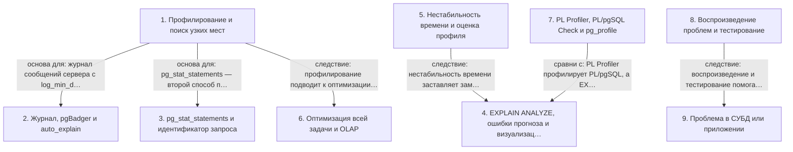

# Профилирование производительности и запросов в Postgres

> [!abstract] Обзор
> Материал о профилировании как универсальном инструменте оптимизации: чтобы понять, что тормозит, задачу разбивают на подзадачи и измеряют их вклад в общее время. В Postgres профиль получают через журнал сообщений сервера, pg_stat_statements и EXPLAIN ANALYZE, а для анализа журнала используют pgBadger и auto_explain. Отдельно рассматриваются идентификатор запроса, PL Profiler, PL/pgSQL Check, pg_profile и визуализация плана через explain.tensor.ru. Обсуждаются нестабильность времени и стабильный показатель ввода-вывода, оценка цифр профиля по pg_class и временное хранилище. Также разбираются воспроизведение проблем производительности, тестирование на продуктивной базе, совпадение данных и поиск проблемы в СУБД или приложении, включая размещение бизнес-логики.

> [!info] Курс
> [[index|Оглавление курса]]

## Оглавление
1. [[#1. Профилирование и поиск узких мест]]
2. [[#2. Журнал, pgBadger и auto_explain]]
3. [[#3. pg_stat_statements и идентификатор запроса]]
4. [[#4. EXPLAIN ANALYZE, ошибки прогноза и визуализация]]
5. [[#5. Нестабильность времени и оценка профиля]]
6. [[#6. Оптимизация всей задачи и OLAP]]
7. [[#7. PL Profiler, PL/pgSQL Check и pg_profile]]
8. [[#8. Воспроизведение проблем и тестирование]]
9. [[#9. Проблема в СУБД или приложении]]

**Схема** — [[#Схема]]
**Итог** — [[#Итог]]

## 1. Профилирование и поиск узких мест

Профилирование — универсальный инструмент оптимизации: чтобы понять, что тормозит, задачу разбивают на более мелкие подзадачи и измеряют, сколько времени занимает каждая из них в общем времени выполнения. Профилировать нужно именно отдельную задачу, а не все действия, иначе произойдёт размытие картины. Время — первое, что приходит на ум, оно важно для пользователя, но очень нестабильно; при этом по числу вызовов и вкладу видно, что практически всё время и обращения к буферам занял один конкретный запрос, а запросы с маленькими цифрами по вкладу далее неинтересны. Проблемный узел находят по наибольшему времени или, лучше, по наибольшему числу чтений буферов; если полный профиль получить не удаётся, используют расширение, показывающее, сколько работы текущий запрос уже сделал в каждом узле, — это частичный профиль. Чем большую долю общего времени занимает подзадача, тем больший эффект даст её оптимизация, а множественные обращения к базе вместо одного — пример неэффективности.

*Источник: [00:01:00]*

> [!quote]- Кадр [00:01:00]
> 

## 2. Журнал, pgBadger и auto_explain

Профиль запросов можно получить через журнал сообщений сервера: параметр log_min_duration_statement задаёт порог длительности запроса, и запросы дольше этого значения попадают в журнал вместе с текстом запроса и временем выполнения, а при значении ноль в журнал записываются все запросы. Параметр log_line_prefix формирует строку, которая подписывается в начало каждой строки журнала, и в неё можно включить идентификатор сеанса, имя пользователя и имя базы данных — эту информацию затем используют для фильтрации; включить журнал для отдельного сеанса штатно сложно, применяются хакерские способы. pgBadger — стандарт де-факто: читает журнальный файл, анализирует его, разбивает на отдельные запросы и группирует их, затем показывает отчётность, по которой можно сделать выводы. Если сервер приложений вызывает процедуру, а она посылает SQL-запросы, в журнале видны только вызовы процедуры, а не сами запросы; для отслеживания вложенных запросов потребуется расширение auto_explain, которое следует включать с выводом вложенных запросов.

> [!info] Зачем это нужно
> Иначе первый запуск покажет только вызов Report.

*Источник: [00:01:00]*

## 3. pg_stat_statements и идентификатор запроса

pg_stat_statements — штатное расширение, по умолчанию не установлено; профиль через него — второй способ получить профиль запросов. Чтобы использовать pg_stat_statements, нужно создать расширение в базе данных через create extension, задать параметр shared_preload_libraries, включив туда библиотечку pg_stat_statements, и после этого перезагрузить сервер; чтобы расширение собирало информацию в том числе о вложенных запросах, устанавливают track со значением all. Над pg_stat_statements создают собственное представление, чтобы показывать только самую главную информацию: время выполнения представляют в секундах и суммируют все обращения, а длину запроса урезают; если запрос уже выполняется за миллисекунду, оптимизировать его некуда, но при выполнении миллиона раз всё будет тормозить. Запросы с разными константами показаны в представлении одной строчкой — запросы считаются одинаковыми с точностью до констант, и замена всех констант на параметры делает все такие планы одинаковыми; это уменьшает требуемую память, но усредняет планы и времена выполнения, из-за чего общая картина размывается, а по идентификатору сеанса разделить нельзя — такой информации в представлении нет. Чтобы в профиль не попали лишние данные, статистику сбрасывают функцией pg_stat_statements_reset; посмотреть, когда статистика сбрасывалась последний раз, можно через представление pg_stat_statements_info. Идентификатор запроса вычисляется ядром системы и совпадает в ядре и в разных расширениях; за вычисление отвечает параметр compute_query_id, который по умолчанию работает именно так. По идентификатору запроса можно связывать между собой таблицы, например с pg_stat_activity, а при выводе плана выполнения с параметром verbose этот идентификатор выводится.

*Источник: [00:01:00]*

## 4. EXPLAIN ANALYZE, ошибки прогноза и визуализация

EXPLAIN ANALYZE выдаёт план выполнения, который по сути является профилем: в нём есть подзадачи, время выполнения (actual time), а при указании параметра buffers — количество обращений к страницам. EXPLAIN с параметрами Analyze и Buffers позволяет увидеть количество чтений при выполнении запроса; в самом верхнем узле плана видна агрегированная информация о том, что происходило в ходе выполнения, а количество выполнений каждой подзадачи и каждого узла видно в строчке loops. Узлы плана, где ошибка прогноза оказывается очень большой, — кандидаты на оптимизацию: в этих узлах планировщик ошибся с оценкой кардинальности, а значит, весь план может быть выбран нехорошо. Не всегда получается воспользоваться EXPLAIN ANALYZE: например, если запрос никогда не завершается и работает часами; чтобы изучить, что происходит внутри отдельного запроса, используется команда EXPLAIN ANALYZE, и полученный профиль помогает наметить стратегию оптимизации. Для визуализации плана запроса можно использовать сервис explain.tensor.ru: он наглядно подсвечивает места, на которые надо обратить внимание, и работает без VPN.

*Источник: [00:01:00]*

## 5. Нестабильность времени и оценка профиля

Время выполнения нестабильно, а количество обращений к страницам — стабильный показатель: вместо времени можно замерять ресурсы, которые надо потратить на решение задачи, в частности количество страниц, к которым должен обратиться запрос. Этот показатель не зависит от нагрузки, конкурентности и характеристик оборудования, и при тех же данных и настройках Postgres даёт плюс-минус те же цифры по вводу-выводу; уменьшение количества ввода-вывода в большинстве случаев означает, что задача будет работать быстрее, и коррелирует с уменьшением времени выполнения задач, хотя сам по себе показатель ввода-вывода пользователям ничего не говорит. Чтобы понять, хорошие цифры в профиле или плохие, нужно посчитать, сколько всего страниц в таблицах, используемых в запросе, и сравнить с фактически прочитанным; количество страниц таблиц можно взять из pg_class, а в примере больше всего данных читает хэш-соединение. Совпадение подтверждает, что данные читаются один раз и план как минимум адекватный. Если запросу потребовалось временное хранилище данных, значит ему не хватило оперативной памяти: данные сбрасывались на диск, а затем читались с диска; если дать запросу больше оперативной памяти, он станет работать быстрее.

*Источник: [00:01:00]*

## 6. Оптимизация всей задачи и OLAP

Не оптимизируйте запрос, который вызывается 27 раз, а оптимизируйте всю задачу целиком: напишите её без цикла, одним запросом. В примере функция подсчёта принимает два параметра — код самолёта и название категории обслуживания — и считает count по посадочным талонам, выданным на все рейсы. Для OLAP-запросов нужно прочитать все данные из многих таблиц и агрегировать их; общий приём для таких запросов — читать данные один раз, потому что чтение данных по нескольку раз плохо.

*Источник: [00:01:00]*

## 7. PL Profiler, PL/pgSQL Check и pg_profile

PL Profiler — стороннее расширение для профилирования PL/pgSQL: позволяет профилировать явный вызов функции или подключиться к работающему сеансу, формирует отчёт в HTML и умеет показывать флайм-графы. PL/pgSQL Check — стороннее расширение для статической проверки кода функций и процедур, оно предполагает, где могут быть ошибки во время выполнения. В примере отчётная функция написана на PL/pgSQL и возвращает набор строк; внутри цикл по всем моделям самолёта, и для каждой модели три раза вызывается функция подсчёта — по числу классов обслуживания. pg_profile — расширение, решение Андрея Зубкова, позволяющее создавать снимки системной статистики и сравнивать их между собой, чтобы делать выводы о том, что происходило в системе.

*Источник: [00:01:00]*

## 8. Воспроизведение проблем и тестирование

Производительность зависит от загрузки сервера: при конкурентной нагрузке всё тормозит, а без неё — быстро; на тестовом сервере проблему не воспроизвести, так как там нет конкурентной нагрузки и вытеснения буферного кэша. При нормальной нагрузке в журнал записывается каждый выполняемый запрос, и объём информации становится очень большим — просмотреть его глазами невозможно, можно пытаться грепать. Повторный запрос может отработать быстро, потому что первый запрос прочитал данные в кэш; слабый тестовый сервер может тормозить всё, что мешает оценить результат. Тестировать нужно на той же самой базе данных, на которой потом будет работать система; можно поднимать систему из резервной копии или пользоваться быстрым тонким клоном за счёт файловой системы со снимками, например ZFS. При профилировании нужно убедиться, что используются такие же данные, как в продуктивной системе: объём данных и характеристики распределения должны совпадать, а конфиденциальные данные приходится предварительно обезличивать.

*Источник: [00:01:00]*

## 9. Проблема в СУБД или приложении

Пользователь, нажимая кнопку и получая результат, работает не только с базой данных: как правило, приложение формирует запрос к серверу приложений, и большая сетевая задержка также увеличивает время отклика. Проблема производительности часто находится на стороне СУБД из-за неправильного плана запроса, но это не всегда так. Если система отвечает долго, сравнивают общее время ответа со временем ответа сервера БД: если время БД близко к общему — проблема в БД, если БД отвечает быстро — проблема в другом месте. Получить полный профиль для подтверждения проблемы на стороне СУБД сложно, так как система должна быть хорошо обвешана мониторингом. Часто бизнес-логика находится в сервере приложений, который посылает SQL-запросы в базу данных; но бывает и так, что значительная часть бизнес-логики находится внутри СУБД, например в процедурах и функциях на PL/pgSQL, которые выполняют много разных SQL-запросов.

*Источник: [00:01:00]*

## Схема

## Итог

> [!success] Что в итоге
> Профилирование начинается с разбивки задачи на подзадачи и выбора той, чья оптимизация даст наибольший выигрыш по общему времени. В Postgres профиль можно получить через журнал, pg_stat_statements и EXPLAIN ANALYZE; время нестабильно, поэтому его дополняют стабильным показателем ввода-вывода, а проверять всё нужно на данных, совпадающих с продуктивной системой. Для сложных случаев есть pgBadger, auto_explain, PL Profiler, PL/pgSQL Check, pg_profile и визуализация плана. Проблему следует искать не только в СУБД, но и в приложении, поскольку бизнес-логика может находиться как в сервере приложений, так и внутри СУБД.

