# Профилирование и оптимизация запросов в PostgreSQL

> [!abstract] Обзор
> Материал о профилировании и оптимизации запросов в PostgreSQL: как выбрать цель оптимизации, чем отличаются метрики времени выполнения и страничного ввода-вывода и как профиль приложения разбивается по компонентам. Разбирается общая сложность профилирования и средства мониторинга, включая pg_profile, журнал сообщений сервера с log_line_prefix, pgBadger и auto_explain. Отдельно рассматривается штатное расширение pg_stat_statements, нормализация запросов и единый query ID, вычисляемый ядром и совпадающий в EXPLAIN и pg_stat_statements. Для разбора отдельного запроса используются EXPLAIN ANALYZE и EXPLAIN с ANALYZE и BUFFERS, сверка страниц с relpages из pg_class и анализ temp read/written. Сквозной пример — функции qty() и report(), подсчитывающие места по классам обслуживания для каждой модели самолёта, и альтернатива через условную агрегацию FILTER. Также упоминаются расширения PL Profiler и plpgsql_check.

> [!info] Курс
> [[index|Оглавление курса]]

## Оглавление
1. [[#1. Профилирование и разбиение задачи на подзадачи]]
2. [[#2. Метрики: время выполнения и страничный ввод-вывод]]
3. [[#3. Профиль приложения: компоненты, сторона СУБД, сеть]]
4. [[#4. Журнал сервера, pgBadger и auto_explain]]
5. [[#5. pg_stat_statements: установка, представление и query ID]]
6. [[#6. EXPLAIN ANALYZE и сверка страниц]]
7. [[#7. Пример report(): цикл против FILTER]]
8. [[#8. Расширения PL Profiler и plpgsql_check]]

**Схема** — [[#Схема]]
**Итог** — [[#Итог]]

## 1. Профилирование и разбиение задачи на подзадачи

Профилирование — универсальный инструмент для поиска узких мест и выбора цели оптимизации: оптимизировать нужно подзадачу с наибольшей долей в общем времени выполнения, учитывая не только продолжительность, но и количество выполнений. Чтобы понять, что тормозит, задачу разбивают на подзадачи и измеряют их вклад; чем точнее охват, тем лучше. Для общей картины используется мониторинг и расширение pg_profile (снимки системной статистики).

> [!info] Зачем это нужно
> Чтобы получить наибольший потенциальный выигрыш от оптимизации. Полезно администратору для поиска ресурсоемких задач.

*Источник: [00:00:20], [00:01:10], [00:01:30], [00:08:36], [00:38:06], [00:41:41] и др.*

> [!quote]- Кадр [00:00:20]
> 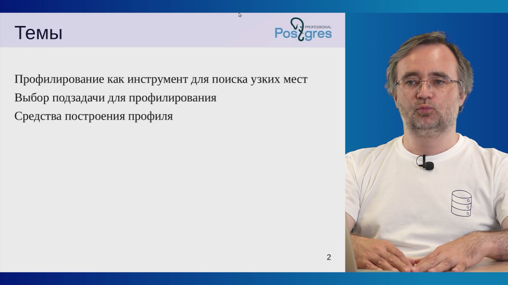

> [!quote]- Кадр [00:46:43]
> 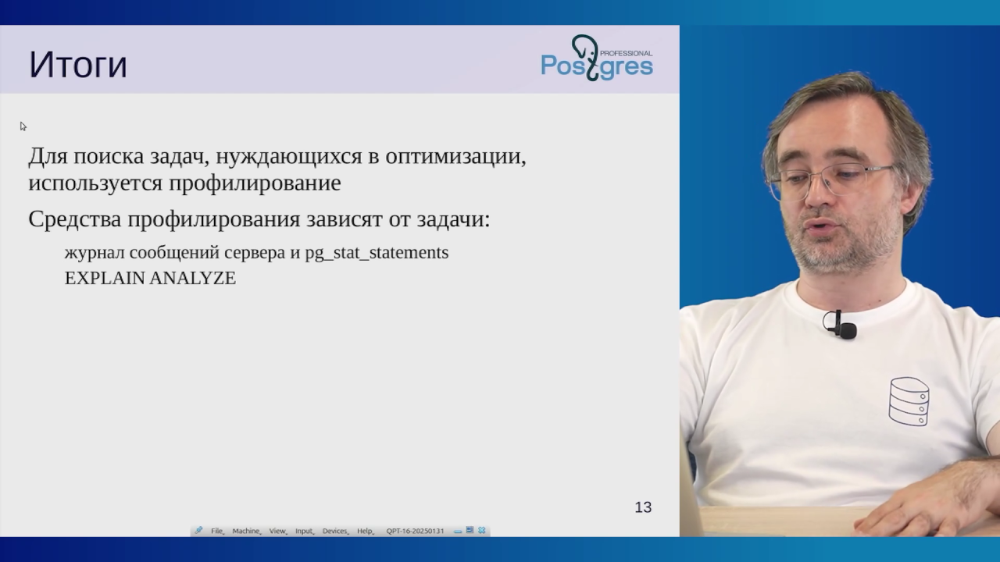

> [!quote]- Кадр [00:01:10]
> 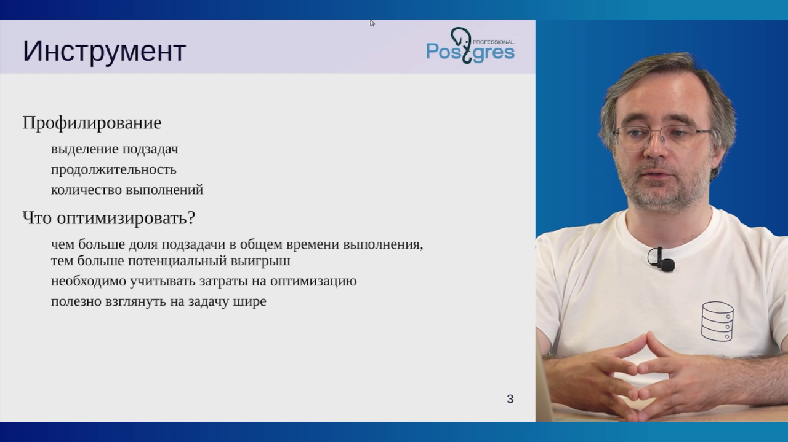

> [!quote]- Кадр [00:08:36]
> 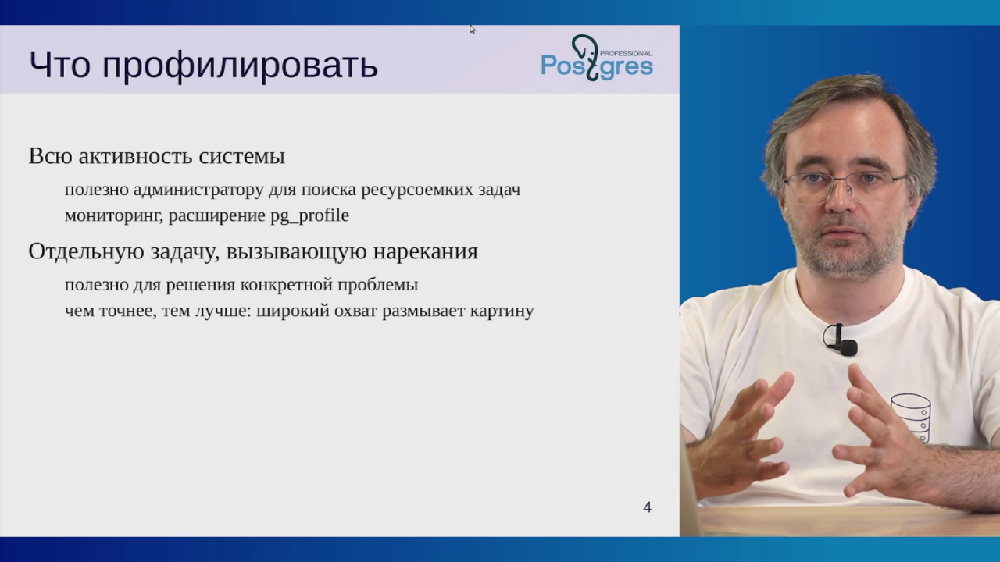

> [!quote]- Кадр [00:01:30]
> 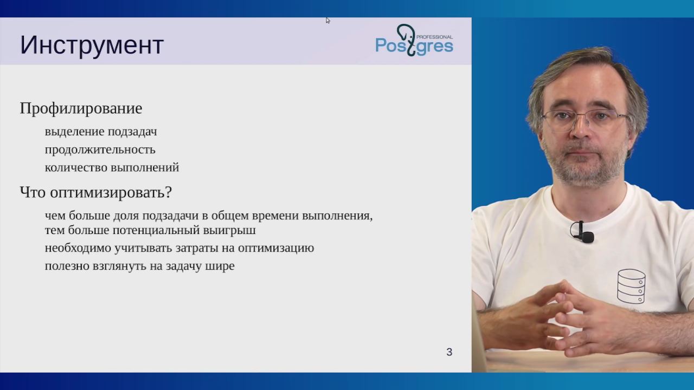

## 2. Метрики: время выполнения и страничный ввод-вывод

Время выполнения имеет смысл для пользователя и является правильным показателем того, сколько тратится на задачу, но это крайне нестабильный показатель: оно зависит от внешних факторов, например от загрузки сервера, и первый запрос может прочитать данные в кэш, а второй поэтому отработает быстро. Страничный ввод-вывод стабилен по отношению к внешним факторам: не зависит от нагрузки, конкурентности и характеристик оборудования, и при тех же данных и настройках на другом сервере цифры будут плюс-минус те же. Сам по себе он мало что говорит пользователям, но снижение ввода-вывода коррелирует с уменьшением времени выполнения задач; полезно измерить количество страниц, к которым обращается запрос. Чтобы оценить общий объём ввода-вывода, можно посмотреть на самый верхний узел плана запроса, где отображается агрегированная информация о количестве прочитанных страниц — например, около 60 тысяч страниц против почти миллиона в предыдущей версии.

```
Sort (actual rows=9 loops=1)
    Sort Method: quicksort  Memory: 25kB
    Buffers: shared hit=4073 read=56839, temp read=13666 written=13666
```

*Источник: [00:08:36], [00:11:29], [00:11:49], [00:43:33]*


## 3. Профиль приложения: компоненты, сторона СУБД, сеть

Профиль приложения включает клиентскую часть, сервер приложений, сервер баз данных и сеть, и профилирование приложения разбивается на подзадачи по этим компонентам. Профилирование технически трудно и требует разнообразных средств мониторинга; подтвердить предположение обычно несложно, однако получить полный профиль, чтобы убедиться, что проблема на стороне СУБД, бывает сложно — вся система должна быть хорошо обвешана мониторингом. Проблема очень часто, может быть почти всегда, находится именно на стороне СУБД, потому что неправильный план запроса способен погубить производительность. Даже если база данных отвечает быстро, сетевая задержка вкладывает своё время во время отклика; можно посмотреть, сколько времени сервер баз данных отвечал на запросы, и подтвердить предположение обычно несложно. Тестировать нужно на той же самой базе данных, на которой потом будет работать система.

> [!info] Зачем это нужно
> Проверить вклад сети, когда пользователь жалуется на медленный ответ системы.

*Источник: [00:11:29], [00:17:35], [00:17:56], [00:18:16], [00:46:43], [00:48:15]*

> [!quote]- Кадр [00:17:56]
> 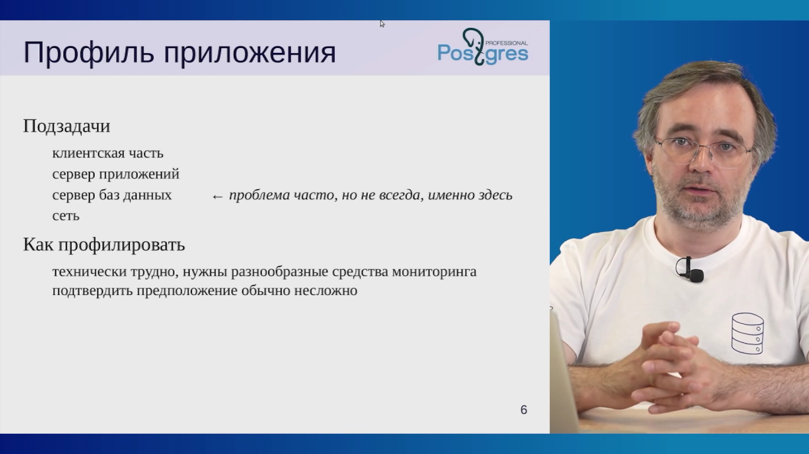

> [!quote]- Кадр [00:17:35]
> 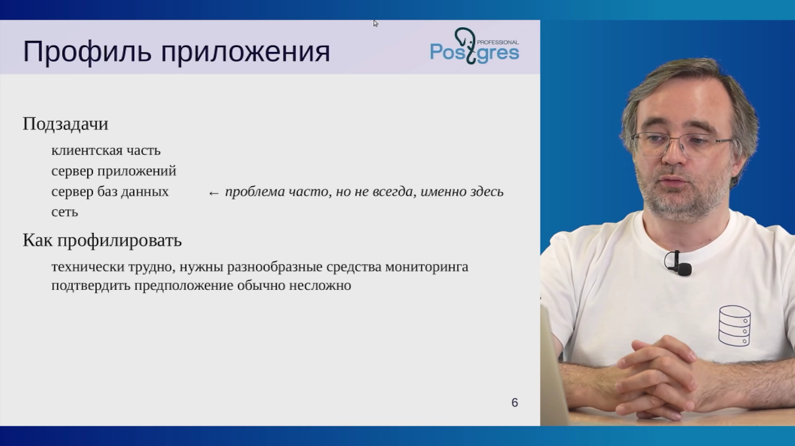


> [!quote]- Кадр [00:18:16]
> 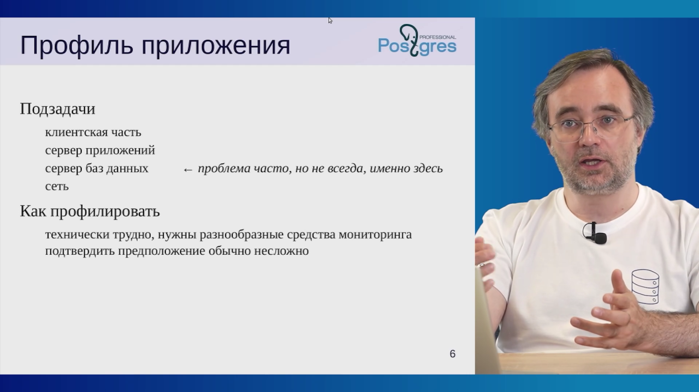

> [!quote]- Кадр [00:11:29]
> 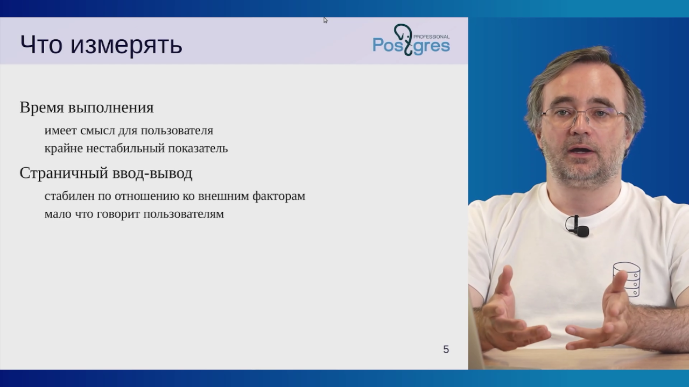

## 4. Журнал сервера, pgBadger и auto_explain

Профиль запросов включается через журнал сообщений сервера; параметр log_min_duration_statements = 0 записывает время и текст всех запросов, а log_line_prefix добавляет идентифицирующую информацию (идентификатор сеанса, имя пользователя и базы данных). Журнал даёт большой объём данных и сложно включается для отдельного сеанса; для его анализа используется pgBadger — стандарт де-факто. Журнал не отслеживает вложенные запросы; для их отслеживания применяется расширение auto_explain, но при увеличении порога времени теряем информацию. Для визуализации плана рекомендуется explain.tensor.ru, который подсвечивает места, на которые надо обратить внимание.

```sql
SET pg_stat_statements.track = 'all';
CREATE VIEW statements_v AS
SELECT
    queryid,
    toplevel,
    substring(regexp_replace(query, ' +', ' ', 'g') FOR 55) AS query,
    calls,
    round(total_exec_time)/1000 AS time_sec,
    shared_blks_hit + shared_blks_read + shared_blks_written AS shared_blks
FROM pg_stat_statements
ORDER BY total_exec_time DESC;
```

*Источник: [00:22:41], [00:23:39], [00:23:59], [00:47:03], [00:49:46]*

> [!quote]- Кадр [00:23:39]
> 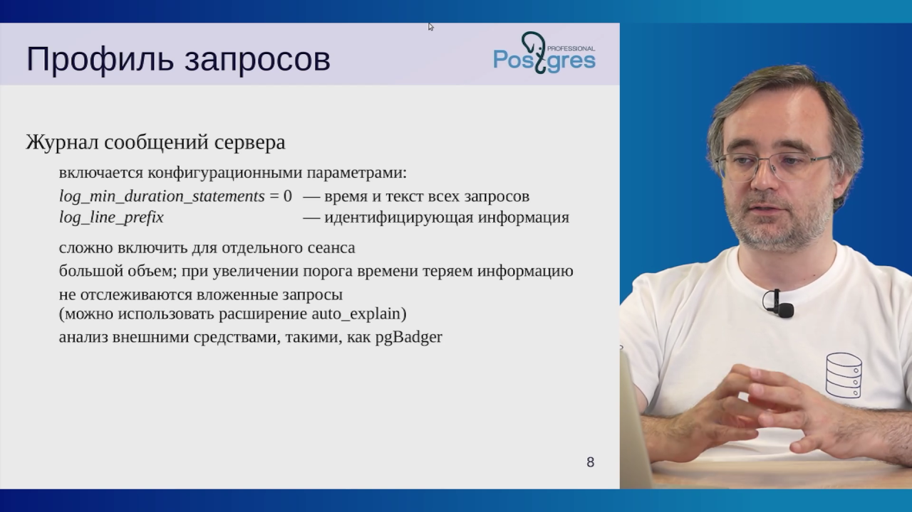

> [!quote]- Кадр [00:23:59]
> 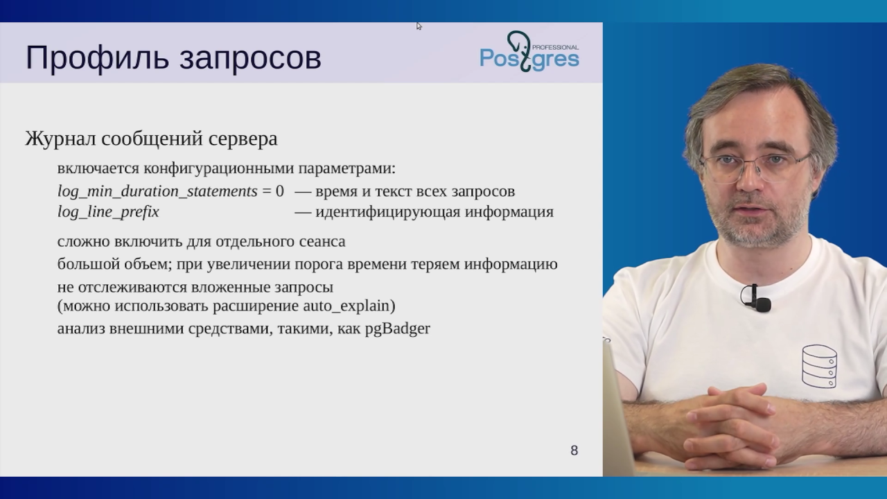

> [!quote]- Кадр [00:22:41]
> 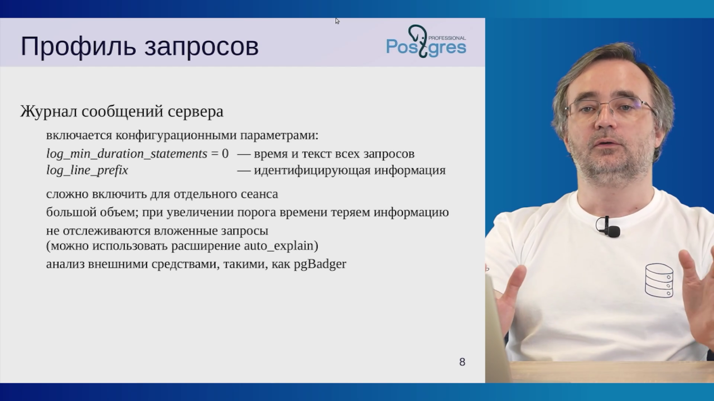

> [!quote]- Кадр [00:49:46]
> 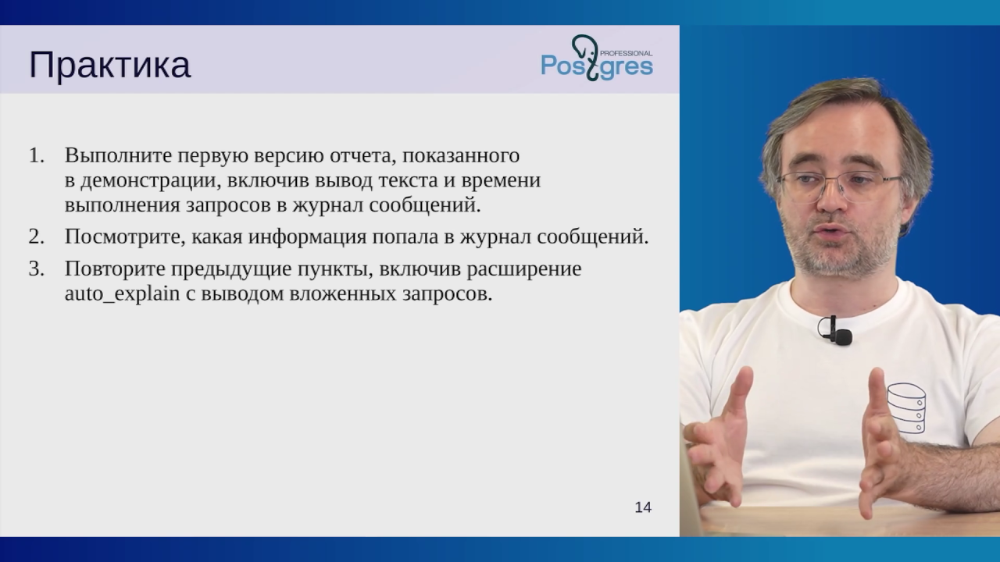

## 5. pg_stat_statements: установка, представление и query ID

pg_stat_statements — штатное расширение, по умолчанию не установлено; для использования нужно выполнить CREATE EXTENSION, добавить библиотеку в shared_preload_libraries через ALTER SYSTEM и перезапустить кластер. Расширение логично устанавливать во все базы данных, а для сбора статистики о вложенных запросах устанавливают pg_stat_statements.track = 'all'. Запросы нормализуются (считаются одинаковыми с точностью до констант), что уменьшает объём памяти; единый query ID вычисляется ядром (параметр compute_query_id) и совпадает в EXPLAIN и pg_stat_statements, а запрос верхнего уровня помечается как top level true. Поверх статистики удобно создать своё представление, например statements_v, которое сортирует запросы по total_exec_time; сброс статистики выполняется через pg_stat_statements_reset(), а дата последнего сброса видна в pg_stat_statements_info.

```sql
SET pg_stat_statements.track = 'all';

CREATE VIEW statements_v AS
SELECT
  queryid,
  toplevel,
  substring(regexp_replace(query, '\s+', ' ', 'g')) FOR 55) AS query,
  calls,
  round(total_exec_time)/1000 AS time_sec,
  shared_blks_hit + shared_blks_read + shared_blks_written AS shared_blks
FROM pg_stat_statements
ORDER BY total_exec_time DESC;

=> EXPLAIN (verbose)
SELECT pg_stat_statements_reset();
QUERY PLAN
Result (cost=0.00..0.01 rows=1 width=4)
Output: pg_stat_statements_reset('0'::oid, '0'::oid, '0'::bigint)
Query Identifier: -7827778417405733903
(3 rows)

=> SELECT pg_stat_statements_reset();
=> SELECT stats_reset FROM pg_stat_statements_info;

=> EXPLAIN (verbose)
SELECT pg_stat_statements_reset();
QUERY PLAN
Result (cost=0.00..0.01 rows=1 width=4)
Output: pg_stat_statements_reset('0'::oid, '0'::oid, '0'::bigint)
Query Identifier: -7827778417405733903
(3 rows)

CREATE FUNCTION qty(aircraft_code char, fare_conditions varchar)
RETURNS bigint AS $$
    SELECT count(*)
    FROM flights f
    JOIN boarding_passes bp ON bp.flight_id = f.flight_id
    JOIN seats s ON s.aircraft_code = f.aircraft_code AND s.seat_no = bp.seat_no
    WHERE f.aircraft_code = qty.aircraft_code AND s.fare_conditions = qty.fare_conditions;
$$ STABLE LANGUAGE sql;

=> SELECT pg_stat_statements_reset();
=> SELECT stats_reset FROM pg_stat_statements_info;
=> SELECT * FROM report();
```

*Источник: [00:23:59], [00:27:27], [00:30:13], [00:30:33], [00:30:53], [00:31:21] и др.*


> [!quote]- Кадр [00:30:13]
> 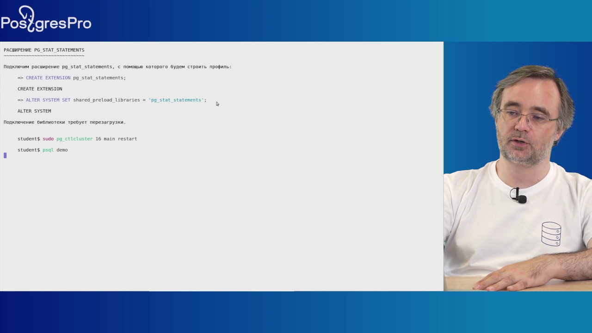

> [!quote]- Кадр [00:27:27]
> 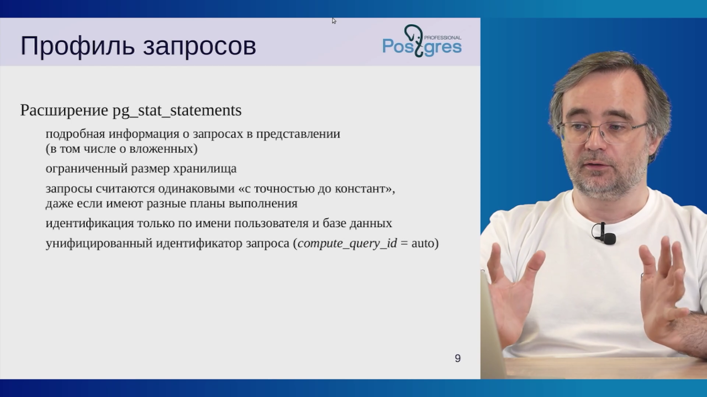

## 6. EXPLAIN ANALYZE и сверка страниц

Для изучения отдельного запроса используется EXPLAIN ANALYZE: он выдаёт профиль запроса, где подзадачи — узлы плана, продолжительность — actual time, страничный ввод-вывод — buffers, количество выполнений — loops. При указании BUFFERS выводятся shared hit, read, temp read/written; можно спускаться по плану, чтобы увидеть источник цифр (например, хэш-соединение читает больше всего). Кандидаты на оптимизацию — не только ресурсоёмкие узлы, но и узлы с большой ошибкой прогноза кардинальности; исправление может перестроить план. Чтобы проверить адекватность плана, количество страниц сверяется с суммой relpages из pg_class для участвующих таблиц; если фактически прочитано примерно столько же (~61 тысяча), план адекватен. Если видно temp read/written, значит запросу не хватило оперативной памяти и данные сбрасывались на диск; для OLAP важно, чтобы данные читались один раз.

```javascript
=> EXPLAIN (analyze, buffers, costs off, timing off)

QUERY PLAN

  Sort (actual rows=9 loops=1)
    Sort Key: (ml.model ->> lang())
    Sort Method: quicksort  Memory: 25kB
    Buffers: shared hit=4073 read=56839, temp read=13666 written=13666
    -> Hash Left Join (actual rows=9 loops=1)
        Hash Cond: (ml.aircraft_code = t.aircraft_code)
        Buffers: shared hit=4073 read=56839, temp read=13666 written=13666
        -> Seq Scan on aircrafts data ml (actual rows=9 loops=1)
        -> Hash (actual rows=8 loops=1)
            -> HashAggregate (actual rows=8 loops=1)
                -> Hash Join (actual rows=7925812 loops=1)

=> SELECT sum(relpages)
   FROM pg_class
   WHERE relname IN ('flights','boarding_passes','aircrafts','seats');
```

*Источник: [00:38:06], [00:38:26], [00:38:46], [00:41:41], [00:43:33], [00:44:53] и др.*

> [!quote]- Кадр [00:38:26]
> 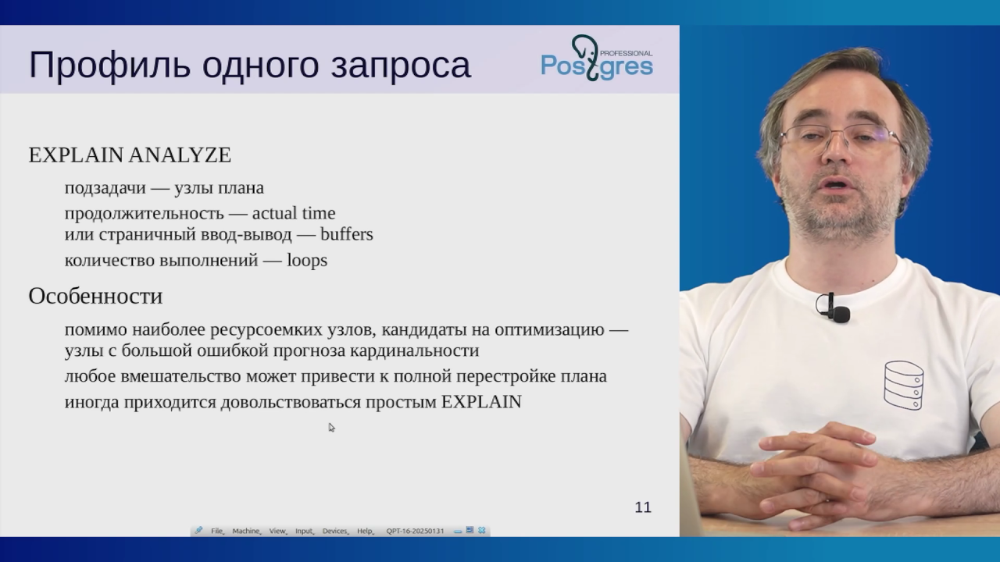

> [!quote]- Кадр [00:38:46]
> 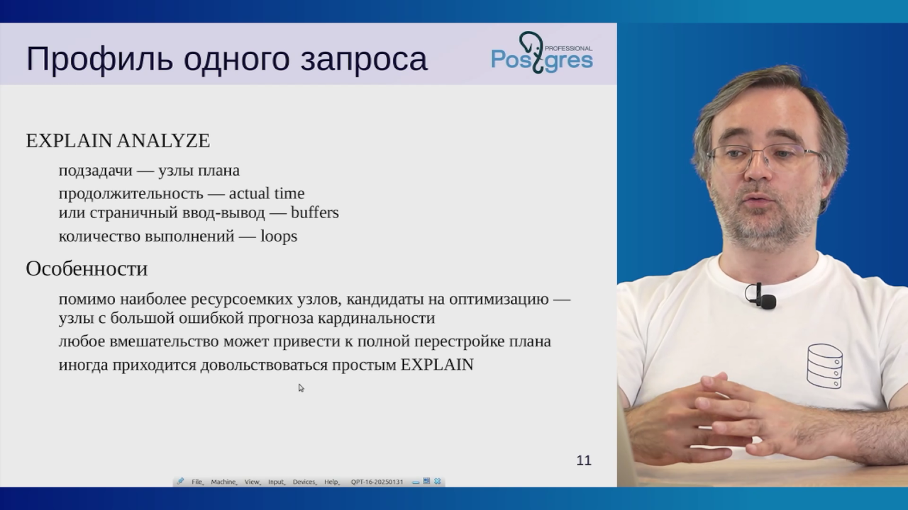

## 7. Пример report(): цикл против FILTER

Сквозной пример — функции qty() и report(): qty возвращает количество перевезённых пассажиров для заданной модели самолёта и категории обслуживания, а report() возвращает таблицу с колонками model, economy, comfort, business, перебирая в цикле все модели и вызывая qty() три раза для каждого класса обслуживания. Функция report() вызывалась 27 раз и заняла практически всё время выполнения и почти все обращения к буферам. Альтернатива — решить задачу одним запросом, соединив таблицы и посчитав количество с помощью условной агрегации FILTER (count(*) FILTER (WHERE s.fare_conditions = ...)) для каждого класса, с левым соединением с aircrafts, чтобы показать все самолёты.

```go
CREATE FUNCTION qty(aircraft_code char, fare_conditions varchar)
RETURNS bigint AS $$
    SELECT count(*)
    FROM flights f
    JOIN boarding_passes bp ON bp.flight_id = f.flight_id
    JOIN seats s ON s.aircraft_code = f.aircraft_code AND s.seat_no = bp.seat_no
    WHERE f.aircraft_code = qty.aircraft_code AND s.fare_conditions = qty.fare_conditions;
$$ STABLE LANGUAGE sql;

CREATE FUNCTION report()
 RETURNS TABLE(model text, economy bigint, comfort bigint, business bigint)
 AS $$
 DECLARE
  r record;
 BEGIN
  FOR r IN SELECT a.aircraft_code, a.model FROM aircrafts a ORDER BY a.model LOOP
   report.model := r.model;
   report.economy := qty(r.aircraft_code, 'Economy');
   report.comfort := qty(r.aircraft_code, 'Comfort');
   report.business := qty(r.aircraft_code, 'Business');
   RETURN NEXT;
  END LOOP;
 END;
$$ STABLE LANGUAGE plpgsql;

count(*) FILTER (WHERE s.fare_conditions = 'Economy') economy,
count(*) FILTER (WHERE s.fare_conditions = 'Comfort') comfort,
count(*) FILTER (WHERE s.fare_conditions = 'Business') business

FROM aircrafts a
    LEFT JOIN t ON a.aircraft_code = t.aircraft_code
ORDER BY a.model;

=> SELECT * FROM report();
```

*Источник: [00:31:41], [00:32:35], [00:32:55], [00:33:36], [00:33:56], [00:34:16] и др.*

## 8. Расширения PL Profiler и plpgsql_check

PL Profiler — стороннее расширение, предназначенное только для функций на PL/pgSQL; оно позволяет профилировать отдельный скрипт или сеанс, а по результатам работы формируется отчёт в HTML, включая flame graph. plpgsql_check — стороннее расширение, которое статически проверяет код функций и процедур на PL/pgSQL и встроенный SQL, чтобы находить ошибки компиляции и предполагать ошибки времени выполнения. Оно также позволяет искать зависимые объекты в функциях и имеет возможность автоматического профилирования функций.

*Источник: [00:20:37], [00:20:58], [00:21:19]*

> [!quote]- Кадр [00:20:37]
> 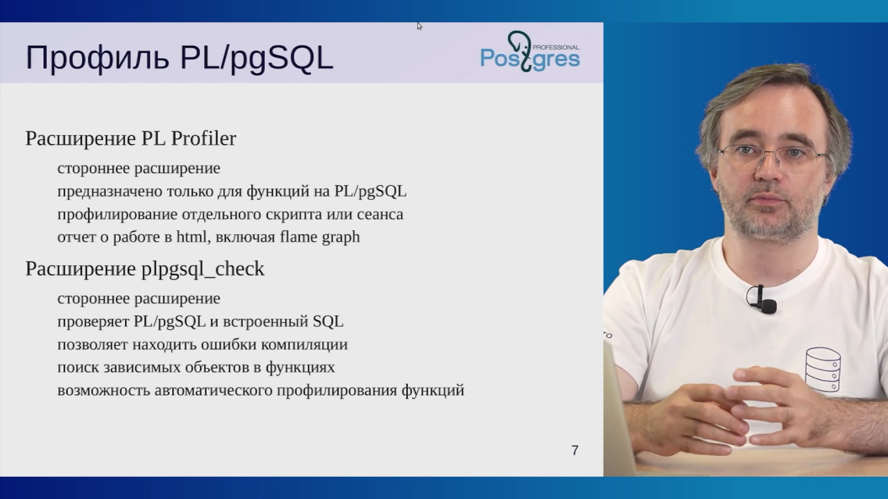

> [!quote]- Кадр [00:20:58]
> 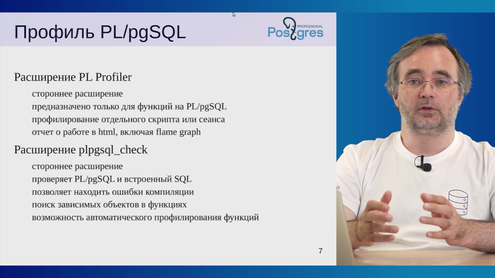

> [!quote]- Кадр [00:21:19]
> 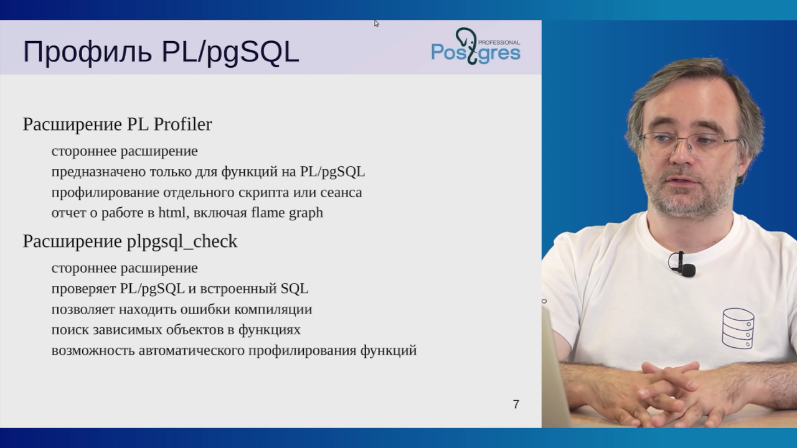

## Схема

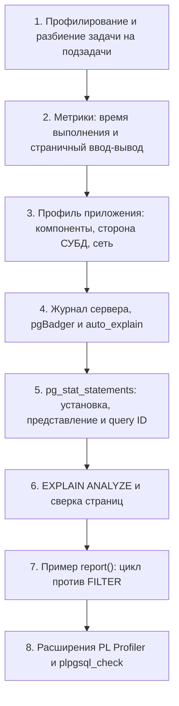

## Итог

> [!success] Что в итоге
> Профилирование начинается с разбиения задачи на подзадачи и оценки их доли в общем времени и числа выполнений; метрика времени нестабильна, а страничный ввод-вывод стабилен и коррелирует со временем. Для общей картины используются мониторинг и pg_profile, для разбора конкретной задачи — журнал сервера с log_line_prefix, pgBadger и auto_explain, а pg_stat_statements с нормализацией запросов показывает, какие запросы нагружают систему. Единый query ID связывает EXPLAIN и pg_stat_statements, а EXPLAIN ANALYZE и EXPLAIN с ANALYZE и BUFFERS дают профиль отдельного запроса, который сверяется с relpages из pg_class и проверяется на появление temp read/written.

