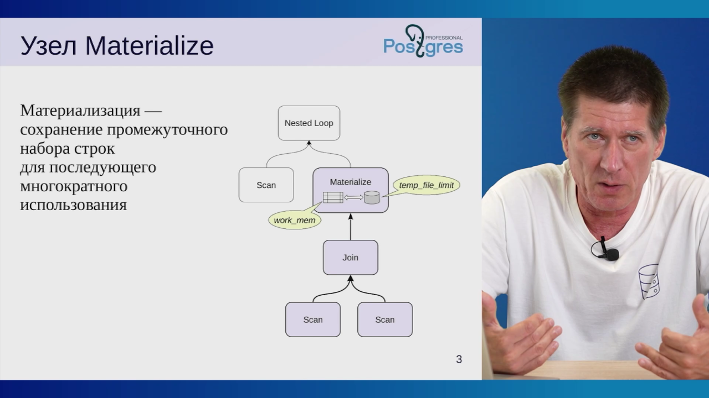
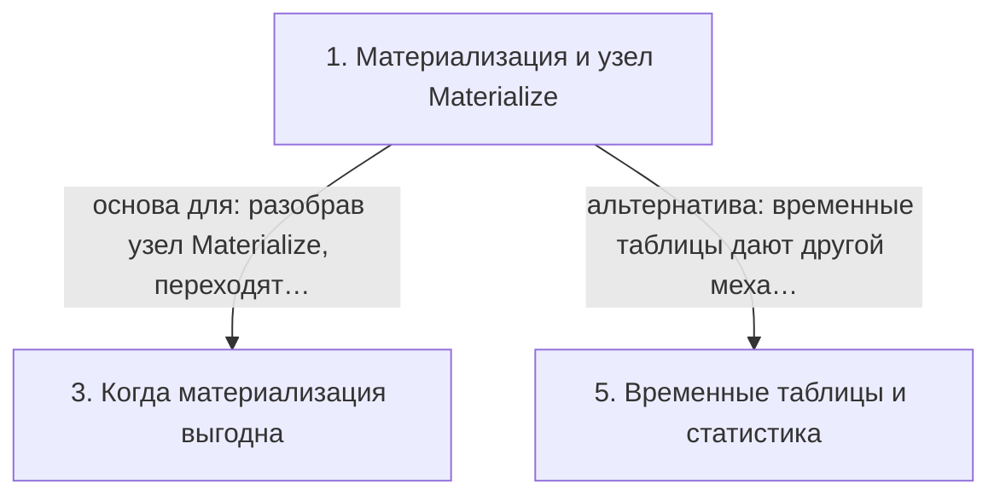

# Материализация в PostgreSQL

> [!abstract] Обзор
> Материал о материализации в PostgreSQL: сохранение промежуточного набора строк для многократного использования, которому в плане запроса соответствует узел Materialize. Разбирается, когда планировщик вставляет этот узел — при Nested Loop и для многократно используемых подзапросов — и какие ресурсы при этом расходуются: оперативная память в пределах work_mem и временные файлы в пределах temp_file_limit. Отдельно рассматриваются материализация CTE и NOT MATERIALIZED, узел Recursive Union, оконные функции, временные таблицы и сбор статистики для них. Завершают материал join_collapse_limit, а также создание, обновление и индексирование материализованных представлений.

> [!info] Курс
> [[index|Оглавление курса]]

## Оглавление
1. [[#1. Материализация и узел Materialize]]
2. [[#2. work_mem и temp_file_limit]]
3. [[#3. Когда материализация выгодна]]
4. [[#4. Узел Recursive Union]]
5. [[#5. Временные таблицы и статистика]]
6. [[#6. join_collapse_limit]]
7. [[#7. Материализованные представления]]

**Схема** — [[#Схема]]
**Итог** — [[#Итог]]

## 1. Материализация и узел Materialize

Материализация — сохранение промежуточного набора строк для последующего многократного использования. В плане запроса материализации соответствует узел Materialize, в котором она выполняется; узел позволяет обращаться к одному и тому же материализованному набору строк многократно. При вычислении CTE возможны оба варианта: результат материализуется в узле CTE Scan или запрос CTE подставляется в основной запрос без материализации; планировщик может сам решить материализовать CTE, но если указаний нет, оптимизатор старается избегать материализации. Планировщик можно попросить не использовать материализацию фразой NOT MATERIALIZED, тогда он построит другой план, и количество прочитанных и записанных страниц будет заметно меньше. Материализация выполняется независимо от указания NOT MATERIALIZED, если в подзапросе данные изменяются: результат материализуется, потому что изменение должно произойти только один раз. Материализацией можно управлять, оформив её как CTE, используя временные таблицы или материализованные представления; при вычислении оконных функций возникает материализация, и если рамка не сдвигается, узел сохраняет строки текущего раздела.

*Источник: [00:00:00], [00:01:00]*

> [!quote]- Кадр [00:00:00]
> 

> [!quote]- Кадр [00:01:00]
> 

## 2. work_mem и temp_file_limit

При материализации набор сохраняется в оперативной памяти, объём которой задаётся параметром work_mem; work_mem задаёт стандартное количество памяти, выделяемое одному узлу. При необходимости набор сбрасывается во временные файлы, создаваемые в пределах лимита temp_file_limit, причём это ограничение действует на весь сеанс.

| Параметр | На что действует |
|---|---|
| work_mem | На один узел |
| temp_file_limit | На весь сеанс |

*Источник: [00:01:00]*

## 3. Когда материализация выгодна

Материализация имеет смысл, если подзапрос достаточно сложный и его вычисление требует ресурсов, чтобы не строить наборы строк повторно. Планировщик вставляет узел Materialize, чтобы избежать многократного обращения ко второму набору, когда количество строк велико. Алгоритм вложенных циклов предполагает многократное обращение к набору, поэтому часто выгодно материализовать второй набор из соединяемых; при Nested Loop, если условие фильтра второго набора не зависит от строк первого (не параметризованное соединение), второй набор имеет смысл материализовать. При соединении слиянием планировщик может выбирать материализацию внутреннего набора, так как значения во внешнем наборе могут повторяться, а подзапрос, используемый несколько раз, может материализоваться даже без указания MATERIALIZE. Материализованный набор не индексируется, поэтому обращения к нему всё равно выполняются полным сканированием, и для материализации большой таблицы требуется много памяти — иначе план без материализации может оказаться эффективнее.

> [!info] Зачем это нужно
> Избежать многократного обращения ко второму набору при большом количестве строк.

*Источник: [00:01:00]*

## 4. Узел Recursive Union

В корне подплана стоит узел Recursive Union, который выполняет объединение таблицы с результатом очередного выполнения второй части рекурсивного подзапроса. При выполнении объединения используются временные файлы.

*Источник: [00:01:00]*

## 5. Временные таблицы и статистика

Использование временных таблиц — тоже материализация, но с другим механизмом: вместо сохранения в памяти и временных файлах организуется таблица, похожая на обычную, но существующая только в пределах сеанса. Такая таблица регистрируется в системном каталоге, не журналируется и хранится в файловой системе как обычная таблица. Если статистики по таблице нет, оптимизатор использует заготовленные по умолчанию константы: считает, что в таблице 10 страниц и на них умещается 520 строк, из-за чего сильно ошибается с оценкой кардинальности. Автоочистка не работает для временных таблиц, поэтому статистику нужно собрать вручную командой ANALYZE. После этого EXPLAIN выдаёт точную оценку кардинальности, и стоимость считается как для обычной таблицы.

*Источник: [00:01:00]*

## 6. join_collapse_limit

join_collapse_limit по умолчанию равен 8. Если число соединяемых таблиц не больше этого значения, планировщик выполняет полный перебор вариантов соединений; если таблиц больше, он разбивает их на группы по join_collapse_limit таблиц, и в каждой группе будет как бы одна таблица. Значение по умолчанию выбрано так, чтобы не сильно нагружать планировщик, так как при планировании соединения большого числа таблиц количество вариантов очень велико. Можно неявно повлиять на поведение планировщика, установив Join Collapse Limit в единицу; результаты выборки из каждой таблицы соединяются последовательно, меняя порядок соединений.

*Источник: [00:01:00]*

## 7. Материализованные представления

Материализованное представление — это именованный результат запроса, который сохранён. Хранится он в формате таблицы, но не как временный объект, а как обычный объект, доступный всем сеансам; его нельзя изменять напрямую — можно только выполнить запрос и обновить строки. При изменении базовых таблиц содержимое автоматически не изменяется, синхронизацию нужно делать вручную; создаётся оно командой CREATE MATERIALIZED VIEW с указанием имени и запроса. В Postgres предусмотрено обновление всего представления командой Refresh Materialized View: выполняется запрос, и все строки заменяются; на всё время перестроения представление полностью блокируется, а для больших объёмов это дорого, поэтому предусмотрено инкрементальное обновление с использованием расширения PGI VM. По материализованному представлению можно построить индекс, например create unique index on airports.msk по коду аэропорта, что позволяет выполнять запросы через индексное сканирование.

*Источник: [00:01:00]*

## Схема

## Итог

> [!success] Что в итоге
> Материализация сохраняет промежуточный набор строк для многократного использования и встречается как узел Materialize в планах; она бывает выгодна во вложенных циклах, при соединении слиянием, в оконных функциях и рекурсивных CTE, а расходует оперативную память в пределах work_mem и временные файлы в пределах temp_file_limit. Управлять ею можно через CTE и NOT MATERIALIZED, временные таблицы и материализованные представления. Для корректных оценок нужна статистика, а для больших материализованных представлений — обновление и индексы.

