# Материализация, временные таблицы и планирование запросов в PostgreSQL

> [!abstract] Обзор
> Материал посвящён материализации в PostgreSQL: сохранению промежуточных наборов строк в планах соединений и при вычислении CTE, а также управлению этим через MATERIALIZED и NOT MATERIALIZED. Показано, как узел Materialize появляется в Nested Loop и Merge Join, как CTE отображается отдельным подпланом и читается через CTE Scan, и как материализация связана с памятью work_mem и временными файлами. Отдельно разобраны рекурсивные запросы с двумя материализованными наборами и оконные функции с узлом WindowAgg. Рассмотрены временные таблицы, их режимы ON COMMIT, отсутствие автоочистки и необходимость ручного ANALYZE, а также влияние статистики на оценку стоимости и выбор порядка соединений. Планировочная часть касается порогов перебора join_collapse_limit и geqo_threshold, порядка хэш-соединений и работы с материализованными представлениями через индексирование, REFRESH и search_path.

> [!info] Курс
> [[index|Оглавление курса]]

## Оглавление
1. [[#1. Материализация в соединениях и CTE]]
2. [[#2. Рекурсивные запросы]]
3. [[#3. Оконные функции и WindowAgg]]
4. [[#4. Временные таблицы: свойства и ON COMMIT]]
5. [[#5. Статистика временных таблиц и ANALYZE]]
6. [[#6. Порядок соединений: пороги перебора и хэш-соединения]]
7. [[#7. Материализованное представление: создание, индексирование, обновление]]

**Схема** — [[#Схема]]
**Итог** — [[#Итог]]

## 1. Материализация в соединениях и CTE

В Nested Loop внутренний набор материализуется, когда условие фильтра не зависит от внешнего; в self-join airports по часовому поясу и широте появляется узел Materialize. При Merge Join материализация выгодна при повторяющихся значениях внешнего набора, например ticket_no в TicketFlights. Для CTE можно указать MATERIALIZED, тогда результат вычисляется и читается через CTE Scan; без указания оптимизатор старается подставить CTE в основной запрос. NOT MATERIALIZED не отменяет материализацию, если подзапрос изменяет данные. Материализованный набор не индексируется и требует памяти work_mem, а при нехватке сбрасывается во временные файлы в пределах temp_file_limit; для диагностики используют EXPLAIN (analyze, costs off, buffers), который выводит Buffers, Planning Time и Execution Time.

```sql
Nested Loop
  -> Seq Scan on airports_data a1
        Filter: (timezone = 'Europe/Moscow'::text)
  -> Materialize
        -> Seq Scan on airports_data a2
              Filter: (abs(coordinates[1]) > '66.652'::double precision)

=> EXPLAIN (costs off)
SELECT al.city, a2.city
FROM airports al, airports a2
WHERE al.timezone = 'Europe/Moscow'
  AND abs(a2.coordinates[1]) > 66.652; -- за полярным кругом

Merge Join
  Merge Cond: (tickets.ticket_no = ticket_flights.ticket_no)
  -> Index Scan using tickets_pkey on tickets
  -> Materialize
        -> Index Scan using ticket_flights_pkey on ticket_flights

WITH q AS (
  SELECT f.flight_id, a.aircraft_code
  FROM flights f
    JOIN aircrafts a ON a.aircraft_code = f.aircraft_code
)
SELECT *
FROM q
JOIN seats s ON s.aircraft_code = q.aircraft_code
WHERE s.seat_no = '1A';

WITH q AS MATERIALIZED (
    SELECT f.flight_id, a.aircraft_code
    FROM flights f
      JOIN aircrafts a ON a.aircraft_code = f.aircraft_code
)
SELECT *
FROM q
  JOIN seats s ON s.aircraft_code = q.aircraft_code
WHERE s.seat_no = '1A';

QUERY PLAN
Hash Join
  Hash Cond: (q.aircraft_code = s.aircraft_code)
  CTE q
    ->  Hash Join
          Hash Cond: (f.aircraft_code = ml.aircraft_code)
          ->  Seq Scan on flights f
          ->  Hash
                ->  Seq Scan on aircrafts_data ml
    ->  CTE Scan on q
    ->  Hash
          ->  Seq Scan on seats s
                Filter: ((seat_no)::text = '1A'::text)

WITH b AS NOT MATERIALIZED (
    SELECT * FROM bookings
)
SELECT *
FROM b AS b1
JOIN b AS b2 ON b1.book_ref = b2.book_ref
WHERE b2.book_ref = '000112';

QUERY PLAN
Nested Loop (actual time=1.306..1.309 rows=1 loops=1)
  Buffers: shared hit=4 read=4
  ->  Index Scan using bookings_pkey on bookings (actual time=1.286..1.286 rows=1 loops=1)
        Index Cond: (book_ref = '000112'::bpchar)
  ->  Index Scan using bookings_pkey on bookings_1 (actual time=0.012..0.013 rows=1 loops=1)
        Index Cond: (book_ref = '000112'::bpchar)

Nested Loop (actual time=0.062..717.806 rows=1 loops=1)
  Buffers: shared read=13447, temp read=8483 written=8483
  CTE b
    ->  Seq Scan on bookings (actual time=0.034..218.024 rows=2111110 loops=1)
          Buffers: shared read=13447
    ->  CTE Scan on b b1
          Filter: (book_ref = '000112'::bpchar)
          Rows Removed by Filter: 2111109
    ->  CTE Scan on b b2
          Filter: (book_ref = '000112'::bpchar)
          Rows Removed by Filter: 2111109

Buffers: shared read=13447, temp read=8483 written=8483

EXPLAIN (analyze, costs off, buffers)

Merge Join
  Merge Cond: (tickets.ticket_no = ticket_flights.ticket_no)
  -> Index Scan using tickets_pkey on tickets
  -> Materialize
        -> Index Scan using ticket_flights_pkey on ticket_flights

=> EXPLAIN (costs off)
SELECT al.city, a2.city
FROM airports al, airports a2
WHERE al.timezone = 'Europe/Moscow'
  AND abs(a2.coordinates[1]) > 66.652; -- за полярным кругом
------------------------- QUERY PLAN
Nested Loop
  -> Seq Scan on airports data ml
        Filter: (timezone = 'Europe/Moscow'::text)
  -> Materialize
        -> Seq Scan on airports data ml_1
              Filter: (abs(coordinates[1]) > '66.652'::double precision)

>=  INSERT INTO airports_data (airport_code, airport_name, city, coordinates, timezone)
   VALUES ('ZIA', '{"ru": "Муковский"}', '{}', point(38.1517, 55.5533), 'Europe/Moscow');
INSERT 0 1
=> SELECT count(*)
FROM airports_msk
WHERE airport_code = 'ZIA';

 count
-------
     0
(1 row)

=> REFRESH MATERIALIZED VIEW CONCURRENTLY airports_msk;
REFRESH MATERIALIZED VIEW
=> SELECT count(*)
FROM airports_msk
WHERE airport_code = 'ZIA';

 count
-------
     1
(1 row)

>=> INSERT INTO airports_data (airport_code, airport_name, city, coordinates, timezone)
   VALUES ('ZIA', '{"ru": "Муковский"}', '{}', point(38.1517, 55.5533), 'Europe/Moscow');
INSERT 0 1
=> SELECT count(*)
FROM airports_msk
WHERE airport_code = 'ZIA';

 count
-------
     0
(1 row)

=> REFRESH MATERIALIZED VIEW CONCURRENTLY airports_msk;
REFRESH MATERIALIZED VIEW
=> SELECT count(*)
FROM airports_msk
WHERE airport_code = 'ZIA';

 count
-------
     1
(1 row)

WITH q AS (
  SELECT f.flight_id, a.aircraft_code
  FROM flights f
    JOIN aircrafts a ON a.aircraft_code = f.aircraft_code
)
SELECT *
FROM q
JOIN seats s ON s.aircraft_code = q.aircraft_code
WHERE s.seat_no = '1A';

WITH q AS MATERIALIZED (
    SELECT f.flight_id, a.aircraft_code
    FROM flights f
      JOIN aircrafts a ON a.aircraft_code = f.aircraft_code
)
SELECT *
FROM q
  JOIN seats s ON s.aircraft_code = q.aircraft_code
WHERE s.seat_no = '1A';

QUERY PLAN
Hash Join
  Hash Cond: (q.aircraft_code = s.aircraft_code)
  CTE q
    ->  Hash Join
          Hash Cond: (f.aircraft_code = ml.aircraft_code)
          ->  Seq Scan on flights f
          ->  Hash
                ->  Seq Scan on aircrafts_data ml
    ->  CTE Scan on q
    ->  Hash
          ->  Seq Scan on seats s
                Filter: ((seat_no)::text = '1A'::text)

WITH q AS MATERIALIZED (
  SELECT f.flight_id, a.aircraft_code
  FROM flights f
    JOIN aircrafts a ON a.aircraft_code = f.aircraft_code
)
SELECT *
FROM q
  JOIN seats s ON s.aircraft_code = q.aircraft_code
WHERE s.seat_no = '1A';

Hash Join
   Hash Cond: (q.aircraft_code = s.aircraft_code)
   CTE q
   ->  Hash Join
         Hash Cond: (f.aircraft_code = ml.aircraft_code)
         ->  Seq Scan on flights f
         ->  Hash
               ->  Seq Scan on aircrafts_data ml
   ->  Seq Scan on q
   ->  Hash
         ->  Seq Scan on seats s
               Filter: ((seat_no)::text = '1A'::text)
```

| Вариант | Что происходит в плане |
|---|---|
| без MATERIALIZED | CTE подставляется в основной запрос без материализации |
| с MATERIALIZED | результат CTE вычисляется и читается через CTE Scan |

> [!info] Зачем это нужно
> Планировщик выбирает материализацию, так как условие фильтра второго набора постоянно для каждой строки первого набора.

*Источник: [00:00:41], [00:02:45], [00:03:35], [00:04:55], [00:05:35], [00:05:55] и др.*

> [!quote]- Кадр [00:00:41]
> 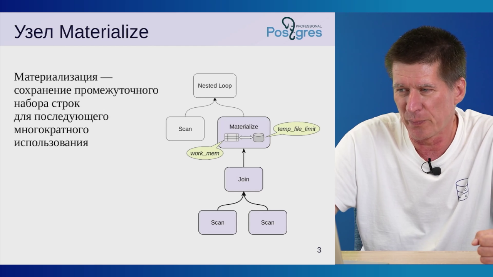

> [!quote]- Кадр [00:06:15]
> 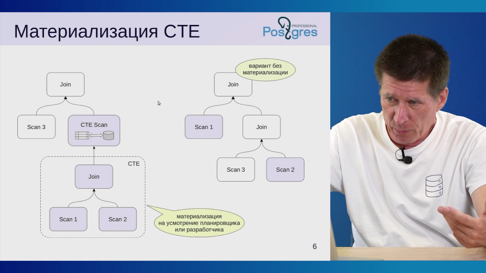

## 2. Рекурсивные запросы

Рекурсивный запрос состоит из базы рекурсии и рекурсивного перехода, соединённых UNION. Он выполняется с двумя материализованными наборами: промежуточной таблицей CTE и рабочей таблицей Worktable. Промежуточная таблица используется в узле Recursive Union, а к рабочей таблице обращается WorkTableScan. Рекурсию ограничивают условием r.n < 2, чтобы не было бесконечного выполнения.

```sql
WITH RECURSIVE r(n, airport_code) AS (
  SELECT 1, a.airport_code
  FROM airports a
  UNION ALL
  SELECT r.n+1, f.arrival_airport
  FROM r
    JOIN flights f ON f.departure_airport = r.airport_code
   WHERE r.n < 2
)
SELECT * FROM r;

WITH RECURSIVE r(n, airport_code) AS (
    SELECT 1, a.airport_code
    FROM airports a
    UNION ALL
    SELECT r.n+1, f.arrival_airport
    FROM r
      JOIN flights f ON f.departure_airport = r.airport_code
    WHERE r.n < 2
)
SELECT * FROM r;
```

*Источник: [00:12:43], [00:13:03], [00:13:23], [00:13:51], [00:15:01], [00:15:41]*

> [!quote]- Кадр [00:12:43]
> 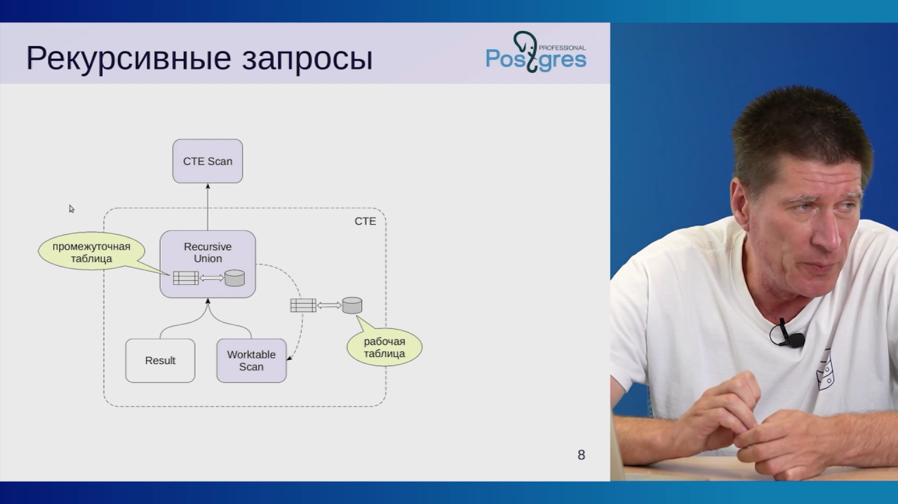

> [!quote]- Кадр [00:13:03]
> 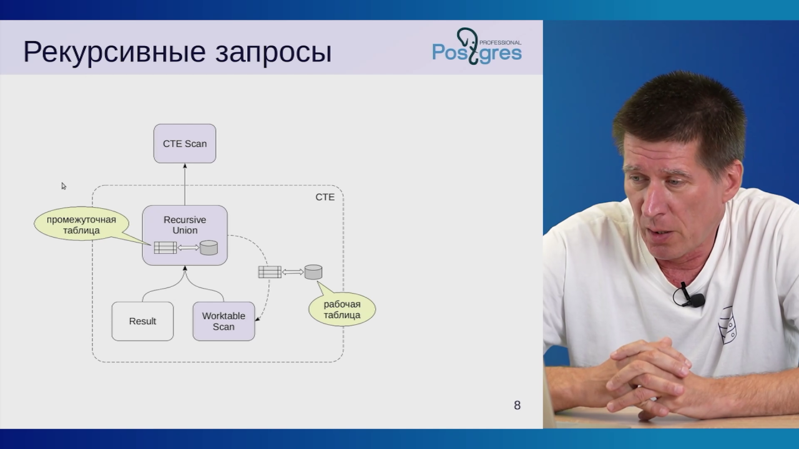

## 3. Оконные функции и WindowAgg

Ещё один случай материализации — вычисление оконных функций. Оконная функция выполняется через узел WindowAgg, которому предшествуют Sort и Seq Scan. Когда рамка не сдвигается, WindowAgg сохраняет строки текущего раздела.

*Источник: [00:17:37], [00:17:57]*

> [!quote]- Кадр [00:17:37]
> 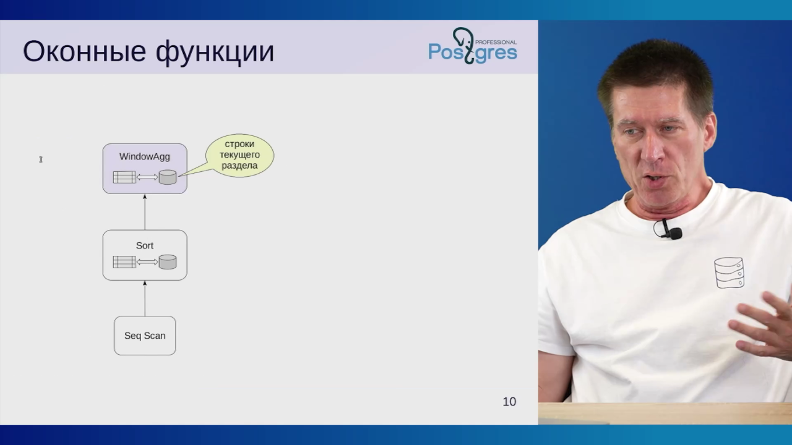

## 4. Временные таблицы: свойства и ON COMMIT

Временная таблица существует только в пределах сеанса, регистрируется в системном каталоге и не журналируется, так как не восстанавливается после сбоя. Она создаёт файлы на диске, но кэшируется в локальной памяти сеанса (temp_buffers), а не в общем буферном кэше. ON COMMIT PRESERVE ROWS — поведение по умолчанию; ON COMMIT DELETE ROWS опустошает таблицу, ON COMMIT DROP удаляет саму таблицу. Автоочистка и автоанализ временных таблиц не выполняются: они работают только вручную, потому что с таблицей может работать только один сеанс. Схема pg_temp проверяется первой в search_path, поэтому временную таблицу видно через \dt, а материализованное представление с тем же именем может быть не видно.

```
CREATE TEMP TABLE airports_msk
  ON COMMIT PRESERVE ROWS; -- по умолчанию
  AS SELECT *
  FROM airports
  WHERE timezone = 'Europe/Moscow';

\dt airports_msk
    List of relations
 Schema |   Name    | Type  |  Owner
--------+-----------+-------+----------
 pg_temp_3 | airports_msk | table | postgres
(1 row)
```

| Режим | Что происходит в конце транзакции |
|---|---|
| ON COMMIT DELETE ROWS | таблица остаётся, удаляются только строки |
| ON COMMIT DROP | удаляется сама таблица |

*Источник: [00:18:17], [00:18:38], [00:18:58], [00:19:59], [00:20:28], [00:29:44] и др.*

> [!quote]- Кадр [00:18:17]
> 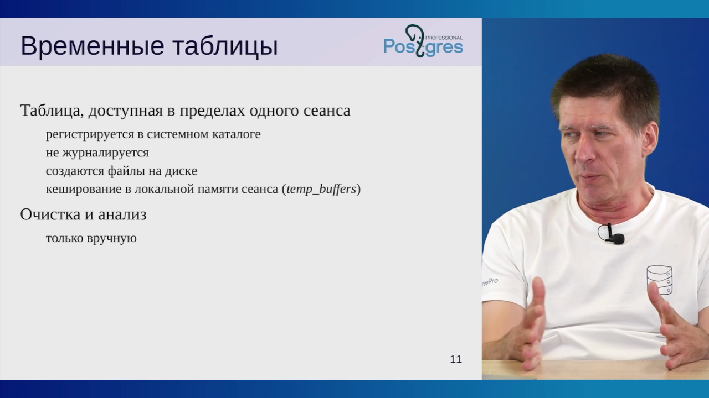

> [!quote]- Кадр [00:18:38]
> 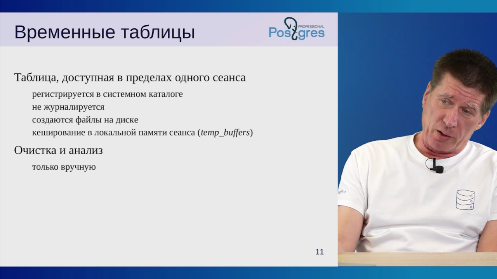

> [!quote]- Кадр [00:18:58]
> 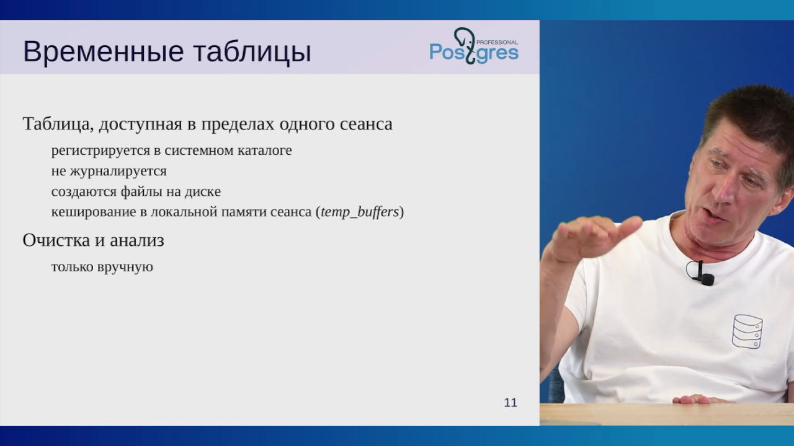

## 5. Статистика временных таблиц и ANALYZE

У временной таблицы нет статистики, поэтому оптимизатор использует константы: 10 страниц и 520 строк, а если в pg_class relpages = 0 и reltuples = -1, статистика отсутствует. Стоимость вычисляется как 10 * seq_page_cost + 520 * cpu_tuple_cost, что даёт 15.2 и завышает оценку. ANALYZE обновляет статистику, после чего оценка кардинальности становится точной; для временных таблиц автоочистка статистику не собирает, поэтому ANALYZE выполняют вручную. После ANALYZE стоимость считается как для обычной таблицы, что важно для выбора порядка соединений.

```sql
ANALYZE airports_msk;
ANALYZE
=> EXPLAIN
SELECT *
FROM airports_msk;

            QUERY PLAN
--------------------------------
 Seq Scan on airports_msk (cost=0.00..1.44 rows=44 width=67)

EXPLAIN
SELECT *
FROM airports_msk;

QUERY PLAN
Seq Scan on airports_msk  (cost=0.00..15.20 rows=520 width=128)

=> SELECT relpages, reltuples,
       10 * current_setting('seq_page_cost')::float +
       520 * current_setting('cpu_tuple_cost')::float AS cost
  FROM pg_class
 WHERE relname = 'airports_msk'
   AND relpersistence = 't'; -- временная

 relpages | reltuples | cost
----------+-----------+-------
        0 |        -1 | 15.2

=\> ANALYZE airports_msk;
ANALYZE
=\> EXPLAIN
SELECT *
FROM airports_msk;

            QUERY PLAN
--------------------------------
 Seq Scan on airports_msk (cost=0.00..1.44 rows=44 width=67)

EXPLAIN
SELECT *
FROM airports_msk;

QUERY PLAN
Seq Scan on airports_msk  (cost=0.00..15.20 rows=520 width=128)

=> SELECT relpages, reltuples,
       10 * current_setting('seq_page_cost')::float +
       520 * current_setting('cpu_tuple_cost')::float AS cost
  FROM pg_class
 WHERE relname = 'airports_msk'
   AND relpersistence = 't'; -- временная

 relpages | reltuples | cost
----------+-----------+-------
        0 |        -1 | 15.2

EXPLAIN
SELECT *
FROM airports
WHERE timezone = 'Europe/Moscow';

Seq Scan on airports_data_ml (cost=0.00..26.52 rows=44 width=99)
  Filter: (timezone = 'Europe/Moscow'::text)
(2 rows)

EXPLAIN
SELECT *
FROM airports_msk;

QUERY PLAN
Seq Scan on airports_msk  (cost=0.00..15.20 rows=520 width=128)
(1 row)

=> EXPLAIN
SELECT *
FROM airports_msk;
QUERY PLAN
-------------------------------------------
Seq Scan on airports_msk  (cost=0.00..15.20 rows=520 width=128)

=> SELECT relpages, reltuples,
       10 * current_setting('seq_page_cost')::float +
       520 * current_setting('cpu_tuple_cost')::float AS cost
  FROM pg_class
 WHERE relname = 'airports_msk'
   AND relpersistence = 't'; -- временная

 relpages | reltuples | cost
----------+-----------+-------
        0 |        -1 | 15.2

=> ANALYZE airports_msk;
ANALYZE
=> EXPLAIN
SELECT *
FROM airports_msk;

            QUERY PLAN
--------------------------------
 Seq Scan on airports_msk (cost=0.00..1.44 rows=44 width=67)

SHOW join_collapse_limit;
join_collapse_limit
-------------------
8
(1 row)

SET join_collapse_limit = 1;
SET
EXPLAIN (costs on)
SELECT *
FROM tickets t
JOIN ticket_flights tf ON (tf.ticket_no = t.ticket_no)
JOIN flights f ON (f.flight_id = tf.flight_id);

QUERY PLAN
Hash Join  (cost=171652.98..860478.65 rows=8391030 width=199)
  Hash Cond: (tf.flight_id = f.flight_id)
  ->  Hash Join  (cost=161885.47..498599.26 rows=8391030 width=136)
        Hash Cond: (tf.ticket_no = t.ticket_no)
        ->  Seq Scan on ticket_flights tf  (cost=0.00..153870.30 rows=8391030 width=32)
        ->  Hash  (cost=78915.21..78915.21 rows=2950021 width=104)
              ->  Seq Scan on tickets t  (cost=0.00..78915.21 rows=2950021 width=104)
  ->  Hash  (cost=4772.67..4772.67 rows=214867 width=63)
        ->  Seq Scan on flights f  (cost=0.00..4772.67 rows=214867 width=63)
(9 rows)

=> SHOW join_collapse_limit;
join_collapse_limit
-------------------
8
(1 row)

=> SHOW join_collapse_limit;

join_collapse_limit
-------------------
0

SET join_collapse_limit = 1;
SET
EXPLAIN (costs on)
SELECT *
FROM tickets t
JOIN ticket_flights tf ON (tf.ticket_no = t.ticket_no)
JOIN flights f ON (f.flight_id = tf.flight_id);

QUERY PLAN
Hash Join  (cost=171652.98..860478.65 rows=8391030 width=199)
  Hash Cond: (tf.flight_id = f.flight_id)
  ->  Hash Join  (cost=161885.47..498599.26 rows=8391030 width=136)
        Hash Cond: (tf.ticket_no = t.ticket_no)
        ->  Seq Scan on ticket_flights tf  (cost=0.00..153870.30 rows=8391030 width=32)
        ->  Hash  (cost=78915.21..78915.21 rows=2950021 width=104)
              ->  Seq Scan on tickets t  (cost=0.00..78915.21 rows=2950021 width=104)
  ->  Hash  (cost=4772.67..4772.67 rows=214867 width=63)
        ->  Seq Scan on flights f  (cost=0.00..4772.67 rows=214867 width=63)
(9 rows)
```

*Источник: [00:20:48], [00:21:08], [00:21:28], [00:21:48], [00:22:38], [00:25:47]*

## 6. Порядок соединений: пороги перебора и хэш-соединения

Количество вариантов соединений растёт экспоненциально с числом таблиц, поэтому полный перебор становится ресурсоёмким. При соединении через JOIN полный перебор выполняется, если число соединений не больше join_collapse_limit (по умолчанию 8); при большем числе таблицы разбиваются на группы. При соединении через запятую полный перебор выполняется при числе соединений не более geqo_threshold = 12, далее применяется генетический алгоритм; from_collapse_limit аналогично влияет на порядок соединений при подзапросе во фразе FROM. Установка join_collapse_limit = 1 меняет порядок соединений при той же начальной стоимости, итоговая стоимость плана становится выше. Планировщик сначала соединяет ticket_flights и flights через хэш-соединение, затем строит хэш-таблицу для tickets и соединяет её с результатом первого соединения.

```sql
SHOW join_collapse_limit;
join_collapse_limit
-------------------
8
(1 row)

SET join_collapse_limit = 1;
SET
EXPLAIN (costs on)
SELECT *
FROM tickets t
JOIN ticket_flights tf ON (tf.ticket_no = t.ticket_no)
JOIN flights f ON (f.flight_id = tf.flight_id);

QUERY PLAN
Hash Join  (cost=171652.98..860478.65 rows=8391030 width=199)
  Hash Cond: (tf.flight_id = f.flight_id)
  ->  Hash Join  (cost=161885.47..498599.26 rows=8391030 width=136)
        Hash Cond: (tf.ticket_no = t.ticket_no)
        ->  Seq Scan on ticket_flights tf  (cost=0.00..153870.30 rows=8391030 width=32)
        ->  Hash  (cost=78915.21..78915.21 rows=2950021 width=104)
              ->  Seq Scan on tickets t  (cost=0.00..78915.21 rows=2950021 width=104)
  ->  Hash  (cost=4772.67..4772.67 rows=214867 width=63)
        ->  Seq Scan on flights f  (cost=0.00..4772.67 rows=214867 width=63)
(9 rows)
```

> [!info] Зачем это нужно
> Значение join_collapse_limit по умолчанию равно 8, чтобы не сильно нагружать планировщик.

*Источник: [00:22:58], [00:23:25], [00:25:27], [00:25:47], [00:26:07], [00:26:27] и др.*

> [!quote]- Кадр [00:22:58]
> 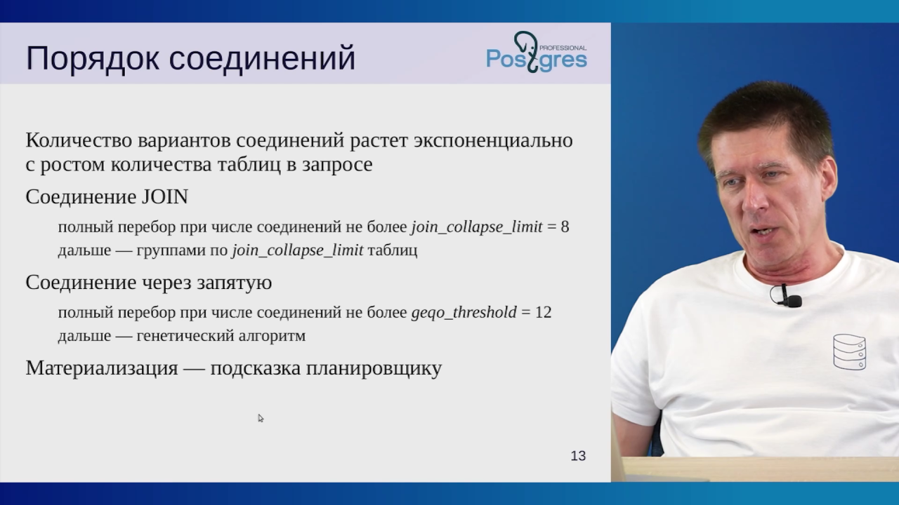

> [!quote]- Кадр [00:23:25]
> 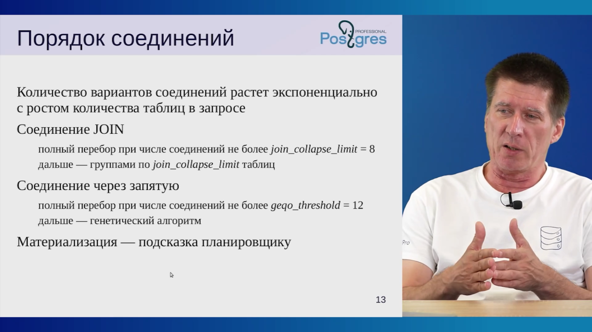

> [!quote]- Кадр [00:33:01]
> 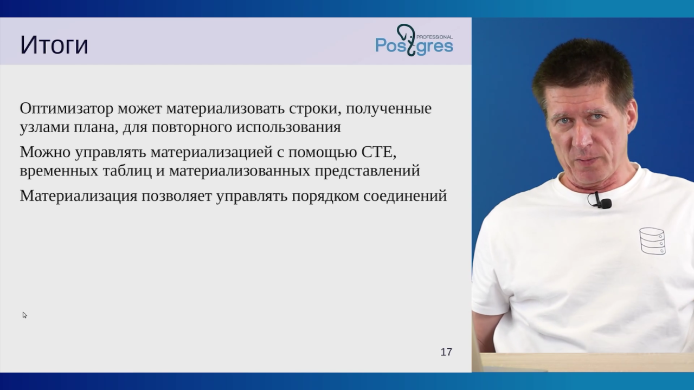

> [!quote]- Кадр [00:34:11]
> 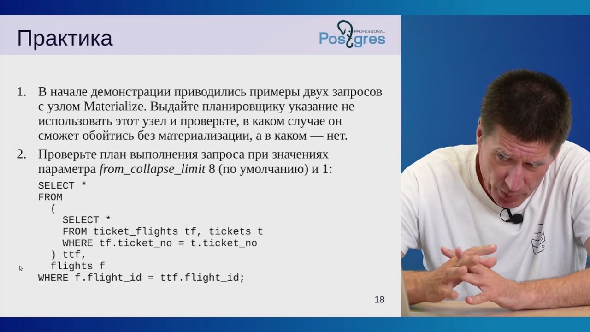

## 7. Материализованное представление: создание, индексирование, обновление

Материализованное представление хранится в формате таблицы, доступно всем сеансам только для чтения; по нему собирается такая же статистика, как для обычных таблиц. Создаётся командой CREATE MATERIALIZED VIEW ... AS; пример airports_msk по timezone. Его можно индексировать, например уникальным индексом по airport_code; запрос с ORDER BY и LIMIT использует индексное сканирование. Изменения в базовой таблице не отражаются автоматически; для синхронизации выполняют REFRESH MATERIALIZED VIEW, с CONCURRENTLY без полной блокировки, но нужен уникальный индекс. Без CONCURRENTLY представление блокируется на всё время перестроения; обновление заменяет все строки и может быть дорогим, инкрементально — через pg_ivm.

```sql
CREATE MATERIALIZED VIEW airports_msk AS
SELECT *
FROM airports
WHERE timezone = 'Europe/Moscow';

CREATE UNIQUE INDEX ON airports_msk (airport_code);
CREATE INDEX
EXPLAIN (costs off) SELECT *
FROM airports_msk
ORDER BY airport_code
LIMIT 3;

=> INSERT INTO airports_data (airport_code, airport_name, city, coordinates, timezone)
   VALUES ('ZIA', '{"ru": "Муковский"}', '{}', point(38.1517, 55.5533), 'Europe/Moscow');
INSERT 0 1
=> SELECT count(*)
FROM airports_msk
WHERE airport_code = 'ZIA';
 count
-------
     0
=> REFRESH MATERIALIZED VIEW CONCURRENTLY airports_msk;
REFRESH MATERIALIZED VIEW
=> SELECT count(*)
FROM airports_msk
WHERE airport_code = 'ZIA';
 count
-------
     1

=\> INSERT INTO airports_data (airport_code, airport_name, city, coordinates, timezone)
   VALUES ('ZIA', '{"ru": "Муковский"}', '{}', point(38.1517, 55.5533), 'Europe/Moscow');
INSERT 0 1
=\> SELECT count(*)
FROM airports_msk
WHERE airport_code = 'ZIA';
 count
-------
     0
=\> REFRESH MATERIALIZED VIEW CONCURRENTLY airports_msk;
=\> SELECT count(*)
FROM airports_msk
WHERE airport_code = 'ZIA';
 count
-------
     1

=> INSERT INTO airports_data (airport_code, airport_name, city, coordinates, timezone)
   VALUES ('ZIA', '{"ru": "Муковский"}', '{}', point(38.1517, 55.5533), 'Europe/Moscow');
INSERT 0 1
=> SELECT count(*)
FROM airports_msk
WHERE airport_code = 'ZIA';
 count
-------
     0
=> REFRESH MATERIALIZED VIEW CONCURRENTLY airports_msk;
=> SELECT count(*)
FROM airports_msk
WHERE airport_code = 'ZIA';
 count
-------
     1
```

*Источник: [00:27:28], [00:27:48], [00:28:14], [00:29:04], [00:29:44], [00:30:05] и др.*

> [!quote]- Кадр [00:27:48]
> 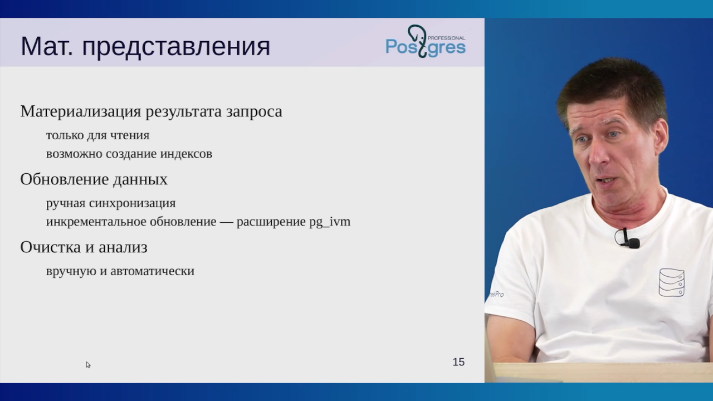

> [!quote]- Кадр [00:29:04]
> 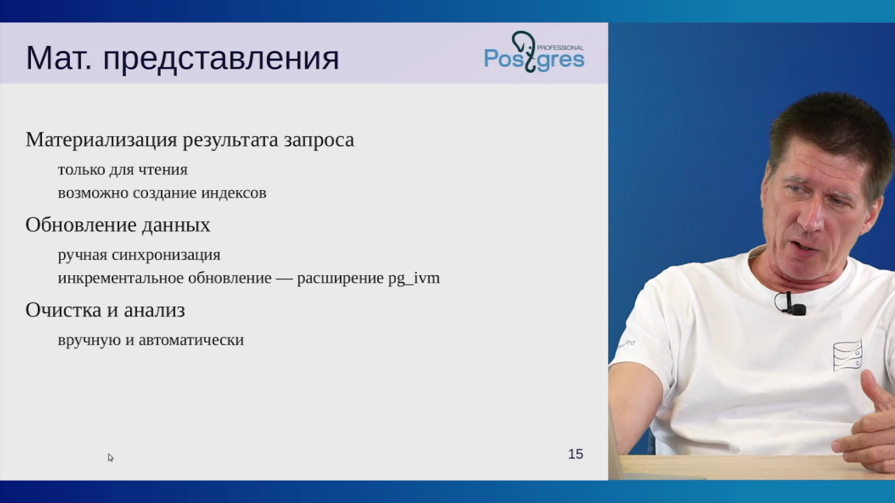

## Схема

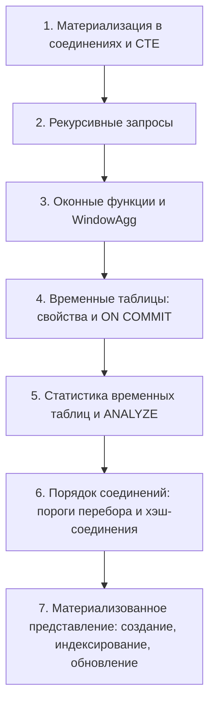

## Итог

> [!success] Что в итоге
> Планировщик PostgreSQL может материализовать внутренний набор при соединениях, чтобы не перечитывать строки из-за повторяющихся значений внешнего набора; это видно по узлу Materialize в плане. При вычислении CTE возможны варианты с материализацией и без неё, и управлять этим можно указаниями MATERIALIZED и NOT MATERIALIZED; без них оптимизатор старается подставить CTE в основной запрос. Материализованный набор не индексируется и требует памяти, а при изменении данных материализация выполняется независимо от NOT MATERIALIZED. Рекурсивные запросы используют два материализованных набора, материализация также возникает в оконных функциях, а материализованные представления требуют ручной синхронизации через REFRESH.

