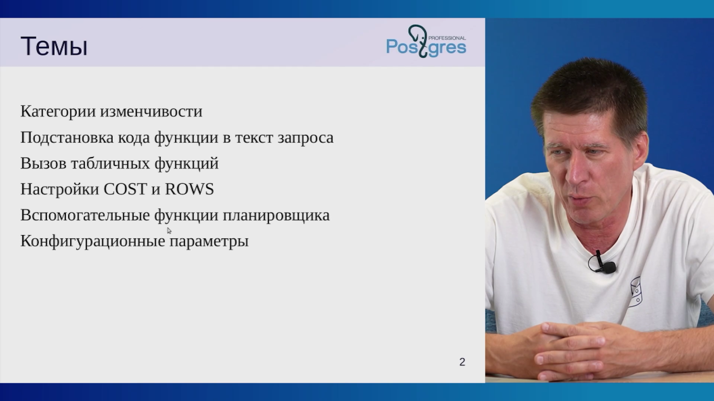
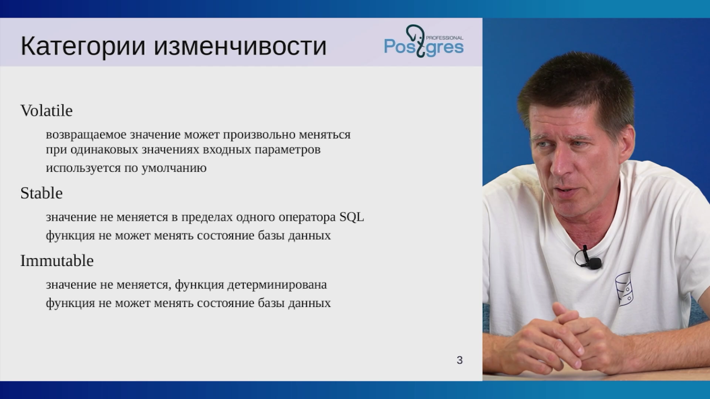
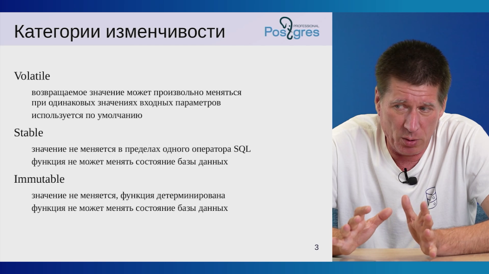
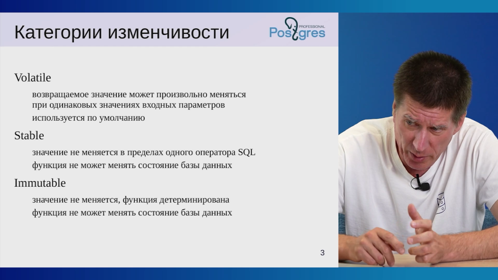
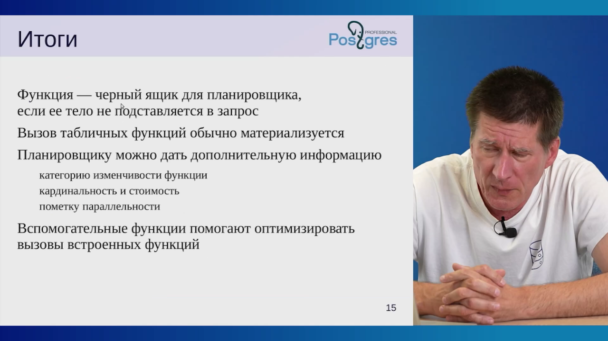
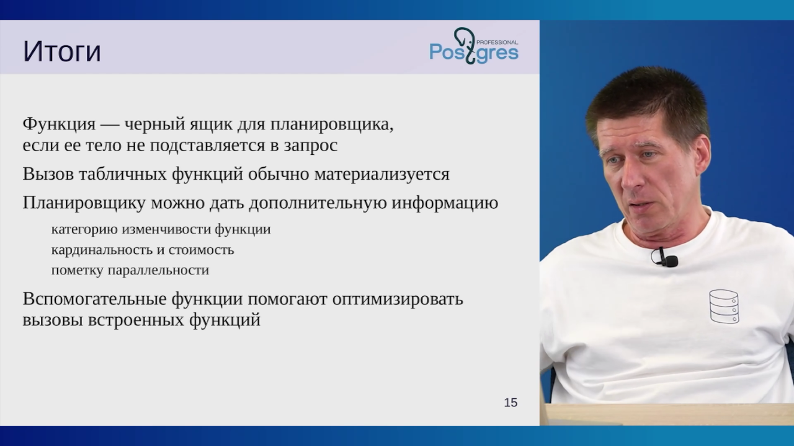
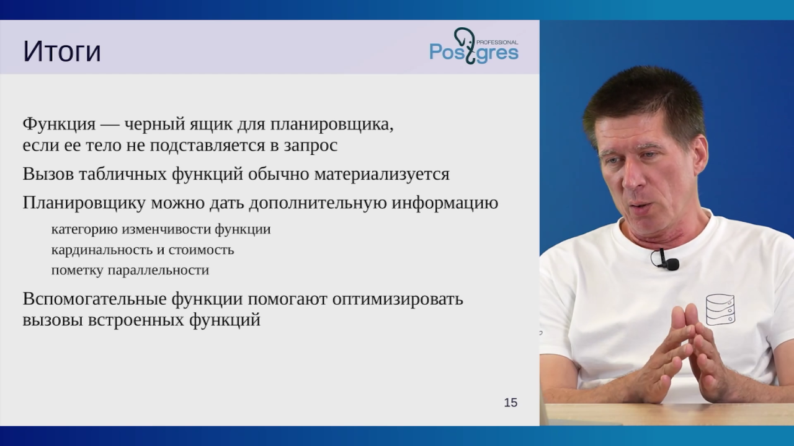
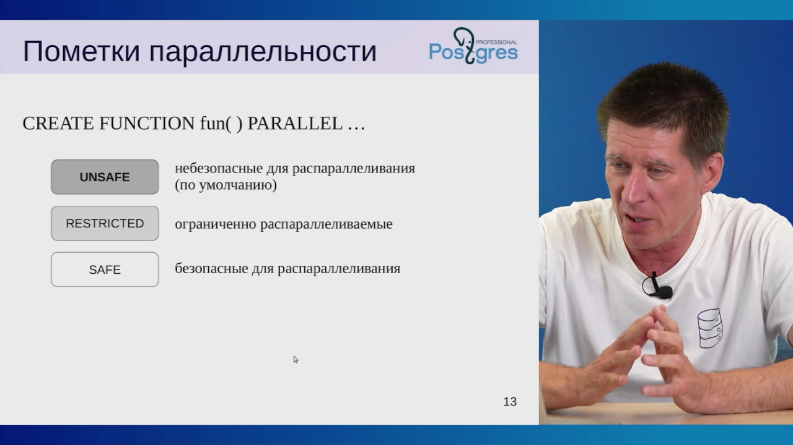
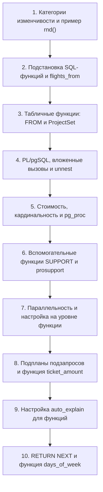

# Функции в планировщике PostgreSQL: изменчивость, табличные функции, стоимость и параллельность

> [!abstract] Обзор
> Материал о том, как планировщик PostgreSQL работает с функциями. Разобраны три категории изменчивости (volatile, stable, immutable) и их влияние на план запроса, пример rnd() с Filter и One-Time Filter, а также подстановка кода SQL-функций. Отдельно рассмотрены табличные функции: вызов из FROM и из целевого списка с узлом ProjectSet, PL/pgSQL-функции, вложенные вызовы, unnest и переписывание через LATERAL JOIN. Показаны оценки стоимости (COST) и кардинальности (ROWS), их видимость в каталоге pg_proc, вспомогательные функции SUPPORT и prosupport. Разобраны пометки параллельности (UNSAFE, RESTRICTED, SAFE), их просмотр через \df+ и pg_proc, запрет параллельности на уровне функции, подпланы подзапросов, хранимые подпрограммы и настройка auto_explain, а также RETURN NEXT и функция days_of_week.

> [!info] Курс
> [[index|Оглавление курса]]

## Оглавление
1. [[#1. Категории изменчивости и пример rnd()]]
2. [[#2. Подстановка SQL-функций и flights_from]]
3. [[#3. Табличные функции: FROM и ProjectSet]]
4. [[#4. PL/pgSQL, вложенные вызовы и unnest]]
5. [[#5. Стоимость, кардинальность и pg_proc]]
6. [[#6. Вспомогательные функции SUPPORT и prosupport]]
7. [[#7. Параллельность и настройка на уровне функции]]
8. [[#8. Подпланы подзапросов и функция ticket_amount]]
9. [[#9. Настройка auto_explain для функций]]
10. [[#10. RETURN NEXT и функция days_of_week]]

**Схема** — [[#Схема]]
**Итог** — [[#Итог]]

## 1. Категории изменчивости и пример rnd()

Благодаря дополнительной информации о поведении функции, которую даёт категория изменчивости, оптимизатор может сэкономить на вызовах функции; во многих случаях функция для планировщика — чёрный ящик. Каждая функция относится к одной из трёх категорий: volatile (по умолчанию, без ограничений), stable (одно значение в пределах одного оператора SQL, не меняет состояние БД) и immutable (детерминирована, не меняет состояние БД, значение можно вычислить на этапе планирования). Для volatile-функций оптимизатор не экономит на вызовах, stable может быть вызвана один раз при планировании (узел One-Time Filter), immutable позволяет вычислить значение заранее. Пример rnd(): при категории stable условие rnd() > 0.5 превращается в One-Time Filter в узле Result, при volatile — в Filter на Function Scan и вызов random() подставляется в план. Если объявить случайную функцию как IMMUTABLE, планировщик вычислит её на этапе планирования и может получить случайный план; ответственность лежит на разработчике.

```sql
CREATE FUNCTION rnd() RETURNS float
LANGUAGE sql VOLATILE
RETURN random();

=> EXPLAIN (costs off)
SELECT * FROM generate_series(1,10) WHERE rnd() > 0.5;

QUERY PLAN
-------+---------------------------------------------
 Function Scan on generate_series
   Filter: (random() > '0.5'::double precision)
(2 rows)

=> ALTER FUNCTION rnd() STABLE;
ALTER FUNCTION
=> EXPLAIN (costs off)
SELECT * FROM generate_series(1,10) WHERE rnd() > 0.5;
QUERY PLAN
-----------------------------
Result
  One-Time Filter: (rnd() > '0.5'::double precision)
  ->  Function Scan on generate_series
(3 rows)

=> ALTER FUNCTION rnd() VOLATILE;

ALTER FUNCTION

=> EXPLAIN (costs off)
SELECT * FROM generate_series(1,10) WHERE rnd() > 0.5;

QUERY PLAN
-------------------------------------------
Function Scan on generate_series
  Filter: (random() > '0.5'::double precision)
(2 rows)

>= ALTER FUNCTION rnd() STABLE;
ALTER FUNCTION
=> EXPLAIN (costs off)
SELECT * FROM generate_series(1,10) WHERE rnd() > 0.5;

QUERY PLAN
--------------------------
 Result
   One-Time Filter: false
(2 rows)

=> CREATE FUNCTION rnd() RETURNS float
LANGUAGE sql VOLATILE
RETURN random();

CREATE FUNCTION

=> EXPLAIN (costs off)
SELECT * FROM generate_series(1,10) WHERE rnd() > 0.5;

QUERY PLAN
-------+---------------------------------------------
 Function Scan on generate_series
   Filter: (random() > '0.5'::double precision)
(2 rows)

=> ALTER FUNCTION rnd() STABLE;
ALTER FUNCTION
=> EXPLAIN (costs off)
SELECT * FROM generate_series(1,10) WHERE rnd() > 0.5;
QUERY PLAN
-----------------------------
Result
  One-Time Filter: (rnd() > '0.5'::double precision)
  ->  Function Scan on generate_series
(3 rows)

=> ALTER FUNCTION rnd() VOLATILE;

ALTER FUNCTION

=> EXPLAIN (costs off)
SELECT * FROM generate_series(1,10) WHERE rnd() > 0.5;

QUERY PLAN
-------------------------------------------
Function Scan on generate_series
  Filter: (random() > '0.5'::double precision)
(2 rows)
```

> [!info] Зачем это нужно
> Дополнительная информация помогает планировщику лучше применять стоимостную модель и экономить на вызовах; категория volatile — по умолчанию, stable/immutable позволяют вычислить значение на этапе планирования.

*Источник: [00:00:20], [00:00:40], [00:01:00], [00:01:22], [00:01:42], [00:03:10] и др.*

> [!quote]- Кадр [00:00:20]
> 

> [!quote]- Кадр [00:00:40]
> 

> [!quote]- Кадр [00:01:00]
> 

> [!quote]- Кадр [00:01:22]
> 

> [!quote]- Кадр [00:01:42]
> 

## 2. Подстановка SQL-функций и flights_from

PostgreSQL умеет подставлять код функций на языке SQL, избавляясь от вызова; при подстановке в плане не появляется узел Function Scan, и функция не вызывается. Для подстановки кода скалярной функции на SQL требуется один оператор SELECT без предложения FROM, возвращающий одно значение, а вызываемые функции не должны быть изменчивее вызывающей. Функция flights_from принимает имя аэропорта и возвращает SETOF flights — таблицу строк, соответствующих строкам таблицы flights. В теле запроса соединяются таблицы flights и airports по имени аэропорта, и выбираются все рейсы, отправляющиеся из этого аэропорта. Функция flights_from создана как LANGUAGE sql STABLE; при использовании flights_from в запросе планировщик сможет вытащить запрос из тела функции и подставить в основной запрос.

```sql
CREATE FUNCTION flights_from(airport_name text)
RETURNS SETOF flights
AS $$
    SELECT f.*
    FROM flights f
    JOIN airports a ON f.departure_airport = a.airport_code
    WHERE a.airport_name = flights_from.airport_name;
$$
LANGUAGE sql STABLE;

>= LOAD 'auto_explain';

LOAD
=> SET auto_explain.log_min_duration = 0;
SET
=> SET auto_explain.log_nested_statements = on;
SET
```

> [!info] Зачем это нужно
> Подстановка избавляет от вызова функции в плане.

*Источник: [00:01:22], [00:11:37]*


## 3. Табличные функции: FROM и ProjectSet

Табличную функцию можно вызвать как SELECT * FROM fun(), так и SELECT fun() в целевом списке; при вызове из целевого списка в плане появляется узел ProjectSet, который по требованию вызывает функцию и выдаёт строки. Вызовы табличных функций обычно материализуются, но в некоторых случаях при вызове в целевом списке удаётся получать строки по требованию. Пример с generate_series(1, 10_000_000) LIMIT 10: из предложения SELECT вместо FROM время выполнения уменьшается на порядок, план использует ProjectSet и Result, Execution Time 0.028 ms. Функция generate_series генерирует последовательность чисел; в каталоге существует 9 перегруженных вариантов, для 4 из них есть вспомогательные функции int4_support или int8_support. Если таких функций несколько, ProjectSet может быть вложенным.

```sql
>= CREATE FUNCTION ticket_amount(ticket_no char(13)) RETURNS numeric
   LANGUAGE plpgsql STABLE PARALLEL SAFE
AS $$
BEGIN
    RETURN (SELECT sum(amount)
            FROM ticket_flights tf
            WHERE tf.ticket_no = ticket_amount.ticket_no
    );
END;
$$;

SELECT * FROM fun()
SELECT fun()

EXPLAIN (analyze, costs off)
SELECT * FROM generate_series(1,10_000_000)
LIMIT 10;

EXPLAIN (analyze, costs off)
SELECT generate_series(1,10 000 000)
LIMIT 10;

QUERY PLAN
Limit (actual time=0.006..0.009 rows=10 loops=1)
  ->  ProjectSet (actual time=0.004..0.006 rows=10 loops=1)
        ->  Result (actual time=0.001..0.001 rows=1 loops=1)
Planning Time: 0.070 ms
Execution Time: 0.028 ms
```

*Источник: [00:05:42], [00:13:34], [00:14:46], [00:15:36], [00:15:57], [00:37:07] и др.*

> [!quote]- Кадр [00:37:07]
> 

> [!quote]- Кадр [00:37:27]
> 

## 4. PL/pgSQL, вложенные вызовы и unnest

PL/pgSQL-функции всегда возвращают все строки результата: планировщик не анализирует содержимое функции, возвращающей SETOF, а сначала выполняет её и использует материализованный результат в основном запросе. Пример plpgsql_rows выполняет SELECT * FROM generate_series(1,10_000_000) полностью в узле ProjectSet, и узел Limit выбирает первые 10 строк. В предложении SELECT может быть несколько вызовов табличных функций, причём вызовы могут быть вложены: generate_series от результата другого generate_series. При вложенных generate_series и unnest EXPLAIN показывает два узла ProjectSet; unnest преобразует массив в набор строк. Запрос можно переписать через FULL JOIN LATERAL для generate_series и unnest по ordinality и CROSS JOIN LATERAL для generate_series(1, g1.i); LATERAL позволяет обращаться к столбцам таблиц из той же фразы FROM.

```sql
CREATE FUNCTION plpgsql_rows() RETURNS SETOF integer
AS $$
BEGIN
  RETURN QUERY
    SELECT * FROM generate_series(1,10_000_000);
END
$$ LANGUAGE plpgsql;

EXPLAIN (verbose, costs off)
SELECT generate_series(1, generate_series(1,3)), unnest(ARRAY['A','B','C']);
QUERY PLAN
ProjectSet
  Output: generate_series(1, (generate_series(1, 3))), (unnest('{A,B,C}'::text[]))
    ->  ProjectSet
          Output: generate_series(1, 3), unnest('{A,B,C}'::text[])
            ->  Result

SELECT g2.i, u.c
FROM generate_series(1,3) WITH ORDINALITY AS g1(i)
FULL JOIN LATERAL unnest(ARRAY['A','B','C']) WITH ORDINALITY AS u(c)
  ON g1.ordinality = u.ordinality
CROSS JOIN LATERAL generate_series(1, g1.i) AS g2(i);
```

*Источник: [00:17:01], [00:18:33], [00:18:53], [00:19:33], [00:19:59]*

## 5. Стоимость, кардинальность и pg_proc

Планировщику нужны оценки стоимости и кардинальности функций, чтобы точнее строить планы; при создании функции можно указать ROWS и COST. По умолчанию планировщик считает, что функция выдаст 1000 строк (ROWS), а стоимость её вычисления — 100 в единицах выполнения; для пользовательских функций это 100 * cpu_operator_cost = 0.25. Function Scan для days_of_week по умолчанию оценивает результат в 1000 строк, хотя фактически функция возвращает 7; ALTER FUNCTION days_of_week ROWS 10 задаёт приблизительную оценку кардинальности и влияет на полную стоимость. Указание COST и ROWS достаточно грубое, потому что при разных параметрах количество строк может быть разным, но может улучшить планирование и указать, что функция дорогая. Изменённые значения cost и rows видны в столбцах procost и prorows таблицы pg_proc; мета-команда \sf показывает сгенерированную команду createFunction.

```sql
SELECT 100 * current_setting('cpu_operator_cost')::float;
 ?column?
----------
     0.25
(1 row)

=> ALTER FUNCTION days_of_week ROWS 10;
ALTER FUNCTION
=> EXPLAIN
SELECT * FROM days_of_week();
QUERY PLAN
-----------------------------------------
 Function Scan on days_of_week  (cost=2.50..2.60 rows=10 width=32)

CREATE FUNCTION fun( ) ROWS 12 COST 123
    SELECT  *  FROM fun( )
    Function Scan ( rows=12 cost=123 )

ALTER FUNCTION days_of_week COST 1000;

CREATE FUNCTION fun(x) ROWS 18

=> SELECT procost, prorows FROM pg_proc WHERE proname='days_of_week';
 procost | prorows
---------+---------
    1000 |        10

=> SELECT 100 * current_setting('cpu_operator_cost')::float;
 ?column?
----------
     0.25
(1 row)

=> ALTER FUNCTION days_of_week ROWS 10;
ALTER FUNCTION
=> EXPLAIN
SELECT * FROM days_of_week();
QUERY PLAN
-----------------------------------------
 Function Scan on days_of_week  (cost=2.50..2.60 rows=10 width=32)

CREATE FUNCTION fun( ) ROWS 12 COST 123
    SELECT  *  FROM fun( )
    Function Scan ( rows=12 cost=123 )

ALTER FUNCTION days_of_week COST 1000;

CREATE FUNCTION fun(x) ROWS 18

=> ALTER FUNCTION days_of_week ROWS 10;
ALTER FUNCTION
=> EXPLAIN
SELECT * FROM days_of_week();
QUERY PLAN
-----------------------------------------
 Function Scan on days_of_week  (cost=2.50..2.60 rows=10 width=32)

CREATE FUNCTION fun( ) ROWS 12 COST 123
    SELECT  *  FROM fun( )
    Function Scan ( rows=12 cost=123 )

SELECT g2.i, u.c
FROM generate_series(1,3) WITH ORDINALITY AS g1(i)
FULL JOIN LATERAL unnest(ARRAY['A','B','C']) WITH ORDINALITY AS u(c)
ON g1.ordinality = u.ordinality
CROSS JOIN LATERAL generate_series(1, g1.i) AS g2(i);

ALTER FUNCTION days_of_week COST 1000;

CREATE FUNCTION fun(x) ROWS 18

=> SELECT 100 * current_setting('cpu_operator_cost')::float;
 ?column?
----------
     0.25
(1 row)

=> ALTER FUNCTION days_of_week COST 1000;
```

COST | ROWS
меняет оценку стоимости | меняет оценку числа строк
видно в столбце procost | видно в столбце prorows
имеет смысл для сложных функций | корректирует rows в плане

> [!info] Зачем это нужно
> Планировщику нужны оценки стоимости и кардинальности функций, чтобы точнее строить планы.

*Источник: [00:21:09], [00:21:49], [00:22:55], [00:23:15], [00:23:36], [00:23:56] и др.*

## 6. Вспомогательные функции SUPPORT и prosupport

С помощью фразы SUPPORT имя можно указать вспомогательную функцию, которая выдаёт по определённым обращениям определённые характеристики функции. С её помощью можно возвращать разные значения кардинальности в зависимости от переданных аргументов: для fun(1) одна оценка, для fun(2) — другая. Вспомогательная функция (может быть написана только на языке C) даёт планировщику дополнительную информацию для вычисления селективности условий, кардинальности функции или её стоимости; наличие можно проверить в таблице pg_proc по столбцу prosupport. Для некоторых перегруженных вариантов generate_series вспомогательной функции (prosupport) нет, поэтому планировщик выдаёт некорректные оценки кардинальности; пример — вариант с датами: timestamp with timezone, timestamp with timezone, interval. Аргументы функции из pg_get_function_arguments(p.oid) обрезают до 57 символов, потому что там бывают длинные значения.

```sql
CREATE FUNCTION fun(x) SUPPORT fun_support

SELECT left(pg_get_function_arguments(p.oid), 57) proargtypes, prosupport
FROM pg_proc p
WHERE p.proname = 'generate_series';

=> SELECT left(pg_get_function_arguments(p.oid), 57) proargtypes, prosupport
FROM pg_proc p
WHERE p.proname = 'generate_series';

ALTER FUNCTION ticket_amount PARALLEL UNSAFE;

=> SELECT proparallel, count(*)
FROM pg_proc
GROUP BY proparallel;

=> ALTER FUNCTION ticket_amount PARALLEL RESTRICTED;
ALTER FUNCTION
=> EXPLAIN (costs off)
SELECT (SELECT sum(ticket_amount(ticket_no)) FROM tickets) =
       (SELECT sum(total_amount) FROM bookings);
Result
  InitPlan 1 (returns $0)
    -> Aggregate
          -> Seq Scan on tickets
  InitPlan 2 (returns $2)
    -> Finalize Aggregate
          -> Gather
                Workers Planned: 2
                -> Partial Aggregate
                      -> Parallel Seq Scan on bookings

=> SELECT proraparel, count(*)
FROM pg_proc
GROUP BY proraparel;

 proraparel | count
------------+-------
 r          |  185
 s          | 3027
 u          |   91
(3 rows)

=> \df+ random
Name             | random
Volatility       | volatile
Parallel         | restricted

=> ALTER FUNCTION ticket_amount PARALLEL RESTRICTED;
ALTER FUNCTION
=> EXPLAIN (costs off)
SELECT (SELECT sum(ticket_amount(ticket_no)) FROM tickets) =
       (SELECT sum(total_amount) FROM bookings);
Result
  InitPlan 1 (returns $0)
    -> Aggregate
          -> Seq Scan on tickets
  InitPlan 2 (returns $2)
    -> Finalize Aggregate
          -> Gather
                Workers Planned: 2
                -> Partial Aggregate
                      -> Parallel Seq Scan on bookings

=> ALTER FUNCTION ticket_amount PARALLEL RESTRICTED;
ALTER FUNCTION
=> EXPLAIN (costs off)
SELECT (SELECT sum(ticket_amount(ticket_no)) FROM tickets) =
       (SELECT sum(total_amount) FROM bookings);
Result
  InitPlan 1 (returns $0)
    ->  Aggregate
          ->  Seq Scan on tickets
  InitPlan 2 (returns $2)
    ->  Finalize Aggregate
          ->  Gather
                Workers Planned: 2
                ->  Partial Aggregate
                      ->  Parallel Seq Scan on bookings
```

*Источник: [00:26:19], [00:26:39], [00:27:20], [00:28:00], [00:28:28], [00:28:48] и др.*

> [!quote]- Кадр [00:37:53]
> 

## 7. Параллельность и настройка на уровне функции

Пометки параллельности указываются в CREATE FUNCTION или ALTER FUNCTION во фразе PARALLEL: UNSAFE (небезопасные для распараллеливания, по умолчанию), RESTRICTED (ограниченно распараллеливаемые) и SAFE (безопасные). Функция, помеченная UNSAFE, запрещает параллельный план; RESTRICTED выполняется последовательно в параллельном плане, но не запрещает другим частям плана выполняться параллельно; SAFE безопасна. Пометку видно через \df+ (поле Parallel) и в колонке proparallel таблицы pg_proc, где значения обозначаются буквами R, S или U. Можно запретить параллельность на уровне функции, установив max_parallel_workers_per_gather = 0 через ALTER FUNCTION; это действует только на время её вызова. Для конкретных хранимых подпрограмм можно устанавливать параметры выполнения через ALTER FUNCTION, например распределять ресурсы.

```sql
ALTER FUNCTION ticket_amount PARALLEL UNSAFE;

=> SELECT proparallel, count(*)
FROM pg_proc
GROUP BY proparallel;

=> ALTER FUNCTION ticket_amount PARALLEL RESTRICTED;
ALTER FUNCTION
=> EXPLAIN (costs off)
SELECT (SELECT sum(ticket_amount(ticket_no)) FROM tickets) =
       (SELECT sum(total_amount) FROM bookings);
Result
  InitPlan 1 (returns $0)
    -> Aggregate
          -> Seq Scan on tickets
  InitPlan 2 (returns $2)
    -> Finalize Aggregate
          -> Gather
                Workers Planned: 2
                -> Partial Aggregate
                      -> Parallel Seq Scan on bookings

=> SELECT proraparel, count(*)
FROM pg_proc
GROUP BY proraparel;

 proraparel | count
------------+-------
 r          |  185
 s          | 3027
 u          |   91
(3 rows)

=> \df+ random
Name             | random
Volatility       | volatile
Parallel         | restricted

CREATE FUNCTION count_bookings() RETURNS bigint
AS $$
SELECT count(*) FROM bookings;
$$ LANGUAGE sql STABLE;
ALTER FUNCTION count_bookings SET max_parallel_workers_per_gather = 0;

CREATE FUNCTION count_bookings() RETURNS bigint
AS $$
SELECT count(*) FROM bookings;
$$ LANGUAGE sql STABLE;
ALTER FUNCTION count_bookings SET max_parallel_workers_per_gather = 0;

=> CREATE FUNCTION count_bookings() RETURNS bigint
AS $$
SELECT count(*) FROM bookings;
$$ LANGUAGE sql STABLE;

CREATE FUNCTION count_bookings() RETURNS bigint
AS $$
SELECT count(*) FROM bookings;
$$ LANGUAGE sql STABLE;
ALTER FUNCTION count_bookings SET max_parallel_workers_per_gather = 0;

>= CREATE FUNCTION count_bookings() RETURNS bigint
AS $$
SELECT count(*) FROM bookings;
$$ LANGUAGE sql STABLE;
```

| Пометка | Что делает |
|---|---|
| PARALLEL UNSAFE | запрещает параллельные планы |
| PARALLEL RESTRICTED | функция выполняется последовательно, но другим частям плана параллельность не запрещена |

*Источник: [00:29:38], [00:29:58], [00:31:04], [00:31:24], [00:33:35], [00:33:55] и др.*

> [!quote]- Кадр [00:29:58]
> 

## 8. Подпланы подзапросов и функция ticket_amount

С помощью EXPLAIN (costs off) проверяется равенство двух агрегатов: суммы ticket_amount по всем tickets и суммы total_amount по bookings. Транскрипт подтверждает, что это два подзапроса, результат которых сравнивает равенство двух чисел. Каждый подзапрос в запросе представлен отдельным подпланом. В приведённом плане оба сканирования (tickets и bookings) выполняются в параллельном режиме с агрегацией. Функция ticket_amount(ticket_no char(13)) возвращает numeric — сумму amount из ticket_flights для переданного ticket_no. Она объявлена на языке plpgsql с атрибутами STABLE PARALLEL SAFE, то есть безопасна для параллельного выполнения.

```sql
>= EXPLAIN (costs off)
SELECT (SELECT sum(ticket_amount(ticket_no)) FROM tickets) =
       (SELECT sum(total_amount) FROM bookings);

QUERY PLAN
------------------------------------------------------------
 Result
  InitPlan 1 (returns $1)
    ->  Finalize Aggregate
          ->  Gather
                Workers Planned: 2
                ->  Partial Aggregate
                      ->  Parallel Seq Scan on tickets
  InitPlan 2 (returns $3)
    ->  Finalize Aggregate
          ->  Gather
                Workers Planned: 2
                ->  Partial Aggregate
                      ->  Parallel Seq Scan on bookings

=> CREATE FUNCTION ticket_amount(ticket_no char(13)) RETURNS numeric
   LANGUAGE plpgsql STABLE PARALLEL SAFE
AS $$
BEGIN
    RETURN (SELECT sum(amount)
            FROM ticket_flights tf
            WHERE tf.ticket_no = ticket_amount.ticket_no
    );
END;
$$;
```

*Источник: [00:31:44], [00:32:34], [00:32:54], [00:33:55]*

## 9. Настройка auto_explain для функций

Для просмотра плана запроса, выполняемого внутри функции, можно использовать расширение auto_explain. Расширение auto_explain загружается командой LOAD, загрузка выполняется для текущего сеанса. Чтобы auto_explain регистрировал планы запросов, выполняющихся внутри функций, необходимо загрузить расширение (LOAD 'auto_explain') и установить параметры auto_explain.log_min_duration = 0 и auto_explain.log_nested_statements = on. Это позволяет логировать планы вложенных запросов внутри функций.

```
LOAD 'auto_explain';
SET auto_explain.log_min_duration = 0;
SET auto_explain.log_nested_statements = on;
```

*Источник: [00:35:39], [00:35:59], [00:36:39]*

## 10. RETURN NEXT и функция days_of_week

RETURN NEXT на каждой итерации добавляет одну строку в выходной буфер; когда тело функции выполнится, весь буфер возвращается. Функция days_of_week возвращает SETOF text, перебирая i от 7 до 13: в каждой итерации она выполняет RETURN NEXT to_char(to_date(i::text, ...), 'TMDy') и возвращает сокращённые названия дней недели.

```
CREATE FUNCTION days_of_week() RETURNS SETOF text
AS $$
BEGIN
  FOR i IN 7 .. 13 LOOP
    RETURN NEXT to_char(to_date(i::text,'J'),'TMDy');
  END LOOP;
$$ LANGUAGE plpgsql;

CREATE FUNCTION days_of_week() RETURNS SETOF text
AS $$
BEGIN
   FOR i IN 7 .. 13 LOOP
      RETURN NEXT to_char(to_date(i::text,'3'),'TMDY');
   END LOOP;
END;
$$ LANGUAGE plpgsql;
```

*Источник: [00:22:32], [00:23:15]*

## Схема



## Итог

> [!success] Что в итоге
> Категория изменчивости — это информация, которую разработчик сообщает планировщику: volatile не накладывает ограничений, stable даёт одно значение в пределах оператора SQL, immutable позволяет вычислить значение на этапе планирования. Работа планировщика с функциями строится на подсказках: категории изменчивости, оценках стоимости и кардинальности (по умолчанию 100 операторов и 1000 строк), вспомогательных функциях SUPPORT и пометке параллельности. Табличную функцию можно вызвать из FROM или из целевого списка с ProjectSet, а PL/pgSQL-функции всегда возвращают все строки; оценки COST и ROWS видны в pg_proc, параллельность ограничивается пометками UNSAFE, RESTRICTED, SAFE или параметром на уровне функции. План внутри функции смотрят через auto_explain, а RETURN NEXT добавляет строки в выходной буфер.

