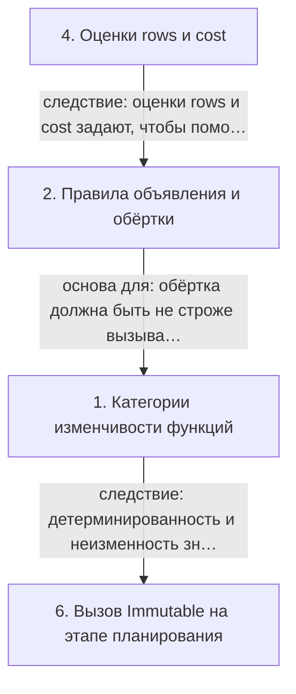

# Категории изменчивости функций в PostgreSQL

> [!abstract] Обзор
> Материал о категориях изменчивости функций в PostgreSQL: Volatile, Stable и Immutable, и о том, как выбор категории влияет на планировщик. Разбираются правила объявления функций, функция-обёртка, strict и табличные функции, узлы плана, работа планировщика с PL/pgSQL, оценки rows и cost и пометки параллельности. Отдельно показано, что Immutable-функция детерминирована и не может менять состояние базы данных, поэтому планировщик вызывает её на этапе планирования. Объясняется, как категория изменчивости определяет подстановку функции в запрос, кеширование вычислений и правила для обёрток, а также что даёт ошибочная маркировка детерминированной функции.

> [!info] Курс
> [[index|Оглавление курса]]

## Оглавление
1. [[#1. Категории изменчивости функций]]
2. [[#2. Правила объявления и обёртки]]
3. [[#3. Табличные функции и планировщик]]
4. [[#4. Оценки rows и cost]]
5. [[#5. Пометки параллельности]]
6. [[#6. Вызов Immutable на этапе планирования]]

**Схема** — [[#Схема]]
**Итог** — [[#Итог]]

## 1. Категории изменчивости функций

В PostgreSQL функции делятся на три категории изменчивости: Volatile, Stable, Immutable. Volatile — категория по умолчанию: при одинаковых входных параметрах значение может произвольно меняться, ограничений нет, и оптимизатор не должен кешировать вычисления. Stable: значение не меняется в пределах одного оператора SQL, функция не может менять состояние базы данных. Immutable: значение не меняется, функция детерминирована, не может менять состояние базы данных; это же ограничение действует и для Stable. Планировщик может подставить Stable-функцию в основной запрос, что позволяет выполнить sequential scan и хэш соединение, а также вызывает её один раз в узле oneTimeFilter.

*Источник: [00:00:00], [00:01:00]*

> [!quote]- Кадр [00:01:00]
> 

## 2. Правила объявления и обёртки

Функция-обёртка должна иметь категорию изменчивости не менее строгую, чем вызываемая функция; если обёртка вызывает volatile-функцию (например, random), её тоже нужно объявить как volatile. Если функцию, возвращающую случайный результат, объявить детерминированной, планировщик обманывается и строит случайный план. В теле функции не должно быть сортировок и группировок, а вызываемые функции не должны быть более изменчивы, чем основная. Чтобы облегчить работу планировщику, можно указать категорию изменчивости, кардинальность результата и стоимость вычисления функции; планировщик может вытащить тело скалярной функции и подставить его в запрос, если функция представляет собой простой SELECT с одним выражением без FROM. Для табличных функций категория изменчивости должна быть mutable или stable, а указание strict запрещено: strict при передаче null сразу возвращает null, поэтому тело функции фактически не выполняется.

*Источник: [00:01:00]*

## 3. Табличные функции и планировщик

Вызов табличной функции в целевом списке приводит к узлу project set, а вызов в предложении FROM приводит к материализации результата функции. Планировщик не оптимизирует PL/pgSQL и не понимает, что внутри PL/pgSQL функции вызывается Generate Series. Планировщик сначала выполняет функцию, а затем использует материализованный результат в основном запросе.

*Источник: [00:01:00]*

## 4. Оценки rows и cost

Чтобы помочь оптимизатору, для функции можно задать настройки rows и cost. По умолчанию планировщик считает, что функция выдаст 1000 строк, а стоимость её вычисления оценивается как 100; значение 100 указано в единицах CPU operator cost.

*Источник: [00:01:00]*

## 5. Пометки параллельности

Для определения поведения функций в параллельных планах существуют пометки параллельности. Они указываются в CREATE FUNCTION или ALTER FUNCTION во фразе PARALLEL; пометок три: Unsafe, Restricted и Safe. Пометка параллельности влияет на использование функции в параллельных планах.

*Источник: [00:01:00]*

## 6. Вызов Immutable на этапе планирования

Если функция объявлена как Immutable, планировщик вызывает её на этапе планирования. За счёт этого условие фильтра можно вычислить заранее и не вычислять его при выполнении.

> [!info] Зачем это нужно
> Условие фильтра можно вычислить заранее и не вычислять его при выполнении.

*Источник: [00:01:00]*

## Схема

## Итог

> [!success] Что в итоге
> Функции в PostgreSQL делятся на Volatile, Stable и Immutable, причём по умолчанию используется Volatile. Категория изменчивости влияет на поведение планировщика: она определяет подстановку функции в запрос, кеширование вычислений и правила для обёрток и табличных функций. Благодаря тому что Immutable-функция детерминирована и не может менять состояние базы данных, планировщик вызывает её на этапе планирования, и условие фильтра вычисляется заранее. Дополнительно планировщику помогают настройки rows и cost, а для параллельных планов задаются пометки параллельности; при этом планировщик не оптимизирует PL/pgSQL и использует материализованный результат.

