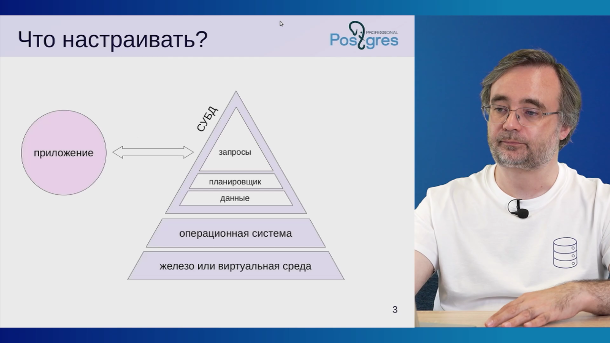
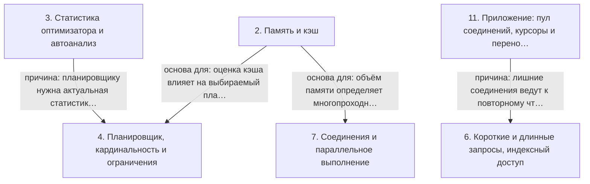

# Настройка и оптимизация производительности PostgreSQL

> [!abstract] Обзор
> Материал посвящён оптимизации и настройке производительности PostgreSQL на разных уровнях — от железа и операционной системы до СУБД, приложения и запросов. Основные ресурсы — процессор, ввод-вывод и память — связаны с параметрами work_mem, shared_buffers, maintenance_work_mem и effective_cache_size. Работа планировщика опирается на актуальную статистику автоанализа и оценки кардинальности, а параметры стоимости и enable_ помогают управлять выбором плана. На стороне приложения применяются пул соединений, курсоры, подготовленные операторы и перенос логики в SQL. Для роста объёмов данных служат предрасчёт, нормализация, индексы, табличные пространства, секционирование и шардирование.

> [!info] Курс
> [[index|Оглавление курса]]

## Оглавление
1. [[#1. Уровни настройки и ресурсы]]
2. [[#2. Память и кэш]]
3. [[#3. Статистика оптимизатора и автоанализ]]
4. [[#4. Планировщик, кардинальность и ограничения]]
5. [[#5. Стоимость чтения и управление планом]]
6. [[#6. Короткие и длинные запросы, индексный доступ]]
7. [[#7. Соединения и параллельное выполнение]]
8. [[#8. EXPLAIN и сравнение чтений]]
9. [[#9. Данные: предрасчёт, типы, нормализация и индексы]]
10. [[#10. Табличные пространства, секционирование и шардирование]]
11. [[#11. Приложение: пул соединений, курсоры и перенос логики]]
12. [[#12. Здравый смысл вместо рецептов]]

**Схема** — [[#Схема]]
**Итог** — [[#Итог]]

## 1. Уровни настройки и ресурсы

Настройку производительности PostgreSQL ведут на нескольких уровнях: СУБД, приложение, запросы, планировщик, данные, операционная система, железо или виртуальная среда. Основные ресурсы для настройки — процессор, ввод-вывод и память. Запросы выполняются в один поток, в один процесс, поэтому настройка процессора ограничена; параллельное выполнение работает через фоновые процессы, и можно управлять их числом и количеством ядер.

*Источник: [00:01:00]*

> [!quote]- Кадр [00:01:00]
> 

## 2. Память и кэш

work_mem задаёт память для отдельных операций плана (по умолчанию 4 МБ) и влияет также на планирование; его увеличение до 8 МБ в примере ускорило запрос с двух с лишним секунд до примерно полутора. hash_mem_multiplier по умолчанию равен двум: для хэширования выделяется вдвое больше памяти, чем для сортировок. shared_buffers по умолчанию 128 МБ — слишком мало, его увеличивают сразу после установки; maintenance_work_mem равен 64 МБ. effective_cache_size не выделяет память, а только показывает планировщику размер кэша (включая кэш операционной системы): чем больше значение, тем дешевле индексный доступ. Отдельный параметр сообщает число независимых дисков и сколько запросов можно посылать одновременно; он используется только для предвыборки при чтении по битовой карте.

*Источник: [00:01:00]*

## 3. Статистика оптимизатора и автоанализ

Для оптимизатора важна актуальная и точная статистика; автоанализ настраивают так, чтобы он не создавал паразитную нагрузку, но успевал обновлять статистику. Основной механизм повышения точности — default_statistics_target, которым управляют на уровне системы, столбцов и таблиц. Для корреляции столбцов собирают расширенную статистику, часто через индекс по выражению, и делают это только при действительной необходимости.

*Источник: [00:01:00]*

## 4. Планировщик, кардинальность и ограничения

Планировщик должен адекватно выполнять большинство запросов; ошибки часто вызваны неверной оценкой кардинальности — расхождением между ожидаемым и реальным числом строк, из-за чего выбирается индексный доступ и вложенные циклы вместо последовательного сканирования и хэш-соединения. Цель оптимизации — адекватный план; если кардинальность посчитана верно, а план плох, настраивают глобальные параметры. Ошибку расчёта кардинальности ищут в самом вложенном узле, так как выше по плану она распространяется и обычно ухудшается. Ограничения целостности могут учитываться планировщиком: при составном внешнем ключе их удаление меняет прогноз с примерно 8 миллионов строк до 300; для улучшения оценок селективности используют индекс по выражению или расширенную статистику, а иногда достаточно переписать условие. Если слева от оператора вызов функции без вспомогательной функции планировщика, применяется фиксированная оценка селективности в 5%, которая может быть некорректной.

> [!info] Зачем это нужно
> Адекватная работа планировщика обеспечивает фундамент для производительной работы системы.

*Источник: [00:01:00]*

## 5. Стоимость чтения и управление планом

seq_page_cost задаёт стоимость последовательного чтения страницы (по умолчанию 1, рекомендуется оставлять), random_page_cost — произвольного, и его иногда меняют; при завышенном random_page_cost (например, 4 на SSD) индексный доступ может оказаться дешевле последовательного сканирования, хотя планировщик может завышать стоимость индексного сканирования и не использовать индекс. На HDD случайный доступ требует физического перемещения головок, а на SSD разница между последовательным и случайным чтением практически стирается (см. таблицу). Параметры оценки времени процессора почти никогда не трогают, но при уверенности в систематической ошибке планировщика их можно подкрутить; иногда задают стоимость пользовательских функций. Параметры enable_ позволяют отключить индексное сканирование или последовательный доступ и быстро проверить гипотезы. В PostgreSQL нет встроенных хинтов, хотя есть обходные механизмы (запрет видов соединений, материализация общих табличных выражений); расширение pg_hint_plan даёт настоящие хинты, но это спорный подход, так как фиксация плана лишает гибкости.

| Устройство | Последовательное и случайное чтение |
|---|---|
| HDD | при случайном доступе нужно физически перемещать головки |
| SSD | разница между последовательным и случайным чтением практически стирается |

> [!info] Зачем это нужно
> Разницей чтения обосновывается разная стоимость последовательного и произвольного доступа. Использование хинтов — спорный подход, а фиксация плана лишает гибкости.

*Источник: [00:01:00]*

## 6. Короткие и длинные запросы, индексный доступ

Короткий запрос читает немного данных и возвращает мало строк; он может быть коротким даже на таблице в миллионы строк, если условие отбирает меньше процента данных и возвращает меньше 2000 строк при высокой селективности. Длинные запросы характерны для аналитики: они читают большие таблицы целиком или почти полностью, и важно, сколько данных нужно прочитать, а не сколько строк вернётся; при них нельзя читать одни и те же данные повторно, в том числе из-за лишних соединений. Запрос с агрегацией по большому числу строк может выполняться долго, так как для результата просматривается много строк. Если из огромной таблицы выбирается несколько строк, почти всегда применяется индексный доступ; при индексе по двум столбцам и условии только по второму индекс сканируется целиком, а при низкой селективности ожидаем полное сканирование. Для условия по одному столбцу scheduled departure создание нового индекса дало сканирование по битовой карте и сократило время с 1 секунды до 25 миллисекунд; индекс по двум полям уменьшил чтение с 259 до 210 страниц (экономия около 20%).

*Источник: [00:01:00]*

## 7. Соединения и параллельное выполнение

На небольшом объёме данных вложенный цикл наиболее эффективен: он быстрее всего начинает отдавать первые данные. Соединение хешированием наиболее быстро соединяет большие объёмы данных, в том числе параллельным образом; параллельное выполнение для длинных запросов может быть оправдано. Многопроходное хэш-соединение возникает, когда хэш-таблица не помещается в память; batches говорит об этом, и при этом создаются временные файлы; увеличение work_mem или hash_mem_multiplier сводит такое хэш-соединение к однопроходному. Для коротких OLTP-запросов параллельное выполнение бессмысленно, а параллельные планы сложнее читать. Параллельное выполнение запроса не уменьшает время выполнения на виртуальной машине с одним ядром; при наличии нескольких свободных ядер такой запрос мог бы выполниться быстрее последовательного.

*Источник: [00:01:00]*

## 8. EXPLAIN и сравнение чтений

EXPLAIN с параметром buffers позволяет увидеть, сколько страниц было прочитано при выполнении запроса. Планировщик неверно оценил кардинальность: ожидал 173 строки вместо 4 тысяч; гипотезу можно проверить, отключив соединение вложенным циклом и выполнив EXPLAIN ANALYZE. В примере запрос стал работать за 8,5 секунды вместо минуты, в плане появилось хэш-соединение. Запрос, выполнявшийся первым, с Nested Loop прочитал около 29 миллионов страниц; второй запрос выполнил примерно 130 тысяч чтений вместо 29 миллионов.

> [!info] Зачем это нужно
> Проверка гипотезы позволяет убедиться в неверной оценке кардинальности планировщиком.

*Источник: [00:01:00]*

## 9. Данные: предрасчёт, типы, нормализация и индексы

Предрассчитанные поля можно создавать как генерируемые столбцы (generated always as) — за синхронизацию отвечает СУБД; для ручной синхронизации пишут триггер, вызов которого тоже обеспечивает СУБД. Материализованное представление хранит результат целого запроса: тяжёлый запрос можно вычислить заранее и обращаться к таблице с готовыми значениями; автоматического обновления при изменении данных в Postgres нет, обновлять нужно вручную (или сторонним расширением). Выбор типа данных влияет на производительность: хранение целых чисел в numeric медленнее, чем в integer, из-за более сложной арифметики; есть и диапазонный тип range. Данные должны быть нормализованы — без избыточности, с одним источником истины; контролируемую избыточность (например, предрасчёт суммы) допускают для скорости, особенно на физическом уровне. Индекс — вторичная структура, пример денормализации: он создаёт избыточность, но ускоряет поиск, а СУБД синхронизирует его автоматически; если включить в индекс столбец для соединения, можно обойтись индексным сканированием без обращения к таблице.

*Источник: [00:01:00]*

## 10. Табличные пространства, секционирование и шардирование

Табличные пространства — это просто каталоги, в которых хранятся данные; можно примонтировать разные физические устройства и разместить каталоги на разных устройствах, разбросав данные по разным дискам или массивам. Активно используемые данные можно положить на быстрые диски, а редко используемые — на более медленные, дешёвые и объёмные. Секционирование — это разделение таблицы на отдельные части (секции), которыми можно управлять отдельно; применяется при очень большом объёме данных, ускоряет полное сканирование и ограничивает секскан отдельной секцией, а также упрощает администрирование. Шардирование — то же, что и секционирование, но секции находятся на разных физических серверах; в обычном Postgres есть базовые механизмы для реализации шардирования, но они в зачаточном состоянии; запрос можно распределить между разными физическими исполнителями, что позволяет масштабировать нагрузку на чтение и в некоторых случаях на запись. Postgres FDW позволяет подключить другой экземпляр Postgres к нашему и создать на нашем сервере внешнюю таблицу, которая фактически обращается к другому серверу; шардирование нужно только при очень больших объёмах данных.

| Понятие | Отличие |
|---|---|
| Секционирование | Таблица разделена на секции, которыми можно управлять отдельно |
| Шардирование | То же, но секции находятся на разных физических серверах |

> [!info] Зачем это нужно
> Размещение данных по разным дискам позволяет управлять производительностью.

*Источник: [00:01:00]*

## 11. Приложение: пул соединений, курсоры и перенос логики

Если приложение часто подключается и отключается или количество сеансов очень большое, ресурсы тратятся не очень хорошо, и Постгрессу тяжело работать при большом числе сеансов. Пул соединений устанавливает определённое количество соединений с базой данных и позволяет экономить ресурсы, используя заранее установленные соединения, чтобы не тратить их на постоянное подключение и отключение при коротких сессиях; при этом возникают сложности для разработки из-за кэширования в памяти обслуживающего процесса при выполнении запросов разных клиентов. Курсоры на стороне клиента можно использовать или не использовать; их использование оправдано, если нужна не вся большая выборка, а только её часть; cursor_tuple_fraction по умолчанию равен 1/10 и определяет, что предпочтение отдаётся планам, которые быстрее выдают первые строки. Если запросы повторяются, подготовленные операторы экономят время на разборе, переписывании, а иногда и на планировании. Если множество коротких запросов невозможно оптимизировать, приложение переделывают и переносят логику в SQL: вместо множества коротких запросов посылают один большой; переписывание запроса — самый креативный способ оптимизации (преобразование условий через OR в union и наоборот, раскрытие коррелированных подзапросов в явные соединения, устранение лишних сканирований), но переделка приложения дорога, поэтому о ней лучше думать на этапе проектирования; создание отдельной таблицы позволяет сэкономить на соединениях и служебной информации, а чтобы убедиться в отсутствии лишних чтений, сравнивают число прочитанных страниц с общим числом страниц в таблицах.

> [!info] Зачем это нужно
> Лишняя таблица не влияет на результат, но создаёт дополнительную работу.

*Источник: [00:01:00]*

## 12. Здравый смысл вместо рецептов

Ничего не заменит голову и здравый смысл: нужно разобраться в проблеме и понять, с чем имеешь дело. Не стоит полагаться на рецепты, потому что рецептов на все случаи жизни не напасёшься.

*Источник: [00:01:00]*

## Схема

## Итог

> [!success] Что в итоге
> Производительность PostgreSQL настраивается сразу на нескольких уровнях, а ключевые ресурсы — процессор, ввод-вывод и память — определяют работу параметров памяти и планировщика. Работа планировщика опирается на актуальную статистику, оценки кардинальности и стоимость чтения и вычислений. На стороне приложения работу улучшают пул соединений, курсоры, подготовленные операторы и перенос логики в SQL, а нормализация и индексы балансируют избыточность и скорость поиска. Для роста объёмов данных применяются предрасчёт, табличные пространства, секционирование и шардирование, которое нужно только при очень больших объёмах; рецептов на все случаи нет, поэтому нужен здравый смысл.

