# Настройка производительности и оптимизация запросов в PostgreSQL: работа планировщика

> [!abstract] Обзор
> Материал объединяет настройку производительности PostgreSQL на разных уровнях (железо, ОС, СУБД, планировщик, приложение) и разбор работы планировщика на примерах таблиц рейсов, билетов и посадочных талонов. Показаны ключевые параметры параллелизма, ввода-вывода и памяти, а также параметры стоимости, на которые опирается оптимизатор. На примерах разбирается, как ограничения целостности, условия с функциями и состав индексов влияют на оценку кардинальности и выбор плана. Отдельно обсуждаются короткие OLTP-запросы, ошибки кардинальности, фиксированная оценка селективности 5%, способы оптимизации через переписывание условий и подбор индексов. Также рассматриваются использование EXPLAIN, проверка buffers, статистика оптимизатора, физическое размещение данных и средства влияния на план. Эффективная оптимизация требует понимания работы планировщика и его настроек.

> [!info] Курс
> [[index|Оглавление курса]]

## Оглавление
1. [[#1. Уровни настройки и цели оптимизации]]
2. [[#2. Параллелизм и типы запросов]]
3. [[#3. Параметры ввода-вывода, памяти и стоимости]]
4. [[#4. Enable-параметры и методы доступа]]
5. [[#5. Статистика и ошибки кардинальности]]
6. [[#6. EXPLAIN, индексы и переписывание запросов]]
7. [[#7. Типы данных и ограничения целостности]]
8. [[#8. Физическое расположение данных]]
9. [[#9. Нормализация и денормализация]]
10. [[#10. Пул соединений и курсоры]]

**Схема** — [[#Схема]]
**Итог** — [[#Итог]]

## 1. Уровни настройки и цели оптимизации

Производительность обеспечивается на уровнях железа или виртуальной среды, операционной системы, СУБД и приложения; настраивать можно также планировщик, отдельные запросы и данные. Цель — эффективное использование ресурсов: СУБД должна уметь использовать предоставленные ресурсы, а планировщик — адекватно выполнять большую часть запросов. Цель оптимизации запросов — получить адекватный план выполнения; идти к ней можно разными путями, но важно не читать одни и те же данные повторно. Если план неправильный, скорее всего неправильно посчитана кардинальность; если кардинальность верна, а план плохой — повод настраивать глобальные параметры. В PostgreSQL нет явных подсказок (hints), но есть конфигурационные параметры, материализация CTE и расширение pg_hint_plan; жёстко зафиксированный план теряет гибкость, а готовых рецептов нет — нужен здравый смысл.

> [!info] Зачем это нужно
> Цель — эффективное использование ресурсов, которое должно обеспечиваться в том числе и операционной системой.

*Источник: [00:01:02], [00:01:26], [00:03:16], [00:38:49], [01:10:43], [01:12:33] и др.*

> [!quote]- Кадр [00:01:02]
> 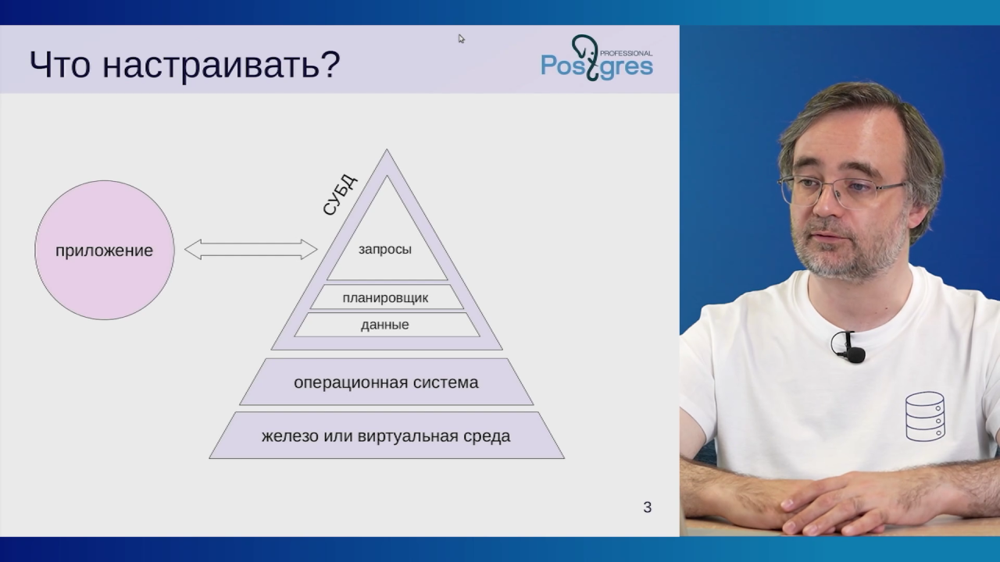

> [!quote]- Кадр [00:01:26]
> 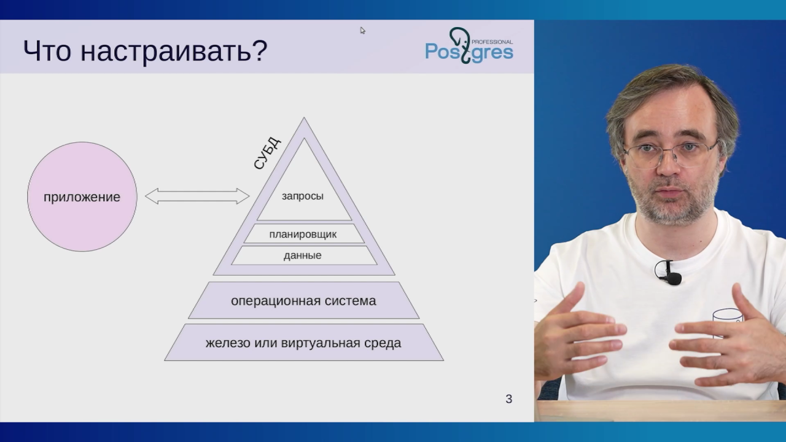

> [!quote]- Кадр [00:03:16]
> 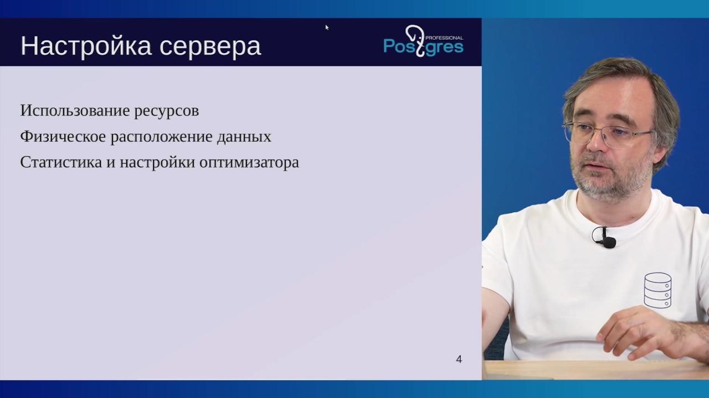

> [!quote]- Кадр [00:38:49]
> 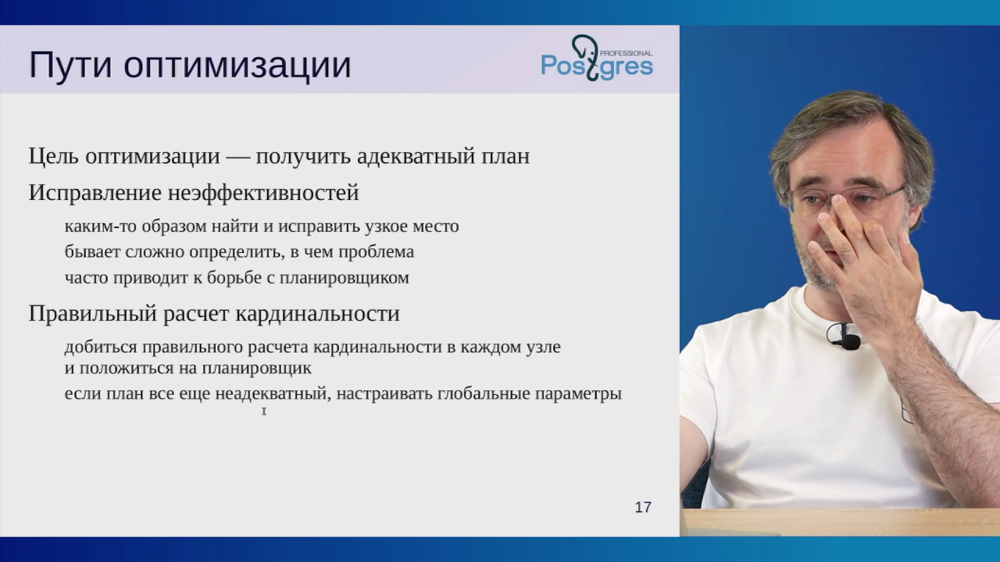

> [!quote]- Кадр [01:10:43]
> 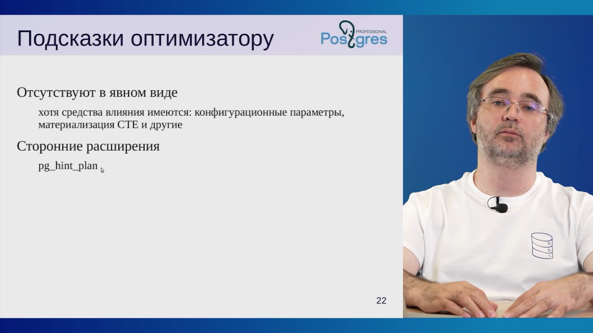

> [!quote]- Кадр [01:12:33]
> 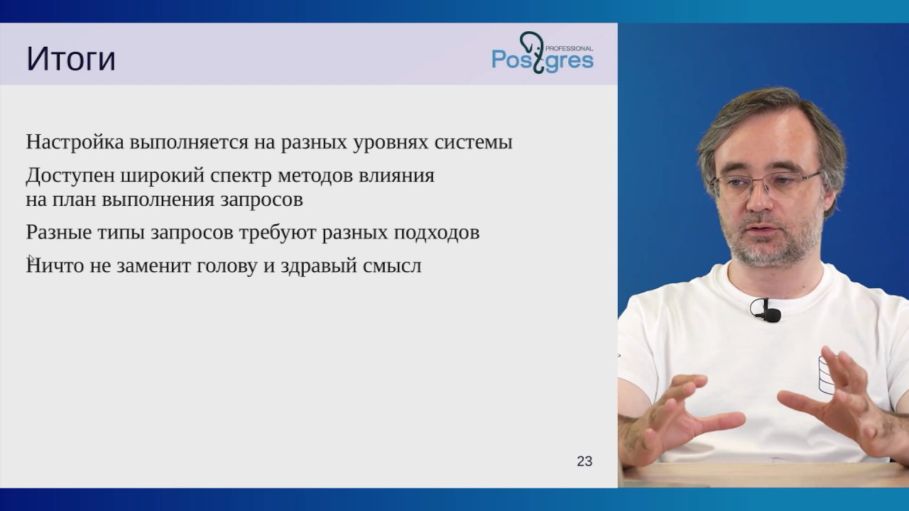

> [!quote]- Кадр [01:13:00]
> 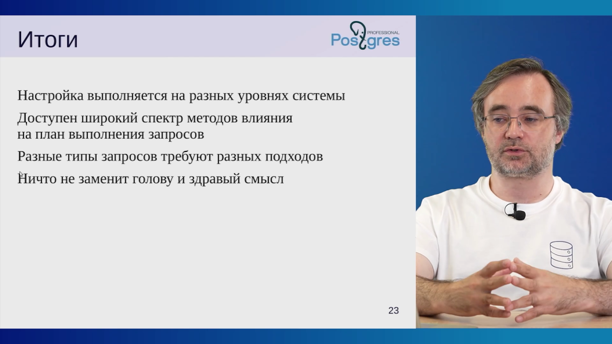

## 2. Параллелизм и типы запросов

Параллельное выполнение в PostgreSQL работает с помощью фоновых процессов; параметры max_parallel_workers_per_gather = 2, max_parallel_workers = 8, max_worker_processes = 8. Для коротких запросов параллельное выполнение бесполезно, его отключают; сброс параметра включает параллельное выполнение, и в плане появляются Gather и Workers Planned/Launched. Короткий запрос читает небольшую часть данных и выдаёт мало строк, характерен для OLTP; важна быстрая реакция. Длинные запросы читают большие таблицы целиком и характерны для OLAP; их особенности — условия с низкой селективностью, полное сканирование, соединение хешированием, агрегация и параллельное выполнение. В PostgreSQL отсутствуют подсказки планировщику (хинты), а на виртуальной машине с одним ядром параллельные планы не уменьшают время выполнения.

```javascript
SET max_parallel_workers_per_gather = 0

=> EXPLAIN SELECT *
FROM ticket_flights tf
JOIN boarding_passes bp ON tf.flight_id = bp.flight_id
AND tf.ticket_no = bp.ticket_no;

SET max_parallel_workers_per_gather = 0;
EXPLAIN (analyze, timing off) SELECT bp.*
FROM flights f
JOIN boarding_passes bp ON bp.flight_id = f.flight_id
WHERE date_trunc('hour',f.scheduled_departure) = '2017-06-01 12:00:00';

EXPLAIN (analyze, timing off) SELECT bp.*
FROM flights f
JOIN boarding_passes bp ON bp.flight_id = f.flight_id
WHERE date_trunc('hour',f.scheduled_departure) = '2017-06-01 12:00:00'::

> ALTER TABLE boarding_passes
DROP CONSTRAINT boarding_passes_ticket_no_fkey;

Hash Join  (cost=310669.60..677478.16 rows=7925944 width=57)
  Hash Cond: ((tf.flight_id = bp.flight_id) AND (tf.ticket_no = bp.ticket_no))
  ->  Seq Scan on ticket_flights tf  (cost=0.00..153884.30 rows=8392430 width=32)
  ->  Hash  (cost=137538.44..137538.44 rows=7925944 width=25)
        ->  Seq Scan on boarding_passes bp  (cost=0.00..137538.44 rows=7925944 width=25)

Gather  (cost=164416.92..358120.12 rows=303 width=57)
  Workers Planned: 2
  ->  Parallel Hash Join  (cost=163416.92..357089.82 rows=126 width=57)
        Hash Cond: ((tf.flight_id = bp.flight_id) AND (tf.ticket_no = bp.ticket_no))
        ->  Parallel Seq Scan on ticket_flights tf  (cost=0.00..104928.46 rows=3496846 width=32)
        ->  Parallel Hash  (cost=91303.77..91303.77 rows=3302477 width=25)
              ->  Parallel Seq Scan on boarding_passes bp  (cost=0.00..91303.77 rows=3302477 width=25)

=> SET max_parallel_workers_per_gather = 0;
SET

=> EXPLAIN (analyze, timing off) SELECT bp.*
FROM flights f
JOIN boarding_passes bp ON bp.flight_id = f.flight_id
WHERE date_trunc('hour',f.scheduled_departure) = '2017-06-01 12:00:00';

QUERY PLAN
-----------------------------------------------------------------------------------------------------------------------------
Hash Join  (cost=5860.43..164204.88 rows=39617 width=25) (actual rows=1799 loops=1)
  Hash Cond: (bp.flight_id = f.flight_id)
  ->  Seq Scan on boarding_passes bp  (cost=0.00..137530.44 rows=7925844 width=25) (actual rows=7925812 loops=1)
  ->  Hash  (cost=5847.00..5847.00 rows=1074 width=4) (actual rows=51 loops=1)
        Buckets: 2048  Batches: 1  Memory Usage: 18kB
        ->  Seq Scan on flights f  (cost=0.00..5847.00 rows=1074 width=4) (actual rows=51 loops=1)
              Filter: (date_trunc('hour'::text, scheduled_departure) = '2017-06-01 12:00:00+03'::timestamp with time zone)
              Rows Removed by Filter: 214816
Planning Time: 2.241 ms
Execution Time: 1049.347 ms
(10 rows)

=> EXPLAIN (analyze, timing off) SELECT *
FROM flights
WHERE scheduled_departure >= '2017-06-01 12:00:00'
AND scheduled_departure < '2017-06-01 13:00:00';

=> EXPLAIN (analyze, timing off) SELECT bp.*
FROM flights f
JOIN boarding_passes bp ON bp.flight_id = f.flight_id
WHERE date_trunc('hour',f.scheduled_departure) = '2017-06-01 12:00:00';
QUERY PLAN
Hash Join (cost=5860.43..164204.88 rows=39617 width=25) (actual rows=1799 loops=1)
  Hash Cond: (bp.flight_id = f.flight_id)
  ->  Seq Scan on boarding_passes bp  (cost=0.00..137538.44 rows=7925944 width=25) (actual rows=7925812 loops=1)
  ->  Hash  (cost=5847.00..5847.00 rows=1074 width=4) (actual rows=51 loops=1)
        ->  Seq Scan on flights f  (cost=0.00..5847.00 rows=1074 width=4) (actual rows=51 loops=1)
              Filter: (date_trunc('hour'::text, scheduled_departure) = '2017-06-01 12:00:00+03'::timestamptz with time zone)
              Rows Removed by Filter: 214816
Planning Time: 2.241 ms
Execution Time: 1049.347 ms
(10 rows)

=> ROLLBACK;
ROLLBACK
(19)
================================
КОРОТКИЕ ЗАПРОСЫ
================================
=> SET max_parallel_workers_per_gather = 0;
SET
=> EXPLAIN (analyze, timing off) SELECT bp.*
FROM flights f
JOIN boarding_passes bp ON bp.flight_id = f.flight_id
WHERE date_trunc('hour',f.scheduled_departure) = '2017-06-01 12:00:00';
QUERY PLAN
Hash Join (cost=5860.43..164204.88 rows=39617 width=25) (actual rows=1799 loops=1)
  Hash Cond: (bp.flight_id = f.flight_id)
  ->  Seq Scan on boarding_passes bp  (cost=0.00..137538.44 rows=7925944 width=25) (actual rows=7925812 loops=1)
  ->  Hash  (cost=5847.00..5847.00 rows=1074 width=4) (actual rows=51 loops=1)
        Buckets: 2048  Batches: 1  Memory Usage: 18kB
        ->  Seq Scan on flights f  (cost=0.00..5847.00 rows=1074 width=4) (actual rows=51 loops=1)
              Filter: (date_trunc('hour'::text, scheduled_departure) = '2017-06-01 12:00:00+03'::timestamptz with time zone)
              Rows Removed by Filter: 214816
Planning Time: 2.241 ms
Execution Time: 1049.347 ms
(10 rows)
```

*Источник: [00:03:36], [00:22:42], [00:42:08], [00:44:21], [00:44:41], [00:45:23] и др.*

> [!quote]- Кадр [00:03:36]
> 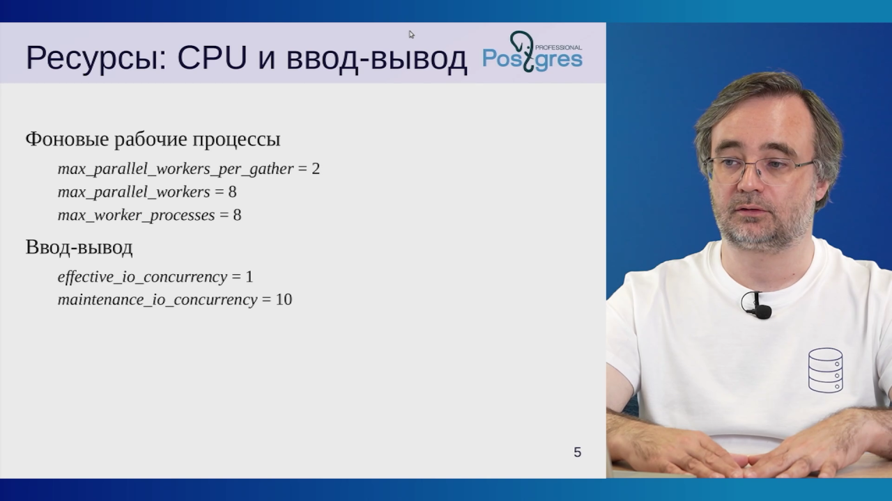

> [!quote]- Кадр [00:22:42]
> 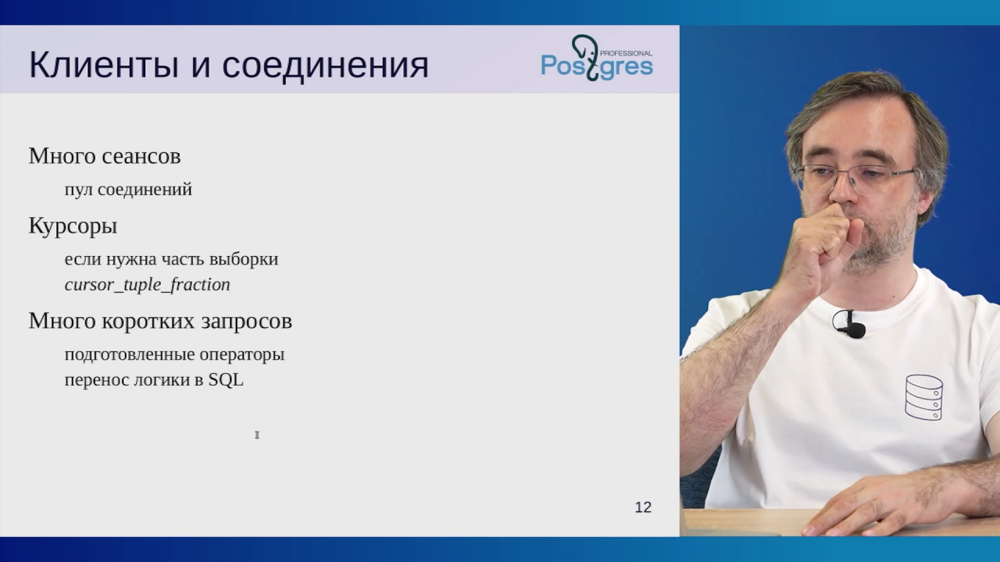

> [!quote]- Кадр [00:42:08]
> 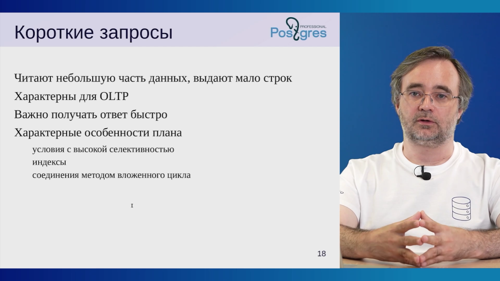

## 3. Параметры ввода-вывода, памяти и стоимости

Для ввода-вывода указаны effective_io_concurrency = 1 и maintenance_io_concurrency = 10; первый говорит, сколько запросов ввода-вывода можно посылать одновременно, и используется для предвыборки при чтении по битовой карте. Оптимизатор опирается на параметры стоимости: seq_page_cost = 1.0 и random_page_cost = 4.0; значение random_page_cost по умолчанию отражает HDD, для SSD его уменьшают вплоть до единицы, а seq_page_cost рекомендуют оставлять 1.0. Стоимость процессорного времени задаётся cpu_tuple_cost, cpu_index_tuple_cost, cpu_operator_cost и стоимостью пользовательских функций; обычно их оставляют по умолчанию, но можно подкрутить при систематических ошибках. work_mem по умолчанию 4MB (мало, стоит увеличивать), maintenance_work_mem 64MB, shared_buffers 128MB (мало, увеличивать сразу после установки), effective_cache_size 4GB влияет только на планирование. Сортировки лучше работают при ограниченной памяти, чем хэширование; hash_mem_multiplier по умолчанию 2, а увеличение work_mem или hash_mem_multiplier сводит многопроходное хэш-соединение к однопроходному. Признак многопроходного хэш-соединения — batches2, а temp read и temp written означают запись во временные файлы.

```sql
Buffers: shared hit=7040 read=53863, temp read=11797 written=11797

Buckets: 262144  Batches: 2  Memory Usage: 5118kB

SET work_mem = '8MB'; -- имеет смысл увеличить для всего сервера

->  Seq Scan on boarding_passes bp (actual rows=7925812 loops=1)
      Buffers: shared hit=4416 read=53863

SELECT sum(relpages) FROM pg_class
   WHERE relname IN ('flights','boarding_passes');
  sum
-------
  60903

EXPLAIN (analyze, buffers, costs off, timing off) SELECT bp.*
FROM flights f
JOIN boarding_passes bp ON bp.flight_id = f.flight_id
WHERE f.scheduled_departure >= '2017-06-01 12:00:00'
AND f.scheduled_departure < '2017-06-01 13:00:00';

DROP INDEX flights_scheduled_departure_idx;

SELECT count(*)
FROM flights f
JOIN ticket_flights tf ON tf.flight_id = f.flight_id
JOIN boarding_passes bp ON bp.flight_id = tf.flight_id AND bp.ticket_no = tf.ticket_no
WHERE f.actual_departure - f.scheduled_departure BETWEEN interval '1 min' AND interval '4 hours'
AND f.actual_arrival - f.scheduled_arrival BETWEEN interval '1 min' AND interval '4 hours';

count
-------
 6940272
(1 row)

Time: 63608,180 ms (01:03,608)

SELECT count(*) FROM flights f;

EXPLAIN
SELECT count(*)
FROM flights f
  JOIN ticket_flights tf ON tf.flight_id = f.flight_id
  JOIN boarding_passes bp ON bp.flight_id = tf.flight_id AND bp.ticket_no = tf.ticket_no
WHERE f.actual_departure - f.scheduled_departure BETWEEN interval '1 min' AND interval '4 hours'
  AND f.actual_arrival - f.scheduled_arrival BETWEEN interval '1 min' AND interval '4 hours';

Aggregate (cost=12171.22..12171.23 rows=1 width=8)
  ->  Nested Loop (cost=6.19..12170.76 rows=184 width=0)
        Join Filter: (f.flight_id = tf.flight_id)
        ->  Nested Loop (cost=5.63..12057.87 rows=184 width=22)
              ->  Seq Scan on flights f  (cost=0.00..9970.01 rows=5 width=4)
              ->  Bitmap Heap Scan on boarding_passes bp  (cost=5.63..596.03 rows=154 width=18)
        ->  Index Only Scan using ticket_flights_pkey on ticket_flights tf  (cost=0.56..0.60 rows=1 width=18)

Aggregate  (cost=12171.22..12171.23 rows=1 width=8)
  ->  Nested Loop  (cost=6.19..12170.76 rows=184 width=0)
      ->  Seq Scan on flights f  (cost=0.00..9070.01 rows=5 width=4)
      ->  Bitmap Heap Scan on boarding_passes bp  (cost=5.63..596.03 rows=154 width=18)
      ->  Index Only Scan using ticket_flights_pkey on ticket_flights tf  (cost=0.56..0.60 rows=1 width=18)

SET enable_nestloop = off;
EXPLAIN (analyze, buffers, timing off, costs off)
SELECT count(*)
Execution Time: 8644.865 ms

EXPLAIN (analyze, timing off) SELECT *
FROM bookings
WHERE book_ref < '9000';

 Seq Scan on bookings  (cost=0.00..39835.88 rows=1203208 width=21) (actual rows=1187454 loops=1)
   Filter: (book_ref < '9000'::bpchar)
   Rows Removed by Filter: 923656
 Planning Time: 3.783 ms
 Execution Time: 211.572 ms

CREATE INDEX ON flights(scheduled_departure);

EXPLAIN (analyze, timing off) SELECT *
FROM flights
WHERE scheduled_departure >= '2017-06-01 12:00:00'
AND scheduled_departure < '2017-06-01 13:00:00';

-> Bitmap Index Scan on flights_scheduled_departure_idx

=\> DROP INDEX flights_scheduled_departure_idx;
DROP INDEX
=\> CREATE INDEX ON flights(scheduled_departure, flight_id);
CREATE INDEX

 ->  Index Only Scan using flights_scheduled_departure_flight_id_idx on flights f (actual rows=51 loops=1)
       Heap Fetches: 0
 Execution Time: 0.462 ms

=> DROP INDEX flights_scheduled_departure_idx;
DROP INDEX
=> CREATE INDEX ON flights(scheduled_departure, flight_id);
CREATE INDEX

 ->  Index Only Scan using flights_scheduled_departure_flight_id_idx on flights f (actual rows=51 loops=1)
       Heap Fetches: 0
 Execution Time: 0.462 ms
```

| | Сортировки | Хэширование |
|---|---|---|
| Ограниченная память | работают лучше | хорошо работает, когда хэш-таблица помещается в оперативную память |
| Внешний режим | внешняя сортировка работает при минимальном объёме памяти | создаёт временные файлы, которые затем читаются заново |

> [!info] Зачем это нужно
> Если оценки кардинальности правильные, а планировщик выбирает нежелательный план — это повод изменить значение random_page_cost. effective_cache_size влияет на привлекательность индексного доступа, а work_mem имеет смысл увеличить для всего сервера.

*Источник: [00:03:36], [00:06:26], [00:06:46], [00:07:06], [00:16:31], [00:16:51] и др.*

> [!quote]- Кадр [00:16:31]
> 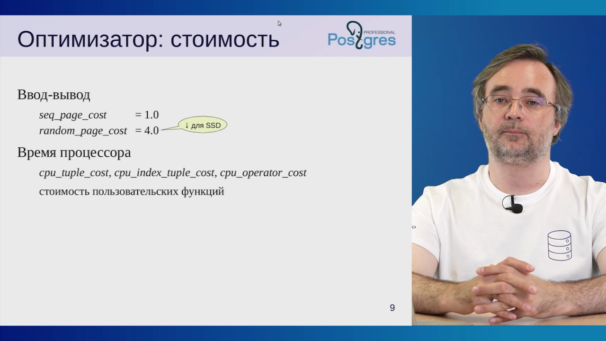

> [!quote]- Кадр [00:06:26]
> 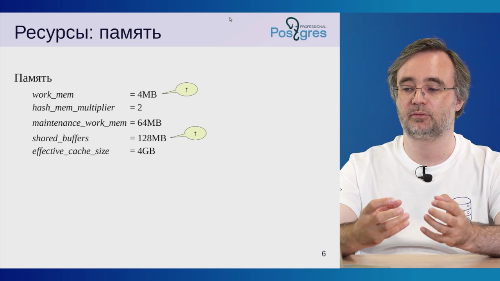


> [!quote]- Кадр [00:07:06]
> 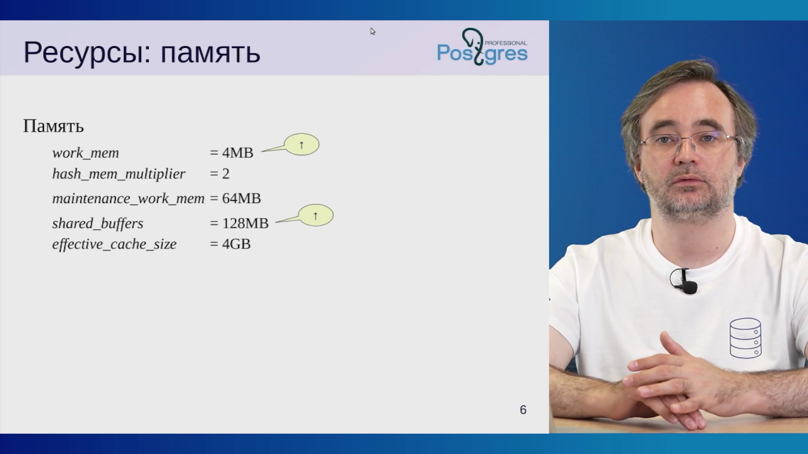

> [!quote]- Кадр [00:06:46]
> 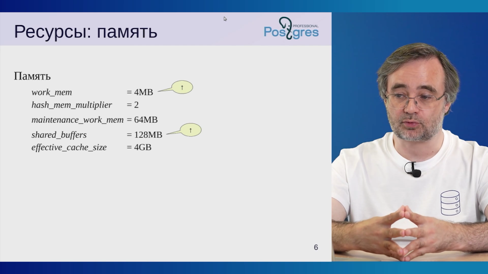

## 4. Enable-параметры и методы доступа

Планировщику можно командовать не использовать последовательное сканирование, если есть другие способы. Аналогичные enable-параметры есть для способов соединения, методов доступа и других операций; они грубо вмешиваются, но полезны для отладки и экспериментов. SET enable_seqscan = off действует до конца сессии; RESET возвращает настройку. Для запроса SELECT * FROM bookings WHERE book_ref < '9000' планировщик выбрал последовательное сканирование, решив, что оно дешевле индексного доступа; с отключённым seq scan время сократилось в два раза. Отключение nested loop выполняется командой SET enable_nestloop = off; после этого планировщик использует hash join, что ускорило запрос. При закэшированных данных индексный доступ оказывается дешевле, чем последовательное сканирование: в примере индексное сканирование оказалось быстрее последовательного (105.596 ms против 211.572 ms).

```javascript
SET enable_seqscan = off; -- действует до конца сессии
SET
=> EXPLAIN (analyze, timing off) SELECT *
FROM bookings
WHERE book_ref < '9000';

 Index Scan using bookings_pkey on bookings  (cost=0.43..41931.57 rows=1203208 width=21) (actual rows=1187454 loops=1)
   Index Cond: (book_ref < '9000'::bpchar)
 Planning Time: 0.205 ms
 Execution Time: 105.596 ms

=> RESET enable_seqscan; -- отменить

=> EXPLAIN (analyze, timing off) SELECT *
FROM bookings
WHERE book_ref < '9000';

 Seq Scan on bookings  (cost=0.00..39835.88 rows=1203208 width=21) (actual rows=1187454 loops=1)
   Filter: (book_ref < '9000'::bpchar)
   Rows Removed by Filter: 923656
 Planning Time: 3.783 ms
 Execution Time: 211.572 ms

SET enable_nestloop = off;

Aggregate  (cost=759276.17..759276.18 rows=1 width=8)
  ->  Hash Join  (cost=11630.04..744898.00 rows=5751268 width=0)
        Hash Cond: (tf.flight_id = f.flight_id)
        ->  Merge Join  (cost=1.12..649931.06 rows=7925944 width=18)
        ->  Hash  (cost=9070.01..9070.01 rows=155913 width=4)
              ->  Seq Scan on flights f  (cost=0.00..9070.01 rows=155913 width=4)

=> SET enable_seqscan = off; -- действует до конца сессии
SET
=> EXPLAIN (analyze, timing off) SELECT *
FROM bookings
WHERE book_ref < '9000';

 Index Scan using bookings_pkey on bookings  (cost=0.43..41931.57 rows=1203208 width=21) (actual rows=1187454 loops=1)
   Index Cond: (book_ref < '9000'::bpchar)
 Planning Time: 0.205 ms
 Execution Time: 105.596 ms

=> RESET enable_seqscan; -- отменить

> SET enable_seqscan = off; -- действует до конца сессии
SET
=> EXPLAIN (analyze, timing off) SELECT *
FROM bookings
WHERE book_ref < '9000'
=> RESET enable_seqscan; -- отменям
RESET

=> EXPLAIN (analyze, timing off) SELECT *
FROM bookings
WHERE book_ref < '9000';

 Seq Scan on bookings  (cost=0.00..39835.88 rows=1203208 width=21) (actual rows=1187454 loops=1)
   Filter: (book_ref < '9000'::bpchar)
   Rows Removed by Filter: 923656
 Planning Time: 3.783 ms
 Execution Time: 211.572 ms

=> SET enable_seqscan = off; -- действует до конца сессии

> SET enable_seqscan = off; -- действует до конца сессии
SET
=> EXPLAIN (analyze, timing off) SELECT *
FROM bookings
WHERE book_ref < '9000';
=> RESET enable_seqscan; -- отменям
RESET

SET enable_nestloop = off;

Aggregate  (cost=759276.17..759276.18 rows=1 width=8)
  ->  Hash Join  (cost=11630.04..744898.00 rows=5751268 width=0)
        Hash Cond: (tf.flight_id = f.flight_id)
        ->  Merge Join  (cost=1.12..649931.06 rows=7925944 width=18)
        ->  Hash  (cost=9070.01..9070.01 rows=155913 width=4)
              ->  Seq Scan on flights f  (cost=0.00..9070.01 rows=155913 width=4)

=\> SET enable_seqscan = off; -- действует до конца сессии
SET
=\> EXPLAIN (analyze, timing off) SELECT *
FROM bookings
WHERE book_ref < '9000';

 Index Scan using bookings_pkey on bookings  (cost=0.43..41931.57 rows=1203208 width=21) (actual rows=1187454 loops=1)
   Index Cond: (book_ref < '9000'::bpchar)
 Planning Time: 0.205 ms
 Execution Time: 105.596 ms

=\> RESET enable_seqscan; -- отменить

SET enable_seqscan = off;

EXPLAIN (analyze, timing off) SELECT *
FROM bookings
WHERE book_ref < '9000';

                    QUERY PLAN
------------------------------------------------------------
 Index Scan using bookings_pkey on bookings  (cost=0.43..41931.57 rows=1203208 width=21) (actual rows=1187454 loops=1)
   Index Cond: (book_ref < '9000'::bpchar)
 Planning Time: 0.205 ms
 Execution Time: 105.596 ms

=> SET enable_seqscan = off; -- действует до конца сессии
SET
=> EXPLAIN (analyze, timing off) SELECT *
FROM bookings
WHERE book_ref < '9000';

 Index Scan using bookings_pkey on bookings  (cost=0.43..41931.57 rows=1203208 width=21) (actual rows=1187454 loops=1)
   Index Cond: (book_ref < '9000'::bpchar)
 Planning Time: 0.205 ms
 Execution Time: 105.596 ms

=> RESET enable_seqscan; -- отменить

SET enable_seqscan = off;

EXPLAIN (analyze, timing off) SELECT *
FROM bookings
WHERE book_ref < '9000';

                    QUERY PLAN
------------------------------------------------------------
 Index Scan using bookings_pkey on bookings  (cost=0.43..41931.57 rows=1203208 width=21) (actual rows=1187454 loops=1)
   Index Cond: (book_ref < '9000'::bpchar)
 Planning Time: 0.205 ms
 Execution Time: 105.596 ms
```

*Источник: [00:19:37], [00:20:48], [00:21:08], [00:36:38], [00:36:58], [01:00:38] и др.*

> [!quote]- Кадр [00:36:38]
> 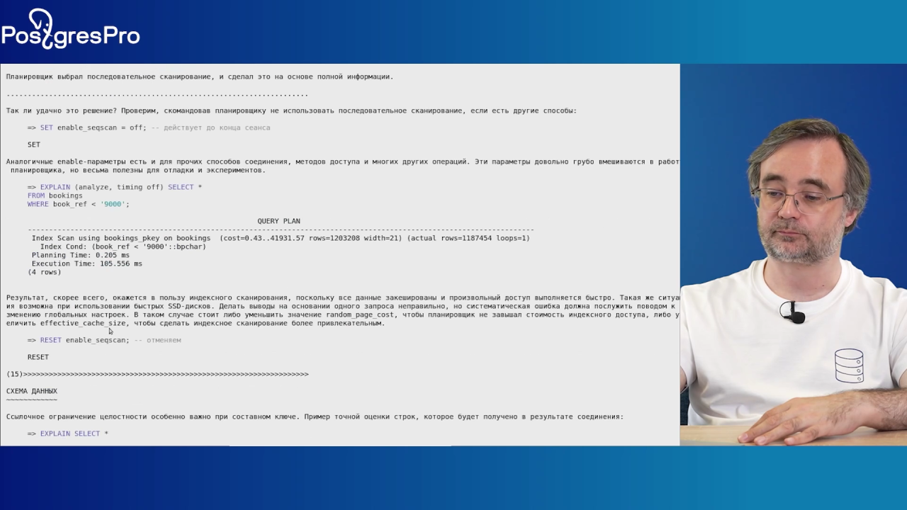

## 5. Статистика и ошибки кардинальности

Автоанализ должен срабатывать достаточно часто, чтобы статистика была актуальной, но не создавать паразитную нагрузку; актуальная и точная статистика — базовая вещь для оптимизатора, её актуальность обеспечивают настройкой автоочистки и автоанализа. Расширенная статистика даёт системе информацию о корреляции столбцов; точность задаётся default_statistics_target = 100, а для выражений используют индекс по выражению и расширенную статистику. Планировщик может сильно недооценивать кардинальность: для Seq Scan on flights указано rows=5, хотя условие возвращает 173 или 4 тысячи строк; ошибку ищут в самом вложенном узле плана, где она проявляется, и выше по плану она обычно ухудшается. Для функций без вспомогательной функции планировщика PostgreSQL использует фиксированную оценку селективности 5%, которая может быть некорректной. Удаление внешнего ключа boarding_passes_ticket_no_fkey привело к оценке соединения в 300 строк вместо 8 миллионов, так как планировщик счёл коррелированные условия независимыми; вложенный цикл эффективен на небольшом объёме данных.

```javascript
=> CREATE STATISTICS ON (actual_departure - scheduled_departure) FROM flights;
=> ANALYZE flights;

-> Seq Scan on flights f (cost=0.00..9970.01 rows=5 width=4)

> ALTER TABLE boarding_passes
DROP CONSTRAINT boarding_passes_ticket_no_fkey;

Hash Join  (cost=310669.60..677478.16 rows=7925944 width=57)
  Hash Cond: ((tf.flight_id = bp.flight_id) AND (tf.ticket_no = bp.ticket_no))
  ->  Seq Scan on ticket_flights tf  (cost=0.00..153884.30 rows=8392430 width=32)
  ->  Hash  (cost=137538.44..137538.44 rows=7925944 width=25)
        ->  Seq Scan on boarding_passes bp  (cost=0.00..137538.44 rows=7925944 width=25)

Gather  (cost=164416.92..358120.12 rows=303 width=57)
  Workers Planned: 2
  ->  Parallel Hash Join  (cost=163416.92..357089.82 rows=126 width=57)
        Hash Cond: ((tf.flight_id = bp.flight_id) AND (tf.ticket_no = bp.ticket_no))
        ->  Parallel Seq Scan on ticket_flights tf  (cost=0.00..104928.46 rows=3496846 width=32)
        ->  Parallel Hash  (cost=91303.77..91303.77 rows=3302477 width=25)
              ->  Parallel Seq Scan on boarding_passes bp  (cost=0.00..91303.77 rows=3302477 width=25)

=> SET max_parallel_workers_per_gather = 0;
SET

=> EXPLAIN (analyze, timing off) SELECT bp.*
FROM flights f
JOIN boarding_passes bp ON bp.flight_id = f.flight_id
WHERE date_trunc('hour',f.scheduled_departure) = '2017-06-01 12:00:00';

QUERY PLAN
-----------------------------------------------------------------------------------------------------------------------------
Hash Join  (cost=5860.43..164204.88 rows=39617 width=25) (actual rows=1799 loops=1)
  Hash Cond: (bp.flight_id = f.flight_id)
  ->  Seq Scan on boarding_passes bp  (cost=0.00..137530.44 rows=7925844 width=25) (actual rows=7925812 loops=1)
  ->  Hash  (cost=5847.00..5847.00 rows=1074 width=4) (actual rows=51 loops=1)
        Buckets: 2048  Batches: 1  Memory Usage: 18kB
        ->  Seq Scan on flights f  (cost=0.00..5847.00 rows=1074 width=4) (actual rows=51 loops=1)
              Filter: (date_trunc('hour'::text, scheduled_departure) = '2017-06-01 12:00:00+03'::timestamp with time zone)
              Rows Removed by Filter: 214816
Planning Time: 2.241 ms
Execution Time: 1049.347 ms
(10 rows)
```

> [!info] Зачем это нужно
> Планировщик не имеет точной статистики для выражения слева от оператора, а актуальная и точная статистика — базовая вещь для оптимизатора.

*Источник: [00:14:03], [00:14:55], [00:36:58], [00:37:38], [00:37:58], [00:44:41] и др.*

> [!quote]- Кадр [00:14:03]
> 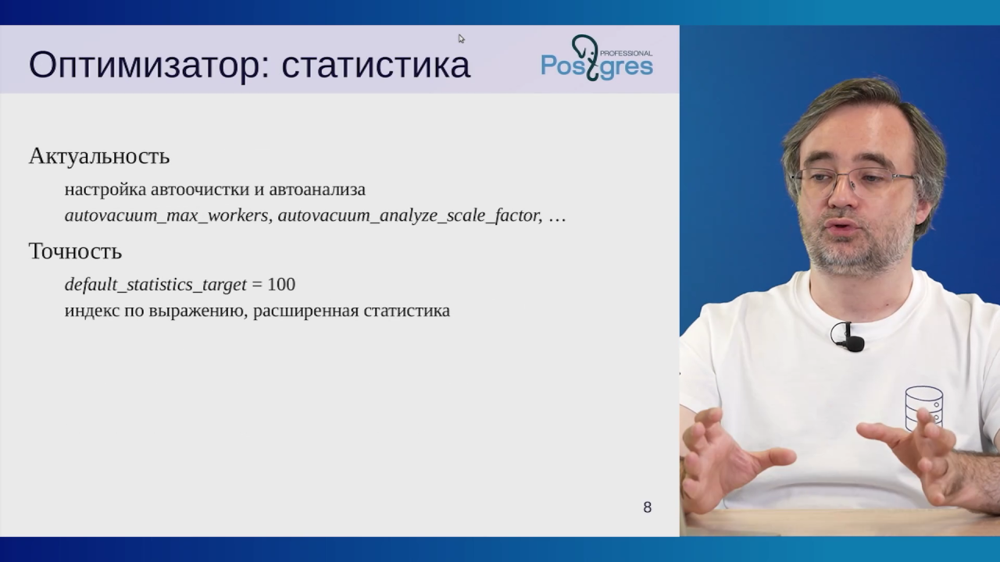

> [!quote]- Кадр [00:53:31]
> 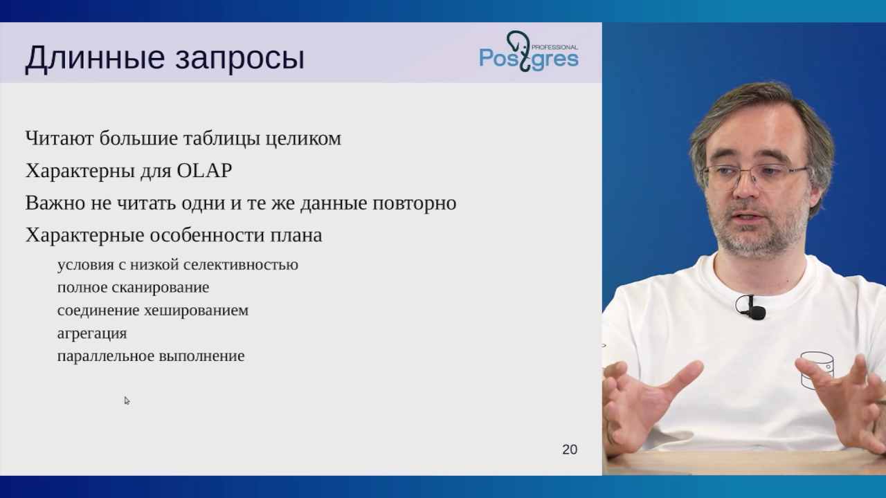

## 6. EXPLAIN, индексы и переписывание запросов

Для проверки запроса выполняют EXPLAIN, который выдаёт план; EXPLAIN (ANALYZE) выполняет запрос и показывает реальное время, а по buffers проверяют лишние чтения. loops=1 означает отсутствие внутренних циклов, а количество прочитанных страниц можно сравнить с суммой relpages таблиц через pg_class; длинный запрос определяется объёмом читаемых данных, а не числом возвращаемых строк. Условия можно переписывать так, чтобы слева от оператора было поле таблицы и мог использоваться индекс: например, индекс flights_flight_no_scheduled_departure_key создан по flight_no и scheduled_departure. Для соединения flights и boarding_passes достаточно идентификатора рейса, поэтому составной индекс flights(scheduled_departure, flight_id) позволяет Index Only Scan с Heap Fetches: 0; CREATE INDEX ON flights(scheduled_departure) сокращает время с 1049 мс до 23 мс. Таблица flights в JOIN избыточна — можно соединить flights напрямую с boarding_passes, так как не бывает посадочного талона без перелёта; после упрощения запрос выполняется за 2 секунды. Коррелированные подзапросы раскрывают явными соединениями, условия через OR преобразуют в UNION и наоборот, а при многих коротких запросах помогают подготовленные операторы.

```sql
->  Seq Scan on boarding_passes bp (actual rows=7925812 loops=1)
      Buffers: shared hit=4416 read=53863

SELECT sum(relpages) FROM pg_class
   WHERE relname IN ('flights','boarding_passes');
  sum
-------
  60903

EXPLAIN (analyze, buffers, costs off, timing off) SELECT bp.*
FROM flights f
JOIN boarding_passes bp ON bp.flight_id = f.flight_id
WHERE f.scheduled_departure >= '2017-06-01 12:00:00'
AND f.scheduled_departure < '2017-06-01 13:00:00';

DROP INDEX flights_scheduled_departure_idx;

SELECT count(*)
FROM flights f
JOIN ticket_flights tf ON tf.flight_id = f.flight_id
JOIN boarding_passes bp ON bp.flight_id = tf.flight_id AND bp.ticket_no = tf.ticket_no
WHERE f.actual_departure - f.scheduled_departure BETWEEN interval '1 min' AND interval '4 hours'
AND f.actual_arrival - f.scheduled_arrival BETWEEN interval '1 min' AND interval '4 hours';

count
-------
 6940272
(1 row)

Time: 63608,180 ms (01:03,608)

SELECT count(*) FROM flights f;

EXPLAIN
SELECT count(*)
FROM flights f
  JOIN ticket_flights tf ON tf.flight_id = f.flight_id
  JOIN boarding_passes bp ON bp.flight_id = tf.flight_id AND bp.ticket_no = tf.ticket_no
WHERE f.actual_departure - f.scheduled_departure BETWEEN interval '1 min' AND interval '4 hours'
  AND f.actual_arrival - f.scheduled_arrival BETWEEN interval '1 min' AND interval '4 hours';

Aggregate (cost=12171.22..12171.23 rows=1 width=8)
  ->  Nested Loop (cost=6.19..12170.76 rows=184 width=0)
        Join Filter: (f.flight_id = tf.flight_id)
        ->  Nested Loop (cost=5.63..12057.87 rows=184 width=22)
              ->  Seq Scan on flights f  (cost=0.00..9970.01 rows=5 width=4)
              ->  Bitmap Heap Scan on boarding_passes bp  (cost=5.63..596.03 rows=154 width=18)
        ->  Index Only Scan using ticket_flights_pkey on ticket_flights tf  (cost=0.56..0.60 rows=1 width=18)

SET enable_nestloop = off;
EXPLAIN (analyze, buffers, timing off, costs off)
SELECT count(*)
Execution Time: 8644.865 ms

CREATE INDEX ON flights(scheduled_departure);

EXPLAIN (analyze, timing off) SELECT *
FROM flights
WHERE scheduled_departure >= '2017-06-01 12:00:00'
AND scheduled_departure < '2017-06-01 13:00:00';

-> Bitmap Index Scan on flights_scheduled_departure_idx

=> DROP INDEX flights_scheduled_departure_idx;
DROP INDEX
=> CREATE INDEX ON flights(scheduled_departure, flight_id);
CREATE INDEX

 ->  Index Only Scan using flights_scheduled_departure_flight_id_idx on flights f (actual rows=51 loops=1)
       Heap Fetches: 0
 Execution Time: 0.462 ms

CREATE INDEX ON flights(scheduled_departure, flight_id);

Index Only Scan using flights_scheduled_departure_flight_id_idx on flights f (actual rows=51 loops=1)
  Index Cond: ((scheduled_departure >= '2017-06-01 12:00:00+03'::timestamp with time zone) AND (scheduled_departure < '2017-06-01 13:00:00+03'::timestamp with time zone))
  Heap Fetches: 0

=> EXPLAIN (analyze, timing off) SELECT *
FROM flights
WHERE scheduled_departure >= '2017-06-01 12:00:00'
AND scheduled_departure < '2017-06-01 13:00:00';
QUERY PLAN
Index Scan using flights_flight_no_scheduled_departure_key on flights  (cost=0.42..5560.92 rows=22 width=63) (actual rows=51 loops=1)
  Index Cond: ((scheduled_departure >= '2017-06-01 12:00:00+03'::timestamptz) AND (scheduled_departure < '2017-06-01 13:00:00+03'::timestamptz))

Создадим новый индекс:

=> CREATE INDEX ON flights(scheduled_departure);

CREATE INDEX

Проверим наш запрос:

=> EXPLAIN (analyze, timing off) SELECT bp.*
FROM flights f
JOIN boarding_passes bp ON bp.flight_id = f.flight_id
WHERE f.scheduled_departure >= '2017-06-01 12:00:00'
AND f.scheduled_departure < '2017-06-01 13:00:00';

QUERY PLAN

---------------------------------------------------------------------------
Nested Loop (cost=10.27..12984.60 rows=812 width=25) (actual rows=1799 loops=1)
  ->  Bitmap Heap Scan on flights f (cost=4.65..86.93 rows=22 width=4) (actual rows=51 loops=1)
        Recheck Cond: ((scheduled_departure >= '2017-06-01 12:00:00+03'::timestamp with time zone) AND (scheduled_departure < '2017-06-01 13:00:00+03'::timestamp with time zone))
        Heap Blocks: exact=50
        ->  Bitmap Index Scan on flights_scheduled_departure_idx (cost=0.00..4.64 rows=22 width=0) (actual rows=51 loops=1)
              Index Cond: ((scheduled_departure >= '2017-06-01 12:00:00+03'::timestamp with time zone) AND (scheduled_departure < '2017-06-01 13:00:00+03'::timestamp with time zone))
  ->  Bitmap Heap Scan on boarding_passes bp (cost=5.63..584.72 rows=154 width=25) (actual rows=35 loops=51)
        Recheck Cond: (f.flight_id = flight_id)
        Heap Blocks: exact=49
        ->  Bitmap Index Scan on boarding_passes_flight_id_seat_no_key (cost=0.00..5.59 rows=154 width=0) (actual rows=35 loops=51)
              Index Cond: (flight_id = f.flight_id)
Planning Time: 2.690 ms
Execution Time: 25.098 ms
(13 rows)

CREATE INDEX ON flights(scheduled_departure);

EXPLAIN (analyze, timing off) SELECT *
FROM flights
WHERE scheduled_departure >= '2017-06-01 12:00:00'
AND scheduled_departure < '2017-06-01 13:00:00';

-> Bitmap Index Scan on flights_scheduled_departure_idx

=\> DROP INDEX flights_scheduled_departure_idx;
DROP INDEX
=\> CREATE INDEX ON flights(scheduled_departure, flight_id);
CREATE INDEX

 ->  Index Only Scan using flights_scheduled_departure_flight_id_idx on flights f (actual rows=51 loops=1)
       Heap Fetches: 0
 Execution Time: 0.462 ms

CREATE INDEX ON flights(scheduled_departure, flight_id);

Index Only Scan using flights_scheduled_departure_flight_id_idx on flights f (actual rows=51 loops=1)
  Index Cond: ((scheduled_departure >= '2017-06-01 12:00:00+03'::timestamp with time zone) AND (scheduled_departure < '2017-06-01 13:00:00+03'::timestamp with time zone))
  Heap Fetches: 0

=> EXPLAIN (analyze, timing off) SELECT *
FROM flights
WHERE scheduled_departure >= '2017-06-01 12:00:00'
AND scheduled_departure < '2017-06-01 13:00:00';
QUERY PLAN
Index Scan using flights_flight_no_scheduled_departure_key on flights  (cost=0.42..5560.92 rows=22 width=63) (actual rows=51 loops=1)
  Index Cond: ((scheduled_departure >= '2017-06-01 12:00:00+03'::timestamptz) AND (scheduled_departure < '2017-06-01 13:00:00+03'::timestamptz))

Создадим новый индекс:

=> CREATE INDEX ON flights(scheduled_departure);

CREATE INDEX

Проверим наш запрос:

=> EXPLAIN (analyze, timing off) SELECT bp.*
FROM flights f
JOIN boarding_passes bp ON bp.flight_id = f.flight_id
WHERE f.scheduled_departure >= '2017-06-01 12:00:00'
AND f.scheduled_departure < '2017-06-01 13:00:00';

QUERY PLAN

---------------------------------------------------------------------------
Nested Loop (cost=10.27..12984.60 rows=812 width=25) (actual rows=1799 loops=1)
  ->  Bitmap Heap Scan on flights f (cost=4.65..86.93 rows=22 width=4) (actual rows=51 loops=1)
        Recheck Cond: ((scheduled_departure >= '2017-06-01 12:00:00+03'::timestamp with time zone) AND (scheduled_departure < '2017-06-01 13:00:00+03'::timestamp with time zone))
        Heap Blocks: exact=50
        ->  Bitmap Index Scan on flights_scheduled_departure_idx (cost=0.00..4.64 rows=22 width=0) (actual rows=51 loops=1)
              Index Cond: ((scheduled_departure >= '2017-06-01 12:00:00+03'::timestamp with time zone) AND (scheduled_departure < '2017-06-01 13:00:00+03'::timestamp with time zone))
  ->  Bitmap Heap Scan on boarding_passes bp (cost=5.63..584.72 rows=154 width=25) (actual rows=35 loops=51)
        Recheck Cond: (f.flight_id = flight_id)
        Heap Blocks: exact=49
        ->  Bitmap Index Scan on boarding_passes_flight_id_seat_no_key (cost=0.00..5.59 rows=154 width=0) (actual rows=35 loops=51)
              Index Cond: (flight_id = f.flight_id)
Planning Time: 2.690 ms
Execution Time: 25.098 ms
(13 rows)

=> EXPLAIN (analyze, buffers, costs off, timing off) SELECT bp.*
FROM flights f
JOIN boarding_passes bp ON bp.flight_id = f.flight_id
WHERE f.scheduled_departure >= '2017-06-01 12:00:00'
AND f.scheduled_departure < '2017-06-01 13:00:00';

Создадим новый индекс:

=> CREATE INDEX ON flights(scheduled_departure);

CREATE INDEX

Проверим наш запрос:

=> EXPLAIN (analyze, timing off) SELECT bp.*
FROM flights f
JOIN boarding_passes bp ON bp.flight_id = f.flight_id
WHERE f.scheduled_departure >= '2017-06-01 12:00:00'
AND f.scheduled_departure < '2017-06-01 13:00:00';

QUERY PLAN

---------------------------------------------------------------------------
Nested Loop (cost=10.27..12984.60 rows=812 width=25) (actual rows=1799 loops=1)
  -> Bitmap Heap Scan on flights f (cost=4.65..86.93 rows=22 width=4) (actual rows=51 loops=1)
        Recheck Cond: ((scheduled_departure >= '2017-06-01 12:00:00+03'::timestamp with time zone) AND (scheduled_departure < '2017-06-01 13:00:00+03'::timestamp with time zone))
        Heap Blocks: exact=50
        ->  Bitmap Index Scan on flights_scheduled_departure_idx (cost=0.00..4.64 rows=22 width=0) (actual rows=51 loops=1)
              Index Cond: ((scheduled_departure >= '2017-06-01 12:00:00+03'::timestamp with time zone) AND (scheduled_departure < '2017-06-01 13:00:00+03'::timestamp with time zone))
  ->  Bitmap Heap Scan on boarding_passes bp (cost=5.63..584.72 rows=154 width=25) (actual rows=35 loops=51)
        Recheck Cond: (f.flight_id = flight_id)
        Heap Blocks: exact=49
        ->  Bitmap Index Scan on boarding_passes_flight_id_seat_no_key (cost=0.00..5.59 rows=154 width=0) (actual rows=35 loops=51)
              Index Cond: (flight_id = f.flight_id)
Planning Time: 2.690 ms
Execution Time: 25.098 ms
(13 rows)

=> EXPLAIN (analyze, buffers, costs off, timing off) SELECT bp.*
FROM flights f
JOIN boarding_passes bp ON bp.flight_id = f.flight_id
WHERE f.scheduled_departure >= '2017-06-01 12:00:00'
AND f.scheduled_departure < '2017-06-01 13:00:00';

Создадим новый индекс:

=> CREATE INDEX ON flights(scheduled_departure);

CREATE INDEX

Проверим наш запрос:

=> EXPLAIN (analyze, timing off) SELECT bp.*
FROM flights f
JOIN boarding_passes bp ON bp.flight_id = f.flight_id
WHERE f.scheduled_departure >= '2017-06-01 12:00:00'
AND f.scheduled_departure < '2017-06-01 13:00:00';

QUERY PLAN

---------------------------------------------------------------------------
Nested Loop (cost=10.27..12984.60 rows=812 width=25) (actual rows=1799 loops=1)
  ->  Bitmap Heap Scan on flights f (cost=4.65..86.93 rows=22 width=4) (actual rows=51 loops=1)
        Recheck Cond: ((scheduled_departure >= '2017-06-01 12:00:00+03'::timestamp with time zone) AND (scheduled_departure < '2017-06-01 13:00:00+03'::timestamp with time zone))
        Heap Blocks: exact=50
        ->  Bitmap Index Scan on flights_scheduled_departure_idx (cost=0.00..4.64 rows=22 width=0) (actual rows=51 loops=1)
              Index Cond: ((scheduled_departure >= '2017-06-01 12:00:00+03'::timestamp with time zone) AND (scheduled_departure < '2017-06-01 13:00:00+03'::timestamp with time zone))
  ->  Bitmap Heap Scan on boarding_passes bp (cost=5.63..584.72 rows=154 width=25) (actual rows=35 loops=51)
        Recheck Cond: (f.flight_id = flight_id)
        Heap Blocks: exact=49
        ->  Bitmap Index Scan on boarding_passes_flight_id_seat_no_key (cost=0.00..5.59 rows=154 width=0) (actual rows=35 loops=51)
              Index Cond: (flight_id = f.flight_id)
Planning Time: 2.690 ms
Execution Time: 25.098 ms
(13 rows)

=> EXPLAIN (analyze, buffers, costs off, timing off) SELECT bp.*
FROM flights f
JOIN boarding_passes bp ON bp.flight_id = f.flight_id
WHERE f.scheduled_departure >= '2017-06-01 12:00:00'
AND f.scheduled_departure < '2017-06-01 13:00:00';

Создадим новый индекс:

=> CREATE INDEX ON flights(scheduled_departure);

CREATE INDEX

Проверим наш запрос:

=> EXPLAIN (analyze, timing off) SELECT bp.*
FROM flights f
JOIN boarding_passes bp ON bp.flight_id = f.flight_id
WHERE f.scheduled_departure >= '2017-06-01 12:00:00'
AND f.scheduled_departure < '2017-06-01 13:00:00';

QUERY PLAN

---------------------------------------------------------------------------
Nested Loop (cost=10.27..12984.60 rows=812 width=25) (actual rows=1799 loops=1)
  -> Bitmap Heap Scan on flights f (cost=4.65..86.93 rows=22 width=4) (actual rows=51 loops=1)
        Recheck Cond: ((scheduled_departure >= '2017-06-01 12:00:00+03'::timestamp with time zone) AND (scheduled_departure < '2017-06-01 13:00:00+03'::timestamp with time zone))
        Heap Blocks: exact=50
        -> Bitmap Index Scan on flights_scheduled_departure_idx (cost=0.00..4.64 rows=22 width=0) (actual rows=51 loops=1)
              Index Cond: ((scheduled_departure >= '2017-06-01 12:00:00+03'::timestamp with time zone) AND (scheduled_departure < '2017-06-01 13:00:00+03'::timestamp with time zone))
  -> Bitmap Heap Scan on boarding_passes bp (cost=5.63..584.72 rows=154 width=25) (actual rows=35 loops=51)
        Recheck Cond: (f.flight_id = flight_id)
        Heap Blocks: exact=49
        -> Bitmap Index Scan on boarding_passes_flight_id_seat_no_key (cost=0.00..5.59 rows=154 width=0) (actual rows=35 loops=51)
              Index Cond: (flight_id = f.flight_id)
Planning Time: 2.690 ms
Execution Time: 25.098 ms
(13 rows)

=> EXPLAIN (analyze, buffers, costs off, timing off) SELECT bp.*
FROM flights f
JOIN boarding_passes bp ON bp.flight_id = f.flight_id
WHERE f.scheduled_departure >= '2017-06-01 12:00:00'
AND f.scheduled_departure < '2017-06-01 13:00:00';

Создадим новый индекс:

=> CREATE INDEX ON flights(scheduled_departure);

CREATE INDEX

Проверим наш запрос:

=> EXPLAIN (analyze, timing off) SELECT bp.*
FROM flights f
JOIN boarding_passes bp ON bp.flight_id = f.flight_id
WHERE f.scheduled_departure >= '2017-06-01 12:00:00'
AND f.scheduled_departure < '2017-06-01 13:00:00';

QUERY PLAN

---------------------------------------------------------------------------
Nested Loop (cost=10.27..12984.60 rows=812 width=25) (actual rows=1799 loops=1)
  -> Bitmap Heap Scan on flights f (cost=4.65..86.93 rows=22 width=4) (actual rows=51 loops=1)
        Recheck Cond: ((scheduled_departure >= '2017-06-01 12:00:00+03'::timestamp with time zone) AND (scheduled_departure < '2017-06-01 13:00:00+03'::timestamp with time zone))
        Heap Blocks: exact=50
        -> Bitmap Index Scan on flights_scheduled_departure_idx (cost=0.00..4.64 rows=22 width=0) (actual rows=51 loops=1)
              Index Cond: ((scheduled_departure >= '2017-06-01 12:00:00+03'::timestamp with time zone) AND (scheduled_departure < '2017-06-01 13:00:00+03'::timestamp with time zone))
  -> Bitmap Heap Scan on boarding_passes bp (cost=5.63..584.72 rows=154 width=25) (actual rows=35 loops=51)
        Recheck Cond: (f.flight_id = flight_id)
        Heap Blocks: exact=49
        -> Bitmap Index Scan on boarding_passes_flight_id_seat_no_key (cost=0.00..5.59 rows=154 width=0) (actual rows=35 loops=51)
              Index Cond: (flight_id = f.flight_id)
Planning Time: 2.690 ms
Execution Time: 25.098 ms
(13 rows)

=> EXPLAIN (analyze, buffers, costs off, timing off) SELECT bp.*
FROM flights f
JOIN boarding_passes bp ON bp.flight_id = f.flight_id
WHERE f.scheduled_departure >= '2017-06-01 12:00:00'
AND f.scheduled_departure < '2017-06-01 13:00:00';
```

> [!info] Зачем это нужно
> EXPLAIN выдаёт план запроса для его проверки.

*Источник: [00:19:37], [00:22:42], [00:48:41], [00:49:01], [00:49:50], [00:50:10] и др.*


> [!quote]- Кадр [00:48:41]
> 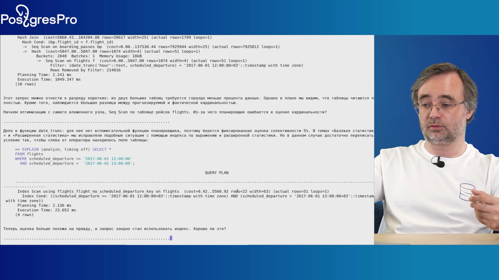


## 7. Типы данных и ограничения целостности

Выбор подходящего типа данных может повлиять на производительность. Хранение целых чисел в типе numeric замедляет работу: арифметические алгоритмы numeric сложнее обычного сложения целых чисел, которое делается простыми командами процессора. Ограничения целостности, помимо обеспечения целостности данных, могут учитываться планировщиком для устранения ненужных соединений, улучшения оценок селективности и других оптимизаций; для проверки CHECK существует constraint_exclusion. Первичный ключ и уникальность реализуются через уникальный индекс; также используются внешний ключ и отсутствие неопределённых значений. Существуют мультидиапазонные типы, которые хорошо работают в некоторых задачах; они позволяют легко записать алгоритмы, которые иначе нужно реализовывать самостоятельно. В PostgreSQL есть составные типы, например массивы и JSON; при проектировании схемы данных их можно использовать вместо создания отдельных таблиц, что позволяет сэкономить на соединениях.

*Источник: [00:33:10], [00:33:30], [00:33:51], [00:34:32]*

> [!quote]- Кадр [00:33:10]
> 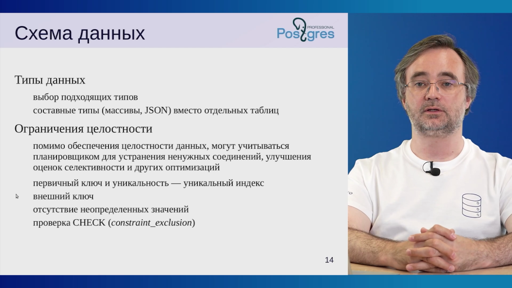

> [!quote]- Кадр [00:33:30]
> 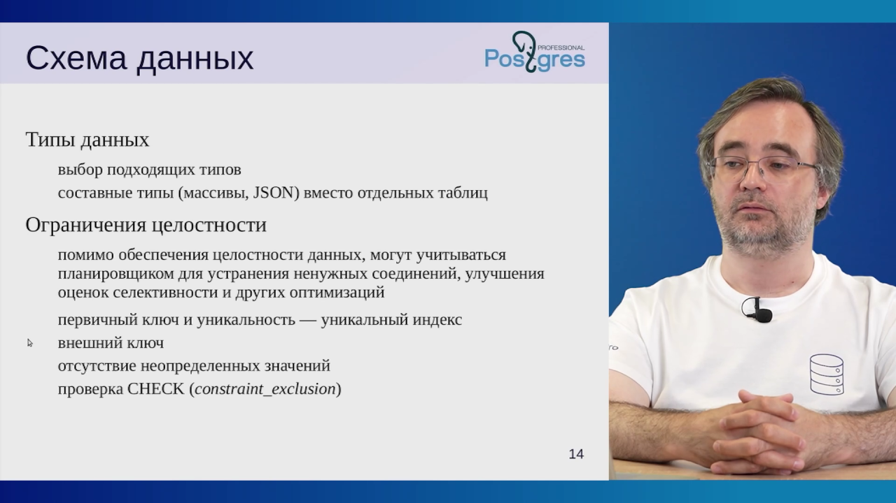

> [!quote]- Кадр [00:34:32]
> 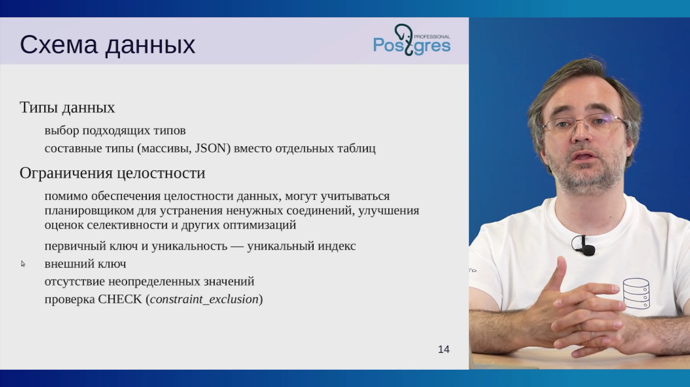

> [!quote]- Кадр [00:33:51]
> 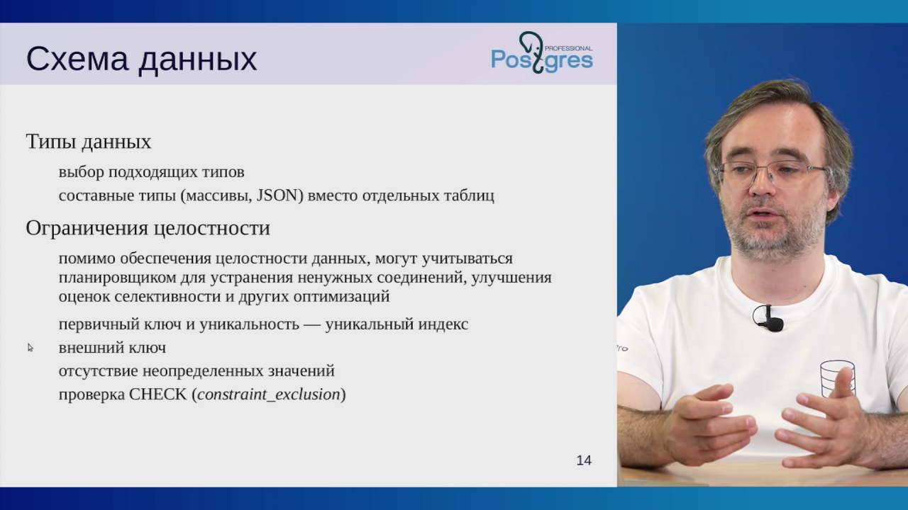

## 8. Физическое расположение данных

Физическое расположение данных может очень сильно влиять на производительность. Табличные пространства — это каталоги, в которых хранятся данные; их можно примонтировать на разные физические устройства, чтобы разнести данные: активно используемые данные размещать на быстрых дисках, а редко используемые — на медленных, более дешёвых и объёмных. Секционирование — это разделение таблицы на отдельные части (секции), которыми можно управлять отдельно; это упрощает администрирование и ускоряет доступ, а при очень больших таблицах позволяет ограничить секскан отдельной секцией. Шардирование — размещение секций на разных серверах для масштабирования нагрузки на чтение и запись; оно реализуется через секционирование и расширение postgres-fdw или сторонние решения. В обычном Postgres шардирование находится в зачаточном состоянии, но есть сторонние решения, например Шардман.

*Источник: [00:07:06], [00:09:54], [00:10:15]*

> [!quote]- Кадр [00:10:15]
> 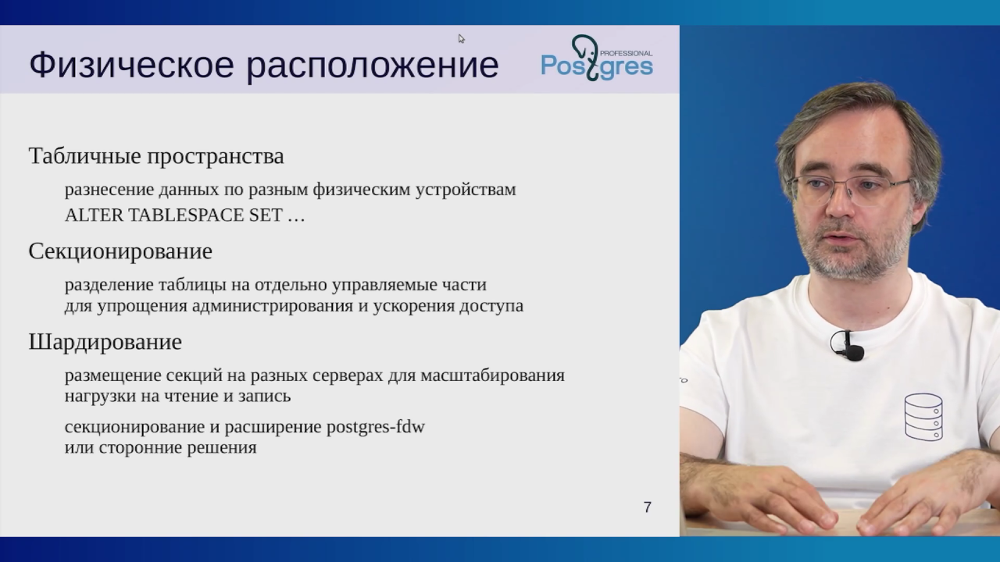

> [!quote]- Кадр [00:09:54]
> 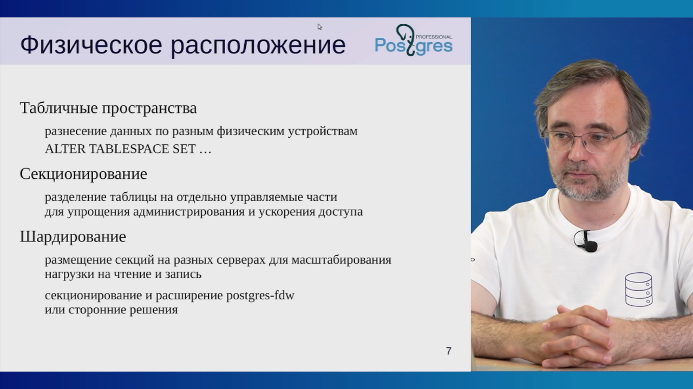

## 9. Нормализация и денормализация

Нормализация — устранение избыточности в данных: одну и ту же информацию не нужно хранить несколько раз; она обеспечивает единственный источник истины и упрощает запросы и проверку согласованности. Денормализация — привнесение избыточности; она может повысить производительность, но требует синхронизации. Способы денормализации: индексы, предрассчитанные поля (генерируемые столбцы или триггеры), материализованные представления, кэширование результатов в приложении. Индексы — пример денормализации, они автоматически синхронизируются СУБД. На физическом уровне хранения денормализация допустима и оправдана для увеличения производительности. Предрассчитанные поля можно создавать как генерируемый столбец (generated always as) — тогда за синхронизацию отвечает СУБД; либо синхронизацию выполняют вручную с помощью триггеров, но вызов триггера в нужный момент также обеспечивает СУБД. В Postgres нет механизма автоматического обновления материализованного представления при изменении данных; такой функционал привносит стороннее расширение. Представление можно обновлять не так часто, если не нужны самые актуальные данные — достаточно среза данных на какой-то момент времени.

| | Нормализация | Денормализация |
|---|---|---|
| Суть | Устранение избыточности | Привнесение избыточности |
| Эффект | Единственный источник истины | Рост производительности, нужна синхронизация |

> [!info] Зачем это нужно
> Приложения создают таблицы и хранят в них данные, поэтому при проектировании нужно обратить внимание на нормализацию.

*Источник: [00:22:42], [00:27:15]*


> [!quote]- Кадр [00:27:15]
> 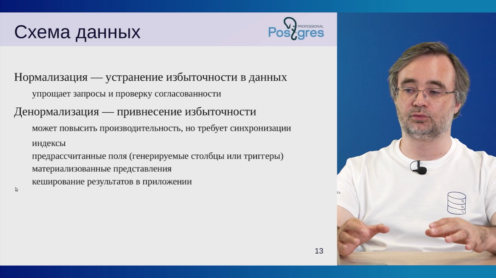

## 10. Пул соединений и курсоры

При множестве сеансов используется пул соединений: чтобы не устанавливать соединение с базой данных повторно каждый раз, пул устанавливает некоторое количество соединений с базой данных. Он позволяет клиентам работать через заранее установленные соединения и экономить ресурсы, однако приносит некоторые сложности для разработки. Курсоры применяются, если нужна не вся большая выборка, а только её часть. Связанный параметр — cursor_tuple_fraction; по умолчанию он равен 1/10 и означает, что предпочтение отдаётся планам, которые быстрее выдают первые строки, а не всю выборку.

*Источник: [00:22:42], [00:23:03]*

> [!quote]- Кадр [00:23:03]
> 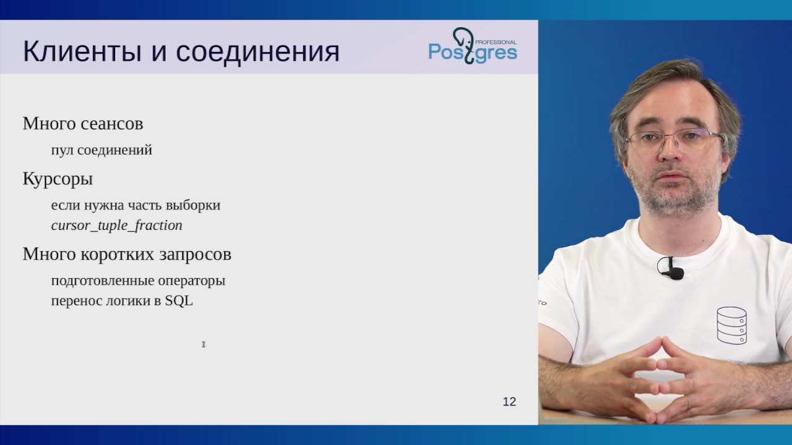


## Схема

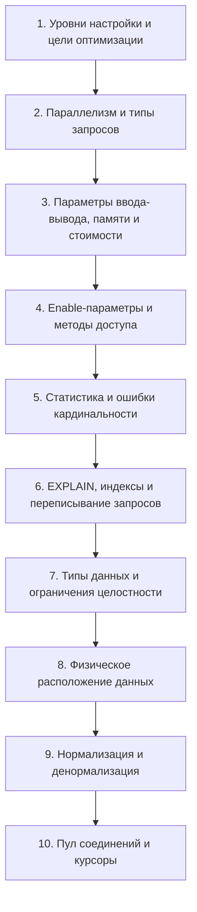

## Итог

> [!success] Что в итоге
> В итоге настройка производительности PostgreSQL охватывает несколько уровней — от железа и операционной системы до СУБД, планировщика и приложения — с целью эффективного использования ресурсов. Ключевые параметры касаются параллелизма, ввода-вывода и памяти: work_mem и shared_buffers по умолчанию малы, а hash_mem_multiplier удваивает память под хэширование. Планировщик опирается на актуальную статистику и ограничения схемы: удаление внешнего ключа и условия с функциями могут приводить к ошибочной кардинальности и неожиданному плану, а оптимизация идёт через анализ EXPLAIN, проверку buffers, переписывание условий и подбор индексов. Влияние на план возможно через enable-параметры и конфигурацию, но готовых рецептов нет — нужен здравый смысл.

